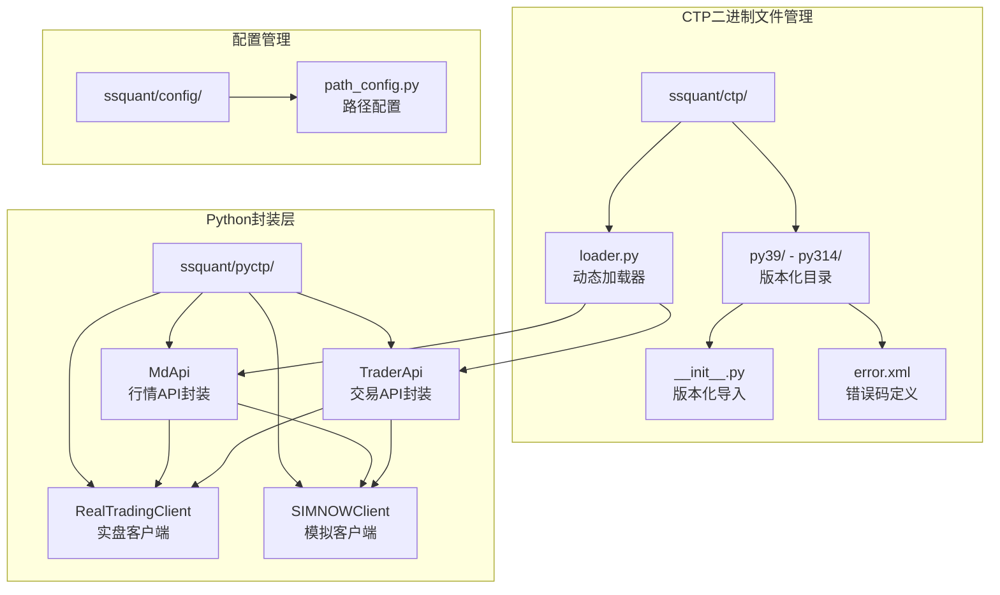
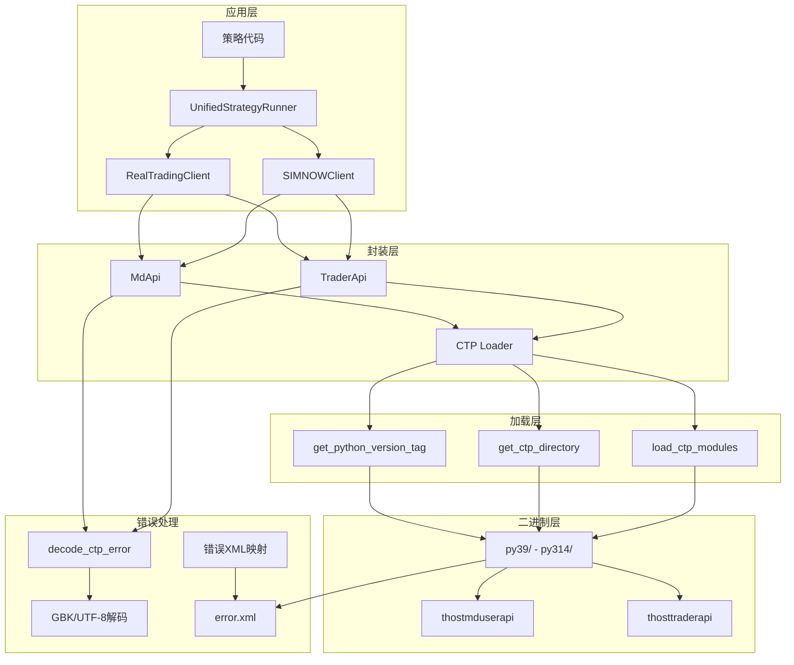
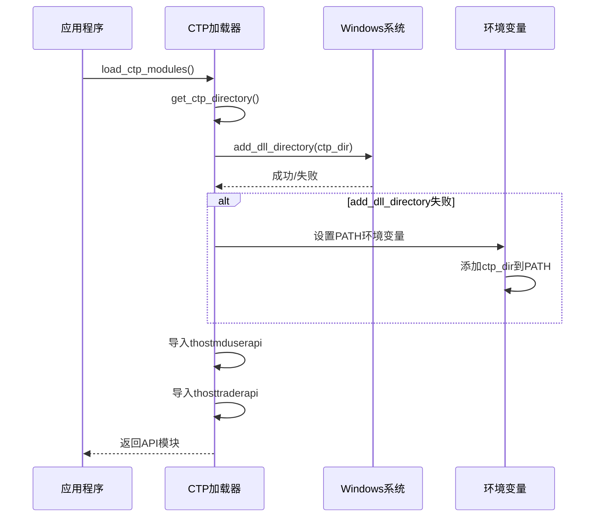
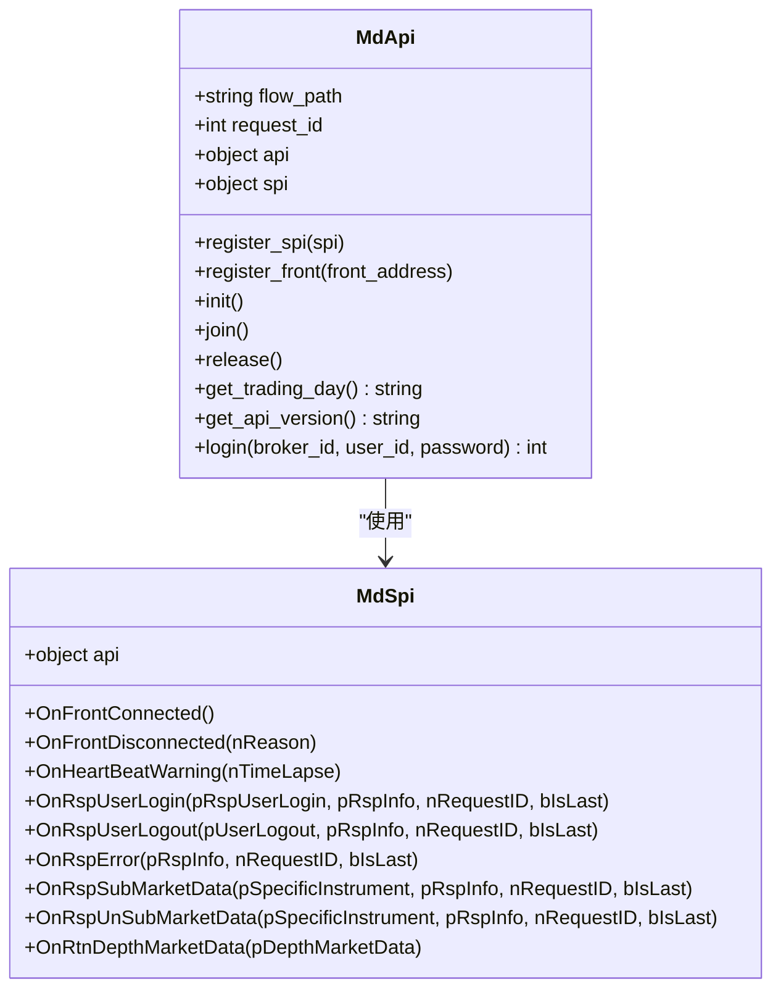
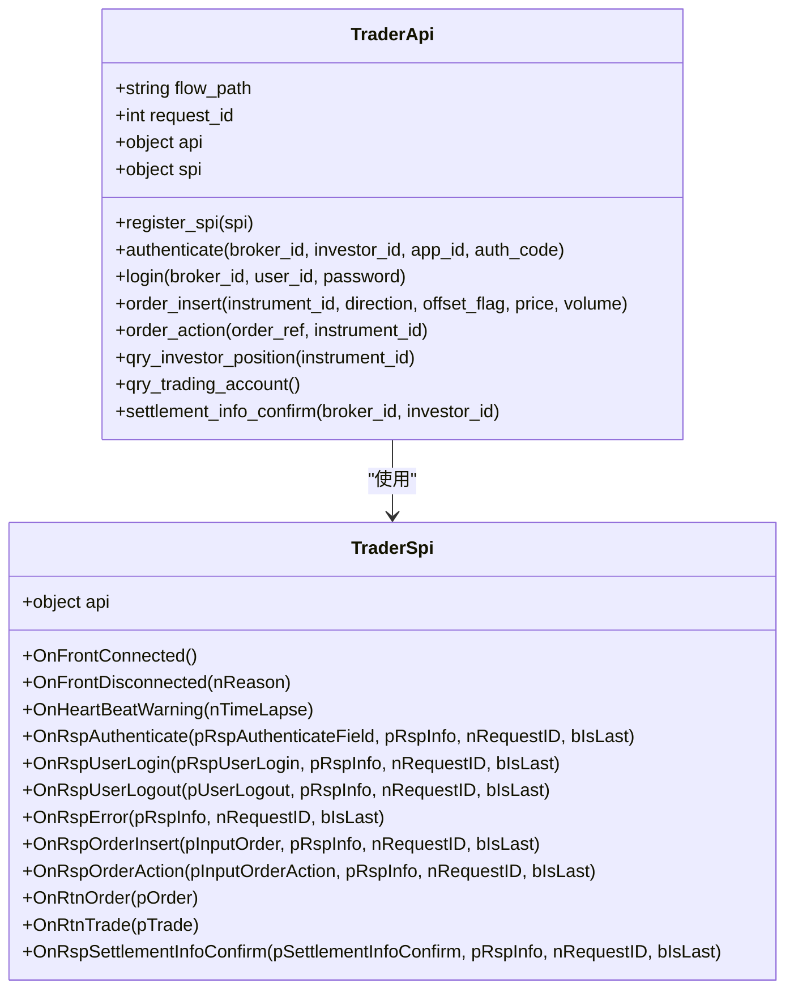
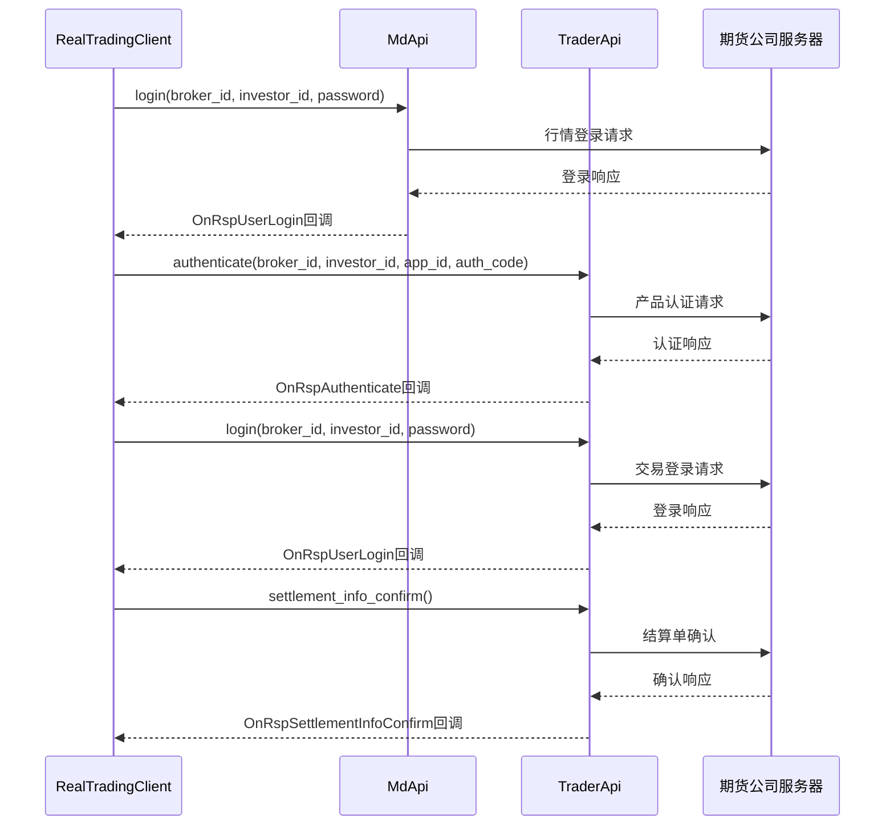
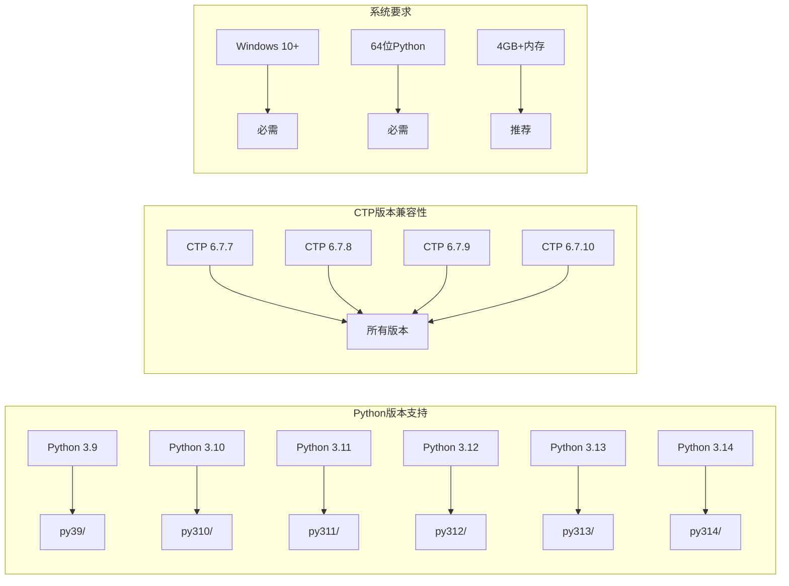
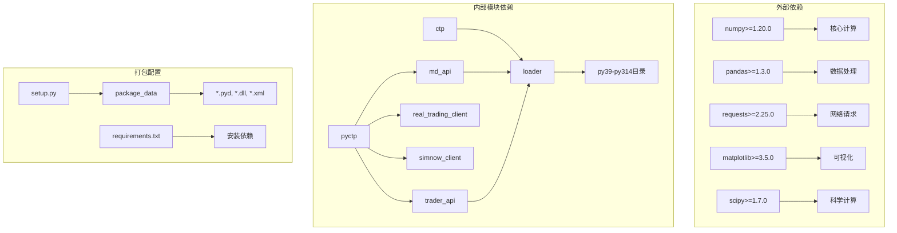
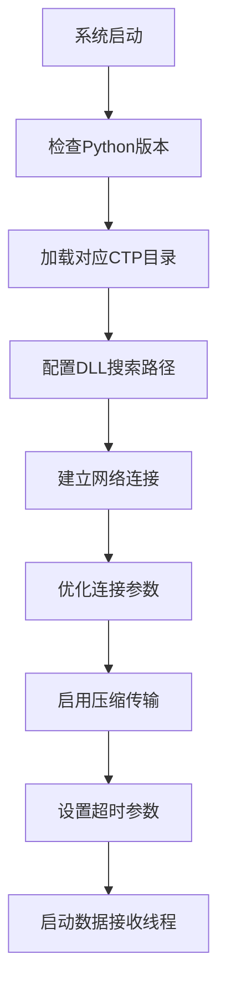
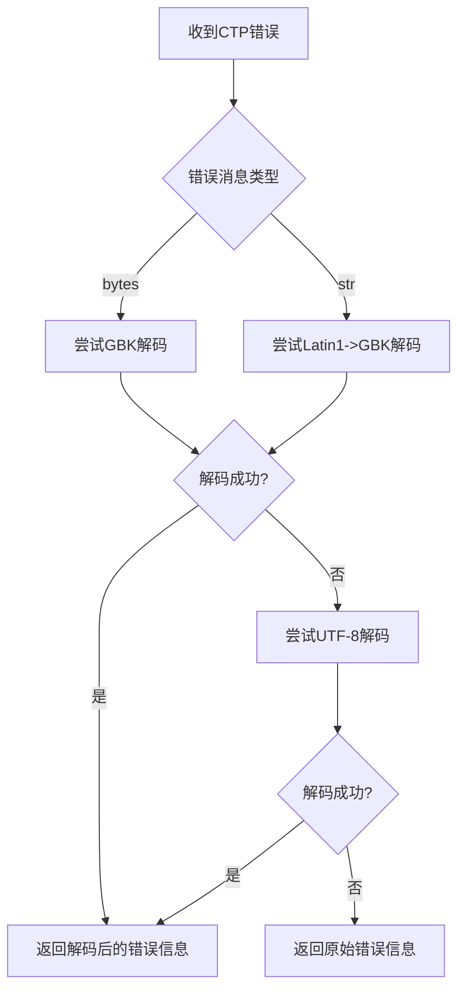

# CTP二进制文件管理

<cite>
**本文档引用的文件**
- [ssquant/ctp/__init__.py](file://ssquant/ctp/__init__.py)
- [ssquant/ctp/loader.py](file://ssquant/ctp/loader.py)
- [ssquant/ctp/py39/__init__.py](file://ssquant/ctp/py39/__init__.py)
- [ssquant/ctp/py310/__init__.py](file://ssquant/ctp/py310/__init__.py)
- [ssquant/ctp/py311/__init__.py](file://ssquant/ctp/py311/__init__.py)
- [ssquant/ctp/py312/__init__.py](file://ssquant/ctp/py312/__init__.py)
- [ssquant/ctp/py313/__init__.py](file://ssquant/ctp/py313/__init__.py)
- [ssquant/ctp/py314/__init__.py](file://ssquant/ctp/py314/__init__.py)
- [ssquant/ctp/py39/error.xml](file://ssquant/ctp/py39/error.xml)
- [ssquant/ctp/py310/error.xml](file://ssquant/ctp/py310/error.xml)
- [ssquant/pyctp/md_api.py](file://ssquant/pyctp/md_api.py)
- [ssquant/pyctp/trader_api.py](file://ssquant/pyctp/trader_api.py)
- [ssquant/pyctp/real_trading_client.py](file://ssquant/pyctp/real_trading_client.py)
- [ssquant/pyctp/simnow_client.py](file://ssquant/pyctp/simnow_client.py)
- [ssquant/config/path_config.py](file://ssquant/config/path_config.py)
- [ssquant/pyctp/__init__.py](file://ssquant/pyctp/__init__.py)
- [README.md](file://README.md)
- [setup.py](file://setup.py)
- [requirements.txt](file://requirements.txt)
</cite>

## 目录
1. [简介](#简介)
2. [项目结构](#项目结构)
3. [核心组件](#核心组件)
4. [架构概览](#架构概览)
5. [详细组件分析](#详细组件分析)
6. [依赖关系分析](#依赖关系分析)
7. [性能考虑](#性能考虑)
8. [故障排除指南](#故障排除指南)
9. [结论](#结论)
10. [附录](#附录)

## 简介

SSQuant项目中的CTP二进制文件管理系统是一个高度模块化的架构，专门设计用于管理不同Python版本的CTP（中国金融期货交易所）二进制接口文件。该系统的核心目标是在Windows平台上实现自动版本检测、动态加载和无缝兼容，为用户提供透明的CTP接口访问能力。

系统支持Python 3.9至3.14版本，每个Python版本都有对应的CTP二进制文件目录，实现了精确的版本匹配和隔离。这种设计确保了不同Python版本之间的独立性和稳定性，避免了版本冲突问题。

## 项目结构

SSQuant项目的CTP相关文件组织遵循清晰的层次结构，主要分布在`ssquant/ctp/`和`ssquant/pyctp/`两个核心目录中：



**图表来源**
- [ssquant/ctp/__init__.py](file://ssquant/ctp/__init__.py#L1-L8)
- [ssquant/ctp/loader.py](file://ssquant/ctp/loader.py#L1-L203)
- [ssquant/pyctp/__init__.py](file://ssquant/pyctp/__init__.py#L1-L26)

**章节来源**
- [ssquant/ctp/__init__.py](file://ssquant/ctp/__init__.py#L1-L8)
- [ssquant/ctp/loader.py](file://ssquant/ctp/loader.py#L1-L203)
- [ssquant/pyctp/__init__.py](file://ssquant/pyctp/__init__.py#L1-L26)

## 核心组件

### CTP动态加载器

CTP动态加载器是整个系统的核心组件，负责自动检测Python版本并加载对应的CTP二进制文件。其主要功能包括：

- **自动版本检测**：通过`get_python_version_tag()`函数获取当前Python版本的标签标识
- **目录结构验证**：确保目标CTP目录存在且包含必要的二进制文件
- **动态模块加载**：使用`load_ctp_modules()`函数动态导入CTP模块
- **错误处理机制**：提供详细的错误信息和回退策略

### 版本化CTP目录结构

系统为每个支持的Python版本维护独立的CTP目录，采用`py{major}{minor}`命名约定：

| Python版本 | 目录名称 | 状态 |
|------------|----------|------|
| 3.9 | `py39/` | ✅ 已包含 |
| 3.10 | `py310/` | ✅ 已包含 |
| 3.11 | `py311/` | ✅ 已包含 |
| 3.12 | `py312/` | ✅ 已包含 |
| 3.13 | `py313/` | ✅ 已包含 |
| 3.14 | `py314/` | ✅ 已包含 |

### Python封装API

系统提供了两层API封装，既保证了底层CTP接口的直接访问，又提供了更高层的易用性：

- **MdApi**：行情数据API封装，处理市场行情订阅和数据接收
- **TraderApi**：交易API封装，处理下单、撤单、查询等功能
- **RealTradingClient**：实盘交易客户端，集成行情和交易功能
- **SIMNOWClient**：SIMNOW模拟交易客户端，提供模拟环境支持

**章节来源**
- [ssquant/ctp/loader.py](file://ssquant/ctp/loader.py#L19-L122)
- [ssquant/ctp/py39/__init__.py](file://ssquant/ctp/py39/__init__.py#L1-L11)
- [ssquant/pyctp/md_api.py](file://ssquant/pyctp/md_api.py#L1-L200)
- [ssquant/pyctp/trader_api.py](file://ssquant/pyctp/trader_api.py#L1-L200)

## 架构概览

SSQuant的CTP系统采用分层架构设计，实现了清晰的关注点分离和模块化组织：



**图表来源**
- [ssquant/ctp/loader.py](file://ssquant/ctp/loader.py#L84-L122)
- [ssquant/pyctp/md_api.py](file://ssquant/pyctp/md_api.py#L27-L42)
- [ssquant/pyctp/trader_api.py](file://ssquant/pyctp/trader_api.py#L27-L42)

系统架构的关键特点：

1. **透明加载**：应用层无需关心具体的CTP版本细节
2. **版本隔离**：每个Python版本的CTP文件相互独立
3. **错误解码**：统一处理CTP错误消息的编码问题
4. **动态配置**：运行时根据Python版本动态选择合适的CTP文件

## 详细组件分析

### CTP动态加载器详细分析

#### 自动版本检测机制

```mermaid
flowchart TD
A[启动系统] --> B[get_python_version_tag]
B --> C[提取Python主版本号]
C --> D[提取Python次版本号]
D --> E[生成版本标签<br/>格式: py{major}{minor}]
E --> F[构建CTP目录路径<br/>ssquant/ctp/py{major}{minor}]
F --> G[验证目录存在性]
G --> H{目录存在?}
H --> |是| I[返回CTP目录路径]
H --> |否| J[列出可用版本]
J --> K[生成错误信息]
K --> L[抛出RuntimeError]
```

**图表来源**
- [ssquant/ctp/loader.py](file://ssquant/ctp/loader.py#L19-L81)

#### Windows平台特定的DLL管理

系统针对Windows平台实现了专门的DLL目录管理策略：



**图表来源**
- [ssquant/ctp/loader.py](file://ssquant/ctp/loader.py#L103-L112)

#### Python版本标签生成

版本标签生成遵循简单的命名约定，确保与目录结构的一致性：

| Python版本 | 版本标签 | 目录路径 |
|------------|----------|----------|
| 3.9 | py39 | ssquant/ctp/py39/ |
| 3.10 | py310 | ssquant/ctp/py310/ |
| 3.11 | py311 | ssquant/ctp/py311/ |
| 3.12 | py312 | ssquant/ctp/py312/ |
| 3.13 | py313 | ssquant/ctp/py313/ |
| 3.14 | py314 | ssquant/ctp/py314/ |

### Python封装API详细分析

#### MdApi（行情API）组件

MdApi提供了完整的CTP行情接口封装，包括：

- **回调接口管理**：通过`MdSpi`基类处理各种行情事件
- **连接管理**：支持前置机注册和连接建立
- **数据订阅**：支持多合约订阅和批量管理
- **错误处理**：统一的错误解码和处理机制



**图表来源**
- [ssquant/pyctp/md_api.py](file://ssquant/pyctp/md_api.py#L130-L184)
- [ssquant/pyctp/md_api.py](file://ssquant/pyctp/md_api.py#L45-L128)

#### TraderApi（交易API）组件

TraderApi提供了完整的CTP交易接口封装，包括：

- **认证管理**：支持产品认证和用户登录流程
- **订单管理**：支持报单录入、撤单操作和状态查询
- **账户管理**：支持资金查询、持仓查询和结算确认
- **回调处理**：完整的交易事件回调机制



**图表来源**
- [ssquant/pyctp/trader_api.py](file://ssquant/pyctp/trader_api.py#L188-L250)
- [ssquant/pyctp/trader_api.py](file://ssquant/pyctp/trader_api.py#L45-L179)

### 实盘交易客户端分析

RealTradingClient整合了行情和交易功能，提供了完整的实盘交易解决方案：



**图表来源**
- [ssquant/pyctp/real_trading_client.py](file://ssquant/pyctp/real_trading_client.py#L129-L196)

**章节来源**
- [ssquant/ctp/loader.py](file://ssquant/ctp/loader.py#L84-L122)
- [ssquant/pyctp/md_api.py](file://ssquant/pyctp/md_api.py#L1-L200)
- [ssquant/pyctp/trader_api.py](file://ssquant/pyctp/trader_api.py#L1-L200)
- [ssquant/pyctp/real_trading_client.py](file://ssquant/pyctp/real_trading_client.py#L1-L200)

## 依赖关系分析

### Python版本支持矩阵

系统支持的Python版本和对应的CTP目录结构如下：



**图表来源**
- [README.md](file://README.md#L377-L389)
- [setup.py](file://setup.py#L59-L60)

### 依赖关系图



**图表来源**
- [requirements.txt](file://requirements.txt#L1-L16)
- [setup.py](file://setup.py#L42-L54)

**章节来源**
- [README.md](file://README.md#L377-L389)
- [setup.py](file://setup.py#L42-L54)
- [requirements.txt](file://requirements.txt#L1-L16)

## 性能考虑

### 内存管理策略

系统在CTP接口使用中采用了多项内存管理策略：

1. **延迟加载**：CTP模块仅在需要时才进行动态加载
2. **资源清理**：提供`release()`方法用于API资源的显式释放
3. **连接池管理**：合理管理前置机连接，避免资源泄露
4. **数据缓冲**：通过流文件机制管理大量行情数据

### 网络性能优化



### 错误恢复机制

系统实现了多层次的错误恢复机制：

1. **连接重连**：自动检测连接断开并尝试重新连接
2. **数据重传**：支持未确认数据的重新传输
3. **状态同步**：在重连后自动同步交易状态
4. **降级模式**：在部分功能不可用时提供降级支持

## 故障排除指南

### 常见问题诊断

#### Python版本不匹配

**症状**：系统提示找不到对应版本的CTP文件

**解决方案**：
1. 检查Python版本：`python --version`
2. 验证CTP目录存在：检查`ssquant/ctp/py{major}{minor}/`目录
3. 重新安装：使用正确的Python版本重新安装SSQuant

#### DLL加载失败

**症状**：导入CTP模块时报DLL加载错误

**解决方案**：
1. 检查系统架构：确保使用64位Python
2. 验证PATH环境变量：确认CTP目录已添加到PATH
3. 权限检查：确保应用程序具有足够的文件访问权限

#### 网络连接问题

**症状**：无法连接到期货公司服务器

**解决方案**：
1. 检查防火墙设置：确保相关端口未被阻止
2. 验证服务器地址：确认前置机地址和端口正确
3. 网络诊断：使用ping和telnet测试网络连通性

### 错误码解码

系统提供了完整的CTP错误码解码功能，支持GBK和UTF-8编码：



**图表来源**
- [ssquant/pyctp/md_api.py](file://ssquant/pyctp/md_api.py#L27-L42)
- [ssquant/pyctp/trader_api.py](file://ssquant/pyctp/trader_api.py#L27-L42)

### 调试工具

系统提供了多种调试工具和诊断功能：

1. **状态查询**：使用`get_ctp_info()`获取当前CTP状态
2. **日志输出**：详细的连接和操作日志
3. **错误追踪**：完整的异常堆栈信息
4. **性能监控**：连接状态和数据传输统计

**章节来源**
- [ssquant/ctp/loader.py](file://ssquant/ctp/loader.py#L124-L148)
- [ssquant/pyctp/md_api.py](file://ssquant/pyctp/md_api.py#L27-L42)
- [ssquant/pyctp/trader_api.py](file://ssquant/pyctp/trader_api.py#L27-L42)

## 结论

SSQuant的CTP二进制文件管理系统展现了优秀的软件工程实践，通过模块化设计、版本隔离和自动化管理实现了高度的可靠性和易用性。

### 主要优势

1. **透明性**：应用层无需关心底层CTP版本细节
2. **可扩展性**：支持新的Python版本和CTP版本
3. **稳定性**：完善的错误处理和回退机制
4. **兼容性**：跨多个Python版本的稳定支持

### 技术创新

1. **智能版本检测**：自动识别和匹配Python版本
2. **动态加载机制**：运行时动态加载CTP模块
3. **统一错误处理**：标准化的错误解码和处理流程
4. **多环境支持**：同时支持实盘、模拟和回测环境

该系统为量化交易开发者提供了一个强大而灵活的基础平台，简化了CTP接口的复杂性，使开发者能够专注于策略开发而非底层技术细节。

## 附录

### 安装指南

#### 系统要求

- **操作系统**：Windows 10+（⚠️ 目前仅支持 Windows）
- **Python版本**：3.9 ~ 3.14
- **内存**：4GB+
- **架构**：64位Python

#### 安装步骤

1. **安装Python**：确保安装了支持的Python版本
2. **安装SSQuant**：使用pip安装或从源码安装
3. **配置账户**：设置SIMNOW或实盘账户信息
4. **验证安装**：运行示例策略测试系统功能

### 版本支持矩阵

| Python版本 | CTP版本 | 目录 | 状态 |
|------------|---------|------|------|
| 3.9 | 6.7.7-6.7.10 | py39/ | ✅ 已包含 |
| 3.10 | 6.7.7-6.7.10 | py310/ | ✅ 已包含 |
| 3.11 | 6.7.7-6.7.10 | py311/ | ✅ 已包含 |
| 3.12 | 6.7.7-6.7.10 | py312/ | ✅ 已包含 |
| 3.13 | 6.7.7-6.7.10 | py313/ | ✅ 已包含 |
| 3.14 | 6.7.7-6.7.10 | py314/ | ✅ 已包含 |

### 最佳实践建议

1. **版本管理**：使用虚拟环境隔离不同Python版本
2. **错误处理**：实现完善的异常捕获和错误恢复
3. **资源管理**：及时释放CTP API资源，避免内存泄漏
4. **监控告警**：建立连接状态和交易活动的监控机制
5. **数据备份**：定期备份重要的交易数据和配置信息