# CTP接口封装设计

<cite>
**本文档引用的文件**
- [__init__.py](file://ssquant/pyctp/__init__.py)
- [md_api.py](file://ssquant/pyctp/md_api.py)
- [trader_api.py](file://ssquant/pyctp/trader_api.py)
- [real_trading_client.py](file://ssquant/pyctp/real_trading_client.py)
- [simnow_client.py](file://ssquant/pyctp/simnow_client.py)
- [simnow_config.py](file://ssquant/pyctp/simnow_config.py)
- [loader.py](file://ssquant/ctp/loader.py)
- [README.md](file://README.md)
</cite>

## 目录
1. [简介](#简介)
2. [项目结构](#项目结构)
3. [核心组件](#核心组件)
4. [架构概览](#架构概览)
5. [详细组件分析](#详细组件分析)
6. [依赖关系分析](#依赖关系分析)
7. [性能考虑](#性能考虑)
8. [故障排除指南](#故障排除指南)
9. [结论](#结论)

## 简介

SSQuant项目中的CTP接口封装设计旨在为期货交易提供统一、易用的Python接口。该设计通过抽象化CTP的复杂性，提供了简洁的API接口，支持行情数据获取、交易指令执行、实时回调通知等功能。项目特别针对中国期货市场的特点，实现了SIMNOW模拟交易和实盘交易的无缝切换。

## 项目结构

SSQuant的CTP接口封装采用模块化设计，主要包含以下核心模块：

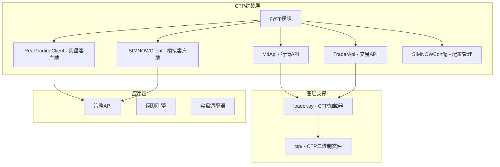

**图表来源**
- [__init__.py](file://ssquant/pyctp/__init__.py#L1-L26)
- [loader.py](file://ssquant/ctp/loader.py#L1-L203)

**章节来源**
- [__init__.py](file://ssquant/pyctp/__init__.py#L1-L26)
- [README.md](file://README.md#L297-L321)

## 核心组件

### CTP动态加载器

CTP动态加载器是整个封装系统的基础，负责根据Python版本自动加载对应的CTP二进制文件：

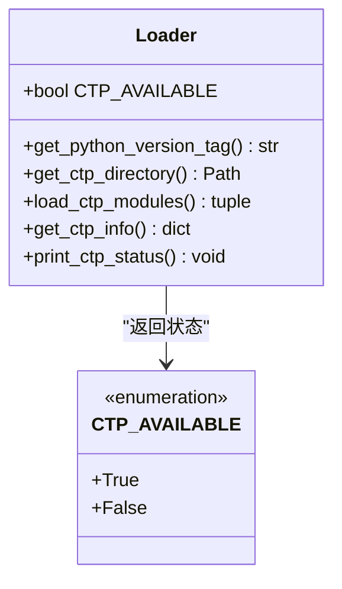

**图表来源**
- [loader.py](file://ssquant/ctp/loader.py#L12-L188)

### 行情API封装

MdApi类提供了简化的CTP行情接口，支持多合约订阅、深度行情数据获取等功能：

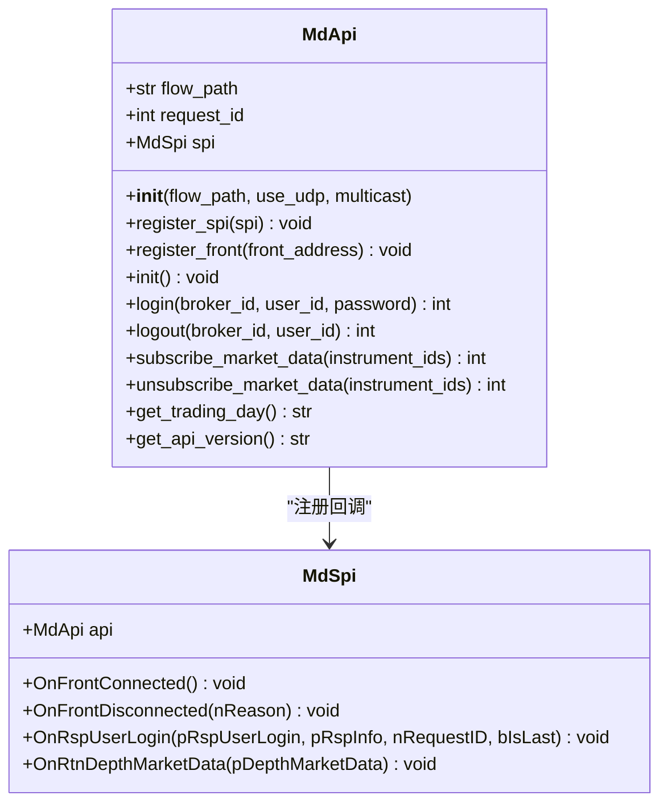

**图表来源**
- [md_api.py](file://ssquant/pyctp/md_api.py#L130-L261)

### 交易API封装

TraderApi类提供了简化的CTP交易接口，支持报单、撤单、查询等功能：

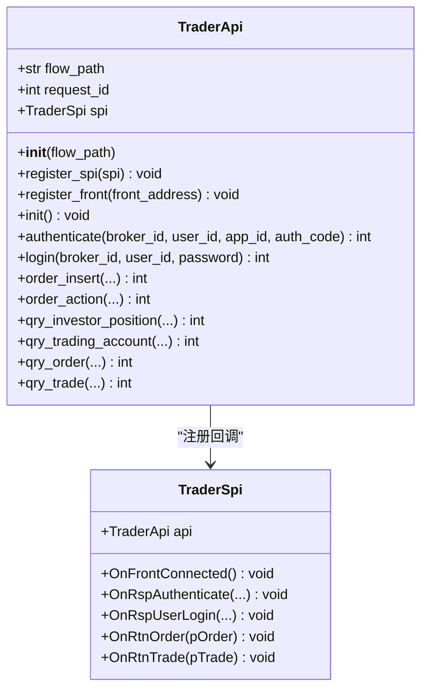

**图表来源**
- [trader_api.py](file://ssquant/pyctp/trader_api.py#L188-L483)

## 架构概览

SSQuant的CTP接口封装采用了分层架构设计，实现了清晰的关注点分离：

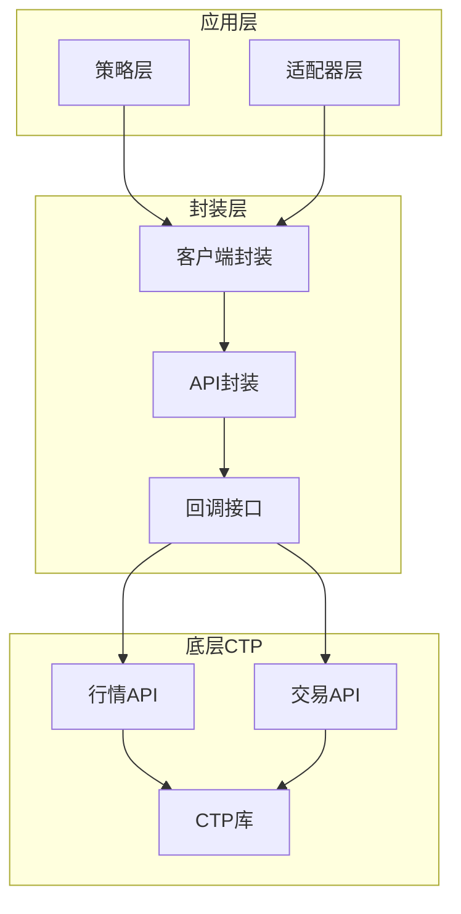

**图表来源**
- [real_trading_client.py](file://ssquant/pyctp/real_trading_client.py#L538-L755)
- [simnow_client.py](file://ssquant/pyctp/simnow_client.py#L590-L815)

## 详细组件分析

### 实盘交易客户端 RealTradingClient

RealTradingClient是实盘交易的核心封装，提供了完整的交易生命周期管理：

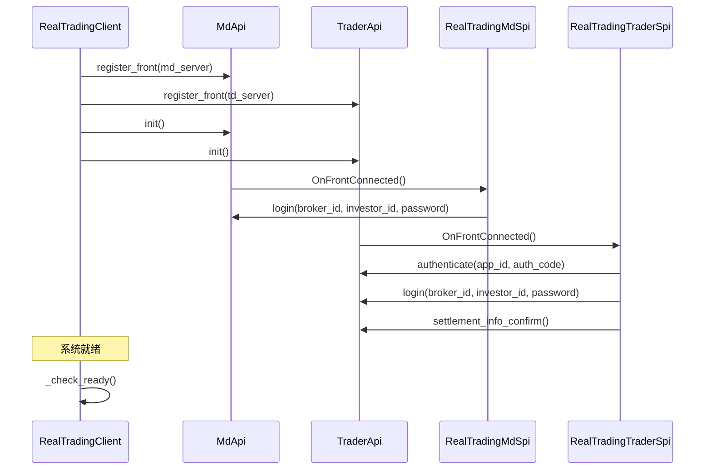

**图表来源**
- [real_trading_client.py](file://ssquant/pyctp/real_trading_client.py#L631-L658)

#### 事件驱动架构

RealTradingClient实现了完整的事件驱动架构，通过回调机制处理各种交易事件：

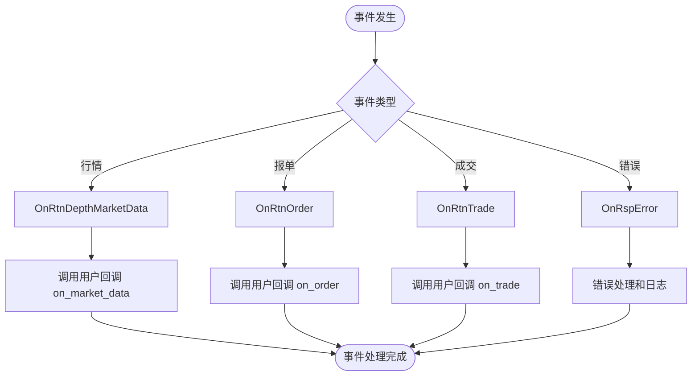

**图表来源**
- [real_trading_client.py](file://ssquant/pyctp/real_trading_client.py#L62-L112)

#### 智能重试机制

RealTradingClient实现了智能重试机制，特别是针对平今仓不足的情况：

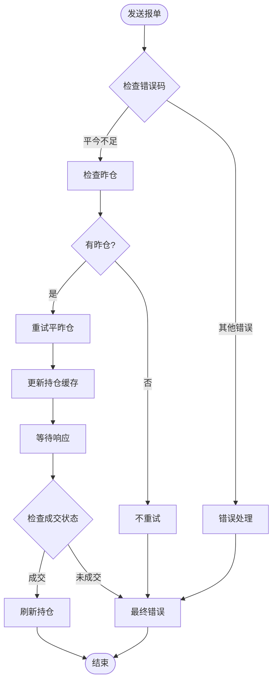

**图表来源**
- [real_trading_client.py](file://ssquant/pyctp/real_trading_client.py#L286-L317)

### SIMNOW模拟客户端

SIMNOWClient提供了完整的模拟交易功能，支持多种服务器配置：

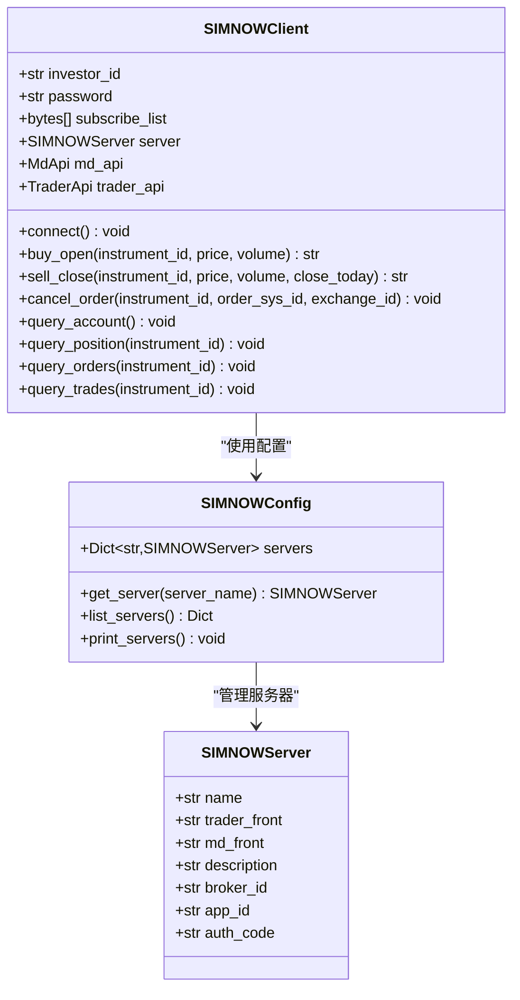

**图表来源**
- [simnow_client.py](file://ssquant/pyctp/simnow_client.py#L590-L815)
- [simnow_config.py](file://ssquant/pyctp/simnow_config.py#L12-L160)

#### 多服务器支持

SIMNOWClient支持多种服务器配置，包括电信、移动、TEST等多种线路：

| 服务器名称 | 交易前置 | 行情前置 | 描述 |
|------------|----------|----------|------|
| 电信1 | tcp://182.254.243.31:30001 | tcp://182.254.243.31:30011 | 电信线路1服务器 |
| 电信2 | tcp://182.254.243.31:30002 | tcp://182.254.243.31:30012 | 电信线路2服务器 |
| 移动 | tcp://218.202.237.33:10203 | tcp://218.202.237.33:10213 | 移动线路服务器 |
| TEST | tcp://182.254.243.31:40001 | tcp://182.254.243.31:40011 | TEST服务器 |
| N视界 | tcp://210.14.72.12:4600 | tcp://210.14.72.12:4602 | N视界服务器 |
| 24hour | tcp://180.168.146.187:10130 | tcp://180.168.146.187:10131 | 7x24小时连续交易环境 |

**章节来源**
- [simnow_config.py](file://ssquant/pyctp/simnow_config.py#L24-L125)

### 回调机制实现

两个客户端都实现了相似的回调机制，但各有特色：

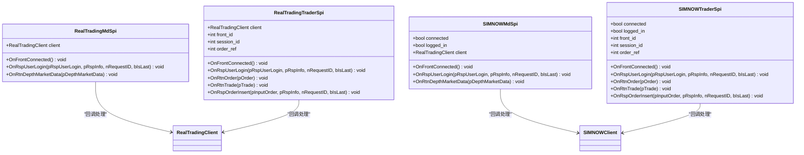

**图表来源**
- [real_trading_client.py](file://ssquant/pyctp/real_trading_client.py#L18-L112)
- [simnow_client.py](file://ssquant/pyctp/simnow_client.py#L19-L132)

## 依赖关系分析

CTP接口封装的设计遵循了良好的依赖关系原则，实现了低耦合高内聚：

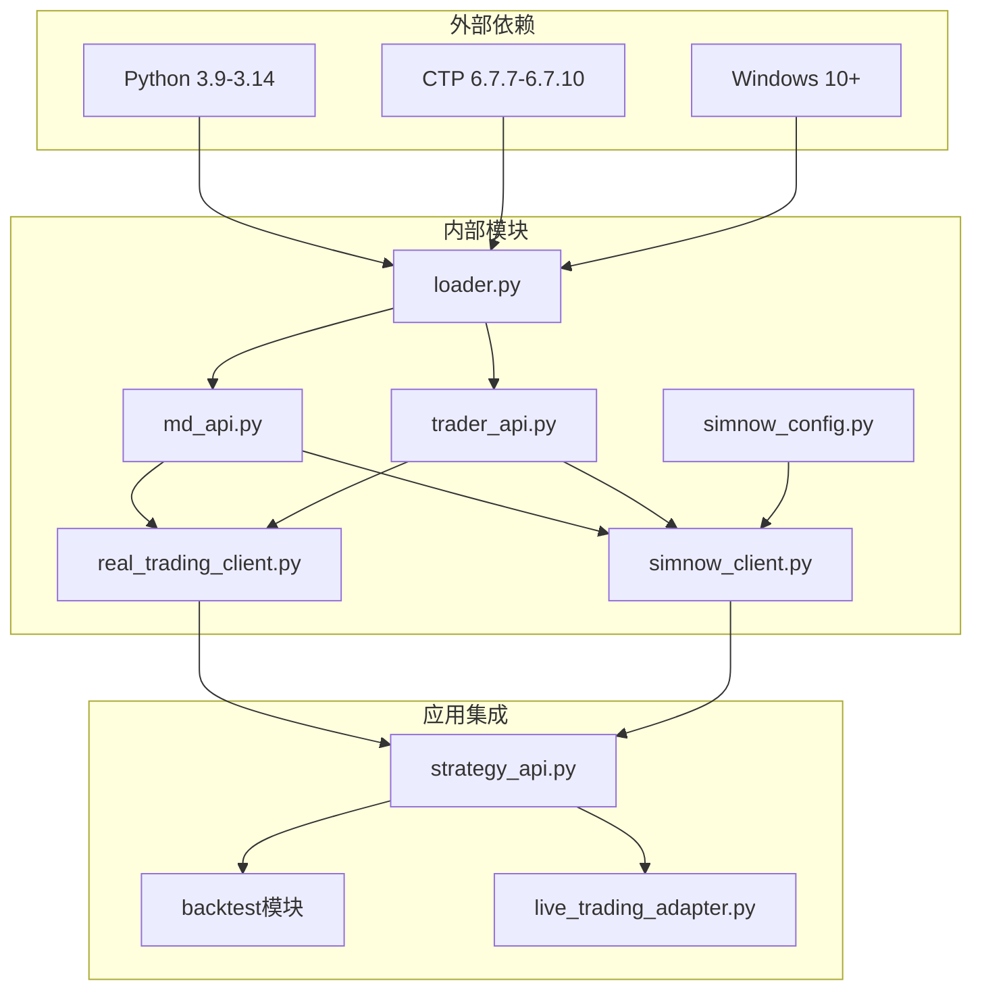

**图表来源**
- [loader.py](file://ssquant/ctp/loader.py#L1-L203)
- [__init__.py](file://ssquant/pyctp/__init__.py#L1-L26)

### 组件耦合度分析

- **低耦合**: 各模块之间通过清晰的接口进行交互，减少了直接依赖
- **高内聚**: 每个模块专注于特定的功能领域，职责单一
- **可扩展性**: 新增功能时不需要修改现有代码，符合开闭原则

**章节来源**
- [loader.py](file://ssquant/ctp/loader.py#L172-L188)
- [README.md](file://README.md#L377-L389)

## 性能考虑

### 内存管理

CTP接口封装采用了高效的内存管理模式：

1. **流文件管理**: 自动创建和管理流文件目录，避免内存泄漏
2. **对象池**: 复用API对象，减少频繁创建销毁的开销
3. **异步处理**: 通过回调机制实现非阻塞操作

### 网络优化

1. **连接复用**: 同一客户端实例复用连接，减少握手开销
2. **批量订阅**: 支持批量合约订阅，提高效率
3. **心跳监控**: 实现心跳检测，及时发现网络问题

### 错误处理优化

1. **多编码支持**: 支持GBK、GB18030、UTF-8等多种编码解码
2. **错误分类**: 将错误分为网络错误、业务错误、系统错误等类别
3. **重试策略**: 对可恢复的错误实现智能重试

## 故障排除指南

### 常见问题及解决方案

#### CTP模块加载失败

**问题**: ImportError: CTP模块不可用

**原因**:
1. Python版本不支持
2. 系统架构不匹配
3. CTP文件缺失

**解决方案**:
1. 检查Python版本是否在支持范围内
2. 确认系统为64位Windows
3. 验证CTP文件是否正确放置

#### 连接超时

**问题**: 连接超时或登录失败

**原因**:
1. 网络不稳定
2. 服务器地址错误
3. 账号权限问题

**解决方案**:
1. 检查网络连接稳定性
2. 验证服务器地址格式
3. 确认账号信息正确性

#### 行情数据异常

**问题**: 行情数据不完整或延迟

**原因**:
1. 订阅合约过多
2. 网络带宽不足
3. 服务器负载过高

**解决方案**:
1. 优化订阅合约数量
2. 检查网络带宽
3. 选择合适的服务器节点

**章节来源**
- [loader.py](file://ssquant/ctp/loader.py#L36-L81)
- [real_trading_client.py](file://ssquant/pyctp/real_trading_client.py#L649-L653)

## 结论

SSQuant的CTP接口封装设计体现了优秀的软件工程实践，通过模块化设计、事件驱动架构和智能重试机制，为期货交易提供了稳定可靠的Python接口。该设计不仅简化了CTP的复杂性，还提供了丰富的功能特性，包括：

1. **统一接口**: 为不同环境提供一致的API体验
2. **事件驱动**: 通过回调机制实现实时响应
3. **智能重试**: 针对业务场景的智能化错误处理
4. **多服务器支持**: 灵活的服务器配置和切换能力
5. **性能优化**: 高效的内存管理和网络优化

该封装设计为量化交易开发者提供了坚实的基础，使得复杂的期货交易逻辑得以简化，提高了开发效率和系统的稳定性。