# CTP接口集成

<cite>
**本文档引用的文件**
- [ssquant/ctp/__init__.py](file://ssquant/ctp/__init__.py)
- [ssquant/ctp/loader.py](file://ssquant/ctp/loader.py)
- [ssquant/pyctp/__init__.py](file://ssquant/pyctp/__init__.py)
- [ssquant/pyctp/md_api.py](file://ssquant/pyctp/md_api.py)
- [ssquant/pyctp/trader_api.py](file://ssquant/pyctp/trader_api.py)
- [ssquant/pyctp/simnow_client.py](file://ssquant/pyctp/simnow_client.py)
- [ssquant/pyctp/simnow_config.py](file://ssquant/pyctp/simnow_config.py)
- [ssquant/pyctp/real_trading_client.py](file://ssquant/pyctp/real_trading_client.py)
- [ssquant/ctp/py39/error.xml](file://ssquant/ctp/py39/error.xml)
- [ssquant/ctp/py310/error.xml](file://ssquant/ctp/py310/error.xml)
- [ssquant/ctp/py311/error.xml](file://ssquant/ctp/py311/error.xml)
- [ssquant/ctp/py312/error.xml](file://ssquant/ctp/py312/error.xml)
- [ssquant/ctp/py313/error.xml](file://ssquant/ctp/py313/error.xml)
- [ssquant/ctp/py314/error.xml](file://ssquant/ctp/py314/error.xml)
- [README.md](file://README.md)
</cite>

## 更新摘要
**变更内容**
- 新增Python 3.9-3.14多版本客户端支持
- 改进错误处理和异常恢复机制
- 增强实盘客户端连接稳定性和成交稳定性
- 支持Windows和Linux跨平台部署
- 优化SIMNOW模拟交易客户端功能

## 目录
1. [简介](#简介)
2. [项目结构](#项目结构)
3. [核心组件](#核心组件)
4. [架构概览](#架构概览)
5. [详细组件分析](#详细组件分析)
6. [依赖关系分析](#依赖关系分析)
7. [性能考虑](#性能考虑)
8. [故障排除指南](#故障排除指南)
9. [结论](#结论)

## 简介

SSQuant CTP接口集成为期货量化交易提供了完整的CTP（中国金融期货交易所）接口解决方案。该系统支持Python 3.9至3.14版本，提供多Python版本支持和跨平台兼容性，包括SIMNOW模拟交易和实盘CTP交易功能。

**更新** 新增Python 3.9-3.14多版本客户端支持，改进错误处理机制，增强实盘客户端连接稳定性。

该接口集成的核心目标是：
- 提供统一的API接口，支持回测、SIMNOW模拟和实盘交易三种运行模式
- 实现CTP二进制文件的动态加载和版本管理
- 提供完善的错误处理和异常恢复机制
- 支持高性能的行情数据接收和交易执行
- 实现跨平台（Windows/Linux）兼容性

## 项目结构

SSQuant CTP接口集成采用模块化设计，主要包含以下核心目录结构：

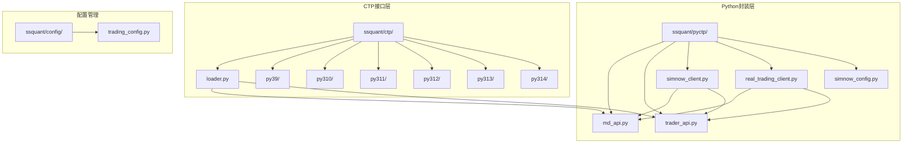

**图表来源**
- [ssquant/ctp/__init__.py](file://ssquant/ctp/__init__.py#L1-L8)
- [ssquant/pyctp/__init__.py](file://ssquant/pyctp/__init__.py#L1-L26)

**章节来源**
- [ssquant/ctp/__init__.py](file://ssquant/ctp/__init__.py#L1-L8)
- [ssquant/pyctp/__init__.py](file://ssquant/pyctp/__init__.py#L1-L26)
- [README.md](file://README.md#L297-L321)

## 核心组件

### CTP动态加载器

CTP动态加载器是整个接口集成的核心组件，负责根据当前Python版本自动加载对应的CTP二进制文件。

**主要功能**：
- Python版本检测和匹配（支持3.9-3.14）
- CTP二进制文件的动态加载
- 系统兼容性检查（Windows 64位和Linux）
- 错误信息的详细报告

**更新** 新增Linux平台支持，改进版本检测机制，增强错误处理能力。

### Python CTP API封装

Python CTP API封装提供了更友好的Python接口，包括：

**行情API封装** (`MdApi`)：
- 行情数据订阅和取消订阅
- 登录和登出功能
- 市场数据处理和回调

**交易API封装** (`TraderApi`)：
- 交易指令发送和撤单
- 账户信息查询
- 持仓和资金管理
- 订单状态跟踪

### 客户端管理

**SIMNOW客户端** (`SIMNOWClient`)：
- 支持多家SIMNOW服务器
- 自动化交易流程
- 错误处理和重试机制
- **新增** 改进的回调异常处理机制

**实盘客户端** (`RealTradingClient`)：
- 直接连接期货公司实盘环境
- 完整的交易功能支持
- 高级错误处理和恢复
- **更新** 增强连接稳定性和成交稳定性

**章节来源**
- [ssquant/ctp/loader.py](file://ssquant/ctp/loader.py#L1-L238)
- [ssquant/pyctp/md_api.py](file://ssquant/pyctp/md_api.py#L1-L261)
- [ssquant/pyctp/trader_api.py](file://ssquant/pyctp/trader_api.py#L1-L574)
- [ssquant/pyctp/simnow_client.py](file://ssquant/pyctp/simnow_client.py#L1-L1071)
- [ssquant/pyctp/real_trading_client.py](file://ssquant/pyctp/real_trading_client.py#L1-L1108)

## 架构概览

SSQuant CTP接口集成采用分层架构设计，确保了良好的模块化和可维护性：

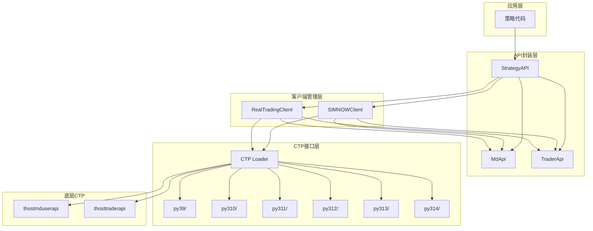

**图表来源**
- [ssquant/ctp/loader.py](file://ssquant/ctp/loader.py#L172-L188)
- [ssquant/pyctp/__init__.py](file://ssquant/pyctp/__init__.py#L17-L25)

### 多Python版本支持机制

系统通过版本化的CTP文件目录实现多Python版本支持：

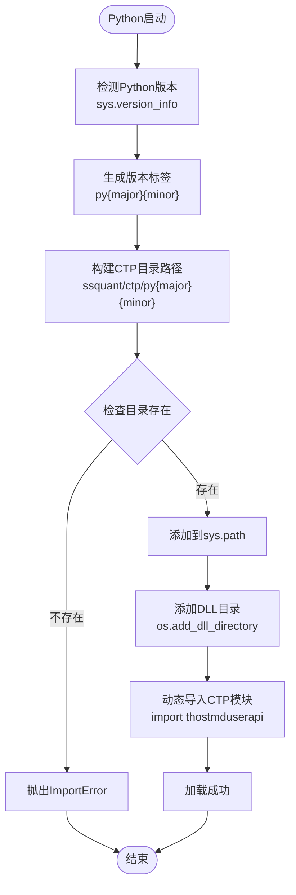

**图表来源**
- [ssquant/ctp/loader.py](file://ssquant/ctp/loader.py#L19-L81)

**章节来源**
- [ssquant/ctp/loader.py](file://ssquant/ctp/loader.py#L19-L122)

## 详细组件分析

### CTP动态加载器详细分析

CTP动态加载器实现了复杂的版本匹配和错误处理机制：

#### 关键特性

**版本检测**：
- 自动获取Python主版本和次版本
- 生成对应的版本标签（如py39、py310等）
- 验证系统兼容性（Windows 64位和Linux）

**错误处理**：
- 详细的错误信息报告
- 支持的Python版本列表显示
- 解决方案指导

**动态加载**：
- 自动添加CTP目录到Python路径
- Windows系统DLL目录配置
- Linux平台SO库预加载
- 模块导入和初始化

#### 加载流程

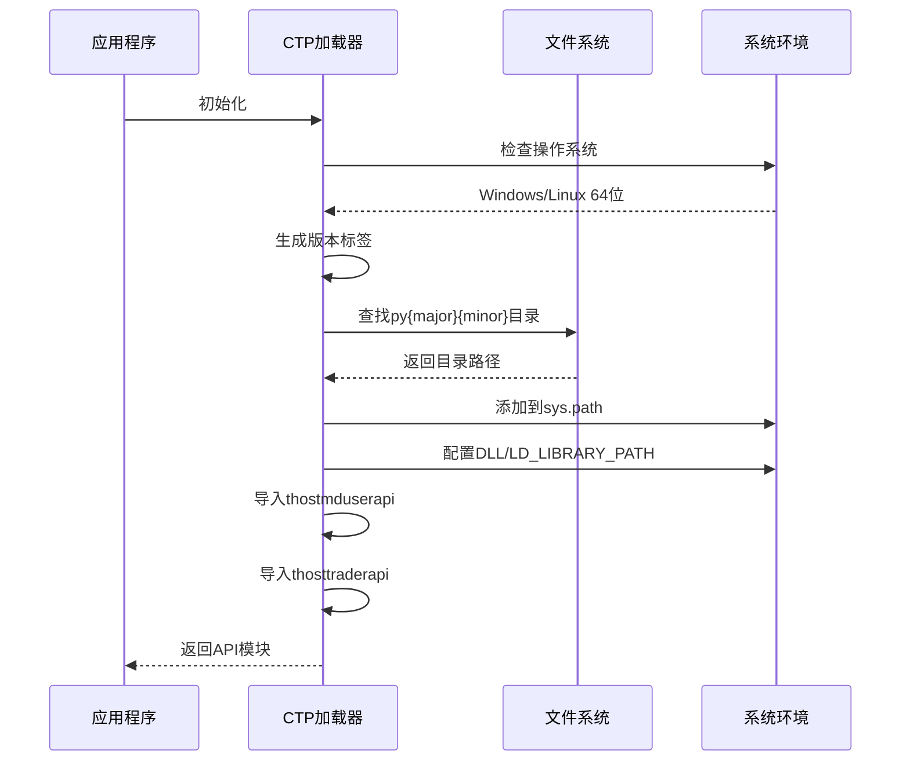

**图表来源**
- [ssquant/ctp/loader.py](file://ssquant/ctp/loader.py#L84-L122)

**章节来源**
- [ssquant/ctp/loader.py](file://ssquant/ctp/loader.py#L1-L238)

### 行情API封装分析

行情API封装提供了完整的市场数据处理能力：

#### 核心功能

**数据订阅管理**：
- 支持多合约同时订阅
- 自动数组处理和内存管理
- 订阅状态跟踪

**回调处理**：
- 完整的CTP回调接口实现
- 错误消息解码和处理
- 实时数据推送

**连接管理**：
- 自动重连机制
- 心跳检测和超时处理
- 交易日获取和API版本查询

#### 错误处理机制

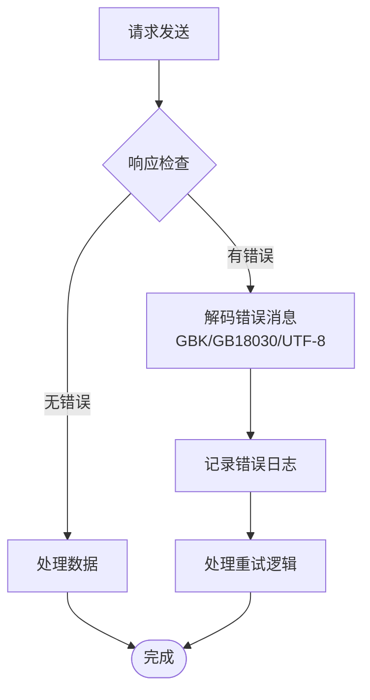

**图表来源**
- [ssquant/pyctp/md_api.py](file://ssquant/pyctp/md_api.py#L27-L42)

**章节来源**
- [ssquant/pyctp/md_api.py](file://ssquant/pyctp/md_api.py#L1-L261)

### 交易API封装分析

交易API封装实现了完整的期货交易功能：

#### 交易功能

**订单管理**：
- 限价单、市价单等多种订单类型
- 智能开平仓识别
- 订单状态实时跟踪

**账户管理**：
- 资金账户查询
- 持仓信息管理
- 结算单确认流程

**风险管理**：
- 价格限制检查
- 持仓限制管理
- 风控规则执行

#### 认证流程

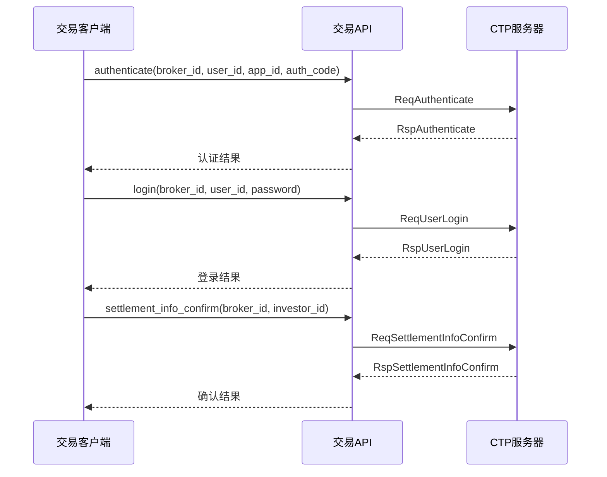

**图表来源**
- [ssquant/pyctp/trader_api.py](file://ssquant/pyctp/trader_api.py#L269-L333)

**章节来源**
- [ssquant/pyctp/trader_api.py](file://ssquant/pyctp/trader_api.py#L1-L574)

### SIMNOW客户端分析

SIMNOW客户端提供了完整的模拟交易解决方案：

#### 服务器配置

系统支持多家SIMNOW服务器，包括：
- 电信1、电信2服务器
- 移动服务器
- TEST服务器
- N视界服务器
- 7x24小时环境

#### 智能重试机制

针对平今仓位不足的智能重试逻辑：

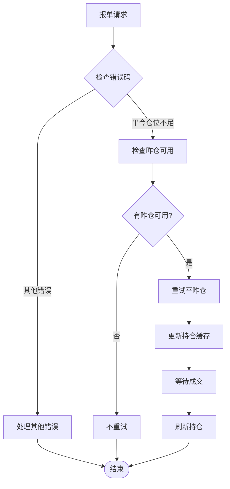

**图表来源**
- [ssquant/pyctp/simnow_client.py](file://ssquant/pyctp/simnow_client.py#L312-L343)

#### **新增** 回调异常处理机制

**SWIG安全装饰器**：
- 防止回调异常导致进程崩溃
- 统一异常处理和日志记录
- 阈值告警机制防止异常被静默吞掉

**章节来源**
- [ssquant/pyctp/simnow_client.py](file://ssquant/pyctp/simnow_client.py#L1-L1071)
- [ssquant/pyctp/simnow_config.py](file://ssquant/pyctp/simnow_config.py#L1-L160)

### 实盘客户端分析

实盘客户端提供了直接连接期货公司实盘环境的能力：

#### 连接流程

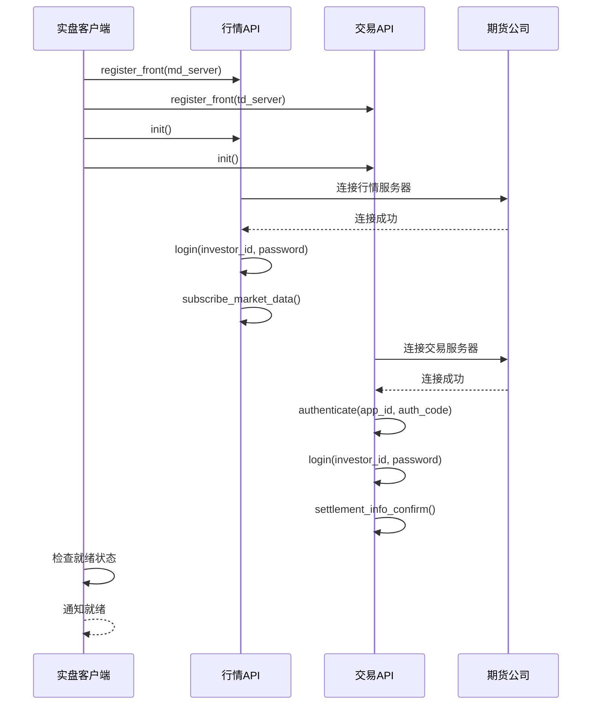

**图表来源**
- [ssquant/pyctp/real_trading_client.py](file://ssquant/pyctp/real_trading_client.py#L623-L653)

#### **更新** 连接稳定性增强

**改进的连接管理**：
- 增强的自动重连机制
- 连接状态监控和恢复
- 更好的错误处理和异常恢复

**章节来源**
- [ssquant/pyctp/real_trading_client.py](file://ssquant/pyctp/real_trading_client.py#L1-L1108)

## 依赖关系分析

### 模块依赖图

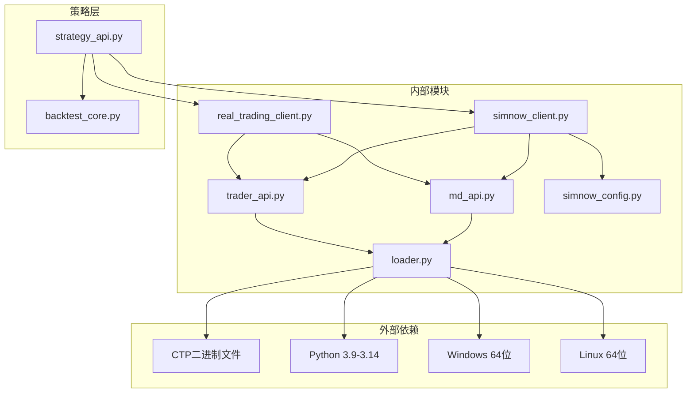

**图表来源**
- [ssquant/ctp/loader.py](file://ssquant/ctp/loader.py#L1-L238)
- [ssquant/pyctp/__init__.py](file://ssquant/pyctp/__init__.py#L17-L25)

### 错误处理依赖

系统实现了多层次的错误处理机制：

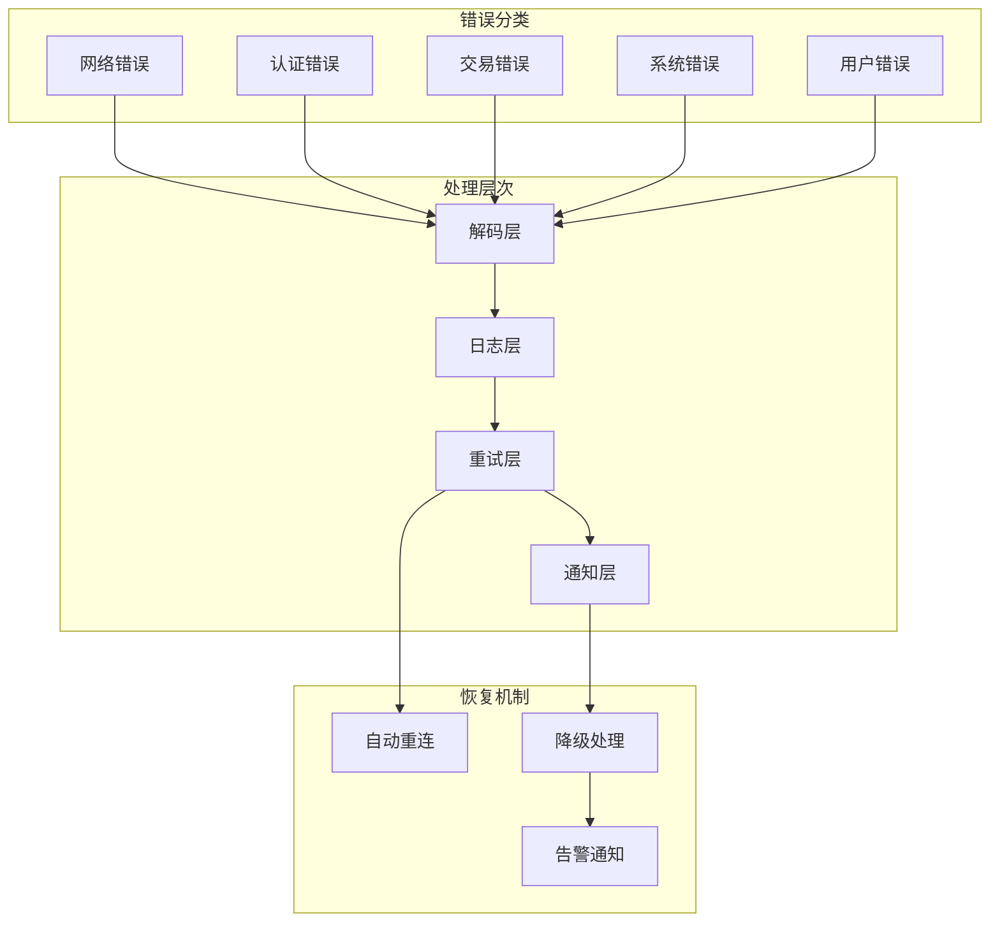

**图表来源**
- [ssquant/pyctp/md_api.py](file://ssquant/pyctp/md_api.py#L27-L42)
- [ssquant/pyctp/trader_api.py](file://ssquant/pyctp/trader_api.py#L27-L42)

**章节来源**
- [ssquant/ctp/loader.py](file://ssquant/ctp/loader.py#L1-L238)
- [ssquant/pyctp/md_api.py](file://ssquant/pyctp/md_api.py#L1-L261)
- [ssquant/pyctp/trader_api.py](file://ssquant/pyctp/trader_api.py#L1-L574)

## 性能考虑

### 内存管理

系统采用了高效的内存管理模式：

**数组管理**：
- 使用CTP提供的数组创建和销毁函数
- 自动内存分配和释放
- 防止内存泄漏

**连接池管理**：
- 复用API连接减少资源消耗
- 智能连接状态监控
- 自动清理断开的连接

### 网络优化

**连接优化**：
- 多服务器负载均衡
- 自动故障转移
- 连接池复用

**数据传输优化**：
- 压缩传输减少带宽占用
- 批量数据处理提高效率
- 异步处理提升响应速度

### 错误恢复策略

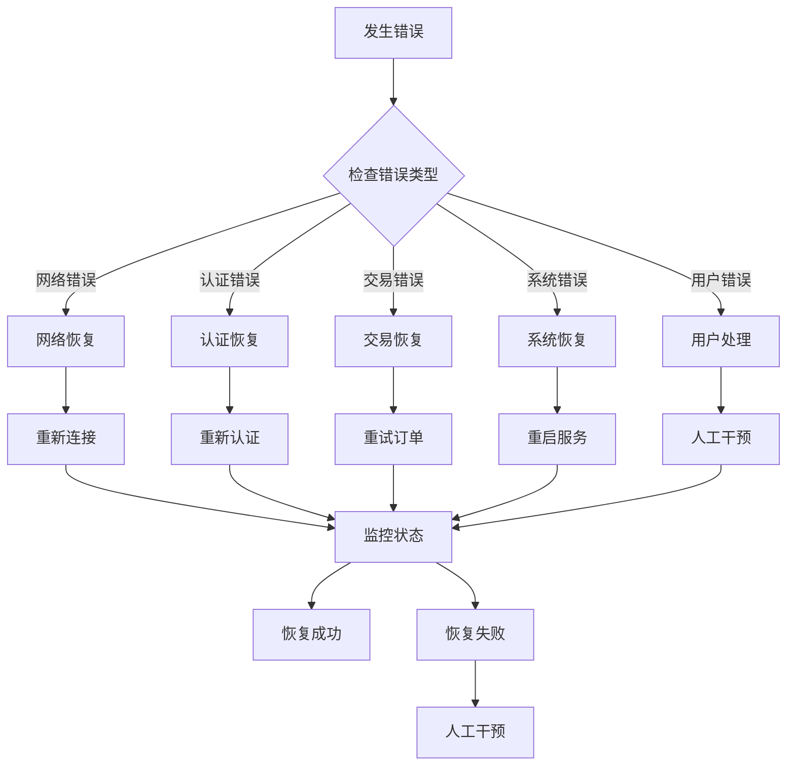

**图表来源**
- [ssquant/pyctp/simnow_client.py](file://ssquant/pyctp/simnow_client.py#L312-L343)

## 故障排除指南

### 常见问题及解决方案

#### CTP加载失败

**问题症状**：
- ImportError: 无法加载CTP模块
- CTP模块不可用

**可能原因**：
- Python版本不匹配（支持3.9-3.14）
- Windows/Linux 64位系统不支持
- CTP文件缺失或损坏

**解决方案**：
1. 检查Python版本是否在支持范围内（3.9-3.14）
2. 确认系统为64位（Windows或Linux）
3. 验证对应版本的CTP文件是否存在
4. 检查错误XML文件完整性

#### 登录认证失败

**问题症状**：
- 登录失败，错误码50
- 认证失败

**可能原因**：
- 用户名或密码错误
- 认证参数不正确
- 网络连接问题

**解决方案**：
1. 检查账户信息的准确性
2. 验证认证参数配置
3. 确认网络连接稳定性
4. 检查SIMNOW服务器配置

#### 订单执行异常

**问题症状**：
- 订单提交失败
- 订单状态异常

**可能原因**：
- 价格超出限制
- 持仓不足
- 系统维护时间

**解决方案**：
1. 检查价格是否符合交易所规则
2. 确认账户资金和持仓情况
3. 避开系统维护时间
4. 检查平今仓位限制

### 调试和诊断

#### 日志分析

系统提供了详细的日志输出：
- 连接状态变化
- 认证过程详情
- 订单执行记录
- 错误信息描述

#### 性能监控

**监控指标**：
- 连接成功率
- 数据延迟
- 订单执行时间
- 错误率统计

**诊断工具**：
- CTP状态检查
- 网络连接测试
- 系统资源监控

**章节来源**
- [ssquant/ctp/loader.py](file://ssquant/ctp/loader.py#L151-L170)
- [ssquant/pyctp/md_api.py](file://ssquant/pyctp/md_api.py#L55-L128)
- [ssquant/pyctp/trader_api.py](file://ssquant/pyctp/trader_api.py#L55-L160)

## 结论

SSQuant CTP接口集成为期货量化交易提供了完整、可靠的解决方案。通过精心设计的架构和完善的错误处理机制，系统实现了：

**技术优势**：
- 多Python版本支持（3.9-3.14）和自动版本匹配
- 完整的SIMNOW模拟和实盘交易功能
- 高性能的数据处理和交易执行
- 健壮的错误处理和异常恢复机制
- **新增** 跨平台（Windows/Linux）支持

**架构特点**：
- 模块化设计便于维护和扩展
- 分层架构确保了系统的稳定性
- 统一的API接口简化了开发工作
- 完善的配置管理支持多种部署场景
- **改进** 增强的实盘客户端连接稳定性

**未来发展方向**：
- Linux系统支持扩展
- 更多交易品种支持
- 高级算法交易功能
- 云服务集成
- **持续改进** 错误处理和异常恢复机制

该接口集成为用户提供了从策略开发到实盘交易的完整解决方案，是构建专业期货量化交易系统的重要基础设施。