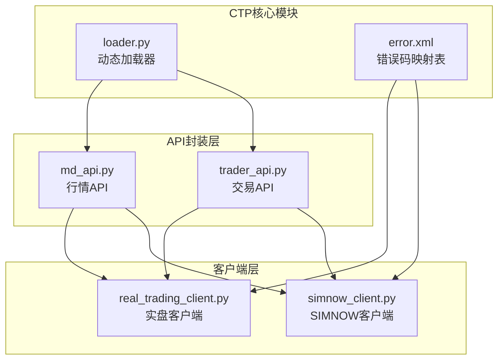
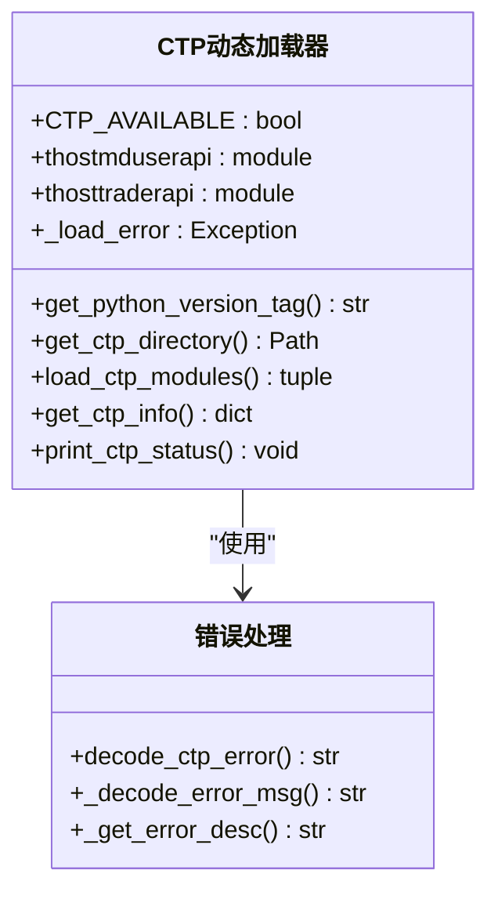
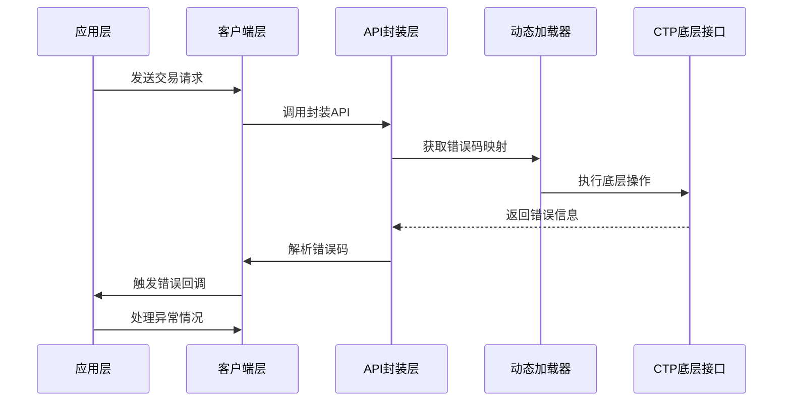
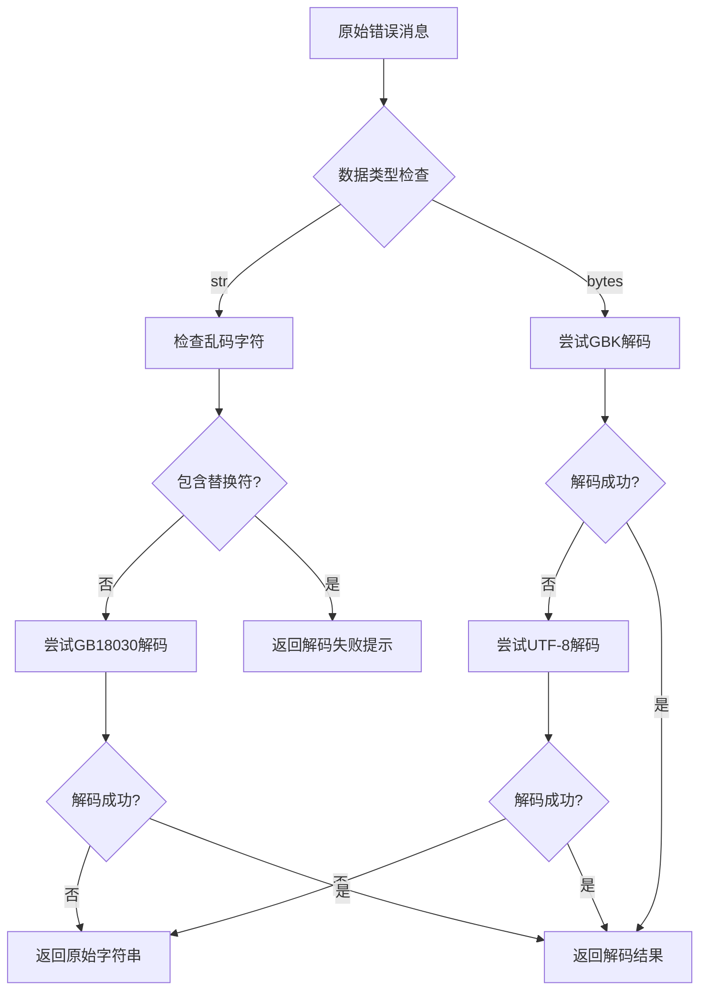
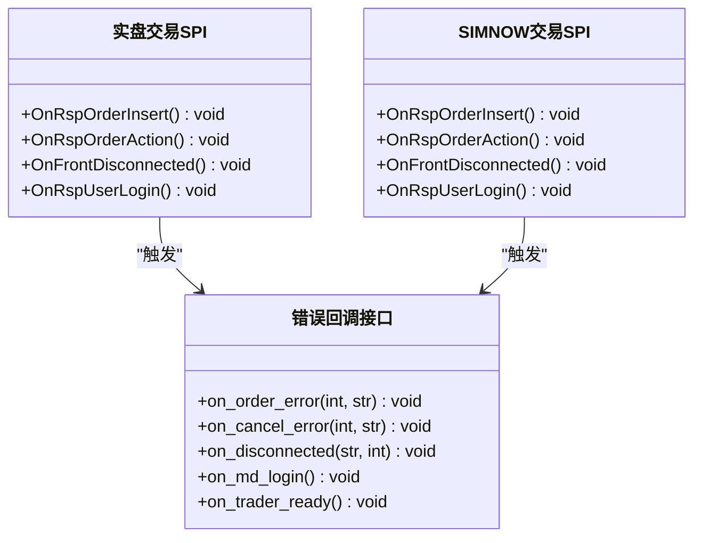
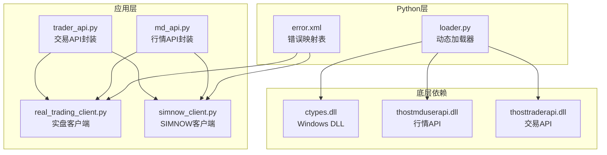

# CTP错误处理机制

<cite>
**本文档引用的文件**
- [ssquant/ctp/loader.py](file://ssquant/ctp/loader.py)
- [ssquant/ctp/py39/error.xml](file://ssquant/ctp/py39/error.xml)
- [ssquant/ctp/py310/error.xml](file://ssquant/ctp/py310/error.xml)
- [ssquant/ctp/py311/error.xml](file://ssquant/ctp/py311/error.xml)
- [ssquant/ctp/py312/error.xml](file://ssquant/ctp/py312/error.xml)
- [ssquant/ctp/py313/error.xml](file://ssquant/ctp/py313/error.xml)
- [ssquant/ctp/py314/error.xml](file://ssquant/ctp/py314/error.xml)
- [ssquant/pyctp/md_api.py](file://ssquant/pyctp/md_api.py)
- [ssquant/pyctp/trader_api.py](file://ssquant/pyctp/trader_api.py)
- [ssquant/pyctp/real_trading_client.py](file://ssquant/pyctp/real_trading_client.py)
- [ssquant/pyctp/simnow_client.py](file://ssquant/pyctp/simnow_client.py)
</cite>

## 目录
1. [引言](#引言)
2. [项目结构](#项目结构)
3. [核心组件](#核心组件)
4. [架构概览](#架构概览)
5. [详细组件分析](#详细组件分析)
6. [依赖关系分析](#依赖关系分析)
7. [性能考虑](#性能考虑)
8. [故障排查指南](#故障排查指南)
9. [结论](#结论)

## 引言

SSQuant CTP错误处理机制是一个完整的期货交易错误管理系统，涵盖了CTP（中国金融期货交易所）API的错误码分类、XML错误映射表、错误解析逻辑以及异常传播机制。该系统提供了从底层CTP接口到上层应用的完整错误处理链路，包括网络异常、认证失败、超时处理和重试机制。

## 项目结构

SSQuant项目的CTP错误处理机制主要分布在以下模块中：



**图表来源**
- [ssquant/ctp/loader.py](file://ssquant/ctp/loader.py#L1-L203)
- [ssquant/pyctp/md_api.py](file://ssquant/pyctp/md_api.py#L1-L261)
- [ssquant/pyctp/trader_api.py](file://ssquant/pyctp/trader_api.py#L1-L483)
- [ssquant/pyctp/real_trading_client.py](file://ssquant/pyctp/real_trading_client.py#L1-L755)
- [ssquant/pyctp/simnow_client.py](file://ssquant/pyctp/simnow_client.py#L1-L815)

**章节来源**
- [ssquant/ctp/loader.py](file://ssquant/ctp/loader.py#L1-L203)
- [ssquant/pyctp/md_api.py](file://ssquant/pyctp/md_api.py#L1-L261)
- [ssquant/pyctp/trader_api.py](file://ssquant/pyctp/trader_api.py#L1-L483)

## 核心组件

### CTP动态加载器

CTP动态加载器负责根据Python版本自动加载对应的CTP二进制文件，支持Python 3.9到3.14版本。



**图表来源**
- [ssquant/ctp/loader.py](file://ssquant/ctp/loader.py#L1-L203)
- [ssquant/pyctp/trader_api.py](file://ssquant/pyctp/trader_api.py#L27-L42)

### 错误码映射表

系统维护了多个版本的XML错误映射表，每个版本都包含296个标准CTP错误码：

| 错误码范围 | 分类 | 错误示例 |
|-----------|------|----------|
| 0-100 | 基础认证错误 | INVALID_LOGIN, DUPLICATE_LOGIN, AUTH_FAILED |
| 100-200 | 合约相关错误 | INSTRUMENT_NOT_FOUND, INSTRUMENT_NOT_TRADING |
| 200-300 | 资金和权限错误 | INSUFFICIENT_MONEY, NO_TRADING_RIGHT |
| 300-400 | 交易操作错误 | OVER_CLOSE_POSITION, ORDER_NOT_FOUND |
| 400-500 | 系统和网络错误 | API_FRONT_SHAKE_HAND_ERR, NEED_RETRY |
| 500-600 | 特殊业务错误 | OPTION_SELF_CLOSE_NOT_OPTION, TK_BUSY |

**章节来源**
- [ssquant/ctp/py39/error.xml](file://ssquant/ctp/py39/error.xml#L1-L296)
- [ssquant/ctp/py310/error.xml](file://ssquant/ctp/py310/error.xml#L1-L296)
- [ssquant/ctp/py311/error.xml](file://ssquant/ctp/py311/error.xml#L1-L296)
- [ssquant/ctp/py312/error.xml](file://ssquant/ctp/py312/error.xml#L1-L296)
- [ssquant/ctp/py313/error.xml](file://ssquant/ctp/py313/error.xml#L1-L296)
- [ssquant/ctp/py314/error.xml](file://ssquant/ctp/py314/error.xml#L1-L296)

## 架构概览

CTP错误处理机制采用分层架构设计，从底层CTP接口到上层应用提供完整的错误处理能力：



**图表来源**
- [ssquant/pyctp/real_trading_client.py](file://ssquant/pyctp/real_trading_client.py#L470-L536)
- [ssquant/pyctp/simnow_client.py](file://ssquant/pyctp/simnow_client.py#L517-L583)

## 详细组件分析

### 实盘交易客户端错误处理

实盘交易客户端实现了完整的错误处理机制，包括智能重试和错误恢复策略：

```mermaid
flowchart TD
A[报单请求] --> B{检查错误码}
B --> |平今仓位不足(50)| C[检查昨仓可用]
B --> |其他错误| D[触发错误回调]
C --> |有昨仓| E[自动改为平昨]
C --> |无昨仓| F[不重试，报错]
E --> G[等待成交确认]
G --> H[刷新持仓缓存]
H --> I[触发成功回调]
D --> J[停止流程]
F --> J
```

**图表来源**
- [ssquant/pyctp/real_trading_client.py](file://ssquant/pyctp/real_trading_client.py#L286-L317)

#### 错误分类和处理策略

系统将CTP错误分为以下几类：

1. **网络连接错误** (错误码: 8, 44, 45, 46)
   - 处理方式: 自动重连，等待网络恢复
   - 恢复策略: 重新建立连接，重新登录

2. **认证失败错误** (错误码: 63, 64, 252, 253)
   - 处理方式: 验证凭据有效性，重新认证
   - 恢复策略: 检查BrokerID、UserID、AppID、AuthCode

3. **资金不足错误** (错误码: 31, 36)
   - 处理方式: 暂停交易，等待资金补充
   - 恢复策略: 查询账户余额，重新评估交易规模

4. **合约错误** (错误码: 16, 17, 22)
   - 处理方式: 验证合约状态，重新订阅
   - 恢复策略: 检查合约交易状态，重新订阅行情

**章节来源**
- [ssquant/pyctp/real_trading_client.py](file://ssquant/pyctp/real_trading_client.py#L496-L536)
- [ssquant/pyctp/simnow_client.py](file://ssquant/pyctp/simnow_client.py#L543-L583)

### 错误解析和解码机制

系统实现了多层次的错误消息解码机制，确保错误信息的正确显示：



**图表来源**
- [ssquant/pyctp/trader_api.py](file://ssquant/pyctp/trader_api.py#L27-L42)
- [ssquant/pyctp/md_api.py](file://ssquant/pyctp/md_api.py#L27-L42)

#### 错误映射表结构

每个错误映射表包含以下关键字段：

| 字段名 | 类型 | 描述 | 示例 |
|--------|------|------|------|
| id | string | 错误码标识符 | "INVALID_LOGIN" |
| value | int | 数值错误码 | 3 |
| prompt | string | 中文错误描述 | "CTP:不合法的登录" |

**章节来源**
- [ssquant/ctp/py39/error.xml](file://ssquant/ctp/py39/error.xml#L5-L11)
- [ssquant/ctp/py310/error.xml](file://ssquant/ctp/py310/error.xml#L5-L11)

### 异常传播机制

系统采用事件驱动的异常传播机制，通过回调函数将错误信息传递给上层应用：



**图表来源**
- [ssquant/pyctp/real_trading_client.py](file://ssquant/pyctp/real_trading_client.py#L604-L618)
- [ssquant/pyctp/simnow_client.py](file://ssquant/pyctp/simnow_client.py#L636-L653)

## 依赖关系分析

CTP错误处理机制的依赖关系呈现明显的层次化特征：



**图表来源**
- [ssquant/ctp/loader.py](file://ssquant/ctp/loader.py#L104-L113)
- [ssquant/pyctp/md_api.py](file://ssquant/pyctp/md_api.py#L13-L24)
- [ssquant/pyctp/trader_api.py](file://ssquant/pyctp/trader_api.py#L13-L24)

**章节来源**
- [ssquant/ctp/loader.py](file://ssquant/ctp/loader.py#L1-L203)
- [ssquant/pyctp/real_trading_client.py](file://ssquant/pyctp/real_trading_client.py#L1-L755)
- [ssquant/pyctp/simnow_client.py](file://ssquant/pyctp/simnow_client.py#L1-L815)

## 性能考虑

### 错误处理性能优化

1. **异步错误处理**: 使用线程池处理错误回调，避免阻塞主线程
2. **错误缓存机制**: 缓存常用的错误描述，减少XML解析开销
3. **批量错误处理**: 对于频繁发生的错误，采用批量处理策略

### 内存管理

- 错误消息解码采用惰性处理，只在需要时进行解码
- 持仓缓存定期清理，避免内存泄漏
- 大量错误日志采用滚动存储，控制磁盘占用

## 故障排查指南

### 常见错误场景分析

#### 认证失败排查

| 错误码 | 错误类型 | 排查步骤 | 解决方案 |
|--------|----------|----------|----------|
| 63 | AUTH_FAILED | 1. 检查AppID和AuthCode<br/>2. 验证BrokerID有效性<br/>3. 确认网络连接 | 1. 重新申请认证信息<br/>2. 联系期货公司客服 |
| 64 | NOT_AUTHENT | 1. 检查认证流程<br/>2. 验证时间同步 | 1. 重新进行产品认证<br/>2. 校准系统时间 |
| 252 | API_UNSUPPORTED_VERSION | 1. 检查API版本<br/>2. 更新客户端 | 1. 升级到最新版本<br/>2. 联系技术支持 |

#### 交易错误排查

| 错误码 | 错误类型 | 排查步骤 | 解决方案 |
|--------|----------|----------|----------|
| 31 | INSUFFICIENT_MONEY | 1. 检查账户余额<br/>2. 验证保证金计算<br/>3. 确认持仓状态 | 1. 充值或调整仓位<br/>2. 降低交易规模 |
| 50 | OVER_CLOSETODAY_POSITION | 1. 检查平今仓限制<br/>2. 验证昨仓可用量 | 1. 改为平昨仓<br/>2. 等待下一交易日 |
| 22 | INSTRUMENT_NOT_FOUND | 1. 检查合约代码<br/>2. 验证合约状态 | 1. 使用正确的合约代码<br/>2. 重新订阅合约 |

#### 网络连接错误排查

| 错误码 | 错误类型 | 排查步骤 | 解决方案 |
|--------|----------|----------|----------|
| 8 | FRONT_NOT_ACTIVE | 1. 检查前置机状态<br/>2. 验证网络连接 | 1. 重启前置机服务<br/>2. 检查防火墙设置 |
| 44 | CFFEX_NETWORK_ERROR | 1. 检查交易所连接<br/>2. 验证网络稳定性 | 1. 切换备用服务器<br/>2. 联系网络服务商 |

### 诊断方法

1. **日志分析**: 查看详细的错误日志，定位问题根因
2. **网络诊断**: 使用ping、telnet等工具测试网络连通性
3. **系统监控**: 监控CPU、内存、网络使用情况
4. **错误重现**: 在测试环境中重现错误，验证修复效果

### 解决方案最佳实践

1. **预防性措施**: 建立完善的错误预防机制
2. **快速响应**: 建立7×24小时应急响应团队
3. **持续改进**: 定期分析错误统计，优化系统性能
4. **文档完善**: 保持错误处理文档的实时更新

**章节来源**
- [ssquant/pyctp/real_trading_client.py](file://ssquant/pyctp/real_trading_client.py#L496-L536)
- [ssquant/pyctp/simnow_client.py](file://ssquant/pyctp/simnow_client.py#L543-L583)

## 结论

SSQuant CTP错误处理机制通过分层架构设计、完善的错误码分类体系和智能重试策略，为期货交易提供了可靠的错误处理保障。系统不仅能够准确识别和处理各种类型的CTP错误，还提供了丰富的诊断工具和恢复策略，确保交易系统的稳定性和可靠性。

该机制的核心优势包括：

1. **全面的错误覆盖**: 涵盖所有标准CTP错误码和特殊业务错误
2. **智能重试机制**: 针对特定错误提供自动重试和恢复策略
3. **灵活的配置选项**: 支持多种部署环境和使用场景
4. **完善的监控告警**: 提供详细的日志记录和异常通知机制

通过持续的优化和完善，SSQuant CTP错误处理机制将继续为期货交易提供强有力的技术支撑，确保交易系统的稳定运行和业务的持续发展。