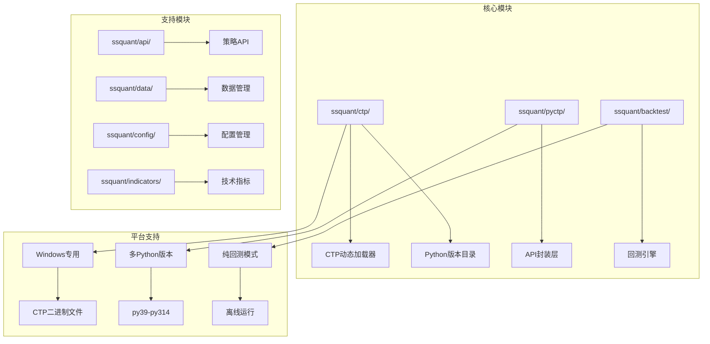
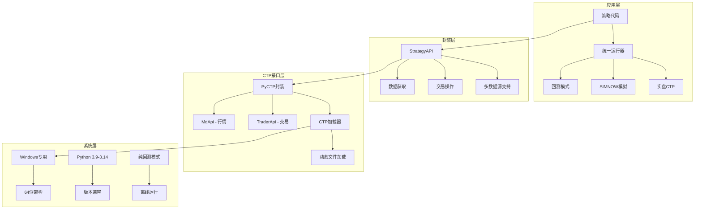
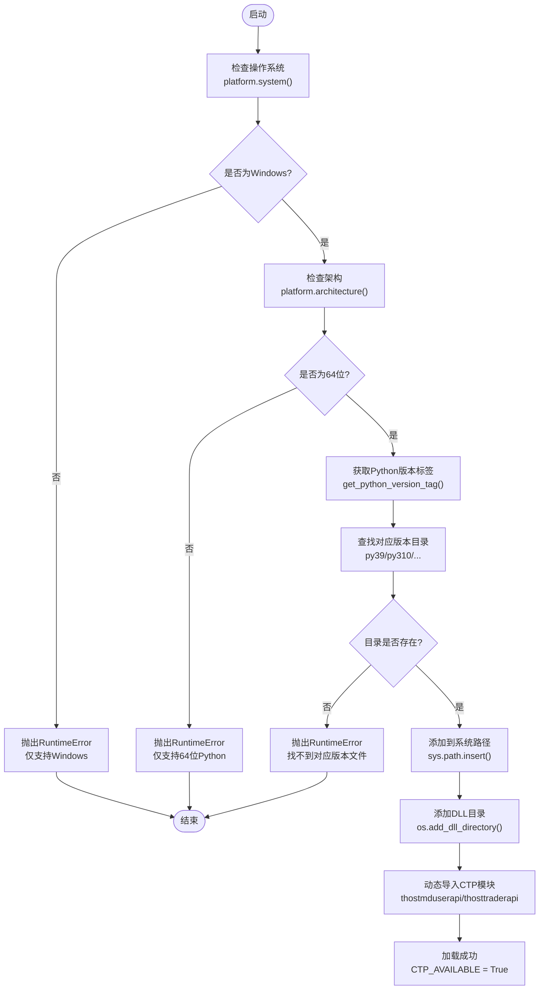
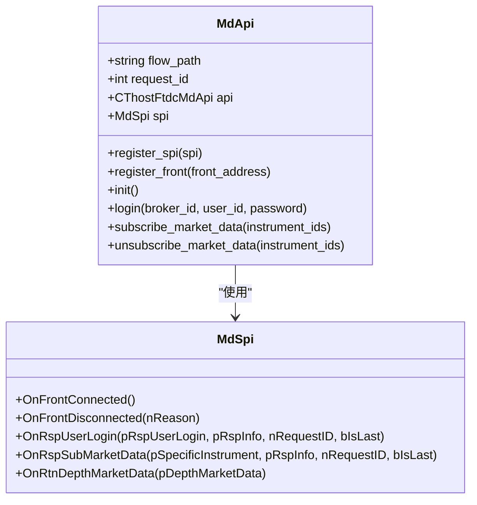
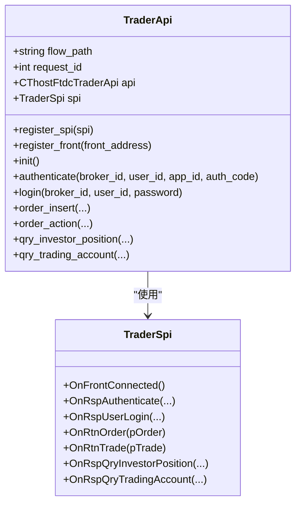
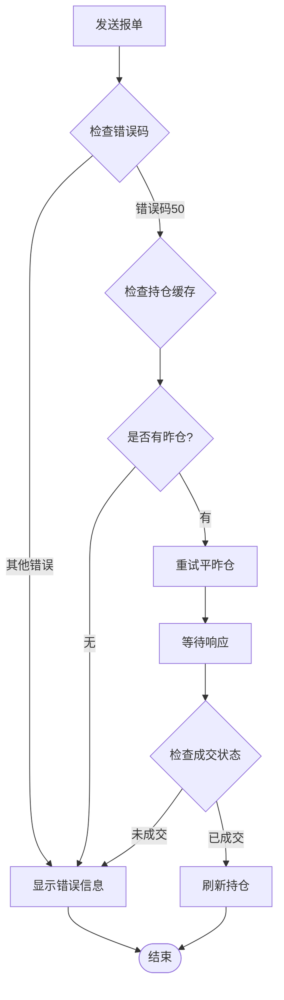
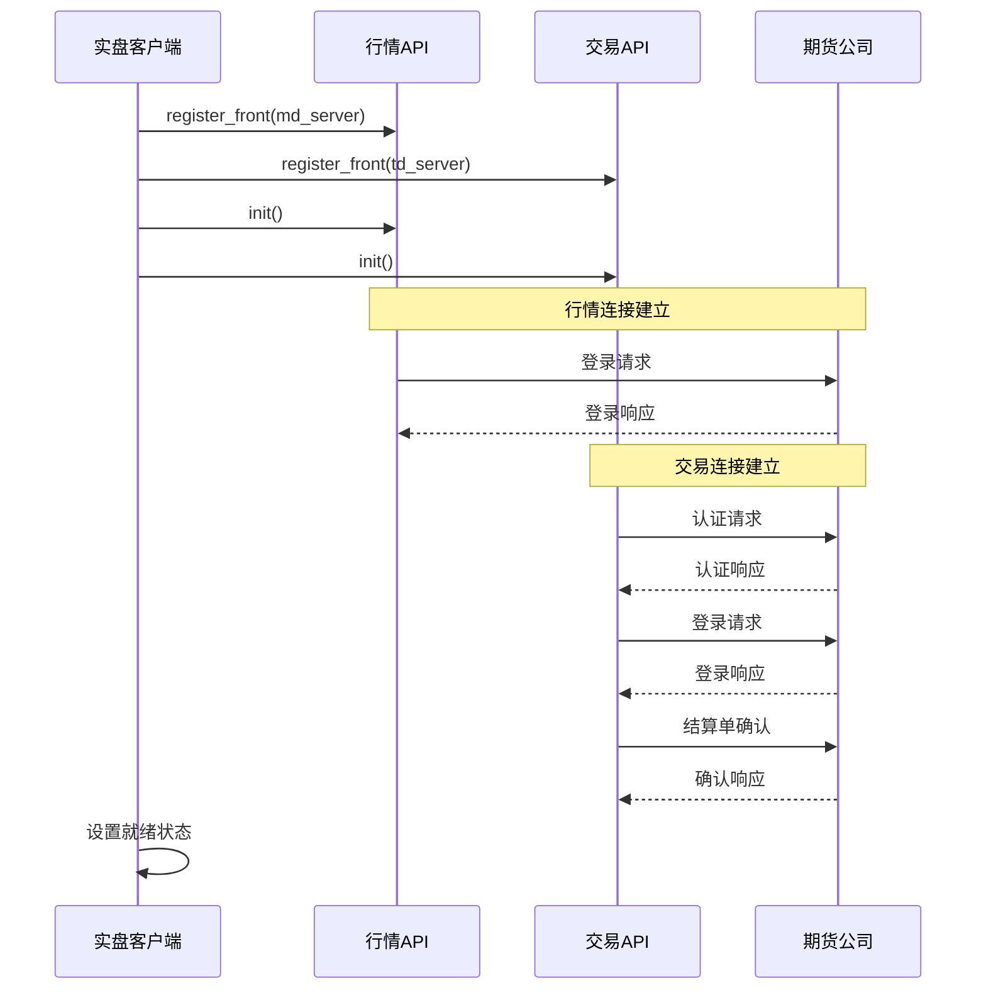
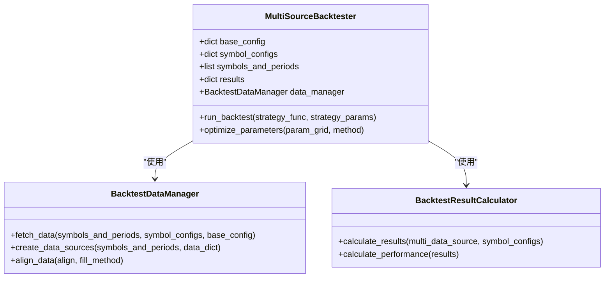
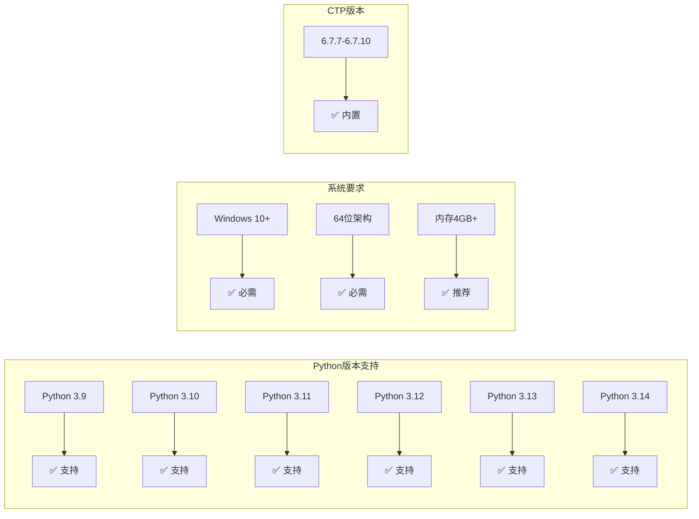

# 跨平台兼容性支持

<cite>
**本文档引用的文件**
- [ssquant/ctp/__init__.py](file://ssquant/ctp/__init__.py)
- [ssquant/ctp/loader.py](file://ssquant/ctp/loader.py)
- [ssquant/pyctp/__init__.py](file://ssquant/pyctp/__init__.py)
- [ssquant/pyctp/real_trading_client.py](file://ssquant/pyctp/real_trading_client.py)
- [ssquant/pyctp/simnow_client.py](file://ssquant/pyctp/simnow_client.py)
- [ssquant/pyctp/md_api.py](file://ssquant/pyctp/md_api.py)
- [ssquant/pyctp/trader_api.py](file://ssquant/pyctp/trader_api.py)
- [ssquant/backtest/backtest_core.py](file://ssquant/backtest/backtest_core.py)
- [setup.py](file://setup.py)
- [requirements.txt](file://requirements.txt)
- [README.md](file://README.md)
- [ssquant/ctp/py310/error.xml](file://ssquant/ctp/py310/error.xml)
</cite>

## 目录
1. [简介](#简介)
2. [项目结构](#项目结构)
3. [核心组件](#核心组件)
4. [架构概览](#架构概览)
5. [详细组件分析](#详细组件分析)
6. [依赖关系分析](#依赖关系分析)
7. [性能考虑](#性能考虑)
8. [故障排除指南](#故障排除指南)
9. [结论](#结论)

## 简介

SSQuant是一个专业的期货量化交易框架，专门为CTP（中国金融期货交易所）接口设计。该项目的核心优势在于其强大的跨平台兼容性支持，特别是对Windows平台的深度优化和对多Python版本的全面支持。

该项目目前专注于Windows平台支持，提供从Python 3.9到3.14的完整兼容性覆盖，包括：
- 自动操作系统检测和架构验证
- 动态CTP二进制文件加载
- 多Python版本的CTP文件管理
- 纯回测模式支持
- SIMNOW模拟交易环境
- 实盘CTP交易系统

## 项目结构

SSQuant采用模块化架构设计，主要分为以下几个核心模块：



**图表来源**
- [ssquant/ctp/__init__.py](file://ssquant/ctp/__init__.py#L1-L8)
- [ssquant/pyctp/__init__.py](file://ssquant/pyctp/__init__.py#L1-L26)

**章节来源**
- [ssquant/ctp/__init__.py](file://ssquant/ctp/__init__.py#L1-L8)
- [ssquant/pyctp/__init__.py](file://ssquant/pyctp/__init__.py#L1-L26)
- [README.md](file://README.md#L297-L321)

## 核心组件

### CTP动态加载器

CTP动态加载器是整个系统的核心组件，负责根据当前Python版本自动加载对应的CTP二进制文件。该组件实现了完整的平台检测、版本匹配和动态加载功能。

**关键特性：**
- 自动Python版本识别（py39-py314）
- Windows系统专用支持
- 64位架构验证
- 动态DLL目录添加
- 错误信息国际化处理

### Python CTP API封装

Python CTP API封装提供了更高层次的接口，简化了CTP接口的使用复杂度。该封装层包括：

- **MdApi**: 行情API封装
- **TraderApi**: 交易API封装  
- **SIMNOWClient**: SIMNOW模拟交易客户端
- **RealTradingClient**: 实盘交易客户端

### 回测引擎

回测引擎提供了完整的策略回测功能，支持多数据源、多周期和参数优化。该引擎具有以下特点：

- 多品种多周期回测支持
- 参数优化功能
- 可视化报告生成
- 环境变量控制（NO_VISUALIZATION、NO_CONSOLE_LOG）

**章节来源**
- [ssquant/ctp/loader.py](file://ssquant/ctp/loader.py#L1-L203)
- [ssquant/pyctp/__init__.py](file://ssquant/pyctp/__init__.py#L1-L26)
- [ssquant/backtest/backtest_core.py](file://ssquant/backtest/backtest_core.py#L1-L579)

## 架构概览

SSQuant的整体架构采用了分层设计，从底层的CTP接口到高层的策略执行，形成了完整的量化交易生态系统。



**图表来源**
- [ssquant/backtest/backtest_core.py](file://ssquant/backtest/backtest_core.py#L14-L579)
- [ssquant/pyctp/md_api.py](file://ssquant/pyctp/md_api.py#L1-L261)
- [ssquant/pyctp/trader_api.py](file://ssquant/pyctp/trader_api.py#L1-L483)

## 详细组件分析

### CTP动态加载器详细分析

CTP动态加载器是项目中最复杂的组件，实现了完整的平台检测和动态加载机制。

#### 核心功能流程



**图表来源**
- [ssquant/ctp/loader.py](file://ssquant/ctp/loader.py#L36-L81)

#### Python版本支持矩阵

项目支持从Python 3.9到3.14的完整版本范围，每个版本都有对应的CTP二进制文件：

| Python版本 | CTP目录 | 状态 |
|------------|---------|------|
| 3.9 | `py39/` | ✅ 已包含 |
| 3.10 | `py310/` | ✅ 已包含 |
| 3.11 | `py311/` | ✅ 已包含 |
| 3.12 | `py312/` | ✅ 已包含 |
| 3.13 | `py313/` | ✅ 已包含 |
| 3.14 | `py314/` | ✅ 已包含 |

#### 动态库加载策略

系统采用了多层次的动态库加载策略来确保兼容性：

1. **现代Windows**: 使用 `os.add_dll_directory()` 添加DLL目录
2. **兼容模式**: 通过修改 `PATH` 环境变量作为后备方案
3. **路径优先级**: 确保CTP目录优先于系统目录

**章节来源**
- [ssquant/ctp/loader.py](file://ssquant/ctp/loader.py#L1-L203)

### Python CTP API封装分析

Python CTP API封装提供了简洁易用的接口，隐藏了底层CTP接口的复杂性。

#### 行情API封装 (MdApi)

行情API封装提供了完整的市场数据获取功能：



**图表来源**
- [ssquant/pyctp/md_api.py](file://ssquant/pyctp/md_api.py#L130-L261)

#### 交易API封装 (TraderApi)

交易API封装提供了完整的交易功能：



**图表来源**
- [ssquant/pyctp/trader_api.py](file://ssquant/pyctp/trader_api.py#L188-L483)

**章节来源**
- [ssquant/pyctp/md_api.py](file://ssquant/pyctp/md_api.py#L1-L261)
- [ssquant/pyctp/trader_api.py](file://ssquant/pyctp/trader_api.py#L1-L483)

### SIMNOW模拟交易客户端

SIMNOW模拟交易客户端提供了完整的模拟交易环境，支持多种服务器配置：

#### SIMNOW服务器配置

| 服务器名称 | 描述 | 适用场景 |
|------------|------|----------|
| `电信1` | 电信网络，稳定性好 | 主要推荐 |
| `电信2` | 电信备用网络 | 网络拥堵时使用 |
| `移动` | 移动网络 | 移动设备使用 |
| `TEST` | 盘后测试 | 非交易时间测试 |
| `N视界` | 特殊网络环境 | 特定用户群体 |

#### 智能重试机制

SIMNOW客户端实现了智能重试机制，特别是在平今/平昨仓切换时：



**图表来源**
- [ssquant/pyctp/simnow_client.py](file://ssquant/pyctp/simnow_client.py#L311-L342)

**章节来源**
- [ssquant/pyctp/simnow_client.py](file://ssquant/pyctp/simnow_client.py#L1-L815)

### 实盘交易客户端

实盘交易客户端提供了生产环境下的完整交易功能，支持多种交易场景：

#### 实盘交易流程



**图表来源**
- [ssquant/pyctp/real_trading_client.py](file://ssquant/pyctp/real_trading_client.py#L631-L653)

**章节来源**
- [ssquant/pyctp/real_trading_client.py](file://ssquant/pyctp/real_trading_client.py#L1-L755)

### 回测引擎分析

回测引擎提供了完整的策略回测功能，支持多数据源、多周期和参数优化。

#### 多数据源回测架构



**图表来源**
- [ssquant/backtest/backtest_core.py](file://ssquant/backtest/backtest_core.py#L14-L81)

#### 回测性能优化

回测引擎实现了多项性能优化措施：

1. **数据预加载**: 支持预加载数据以提高参数优化效率
2. **环境变量控制**: 通过 `NO_VISUALIZATION` 和 `NO_CONSOLE_LOG` 控制输出
3. **进度条显示**: 实时显示回测进度和性能指标
4. **内存管理**: 优化数据结构以减少内存占用

**章节来源**
- [ssquant/backtest/backtest_core.py](file://ssquant/backtest/backtest_core.py#L1-L579)

## 依赖关系分析

### Python版本兼容性矩阵

项目对Python版本的支持具有明确的兼容性要求：



**图表来源**
- [setup.py](file://setup.py#L59-L91)
- [README.md](file://README.md#L43-L51)

### 外部依赖管理

项目的主要外部依赖包括：

| 依赖包 | 版本要求 | 用途 |
|--------|----------|------|
| `numpy` | `>=1.20.0` | 数值计算基础 |
| `pandas` | `>=1.3.0` | 数据处理 |
| `requests` | `>=2.25.0` | 网络请求 |
| `matplotlib` | `>=3.5.0` | 可视化图表 |
| `scipy` | `>=1.7.0` | 科学计算 |
| `Pillow` | `>=8.0.0` | 图像处理 |
| `akshare` | `>=1.10.0` | 金融数据获取 |

**章节来源**
- [setup.py](file://setup.py#L22-L26)
- [requirements.txt](file://requirements.txt#L1-L16)

## 性能考虑

### 内存优化策略

1. **数据分页加载**: 回测引擎支持数据分页加载，避免内存溢出
2. **缓存机制**: 实现多级缓存以提高数据访问速度
3. **垃圾回收**: 合理的垃圾回收策略减少内存碎片

### 网络性能优化

1. **连接池管理**: 优化CTP连接的生命周期管理
2. **批量请求**: 支持批量数据请求以减少网络开销
3. **超时控制**: 合理的超时设置避免长时间阻塞

### 并发处理

1. **异步I/O**: 使用异步I/O处理网络请求
2. **线程池**: 合理的线程池配置提高并发性能
3. **锁机制**: 最小化锁的使用避免性能瓶颈

## 故障排除指南

### 常见问题及解决方案

#### CTP模块加载失败

**问题症状**：
```
错误: 无法导入CTP模块
提示: 回测功能仍然可用
提示: 如需实盘功能，请检查Python版本是否支持
```

**解决方案**：
1. 确认Python版本在支持范围内（3.9-3.14）
2. 检查操作系统是否为Windows 64位
3. 验证对应版本的CTP文件是否存在
4. 检查PATH环境变量配置

#### Python版本不兼容

**问题症状**：
```
RuntimeError: 找不到 Python 3.x 对应的CTP文件
```

**解决方案**：
1. 升级到支持的Python版本
2. 重新安装SSQuant包
3. 检查CTP文件目录结构
4. 验证文件完整性

#### 网络连接问题

**问题症状**：
```
连接超时
服务器无响应
```

**解决方案**：
1. 检查网络连接稳定性
2. 验证服务器地址和端口
3. 检查防火墙设置
4. 尝试不同的服务器配置

### 调试工具和方法

#### CTP状态检查

系统提供了完整的CTP状态检查功能：

```python
# 获取CTP加载信息
info = get_ctp_info()
print(info)

# 打印详细的CTP状态
print_ctp_status()
```

#### 错误码处理

项目内置了完整的错误码处理机制，支持多种编码格式：

1. **GBK编码**: 处理中文错误信息
2. **GB18030编码**: 现代Windows系统的默认编码
3. **UTF-8编码**: 国际化支持
4. **原始字节**: 作为最后的后备方案

**章节来源**
- [ssquant/ctp/loader.py](file://ssquant/ctp/loader.py#L124-L188)
- [ssquant/pyctp/trader_api.py](file://ssquant/pyctp/trader_api.py#L27-L42)

## 结论

SSQuant的CTP跨平台兼容性支持展现了现代量化交易框架的设计理念和技术水平。通过精心设计的架构和完善的兼容性机制，该项目成功地解决了跨平台部署中的关键挑战。

### 主要成就

1. **完整的Windows支持**: 专门针对Windows平台优化，充分利用系统特性
2. **多版本兼容**: 支持从Python 3.9到3.14的完整版本范围
3. **智能加载机制**: 自动检测和加载对应的CTP二进制文件
4. **纯回测模式**: 提供完整的离线运行能力
5. **错误处理完善**: 全面的错误码处理和用户友好的错误信息

### 技术亮点

- **动态加载器**: 实现了灵活的CTP文件加载机制
- **封装层设计**: 提供简洁易用的API接口
- **多模式支持**: 同一套代码支持回测、模拟和实盘
- **性能优化**: 多层次的性能优化策略

### 发展方向

未来的发展重点包括：
1. **Linux平台支持**: 计划扩展到Linux和macOS平台
2. **容器化部署**: 支持Docker等容器化部署方式
3. **云原生架构**: 优化云端部署和扩展能力
4. **微服务架构**: 将功能模块化为独立的服务

SSQuant的跨平台兼容性支持为量化交易领域提供了一个优秀的开源解决方案，为开发者提供了稳定可靠的基础设施。