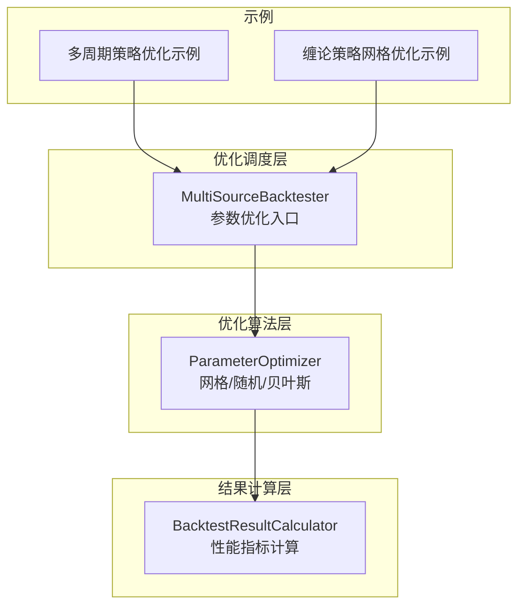
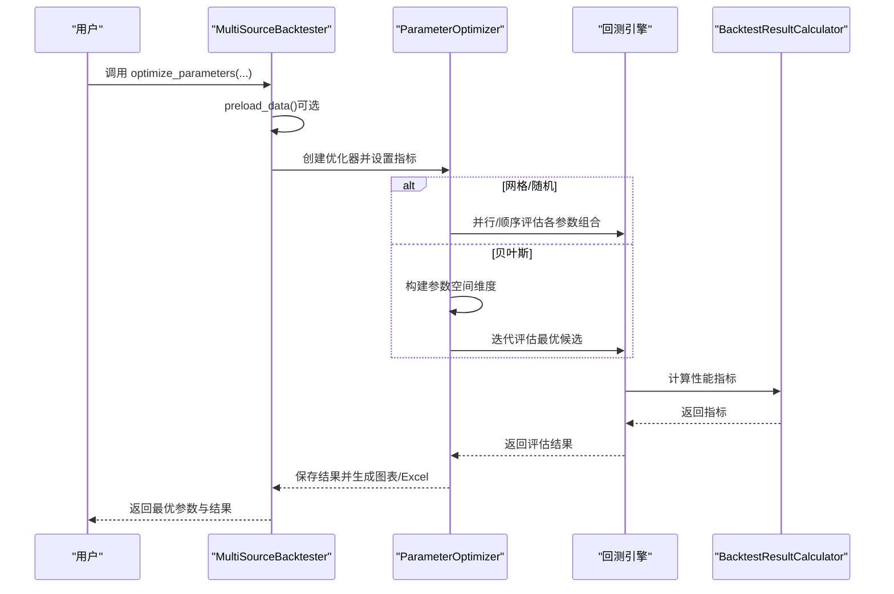
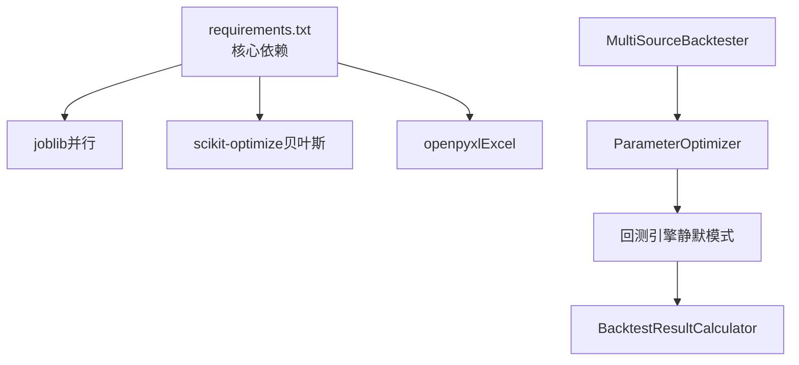
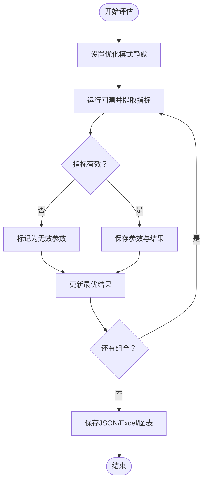

# 参数优化系统

<cite>
**本文引用的文件**
- [ssquant/backtest/parameter_optimizer.py](file://ssquant/backtest/parameter_optimizer.py)
- [ssquant/backtest/backtest_core.py](file://ssquant/backtest/backtest_core.py)
- [ssquant/backtest/backtest_results.py](file://ssquant/backtest/backtest_results.py)
- [examples/B_多品种多周期交易策略_参数优化.py](file://examples/B_多品种多周期交易策略_参数优化.py)
- [examples/chanlun_5m_optimize.py](file://examples/chanlun_5m_optimize.py)
- [requirements.txt](file://requirements.txt)
- [setup.py](file://setup.py)
</cite>

## 目录
1. [简介](#简介)
2. [项目结构](#项目结构)
3. [核心组件](#核心组件)
4. [架构概览](#架构概览)
5. [详细组件分析](#详细组件分析)
6. [依赖关系分析](#依赖关系分析)
7. [性能考量](#性能考量)
8. [故障排查指南](#故障排查指南)
9. [结论](#结论)
10. [附录](#附录)

## 简介
本文件面向SSQuant参数优化系统，围绕网格搜索、随机搜索与贝叶斯优化三大算法，系统阐述其算法原理、适用场景、指标选择策略、目标函数设计、收敛判断、参数空间定义与约束处理、搜索范围限制，以及优化效率提升技巧（并行计算、增量优化、早停机制）。同时提供优化结果分析方法、置信区间估计思路与过拟合检测策略，帮助用户在多品种多周期回测场景中高效、稳健地完成参数寻优。

## 项目结构
参数优化系统主要由三层组成：
- 优化调度层：MultiSourceBacktester负责接收优化请求、预加载数据、分发到具体优化器。
- 优化算法层：ParameterOptimizer封装网格搜索、随机搜索、贝叶斯优化的具体实现。
- 结果计算层：BacktestResultCalculator负责回测结果的统计与性能指标计算。

**图表来源**
- [ssquant/backtest/backtest_core.py](file://ssquant/backtest/backtest_core.py#L526-L579)
- [ssquant/backtest/parameter_optimizer.py](file://ssquant/backtest/parameter_optimizer.py#L74-L125)
- [ssquant/backtest/backtest_results.py](file://ssquant/backtest/backtest_results.py#L16-L90)
- [examples/B_多品种多周期交易策略_参数优化.py](file://examples/B_多品种多周期交易策略_参数优化.py#L18-L155)
- [examples/chanlun_5m_optimize.py](file://examples/chanlun_5m_optimize.py#L32-L153)

**章节来源**
- [ssquant/backtest/backtest_core.py](file://ssquant/backtest/backtest_core.py#L14-L143)
- [ssquant/backtest/parameter_optimizer.py](file://ssquant/backtest/parameter_optimizer.py#L74-L125)
- [ssquant/backtest/backtest_results.py](file://ssquant/backtest/backtest_results.py#L16-L90)

## 核心组件
- ParameterOptimizer：封装三种优化算法，统一指标设置、结果保存、进度跟踪与可视化。
- MultiSourceBacktester：提供统一的优化入口，支持数据预加载、并行评估、静默模式与完整报告生成切换。
- BacktestResultCalculator：计算总收益、年化收益、最大回撤、夏普比率、胜率、盈亏比等关键指标。

**章节来源**
- [ssquant/backtest/parameter_optimizer.py](file://ssquant/backtest/parameter_optimizer.py#L74-L125)
- [ssquant/backtest/backtest_core.py](file://ssquant/backtest/backtest_core.py#L526-L579)
- [ssquant/backtest/backtest_results.py](file://ssquant/backtest/backtest_results.py#L16-L90)

## 架构概览
参数优化流程自上而下分为“配置—调度—评估—汇总”四个阶段，支持并行加速与增量优化（预加载数据）。

**图表来源**
- [ssquant/backtest/backtest_core.py](file://ssquant/backtest/backtest_core.py#L526-L579)
- [ssquant/backtest/parameter_optimizer.py](file://ssquant/backtest/parameter_optimizer.py#L140-L309)
- [ssquant/backtest/parameter_optimizer.py](file://ssquant/backtest/parameter_optimizer.py#L495-L660)
- [ssquant/backtest/backtest_results.py](file://ssquant/backtest/backtest_results.py#L16-L90)

## 详细组件分析

### 算法实现与适用场景
- 网格搜索（Grid Search）
  - 原理：在离散参数空间上穷举所有组合，适用于参数维数较低、搜索空间有限且需要全面探索的场景。
  - 特点：保证全局覆盖，但计算复杂度随参数组合数呈指数增长。
  - 并行支持：通过joblib并行评估，显著缩短总耗时。
  - 示例：多周期策略参数优化示例展示了网格搜索在多品种多周期下的应用。
  
  **章节来源**
  - [ssquant/backtest/parameter_optimizer.py](file://ssquant/backtest/parameter_optimizer.py#L140-L309)
  - [examples/B_多品种多周期交易策略_参数优化.py](file://examples/B_多品种多周期交易策略_参数优化.py#L89-L119)

- 随机搜索（Random Search）
  - 原理：在参数空间内随机采样，适用于参数维数较高、计算预算有限但希望保持一定探索性的场景。
  - 特点：计算开销可控，易于扩展到连续/离散混合空间。
  - 并行支持：同样支持并行评估。
  - 示例：缠论策略网格优化示例展示了随机搜索在参数空间较大时的可行性。
  
  **章节来源**
  - [ssquant/backtest/parameter_optimizer.py](file://ssquant/backtest/parameter_optimizer.py#L310-L494)
  - [examples/chanlun_5m_optimize.py](file://examples/chanlun_5m_optimize.py#L88-L125)

- 贝叶斯优化（Bayesian Optimization）
  - 原理：通过高斯过程对目标函数进行概率建模，结合采集函数（如Expected Improvement）平衡探索与利用，逐步收敛到最优区域。
  - 特点：适合昂贵目标函数评估、连续/离散混合参数空间，通常以较少评估次数获得较优解。
  - 依赖：需安装scikit-optimize（skopt）库。
  - 示例：在参数优化器中通过gp_minimize实现，自动处理更高/更低目标的符号转换。
  
  **章节来源**
  - [ssquant/backtest/parameter_optimizer.py](file://ssquant/backtest/parameter_optimizer.py#L495-L660)
  - [requirements.txt](file://requirements.txt#L1-L16)
  - [setup.py](file://setup.py#L62-L74)

### 优化指标与目标函数设计
- 指标选择策略
  - 常用指标：夏普比率（Sharpe Ratio）、总收益（Total Return）、最大回撤（Max Drawdown）、胜率（Win Rate）、盈亏比（Profit Factor）。
  - 选择原则：根据策略特性与风险偏好确定主指标；若追求稳健性，可优先考虑夏普比率或最大回撤控制。
- 目标函数设计
  - higher_is_better=True：最大化指标（如夏普比率、总收益）。
  - higher_is_better=False：最小化指标（如最大回撤），内部通过取负值转换为最小化问题。
- 收敛判断
  - 网格/随机：遍历完全部/指定次数即结束。
  - 贝叶斯：由n_calls（迭代次数）控制；可通过外部早停机制（见下一节）结合指标变化趋势提前终止。

**章节来源**
- [ssquant/backtest/parameter_optimizer.py](file://ssquant/backtest/parameter_optimizer.py#L126-L138)
- [ssquant/backtest/parameter_optimizer.py](file://ssquant/backtest/parameter_optimizer.py#L571-L572)
- [ssquant/backtest/backtest_results.py](file://ssquant/backtest/backtest_results.py#L16-L90)

### 参数空间定义、约束与搜索范围
- 参数空间定义
  - 离散网格：param_grid={'param': [a,b,c]}。
  - 连续范围：param_space={'param': (low, high)}，支持整数/浮点数。
  - 离散列表：param_space={'param': [x,y,z]}。
- 约束与边界处理
  - 评估过程中若指标缺失或非数值，系统将其视为无效参数并标记，避免影响整体排序与可视化。
  - 通过invalid_params/error字段标识异常参数组合，便于后续筛选与分析。
- 搜索范围限制
  - 网格搜索：受组合数量限制，建议先缩小范围再扩大。
  - 随机/贝叶斯：通过n_iter/n_calls控制评估次数，避免过度探索。

**章节来源**
- [ssquant/backtest/parameter_optimizer.py](file://ssquant/backtest/parameter_optimizer.py#L144-L149)
- [ssquant/backtest/parameter_optimizer.py](file://ssquant/backtest/parameter_optimizer.py#L314-L319)
- [ssquant/backtest/parameter_optimizer.py](file://ssquant/backtest/parameter_optimizer.py#L533-L549)
- [ssquant/backtest/parameter_optimizer.py](file://ssquant/backtest/parameter_optimizer.py#L661-L720)
- [ssquant/backtest/parameter_optimizer.py](file://ssquant/backtest/parameter_optimizer.py#L721-L830)

### 优化效率提升技巧
- 并行计算
  - 网格/随机：通过joblib并行评估，n_jobs=-1可使用全部CPU核。
  - 示例：多周期策略优化示例中将n_jobs设置为4以规避Windows句柄限制。
- 增量优化（数据预加载）
  - 预加载数据：MultiSourceBacktester.preload_data()一次性拉取并对齐多品种/多周期数据，避免重复IO。
  - 优化时复用预加载数据：reuse_data=True，显著降低I/O开销。
- 早停机制
  - 可基于指标变化趋势（如连续若干次无改善）或时间预算进行外部早停，减少无效评估。
  - 示例：缠论策略网格优化示例中通过较小网格验证有效性后再扩展。

**章节来源**
- [ssquant/backtest/parameter_optimizer.py](file://ssquant/backtest/parameter_optimizer.py#L177-L185)
- [ssquant/backtest/parameter_optimizer.py](file://ssquant/backtest/parameter_optimizer.py#L364-L371)
- [ssquant/backtest/backtest_core.py](file://ssquant/backtest/backtest_core.py#L552-L556)
- [ssquant/backtest/backtest_core.py](file://ssquant/backtest/backtest_core.py#L456-L524)
- [examples/B_多品种多周期交易策略_参数优化.py](file://examples/B_多品种多周期交易策略_参数优化.py#L20-L21)
- [examples/chanlun_5m_optimize.py](file://examples/chanlun_5m_optimize.py#L33-L125)

### 优化结果分析、置信区间与过拟合检测
- 结果分析
  - 保存JSON与Excel：包含所有评估参数组合、指标值及关键性能指标，便于二次分析。
  - 可视化：参数分布图（散点/箱线）、参数重要性（与指标相关性）、优化过程曲线（累积最优值）。
- 置信区间估计
  - 建议思路：对同一策略在不同样本窗口（滚动/留出）上多次独立优化，统计最优参数分布的分位数作为稳健区间。
  - 注意：当前实现未内置统计检验，需结合外部分析工具完成。
- 过拟合检测
  - 方法：划分训练/验证集，在验证集上评估最优参数表现；若验证集指标显著劣于训练集，提示过拟合。
  - 可视化辅助：对比训练/验证集的参数分布与指标差异，观察是否存在“过度拟合特定参数组合”的现象。

**章节来源**
- [ssquant/backtest/parameter_optimizer.py](file://ssquant/backtest/parameter_optimizer.py#L892-L1051)
- [ssquant/backtest/parameter_optimizer.py](file://ssquant/backtest/parameter_optimizer.py#L1089-L1203)
- [ssquant/backtest/parameter_optimizer.py](file://ssquant/backtest/parameter_optimizer.py#L1219-L1362)

## 依赖关系分析
- 外部库依赖
  - joblib：并行计算。
  - scikit-optimize（skopt）：贝叶斯优化。
  - openpyxl：导出Excel结果。
- 内部模块耦合
  - MultiSourceBacktester依赖ParameterOptimizer执行优化，并通过BacktestResultCalculator产出指标。
  - ParameterOptimizer依赖回测器的静默模式与性能指标提取能力。

**图表来源**
- [requirements.txt](file://requirements.txt#L1-L16)
- [setup.py](file://setup.py#L62-L74)
- [ssquant/backtest/backtest_core.py](file://ssquant/backtest/backtest_core.py#L526-L579)
- [ssquant/backtest/parameter_optimizer.py](file://ssquant/backtest/parameter_optimizer.py#L33-L44)

**章节来源**
- [requirements.txt](file://requirements.txt#L1-L16)
- [setup.py](file://setup.py#L62-L74)
- [ssquant/backtest/backtest_core.py](file://ssquant/backtest/backtest_core.py#L526-L579)

## 性能考量
- I/O与数据准备
  - 预加载数据可显著降低重复IO开销；建议在大规模参数搜索前执行。
- 并行策略
  - Windows平台句柄限制：n_jobs建议设为4-8；Linux/Mac可设为-1。
  - 避免过度并行导致CPU/内存争用，合理设置n_jobs。
- 指标计算成本
  - 夏普比率、最大回撤等指标计算相对轻量；若策略交易频度极高，可考虑简化统计口径。
- 存储与可视化
  - 大规模评估时建议限制保存的参数组合数量（系统默认最多保存前1000个最优组合）。

**章节来源**
- [ssquant/backtest/backtest_core.py](file://ssquant/backtest/backtest_core.py#L456-L524)
- [ssquant/backtest/parameter_optimizer.py](file://ssquant/backtest/parameter_optimizer.py#L920-L933)
- [examples/B_多品种多周期交易策略_参数优化.py](file://examples/B_多品种多周期交易策略_参数优化.py#L20-L21)

## 故障排查指南
- 贝叶斯优化不可用
  - 现象：提示需要安装scikit-optimize。
  - 处理：安装skopt库后重试。
- 并行库缺失
  - 现象：无法使用并行评估。
  - 处理：安装joblib或调整n_jobs为1关闭并行。
- Excel导出失败
  - 现象：提示未安装openpyxl或导出异常。
  - 处理：安装openpyxl；检查文件权限与磁盘空间。
- 无效参数组合
  - 现象：指标为None或非数值，系统标记为invalid_params。
  - 处理：检查策略逻辑与输入参数边界，排除非法组合。
- Windows句柄限制
  - 现象：并行进程过多导致异常。
  - 处理：降低n_jobs，或改用串行评估。

**章节来源**
- [ssquant/backtest/parameter_optimizer.py](file://ssquant/backtest/parameter_optimizer.py#L33-L44)
- [ssquant/backtest/parameter_optimizer.py](file://ssquant/backtest/parameter_optimizer.py#L517-L519)
- [ssquant/backtest/parameter_optimizer.py](file://ssquant/backtest/parameter_optimizer.py#L948-L950)
- [ssquant/backtest/parameter_optimizer.py](file://ssquant/backtest/parameter_optimizer.py#L661-L720)
- [examples/B_多品种多周期交易策略_参数优化.py](file://examples/B_多品种多周期交易策略_参数优化.py#L20-L21)

## 结论
SSQuant参数优化系统通过统一的调度接口与多种优化算法，结合数据预加载、并行评估与完善的可视化输出，为多品种多周期回测提供了高效、可扩展的参数寻优方案。建议在实践中遵循“先粗后精、分层验证、稳健优先”的策略：先用随机/网格快速定位可行域，再用贝叶斯精细收敛；通过验证集与可视化手段检测过拟合，结合置信区间估计提升参数鲁棒性。

## 附录
- 关键流程图（参数评估与结果保存）

**图表来源**
- [ssquant/backtest/parameter_optimizer.py](file://ssquant/backtest/parameter_optimizer.py#L721-L830)
- [ssquant/backtest/parameter_optimizer.py](file://ssquant/backtest/parameter_optimizer.py#L892-L1051)