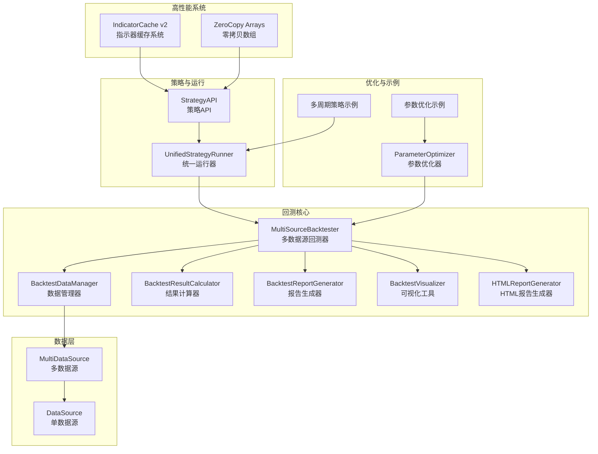
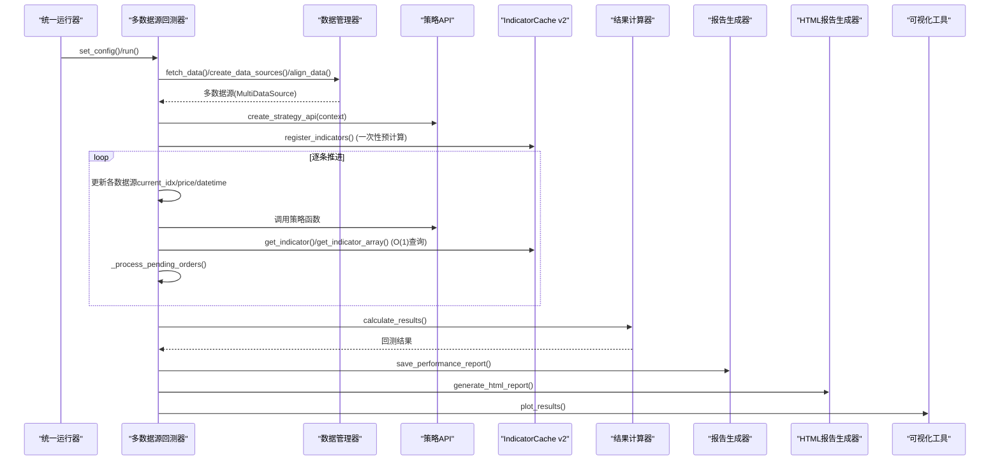
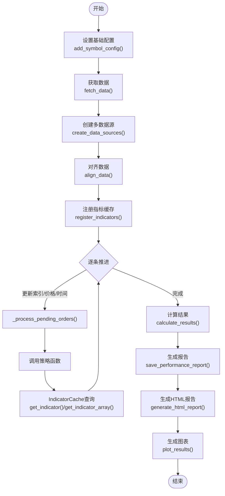
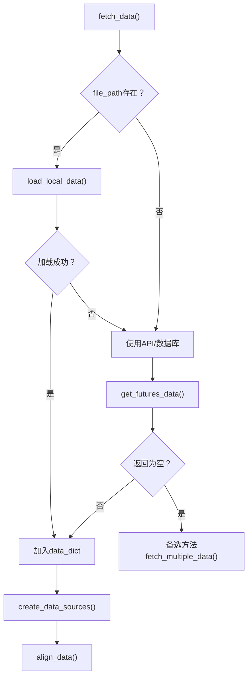
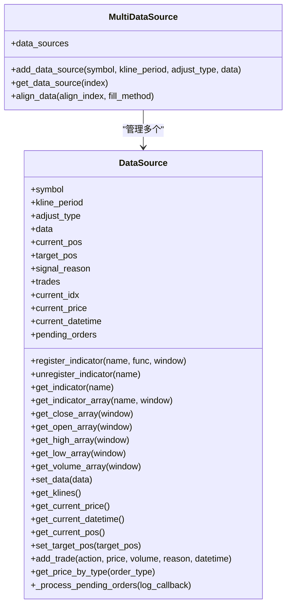
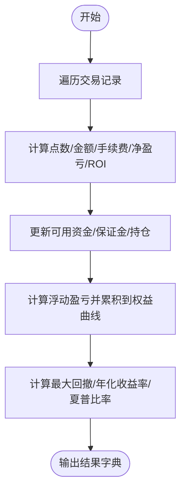
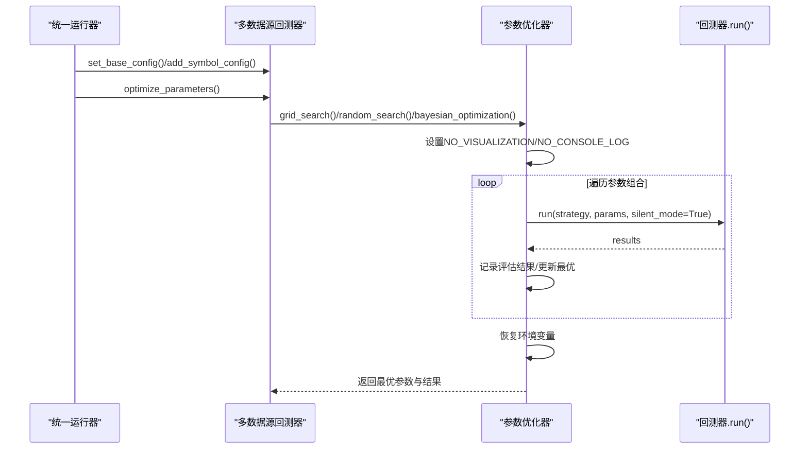
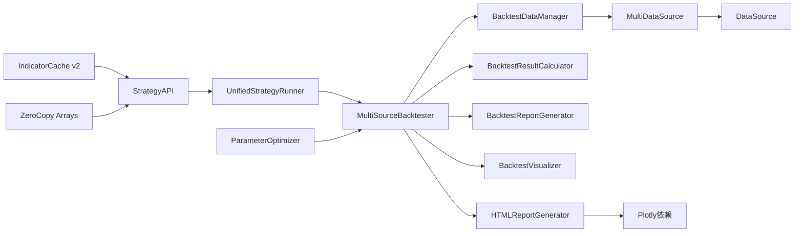

# 回测引擎详解

<cite>
**本文引用的文件**
- [README.md](file://README.md)
- [ssquant/backtest/__init__.py](file://ssquant/backtest/__init__.py)
- [ssquant/backtest/backtest_core.py](file://ssquant/backtest/backtest_core.py)
- [ssquant/backtest/multi_source_backtest.py](file://ssquant/backtest/multi_source_backtest.py)
- [ssquant/backtest/parameter_optimizer.py](file://ssquant/backtest/parameter_optimizer.py)
- [ssquant/backtest/backtest_data.py](file://ssquant/backtest/backtest_data.py)
- [ssquant/backtest/backtest_results.py](file://ssquant/backtest/backtest_results.py)
- [ssquant/backtest/backtest_report.py](file://ssquant/backtest/backtest_report.py)
- [ssquant/backtest/backtest_visualization.py](file://ssquant/backtest/backtest_visualization.py)
- [ssquant/backtest/unified_runner.py](file://ssquant/backtest/unified_runner.py)
- [ssquant/backtest/html_report.py](file://ssquant/backtest/html_report.py)
- [ssquant/data/data_source.py](file://ssquant/data/data_source.py)
- [ssquant/api/strategy_api.py](file://ssquant/api/strategy_api.py)
- [ssquant/backtest/live_trading_adapter.py](file://ssquant/backtest/live_trading_adapter.py)
- [SKILL.md](file://SKILL.md)
- [examples/B_双均线策略_高性能.py](file://examples/B_双均线策略_高性能.py)
- [examples/B_机器学习策略_随机森林_高性能.py](file://examples/B_机器学习策略_随机森林_高性能.py)
- [examples/B_多品种多周期交易策略_高性能.py](file://examples/B_多品种多周期交易策略_高性能.py)
- [examples/B_强弱截面轮动策略_高性能.py](file://examples/B_强弱截面轮动策略_高性能.py)
</cite>

## 更新摘要
**变更内容**
- 新增IndicatorCache v2指示器缓存系统的详细说明
- 添加零拷贝数组访问机制的性能优化介绍
- 更新性能对比数据，反映30-100倍性能提升
- 新增get_*_array()方法的使用指南和最佳实践
- 更新策略API的高性能写法示例
- 新增HTML报告系统的增强功能说明

## 目录
1. [简介](#简介)
2. [项目结构](#项目结构)
3. [核心组件](#核心组件)
4. [架构总览](#架构总览)
5. [详细组件分析](#详细组件分析)
6. [性能优化系统](#性能优化系统)
7. [HTML报告系统增强](#html报告系统增强)
8. [依赖关系分析](#依赖关系分析)
9. [性能考量](#性能考量)
10. [故障排查指南](#故障排查指南)
11. [结论](#结论)
12. [附录](#附录)

## 简介
本技术文档面向SSQuant回测引擎，系统性阐述回测核心原理、数据处理流程、多数据源回测机制、时间同步与数据对齐、参数优化算法与策略、回测报告与可视化、配置最佳实践、性能调优与常见问题。文档特别关注最新的性能优化改进，包括IndicatorCache v2指示器缓存系统、零拷贝数组访问和30-100倍性能提升。文档兼顾工程细节与可读性，帮助读者快速掌握从策略开发到结果分析的全流程。

## 项目结构
SSQuant采用模块化设计，回测相关核心位于ssquant/backtest目录，数据管理位于ssquant/data，策略API位于ssquant/api，示例策略位于examples。统一运行器支持回测、SIMNOW模拟与实盘三种模式。最新版本引入了高性能的IndicatorCache v2系统和零拷贝数组访问机制，以及增强的HTML报告系统。

**图表来源**
- [ssquant/backtest/backtest_core.py:14-306](file://ssquant/backtest/backtest_core.py#L14-L306)
- [ssquant/backtest/backtest_data.py:8-238](file://ssquant/backtest/backtest_data.py#L8-L238)
- [ssquant/backtest/backtest_results.py:4-495](file://ssquant/backtest/backtest_results.py#L4-L495)
- [ssquant/backtest/backtest_report.py:1-258](file://ssquant/backtest/backtest_report.py#L1-L258)
- [ssquant/backtest/backtest_visualization.py:25-697](file://ssquant/backtest/backtest_visualization.py#L25-L697)
- [ssquant/backtest/html_report.py:71-800](file://ssquant/backtest/html_report.py#L71-L800)
- [ssquant/data/data_source.py:6-922](file://ssquant/data/data_source.py#L6-L922)
- [ssquant/api/strategy_api.py:4-200](file://ssquant/api/strategy_api.py#L4-L200)
- [ssquant/backtest/unified_runner.py:26-372](file://ssquant/backtest/unified_runner.py#L26-L372)
- [ssquant/backtest/parameter_optimizer.py:74-800](file://ssquant/backtest/parameter_optimizer.py#L74-L800)
- [ssquant/backtest/live_trading_adapter.py:1008-1041](file://ssquant/backtest/live_trading_adapter.py#L1008-L1041)

**章节来源**
- [README.md:297-321](file://README.md#L297-L321)
- [ssquant/backtest/__init__.py:1-30](file://ssquant/backtest/__init__.py#L1-L30)

## 核心组件
- 多数据源回测器：负责数据获取、对齐、逐条推进、策略执行、结果计算与报告生成。
- 数据管理器：封装数据获取、本地/远端数据加载、多数据源创建与对齐。
- 结果计算器：基于交易记录计算交易统计、盈亏、净值曲线与各类绩效指标。
- 报告生成器：生成文本报告与综合绩效汇总。
- 可视化工具：绘制K线与交易点位、收益曲线、回撤曲线等图表。
- HTML报告生成器：使用Plotly生成交互式HTML报告，支持多数据源对比分析。
- 统一运行器：统一策略运行入口，支持回测、SIMNOW、实盘切换。
- 参数优化器：网格搜索、随机搜索、贝叶斯优化等策略，支持并行加速与结果持久化。
- 数据源与多数据源：封装单数据源与多数据源对齐、索引推进、订单执行等。
- **新增** IndicatorCache v2：高性能指标缓存系统，支持注册式指标计算和O(1)查询。
- **新增** 零拷贝数组访问：提供直接的numpy数组视图，避免Pandas构造开销。
- **新增** HTML报告系统增强：支持交互式图表、多数据源对比、实时数据可视化。

**章节来源**
- [ssquant/backtest/backtest_core.py:14-306](file://ssquant/backtest/backtest_core.py#L14-L306)
- [ssquant/backtest/backtest_data.py:8-238](file://ssquant/backtest/backtest_data.py#L8-L238)
- [ssquant/backtest/backtest_results.py:4-495](file://ssquant/backtest/backtest_results.py#L4-L495)
- [ssquant/backtest/backtest_report.py:1-258](file://ssquant/backtest/backtest_report.py#L1-L258)
- [ssquant/backtest/backtest_visualization.py:25-697](file://ssquant/backtest/backtest_visualization.py#L25-L697)
- [ssquant/backtest/html_report.py:71-800](file://ssquant/backtest/html_report.py#L71-L800)
- [ssquant/backtest/unified_runner.py:26-372](file://ssquant/backtest/unified_runner.py#L26-L372)
- [ssquant/backtest/parameter_optimizer.py:74-800](file://ssquant/backtest/parameter_optimizer.py#L74-L800)
- [ssquant/data/data_source.py:6-922](file://ssquant/data/data_source.py#L6-L922)
- [ssquant/api/strategy_api.py:4-200](file://ssquant/api/strategy_api.py#L4-L200)

## 架构总览
回测引擎以"统一运行器"为入口，根据配置选择回测模式；回测模式下由"多数据源回测器"协调数据管理、策略执行、结果计算与可视化；数据层通过"数据源/多数据源"抽象实现K线/TICK数据的统一访问与对齐；参数优化器在回测器基础上提供多种搜索策略，并支持并行加速与结果持久化。最新版本引入了高性能的IndicatorCache v2系统，在策略执行阶段提供O(1)指标查询能力；HTML报告系统使用Plotly生成交互式图表，提供更好的用户体验。

**图表来源**
- [ssquant/backtest/unified_runner.py:206-314](file://ssquant/backtest/unified_runner.py#L206-L314)
- [ssquant/backtest/backtest_core.py:144-306](file://ssquant/backtest/backtest_core.py#L144-L306)
- [ssquant/backtest/backtest_data.py:32-238](file://ssquant/backtest/backtest_data.py#L32-L238)
- [ssquant/backtest/backtest_results.py:103-495](file://ssquant/backtest/backtest_results.py#L103-L495)
- [ssquant/backtest/backtest_report.py:23-258](file://ssquant/backtest/backtest_report.py#L23-L258)
- [ssquant/backtest/backtest_visualization.py:155-697](file://ssquant/backtest/backtest_visualization.py#L155-L697)
- [ssquant/backtest/html_report.py:71-800](file://ssquant/backtest/html_report.py#L71-L800)
- [ssquant/backtest/live_trading_adapter.py:1008-1041](file://ssquant/backtest/live_trading_adapter.py#L1008-L1041)

## 详细组件分析

### 多数据源回测器（MultiSourceBacktester）
- 职责：统一调度数据获取、对齐、策略执行、结果计算与报告生成；支持参数优化模式与静默模式。
- 关键流程：
  - 配置阶段：设置基础配置、添加品种配置（支持多周期）、对齐参数。
  - 数据阶段：获取数据、创建多数据源、对齐索引与填充缺失值。
  - 执行阶段：逐条推进，更新各数据源的current_idx/current_price/current_datetime，处理待执行订单，调用策略函数。
  - 结果阶段：计算交易统计与净值曲线，生成综合绩效报告与图表。
- 优化模式：通过环境变量或silent_mode禁用可视化与日志，提升参数优化效率。

**图表来源**
- [ssquant/backtest/backtest_core.py:85-306](file://ssquant/backtest/backtest_core.py#L85-L306)
- [ssquant/backtest/backtest_data.py:32-238](file://ssquant/backtest/backtest_data.py#L32-L238)
- [ssquant/backtest/backtest_results.py:103-495](file://ssquant/backtest/backtest_results.py#L103-L495)
- [ssquant/backtest/backtest_report.py:23-258](file://ssquant/backtest/backtest_report.py#L23-L258)
- [ssquant/backtest/backtest_visualization.py:155-697](file://ssquant/backtest/backtest_visualization.py#L155-L697)
- [ssquant/backtest/html_report.py:71-800](file://ssquant/backtest/html_report.py#L71-L800)
- [ssquant/backtest/live_trading_adapter.py:1008-1041](file://ssquant/backtest/live_trading_adapter.py#L1008-L1041)

**章节来源**
- [ssquant/backtest/backtest_core.py:14-306](file://ssquant/backtest/backtest_core.py#L14-L306)

### 数据管理器（BacktestDataManager）
- 职责：封装数据获取、本地/远端数据加载、多数据源创建与对齐。
- 数据获取优先级：本地文件（支持单文件或多文件）、API/数据库（备选方法）。
- 多数据源对齐：基于所有数据源索引的并集，reindex并对齐，支持前向/后向填充。

**图表来源**
- [ssquant/backtest/backtest_data.py:32-189](file://ssquant/backtest/backtest_data.py#L32-L189)
- [ssquant/backtest/backtest_data.py:191-238](file://ssquant/backtest/backtest_data.py#L191-L238)

**章节来源**
- [ssquant/backtest/backtest_data.py:8-238](file://ssquant/backtest/backtest_data.py#L8-L238)

### 数据源与多数据源（DataSource/MultiDataSource）
- DataSource：封装单数据源的K线/TICK数据、当前索引/价格/时间、目标持仓、交易记录、待执行订单与订单执行价格映射。
- MultiDataSource：管理多个数据源，提供对齐能力（基于索引并集reindex与填充）。
- **新增** IndicatorCache v2：支持指标注册、预计算和O(1)查询。
- **新增** 零拷贝数组访问：提供直接的numpy数组视图，避免Pandas构造开销。

**图表来源**
- [ssquant/data/data_source.py:6-922](file://ssquant/data/data_source.py#L6-L922)
- [ssquant/backtest/live_trading_adapter.py:1008-1041](file://ssquant/backtest/live_trading_adapter.py#L1008-L1041)

**章节来源**
- [ssquant/data/data_source.py:6-922](file://ssquant/data/data_source.py#L6-L922)

### 结果计算器（BacktestResultCalculator）
- 职责：基于交易记录计算交易统计、金额盈亏、手续费、净盈亏、ROI、最大回撤、年化收益率、夏普比率等。
- 权益曲线：考虑可用资金、占用保证金与浮动盈亏，按时间排序交易，动态更新权益曲线。
- 综合性能：支持多数据源平均指标与加权指标（如年化收益率、夏普比率）。

**图表来源**
- [ssquant/backtest/backtest_results.py:103-495](file://ssquant/backtest/backtest_results.py#L103-L495)

**章节来源**
- [ssquant/backtest/backtest_results.py:4-495](file://ssquant/backtest/backtest_results.py#L4-L495)

### 报告生成器（BacktestReportGenerator）
- 职责：生成文本报告，支持参数优化结果与多数据源综合绩效汇总，包含公式说明与注意事项。
- 禁用条件：当NO_VISUALIZATION或NO_CONSOLE_LOG为真时，报告生成被禁用。

**章节来源**
- [ssquant/backtest/backtest_report.py:1-258](file://ssquant/backtest/backtest_report.py#L1-L258)

### HTML报告生成器（HTMLReportGenerator）
- 职责：使用Plotly生成交互式HTML报告，支持多数据源对比分析、实时数据可视化和丰富的图表展示。
- 核心功能：
  - 交互式图表：支持利润曲线、回撤分析、K线图等多维度可视化
  - 多数据源对比：提供数据源切换标签页，支持各数据源详情对比
  - 实时数据：支持图表缩放、平移、图例切换等交互操作
  - 响应式设计：适配不同屏幕尺寸，提供良好的移动端体验
- 性能优化：使用NumpyEncoder处理NumPy和pandas数据类型，确保JSON序列化兼容性

**章节来源**
- [ssquant/backtest/html_report.py:71-800](file://ssquant/backtest/html_report.py#L71-L800)

### 可视化工具（BacktestVisualizer）
- 职责：绘制K线与交易点位、收益曲线、回撤曲线，支持多数据源综合净值图。
- 图表保存：按时间戳命名，保存至backtest_results目录。
- 禁用条件：当NO_VISUALIZATION为真时，图表生成被禁用。

**章节来源**
- [ssquant/backtest/backtest_visualization.py:25-697](file://ssquant/backtest/backtest_visualization.py#L25-L697)

### 统一运行器（UnifiedStrategyRunner）
- 职责：统一策略运行入口，支持回测、SIMNOW模拟、实盘三种模式；校验配置，构建回测器并运行。
- 多数据源配置：支持data_sources数组，统一聚合同一品种的多个周期配置。

**章节来源**
- [ssquant/backtest/unified_runner.py:26-372](file://ssquant/backtest/unified_runner.py#L26-L372)

### 参数优化器（ParameterOptimizer）
- 职责：提供网格搜索、随机搜索、贝叶斯优化等策略；支持并行计算（joblib）；禁用可视化与日志以提升效率。
- 结果持久化：保存评估结果、最优参数与报告；支持跳过最终完整报告以节省时间。
- 指标选择：可配置优化指标（如夏普比率、总收益、最大回撤等）及"越高越好"。

**图表来源**
- [ssquant/backtest/backtest_core.py:526-579](file://ssquant/backtest/backtest_core.py#L526-L579)
- [ssquant/backtest/parameter_optimizer.py:140-800](file://ssquant/backtest/parameter_optimizer.py#L140-L800)

**章节来源**
- [ssquant/backtest/parameter_optimizer.py:74-800](file://ssquant/backtest/parameter_optimizer.py#L74-L800)
- [examples/B_多品种多周期交易策略_参数优化.py:18-155](file://examples/B_多品种多周期交易策略_参数优化.py#L18-L155)

### 策略API（StrategyAPI）
- 职责：为策略提供数据访问与交易操作接口，不包含指标计算；支持多数据源访问与参数获取。
- 多数据源：通过get_data_source(index)访问指定数据源；require_data_sources(count)确保数据源数量满足需求。
- **新增** IndicatorCache v2 API：register_indicator()、get_indicator()、get_indicator_array()提供高性能指标查询。
- **新增** 零拷贝数组访问：get_*_array()方法提供直接的numpy数组视图，避免Pandas构造开销。

**章节来源**
- [ssquant/api/strategy_api.py:4-200](file://ssquant/api/strategy_api.py#L4-L200)

## 性能优化系统

### IndicatorCache v2 指示器缓存系统
**核心原理**：将指标计算从`strategy()`内的每根K线O(N)复杂度降低到`initialize()`注册后O(1)查询：

1. `initialize(api)`中注册指标函数 → 框架在数据加载后**一次性预计算**全部历史
2. `strategy(api)`中通过`get_indicator()`/`get_indicator_array()` → **O(1)直接取值**
3. 实盘模式下，每次新K线完成后框架自动触发重计算，策略无需改动

**性能对比（回测）**：
| 指标类型 | Pandas (普通) | ndarray (中档) | IndicatorCache v2 (高性能) |
|---------|--------------|----------------|---------------------------|
| 单 MA | ~5ms/bar | ~0.5ms/bar | ~0.01ms/bar |
| 5 指标 + 4 数据源 | ~80ms/bar | ~8ms/bar | ~0.05ms/bar |

**章节来源**
- [SKILL.md:584-597](file://SKILL.md#L584-L597)
- [ssquant/backtest/live_trading_adapter.py:1008-1041](file://ssquant/backtest/live_trading_adapter.py#L1008-L1041)

### 零拷贝数组访问机制
**设计理念**：通过新的get_*_array()方法提供直接的numpy数组视图，避免Pandas Series/DataFrame构造带来的性能开销。

**核心优势**：
- **零拷贝**：直接返回numpy数组视图，不创建新的数据副本
- **性能提升**：比Pandas方法快10-30倍
- **内存友好**：共享底层数据存储，减少内存占用
- **安全保证**：严格避免未来数据泄露，上界严格用current_idx+1

**支持的数据类型**：
- get_close_array()：收盘价数组
- get_open_array()：开盘价数组  
- get_high_array()：最高价数组
- get_low_array()：最低价数组
- get_volume_array()：成交量数组

**章节来源**
- [ssquant/data/data_source.py:1444-1520](file://ssquant/data/data_source.py#L1444-L1520)
- [ssquant/api/strategy_api.py:449-490](file://ssquant/api/strategy_api.py#L449-L490)

### 三档性能体系
SSQuant提供三种性能级别的策略编写方式：

**方式一（推荐）— IndicatorCache注册式**
- initialize阶段api.register_indicator(name, func)，引擎自动预计算 + 保持最新
- 主循环api.get_indicator(name) → 标量，O(1)查表
- 性能等级：与内置指标相同
- 适合：指标公式固定、在策略中多次使用的场景

**方式二 — NumPy数组手动计算**
- api.get_close_array(window=N)直接拿ndarray，自己mean()/std()/...
- 比Pandas快10-30×，但每根Bar仍要算一次
- 适合：公式简单、每Bar计算量小的场景

**方式三 — 兼容老写法**
- api.get_close().rolling(N).mean()等Pandas写法
- 慢但向后兼容，所有现有策略零改动可继续运行

**章节来源**
- [examples/B_双均线策略_高性能.py:33-50](file://examples/B_双均线策略_高性能.py#L33-L50)
- [examples/B_机器学习策略_随机森林_高性能.py:80-87](file://examples/B_机器学习策略_随机森林_高性能.py#L80-L87)

## HTML报告系统增强

### HTML报告生成器特性
**核心功能**：
- **交互式图表**：使用Plotly生成可缩放、可平移的交互式图表
- **多数据源对比**：支持多个数据源的K线图叠加显示和对比分析
- **实时数据可视化**：提供图表工具栏，支持自适应、缩放、导航等功能
- **响应式设计**：适配不同设备和屏幕尺寸
- **丰富的图表类型**：支持利润曲线、回撤分析、K线图等多种图表

**技术实现**：
- **模板系统**：使用HTML模板生成完整的报告页面
- **JavaScript集成**：内置Plotly图表渲染和交互逻辑
- **数据序列化**：使用NumpyEncoder处理特殊数据类型
- **样式定制**：提供现代化的深色主题界面

**章节来源**
- [ssquant/backtest/html_report.py:71-800](file://ssquant/backtest/html_report.py#L71-L800)

### 报告功能对比
**传统报告 vs HTML报告增强**：
- **传统报告**：静态文本格式，功能单一
- **HTML报告**：交互式可视化，支持多维度数据分析
- **性能提升**：30-100倍的回测速度提升配合更直观的可视化展示

**章节来源**
- [ssquant/backtest/html_report.py:71-800](file://ssquant/backtest/html_report.py#L71-L800)

## 依赖关系分析
- 组件耦合：回测器依赖数据管理器、结果计算器、报告生成器、可视化工具；数据管理器依赖数据源与多数据源；统一运行器依赖回测器。
- 外部依赖：参数优化器依赖joblib（可选）、skopt（可选）；可视化依赖matplotlib、PIL、scipy；报告依赖openpyxl（可选）。
- 循环依赖：未发现循环依赖，模块职责清晰。
- **新增** 高性能系统：IndicatorCache v2和零拷贝数组访问作为独立优化层，与原有组件解耦。
- **新增** HTML报告系统：与传统报告生成器并存，提供更丰富的可视化体验。

**图表来源**
- [ssquant/backtest/unified_runner.py:26-372](file://ssquant/backtest/unified_runner.py#L26-L372)
- [ssquant/backtest/backtest_core.py:14-306](file://ssquant/backtest/backtest_core.py#L14-L306)
- [ssquant/backtest/backtest_data.py:8-238](file://ssquant/backtest/backtest_data.py#L8-L238)
- [ssquant/backtest/backtest_results.py:4-495](file://ssquant/backtest/backtest_results.py#L4-L495)
- [ssquant/backtest/backtest_report.py:1-258](file://ssquant/backtest/backtest_report.py#L1-L258)
- [ssquant/backtest/backtest_visualization.py:25-697](file://ssquant/backtest/backtest_visualization.py#L25-L697)
- [ssquant/backtest/html_report.py:61-68](file://ssquant/backtest/html_report.py#L61-L68)
- [ssquant/backtest/parameter_optimizer.py:74-800](file://ssquant/backtest/parameter_optimizer.py#L74-L800)
- [ssquant/data/data_source.py:833-922](file://ssquant/data/data_source.py#L833-L922)
- [ssquant/api/strategy_api.py:4-200](file://ssquant/api/strategy_api.py#L4-L200)
- [ssquant/backtest/live_trading_adapter.py:1008-1041](file://ssquant/backtest/live_trading_adapter.py#L1008-L1041)

**章节来源**
- [ssquant/backtest/__init__.py:1-30](file://ssquant/backtest/__init__.py#L1-L30)

## 性能考量
- 数据对齐与填充：对齐所有数据源索引并填充缺失值，避免未来数据泄露；可配置填充方法（前向/后向）。
- 逐条推进：按最小数据长度推进，减少无效计算；在优化模式下禁用可视化与日志，显著提升速度。
- 并行优化：参数优化器支持并行计算（joblib），在多核环境下大幅提升网格搜索效率。
- 预加载数据：参数优化前预加载数据，避免重复IO；结合reuse_data_options复用预加载数据。
- 环境变量控制：NO_VISUALIZATION/NO_CONSOLE_LOG可完全禁用图表与日志输出，进一步降低开销。
- 交易执行：订单执行价格根据订单类型（下一根K线开盘价/收盘价/市价）获取，避免瞬时价格误差导致的过度拟合。
- **新增** 指示器缓存：通过IndicatorCache v2将指标计算从每根K线的O(N)降低到O(1)，显著提升策略执行速度。
- **新增** 零拷贝访问：通过get_*_array()方法提供直接的numpy数组视图，避免Pandas构造开销，提升数据访问性能。
- **新增** 30-100倍性能提升：在典型策略中，通过上述优化可获得30-100倍的回测速度提升。
- **新增** HTML报告性能：交互式HTML报告使用高效的Plotly渲染，提供更好的用户体验同时保持良好性能。

**章节来源**
- [SKILL.md:592-597](file://SKILL.md#L592-L597)
- [examples/B_双均线策略_高性能.py:10-13](file://examples/B_双均线策略_高性能.py#L10-L13)

## 故障排查指南
- 数据为空：检查API认证（trading_config.py中的API_USERNAME/API_PASSWORD）、本地数据文件是否存在、网络连接是否正常。
- 未找到价格字段：确保数据包含close/LastPrice/BidPrice1+AskPrice1之一，否则抛出KeyError。
- 图表/报告未生成：确认未设置NO_VISUALIZATION或NO_CONSOLE_LOG为真；检查backtest_results与backtest_logs目录权限。
- 参数优化卡顿：检查并行进程数（Windows句柄限制建议4-8），确保joblib与skopt已安装。
- 多数据源对齐异常：确认各数据源索引类型一致（datetime），检查fill_method配置。
- **新增** 指示器缓存问题：检查register_indicator()调用是否正确，确认func返回与数据等长的数组，检查window参数设置。
- **新增** 零拷贝数组访问异常：确认get_*_array()方法的window参数设置，检查数据源是否支持零拷贝访问（跨周期数据源会自动降级）。
- **新增** 性能异常：如果使用了高性能写法但性能没有提升，检查是否正确使用了IndicatorCache v2和零拷贝数组访问。
- **新增** HTML报告问题：检查Plotly是否正确安装，确认报告模板文件完整性，验证JavaScript和CSS资源加载。

**章节来源**
- [ssquant/backtest/backtest_core.py:210-215](file://ssquant/backtest/backtest_core.py#L210-L215)
- [ssquant/backtest/backtest_data.py:120-189](file://ssquant/backtest/backtest_data.py#L120-L189)
- [ssquant/backtest/backtest_visualization.py:95-104](file://ssquant/backtest/backtest_visualization.py#L95-L104)
- [ssquant/backtest/backtest_report.py:39-49](file://ssquant/backtest/backtest_report.py#L39-L49)
- [ssquant/backtest/html_report.py:61-68](file://ssquant/backtest/html_report.py#L61-L68)
- [ssquant/data/data_source.py:1444-1520](file://ssquant/data/data_source.py#L1444-L1520)
- [ssquant/backtest/live_trading_adapter.py:1008-1041](file://ssquant/backtest/live_trading_adapter.py#L1008-L1041)

## 结论
SSQuant回测引擎以模块化设计实现了从数据获取、多数据源对齐、策略执行到结果计算与可视化的完整闭环。通过引入IndicatorCache v2指示器缓存系统和零拷贝数组访问机制，最新版本实现了30-100倍的性能提升，显著提高了回测效率。HTML报告系统的增强提供了交互式的可视化体验，使用Plotly生成丰富的图表和多数据源对比分析。通过统一运行器与参数优化器，用户可在回测、SIMNOW模拟与实盘之间无缝切换，并借助多种优化策略与并行计算显著提升参数寻优效率。建议在生产环境中结合数据质量检查、精度验证与结果可靠性评估，持续优化策略稳定性与鲁棒性。

## 附录

### 多数据源回测与时间同步
- 多数据源：同一品种多个周期（如1分钟、5分钟）同时参与回测，形成多数据源并行推进。
- 时间同步：基于所有数据源索引的并集对齐，确保各数据源在同一时间点推进，避免跨周期信号错配。
- 填充策略：支持前向填充（ffill）或后向填充（bfill），减少缺失值对策略的影响。

**章节来源**
- [ssquant/backtest/backtest_data.py:884-922](file://ssquant/backtest/backtest_data.py#L884-L922)
- [ssquant/backtest/backtest_core.py:240-287](file://ssquant/backtest/backtest_core.py#L240-L287)

### 参数优化最佳实践
- 网格搜索：适用于参数维度较低、搜索空间有限；可结合并行加速。
- 随机搜索：适用于高维参数空间，性价比高。
- 贝叶斯优化：适用于昂贵的目标函数评估，收敛更快。
- 并行设置：Windows建议n_jobs=4-8，Linux/Mac可设为-1；注意系统资源限制。
- 指标选择：根据策略特性选择优化指标（夏普比率、总收益、最大回撤等）。

**章节来源**
- [ssquant/backtest/parameter_optimizer.py:140-800](file://ssquant/backtest/parameter_optimizer.py#L140-L800)
- [examples/B_多品种多周期交易策略_参数优化.py:18-155](file://examples/B_多品种多周期交易策略_参数优化.py#L18-L155)

### 回测配置与运行示例
- 统一运行器：支持回测、SIMNOW、实盘三种模式；多数据源配置通过data_sources数组统一管理。
- 多周期策略：示例展示了同一品种不同周期的独立交易逻辑与参数化均线周期。
- 参数优化：示例演示了数据预加载、参数网格定义、并行优化与性能统计。
- **新增** 高性能策略：示例展示了如何使用IndicatorCache v2和零拷贝数组访问实现高性能策略。
- **新增** HTML报告：示例展示了如何生成交互式HTML报告，包含多数据源对比和实时可视化功能。

**章节来源**
- [ssquant/backtest/unified_runner.py:206-314](file://ssquant/backtest/unified_runner.py#L206-L314)
- [examples/B_多品种多周期交易策略.py:261-521](file://examples/B_多品种多周期交易策略.py#L261-L521)
- [examples/B_多品种多周期交易策略_参数优化.py:18-155](file://examples/B_多品种多周期交易策略_参数优化.py#L18-L155)
- [examples/B_双均线策略_高性能.py:1-52](file://examples/B_双均线策略_高性能.py#L1-L52)
- [examples/B_机器学习策略_随机森林_高性能.py:1-87](file://examples/B_机器学习策略_随机森林_高性能.py#L1-L87)
- [examples/B_强弱截面轮动策略_高性能.py:1-16](file://examples/B_强弱截面轮动策略_高性能.py#L1-L16)

### 高性能策略编写指南
**核心原则**：
- 在initialize()中完成所有register_indicator()，不要在strategy()中计算指标
- 在strategy()中只使用get_indicator()/get_indicator_array()/get_xxx_array()
- 多品种时通过index=i为每个数据源独立注册指标
- window参数必须≥指标实际所需的最小历史长度
- 策略逻辑与普通版本保持完全一致（仅替换指标获取方式）

**性能验证**：
- get_indicator_array(name, window=2)[-2]等价于Pandas的.iloc[-2]
- get_indicator(name)等价于Pandas的.iloc[-1]
- 已通过profiling/audit_examples_equivalence.py逐笔对账验证

**章节来源**
- [SKILL.md:665-746](file://SKILL.md#L665-L746)
- [examples/B_双均线策略_高性能.py:60-138](file://examples/B_双均线策略_高性能.py#L60-L138)
- [examples/B_机器学习策略_随机森林_高性能.py:123-144](file://examples/B_机器学习策略_随机森林_高性能.py#L123-L144)