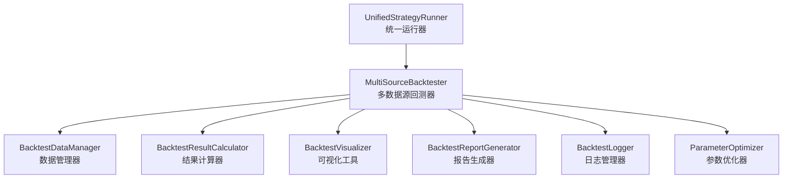
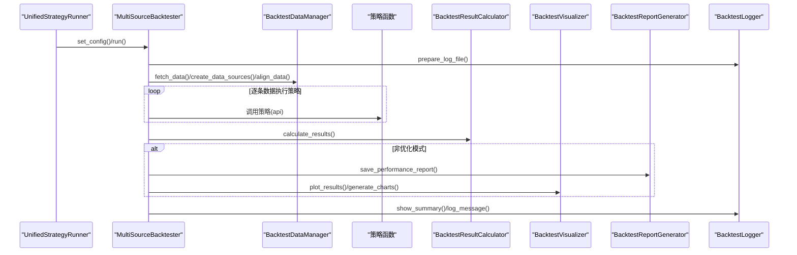
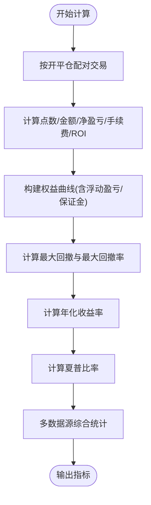
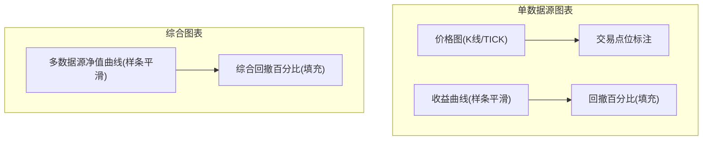
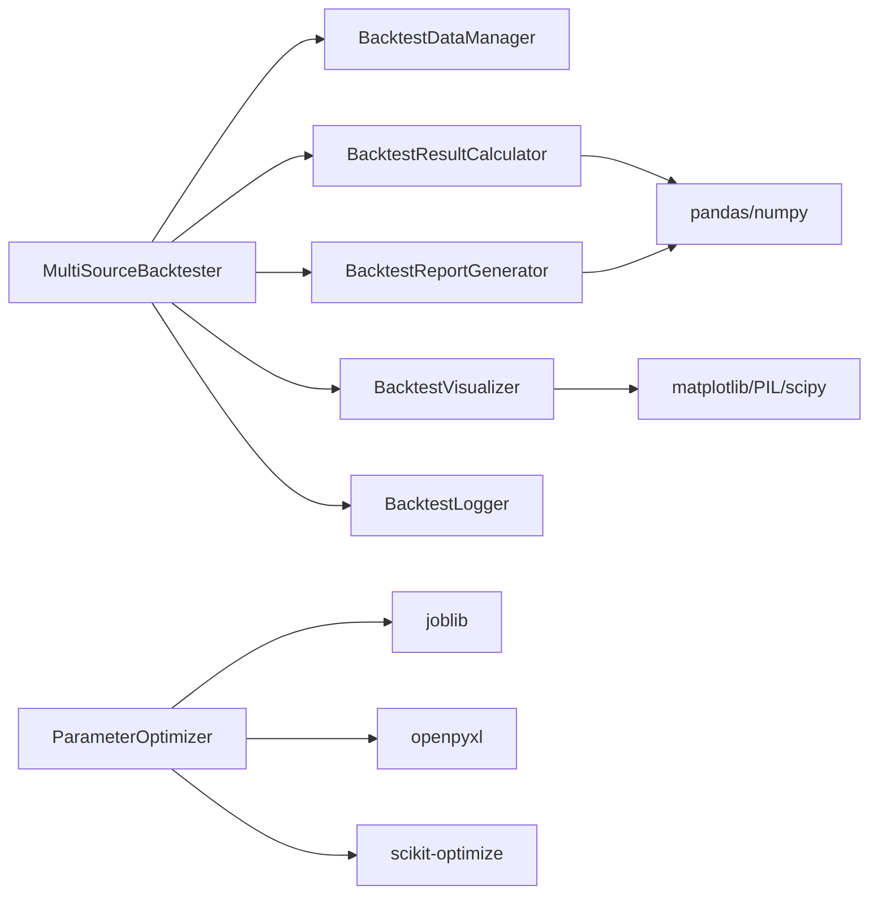

# 回测报告系统

<cite>
**本文引用的文件**
- [README.md](file://README.md)
- [ssquant/backtest/__init__.py](file://ssquant/backtest/__init__.py)
- [ssquant/backtest/backtest_core.py](file://ssquant/backtest/backtest_core.py)
- [ssquant/backtest/backtest_data.py](file://ssquant/backtest/backtest_data.py)
- [ssquant/backtest/backtest_results.py](file://ssquant/backtest/backtest_results.py)
- [ssquant/backtest/backtest_visualization.py](file://ssquant/backtest/backtest_visualization.py)
- [ssquant/backtest/backtest_report.py](file://ssquant/backtest/backtest_report.py)
- [ssquant/backtest/backtest_logger.py](file://ssquant/backtest/backtest_logger.py)
- [ssquant/backtest/unified_runner.py](file://ssquant/backtest/unified_runner.py)
- [ssquant/backtest/parameter_optimizer.py](file://ssquant/backtest/parameter_optimizer.py)
- [examples/B_双均线策略.py](file://examples/B_双均线策略.py)
- [examples/B_海龟交易策略.py](file://examples/B_海龟交易策略.py)
</cite>

## 目录
1. [简介](#简介)
2. [项目结构](#项目结构)
3. [核心组件](#核心组件)
4. [架构总览](#架构总览)
5. [详细组件分析](#详细组件分析)
6. [依赖关系分析](#依赖关系分析)
7. [性能考量](#性能考量)
8. [故障排查指南](#故障排查指南)
9. [结论](#结论)
10. [附录](#附录)

## 简介
本文件面向SSQuant回测报告系统，系统性梳理回测结果的统计计算方法、可视化图表生成机制、报告模板设计与输出规范，并提供自定义指标开发、图表样式定制与报告自动化生成的实现指南，以及报告质量验证、数据准确性检查与异常结果标注的最佳实践。

## 项目结构
回测系统采用模块化设计，核心围绕“统一运行器”驱动回测流程，贯穿数据获取、策略执行、结果计算、报告生成与可视化输出。关键模块如下：
- backtest_core：多数据源回测器，负责策略执行、进度与结果汇总
- backtest_data：数据管理器，负责多数据源获取、对齐与创建
- backtest_results：结果计算器，负责交易统计、盈亏与绩效指标计算
- backtest_report：报告生成器，负责文本报告与公式说明
- backtest_visualization：可视化工具，负责K线图、收益曲线、回撤图与综合图表
- backtest_logger：日志管理器，负责日志文件与性能报告文件路径管理
- unified_runner：统一运行器，支持回测/SIMNOW/实盘三种模式
- parameter_optimizer：参数优化器，支持网格搜索、随机搜索、贝叶斯优化等

**图表来源**
- [ssquant/backtest/unified_runner.py](file://ssquant/backtest/unified_runner.py#L26-L379)
- [ssquant/backtest/backtest_core.py](file://ssquant/backtest/backtest_core.py#L14-L579)
- [ssquant/backtest/backtest_data.py](file://ssquant/backtest/backtest_data.py#L8-L246)
- [ssquant/backtest/backtest_results.py](file://ssquant/backtest/backtest_results.py#L4-L544)
- [ssquant/backtest/backtest_visualization.py](file://ssquant/backtest/backtest_visualization.py#L25-L859)
- [ssquant/backtest/backtest_report.py](file://ssquant/backtest/backtest_report.py#L1-L299)
- [ssquant/backtest/backtest_logger.py](file://ssquant/backtest/backtest_logger.py#L4-L90)
- [ssquant/backtest/parameter_optimizer.py](file://ssquant/backtest/parameter_optimizer.py#L74-L200)

**章节来源**
- [README.md](file://README.md#L297-L321)
- [ssquant/backtest/__init__.py](file://ssquant/backtest/__init__.py#L1-L30)

## 核心组件
- 多数据源回测器：负责策略执行、进度条、结果汇总与图表/报告生成
- 数据管理器：负责多数据源获取、对齐与创建
- 结果计算器：负责交易统计、盈亏计算、权益曲线、最大回撤、年化收益率、夏普比率等指标
- 报告生成器：负责文本报告生成与公式说明
- 可视化工具：负责K线图、收益曲线、回撤图与综合图表
- 日志管理器：负责日志文件与性能报告文件路径管理
- 统一运行器：支持回测/SIMNOW/实盘三种模式
- 参数优化器：支持多种优化方法，支持静默模式与并行加速

**章节来源**
- [ssquant/backtest/backtest_core.py](file://ssquant/backtest/backtest_core.py#L14-L579)
- [ssquant/backtest/backtest_data.py](file://ssquant/backtest/backtest_data.py#L8-L246)
- [ssquant/backtest/backtest_results.py](file://ssquant/backtest/backtest_results.py#L4-L544)
- [ssquant/backtest/backtest_report.py](file://ssquant/backtest/backtest_report.py#L1-L299)
- [ssquant/backtest/backtest_visualization.py](file://ssquant/backtest/backtest_visualization.py#L25-L859)
- [ssquant/backtest/backtest_logger.py](file://ssquant/backtest/backtest_logger.py#L4-L90)
- [ssquant/backtest/unified_runner.py](file://ssquant/backtest/unified_runner.py#L26-L379)
- [ssquant/backtest/parameter_optimizer.py](file://ssquant/backtest/parameter_optimizer.py#L74-L200)

## 架构总览
回测流程从统一运行器开始，根据配置选择回测模式，随后由多数据源回测器驱动策略执行，期间通过数据管理器获取与对齐数据，策略执行产生交易记录，由结果计算器计算统计与指标，最终由报告生成器与可视化工具分别输出文本报告与图表。

**图表来源**
- [ssquant/backtest/unified_runner.py](file://ssquant/backtest/unified_runner.py#L206-L314)
- [ssquant/backtest/backtest_core.py](file://ssquant/backtest/backtest_core.py#L144-L380)
- [ssquant/backtest/backtest_data.py](file://ssquant/backtest/backtest_data.py#L32-L238)
- [ssquant/backtest/backtest_results.py](file://ssquant/backtest/backtest_results.py#L103-L495)
- [ssquant/backtest/backtest_report.py](file://ssquant/backtest/backtest_report.py#L23-L299)
- [ssquant/backtest/backtest_visualization.py](file://ssquant/backtest/backtest_visualization.py#L155-L697)
- [ssquant/backtest/backtest_logger.py](file://ssquant/backtest/backtest_logger.py#L21-L90)

## 详细组件分析

### 统计计算方法与实现细节
- 交易统计与盈亏计算
  - 交易对配对：按开平仓顺序配对，开仓交易记录手续费，平仓交易计算点数盈亏、金额盈亏、净盈亏与ROI
  - 盈亏比修正：使用平均盈利/平均亏损的绝对值，若总体亏损且比值>1则取倒数，确保结果合理
  - 未配对开仓处理：最后一笔未平仓开仓交易单独处理手续费与保证金占用
- 权益曲线与最大回撤
  - 权益曲线：按时间累积交易净盈亏并叠加初始资金，同时考虑持仓浮动盈亏与保证金占用
  - 最大回撤：对权益曲线进行修正（不允许负值），计算累计最大值与回撤，最大回撤率=回撤/回撤前最高权益×100%
- 年化收益率与夏普比率
  - 年化收益率：总净盈亏/初始资金/交易周期(年)×100%，交易周期按起止日期推导
  - 夏普比率：(日收益率均值-无风险利率)/日收益率标准差×√250，无风险利率默认0.03/250日
- 综合指标
  - 多数据源综合：对所有数据源的权益曲线进行对齐与叠加，计算综合最大回撤与加权平均年化收益率、夏普比率
  - 交易统计综合：按交易次数加权计算胜率、平均盈利、平均亏损、盈亏比

**图表来源**
- [ssquant/backtest/backtest_results.py](file://ssquant/backtest/backtest_results.py#L136-L495)

**章节来源**
- [ssquant/backtest/backtest_results.py](file://ssquant/backtest/backtest_results.py#L136-L495)
- [ssquant/backtest/backtest_report.py](file://ssquant/backtest/backtest_report.py#L235-L256)

### 可视化图表生成机制
- K线图与交易点位
  - K线图：支持蜡烛图绘制，涨跌颜色区分，实体与影线分离绘制
  - TICK数据：绘制价格曲线并进行样条插值平滑
  - 交易点位：在K线图上标注开多/平多/开空/平空点位，使用不同颜色与形状
- 收益曲线与回撤图
  - 收益曲线：对权益曲线进行样条插值平滑，动态调整Y轴范围，避免小范围图形过度放大
  - 回撤图：计算累计最大值与回撤百分比，填充红色区域，Y轴从最大回撤向上显示
- 综合图表
  - 多数据源净值曲线：对齐各数据源的日期索引，计算各品种净值并取平均，绘制综合净值曲线
  - 综合回撤：基于综合净值曲线计算回撤百分比并绘制
- 图表样式与水印
  - 字体与中文字体支持，中文负号显示处理
  - 顶部Logo水印，网站标识添加于各子图左下角

**图表来源**
- [ssquant/backtest/backtest_visualization.py](file://ssquant/backtest/backtest_visualization.py#L220-L487)
- [ssquant/backtest/backtest_visualization.py](file://ssquant/backtest/backtest_visualization.py#L528-L697)

**章节来源**
- [ssquant/backtest/backtest_visualization.py](file://ssquant/backtest/backtest_visualization.py#L220-L697)

### 报告模板设计与输出规范
- 报告内容
  - 单数据源回测结果：总交易次数、盈利/亏损交易、胜率、初始/期末权益、净值、总点数/金额盈亏、总手续费、总净盈亏、平均盈利/亏损、盈亏比、最大回撤、年化收益率、夏普比率、交易明细
  - 综合绩效：多数据源加权统计，综合最大回撤、加权年化收益率、加权夏普比率
  - 公式说明：胜率、净值、总点数盈亏、总金额盈亏、总净盈亏、平均盈利、平均亏损、盈亏比、最大回撤、最大回撤率、年化收益率、夏普比率的计算公式
- 输出位置
  - 文本报告：backtest_results目录下performance_*.txt
  - 图表：backtest_results目录下*.png
  - 日志：backtest_logs目录下backtest_*.log
- 环境变量控制
  - NO_VISUALIZATION=true：禁用图表与报告生成
  - NO_CONSOLE_LOG=true：禁用控制台日志输出（参数优化时常用）

**章节来源**
- [ssquant/backtest/backtest_report.py](file://ssquant/backtest/backtest_report.py#L23-L299)
- [ssquant/backtest/backtest_logger.py](file://ssquant/backtest/backtest_logger.py#L21-L90)

### 自定义指标开发指南
- 指标接入点
  - 在策略中通过API获取K线序列与技术指标，结合交易信号进行决策
  - 可在策略中记录自定义信号原因，便于报告与可视化标注
- 指标计算建议
  - 使用pandas/numpy进行向量化计算，避免逐行循环
  - 注意数据长度与边界条件，确保指标在回测早期阶段的稳定性
  - 对于波动率类指标（如ATR），建议使用滚动窗口并处理NaN值
- 指标持久化
  - 可将指标序列作为策略参数或中间结果保存，供后续分析使用

**章节来源**
- [examples/B_海龟交易策略.py](file://examples/B_海龟交易策略.py#L85-L117)
- [examples/B_双均线策略.py](file://examples/B_双均线策略.py#L39-L123)

### 图表样式定制
- 字体与显示
  - 自动检测平台并设置中文字体，解决负号显示问题
  - 图表尺寸与网格布局可调，顶部Logo水印与网站标识可保留或隐藏
- 交易点位样式
  - 开多/平多/开空/平空使用不同颜色与形状标注，便于区分
- 回撤图样式
  - 回撤百分比填充红色，Y轴从最大回撤向上显示，确保视觉一致性

**章节来源**
- [ssquant/backtest/backtest_visualization.py](file://ssquant/backtest/backtest_visualization.py#L11-L24)
- [ssquant/backtest/backtest_visualization.py](file://ssquant/backtest/backtest_visualization.py#L285-L311)

### 报告自动化生成
- 统一运行器模式
  - 回测模式：自动保存性能报告与图表，支持静默模式（参数优化）
  - SIMNOW/实盘模式：通过适配器运行，策略API保持一致
- 参数优化模式
  - 自动设置环境变量禁用图表与日志，提升优化效率
  - 支持并行计算（joblib），加速参数组合评估

**章节来源**
- [ssquant/backtest/unified_runner.py](file://ssquant/backtest/unified_runner.py#L206-L314)
- [ssquant/backtest/parameter_optimizer.py](file://ssquant/backtest/parameter_optimizer.py#L140-L200)

## 依赖关系分析
- 组件耦合
  - MultiSourceBacktester依赖BacktestDataManager、BacktestResultCalculator、BacktestVisualizer、BacktestReportGenerator、BacktestLogger
  - BacktestResultCalculator依赖pandas/numpy进行统计计算
  - BacktestVisualizer依赖matplotlib/PIL/scipy进行绘图与插值
  - BacktestReportGenerator依赖pandas进行综合统计与文件输出
- 外部依赖
  - pandas/numpy：数据结构与数值计算
  - matplotlib/PIL/scipy：图表绘制与插值
  - openpyxl/joblib/skopt：可选功能（Excel导出、并行、贝叶斯优化）

**图表来源**
- [ssquant/backtest/backtest_core.py](file://ssquant/backtest/backtest_core.py#L14-L81)
- [ssquant/backtest/backtest_results.py](file://ssquant/backtest/backtest_results.py#L1-L2)
- [ssquant/backtest/backtest_visualization.py](file://ssquant/backtest/backtest_visualization.py#L1-L9)
- [ssquant/backtest/backtest_report.py](file://ssquant/backtest/backtest_report.py#L1-L2)
- [ssquant/backtest/parameter_optimizer.py](file://ssquant/backtest/parameter_optimizer.py#L11-L44)

**章节来源**
- [ssquant/backtest/backtest_core.py](file://ssquant/backtest/backtest_core.py#L14-L81)
- [ssquant/backtest/parameter_optimizer.py](file://ssquant/backtest/parameter_optimizer.py#L11-L44)

## 性能考量
- 数据对齐与填充
  - 多数据源对齐时使用ffill/bfill填充，减少缺失值影响
- 插值平滑
  - 收益曲线与价格曲线采用样条插值（数据量多）或线性插值（数据量少），兼顾平滑与性能
- 并行优化
  - 参数优化支持joblib并行，显著缩短评估时间
- 环境变量控制
  - 在参数优化与批量运行时禁用图表与日志，降低I/O与渲染开销

[本节为一般性指导，无需特定文件引用]

## 故障排查指南
- 数据获取失败
  - 检查API认证配置（trading_config.py），确认用户名/密码正确
  - 检查本地数据文件是否存在，或网络连接是否稳定
- 回测无数据
  - 确认数据源配置正确，周期与复权类型匹配
  - 检查数据对齐与填充是否生效
- 图表生成失败
  - 确认matplotlib后端设置（Agg），避免无GUI环境报错
  - 检查Logo图片路径与权限
- 报告生成异常
  - 检查NO_VISUALIZATION/NO_CONSOLE_LOG环境变量
  - 确认backtest_results与backtest_logs目录可写
- 参数优化卡顿
  - 启用并行计算（n_jobs=-1），确保joblib可用
  - 在优化前预加载数据，避免重复IO

**章节来源**
- [ssquant/backtest/backtest_data.py](file://ssquant/backtest/backtest_data.py#L119-L186)
- [ssquant/backtest/backtest_visualization.py](file://ssquant/backtest/backtest_visualization.py#L48-L85)
- [ssquant/backtest/backtest_report.py](file://ssquant/backtest/backtest_report.py#L39-L48)
- [ssquant/backtest/parameter_optimizer.py](file://ssquant/backtest/parameter_optimizer.py#L177-L185)

## 结论
SSQuant回测报告系统通过模块化设计实现了从数据获取、策略执行、统计计算到报告与可视化的完整闭环。系统在指标计算上注重严谨性与实用性，在可视化上强调清晰与可读性，并通过统一运行器与参数优化器支持策略开发与优化的自动化流程。遵循本文提供的最佳实践，可显著提升报告质量与分析效率。

[本节为总结性内容，无需特定文件引用]

## 附录

### 关键流程与数据流
- 回测流程：统一运行器→多数据源回测器→数据管理器→策略执行→结果计算→报告与可视化
- 数据流：K线/TICK数据→策略API→交易记录→权益曲线→统计指标→报告与图表

**章节来源**
- [ssquant/backtest/unified_runner.py](file://ssquant/backtest/unified_runner.py#L206-L314)
- [ssquant/backtest/backtest_core.py](file://ssquant/backtest/backtest_core.py#L144-L380)
- [ssquant/backtest/backtest_results.py](file://ssquant/backtest/backtest_results.py#L103-L495)
- [ssquant/backtest/backtest_visualization.py](file://ssquant/backtest/backtest_visualization.py#L155-L697)
- [ssquant/backtest/backtest_report.py](file://ssquant/backtest/backtest_report.py#L23-L299)

### 示例策略参考
- 双均线策略：展示统一运行器与策略参数配置
- 海龟交易策略：展示波动率调整头寸管理与多数据源遍历

**章节来源**
- [examples/B_双均线策略.py](file://examples/B_双均线策略.py#L134-L269)
- [examples/B_海龟交易策略.py](file://examples/B_海龟交易策略.py#L281-L423)