# 多数据源回测

<cite>
**本文引用的文件**
- [README.md](file://README.md)
- [multi_source_backtest.py](file://ssquant/backtest/multi_source_backtest.py)
- [backtest_core.py](file://ssquant/backtest/backtest_core.py)
- [backtest_data.py](file://ssquant/backtest/backtest_data.py)
- [backtest_results.py](file://ssquant/backtest/backtest_results.py)
- [backtest_visualization.py](file://ssquant/backtest/backtest_visualization.py)
- [backtest_report.py](file://ssquant/backtest/backtest_report.py)
- [backtest_logger.py](file://ssquant/backtest/backtest_logger.py)
- [unified_runner.py](file://ssquant/backtest/unified_runner.py)
- [strategy_api.py](file://ssquant/api/strategy_api.py)
- [data_source.py](file://ssquant/data/data_source.py)
- [api_data_fetcher.py](file://ssquant/data/api_data_fetcher.py)
- [local_data_loader.py](file://ssquant/data/local_data_loader.py)
- [multi_data_fetcher.py](file://ssquant/data/multi_data_fetcher.py)
- [B_多品种多周期交易策略.py](file://examples/B_多品种多周期交易策略.py)
</cite>

## 目录
1. [简介](#简介)
2. [项目结构](#项目结构)
3. [核心组件](#核心组件)
4. [架构概览](#架构概览)
5. [详细组件分析](#详细组件分析)
6. [依赖关系分析](#依赖关系分析)
7. [性能考量](#性能考量)
8. [故障排查指南](#故障排查指南)
9. [结论](#结论)
10. [附录](#附录)

## 简介
本技术文档面向SSQuant多数据源回测系统，围绕多品种、多周期回测的实现机制展开，重点涵盖：
- 数据源配置管理与多数据源统一访问接口设计
- 周期对齐算法与时间同步策略
- 数据获取流程、缓存机制与数据预处理步骤
- 数据质量检查、缺失值处理与异常数据过滤方案
- 大数据量处理的性能优化与内存管理技巧

## 项目结构
SSQuant采用模块化分层架构，核心模块包括：
- backtest：回测引擎与运行器
- data：数据获取、缓存与本地加载
- api：策略API与统一运行器
- examples：策略示例与演示

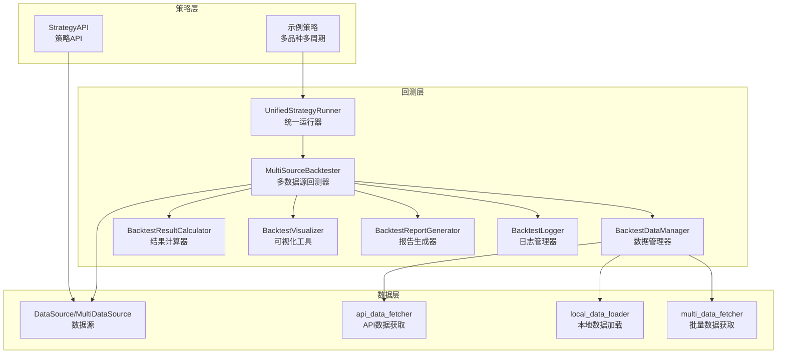

**图表来源**
- [unified_runner.py](file://ssquant/backtest/unified_runner.py#L26-L379)
- [backtest_core.py](file://ssquant/backtest/backtest_core.py#L14-L579)
- [backtest_data.py](file://ssquant/backtest/backtest_data.py#L8-L246)
- [strategy_api.py](file://ssquant/api/strategy_api.py#L4-L570)
- [data_source.py](file://ssquant/data/data_source.py#L6-L922)
- [api_data_fetcher.py](file://ssquant/data/api_data_fetcher.py#L171-L1031)
- [local_data_loader.py](file://ssquant/data/local_data_loader.py#L5-L233)
- [multi_data_fetcher.py](file://ssquant/data/multi_data_fetcher.py#L4-L139)

**章节来源**
- [README.md](file://README.md#L297-L321)

## 核心组件
- 多数据源回测器：负责数据获取、对齐、回测执行与结果汇总
- 数据管理器：协调API与本地数据加载，支持多数据源创建与对齐
- 数据源：封装单数据源的K线/TICK数据、交易执行与价格更新
- 统一运行器：支持回测、SIMNOW模拟与实盘运行模式
- 策略API：提供多数据源访问接口与交易操作
- 可视化与报告：生成图表与综合绩效报告
- 日志管理：统一日志输出与性能报告文件管理

**章节来源**
- [backtest_core.py](file://ssquant/backtest/backtest_core.py#L14-L579)
- [backtest_data.py](file://ssquant/backtest/backtest_data.py#L8-L246)
- [data_source.py](file://ssquant/data/data_source.py#L6-L922)
- [unified_runner.py](file://ssquant/backtest/unified_runner.py#L26-L379)
- [strategy_api.py](file://ssquant/api/strategy_api.py#L4-L570)
- [backtest_visualization.py](file://ssquant/backtest/backtest_visualization.py#L25-L859)
- [backtest_report.py](file://ssquant/backtest/backtest_report.py#L1-L299)
- [backtest_logger.py](file://ssquant/backtest/backtest_logger.py#L4-L90)

## 架构概览
多数据源回测系统的关键流程：
1. 统一运行器接收配置，创建多数据源回测器
2. 回测器通过数据管理器获取数据，支持API与本地文件
3. 数据管理器创建多数据源并进行周期对齐与填充
4. 回测器逐条推进时间序列，执行策略与订单处理
5. 结果计算器计算交易统计与绩效指标
6. 可视化与报告生成器输出图表与报告

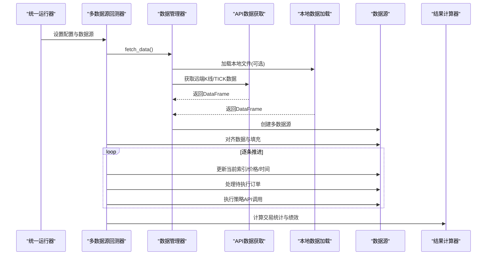

**图表来源**
- [unified_runner.py](file://ssquant/backtest/unified_runner.py#L215-L314)
- [backtest_core.py](file://ssquant/backtest/backtest_core.py#L144-L306)
- [backtest_data.py](file://ssquant/backtest/backtest_data.py#L32-L189)
- [api_data_fetcher.py](file://ssquant/data/api_data_fetcher.py#L171-L1031)
- [local_data_loader.py](file://ssquant/data/local_data_loader.py#L5-L233)
- [backtest_results.py](file://ssquant/backtest/backtest_results.py#L103-L495)

## 详细组件分析

### 多数据源回测器（MultiSourceBacktester）
- 支持多品种、多周期配置，提供基础配置与品种特定配置
- 数据获取与对齐：通过数据管理器获取数据，支持对齐与填充策略
- 回测执行：逐条推进时间序列，更新价格与持仓，处理待执行订单
- 结果计算：调用结果计算器生成交易统计与绩效指标
- 可视化与报告：生成图表与综合绩效报告

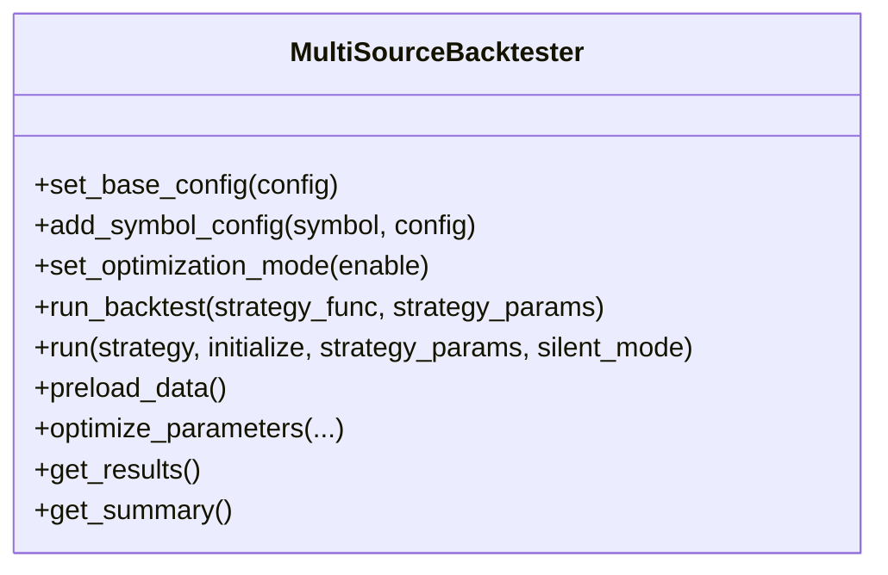

**图表来源**
- [backtest_core.py](file://ssquant/backtest/backtest_core.py#L14-L579)

**章节来源**
- [backtest_core.py](file://ssquant/backtest/backtest_core.py#L14-L579)

### 数据管理器（BacktestDataManager）
- 数据获取：优先加载本地文件，否则调用API获取K线/TICK数据
- 多数据源创建：根据符号与周期创建数据源并加入容器
- 数据对齐：对多个数据源的时间索引进行对齐与填充

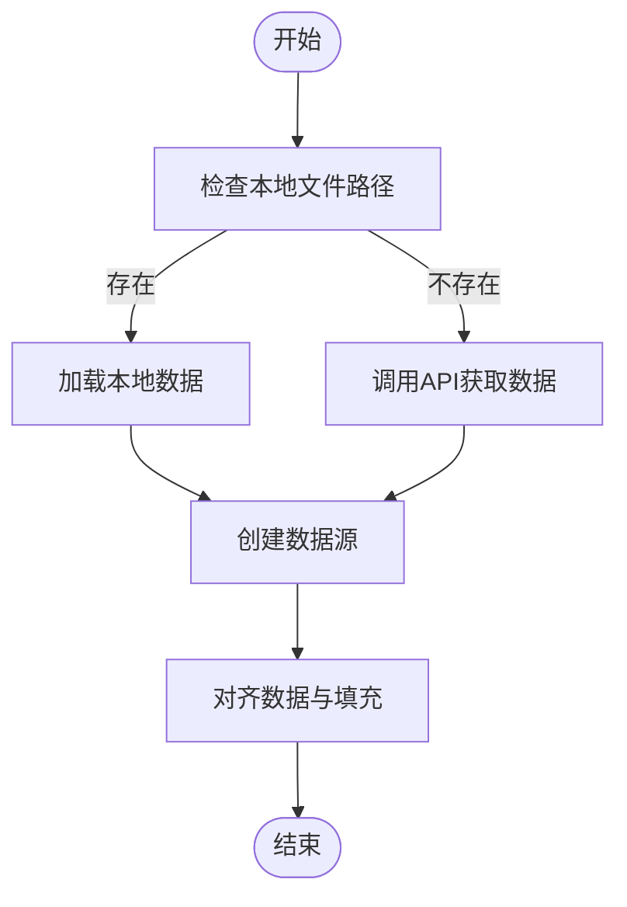

**图表来源**
- [backtest_data.py](file://ssquant/backtest/backtest_data.py#L32-L238)

**章节来源**
- [backtest_data.py](file://ssquant/backtest/backtest_data.py#L32-L238)

### 数据源与多数据源容器
- DataSource：封装单数据源的K线/TICK数据、当前价格/时间、持仓与订单队列
- MultiDataSource：管理多个数据源，提供对齐与访问接口
- 价格更新机制：根据K线close或TICK数据计算当前价格，支持BidPrice1/AskPrice1均价

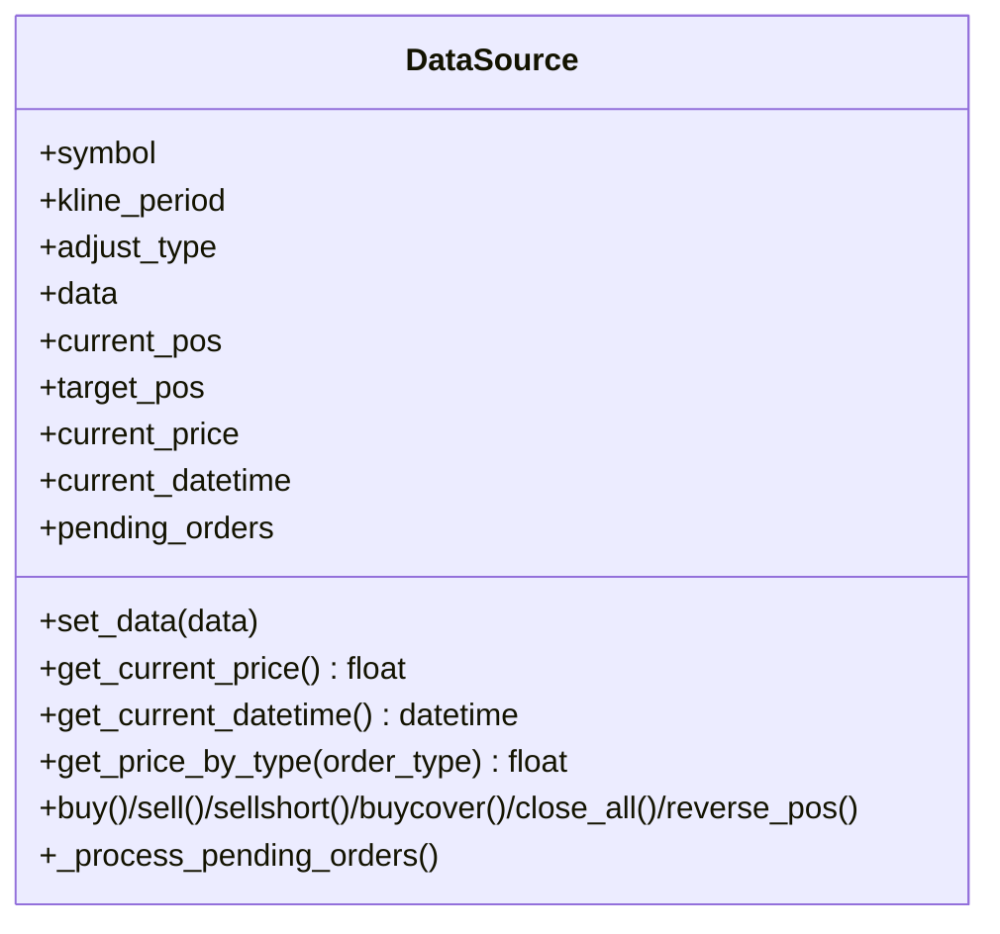

**图表来源**
- [data_source.py](file://ssquant/data/data_source.py#L6-L922)

**章节来源**
- [data_source.py](file://ssquant/data/data_source.py#L6-L922)

### 统一运行器（UnifiedStrategyRunner）
- 支持回测、SIMNOW模拟与实盘运行模式
- 多数据源配置：将同一品种的多个周期合并为数据源集合
- 配置验证：根据运行模式检查必填参数

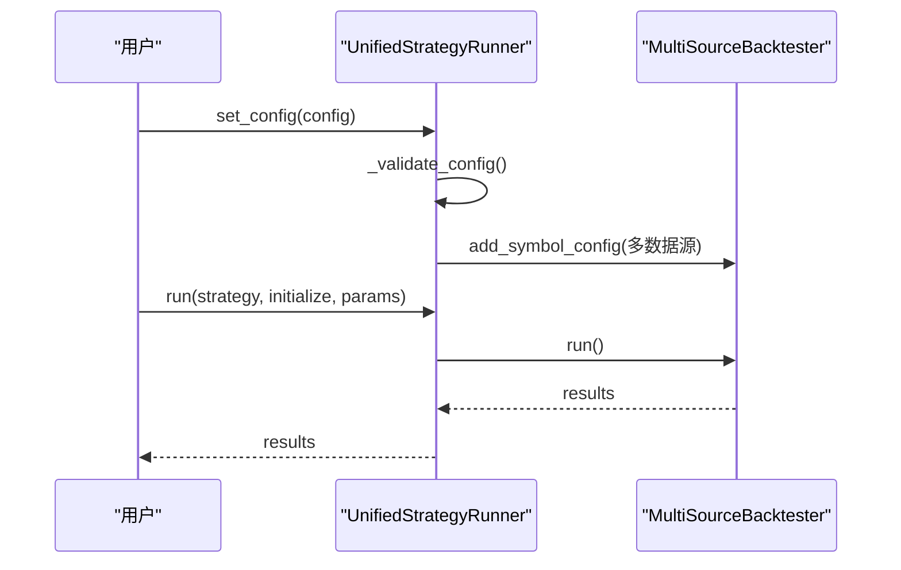

**图表来源**
- [unified_runner.py](file://ssquant/backtest/unified_runner.py#L79-L314)

**章节来源**
- [unified_runner.py](file://ssquant/backtest/unified_runner.py#L26-L379)

### 策略API（StrategyAPI）
- 多数据源访问：get_data_source(index)、get_klines(index)、get_price(index)、get_pos(index)
- 交易操作：buy/sell/sellshort/buycover/close_all/reverse_pos，支持多种订单类型
- TICK数据：get_tick/get_ticks/get_ticks_count，支持历史TICK预加载

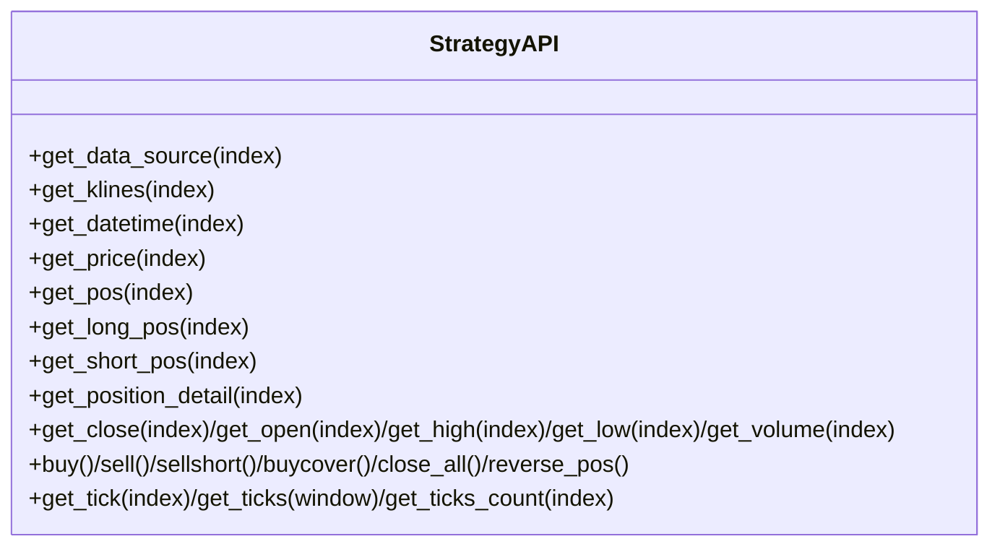

**图表来源**
- [strategy_api.py](file://ssquant/api/strategy_api.py#L4-L570)

**章节来源**
- [strategy_api.py](file://ssquant/api/strategy_api.py#L4-L570)

### 数据获取与缓存机制
- API数据获取：支持K线与TICK数据，自动处理交易日历与时间范围
- 本地数据加载：支持CSV/HDF5/7z/SQLite，自动校验字段并按日期筛选
- 缓存策略：SQLite缓存，支持部分覆盖与缺失交易日补全

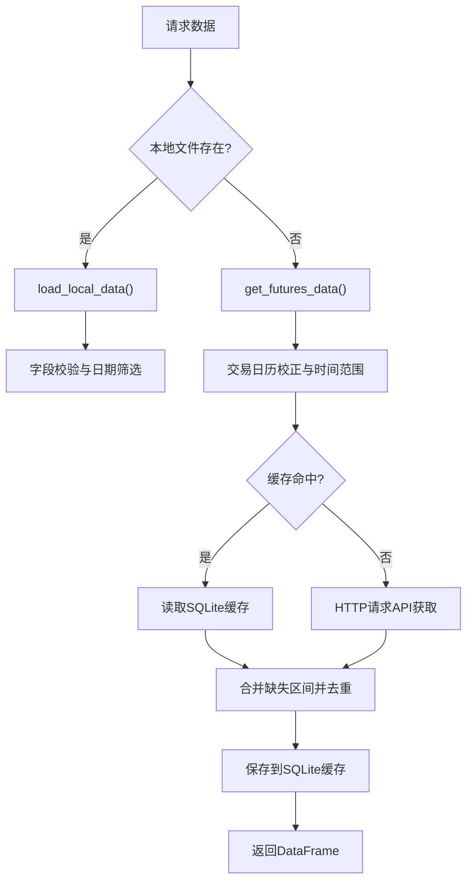

**图表来源**
- [backtest_data.py](file://ssquant/backtest/backtest_data.py#L32-L189)
- [api_data_fetcher.py](file://ssquant/data/api_data_fetcher.py#L171-L1031)
- [local_data_loader.py](file://ssquant/data/local_data_loader.py#L5-L233)

**章节来源**
- [backtest_data.py](file://ssquant/backtest/backtest_data.py#L32-L189)
- [api_data_fetcher.py](file://ssquant/data/api_data_fetcher.py#L171-L1031)
- [local_data_loader.py](file://ssquant/data/local_data_loader.py#L5-L233)

### 多数据源统一访问接口设计
- 数据索引管理：通过get_data_source(index)访问指定数据源
- 价格更新机制：逐条推进时更新current_price与current_datetime
- 订单执行：支持下一K线开盘/收盘/最高/最低价与市价单执行

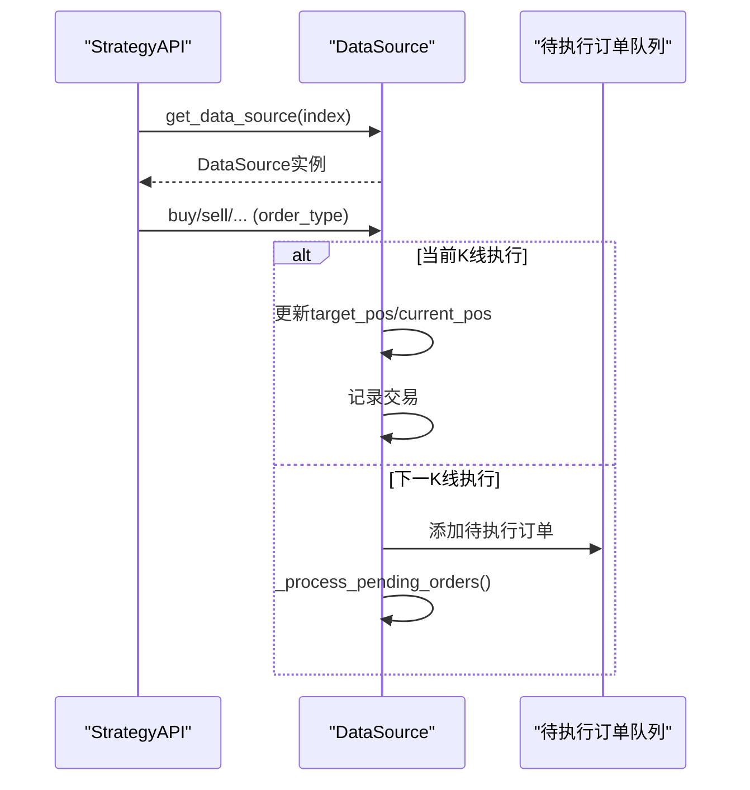

**图表来源**
- [strategy_api.py](file://ssquant/api/strategy_api.py#L52-L570)
- [data_source.py](file://ssquant/data/data_source.py#L137-L705)

**章节来源**
- [strategy_api.py](file://ssquant/api/strategy_api.py#L52-L570)
- [data_source.py](file://ssquant/data/data_source.py#L137-L705)

### 周期对齐算法与时间同步策略
- 对齐策略：基于时间索引对齐多个数据源，支持向前填充
- 时间同步：逐条推进时统一更新所有数据源的current_idx/current_datetime/current_price
- 多周期信号：不同周期独立交易，互不影响

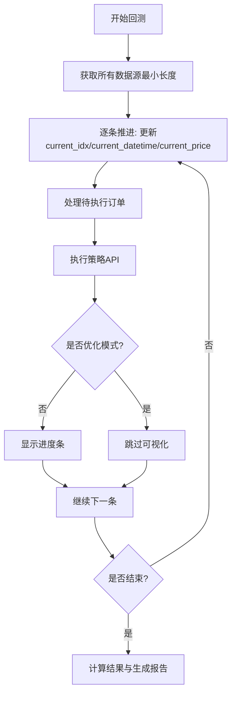

**图表来源**
- [backtest_core.py](file://ssquant/backtest/backtest_core.py#L240-L297)

**章节来源**
- [backtest_core.py](file://ssquant/backtest/backtest_core.py#L240-L297)

### 数据质量检查、缺失值处理与异常数据过滤
- 字段校验：K线必须字段datetime/open/high/low/close；TICK必须字段datetime/price/volume或BidPrice1/AskPrice1
- 日期筛选：按start_date/end_date过滤，支持列表文件合并
- 缺失处理：缓存缺失交易日自动补全，重复记录去重
- 异常保护：空数据返回、异常捕获与降级策略

**章节来源**
- [local_data_loader.py](file://ssquant/data/local_data_loader.py#L144-L174)
- [api_data_fetcher.py](file://ssquant/data/api_data_fetcher.py#L305-L598)
- [backtest_data.py](file://ssquant/backtest/backtest_data.py#L144-L186)

### 大数据量处理的性能优化与内存管理
- 预加载数据：preload_data复用数据，显著提升参数优化效率
- 环境变量控制：NO_VISUALIZATION/NO_CONSOLE_LOG静默模式，禁用图表与日志输出
- 数据对齐优化：仅对齐非空数据源，最小化对齐范围
- 内存管理：逐条推进，避免一次性加载全部数据；权益曲线按需计算

**章节来源**
- [backtest_core.py](file://ssquant/backtest/backtest_core.py#L456-L524)
- [backtest_visualization.py](file://ssquant/backtest/backtest_visualization.py#L95-L103)
- [backtest_logger.py](file://ssquant/backtest/backtest_logger.py#L30-L35)

## 依赖关系分析
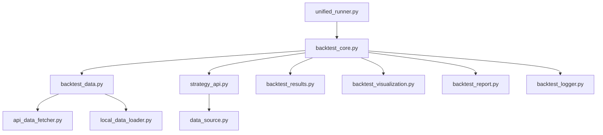

**图表来源**
- [unified_runner.py](file://ssquant/backtest/unified_runner.py#L15-L379)
- [backtest_core.py](file://ssquant/backtest/backtest_core.py#L7-L12)
- [backtest_data.py](file://ssquant/backtest/backtest_data.py#L1-L7)
- [strategy_api.py](file://ssquant/api/strategy_api.py#L1-L5)
- [data_source.py](file://ssquant/data/data_source.py#L1-L4)
- [api_data_fetcher.py](file://ssquant/data/api_data_fetcher.py#L1-L10)
- [local_data_loader.py](file://ssquant/data/local_data_loader.py#L1-L5)
- [backtest_results.py](file://ssquant/backtest/backtest_results.py#L1-L5)
- [backtest_visualization.py](file://ssquant/backtest/backtest_visualization.py#L1-L9)
- [backtest_report.py](file://ssquant/backtest/backtest_report.py#L1-L2)
- [backtest_logger.py](file://ssquant/backtest/backtest_logger.py#L1-L5)

**章节来源**
- [unified_runner.py](file://ssquant/backtest/unified_runner.py#L15-L379)
- [backtest_core.py](file://ssquant/backtest/backtest_core.py#L7-L12)

## 性能考量
- 预加载与复用：参数优化时启用数据复用，避免重复I/O
- 环境变量优化：在批处理或参数扫描时设置NO_VISUALIZATION/NO_CONSOLE_LOG
- 数据对齐范围：仅对非空数据源进行对齐，减少计算量
- 图表生成：在不需要时禁用可视化，降低CPU与内存消耗

[本节为通用指导，无需列出具体文件来源]

## 故障排查指南
- API认证失败：确认trading_config.py中API_USERNAME/API_PASSWORD配置
- 本地数据文件不存在：检查file_path路径与表名，确保SQLite表存在
- 无数据可回测：检查日期范围、交易日历与缓存有效性
- 性能问题：启用预加载、禁用可视化、检查磁盘I/O与网络延迟

**章节来源**
- [backtest_data.py](file://ssquant/backtest/backtest_data.py#L119-L186)
- [api_data_fetcher.py](file://ssquant/data/api_data_fetcher.py#L266-L268)
- [backtest_logger.py](file://ssquant/backtest/backtest_logger.py#L21-L59)

## 结论
SSQuant多数据源回测系统通过模块化设计实现了多品种、多周期的统一回测能力。系统在数据获取、缓存与对齐方面具备完善的机制，在策略API层面提供了简洁易用的多数据源访问接口。配合性能优化与故障排查手段，能够在保证准确性的同时高效处理大规模数据。

[本节为总结性内容，无需列出具体文件来源]

## 附录

### 示例策略：多品种多周期交易
示例展示了在同一策略中同时交易多个品种与周期，体现多数据源回测的核心能力。

**章节来源**
- [B_多品种多周期交易策略.py](file://examples/B_多品种多周期交易策略.py#L48-L260)