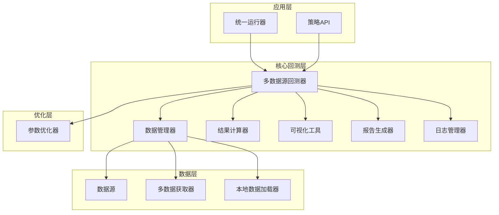
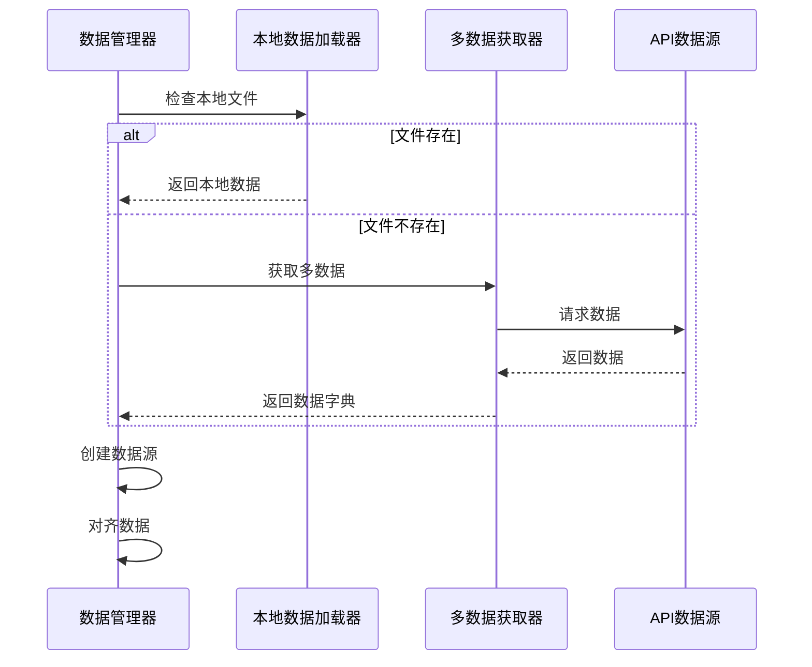
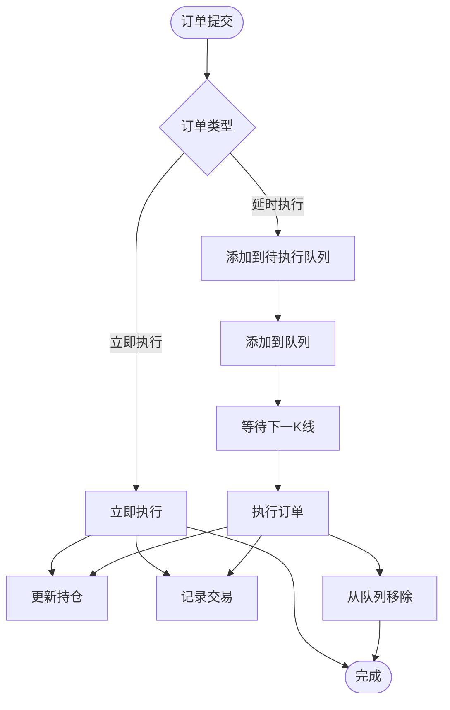
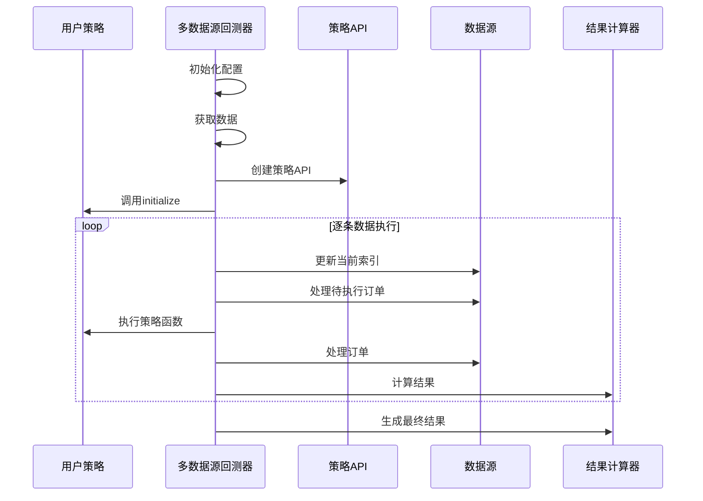
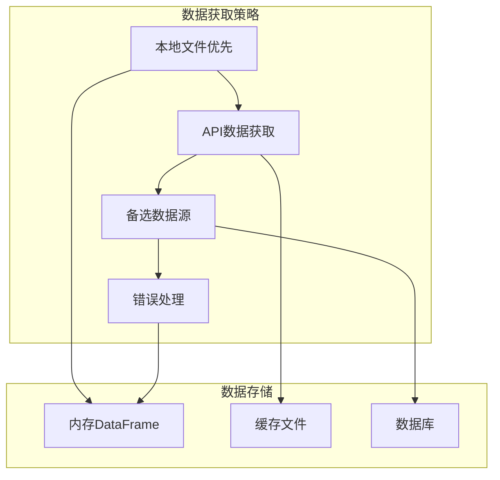
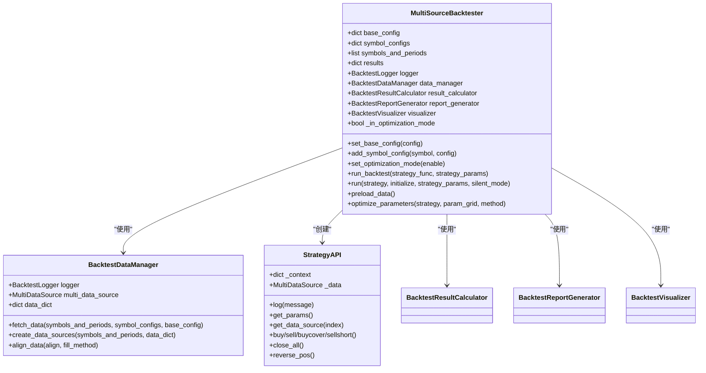
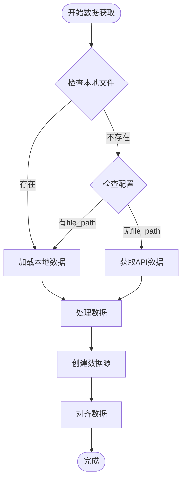
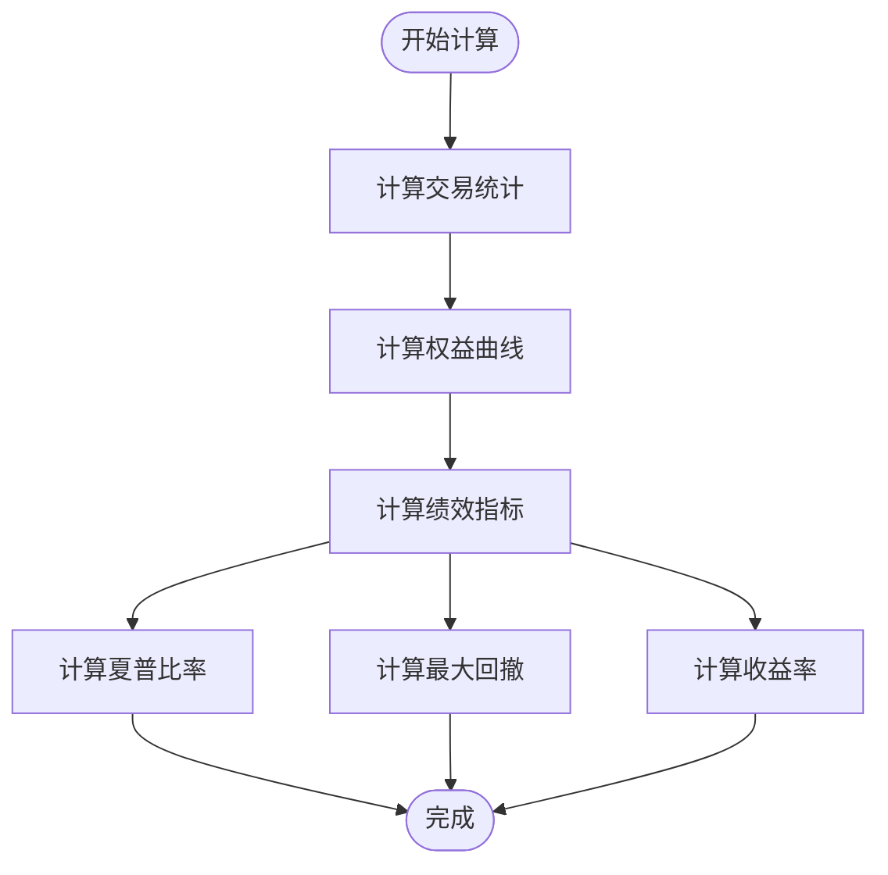
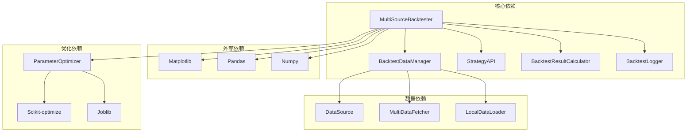
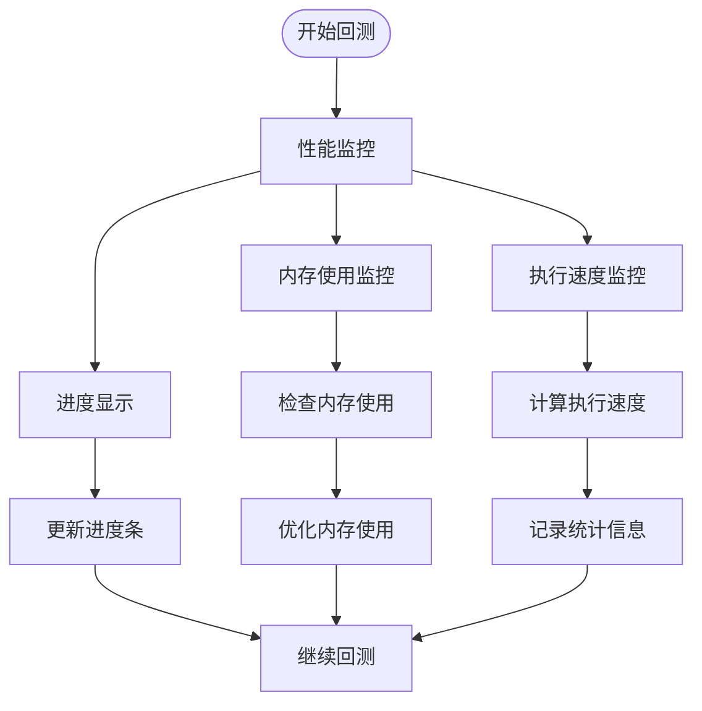

# 核心回测引擎

<cite>
**本文档引用的文件**
- [backtest_core.py](file://ssquant/backtest/backtest_core.py)
- [backtest_data.py](file://ssquant/backtest/backtest_data.py)
- [data_source.py](file://ssquant/data/data_source.py)
- [strategy_api.py](file://ssquant/api/strategy_api.py)
- [backtest_logger.py](file://ssquant/backtest/backtest_logger.py)
- [backtest_results.py](file://ssquant/backtest/backtest_results.py)
- [backtest_visualization.py](file://ssquant/backtest/backtest_visualization.py)
- [backtest_report.py](file://ssquant/backtest/backtest_report.py)
- [parameter_optimizer.py](file://ssquant/backtest/parameter_optimizer.py)
- [multi_data_fetcher.py](file://ssquant/data/multi_data_fetcher.py)
- [local_data_loader.py](file://ssquant/data/local_data_loader.py)
- [unified_runner.py](file://ssquant/backtest/unified_runner.py)
</cite>

## 目录
1. [简介](#简介)
2. [项目结构](#项目结构)
3. [核心组件](#核心组件)
4. [架构概览](#架构概览)
5. [详细组件分析](#详细组件分析)
6. [依赖关系分析](#依赖关系分析)
7. [性能考量](#性能考量)
8. [故障排除指南](#故障排除指南)
9. [结论](#结论)

## 简介

SSQuant核心回测引擎是一个功能完整的多数据源量化回测系统，支持多品种、多周期的期货策略回测。该引擎采用模块化设计，提供了完整的策略执行循环、数据管理、时间同步机制和订单处理流程。

## 项目结构

SSQuant回测引擎采用分层架构设计，主要分为以下几个层次：



**图表来源**
- [backtest_core.py](file://ssquant/backtest/backtest_core.py#L14-L84)
- [backtest_data.py](file://ssquant/backtest/backtest_data.py#L8-L19)

**章节来源**
- [backtest_core.py](file://ssquant/backtest/backtest_core.py#L1-L579)
- [backtest_data.py](file://ssquant/backtest/backtest_data.py#L1-L246)

## 核心组件

### 多数据源回测器 (MultiSourceBacktester)

MultiSourceBacktester是整个回测引擎的核心控制器，负责协调各个组件的工作流程。

#### 主要特性

1. **多数据源支持**：支持同时处理多个品种、多个周期的数据
2. **灵活配置**：提供丰富的配置选项，包括数据获取、缓存、对齐等
3. **策略执行循环**：实现了完整的策略执行生命周期
4. **参数优化集成**：内置参数优化功能，支持多种优化算法

#### 关键配置参数

| 参数名称 | 类型 | 默认值 | 描述 |
|---------|------|--------|------|
| use_api_data | bool | True | 是否使用API数据 |
| use_cache | bool | True | 是否使用缓存 |
| save_data | bool | True | 是否保存数据 |
| fetch_multiple | bool | True | 是否获取多个周期 |
| align_data | bool | True | 是否对齐数据 |
| fill_method | str | 'ffill' | 填充方法 |
| debug | bool | False | 调试模式 |

**章节来源**
- [backtest_core.py](file://ssquant/backtest/backtest_core.py#L21-L84)

### 数据管理器 (BacktestDataManager)

负责数据获取、处理和管理的中间层组件。

#### 数据获取流程



**图表来源**
- [backtest_data.py](file://ssquant/backtest/backtest_data.py#L32-L189)
- [local_data_loader.py](file://ssquant/data/local_data_loader.py#L5-L174)
- [multi_data_fetcher.py](file://ssquant/data/multi_data_fetcher.py#L4-L76)

**章节来源**
- [backtest_data.py](file://ssquant/backtest/backtest_data.py#L32-L238)

### 数据源 (DataSource)

单个数据源的封装，提供统一的数据访问接口。

#### 订单处理机制



**图表来源**
- [data_source.py](file://ssquant/data/data_source.py#L137-L221)

**章节来源**
- [data_source.py](file://ssquant/data/data_source.py#L6-L800)

## 架构概览

### 策略执行循环

回测引擎的核心执行流程如下：



**图表来源**
- [backtest_core.py](file://ssquant/backtest/backtest_core.py#L144-L306)
- [strategy_api.py](file://ssquant/api/strategy_api.py#L560-L570)

### 数据获取架构



**图表来源**
- [backtest_data.py](file://ssquant/backtest/backtest_data.py#L69-L187)
- [local_data_loader.py](file://ssquant/data/local_data_loader.py#L5-L174)

**章节来源**
- [backtest_core.py](file://ssquant/backtest/backtest_core.py#L144-L380)

## 详细组件分析

### MultiSourceBacktester 类分析

MultiSourceBacktester是回测引擎的核心类，实现了完整的回测生命周期管理。

#### 类结构图



**图表来源**
- [backtest_core.py](file://ssquant/backtest/backtest_core.py#L14-L84)
- [backtest_data.py](file://ssquant/backtest/backtest_data.py#L8-L19)
- [strategy_api.py](file://ssquant/api/strategy_api.py#L4-L570)

#### 策略执行循环详解

策略执行循环是回测引擎的核心机制，确保多数据源的时间同步和一致性。

**章节来源**
- [backtest_core.py](file://ssquant/backtest/backtest_core.py#L240-L288)

### 数据管理器分析

BacktestDataManager负责协调数据获取、处理和存储的各个环节。

#### 数据获取策略



**图表来源**
- [backtest_data.py](file://ssquant/backtest/backtest_data.py#L32-L238)

**章节来源**
- [backtest_data.py](file://ssquant/backtest/backtest_data.py#L32-L238)

### 策略API分析

StrategyAPI为策略提供统一的接口，屏蔽底层实现细节。

#### API方法分类

| 方法类别 | 方法名称 | 功能描述 |
|---------|----------|----------|
| 数据访问 | get_klines(), get_close(), get_high() | 获取K线数据序列 |
| 价格访问 | get_price(), get_datetime() | 获取当前价格和时间 |
| 持仓管理 | get_pos(), get_long_pos(), get_short_pos() | 获取持仓信息 |
| 交易执行 | buy(), sell(), buycover(), sellshort() | 执行交易指令 |
| 订单管理 | close_all(), reverse_pos() | 管理订单 |

**章节来源**
- [strategy_api.py](file://ssquant/api/strategy_api.py#L91-L570)

### 结果计算分析

BacktestResultCalculator负责计算回测结果的各项指标。

#### 绩效指标计算



**图表来源**
- [backtest_results.py](file://ssquant/backtest/backtest_results.py#L103-L495)

**章节来源**
- [backtest_results.py](file://ssquant/backtest/backtest_results.py#L16-L495)

## 依赖关系分析

### 组件耦合度分析



**图表来源**
- [backtest_core.py](file://ssquant/backtest/backtest_core.py#L7-L12)
- [parameter_optimizer.py](file://ssquant/backtest/parameter_optimizer.py#L25-L44)

### 循环依赖检测

经过分析，系统中不存在循环依赖关系，各模块间的关系清晰明确。

**章节来源**
- [backtest_core.py](file://ssquant/backtest/backtest_core.py#L1-L579)
- [parameter_optimizer.py](file://ssquant/backtest/parameter_optimizer.py#L1-L800)

## 性能考量

### 内存管理策略

1. **数据分页加载**：支持大数据集的分页加载，避免内存溢出
2. **缓存机制**：智能缓存机制减少重复数据获取
3. **数据对齐优化**：高效的多数据源对齐算法
4. **批处理执行**：批量处理订单，减少系统调用开销

### 性能监控



**图表来源**
- [backtest_core.py](file://ssquant/backtest/backtest_core.py#L235-L292)

### 回测精度保证

1. **时间同步机制**：确保多数据源在同一时间点执行
2. **订单执行精度**：精确的订单执行价格计算
3. **手续费计算**：准确的手续费和滑点处理
4. **复权处理**：支持前复权和后复权数据

## 故障排除指南

### 常见问题及解决方案

| 问题类型 | 症状 | 可能原因 | 解决方案 |
|---------|------|----------|----------|
| 数据获取失败 | 无法获取历史数据 | API认证失败、网络连接问题 | 检查API配置、网络连接 |
| 回测结果异常 | 收益率异常、交易次数不符 | 数据对齐问题、订单执行错误 | 检查数据源配置、订单类型 |
| 内存不足 | 回测过程中内存溢出 | 数据量过大、缓存未清理 | 减少数据量、启用缓存清理 |
| 性能问题 | 回测速度慢 | 算法效率低、I/O阻塞 | 优化算法、使用并行计算 |

### 调试模式

启用调试模式可以获得更详细的日志信息：

```python
# 设置调试模式
backtester.set_base_config({
    'debug': True,
    'use_cache': True,
    'save_data': True
})
```

**章节来源**
- [backtest_logger.py](file://ssquant/backtest/backtest_logger.py#L7-L90)
- [backtest_core.py](file://ssquant/backtest/backtest_core.py#L155-L169)

## 结论

SSQuant核心回测引擎采用了模块化、可扩展的设计理念，提供了完整而强大的量化回测功能。其主要优势包括：

1. **多数据源支持**：能够同时处理多个品种、多个周期的数据
2. **灵活的配置系统**：支持丰富的配置选项，适应不同的回测需求
3. **精确的执行机制**：确保多数据源的时间同步和订单执行精度
4. **完善的性能监控**：提供实时的进度显示和性能指标
5. **强大的扩展性**：模块化设计便于功能扩展和定制

该引擎适用于各种复杂的量化策略开发和回测需求，为用户提供了一个稳定可靠的回测平台。