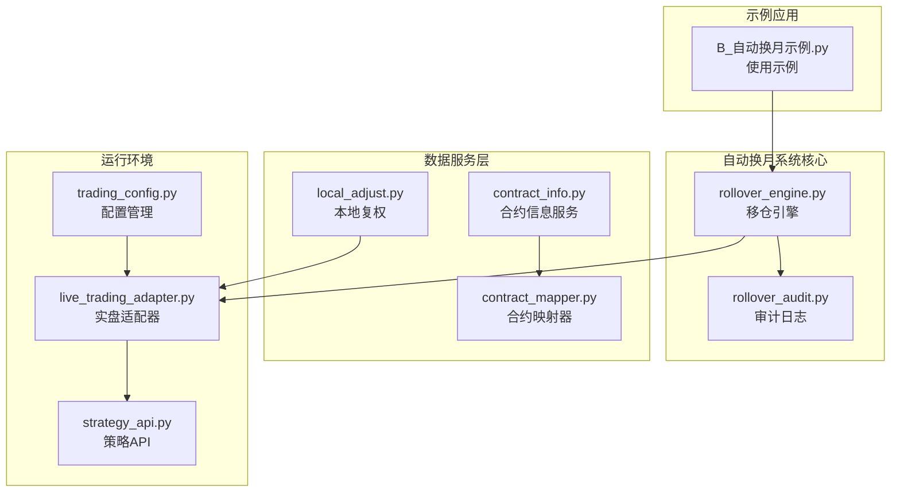
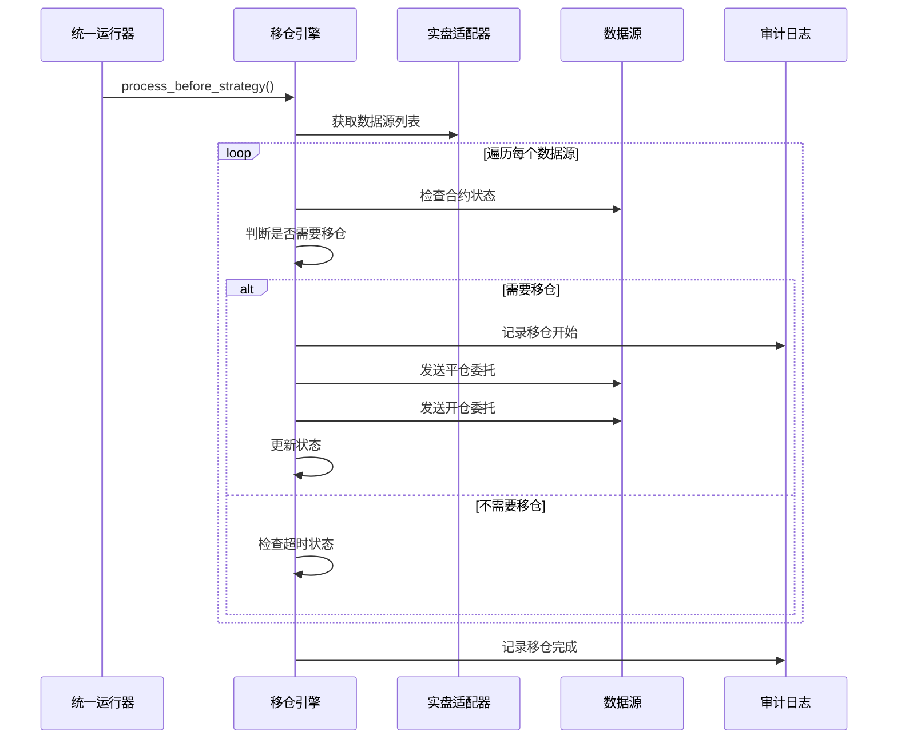
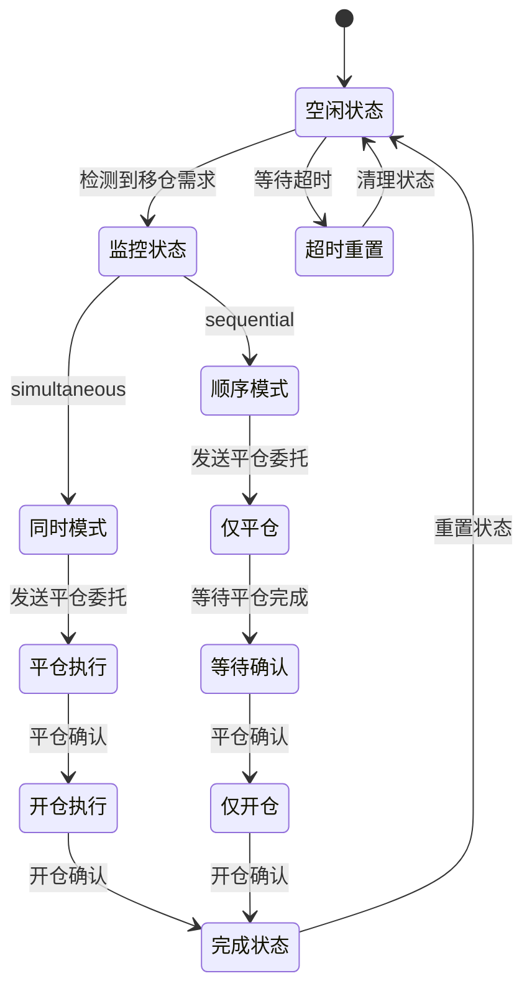
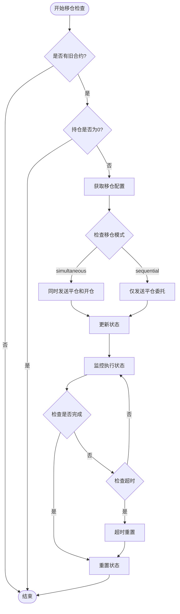
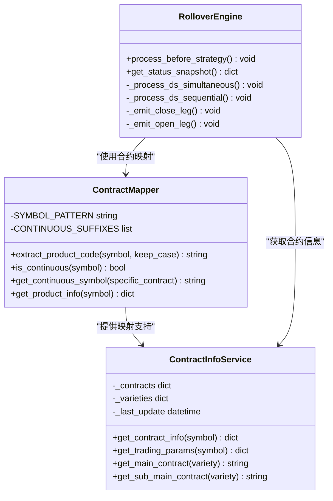
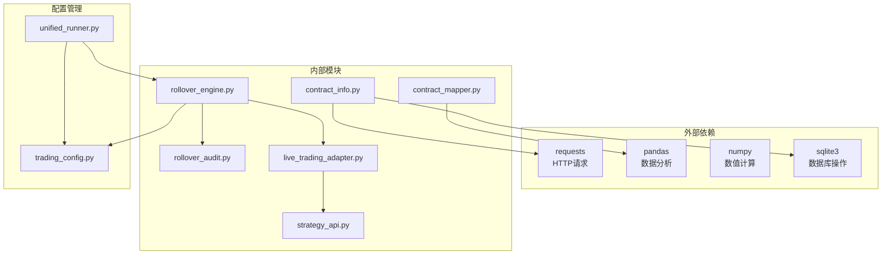

# 自动合约换月系统

<cite>
**本文档引用的文件**
- [rollover_engine.py](file://ssquant/backtest/rollover_engine.py)
- [rollover_audit.py](file://ssquant/backtest/rollover_audit.py)
- [B_自动换月示例.py](file://examples/B_自动换月示例.py)
- [contract_mapper.py](file://ssquant/data/contract_mapper.py)
- [contract_info.py](file://ssquant/data/contract_info.py)
- [live_trading_adapter.py](file://ssquant/backtest/live_trading_adapter.py)
- [strategy_api.py](file://ssquant/api/strategy_api.py)
- [trading_config.py](file://ssquant/config/trading_config.py)
- [unified_runner.py](file://ssquant/backtest/unified_runner.py)
- [local_adjust.py](file://ssquant/data/local_adjust.py)
- [api_data_fetcher.py](file://ssquant/data/api_data_fetcher.py)
</cite>

## 目录
1. [简介](#简介)
2. [项目结构](#项目结构)
3. [核心组件](#核心组件)
4. [架构概览](#架构概览)
5. [详细组件分析](#详细组件分析)
6. [依赖关系分析](#依赖关系分析)
7. [性能考虑](#性能考虑)
8. [故障排除指南](#故障排除指南)
9. [结论](#结论)

## 简介

自动合约换月系统是SSQuant量化交易框架中的核心功能模块，专门负责在期货合约到期或主力合约切换时自动完成移仓操作。该系统能够在策略执行前自动检测合约换月时机，并执行相应的平仓和开仓操作，确保交易策略的连续性和完整性。

系统支持两种移仓模式：
- **同时模式（Simultaneous）**：在同一策略回调中同时发送平旧合约和开新合约委托
- **顺序模式（Sequential）**：先发送平旧合约委托，待平仓完成后再次发送开新合约委托

## 项目结构

SSQuant框架采用模块化设计，自动换月系统主要分布在以下目录中：

**图表来源**
- [rollover_engine.py:1-334](file://ssquant/backtest/rollover_engine.py#L1-L334)
- [contract_info.py:1-441](file://ssquant/data/contract_info.py#L1-L441)
- [live_trading_adapter.py:1-800](file://ssquant/backtest/live_trading_adapter.py#L1-L800)

## 核心组件

### 移仓引擎（RolloverEngine）

移仓引擎是整个系统的核心，负责监控合约状态并执行自动移仓操作。其主要特点包括：

- **状态管理**：为每个数据源维护独立的状态机
- **模式支持**：支持同时和顺序两种移仓模式
- **超时控制**：防止移仓操作陷入死循环
- **审计日志**：完整记录所有移仓操作

### 审计日志系统

审计日志系统提供完整的移仓操作记录，支持文本和JSON两种格式：

- **文本格式**：人类可读的日志文件
- **JSON格式**：便于程序解析的结构化数据
- **按日分割**：自动按日期创建新的日志文件

### 合约信息服务

合约信息服务提供合约参数的自动获取和缓存功能：

- **远程API集成**：自动从外部API获取最新合约信息
- **本地缓存**：减少网络请求，提高响应速度
- **参数映射**：自动处理主力合约和具体合约的映射关系

**章节来源**
- [rollover_engine.py:33-92](file://ssquant/backtest/rollover_engine.py#L33-L92)
- [rollover_audit.py:12-79](file://ssquant/backtest/rollover_audit.py#L12-L79)
- [contract_info.py:37-180](file://ssquant/data/contract_info.py#L37-L180)

## 架构概览

自动换月系统的整体架构采用分层设计，确保各组件职责明确且相互独立：

**图表来源**
- [unified_runner.py:175-200](file://ssquant/backtest/unified_runner.py#L175-L200)
- [rollover_engine.py:81-92](file://ssquant/backtest/rollover_engine.py#L81-L92)
- [live_trading_adapter.py:28-40](file://ssquant/backtest/live_trading_adapter.py#L28-L40)

## 详细组件分析

### 移仓引擎状态管理

移仓引擎使用状态机模式管理复杂的移仓流程：

**图表来源**
- [rollover_engine.py:20-28](file://ssquant/backtest/rollover_engine.py#L20-L28)
- [rollover_engine.py:89-92](file://ssquant/backtest/rollover_engine.py#L89-L92)

### 移仓决策流程

移仓引擎的决策流程基于合约状态和持仓情况：

**图表来源**
- [rollover_engine.py:165-229](file://ssquant/backtest/rollover_engine.py#L165-L229)
- [rollover_engine.py:232-334](file://ssquant/backtest/rollover_engine.py#L232-L334)

### 合约映射机制

系统支持多种合约类型的自动映射：

**图表来源**
- [contract_mapper.py:10-122](file://ssquant/data/contract_mapper.py#L10-L122)
- [contract_info.py:37-344](file://ssquant/data/contract_info.py#L37-L344)
- [rollover_engine.py:33-92](file://ssquant/backtest/rollover_engine.py#L33-L92)

**章节来源**
- [contract_mapper.py:10-139](file://ssquant/data/contract_mapper.py#L10-L139)
- [contract_info.py:181-275](file://ssquant/data/contract_info.py#L181-L275)
- [rollover_engine.py:93-164](file://ssquant/backtest/rollover_engine.py#L93-L164)

### 实盘适配器集成

实盘适配器提供了完整的CTP接口适配：

- **数据源管理**：统一管理多个数据源
- **订单处理**：处理买卖、平仓等交易指令
- **状态同步**：实时同步账户和持仓状态
- **错误处理**：完善的异常处理和重试机制

**章节来源**
- [live_trading_adapter.py:265-800](file://ssquant/backtest/live_trading_adapter.py#L265-L800)
- [strategy_api.py:57-98](file://ssquant/api/strategy_api.py#L57-L98)

## 依赖关系分析

自动换月系统的依赖关系相对简单，主要依赖关系如下：

**图表来源**
- [contract_info.py:22-26](file://ssquant/data/contract_info.py#L22-L26)
- [live_trading_adapter.py:14-16](file://ssquant/backtest/live_trading_adapter.py#L14-L16)
- [unified_runner.py:15-16](file://ssquant/backtest/unified_runner.py#L15-L16)

**章节来源**
- [contract_info.py:22-26](file://ssquant/data/contract_info.py#L22-L26)
- [live_trading_adapter.py:14-16](file://ssquant/backtest/live_trading_adapter.py#L14-L16)
- [unified_runner.py:15-16](file://ssquant/backtest/unified_runner.py#L15-L16)

## 性能考虑

自动换月系统在设计时充分考虑了性能因素：

### 内存管理
- **状态缓存**：使用列表缓存每个数据源的状态，避免频繁创建销毁
- **数据源复用**：通过状态机避免重复检查合约状态
- **批量处理**：支持多数据源并行处理

### 网络优化
- **智能缓存**：合约信息缓存4小时，减少API调用频率
- **错误重试**：网络异常时自动重试，提高成功率
- **超时控制**：防止长时间阻塞影响系统性能

### 实时性保障
- **异步处理**：订单发送采用异步方式，不影响策略执行
- **状态监控**：实时监控移仓状态，及时发现异常
- **超时保护**：防止移仓操作无限期等待

## 故障排除指南

### 常见问题及解决方案

#### 移仓失败
**症状**：移仓委托发送后未成交
**可能原因**：
- 合约切换时机不当
- 市场流动性不足
- 价格偏移设置不合理

**解决方法**：
1. 检查`auto_roll_order_type`配置
2. 调整`auto_roll_close_offset_ticks`和`auto_roll_open_offset_ticks`
3. 确认市场流动性充足

#### 超时重置
**症状**：移仓状态持续显示"等待闭环"
**可能原因**：
- 移仓委托长时间未成交
- 系统检测到异常状态

**解决方法**：
1. 检查`auto_roll_verify_timeout_bars`配置
2. 查看审计日志了解具体原因
3. 手动检查合约状态

#### 配置错误
**症状**：移仓功能完全不工作
**可能原因**：
- `auto_roll_enabled`未设置为True
- 数据源配置不正确
- 账户权限不足

**解决方法**：
1. 确认在配置中启用了自动移仓
2. 检查数据源配置的正确性
3. 验证账户权限设置

**章节来源**
- [trading_config.py:105-121](file://ssquant/config/trading_config.py#L105-L121)
- [rollover_engine.py:185-196](file://ssquant/backtest/rollover_engine.py#L185-L196)

## 结论

自动合约换月系统是SSQuant框架的重要组成部分，它通过智能化的状态管理和严格的审计机制，确保了期货交易策略在合约换月时的连续性和稳定性。系统的设计充分考虑了实盘交易的复杂性和不确定性，提供了灵活的配置选项和完善的错误处理机制。

主要优势包括：
- **自动化程度高**：无需手动干预，系统自动完成移仓操作
- **安全性强**：完善的超时控制和状态监控机制
- **灵活性好**：支持多种移仓模式和配置选项
- **可追溯性强**：完整的审计日志便于问题排查

对于用户而言，只需在配置中启用自动移仓功能，即可享受系统提供的完整移仓服务。同时，系统提供了丰富的配置选项，可以根据不同的交易策略和市场环境进行个性化定制。