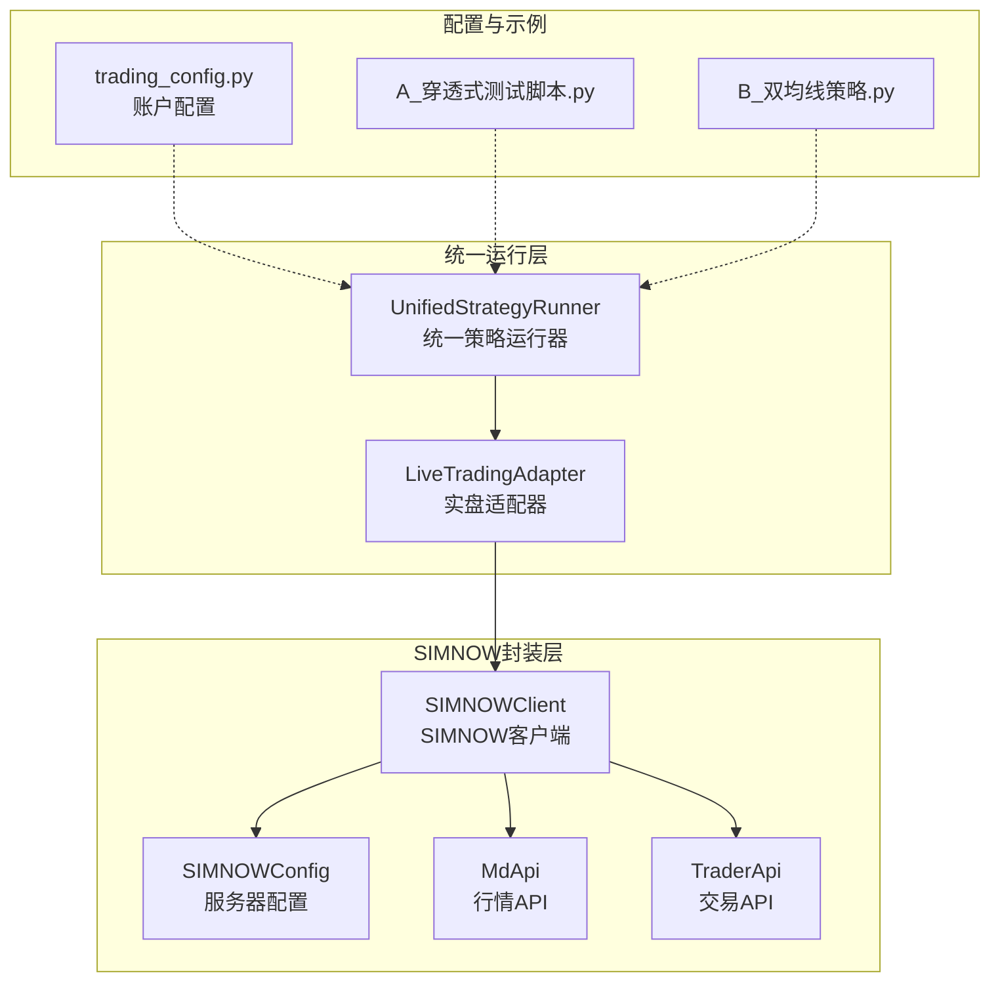
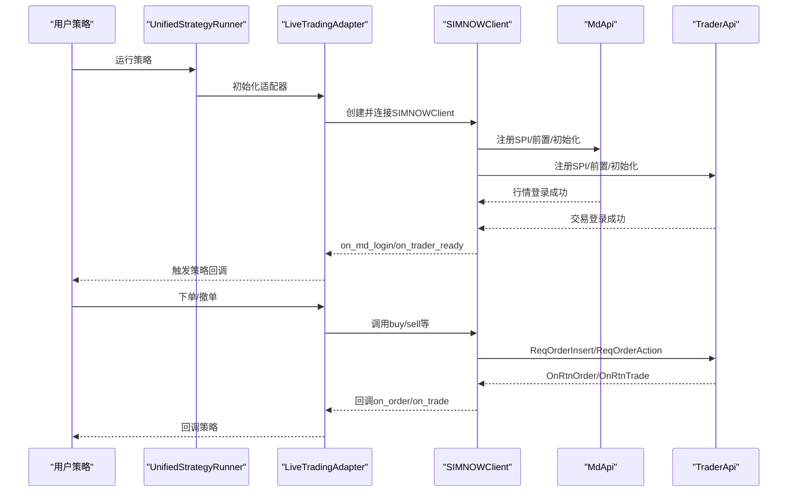
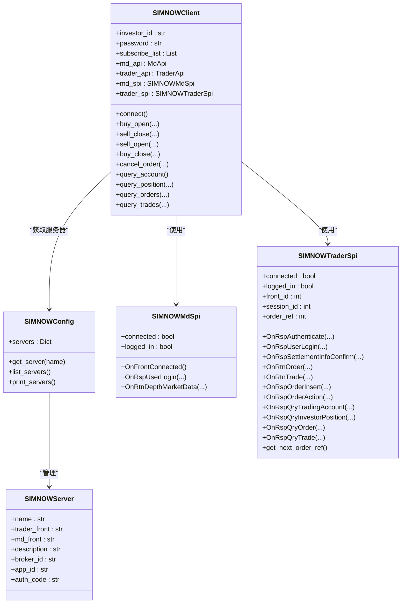
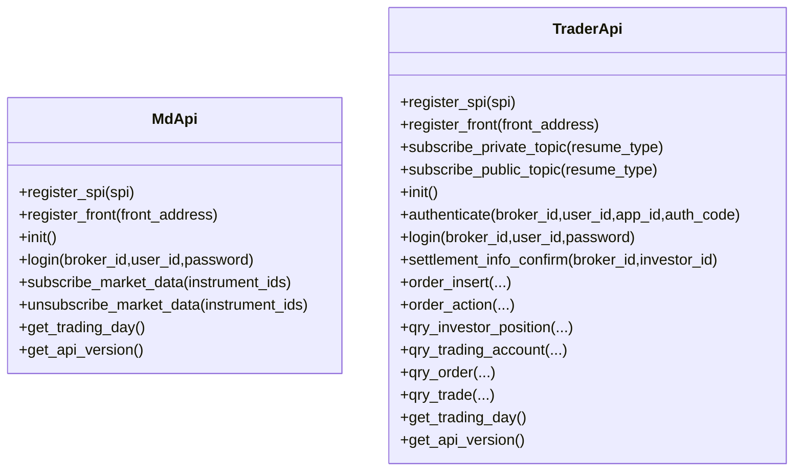
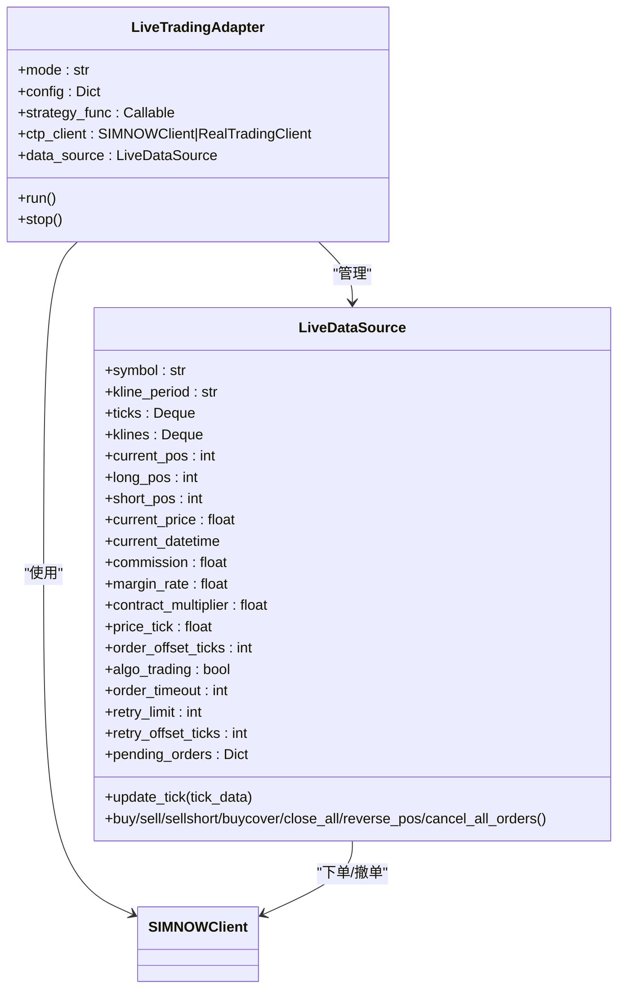
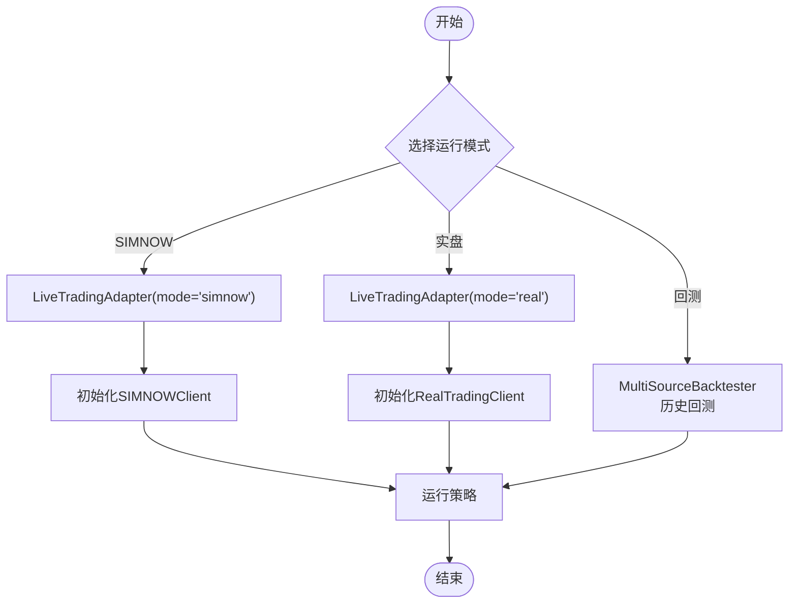
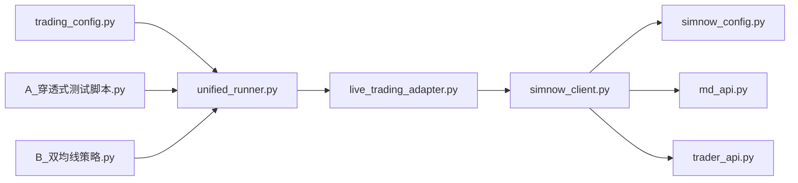

# SIMNOW模拟交易

<cite>
**本文引用的文件**
- [simnow_client.py](file://ssquant/pyctp/simnow_client.py)
- [simnow_config.py](file://ssquant/pyctp/simnow_config.py)
- [md_api.py](file://ssquant/pyctp/md_api.py)
- [trader_api.py](file://ssquant/pyctp/trader_api.py)
- [live_trading_adapter.py](file://ssquant/backtest/live_trading_adapter.py)
- [unified_runner.py](file://ssquant/backtest/unified_runner.py)
- [trading_config.py](file://ssquant/config/trading_config.py)
- [A_穿透式测试脚本.py](file://examples/A_穿透式测试脚本.py)
- [B_双均线策略.py](file://examples/B_双均线策略.py)
- [README.md](file://README.md)
</cite>

## 目录
1. [简介](#简介)
2. [项目结构](#项目结构)
3. [核心组件](#核心组件)
4. [架构总览](#架构总览)
5. [详细组件分析](#详细组件分析)
6. [依赖关系分析](#依赖关系分析)
7. [性能考量](#性能考量)
8. [故障排查指南](#故障排查指南)
9. [结论](#结论)
10. [附录](#附录)

## 简介
本文件面向SIMNOW模拟交易系统的技术文档，围绕连接配置、账户验证、数据同步机制、与实盘接口差异、数据延迟处理、订单执行逻辑、风控与资金管理、手续费计算、账户配置与连接测试、验证流程、策略测试最佳实践与风险控制建议展开。文档基于仓库中的代码实现进行深入分析，并提供可视化图示帮助理解。

## 项目结构
本项目采用模块化设计，围绕“统一策略运行器”贯穿回测、SIMNOW模拟与实盘CTP交易。与SIMNOW相关的模块主要集中在pyctp（CTP封装）、backtest（实盘适配与运行器）、config（账户配置）以及examples（示例策略）。

**图表来源**
- [unified_runner.py](file://ssquant/backtest/unified_runner.py#L26-L379)
- [live_trading_adapter.py](file://ssquant/backtest/live_trading_adapter.py#L1127-L1200)
- [simnow_client.py](file://ssquant/pyctp/simnow_client.py#L590-L800)
- [simnow_config.py](file://ssquant/pyctp/simnow_config.py#L24-L160)
- [md_api.py](file://ssquant/pyctp/md_api.py#L130-L261)
- [trader_api.py](file://ssquant/pyctp/trader_api.py#L188-L483)
- [trading_config.py](file://ssquant/config/trading_config.py#L115-L187)

**章节来源**
- [README.md](file://README.md#L297-L321)

## 核心组件
- SIMNOWClient：封装SIMNOW连接、登录、报单、撤单、查询账户/持仓/成交、行情订阅等核心能力，提供统一的回调接口。
- SIMNOWConfig：维护SIMNOW服务器列表及默认应用ID/认证码，提供服务器选择与打印。
- MdApi/TraderApi：对CTP底层API的轻量封装，提供注册SPI、前置机注册、登录、下单、撤单、查询等功能。
- LiveTradingAdapter：将策略API与SIMNOW/实盘客户端对接，负责数据源、订单执行、回调转发、数据记录等。
- UnifiedStrategyRunner：统一入口，支持回测、SIMNOW模拟、实盘三种模式，策略代码零改动切换。
- trading_config.py：集中管理账户配置、默认参数与配置生成函数。

**章节来源**
- [simnow_client.py](file://ssquant/pyctp/simnow_client.py#L590-L800)
- [simnow_config.py](file://ssquant/pyctp/simnow_config.py#L24-L160)
- [md_api.py](file://ssquant/pyctp/md_api.py#L130-L261)
- [trader_api.py](file://ssquant/pyctp/trader_api.py#L188-L483)
- [live_trading_adapter.py](file://ssquant/backtest/live_trading_adapter.py#L1127-L1200)
- [unified_runner.py](file://ssquant/backtest/unified_runner.py#L26-L379)
- [trading_config.py](file://ssquant/config/trading_config.py#L115-L187)

## 架构总览
SIMNOW模拟交易的运行路径如下：策略通过UnifiedStrategyRunner启动，LiveTradingAdapter初始化SIMNOWClient，SIMNOWClient通过MdApi/TraderApi连接SIMNOW服务器，建立行情与交易通道，策略通过LiveDataSource获取数据并执行下单，回调经由SIMNOWClient转达给用户。

**图表来源**
- [unified_runner.py](file://ssquant/backtest/unified_runner.py#L316-L343)
- [live_trading_adapter.py](file://ssquant/backtest/live_trading_adapter.py#L1127-L1200)
- [simnow_client.py](file://ssquant/pyctp/simnow_client.py#L662-L701)
- [md_api.py](file://ssquant/pyctp/md_api.py#L167-L177)
- [trader_api.py](file://ssquant/pyctp/trader_api.py#L237-L247)

## 详细组件分析

### SIMNOWClient与SPI回调
- 行情SPI（SIMNOWMdSpi）：自动登录、订阅行情、转换深度行情数据为统一字典、回调on_market_data。
- 交易SPI（SIMNOWTraderSpi）：支持认证与登录、结算单确认、报单/撤单/成交通知、账户/持仓/订单/成交查询、错误解码与常见错误映射、智能重试（平今不足时自动改为平昨）。
- SIMNOWClient：统一入口，负责连接、登录、下单/撤单、查询、回调注册、服务器选择、流文件目录创建。

**图表来源**
- [simnow_client.py](file://ssquant/pyctp/simnow_client.py#L19-L132)
- [simnow_client.py](file://ssquant/pyctp/simnow_client.py#L134-L588)
- [simnow_client.py](file://ssquant/pyctp/simnow_client.py#L590-L800)
- [simnow_config.py](file://ssquant/pyctp/simnow_config.py#L12-L95)

**章节来源**
- [simnow_client.py](file://ssquant/pyctp/simnow_client.py#L19-L132)
- [simnow_client.py](file://ssquant/pyctp/simnow_client.py#L134-L588)
- [simnow_client.py](file://ssquant/pyctp/simnow_client.py#L590-L800)
- [simnow_config.py](file://ssquant/pyctp/simnow_config.py#L24-L160)

### MdApi/TraderApi与CTP封装
- MdApi：注册SPI、注册前置、初始化、登录、订阅/取消订阅行情、查询交易日、API版本等。
- TraderApi：注册SPI、订阅私有/公共流、初始化、认证、登录、结算单确认、下单/撤单、查询账户/持仓/订单/成交等。

**图表来源**
- [md_api.py](file://ssquant/pyctp/md_api.py#L130-L261)
- [trader_api.py](file://ssquant/pyctp/trader_api.py#L188-L483)

**章节来源**
- [md_api.py](file://ssquant/pyctp/md_api.py#L130-L261)
- [trader_api.py](file://ssquant/pyctp/trader_api.py#L188-L483)

### LiveTradingAdapter与数据源
- LiveTradingAdapter：根据模式（simnow/real）创建相应客户端，管理数据源、订单执行、回调转发、数据记录器。
- LiveDataSource：维护K线/TICK缓存、聚合K线、计算成交量/持仓量变化、防重复下单、智能分单（平今不足自动拆分为平今+平昨）、订单超时与重发、历史数据预加载等。

**图表来源**
- [live_trading_adapter.py](file://ssquant/backtest/live_trading_adapter.py#L1127-L1200)
- [live_trading_adapter.py](file://ssquant/backtest/live_trading_adapter.py#L235-L415)
- [live_trading_adapter.py](file://ssquant/backtest/live_trading_adapter.py#L461-L642)
- [live_trading_adapter.py](file://ssquant/backtest/live_trading_adapter.py#L709-L1072)

**章节来源**
- [live_trading_adapter.py](file://ssquant/backtest/live_trading_adapter.py#L1127-L1200)
- [live_trading_adapter.py](file://ssquant/backtest/live_trading_adapter.py#L235-L415)
- [live_trading_adapter.py](file://ssquant/backtest/live_trading_adapter.py#L461-L642)
- [live_trading_adapter.py](file://ssquant/backtest/live_trading_adapter.py#L709-L1072)

### UnifiedStrategyRunner与运行模式
- 支持BACKTEST、SIMNOW、REAL_TRADING三种模式，统一配置生成与校验，策略函数零改动切换。

**图表来源**
- [unified_runner.py](file://ssquant/backtest/unified_runner.py#L19-L379)

**章节来源**
- [unified_runner.py](file://ssquant/backtest/unified_runner.py#L26-L379)

## 依赖关系分析
- SIMNOWClient依赖SIMNOWConfig提供服务器配置，依赖MdApi/TraderApi进行CTP封装调用。
- LiveTradingAdapter依赖SIMNOWClient或RealTradingClient，依赖LiveDataSource提供数据与下单接口。
- trading_config.py集中管理账户配置，提供get_config统一生成配置。
- examples提供穿透式测试与双均线策略示例，展示SIMNOW模式下的运行方式。

**图表来源**
- [trading_config.py](file://ssquant/config/trading_config.py#L115-L187)
- [unified_runner.py](file://ssquant/backtest/unified_runner.py#L316-L343)
- [live_trading_adapter.py](file://ssquant/backtest/live_trading_adapter.py#L1127-L1200)
- [simnow_client.py](file://ssquant/pyctp/simnow_client.py#L590-L800)
- [simnow_config.py](file://ssquant/pyctp/simnow_config.py#L24-L160)
- [md_api.py](file://ssquant/pyctp/md_api.py#L130-L261)
- [trader_api.py](file://ssquant/pyctp/trader_api.py#L188-L483)
- [A_穿透式测试脚本.py](file://examples/A_穿透式测试脚本.py#L125-L202)
- [B_双均线策略.py](file://examples/B_双均线策略.py#L134-L269)

**章节来源**
- [trading_config.py](file://ssquant/config/trading_config.py#L115-L187)
- [unified_runner.py](file://ssquant/backtest/unified_runner.py#L316-L343)
- [live_trading_adapter.py](file://ssquant/backtest/live_trading_adapter.py#L1127-L1200)
- [simnow_client.py](file://ssquant/pyctp/simnow_client.py#L590-L800)
- [simnow_config.py](file://ssquant/pyctp/simnow_config.py#L24-L160)
- [md_api.py](file://ssquant/pyctp/md_api.py#L130-L261)
- [trader_api.py](file://ssquant/pyctp/trader_api.py#L188-L483)
- [A_穿透式测试脚本.py](file://examples/A_穿透式测试脚本.py#L125-L202)
- [B_双均线策略.py](file://examples/B_双均线策略.py#L134-L269)

## 性能考量
- 数据聚合与缓存：LiveDataSource使用双端队列缓存TICK/K线，支持历史数据预加载，降低实时计算开销。
- 异步数据落盘：DataRecorder使用后台线程与队列异步写入CSV/DB，避免阻塞主线程。
- 订单超时与重发：智能算法交易支持订单超时自动撤单与重发，提升成交可靠性。
- CTP流文件：MdApi/TraderApi支持流文件路径配置，便于断线重连与数据恢复。

[本节为通用指导，不直接分析具体文件]

## 故障排查指南
- 连接与登录失败
  - 检查服务器名称与broker_id/app_id/auth_code配置是否正确。
  - 确认网络可达性与防火墙设置。
  - 查看回调日志中的错误码与错误描述，常见错误映射见SIMNOWTraderSpi的错误描述表。
- 行情订阅失败
  - 确认订阅合约列表编码与格式正确。
  - 检查服务器是否支持该合约。
- 平今不足自动改为平昨
  - 若出现“平今仓位不足”，系统会自动检查昨仓并重试平昨，若无昨仓则不重试。
- 订单超时与重发
  - 若启用智能算法交易，订单超时将自动撤单并按策略重发，注意retry_limit与retry_offset_ticks配置。
- 数据延迟与同步
  - CTP系统数据同步可能存在延迟，持仓查询时会输出提示信息，建议结合账户/持仓查询与成交回报进行核对。

**章节来源**
- [simnow_client.py](file://ssquant/pyctp/simnow_client.py#L541-L582)
- [simnow_client.py](file://ssquant/pyctp/simnow_client.py#L312-L343)
- [live_trading_adapter.py](file://ssquant/backtest/live_trading_adapter.py#L416-L460)

## 结论
SIMNOW模拟交易系统通过统一的策略运行器与适配器，实现了与实盘CTP接口的高度一致性，同时针对SIMNOW的特点提供了自动登录、智能重试、错误解码与常见错误映射、历史数据预加载、异步数据落盘等增强功能。配合完善的配置管理与示例策略，用户可以在SIMNOW环境中进行充分的策略验证与优化，为实盘过渡打下坚实基础。

[本节为总结性内容，不直接分析具体文件]

## 附录

### SIMNOW账户配置指南
- 在trading_config.py中配置ACCOUNTS，SIMNOW账户需提供investor_id、password、server_name等。
- 可选参数包括kline_period、price_tick、order_offset_ticks、智能算法交易参数、历史数据预加载、回调模式、数据保存路径等。
- 使用get_config(account='simnow_default', ...)生成运行配置。

**章节来源**
- [trading_config.py](file://ssquant/config/trading_config.py#L31-L68)
- [trading_config.py](file://ssquant/config/trading_config.py#L115-L164)

### 连接测试方法
- 使用穿透式测试脚本进行买开/卖平/卖开/买平的自动化验证，支持SIMNOW与实盘模式切换。
- 通过on_trade/on_order/on_order_error等回调观察交易执行与错误信息。

**章节来源**
- [A_穿透式测试脚本.py](file://examples/A_穿透式测试脚本.py#L125-L202)

### 策略测试最佳实践
- 先在回测中验证策略逻辑与参数稳定性。
- 切换到SIMNOW模拟交易，启用历史数据预加载与TICK回调，观察订单执行与成交细节。
- 关注平今不足自动平昨、订单超时重发、防重复下单等机制对策略的影响。
- 使用数据落盘功能记录K线/TICK，便于后续分析与复盘。

**章节来源**
- [B_双均线策略.py](file://examples/B_双均线策略.py#L165-L200)
- [live_trading_adapter.py](file://ssquant/backtest/live_trading_adapter.py#L235-L415)

### 风险控制建议
- 严格设置止损与止盈，避免单笔或累计损失过大。
- 控制单品种/单策略的仓位规模，合理分配资金。
- 使用SIMNOW充分验证策略，避免实盘初期使用高杠杆。
- 定期检查账户资金与保证金占用，关注波动率变化对风控参数的影响。

[本节为通用建议，不直接分析具体文件]