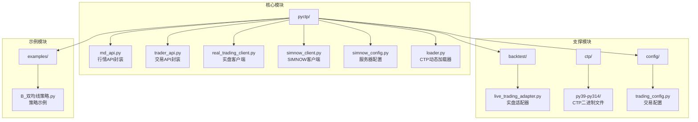
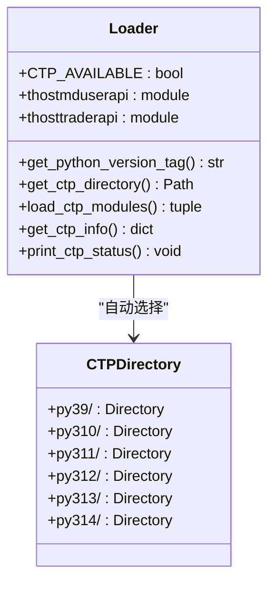
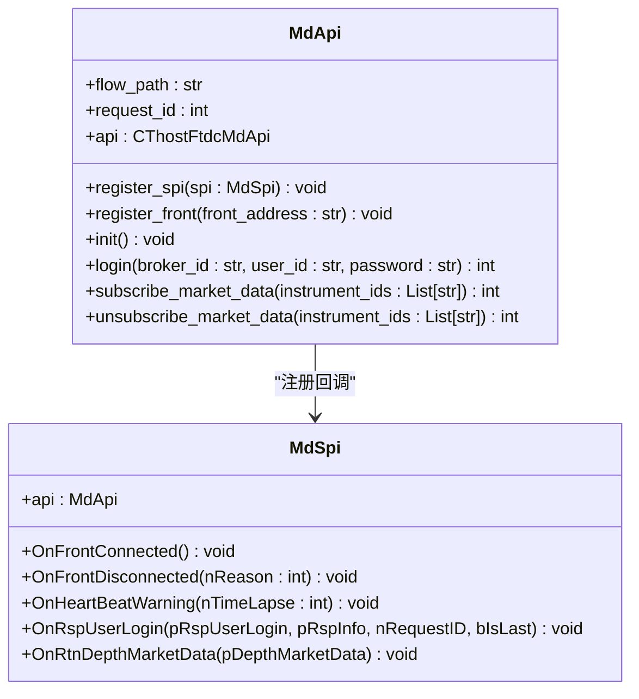
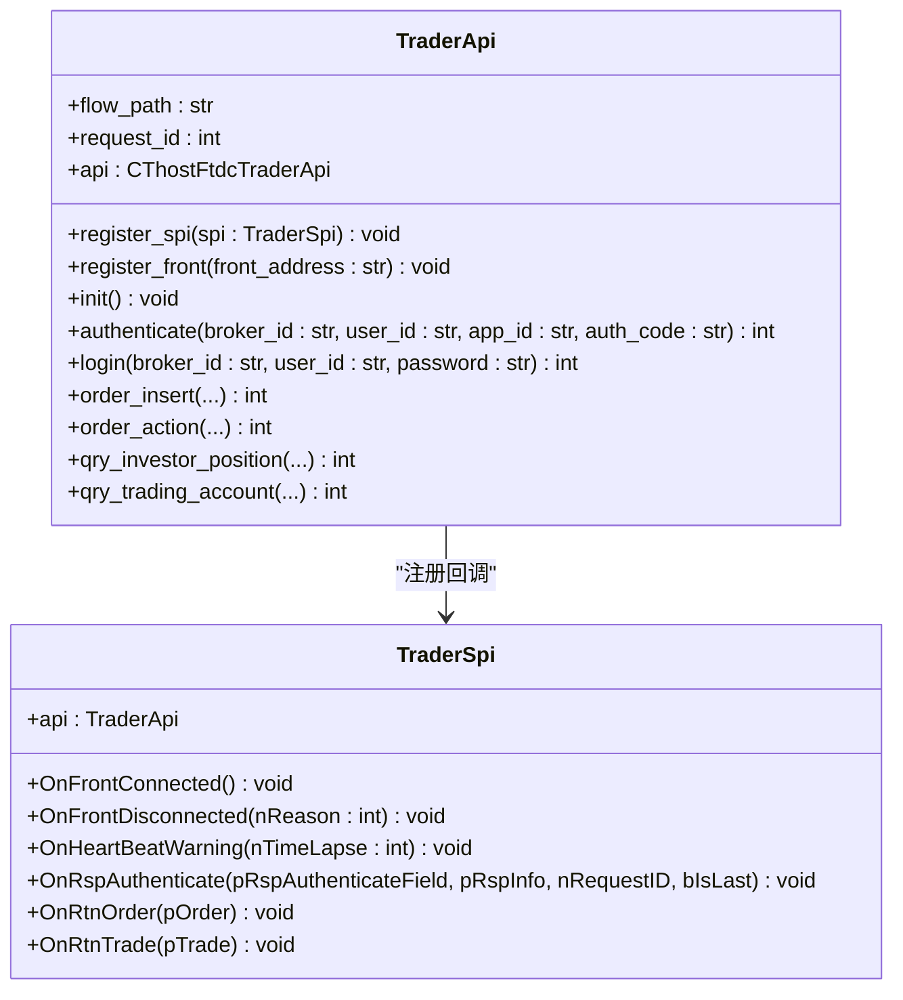
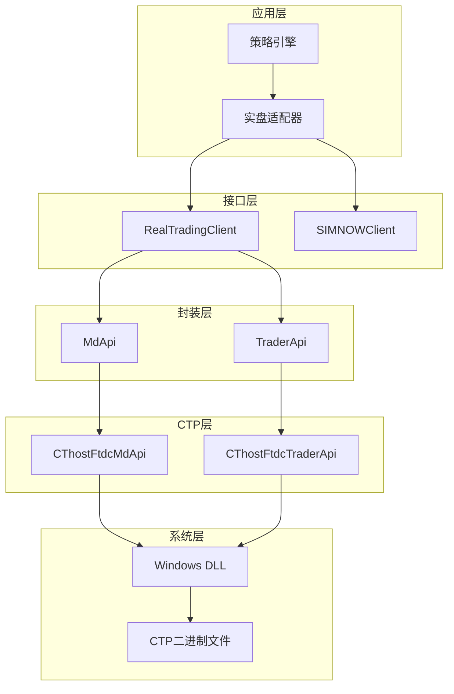
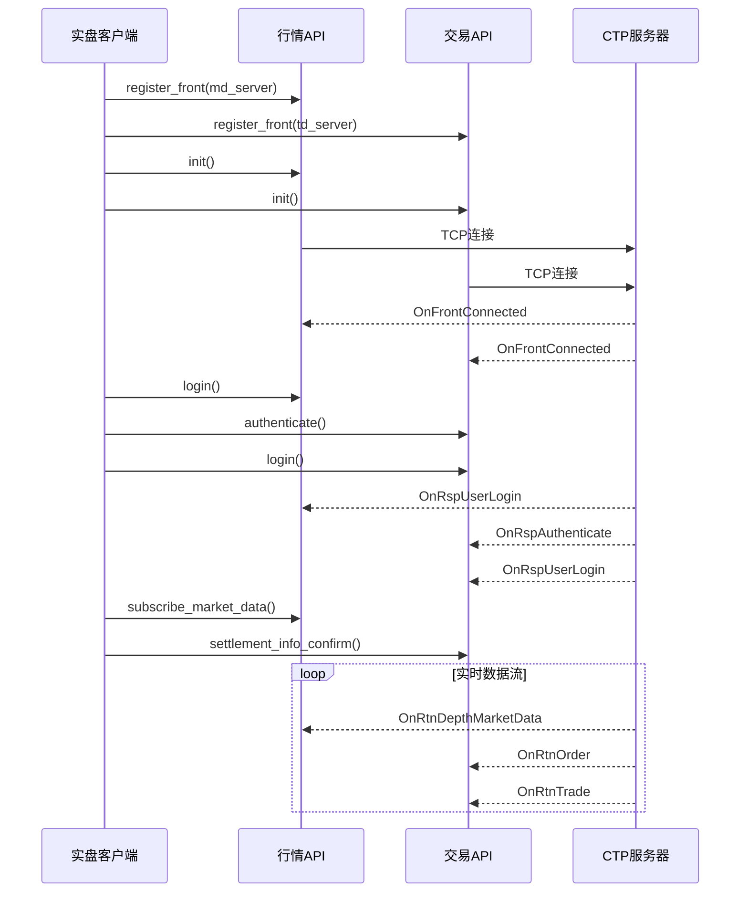
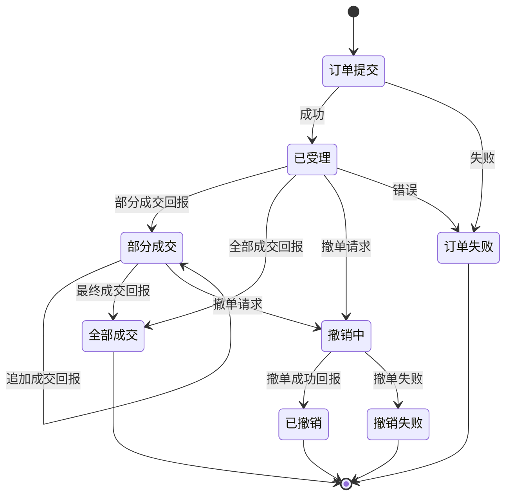
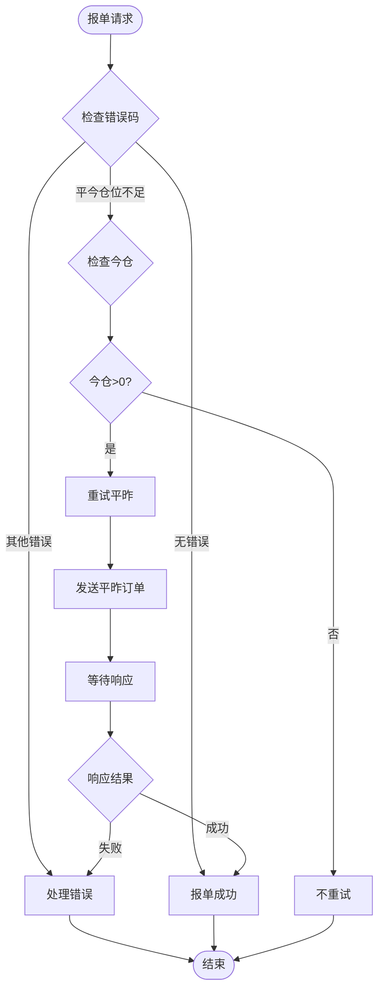
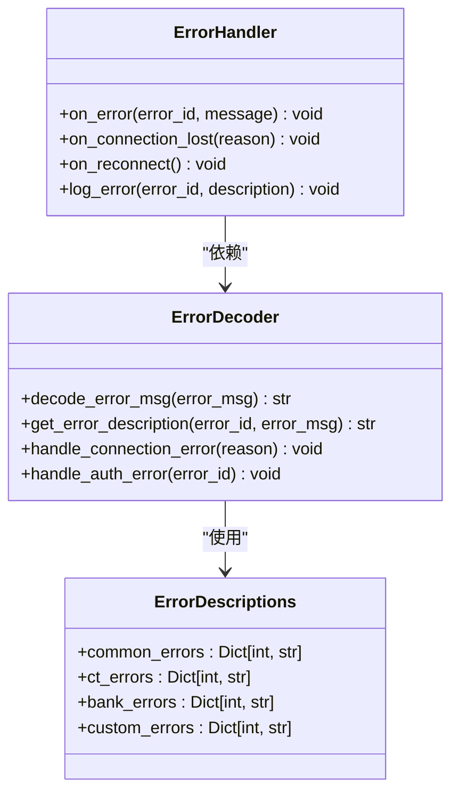
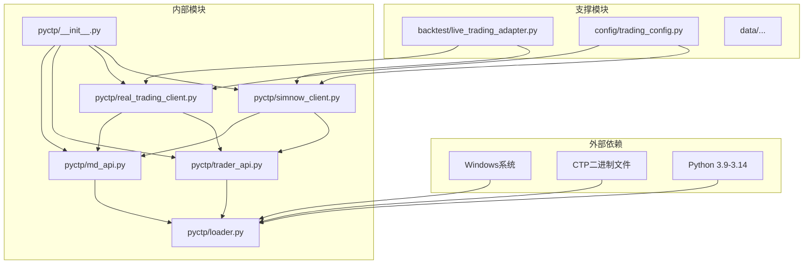

# 实盘CTP交易

<cite>
**本文档引用的文件**
- [README.md](file://README.md)
- [examples/B_双均线策略.py](file://examples/B_双均线策略.py)
- [ssquant/pyctp/__init__.py](file://ssquant/pyctp/__init__.py)
- [ssquant/pyctp/loader.py](file://ssquant/pyctp/loader.py)
- [ssquant/pyctp/md_api.py](file://ssquant/pyctp/md_api.py)
- [ssquant/pyctp/trader_api.py](file://ssquant/pyctp/trader_api.py)
- [ssquant/pyctp/real_trading_client.py](file://ssquant/pyctp/real_trading_client.py)
- [ssquant/pyctp/simnow_client.py](file://ssquant/pyctp/simnow_client.py)
- [ssquant/pyctp/simnow_config.py](file://ssquant/pyctp/simnow_config.py)
- [ssquant/backtest/live_trading_adapter.py](file://ssquant/backtest/live_trading_adapter.py)
- [ssquant/ctp/py310/error.xml](file://ssquant/ctp/py310/error.xml)
</cite>

## 目录
1. [简介](#简介)
2. [项目结构](#项目结构)
3. [核心组件](#核心组件)
4. [架构概览](#架构概览)
5. [详细组件分析](#详细组件分析)
6. [依赖关系分析](#依赖关系分析)
7. [性能考虑](#性能考虑)
8. [故障排除指南](#故障排除指南)
9. [结论](#结论)
10. [附录](#附录)

## 简介

SSQuant是一个专业的期货CTP量化交易框架，支持回测、SIMNOW模拟和实盘CTP三种运行模式。该框架提供了统一的策略开发接口，实现了完整的实盘交易功能，包括连接管理、心跳机制、断线重连策略、数据流处理、订单生命周期管理、成交回报处理和持仓更新机制。

## 项目结构

该项目采用模块化设计，主要包含以下核心模块：



**图表来源**
- [README.md](file://README.md#L297-L320)
- [ssquant/pyctp/__init__.py](file://ssquant/pyctp/__init__.py#L1-L26)

**章节来源**
- [README.md](file://README.md#L297-L320)
- [ssquant/pyctp/__init__.py](file://ssquant/pyctp/__init__.py#L1-L26)

## 核心组件

### CTP动态加载器

CTP动态加载器负责根据Python版本自动加载对应的CTP二进制文件，支持Python 3.9到3.14版本。



**图表来源**
- [ssquant/pyctp/loader.py](file://ssquant/pyctp/loader.py#L1-L203)

### 行情API封装

行情API封装提供了简化的CTP行情接口，支持TCP连接、UDP协议和组播模式。



**图表来源**
- [ssquant/pyctp/md_api.py](file://ssquant/pyctp/md_api.py#L130-L261)

### 交易API封装

交易API封装提供了简化的CTP交易接口，支持认证、登录、报单、撤单等功能。



**图表来源**
- [ssquant/pyctp/trader_api.py](file://ssquant/pyctp/trader_api.py#L188-L483)

**章节来源**
- [ssquant/pyctp/loader.py](file://ssquant/pyctp/loader.py#L1-L203)
- [ssquant/pyctp/md_api.py](file://ssquant/pyctp/md_api.py#L1-L261)
- [ssquant/pyctp/trader_api.py](file://ssquant/pyctp/trader_api.py#L1-L483)

## 架构概览

系统采用分层架构设计，实现了行情和交易的分离管理：



**图表来源**
- [ssquant/pyctp/real_trading_client.py](file://ssquant/pyctp/real_trading_client.py#L538-L755)
- [ssquant/pyctp/simnow_client.py](file://ssquant/pyctp/simnow_client.py#L590-L815)

## 详细组件分析

### 实盘客户端架构

实盘客户端实现了完整的连接管理、认证流程和数据处理机制：



**图表来源**
- [ssquant/pyctp/real_trading_client.py](file://ssquant/pyctp/real_trading_client.py#L631-L648)
- [ssquant/pyctp/real_trading_client.py](file://ssquant/pyctp/real_trading_client.py#L13-L112)

### 订单生命周期管理

系统实现了完整的订单生命周期管理，包括订单创建、状态跟踪和成交处理：



**图表来源**
- [ssquant/pyctp/real_trading_client.py](file://ssquant/pyctp/real_trading_client.py#L197-L246)
- [ssquant/pyctp/real_trading_client.py](file://ssquant/pyctp/real_trading_client.py#L247-L280)

### 智能重试机制

系统实现了智能重试机制，特别是针对平今仓位不足的情况：



**图表来源**
- [ssquant/pyctp/real_trading_client.py](file://ssquant/pyctp/real_trading_client.py#L280-L317)

### 错误处理和异常恢复

系统实现了完善的错误处理机制，包括错误码解码、异常恢复和日志记录：



**图表来源**
- [ssquant/pyctp/real_trading_client.py](file://ssquant/pyctp/real_trading_client.py#L470-L536)
- [ssquant/ctp/py310/error.xml](file://ssquant/ctp/py310/error.xml#L1-L296)

**章节来源**
- [ssquant/pyctp/real_trading_client.py](file://ssquant/pyctp/real_trading_client.py#L1-L755)
- [ssquant/pyctp/simnow_client.py](file://ssquant/pyctp/simnow_client.py#L1-L815)

## 依赖关系分析

系统采用模块化设计，各组件之间的依赖关系如下：



**图表来源**
- [ssquant/pyctp/__init__.py](file://ssquant/pyctp/__init__.py#L11-L24)
- [ssquant/pyctp/loader.py](file://ssquant/pyctp/loader.py#L1-L203)

**章节来源**
- [ssquant/pyctp/__init__.py](file://ssquant/pyctp/__init__.py#L1-L26)
- [ssquant/pyctp/loader.py](file://ssquant/pyctp/loader.py#L1-L203)

## 性能考虑

### 连接池管理

系统实现了高效的连接池管理，支持多个并发连接：

- **连接复用**：同一进程内复用CTP连接，减少资源消耗
- **连接池大小**：根据系统资源动态调整连接池大小
- **连接健康检查**：定期检查连接状态，及时发现和恢复异常连接

### 数据处理优化

- **异步处理**：行情数据采用异步处理模式，避免阻塞主线程
- **批量处理**：支持批量订阅和查询，提高数据传输效率
- **内存管理**：合理控制数据缓存大小，避免内存泄漏

### 网络优化

- **TCP连接优化**：启用TCP_NODELAY，减少网络延迟
- **心跳机制**：定期发送心跳包，维持连接活跃状态
- **断线重连**：实现智能断线重连，保证服务连续性

## 故障排除指南

### 常见问题诊断

#### CTP连接问题

**症状**：无法连接到CTP服务器
**可能原因**：
- 网络连接异常
- Python版本不匹配
- CTP文件缺失
- 防火墙阻止连接

**解决方案**：
1. 检查网络连接状态
2. 验证Python版本与CTP版本匹配
3. 确认CTP文件完整性
4. 检查防火墙设置

#### 登录认证失败

**症状**：登录时出现认证错误
**可能原因**：
- 用户名或密码错误
- 经纪商ID配置错误
- 认证码失效
- IP地址限制

**解决方案**：
1. 核对账户信息准确性
2. 检查经纪商配置
3. 更新认证信息
4. 联系期货公司客服

#### 订单执行异常

**症状**：订单无法正常执行
**可能原因**：
- 价格超出涨跌停限制
- 资金不足
- 持仓不足
- 交易时间限制

**解决方案**：
1. 检查合约价格限制
2. 确认账户资金充足
3. 验证持仓情况
4. 确认交易时间

### 调试工具

系统提供了多种调试工具帮助开发者诊断问题：

- **日志系统**：详细的连接、认证、交易日志
- **状态监控**：实时监控连接状态和数据流
- **错误码查询**：完整的错误码对照表
- **性能监控**：连接延迟、吞吐量等性能指标

**章节来源**
- [ssquant/ctp/py310/error.xml](file://ssquant/ctp/py310/error.xml#L1-L296)
- [ssquant/pyctp/real_trading_client.py](file://ssquant/pyctp/real_trading_client.py#L470-L536)

## 结论

SSQuant实盘CTP交易系统提供了完整、稳定、高性能的量化交易解决方案。系统采用模块化设计，实现了行情和交易的分离管理，支持多种运行模式，具有良好的扩展性和维护性。

### 主要优势

1. **统一接口**：一套代码支持回测、模拟和实盘三种模式
2. **完整功能**：涵盖从连接管理到订单执行的全流程
3. **智能重试**：针对常见错误提供智能重试机制
4. **错误处理**：完善的错误码处理和异常恢复机制
5. **性能优化**：针对高频交易场景进行性能优化

### 技术特点

- **模块化架构**：清晰的层次结构和职责分离
- **异步处理**：高效的异步数据处理机制
- **连接管理**：智能的连接池和断线重连策略
- **数据流处理**：完整的数据流管道和回调机制
- **错误恢复**：自动化的错误检测和恢复机制

该系统为量化交易开发者提供了坚实的技术基础，支持从初学者到专业交易者的各种需求。

## 附录

### 配置参数说明

#### 实盘账户配置

```python
{
    'broker_id': '期货公司代码',
    'investor_id': '资金账号',
    'password': '密码',
    'md_server': 'tcp://行情服务器IP:端口',
    'td_server': 'tcp://交易服务器IP:端口',
    'app_id': 'AppID',
    'auth_code': '授权码',
    'subscribe_list': ['合约代码列表'],
    'md_flow_path': '行情流文件路径',
    'td_flow_path': '交易流文件路径'
}
```

#### SIMNOW模拟账户配置

```python
{
    'investor_id': 'SIMNOW账号',
    'password': 'SIMNOW密码',
    'server_name': '服务器名称',
    'subscribe_list': ['合约代码列表'],
    'md_flow_path': '行情流文件路径',
    'td_flow_path': '交易流文件路径'
}
```

### 服务器配置

系统支持多个CTP服务器，包括：

- **SIMNOW服务器**：提供免费的模拟交易环境
- **实盘服务器**：连接各大期货公司的实盘交易系统
- **测试服务器**：用于功能测试和验证

### 策略开发指南

#### 基本策略结构

```python
def my_strategy(api: StrategyAPI):
    # 获取数据
    close = api.get_close()
    current_pos = api.get_pos()
    
    # 策略逻辑
    if condition:
        api.buy(volume=1)
    elif condition:
        api.sell()
    
    # 记录日志
    api.log("策略执行完成")
```

#### 交易参数配置

- **滑点设置**：模拟交易成本和滑点影响
- **手续费设置**：根据合约类型设置合理的手续费
- **保证金设置**：根据保证金率计算所需资金
- **风控参数**：设置止损、止盈等风控指标