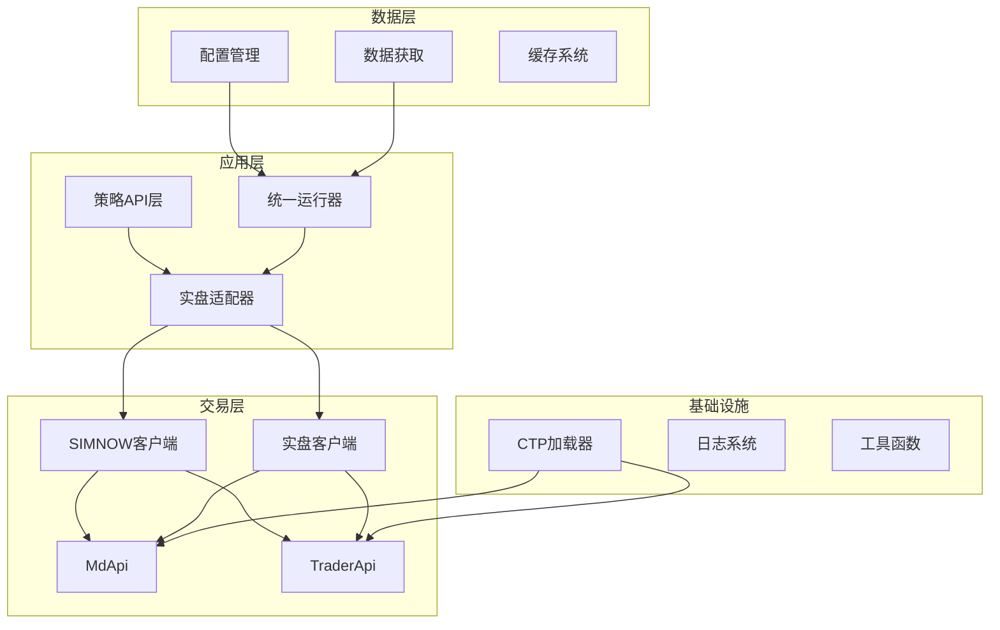
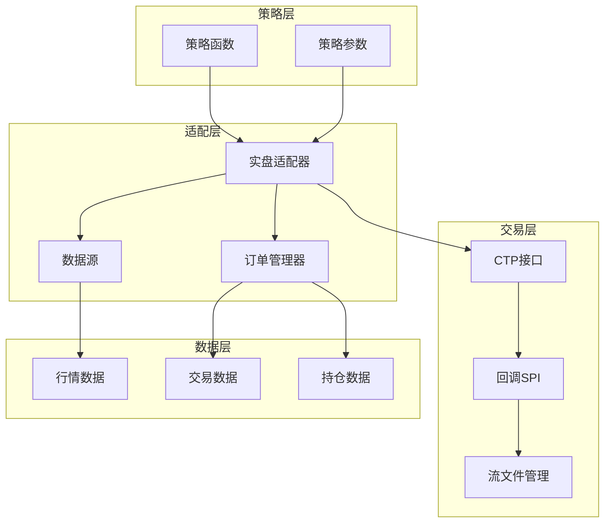
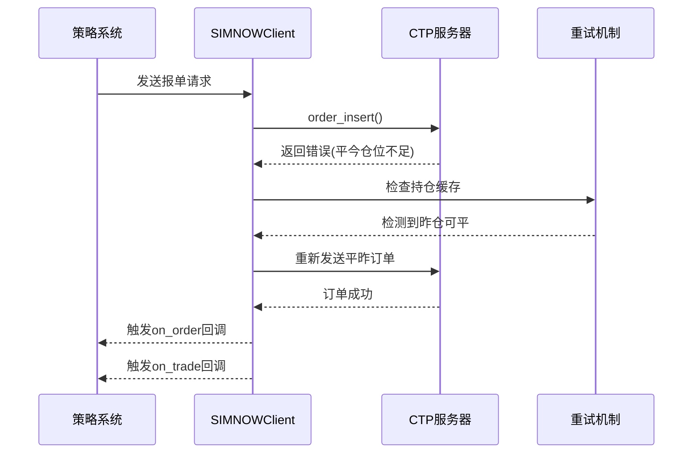
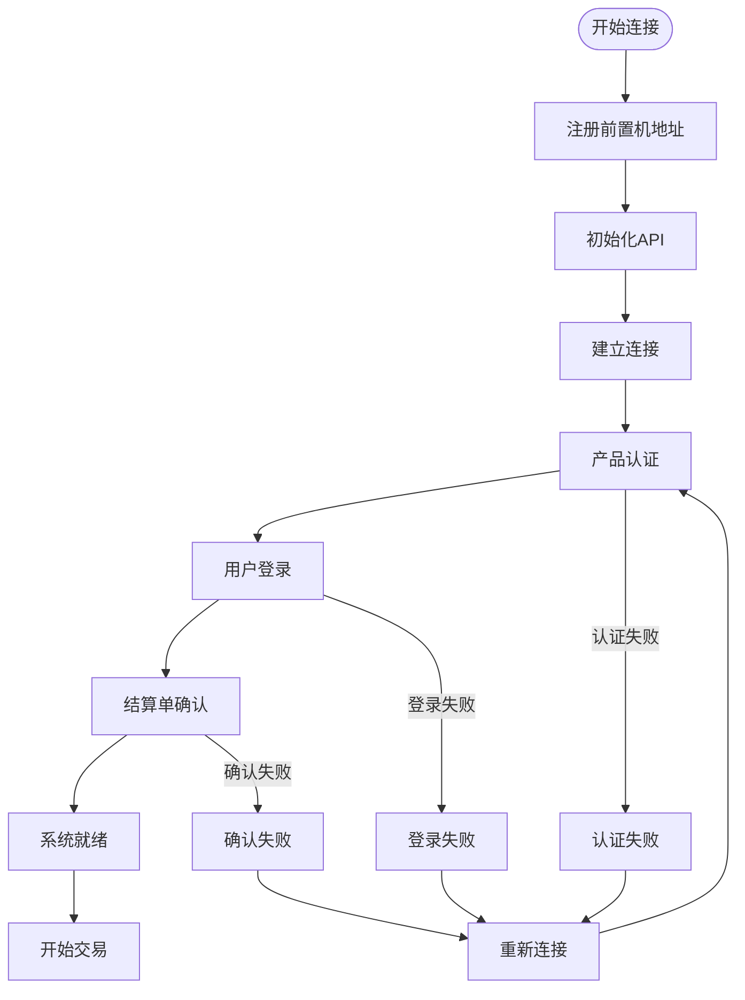
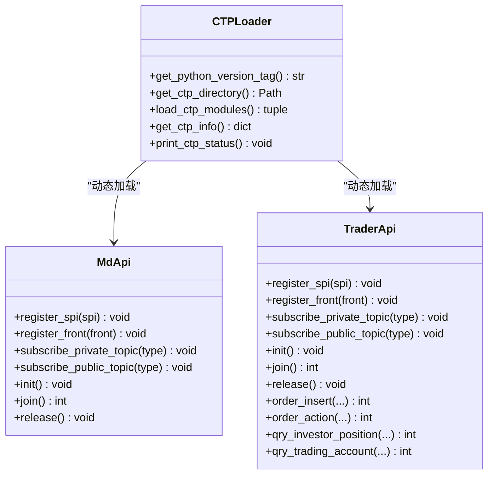
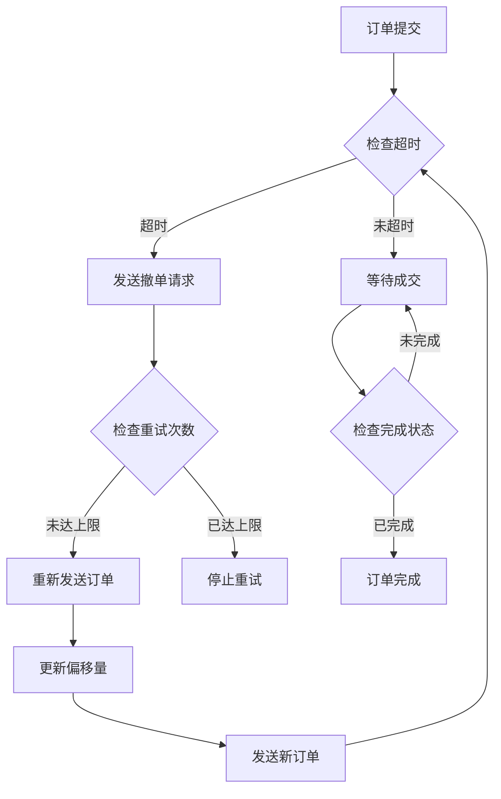
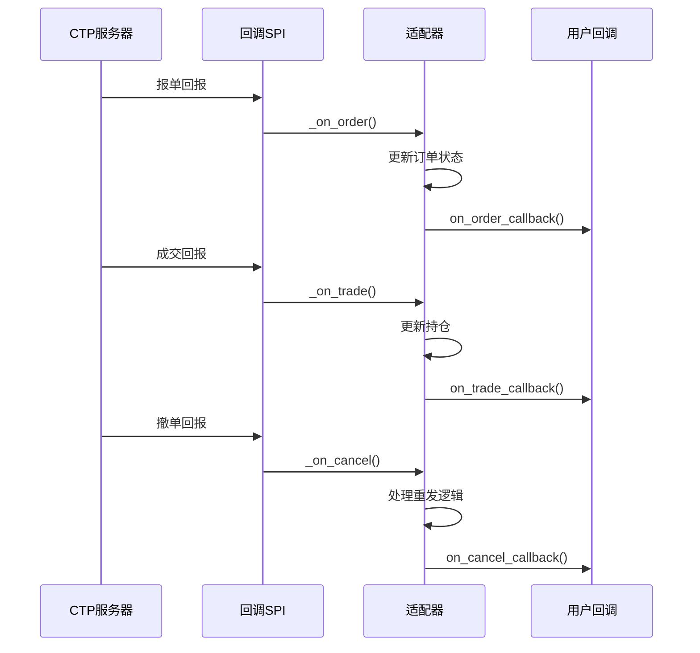
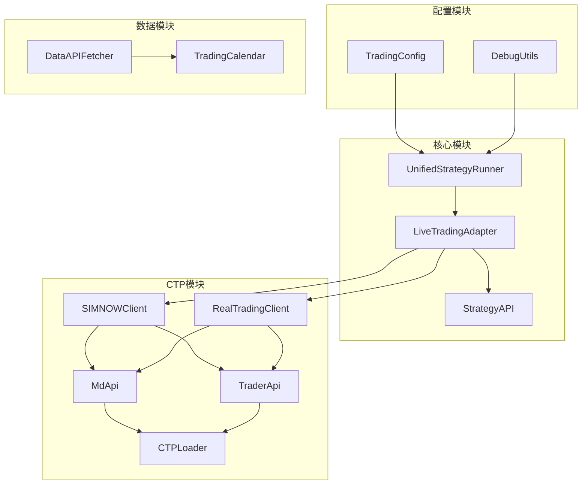

# 实盘交易系统

<cite>
**本文档引用的文件**
- [README.md](file://README.md)
- [ssquant/__init__.py](file://ssquant/__init__.py)
- [ssquant/pyctp/__init__.py](file://ssquant/pyctp/__init__.py)
- [ssquant/pyctp/simnow_client.py](file://ssquant/pyctp/simnow_client.py)
- [ssquant/pyctp/trader_api.py](file://ssquant/pyctp/trader_api.py)
- [ssquant/pyctp/real_trading_client.py](file://ssquant/pyctp/real_trading_client.py)
- [ssquant/pyctp/simnow_config.py](file://ssquant/pyctp/simnow_config.py)
- [ssquant/backtest/live_trading_adapter.py](file://ssquant/backtest/live_trading_adapter.py)
- [ssquant/backtest/unified_runner.py](file://ssquant/backtest/unified_runner.py)
- [ssquant/config/trading_config.py](file://ssquant/config/trading_config.py)
- [ssquant/api/strategy_api.py](file://ssquant/api/strategy_api.py)
- [ssquant/ctp/loader.py](file://ssquant/ctp/loader.py)
- [ssquant/api/debug_utils.py](file://ssquant/api/debug_utils.py)
- [ssquant/data/api_data_fetcher.py](file://ssquant/data/api_data_fetcher.py)
</cite>

## 目录
1. [简介](#简介)
2. [项目结构](#项目结构)
3. [核心组件](#核心组件)
4. [架构概览](#架构概览)
5. [详细组件分析](#详细组件分析)
6. [依赖关系分析](#依赖关系分析)
7. [性能考虑](#性能考虑)
8. [故障排除指南](#故障排除指南)
9. [结论](#结论)
10. [附录](#附录)

## 简介

SSQuant是一个专业的期货量化交易框架，支持"一次编写，三处运行"的策略开发模式。该系统提供了完整的回测、SIMNOW模拟交易和实盘CTP交易功能，实现了统一的API接口，使得策略代码可以在不同的运行环境中无缝切换。

该框架的核心特性包括：
- 统一的策略框架，一套代码三处运行
- 完整的数据支持，K线数据和TICK逐笔数据
- 多品种多周期交易支持
- 强大的交易功能，包括自动开平仓管理、智能算法交易
- 实时回调系统，支持on_trade/on_order/on_cancel实时通知
- TICK流双驱动模式，支持K线驱动和TICK驱动两种模式

## 项目结构

SSQuant项目的整体架构采用模块化设计，主要包含以下几个核心模块：

**图表来源**
- [ssquant/__init__.py:1-18](file://ssquant/__init__.py#L1-L18)
- [ssquant/backtest/unified_runner.py:26-57](file://ssquant/backtest/unified_runner.py#L26-L57)
- [ssquant/pyctp/__init__.py:11-24](file://ssquant/pyctp/__init__.py#L11-L24)

**章节来源**
- [README.md:297-321](file://README.md#L297-L321)
- [ssquant/__init__.py:1-18](file://ssquant/__init__.py#L1-L18)

## 核心组件

### CTP接口封装

SSQuant提供了完整的CTP接口封装，支持SIMNOW模拟交易和实盘CTP交易两种模式。核心组件包括：

1. **MdApi** - 行情API封装
2. **TraderApi** - 交易API封装  
3. **SIMNOWClient** - SIMNOW模拟交易客户端
4. **RealTradingClient** - 实盘交易客户端

### 实盘适配器

LiveTradingAdapter是实盘交易的核心适配器，负责将CTP实盘交易接口适配为与回测一致的API调用方式，支持SIMNOW模拟和实盘交易。

### 策略API

StrategyAPI提供了统一的策略开发接口，支持多数据源访问和交易操作，实现了"一次编写，多处运行"的目标。

**章节来源**
- [ssquant/pyctp/__init__.py:11-24](file://ssquant/pyctp/__init__.py#L11-L24)
- [ssquant/api/strategy_api.py:4-20](file://ssquant/api/strategy_api.py#L4-L20)

## 架构概览

SSQuant采用分层架构设计，实现了高度的模块化和可扩展性：

**图表来源**
- [ssquant/backtest/live_trading_adapter.py:1127-1186](file://ssquant/backtest/live_trading_adapter.py#L1127-L1186)
- [ssquant/pyctp/trader_api.py:188-254](file://ssquant/pyctp/trader_api.py#L188-L254)

## 详细组件分析

### SIMNOW模拟交易客户端

SIMNOWClient实现了完整的SIMNOW自动交易客户端功能，提供了友好的Python接口用于访问CTP行情和交易API。

#### 核心功能特性

1. **自动登录机制** - 客户端启动后自动连接服务器并进行身份认证
2. **智能重试机制** - 支持平今仓位不足时的自动平昨重试
3. **详细回调系统** - 提供on_trade/on_order/on_cancel等实时回调
4. **多服务器支持** - 支持电信1、电信2、移动、TEST、N视界、24hour等多种服务器

#### 智能算法交易功能

**图表来源**
- [ssquant/pyctp/simnow_client.py:312-343](file://ssquant/pyctp/simnow_client.py#L312-L343)
- [ssquant/backtest/live_trading_adapter.py:1854-1893](file://ssquant/backtest/live_trading_adapter.py#L1854-L1893)

#### 订单管理机制

SIMNOWClient实现了完善的订单管理机制，包括：

1. **订单超时检测** - 支持智能追单重试机制
2. **订单状态跟踪** - 实时跟踪未成交订单状态
3. **智能分单处理** - 支持今仓和昨仓的智能分单
4. **防重复下单** - 防止短时间内重复下单

**章节来源**
- [ssquant/pyctp/simnow_client.py:590-800](file://ssquant/pyctp/simnow_client.py#L590-L800)
- [ssquant/backtest/live_trading_adapter.py:416-460](file://ssquant/backtest/live_trading_adapter.py#L416-L460)

### 实盘交易客户端

RealTradingClient支持连接期货公司实盘环境，提供了与SIMNOW相同的API接口，但使用真实的实盘服务器。

#### 实盘连接流程

**图表来源**
- [ssquant/pyctp/real_trading_client.py:129-196](file://ssquant/pyctp/real_trading_client.py#L129-L196)

#### 实盘适配器

LiveTradingAdapter是实盘交易的核心适配器，负责协调各个组件的工作：

1. **多数据源支持** - 支持单数据源和多数据源模式
2. **TICK流双驱动** - 支持TICK级和K线级两种驱动模式
3. **数据记录系统** - 支持CSV和数据库双存储
4. **实时回调系统** - 提供完整的交易回调支持

**章节来源**
- [ssquant/backtest/live_trading_adapter.py:1127-1599](file://ssquant/backtest/live_trading_adapter.py#L1127-L1599)

### CTP接口封装设计

#### CTP加载器

CTP加载器实现了跨平台兼容性，支持多种Python版本：

**图表来源**
- [ssquant/ctp/loader.py:84-122](file://ssquant/ctp/loader.py#L84-L122)
- [ssquant/pyctp/trader_api.py:188-254](file://ssquant/pyctp/trader_api.py#L188-L254)

#### 错误处理策略

CTP接口封装实现了完善的错误处理机制：

1. **GBK编码解码** - 处理CTP返回的GBK编码错误信息
2. **常见错误映射** - 将CTP错误码映射为中文描述
3. **重试机制** - 对可恢复的错误进行自动重试
4. **降级处理** - 在错误情况下提供降级处理方案

**章节来源**
- [ssquant/pyctp/trader_api.py:27-42](file://ssquant/pyctp/trader_api.py#L27-L42)
- [ssquant/backtest/live_trading_adapter.py:2093-2161](file://ssquant/backtest/live_trading_adapter.py#L2093-L2161)

### 风险控制系统

SSQuant实现了多层次的风险控制机制：

#### 智能算法交易

**图表来源**
- [ssquant/backtest/live_trading_adapter.py:416-460](file://ssquant/backtest/live_trading_adapter.py#L416-L460)

#### 订单重发机制

系统实现了智能的订单重发机制，包括：

1. **超时检测** - 基于订单插入时间和配置的超时检测
2. **重试策略** - 支持最大重试次数配置
3. **偏移量递增** - 重试时增加委托价格偏移量
4. **状态跟踪** - 实时跟踪重发订单的状态

**章节来源**
- [ssquant/backtest/live_trading_adapter.py:1854-1893](file://ssquant/backtest/live_trading_adapter.py#L1854-L1893)

### 实时回调系统

SSQuant实现了完整的实时回调系统，支持多种类型的交易事件：

#### 回调类型

1. **on_trade** - 成交回调，提供详细的成交信息
2. **on_order** - 报单回调，提供订单状态变化通知
3. **on_cancel** - 撤单回调，提供撤单确认信息
4. **on_position** - 持仓回调，提供持仓变化通知
5. **on_account** - 账户回调，提供资金变化通知

#### 回调处理流程

**图表来源**
- [ssquant/backtest/live_trading_adapter.py:1575-1811](file://ssquant/backtest/live_trading_adapter.py#L1575-L1811)

**章节来源**
- [ssquant/backtest/live_trading_adapter.py:1507-1574](file://ssquant/backtest/live_trading_adapter.py#L1507-L1574)

### 订单管理增强功能

**更新** 增强了订单管理、账户查询、连接稳定性、OrderRef填充和CTP查询节流功能

#### 订单管理改进

1. **智能超时检测** - 每秒最多检查一次，避免频繁遍历未成交订单
2. **连接状态检查** - 发送订单前检查连接状态，防止未就绪状态下下单
3. **撤单备用键** - 支持OrderSysID为空时使用FrontID:SessionID:OrderRef备用键
4. **重试计数继承** - 支持订单重发时继承重试次数

#### 账户查询增强

1. **查询缓存管理** - 查询前自动清空缓存，避免重复数据
2. **查询节流控制** - 使用最小间隔控制查询频率，避免过度查询
3. **多品种支持** - 支持特定品种和全部品种的查询
4. **状态同步** - 实时同步账户资金到适配器

#### 连接稳定性提升

1. **连接纪元管理** - 使用连接纪元号避免过期重试
2. **自动重连机制** - CTP自动重连后自动重新登录
3. **认证重试** - 认证失败时自动重试，最长30秒延迟
4. **状态监控** - 实时监控连接状态和断开原因

#### OrderRef填充优化

1. **自动续号** - 从MaxOrderRef续号，避免重复
2. **协议异常处理** - MaxOrderRef解析失败时使用时间戳种子
3. **跨会话兼容** - 避免同交易日重启后OrderRef冲突
4. **错误告警** - 使用阈值告警机制监控异常情况

#### CTP查询节流

1. **最小间隔控制** - 默认1秒最小间隔，避免过度查询
2. **智能补时** - 仅补齐不足的时间，避免无谓阻塞
3. **锁保护** - 使用线程锁确保查询时序
4. **缓存清空** - 查询前自动清空相关缓存

**章节来源**
- [ssquant/backtest/live_trading_adapter.py:481-542](file://ssquant/backtest/live_trading_adapter.py#L481-L542)
- [ssquant/pyctp/real_trading_client.py:890-898](file://ssquant/pyctp/real_trading_client.py#L890-L898)
- [ssquant/pyctp/real_trading_client.py:1058-1092](file://ssquant/pyctp/real_trading_client.py#L1058-L1092)
- [ssquant/pyctp/simnow_client.py:346-368](file://ssquant/pyctp/simnow_client.py#L346-L368)

## 依赖关系分析

### 模块依赖图

**图表来源**
- [ssquant/backtest/unified_runner.py:15-57](file://ssquant/backtest/unified_runner.py#L15-L57)
- [ssquant/pyctp/__init__.py:17-24](file://ssquant/pyctp/__init__.py#L17-L24)

### 关键依赖关系

1. **CTP动态加载** - 通过CTPLoader实现Python版本兼容
2. **配置管理** - 通过TradingConfig集中管理账户配置
3. **数据获取** - 通过DataAPIFetcher获取外部数据源
4. **调试工具** - 通过DebugUtils提供模块检查功能

**章节来源**
- [ssquant/ctp/loader.py:172-188](file://ssquant/ctp/loader.py#L172-L188)
- [ssquant/config/trading_config.py:115-164](file://ssquant/config/trading_config.py#L115-L164)

## 性能考虑

### CTP接口性能优化

1. **异步处理** - CTP回调采用异步处理模式，避免阻塞主线程
2. **流文件管理** - 通过流文件实现高性能的数据传输
3. **内存管理** - 使用deque实现高效的数据缓存
4. **网络优化** - 支持多服务器选择，提高连接稳定性

### 数据处理性能

1. **批量处理** - 支持批量数据处理，减少系统调用次数
2. **缓存机制** - 实现多级缓存，提高数据访问速度
3. **异步写入** - 数据记录采用异步写入，避免影响交易性能
4. **内存池** - 使用内存池技术，减少内存分配开销

### 系统资源管理

1. **连接池** - 实现CTP连接池，提高连接复用效率
2. **线程管理** - 合理的线程池配置，避免资源浪费
3. **资源监控** - 实时监控系统资源使用情况
4. **自动清理** - 实现资源自动清理机制

### 查询节流优化

**更新** 新增查询节流机制，提升系统性能

1. **最小间隔控制** - 默认1秒最小间隔，避免过度查询
2. **智能补时** - 仅补齐不足的时间，避免无谓阻塞
3. **锁保护** - 使用线程锁确保查询时序
4. **缓存清空** - 查询前自动清空相关缓存

**章节来源**
- [ssquant/pyctp/real_trading_client.py:890-898](file://ssquant/pyctp/real_trading_client.py#L890-L898)

## 故障排除指南

### 常见问题及解决方案

#### CTP模块不可用

**问题描述**：CTP模块加载失败，提示"CTP模块不可用"

**解决方案**：
1. 检查Python版本是否在支持范围内
2. 确认CTP文件目录是否存在
3. 验证系统架构是否为64位
4. 检查操作系统是否为Windows

**章节来源**
- [ssquant/ctp/loader.py:36-48](file://ssquant/ctp/loader.py#L36-L48)

#### SIMNOW连接失败

**问题描述**：SIMNOW连接超时或认证失败

**解决方案**：
1. 检查SIMNOW账户信息是否正确
2. 尝试切换不同的服务器节点
3. 验证网络连接是否稳定
4. 检查防火墙设置

**章节来源**
- [ssquant/pyctp/simnow_client.py:662-700](file://ssquant/pyctp/simnow_client.py#L662-L700)

#### 实盘连接问题

**问题描述**：实盘连接失败或交易异常

**解决方案**：
1. 验证期货公司提供的服务器地址
2. 检查产品认证信息是否正确
3. 确认账户权限设置
4. 验证网络环境和防火墙配置

**章节来源**
- [ssquant/pyctp/real_trading_client.py:631-653](file://ssquant/pyctp/real_trading_client.py#L631-L653)

#### 订单管理问题

**更新** 新增订单管理相关故障排除

**问题描述**：订单超时、重发失败或连接状态异常

**解决方案**：
1. 检查订单超时配置是否合理
2. 验证连接状态检查机制
3. 确认撤单备用键是否正确设置
4. 检查重试计数继承机制

**章节来源**
- [ssquant/backtest/live_trading_adapter.py:481-542](file://ssquant/backtest/live_trading_adapter.py#L481-L542)

### 调试工具使用

#### 模块检查工具

DebugUtils提供了完整的模块检查功能：

1. **模块存在性检查** - 检查指定模块是否可导入
2. **函数存在性检查** - 验证关键函数是否存在
3. **路径信息获取** - 获取模块文件的实际路径
4. **系统路径检查** - 显示Python的模块搜索路径

**章节来源**
- [ssquant/api/debug_utils.py:104-134](file://ssquant/api/debug_utils.py#L104-L134)

### 性能监控

#### CTP状态监控

通过print_ctp_status()函数可以查看CTP模块的详细状态信息，包括：

1. **Python版本信息** - 显示当前使用的Python版本
2. **操作系统信息** - 显示操作系统类型和架构
3. **CTP模块状态** - 显示CTP模块的可用性
4. **错误信息** - 显示具体的错误原因

**章节来源**
- [ssquant/ctp/loader.py:151-169](file://ssquant/ctp/loader.py#L151-L169)

## 结论

SSQuant实盘交易系统通过其精心设计的架构和完善的组件实现了高度的模块化和可扩展性。系统的核心优势包括：

1. **统一的API接口** - 支持一套代码在回测、SIMNOW模拟和实盘交易中运行
2. **完整的交易功能** - 提供从行情获取到订单执行的完整交易链路
3. **智能算法交易** - 实现了复杂的订单管理和重发机制
4. **实时回调系统** - 提供全面的交易事件通知
5. **跨平台兼容性** - 通过CTP动态加载器支持多种Python版本
6. **增强的订单管理** - 支持智能超时检测、连接状态检查、OrderRef填充和查询节流
7. **稳定的连接机制** - 实现自动重连、认证重试和连接纪元管理

该系统特别适合需要进行多环境策略开发和测试的量化交易开发者，为从策略开发到实盘交易提供了完整的解决方案。

## 附录

### 实盘配置指南

#### 账户配置参数

| 参数名称 | 类型 | 必填 | 描述 |
|---------|------|------|------|
| broker_id | str | 是 | 期货公司代码 |
| investor_id | str | 是 | 资金账号 |
| password | str | 是 | 交易密码 |
| md_server | str | 是 | 行情服务器地址 |
| td_server | str | 是 | 交易服务器地址 |
| app_id | str | 是 | 应用ID |
| auth_code | str | 是 | 授权码 |

#### 交易参数配置

| 参数名称 | 类型 | 默认值 | 描述 |
|---------|------|--------|------|
| kline_period | str | '1d' | K线周期 |
| price_tick | float | 1.0 | 最小变动价位 |
| order_offset_ticks | int | 5 | 委托价格偏移跳数 |
| algo_trading | bool | False | 是否启用算法交易 |
| order_timeout | int | 10 | 订单超时时间(秒) |
| retry_limit | int | 3 | 最大重试次数 |

### 连接测试方法

#### SIMNOW测试步骤

1. 配置SIMNOW账户信息
2. 选择合适的服务器节点
3. 运行连接测试程序
4. 验证连接状态和认证结果

#### 实盘测试步骤

1. 获取期货公司提供的服务器信息
2. 配置产品认证参数
3. 验证账户权限
4. 进行模拟交易测试

### 故障排除最佳实践

1. **日志记录** - 详细记录系统运行状态和错误信息
2. **监控告警** - 建立系统监控和告警机制
3. **备份恢复** - 定期备份重要数据和配置
4. **版本管理** - 严格管理代码版本和依赖库版本
5. **安全防护** - 加强系统安全防护，保护交易数据
6. **性能优化** - 合理配置查询节流和缓存机制
7. **连接管理** - 定期检查连接状态和重连机制