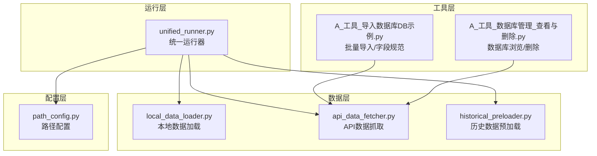
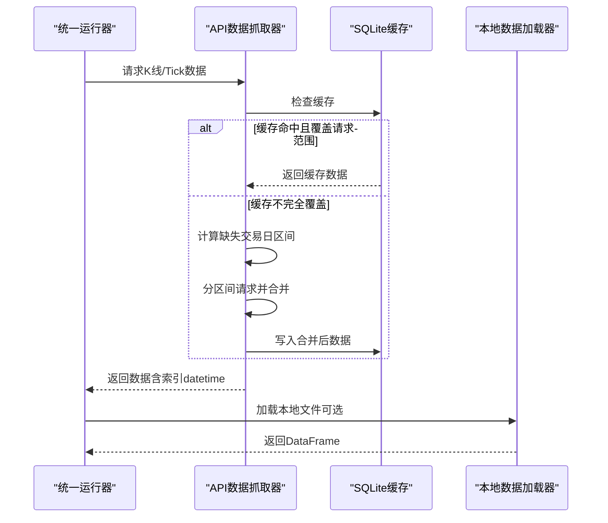
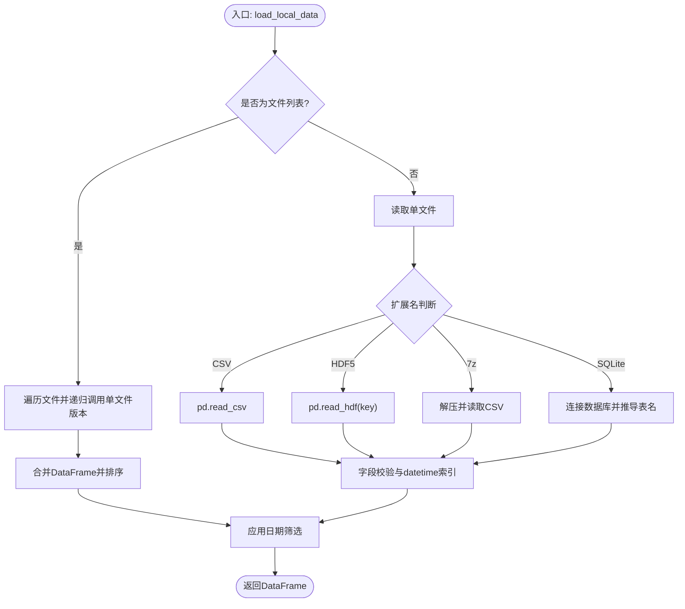
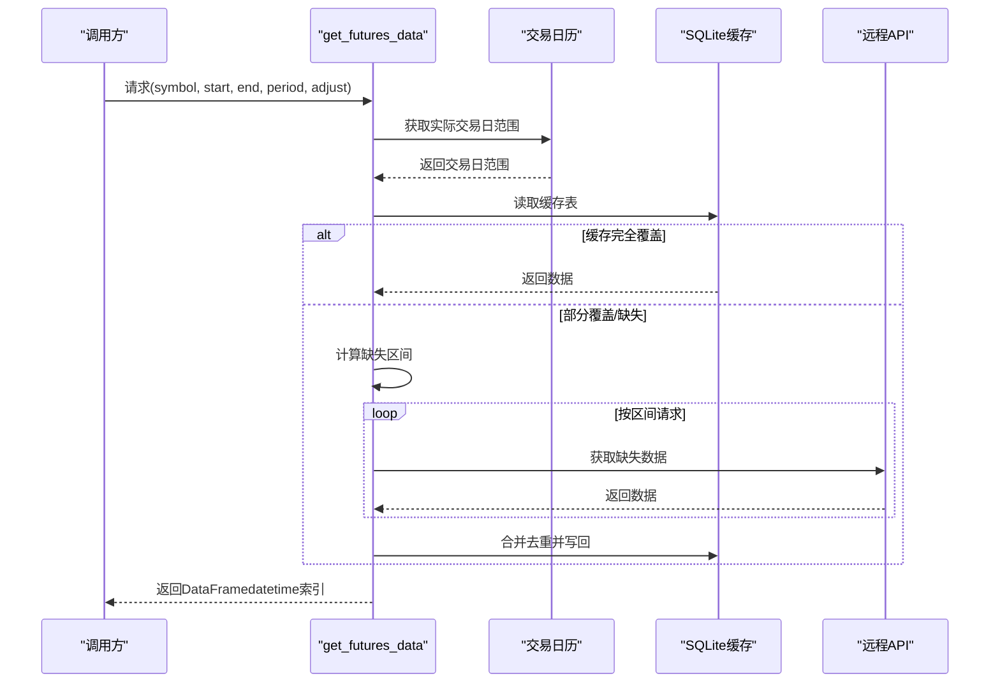
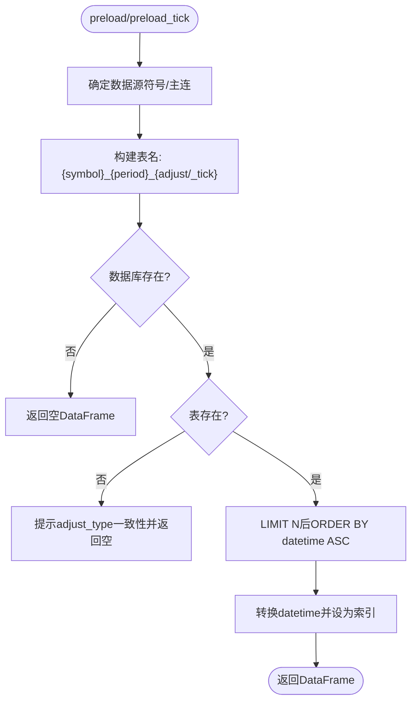
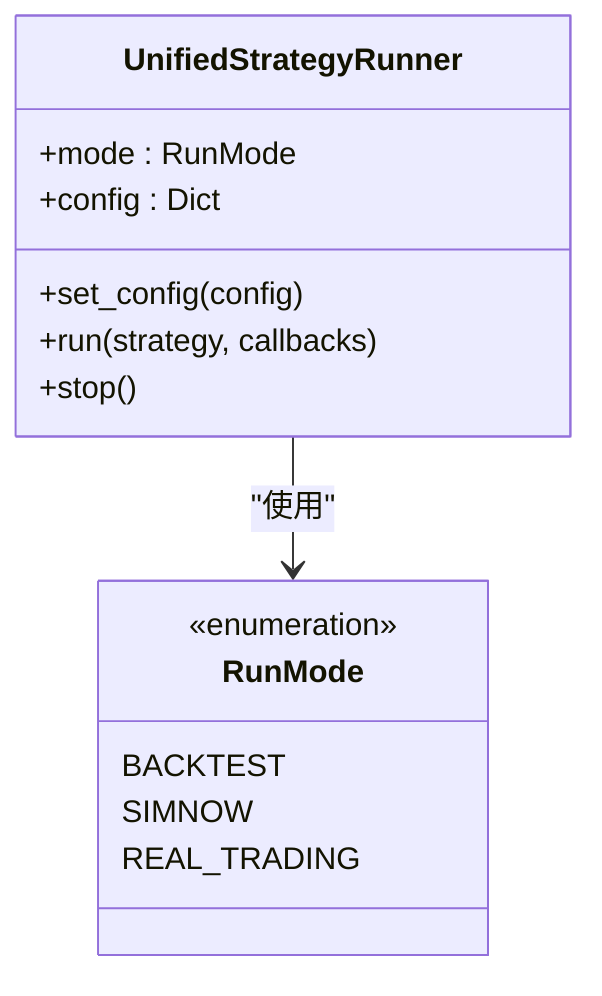
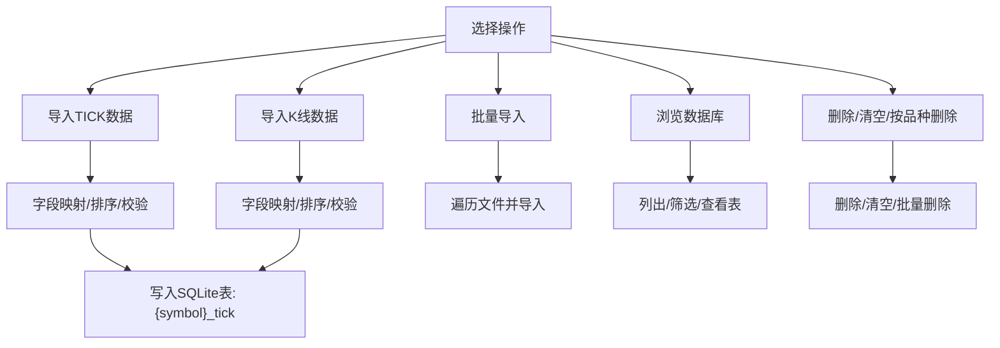
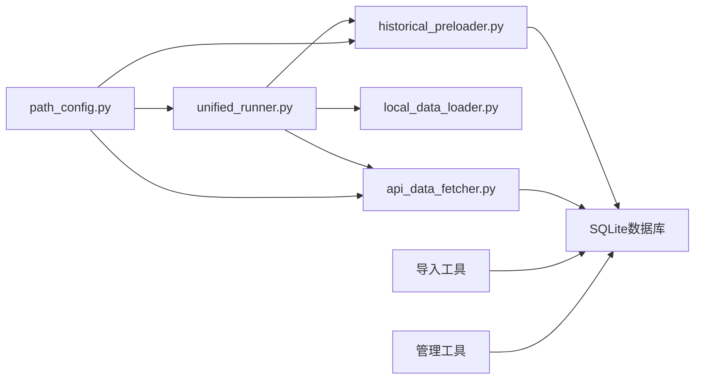

# 数据记录系统

<cite>
**本文引用的文件**
- [README.md](file://README.md)
- [ssquant/__init__.py](file://ssquant/__init__.py)
- [ssquant/config/path_config.py](file://ssquant/config/path_config.py)
- [ssquant/data/local_data_loader.py](file://ssquant/data/local_data_loader.py)
- [ssquant/data/api_data_fetcher.py](file://ssquant/data/api_data_fetcher.py)
- [ssquant/data/historical_preloader.py](file://ssquant/data/historical_preloader.py)
- [ssquant/backtest/unified_runner.py](file://ssquant/backtest/unified_runner.py)
- [examples/A_工具_导入数据库DB示例.py](file://examples/A_工具_导入数据库DB示例.py)
- [examples/A_工具_数据库管理_查看与删除.py](file://examples/A_工具_数据库管理_查看与删除.py)
</cite>

## 目录
1. [简介](#简介)
2. [项目结构](#项目结构)
3. [核心组件](#核心组件)
4. [架构总览](#架构总览)
5. [详细组件分析](#详细组件分析)
6. [依赖关系分析](#依赖关系分析)
7. [性能考量](#性能考量)
8. [故障排查指南](#故障排查指南)
9. [结论](#结论)
10. [附录](#附录)

## 简介
本文件面向“数据记录系统”的技术文档，围绕异步数据写入机制、CSV与数据库双存储策略、后台线程管理、Tick/K线数据记录格式与字段定义、数据对齐、持久化策略与存储路径、文件命名规则、数据完整性校验、批量导入导出、备份恢复、配置选项、性能优化、存储空间管理与清理策略等方面进行全面阐述。文档基于仓库现有代码与示例脚本进行分析，确保内容可追溯、可落地。

## 项目结构
该项目采用模块化组织，数据相关能力主要分布在 data、backtest、config 与 examples 目录中：
- data：数据获取、本地加载、历史预加载、API数据抓取
- backtest：统一运行器，贯穿回测、SIMNOW模拟与实盘模式
- config：路径配置与交易配置
- examples：数据库导入/管理工具与示例策略

图表来源
- [ssquant/data/local_data_loader.py](file://ssquant/data/local_data_loader.py#L1-L233)
- [ssquant/data/api_data_fetcher.py](file://ssquant/data/api_data_fetcher.py#L1-L800)
- [ssquant/data/historical_preloader.py](file://ssquant/data/historical_preloader.py#L1-L339)
- [ssquant/backtest/unified_runner.py](file://ssquant/backtest/unified_runner.py#L1-L379)
- [ssquant/config/path_config.py](file://ssquant/config/path_config.py#L1-L30)
- [examples/A_工具_导入数据库DB示例.py](file://examples/A_工具_导入数据库DB示例.py#L1-L776)
- [examples/A_工具_数据库管理_查看与删除.py](file://examples/A_工具_数据库管理_查看与删除.py#L1-L638)

章节来源
- [README.md](file://README.md#L297-L321)
- [ssquant/backtest/unified_runner.py](file://ssquant/backtest/unified_runner.py#L1-L379)

## 核心组件
- 本地数据加载器：支持CSV/HDF5/7z/SQLite等多种格式，自动校验字段，支持Tick/K线数据识别与日期筛选。
- API数据抓取器：提供交易日历、缓存策略、缺失交易日补全、时区转换、K线时间对齐等能力。
- 历史数据预加载器：按K线数量或Tick条数从SQLite数据库读取历史数据，支持主连符号与复权类型。
- 统一运行器：贯穿回测/SIMNOW/实盘模式，支持配置注入与回调注册。
- 路径配置：统一管理项目根目录、数据缓存目录、回测结果与日志目录。
- 数据库导入/管理工具：提供批量导入、字段映射、表结构展示、删除与清空等运维能力。

章节来源
- [ssquant/data/local_data_loader.py](file://ssquant/data/local_data_loader.py#L1-L233)
- [ssquant/data/api_data_fetcher.py](file://ssquant/data/api_data_fetcher.py#L1-L800)
- [ssquant/data/historical_preloader.py](file://ssquant/data/historical_preloader.py#L1-L339)
- [ssquant/backtest/unified_runner.py](file://ssquant/backtest/unified_runner.py#L1-L379)
- [ssquant/config/path_config.py](file://ssquant/config/path_config.py#L1-L30)
- [examples/A_工具_导入数据库DB示例.py](file://examples/A_工具_导入数据库DB示例.py#L1-L776)
- [examples/A_工具_数据库管理_查看与删除.py](file://examples/A_工具_数据库管理_查看与删除.py#L1-L638)

## 架构总览
数据记录系统在不同运行模式下协同工作：
- 回测模式：通过统一运行器加载API数据或本地文件，支持缓存与对齐策略。
- SIMNOW/实盘模式：通过适配器采集Tick/K线数据，写入SQLite数据库，供后续回测或预加载使用。
- 数据库工具：提供导入、浏览、删除、清空等运维能力，保障数据完整性与可维护性。

图表来源
- [ssquant/data/api_data_fetcher.py](file://ssquant/data/api_data_fetcher.py#L171-L626)
- [ssquant/data/local_data_loader.py](file://ssquant/data/local_data_loader.py#L5-L174)
- [ssquant/backtest/unified_runner.py](file://ssquant/backtest/unified_runner.py#L215-L314)

## 详细组件分析

### 组件A：本地数据加载器（CSV/7z/HDF5/SQLite）
- 支持格式：CSV、HDF5、7z、SQLite（.db/.sqlite/.sqlite3）
- 字段校验：Tick数据要求datetime与价格字段；K线数据要求datetime/open/high/low/close
- 日期筛选：支持按start_date/end_date筛选，输出筛选前后统计
- 多文件合并：支持文件列表合并，按时间排序
- SQLite表名推导：支持显式表名或按{symbol}_{period}_{adjust}推导

图表来源
- [ssquant/data/local_data_loader.py](file://ssquant/data/local_data_loader.py#L5-L174)

章节来源
- [ssquant/data/local_data_loader.py](file://ssquant/data/local_data_loader.py#L1-L233)

### 组件B：API数据抓取器（异步写入与缓存策略）
- 交易日历：基于AkShare或基本规则生成，支持缓存与更新频率控制
- 缓存策略：SQLite缓存，按{symbol}_{period}_{adjust}命名表
- 缺失交易日补全：按交易日范围拆分区间，最小化API请求次数
- 时区与K线时间对齐：统一转换为北京时间，分钟/小时K线起始时间回退周期
- 重试与错误处理：HTTP状态码分级处理，单日请求扩展到下一交易日

图表来源
- [ssquant/data/api_data_fetcher.py](file://ssquant/data/api_data_fetcher.py#L171-L626)

章节来源
- [ssquant/data/api_data_fetcher.py](file://ssquant/data/api_data_fetcher.py#L1-L800)

### 组件C：历史数据预加载器（后台线程与数据对齐）
- 预加载逻辑：按K线数量或Tick条数从SQLite读取最近N条记录，先倒序取N再正序排列
- 表名规则：Tick表名{symbol}_tick；K线表名{symbol}_{period}_{adjust}（hfq/raw）
- 主连符号：通过ContractMapper推导主连符号（如rb888）
- 错误处理：数据库/表不存在、空数据等情况的提示与返回

图表来源
- [ssquant/data/historical_preloader.py](file://ssquant/data/historical_preloader.py#L23-L133)
- [ssquant/data/historical_preloader.py](file://ssquant/data/historical_preloader.py#L134-L240)

章节来源
- [ssquant/data/historical_preloader.py](file://ssquant/data/historical_preloader.py#L1-L339)

### 组件D：统一运行器（配置与模式切换）
- 模式：BACKTEST/SIMNOW/REAL_TRADING
- 配置：支持单数据源/多数据源，回测模式需start_date/end_date，SIMNOW/实盘需账户信息
- 回调：实盘模式支持on_trade/on_order/on_cancel等回调
- 数据源：透传file_path/db_table等参数给回测核心

图表来源
- [ssquant/backtest/unified_runner.py](file://ssquant/backtest/unified_runner.py#L19-L57)

章节来源
- [ssquant/backtest/unified_runner.py](file://ssquant/backtest/unified_runner.py#L1-L379)

### 组件E：路径配置与存储路径
- 项目根目录、数据缓存目录、回测结果目录、回测日志目录统一管理
- SQLite数据库默认路径：data_cache/backtest_data.db

章节来源
- [ssquant/config/path_config.py](file://ssquant/config/path_config.py#L1-L30)

### 组件F：数据库导入/管理工具（批量导入导出与运维）
- 批量导入：支持CSV/Excel/JSON/Parquet/Feather/Pickle，自动字段映射与排序
- 字段规范：Tick/K线字段清单与标准顺序
- 数据库浏览：列出表、查看字段、按品种筛选、执行SQL
- 运维操作：删除表、清空表、按品种批量删除

图表来源
- [examples/A_工具_导入数据库DB示例.py](file://examples/A_工具_导入数据库DB示例.py#L1-L776)
- [examples/A_工具_数据库管理_查看与删除.py](file://examples/A_工具_数据库管理_查看与删除.py#L1-L638)

章节来源
- [examples/A_工具_导入数据库DB示例.py](file://examples/A_工具_导入数据库DB示例.py#L1-L776)
- [examples/A_工具_数据库管理_查看与删除.py](file://examples/A_工具_数据库管理_查看与删除.py#L1-L638)

## 依赖关系分析
- 统一运行器依赖API数据抓取器与本地数据加载器，用于数据源配置与回测执行
- 历史数据预加载器依赖SQLite数据库与合约映射器，用于主连符号推导与表名解析
- 数据库导入/管理工具独立运行，与运行器解耦，便于离线维护
- 路径配置为全局共享，确保各模块使用一致的存储路径

图表来源
- [ssquant/backtest/unified_runner.py](file://ssquant/backtest/unified_runner.py#L1-L379)
- [ssquant/data/api_data_fetcher.py](file://ssquant/data/api_data_fetcher.py#L1-L800)
- [ssquant/data/local_data_loader.py](file://ssquant/data/local_data_loader.py#L1-L233)
- [ssquant/data/historical_preloader.py](file://ssquant/data/historical_preloader.py#L1-L339)
- [ssquant/config/path_config.py](file://ssquant/config/path_config.py#L1-L30)
- [examples/A_工具_导入数据库DB示例.py](file://examples/A_工具_导入数据库DB示例.py#L1-L776)
- [examples/A_工具_数据库管理_查看与删除.py](file://examples/A_工具_数据库管理_查看与删除.py#L1-L638)

章节来源
- [ssquant/backtest/unified_runner.py](file://ssquant/backtest/unified_runner.py#L1-L379)
- [ssquant/data/api_data_fetcher.py](file://ssquant/data/api_data_fetcher.py#L1-L800)
- [ssquant/data/local_data_loader.py](file://ssquant/data/local_data_loader.py#L1-L233)
- [ssquant/data/historical_preloader.py](file://ssquant/data/historical_preloader.py#L1-L339)
- [ssquant/config/path_config.py](file://ssquant/config/path_config.py#L1-L30)
- [examples/A_工具_导入数据库DB示例.py](file://examples/A_工具_导入数据库DB示例.py#L1-L776)
- [examples/A_工具_数据库管理_查看与删除.py](file://examples/A_工具_数据库管理_查看与删除.py#L1-L638)

## 性能考量
- 缓存策略：API侧按交易日范围与缺失区间最小化请求，SQLite缓存避免重复抓取
- 数据对齐：K线时间从收盘时间回退到开始时间，确保与回测引擎对齐
- 去重与合并：合并缺失数据后去重并排序，减少重复写入
- I/O优化：批量导入/导出时统一字段顺序与索引设置，降低写入成本
- 时区处理：统一转换为北京时间，避免跨时区比较带来的性能损耗

## 故障排查指南
- 缺少必需字段：Tick/K线字段校验失败时，检查字段映射与数据源格式
- 日期范围无交易日：API请求返回空时，确认start_date/end_date是否落在交易日历内
- 缓存异常：SQLite缓存损坏或表不存在时，删除重建或使用导入工具修复
- 数据库权限：确保SQLite文件可读写，路径存在
- 交易日历不可用：AkShare不可用时自动降级为基本规则，仍可正常运行

章节来源
- [ssquant/data/local_data_loader.py](file://ssquant/data/local_data_loader.py#L144-L174)
- [ssquant/data/api_data_fetcher.py](file://ssquant/data/api_data_fetcher.py#L627-L800)
- [examples/A_工具_数据库管理_查看与删除.py](file://examples/A_工具_数据库管理_查看与删除.py#L332-L472)

## 结论
本数据记录系统通过“API缓存+SQLite落盘”的双存储策略，结合本地文件加载与历史预加载能力，实现了Tick/K线数据的高效获取、对齐与持久化。统一运行器贯穿多种模式，数据库工具提供完善的运维支持。建议在生产环境中启用缓存、合理配置交易日历与缺失区间补全策略，并定期进行数据完整性校验与备份。

## 附录

### 数据记录格式与字段定义
- Tick数据（CTP原始字段名）：datetime、LastPrice、BidPrice1、AskPrice1、BidVolume1、AskVolume1、Volume、OpenInterest等
- K线数据：datetime、open、high、low、close、volume等，可选amount、open_interest/openint、symbol等
- 表名规则：Tick表{symbol}_tick；K线表{symbol}_{period}_{adjust}（period取值：1m/5m/15m/30m/1h/4h/D/W/M；adjust取值：hfq/raw）

章节来源
- [examples/A_工具_导入数据库DB示例.py](file://examples/A_工具_导入数据库DB示例.py#L22-L77)

### 存储路径与文件命名规则
- 默认数据库路径：data_cache/backtest_data.db
- 目录管理：项目根目录、数据缓存目录、回测结果目录、回测日志目录统一由路径配置模块管理
- 文件命名：CSV/Excel/JSON/Parquet/Feather/Pickle等格式文件，导入时按表名写入SQLite

章节来源
- [ssquant/config/path_config.py](file://ssquant/config/path_config.py#L1-L30)
- [examples/A_工具_导入数据库DB示例.py](file://examples/A_工具_导入数据库DB示例.py#L94-L95)

### 数据完整性校验与备份恢复
- 校验：字段存在性检查、datetime格式转换、索引设置、空数据处理
- 备份：建议定期复制SQLite数据库文件；导入工具提供批量导入，便于快速恢复
- 恢复：通过导入工具将历史数据重新写入数据库，或使用管理工具重建表结构

章节来源
- [ssquant/data/local_data_loader.py](file://ssquant/data/local_data_loader.py#L144-L174)
- [examples/A_工具_导入数据库DB示例.py](file://examples/A_工具_导入数据库DB示例.py#L414-L427)
- [examples/A_工具_数据库管理_查看与删除.py](file://examples/A_工具_数据库管理_查看与删除.py#L332-L472)

### 批量导入导出与运维
- 批量导入：支持文件夹扫描、按symbol提取、字段映射与排序、替换/追加模式
- 导出：通过管理工具查看表结构、示例行、执行SQL查询
- 运维：删除表、清空表、按品种批量删除，便于数据清理与迁移

章节来源
- [examples/A_工具_导入数据库DB示例.py](file://examples/A_工具_导入数据库DB示例.py#L480-L544)
- [examples/A_工具_数据库管理_查看与删除.py](file://examples/A_工具_数据库管理_查看与删除.py#L548-L638)

### 配置选项与最佳实践
- 回测模式：需提供symbol/start_date/end_date/kline_period；可启用use_cache/save_data/align_data/fill_method等
- SIMNOW/实盘模式：需提供账户信息；可启用数据落盘开关与回调注册
- 性能优化：启用缓存、合理设置缺失区间、批量导入/导出、统一字段顺序
- 存储管理：定期清理无用表、监控数据库大小、备份重要表结构与数据

章节来源
- [ssquant/backtest/unified_runner.py](file://ssquant/backtest/unified_runner.py#L79-L161)
- [ssquant/data/api_data_fetcher.py](file://ssquant/data/api_data_fetcher.py#L171-L225)