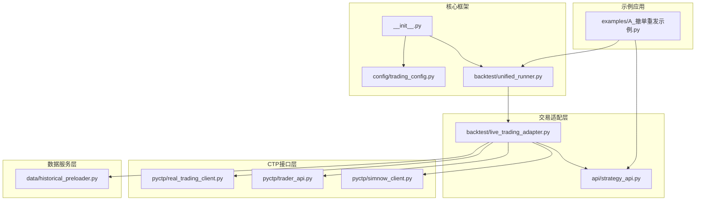
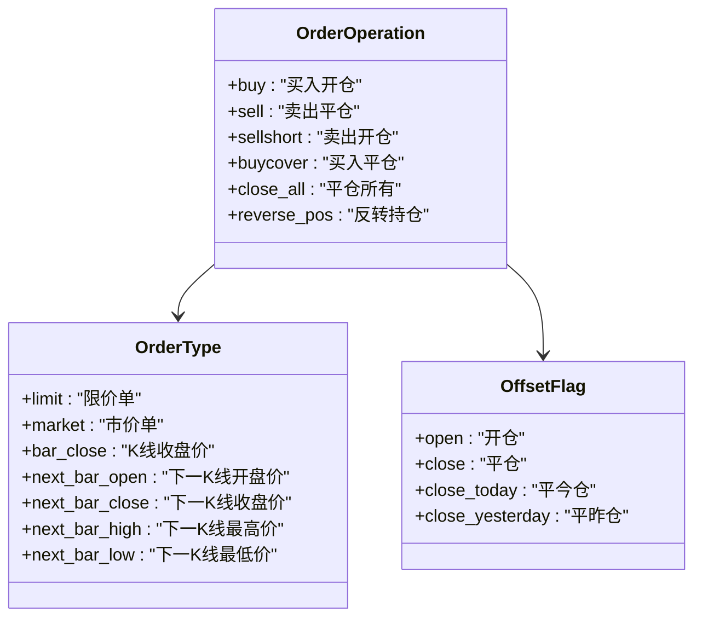
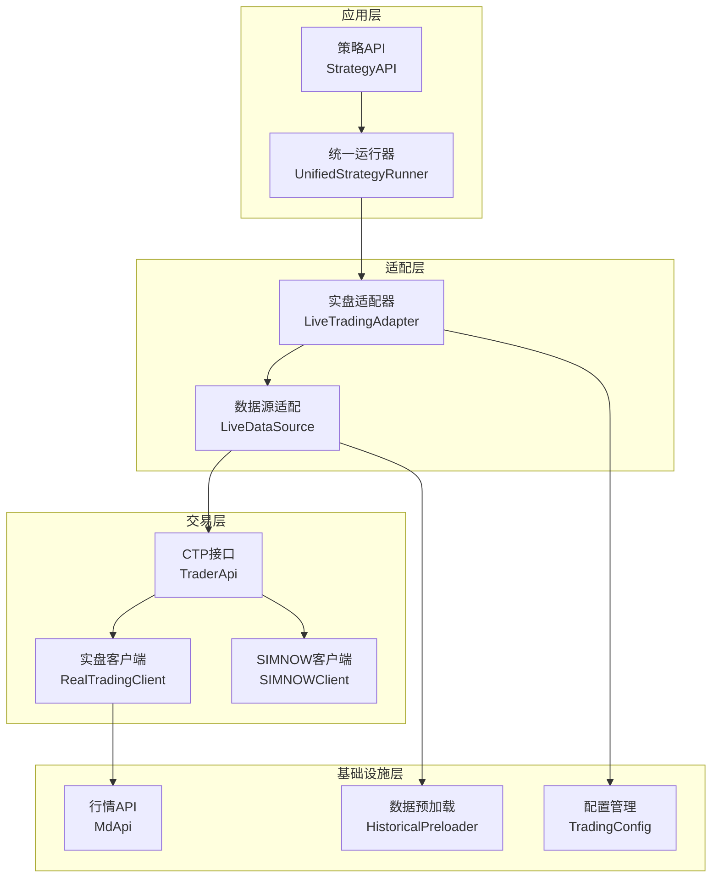
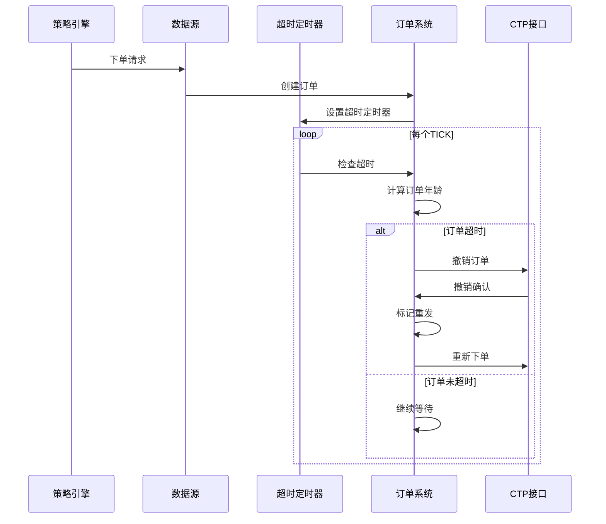
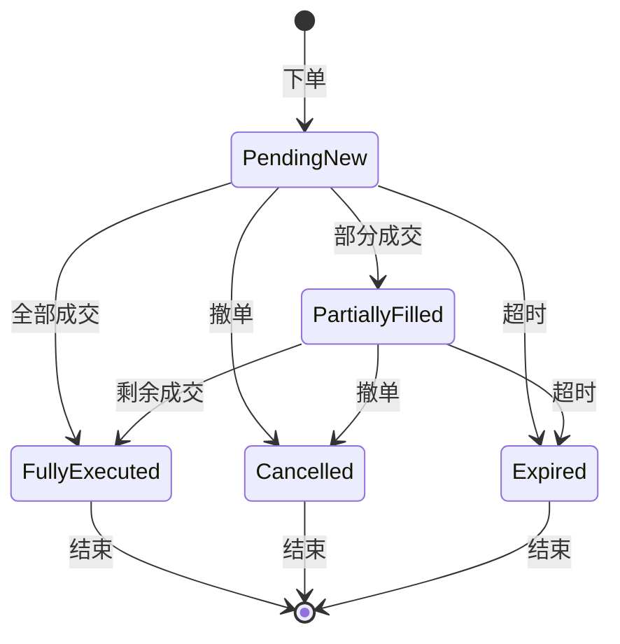
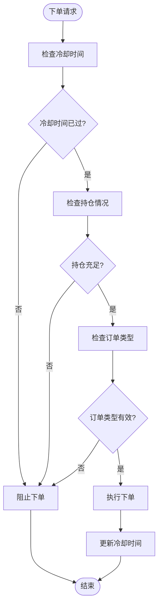
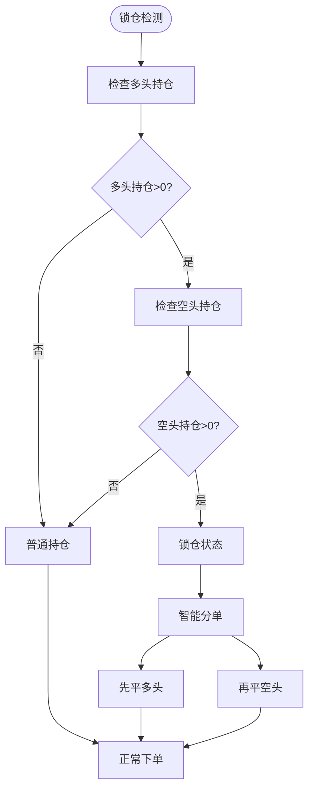
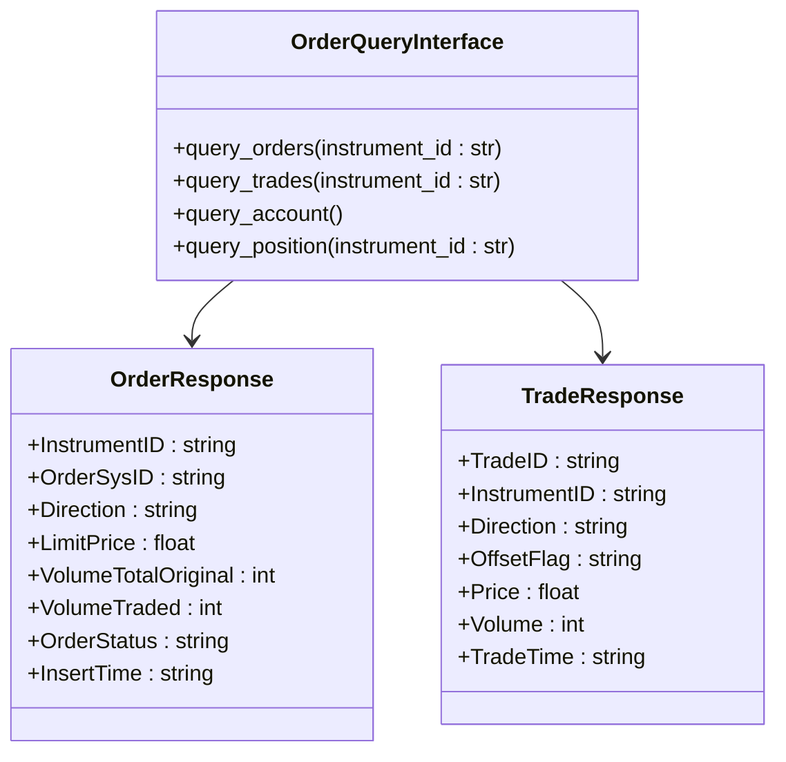
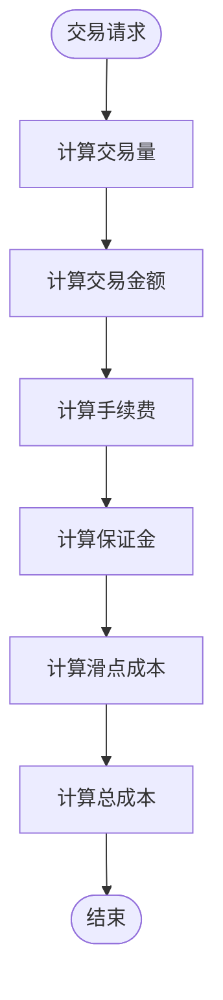
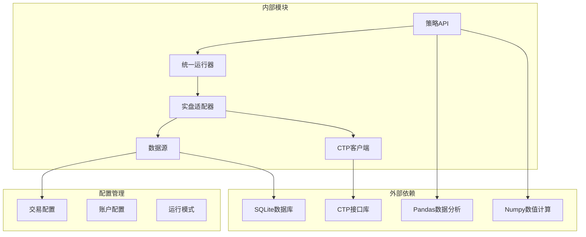

# 订单管理系统

<cite>
**本文档引用的文件**
- [ssquant/__init__.py](file://ssquant/__init__.py)
- [ssquant/config/trading_config.py](file://ssquant/config/trading_config.py)
- [ssquant/backtest/unified_runner.py](file://ssquant/backtest/unified_runner.py)
- [ssquant/backtest/live_trading_adapter.py](file://ssquant/backtest/live_trading_adapter.py)
- [ssquant/api/strategy_api.py](file://ssquant/api/strategy_api.py)
- [ssquant/pyctp/real_trading_client.py](file://ssquant/pyctp/real_trading_client.py)
- [ssquant/pyctp/trader_api.py](file://ssquant/pyctp/trader_api.py)
- [ssquant/pyctp/simnow_client.py](file://ssquant/pyctp/simnow_client.py)
- [ssquant/data/historical_preloader.py](file://ssquant/data/historical_preloader.py)
- [examples/A_撤单重发示例.py](file://examples/A_撤单重发示例.py)
</cite>

## 目录
1. [简介](#简介)
2. [项目结构](#项目结构)
3. [核心组件](#核心组件)
4. [架构概览](#架构概览)
5. [详细组件分析](#详细组件分析)
6. [依赖关系分析](#依赖关系分析)
7. [性能考虑](#性能考虑)
8. [故障排除指南](#故障排除指南)
9. [结论](#结论)
10. [附录](#附录)

## 简介

SSQuant 是一个专业的期货量化交易框架，专注于提供完整的订单管理系统。该系统支持多种运行模式，包括历史回测、SIMNOW模拟交易和实盘CTP交易，为用户提供了一致的编程接口和强大的订单管理功能。

本系统的核心优势在于其智能化的订单管理机制，包括智能算法交易、订单超时处理、防重复下单、冷却时间控制、锁仓处理策略等先进功能。通过统一的策略运行器，用户可以在不同模式间无缝切换，实现"一次编写，多处运行"的开发体验。

## 项目结构

SSQuant 采用模块化设计，主要包含以下核心模块：

**图表来源**
- [ssquant/__init__.py](file://ssquant/__init__.py#L1-L18)
- [ssquant/config/trading_config.py](file://ssquant/config/trading_config.py#L1-L187)
- [ssquant/backtest/unified_runner.py](file://ssquant/backtest/unified_runner.py#L1-L379)

**章节来源**
- [ssquant/__init__.py](file://ssquant/__init__.py#L1-L18)
- [ssquant/config/trading_config.py](file://ssquant/config/trading_config.py#L1-L187)

## 核心组件

### 订单类型分类

系统支持多种订单类型，通过统一的策略API进行管理：

**图表来源**
- [ssquant/api/strategy_api.py](file://ssquant/api/strategy_api.py#L362-L437)
- [ssquant/backtest/live_trading_adapter.py](file://ssquant/backtest/live_trading_adapter.py#L709-L1019)

### 委托价格计算机制

系统提供灵活的委托价格计算方式：

1. **基于市场深度的计算**
   - 买入开仓：卖一价 + 偏移跳数 × 最小变动价位
   - 卖出开仓：买一价 - 偏移跳数 × 最小变动价位

2. **基于技术分析的价格**
   - 当前K线收盘价
   - 下一K线开盘价/收盘价/最高价/最低价

3. **自定义价格**
   - 显式指定委托价格
   - 支持限价单和市价单

**章节来源**
- [ssquant/backtest/live_trading_adapter.py](file://ssquant/backtest/live_trading_adapter.py#L742-L747)
- [ssquant/backtest/live_trading_adapter.py](file://ssquant/backtest/live_trading_adapter.py#L817-L820)

## 架构概览

SSQuant 采用分层架构设计，确保各层职责清晰、耦合度低：

**图表来源**
- [ssquant/api/strategy_api.py](file://ssquant/api/strategy_api.py#L1-L570)
- [ssquant/backtest/unified_runner.py](file://ssquant/backtest/unified_runner.py#L26-L379)
- [ssquant/backtest/live_trading_adapter.py](file://ssquant/backtest/live_trading_adapter.py#L1127-L1200)

## 详细组件分析

### 智能算法交易系统

智能算法交易是SSQuant的核心功能之一，提供自动化的订单管理和执行策略：

#### 订单超时检测机制

**图表来源**
- [ssquant/backtest/live_trading_adapter.py](file://ssquant/backtest/live_trading_adapter.py#L416-L460)
- [ssquant/backtest/live_trading_adapter.py](file://ssquant/backtest/live_trading_adapter.py#L1077-L1112)

#### 订单重发策略

系统提供智能的订单重发机制，确保在超时情况下能够快速成交：

1. **超价委托重发**
   - 使用相反方向的偏移跳数
   - 确保快速成交

2. **分单处理**
   - 支持今仓和昨仓的智能分单
   - 自动处理锁仓情况

**章节来源**
- [ssquant/backtest/live_trading_adapter.py](file://ssquant/backtest/live_trading_adapter.py#L452-L460)
- [ssquant/backtest/live_trading_adapter.py](file://ssquant/backtest/live_trading_adapter.py#L822-L864)

### 订单状态管理

系统实现了完整的订单生命周期管理：

**图表来源**
- [ssquant/backtest/live_trading_adapter.py](file://ssquant/backtest/live_trading_adapter.py#L416-L460)

### 未成交订单跟踪

系统提供实时的未成交订单跟踪功能：

| 跟踪字段 | 描述 | 用途 |
|---------|------|------|
| OrderSysID | 订单系统编号 | 撤单和查询 |
| Direction | 订单方向 | 识别买卖方向 |
| LimitPrice | 委托价格 | 成交价格对比 |
| VolumeTotalOriginal | 委托数量 | 未成交数量计算 |
| VolumeTraded | 已成交数量 | 剩余未成交计算 |
| OrderStatus | 订单状态 | 状态监控和处理 |

**章节来源**
- [ssquant/backtest/live_trading_adapter.py](file://ssquant/backtest/live_trading_adapter.py#L1094-L1107)

### 防重复下单机制

系统内置多重防重复下单保护机制：

**图表来源**
- [ssquant/backtest/live_trading_adapter.py](file://ssquant/backtest/live_trading_adapter.py#L501-L547)

**章节来源**
- [ssquant/backtest/live_trading_adapter.py](file://ssquant/backtest/live_trading_adapter.py#L512-L547)

### 冷却时间控制

系统提供灵活的冷却时间控制机制：

| 操作类型 | 冷却时间(秒) | 说明 |
|---------|-------------|------|
| 买入开仓 | 0.5 | 防止频繁买入 |
| 卖出平仓 | 0.5 | 防止频繁平仓 |
| 卖出开仓 | 0.5 | 防止频繁做空 |
| 买入平仓 | 0.5 | 防止频繁平空 |
| 撤单操作 | 0.3 | 撤单后快速下单 |

**章节来源**
- [ssquant/backtest/live_trading_adapter.py](file://ssquant/backtest/live_trading_adapter.py#L314-L314)

### 锁仓处理策略

系统支持复杂的锁仓情况处理：

**图表来源**
- [ssquant/backtest/live_trading_adapter.py](file://ssquant/backtest/live_trading_adapter.py#L822-L864)
- [ssquant/backtest/live_trading_adapter.py](file://ssquant/backtest/live_trading_adapter.py#L977-L1019)

**章节来源**
- [ssquant/backtest/live_trading_adapter.py](file://ssquant/backtest/live_trading_adapter.py#L822-L864)
- [ssquant/backtest/live_trading_adapter.py](file://ssquant/backtest/live_trading_adapter.py#L977-L1019)

### 订单查询接口

系统提供完整的订单查询功能：

**图表来源**
- [ssquant/pyctp/real_trading_client.py](file://ssquant/pyctp/real_trading_client.py#L741-L753)
- [ssquant/pyctp/trader_api.py](file://ssquant/pyctp/trader_api.py#L447-L481)

**章节来源**
- [ssquant/pyctp/real_trading_client.py](file://ssquant/pyctp/real_trading_client.py#L729-L753)
- [ssquant/pyctp/trader_api.py](file://ssquant/pyctp/trader_api.py#L447-L481)

### 成交明细记录

系统提供详细的成交记录功能：

| 字段名称 | 类型 | 描述 |
|---------|------|------|
| TradeID | string | 成交编号 |
| InstrumentID | string | 合约代码 |
| Direction | string | 交易方向 |
| OffsetFlag | string | 开平标志 |
| Price | float | 成交价格 |
| Volume | int | 成交数量 |
| TradeDate | string | 成交日期 |
| TradeTime | string | 成交时间 |

**章节来源**
- [ssquant/pyctp/real_trading_client.py](file://ssquant/pyctp/real_trading_client.py#L446-L468)

### 交易费用计算

系统支持灵活的交易费用计算：

**图表来源**
- [ssquant/config/trading_config.py](file://ssquant/config/trading_config.py#L15-L26)

**章节来源**
- [ssquant/config/trading_config.py](file://ssquant/config/trading_config.py#L15-L26)

## 依赖关系分析

系统采用松耦合的设计，各模块间的依赖关系清晰：

**图表来源**
- [ssquant/backtest/unified_runner.py](file://ssquant/backtest/unified_runner.py#L1-L379)
- [ssquant/config/trading_config.py](file://ssquant/config/trading_config.py#L1-L187)

**章节来源**
- [ssquant/backtest/unified_runner.py](file://ssquant/backtest/unified_runner.py#L1-L379)
- [ssquant/config/trading_config.py](file://ssquant/config/trading_config.py#L1-L187)

## 性能考虑

### 订单处理性能优化

1. **异步处理机制**
   - 使用线程池处理订单查询
   - 异步数据记录
   - 非阻塞的行情推送

2. **内存管理优化**
   - 使用deque管理历史数据
   - 智能缓存策略
   - 内存使用监控

3. **网络通信优化**
   - 连接池管理
   - 心跳检测
   - 断线重连机制

### 数据处理性能

系统针对大数据量场景进行了专门优化：

- **历史数据预加载**：支持按需预加载，减少实时查询压力
- **数据缓存**：多级缓存机制，提高数据访问速度
- **批量处理**：支持批量订单查询和处理

## 故障排除指南

### 常见问题及解决方案

#### CTP连接问题

| 问题症状 | 可能原因 | 解决方案 |
|---------|---------|---------|
| 连接超时 | 网络不稳定 | 检查网络连接，重试连接 |
| 登录失败 | 账号信息错误 | 核对broker_id、investor_id、password |
| 认证失败 | AppID或AuthCode错误 | 重新申请认证信息 |
| 心跳超时 | 服务器维护 | 稍后重试或联系客服 |

#### 订单执行问题

| 问题症状 | 可能原因 | 解决方案 |
|---------|---------|---------|
| 订单超时 | 市场流动性不足 | 调整偏移跳数，使用超价委托 |
| 撤单失败 | 订单已成交 | 等待成交确认后再撤单 |
| 重复下单 | 网络延迟 | 启用防重复机制，设置冷却时间 |
| 撤单超时 | 交易所处理延迟 | 检查撤单状态，必要时重新撤单 |

#### 数据同步问题

| 问题症状 | 可能原因 | 解决方案 |
|---------|---------|---------|
| 持仓不一致 | CTP数据延迟 | 等待数据同步或手动刷新 |
| K线缺失 | 数据库问题 | 检查数据库连接，重新加载数据 |
| 行情异常 | 服务器问题 | 切换服务器或等待恢复 |

**章节来源**
- [ssquant/pyctp/real_trading_client.py](file://ssquant/pyctp/real_trading_client.py#L494-L535)

### 调试和监控

系统提供了完善的调试和监控功能：

1. **日志系统**
   - 详细的操作日志
   - 错误追踪日志
   - 性能监控日志

2. **状态监控**
   - 实时订单状态
   - 账户资金监控
   - 持仓情况监控

3. **异常处理**
   - 自动重试机制
   - 错误恢复策略
   - 异常告警通知

**章节来源**
- [ssquant/backtest/live_trading_adapter.py](file://ssquant/backtest/live_trading_adapter.py#L26-L113)

## 结论

SSQuant 订单管理系统是一个功能完整、架构清晰的量化交易框架。其核心优势包括：

1. **智能化订单管理**：提供完整的订单生命周期管理，包括超时处理、重发机制、防重复下单等功能

2. **多模式支持**：统一的API接口支持回测、SIMNOW模拟和实盘交易三种模式

3. **高性能设计**：采用异步处理、内存优化、网络优化等技术手段，确保系统高效稳定运行

4. **完善的监控体系**：提供全面的日志记录、状态监控和异常处理机制

5. **灵活的配置管理**：支持丰富的配置选项，满足不同用户的个性化需求

该系统为量化交易开发者提供了一个强大而易用的平台，能够有效提升交易策略的开发效率和执行质量。

## 附录

### 配置参数说明

#### 交易配置参数

| 参数名称 | 类型 | 默认值 | 说明 |
|---------|------|--------|------|
| initial_capital | float | 20000 | 初始资金 |
| commission | float | 0.0001 | 手续费率 |
| margin_rate | float | 0.1 | 保证金率 |
| contract_multiplier | int | 10 | 合约乘数 |
| price_tick | float | 1.0 | 最小变动价位 |
| slippage_ticks | int | 1 | 滑点跳数 |

#### 智能算法交易参数

| 参数名称 | 类型 | 默认值 | 说明 |
|---------|------|--------|------|
| algo_trading | bool | False | 是否启用算法交易 |
| order_timeout | int | 10 | 订单超时时间(秒) |
| retry_limit | int | 3 | 最大重试次数 |
| retry_offset_ticks | int | 5 | 重试时的超价跳数 |

### 最佳实践建议

1. **订单管理最佳实践**
   - 合理设置订单超时时间，平衡成交速度和成本
   - 使用防重复机制，避免频繁下单
   - 启用智能分单，优化锁仓处理
   - 建立完善的订单跟踪和监控体系

2. **风险管理参数设置**
   - 根据市场波动性调整偏移跳数
   - 设置合理的止损和止盈点位
   - 控制单笔订单规模，避免过度集中
   - 建立风险预警机制

3. **系统监控和维护**
   - 定期检查CTP连接状态
   - 监控订单执行成功率
   - 分析交易成本和收益
   - 及时更新系统和策略