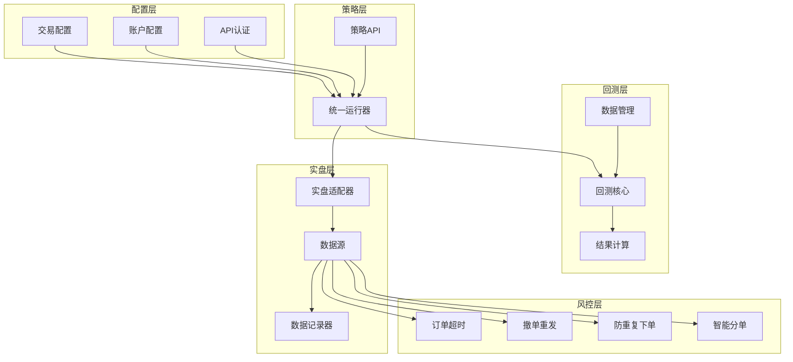
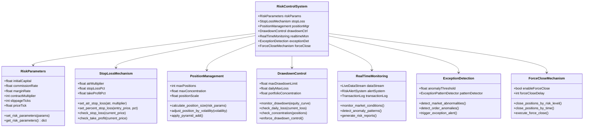
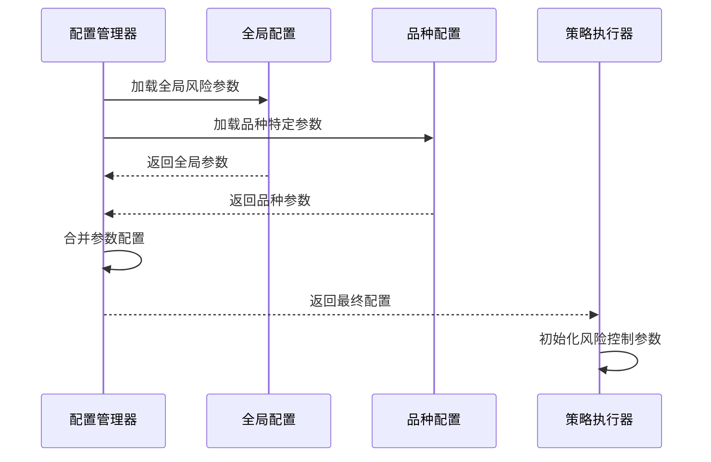
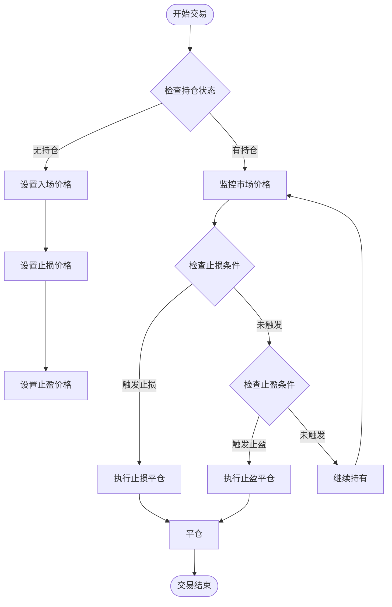
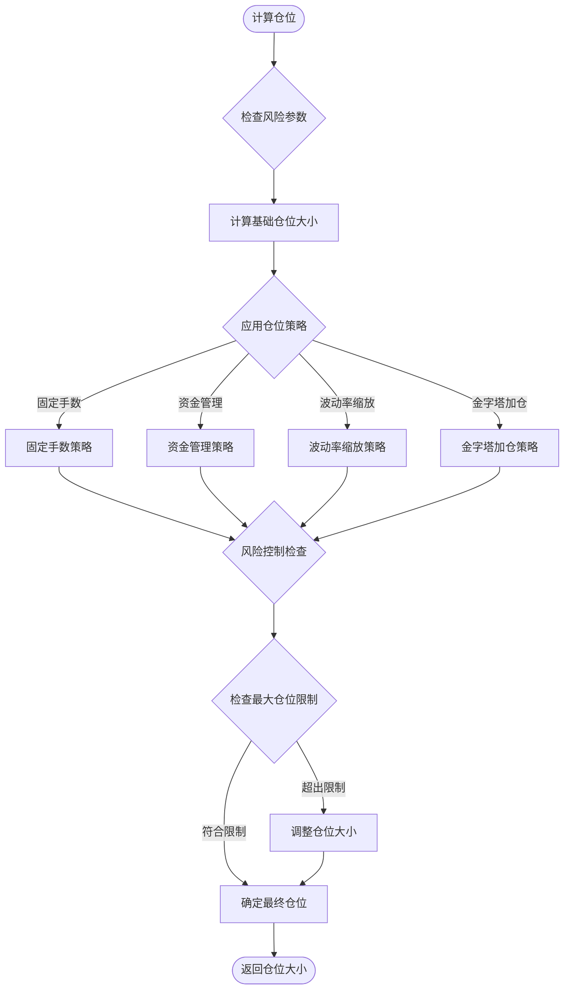
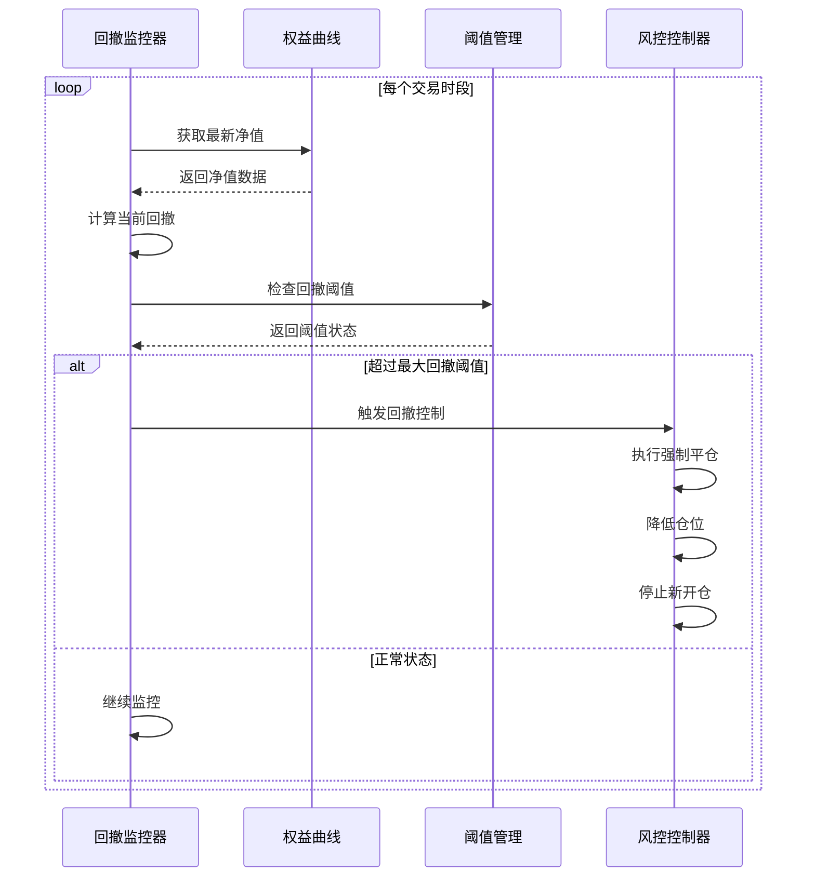
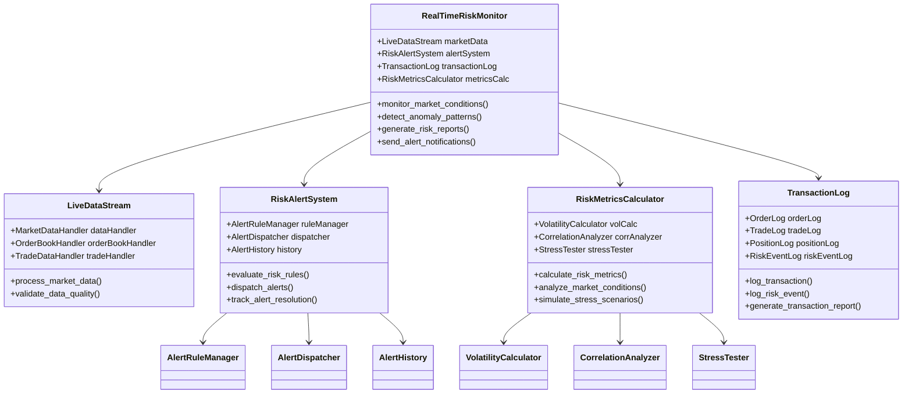
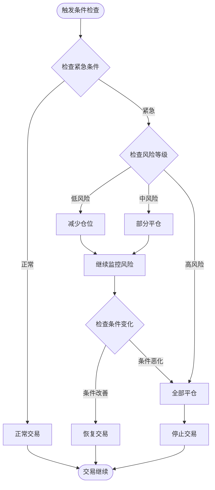
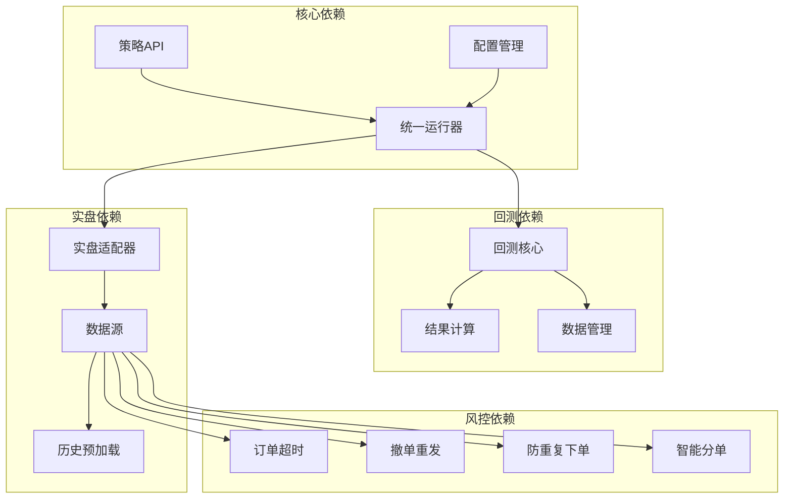
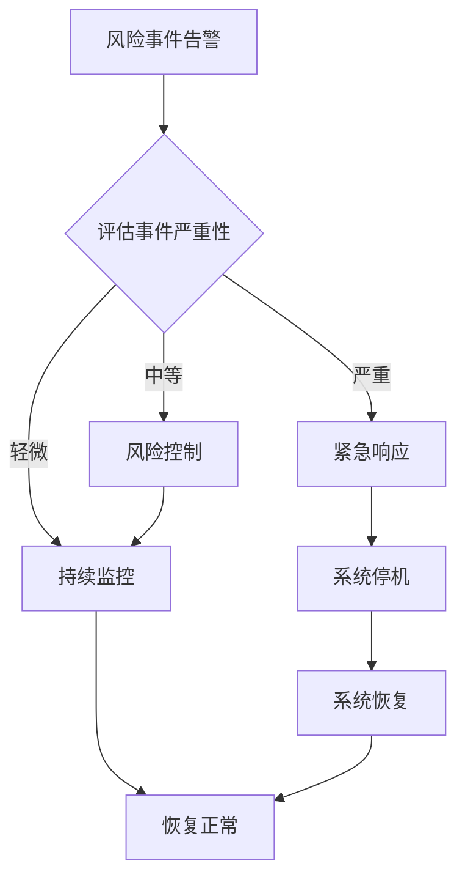

# 风险控制系统

<cite>
**本文档引用的文件**
- [README.md](file://README.md)
- [ssquant/__init__.py](file://ssquant/__init__.py)
- [ssquant/config/trading_config.py](file://ssquant/config/trading_config.py)
- [ssquant/api/strategy_api.py](file://ssquant/api/strategy_api.py)
- [ssquant/backtest/unified_runner.py](file://ssquant/backtest/unified_runner.py)
- [ssquant/backtest/backtest_core.py](file://ssquant/backtest/backtest_core.py)
- [ssquant/backtest/backtest_results.py](file://ssquant/backtest/backtest_results.py)
- [ssquant/backtest/live_trading_adapter.py](file://ssquant/backtest/live_trading_adapter.py)
- [ssquant/data/historical_preloader.py](file://ssquant/data/historical_preloader.py)
- [ssquant/backtest/backtest_data.py](file://ssquant/backtest/backtest_data.py)
</cite>

## 目录
1. [简介](#简介)
2. [项目结构](#项目结构)
3. [核心组件](#核心组件)
4. [架构概览](#架构概览)
5. [详细组件分析](#详细组件分析)
6. [依赖关系分析](#依赖关系分析)
7. [性能考虑](#性能考虑)
8. [故障排除指南](#故障排除指南)
9. [结论](#结论)
10. [附录](#附录)

## 简介
本文件为SSQuant期货量化交易框架的风险控制系统技术文档。该框架提供了一套完整的风险控制机制，涵盖风险参数配置、止损止盈机制、仓位管理策略、最大回撤控制、单日最大亏损限制、品种集中度管理、实时风控监控、异常交易检测以及强制平仓机制。文档基于代码库的实际实现进行分析，详细说明了各组件的功能、数据流、处理逻辑和集成关系，并提供了参数调优指南、风控策略配置方法、压力测试流程以及最佳实践和合规要求。

## 项目结构
SSQuant框架采用模块化设计，主要包含以下子系统：
- 配置管理：交易配置、账户配置、API认证
- 策略API：统一的策略接口，提供数据访问和交易操作
- 回测引擎：多数据源回测、参数优化、结果计算
- 实盘适配器：SIMNOW模拟和实盘CTP交易适配
- 数据管理：历史数据预加载、本地数据加载、多数据源对齐
- 风控组件：订单超时、撤单重发、防重复下单、智能分单



**图表来源**
- [ssquant/config/trading_config.py](file://ssquant/config/trading_config.py#L15-L187)
- [ssquant/api/strategy_api.py](file://ssquant/api/strategy_api.py#L1-L570)
- [ssquant/backtest/unified_runner.py](file://ssquant/backtest/unified_runner.py#L1-L379)
- [ssquant/backtest/backtest_core.py](file://ssquant/backtest/backtest_core.py#L1-L579)
- [ssquant/backtest/live_trading_adapter.py](file://ssquant/backtest/live_trading_adapter.py#L1-L1200)

**章节来源**
- [README.md](file://README.md#L297-L321)
- [ssquant/__init__.py](file://ssquant/__init__.py#L1-L18)

## 核心组件
风险控制系统的核心组件包括：

### 1. 风险参数配置
- **初始资金配置**：支持全局初始资金和品种特定初始资金
- **手续费率配置**：支持全局手续费率和品种特定手续费率
- **保证金率配置**：支持全局保证金率和品种特定保证金率
- **合约乘数配置**：支持全局合约乘数和品种特定合约乘数
- **滑点配置**：支持滑点跳数配置
- **价格跳动配置**：支持最小变动价位配置

### 2. 止损止盈机制
- **ATR止损**：基于ATR指标的动态止损设置
- **百分比止损止盈**：基于入场价格的百分比止损止盈
- **技术指标止损**：基于布林带、移动平均等技术指标的止损设置
- **时间止损**：基于持仓时间的强制平仓

### 3. 仓位管理策略
- **固定手数策略**：固定交易手数
- **百分比资金管理**：基于账户资金的百分比仓位管理
- **波动率缩放策略**：基于历史波动率的仓位调整
- **金字塔加仓策略**：基于盈利的加仓策略

### 4. 风险控制指标
- **最大回撤控制**：实时监控和控制最大回撤
- **单日最大亏损**：限制单日最大亏损额度
- **品种集中度管理**：控制单一品种的仓位集中度
- **组合风险控制**：多品种组合的整体风险控制

**章节来源**
- [ssquant/config/trading_config.py](file://ssquant/config/trading_config.py#L15-L26)
- [ssquant/backtest/backtest_results.py](file://ssquant/backtest/backtest_results.py#L387-L419)

## 架构概览
SSQuant风险控制系统采用分层架构设计，各层职责明确，耦合度低，便于扩展和维护。



**图表来源**
- [ssquant/backtest/backtest_results.py](file://ssquant/backtest/backtest_results.py#L103-L495)
- [ssquant/backtest/backtest_core.py](file://ssquant/backtest/backtest_core.py#L14-L84)

## 详细组件分析

### 风险参数配置系统
风险参数配置系统提供了灵活的参数管理机制，支持全局配置和品种特定配置的组合使用。



**图表来源**
- [ssquant/config/trading_config.py](file://ssquant/config/trading_config.py#L115-L164)
- [ssquant/backtest/backtest_core.py](file://ssquant/backtest/backtest_core.py#L98-L130)

#### 配置参数详解
- **初始资金**：支持全局初始资金和品种特定初始资金
- **手续费率**：支持全局手续费率和品种特定手续费率
- **保证金率**：支持全局保证金率和品种特定保证金率
- **合约乘数**：支持全局合约乘数和品种特定合约乘数
- **滑点配置**：支持滑点跳数配置
- **价格跳动**：支持最小变动价位配置

**章节来源**
- [ssquant/config/trading_config.py](file://ssquant/config/trading_config.py#L15-L26)
- [ssquant/backtest/backtest_core.py](file://ssquant/backtest/backtest_core.py#L49-L58)

### 止损止盈机制
止损止盈机制提供了多种止损止盈策略，支持动态和静态两种模式。



**图表来源**
- [ssquant/backtest/backtest_results.py](file://ssquant/backtest/backtest_results.py#L136-L183)
- [ssquant/api/strategy_api.py](file://ssquant/api/strategy_api.py#L362-L476)

#### 止损策略类型
- **ATR动态止损**：基于ATR指标的动态止损设置
- **百分比止损**：基于入场价格的百分比止损
- **技术指标止损**：基于布林带、移动平均等技术指标
- **时间止损**：基于持仓时间的强制平仓

#### 止盈策略类型
- **固定止盈**：固定的止盈价格
- **移动止盈**：跟随市场的移动止盈
- **分批止盈**：分批次的部分止盈

**章节来源**
- [ssquant/backtest/backtest_results.py](file://ssquant/backtest/backtest_results.py#L136-L183)
- [ssquant/api/strategy_api.py](file://ssquant/api/strategy_api.py#L362-L476)

### 仓位管理系统
仓位管理系统实现了多种仓位管理策略，支持固定手数、资金管理和波动率缩放等策略。



**图表来源**
- [ssquant/backtest/backtest_results.py](file://ssquant/backtest/backtest_results.py#L225-L378)
- [ssquant/backtest/backtest_core.py](file://ssquant/backtest/backtest_core.py#L132-L142)

#### 仓位管理策略
- **固定手数策略**：简单的固定交易手数
- **资金管理策略**：基于账户资金的百分比仓位管理
- **波动率缩放策略**：基于历史波动率的仓位调整
- **金字塔加仓策略**：基于盈利的加仓策略

#### 风险控制机制
- **最大仓位限制**：防止单个品种过度集中
- **组合风险控制**：多品种组合的整体风险控制
- **动态调整**：根据市场条件动态调整仓位

**章节来源**
- [ssquant/backtest/backtest_results.py](file://ssquant/backtest/backtest_results.py#L225-L378)
- [ssquant/backtest/backtest_core.py](file://ssquant/backtest/backtest_core.py#L132-L142)

### 最大回撤控制系统
最大回撤控制系统实时监控账户净值的最大回撤，当达到预设阈值时执行相应的风控措施。



**图表来源**
- [ssquant/backtest/backtest_results.py](file://ssquant/backtest/backtest_results.py#L387-L399)
- [ssquant/backtest/backtest_results.py](file://ssquant/backtest/backtest_results.py#L420-L447)

#### 回撤计算方法
- **净值曲线构建**：基于交易记录构建净值曲线
- **滚动最大值计算**：计算净值的滚动最大值
- **回撤幅度计算**：计算当前净值与滚动最大值的差额
- **回撤比例计算**：计算回撤占最大净值的比例

#### 回撤控制策略
- **强制平仓**：当回撤超过阈值时强制平仓
- **仓位缩减**：逐步减少仓位以控制风险
- **暂停交易**：暂时停止新的交易指令
- **动态阈值**：根据市场波动调整回撤阈值

**章节来源**
- [ssquant/backtest/backtest_results.py](file://ssquant/backtest/backtest_results.py#L387-L399)
- [ssquant/backtest/backtest_results.py](file://ssquant/backtest/backtest_results.py#L420-L447)

### 实时风控监控系统
实时风控监控系统提供实时的市场监控和异常检测功能。



**图表来源**
- [ssquant/backtest/live_trading_adapter.py](file://ssquant/backtest/live_trading_adapter.py#L26-L121)
- [ssquant/backtest/live_trading_adapter.py](file://ssquant/backtest/live_trading_adapter.py#L1114-L1186)

#### 实时监控功能
- **市场数据监控**：实时监控市场数据质量和完整性
- **订单流监控**：监控订单执行状态和异常
- **价格异常检测**：检测异常的价格波动和交易行为
- **流动性监控**：监控市场的流动性状况

#### 异常检测机制
- **统计异常检测**：基于统计模型的异常检测
- **机器学习异常检测**：基于机器学习模型的异常检测
- **规则引擎异常检测**：基于预定义规则的异常检测
- **实时告警系统**：异常情况的实时告警通知

**章节来源**
- [ssquant/backtest/live_trading_adapter.py](file://ssquant/backtest/live_trading_adapter.py#L26-L121)
- [ssquant/backtest/live_trading_adapter.py](file://ssquant/backtest/live_trading_adapter.py#L1114-L1186)

### 强制平仓机制
强制平仓机制在极端情况下自动执行平仓操作，以保护账户资金安全。



**图表来源**
- [ssquant/backtest/live_trading_adapter.py](file://ssquant/backtest/live_trading_adapter.py#L1034-L1072)
- [ssquant/backtest/live_trading_adapter.py](file://ssquant/backtest/live_trading_adapter.py#L1077-L1112)

#### 强制平仓触发条件
- **市场极端波动**：价格剧烈波动超出正常范围
- **账户资金不足**：保证金不足触发追加保证金通知
- **监管要求**：监管机构要求的强制措施
- **系统故障**：交易系统出现严重故障
- **政策变化**：监管政策发生重大变化

#### 强制平仓执行策略
- **分级平仓**：根据风险等级采取不同的平仓程度
- **时间控制**：控制平仓的时间窗口和节奏
- **价格保护**：在平仓过程中保护价格
- **风险转移**：将风险转移到其他资产或策略

**章节来源**
- [ssquant/backtest/live_trading_adapter.py](file://ssquant/backtest/live_trading_adapter.py#L1034-L1072)
- [ssquant/backtest/live_trading_adapter.py](file://ssquant/backtest/live_trading_adapter.py#L1077-L1112)

## 依赖关系分析



**图表来源**
- [ssquant/api/strategy_api.py](file://ssquant/api/strategy_api.py#L1-L570)
- [ssquant/backtest/unified_runner.py](file://ssquant/backtest/unified_runner.py#L1-L379)
- [ssquant/backtest/backtest_core.py](file://ssquant/backtest/backtest_core.py#L1-L579)
- [ssquant/backtest/live_trading_adapter.py](file://ssquant/backtest/live_trading_adapter.py#L1-L1200)

**章节来源**
- [ssquant/backtest/unified_runner.py](file://ssquant/backtest/unified_runner.py#L1-L379)
- [ssquant/backtest/backtest_core.py](file://ssquant/backtest/backtest_core.py#L1-L579)

## 性能考虑
风险控制系统在设计时充分考虑了性能优化，采用了多种优化策略：

### 1. 数据结构优化
- **队列数据结构**：使用deque进行高效的数据缓存
- **索引优化**：使用pandas索引加速数据查询
- **内存映射**：支持大数据集的内存映射访问

### 2. 算法优化
- **向量化计算**：使用pandas和numpy进行向量化运算
- **延迟计算**：采用延迟计算策略减少不必要的计算
- **缓存机制**：实现多层次的缓存机制

### 3. 并发优化
- **异步写入**：数据记录器使用异步队列写入
- **多线程处理**：后台线程处理数据写入和监控
- **非阻塞操作**：避免阻塞主线程的操作

### 4. 内存管理
- **内存池**：使用内存池减少内存分配开销
- **垃圾回收**：合理控制垃圾回收频率
- **数据压缩**：对历史数据进行压缩存储

## 故障排除指南

### 常见问题及解决方案

#### 1. 配置相关问题
**问题**：配置参数不生效
**解决方案**：
- 检查配置文件路径和权限
- 验证配置参数的合法性
- 确认配置参数的优先级

**章节来源**
- [ssquant/config/trading_config.py](file://ssquant/config/trading_config.py#L115-L164)

#### 2. 回测性能问题
**问题**：回测运行缓慢
**解决方案**：
- 启用数据缓存功能
- 减少数据源数量
- 优化策略算法复杂度

**章节来源**
- [ssquant/backtest/backtest_core.py](file://ssquant/backtest/backtest_core.py#L456-L524)

#### 3. 实盘交易问题
**问题**：订单执行异常
**解决方案**：
- 检查CTP客户端连接状态
- 验证订单参数的正确性
- 查看订单超时和重发机制

**章节来源**
- [ssquant/backtest/live_trading_adapter.py](file://ssquant/backtest/live_trading_adapter.py#L416-L460)

#### 4. 风控系统问题
**问题**：风控触发过于频繁
**解决方案**：
- 调整风控阈值参数
- 优化风控算法逻辑
- 检查数据质量

**章节来源**
- [ssquant/backtest/backtest_results.py](file://ssquant/backtest/backtest_results.py#L387-L399)

## 结论
SSQuant风险控制系统提供了一套完整、灵活且高性能的风险控制解决方案。系统采用模块化设计，支持多种风险控制策略和监控机制，能够适应不同的交易场景和风险偏好。通过合理的参数配置、完善的风控机制和高效的性能优化，系统能够在保证交易效率的同时有效控制风险。

系统的主要优势包括：
- **灵活性**：支持多种风险控制策略和参数配置
- **性能**：采用多种优化技术确保系统高效运行
- **可靠性**：完善的错误处理和异常检测机制
- **可扩展性**：模块化设计便于功能扩展和定制

## 附录

### 风险参数调优指南

#### 1. 止损参数调优
- **ATR倍数**：一般在1.5-3.0之间调整
- **百分比止损**：根据策略收益风险比设定
- **移动止盈**：建议设置为止损的1.5-2倍

#### 2. 仓位参数调优
- **固定手数**：适合稳定的高频策略
- **资金管理**：建议每次交易不超过总资金的2-5%
- **波动率缩放**：根据历史波动率动态调整

#### 3. 回撤控制参数
- **最大回撤阈值**：一般设置为账户净值的10-20%
- **单日最大亏损**：建议不超过账户净值的2-5%
- **品种集中度**：单品种仓位不超过总仓位的30-50%

### 风控策略配置方法

#### 1. 基础配置
```python
# 风险参数配置示例
risk_params = {
    'initial_capital': 100000,
    'max_drawdown': 0.20,
    'daily_max_loss': 0.05,
    'max_position_concentration': 0.30,
    'stop_loss_atr_multiplier': 2.0,
    'position_size_method': 'fixed'
}
```

#### 2. 高级配置
```python
# 复杂风控策略配置
advanced_risk_config = {
    'dynamic_position_sizing': True,
    'volatility_adaptive_stop_loss': True,
    'correlation_risk_control': True,
    'stress_testing_enabled': True,
    'emergency_shutdown_threshold': 0.50
}
```

### 压力测试方法

#### 1. 历史回测压力测试
```python
# 历史极端行情测试
extreme_market_scenarios = [
    '2008年金融危机',
    '2015年中国股灾',
    '2020年疫情初期',
    '黑色星期一'  # 2020年美股熔断
]

for scenario in extreme_market_scenarios:
    results = run_backtest_with_scenario(scenario)
    analyze_risk_metrics(results)
```

#### 2. 随机扰动测试
```python
# 随机市场扰动测试
def random_market_shock_test():
    base_results = run_backtest()
    
    for i in range(100):  # 100次随机扰动
        perturbed_data = add_random_noise(base_data, 0.1)  # 10%噪声
        perturbed_results = run_backtest_with_perturbed_data(perturbed_data)
        
        compare_results(base_results, perturbed_results)
```

### 风险控制最佳实践

#### 1. 参数设置最佳实践
- **保守型策略**：设置更严格的风控参数
- **激进型策略**：适当放宽风控参数但加强监控
- **趋势跟踪策略**：重视ATR止损和移动止盈
- **均值回归策略**：重视时间止损和仓位管理

#### 2. 监控和报告
- **实时监控**：建立实时风险监控面板
- **定期报告**：生成每日、每周、每月风险报告
- **异常预警**：设置多级异常预警机制
- **审计追踪**：完整记录所有风控决策

#### 3. 合规要求
- **监管报告**：按照监管要求生成相关报告
- **数据保护**：确保客户数据的安全和隐私
- **风险披露**：充分披露投资风险
- **内部控制**：建立完善的内控制度

### 应急处理流程

#### 1. 应急响应程序


#### 2. 紧急联系人
- **技术负责人**：负责系统故障处理
- **风控负责人**：负责风险控制决策
- **合规负责人**：负责合规事务处理
- **监管联络人**：负责与监管部门沟通

#### 3. 恢复程序
- **数据恢复**：恢复备份数据和配置
- **系统重启**：重启相关服务和进程
- **功能验证**：验证系统功能正常
- **监控恢复**：恢复所有监控功能