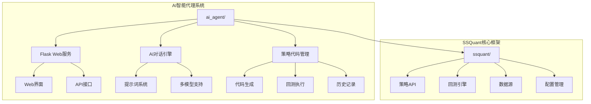
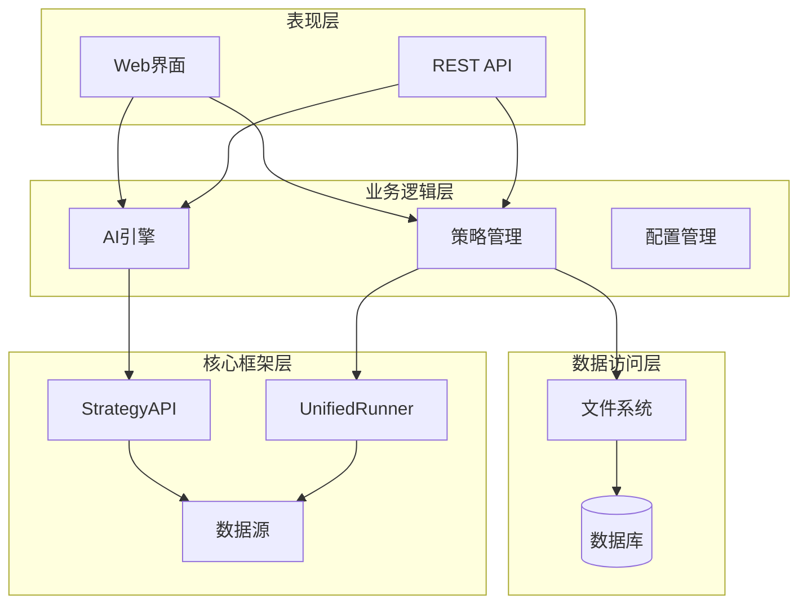
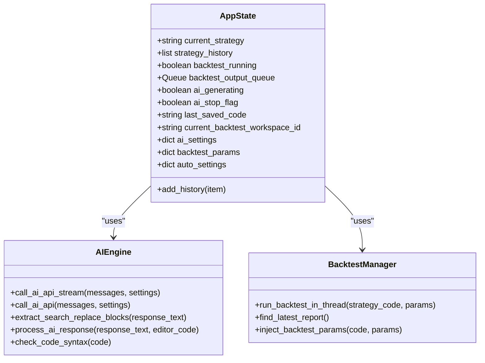
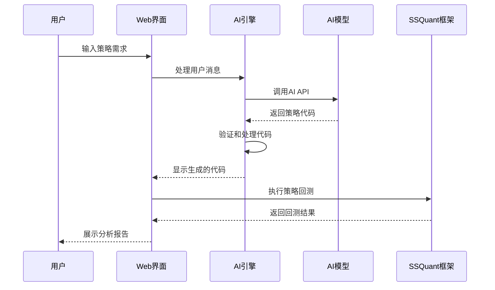
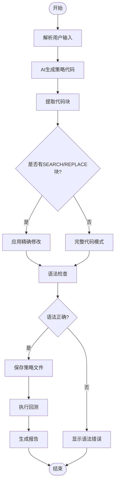
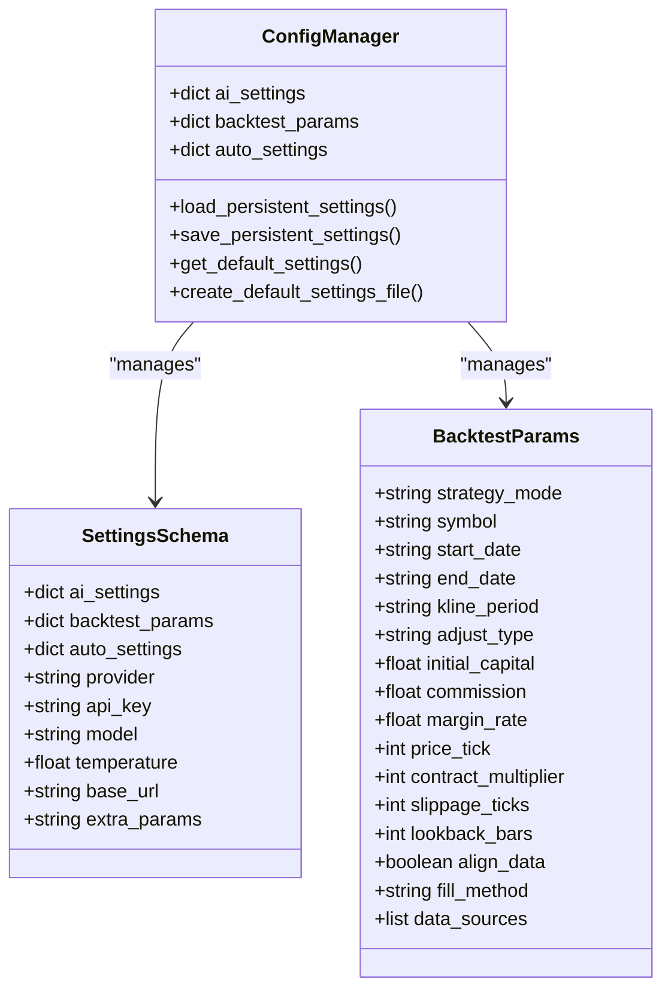
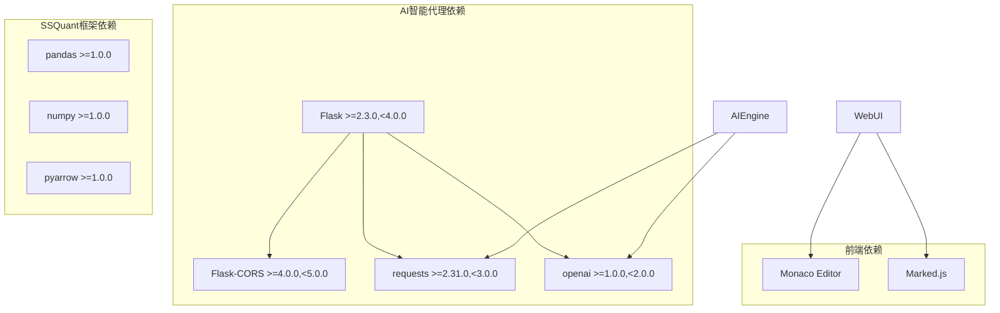

# AI智能代理系统

<cite>
**本文档引用的文件**
- [ai_agent/app.py](file://ai_agent/app.py)
- [ai_agent/__init__.py](file://ai_agent/__init__.py)
- [ai_agent/settings.json](file://ai_agent/settings.json)
- [ai_agent/history.json](file://ai_agent/history.json)
- [ai_agent/templates/index.html](file://ai_agent/templates/index.html)
- [ai_agent/requirements.txt](file://ai_agent/requirements.txt)
- [ai_agent/prompt.py](file://ai_agent/prompt.py)
- [ssquant/backtest/unified_runner.py](file://ssquant/backtest/unified_runner.py)
- [ssquant/api/strategy_api.py](file://ssquant/api/strategy_api.py)
- [README.md](file://README.md)
</cite>

## 目录
1. [简介](#简介)
2. [项目结构](#项目结构)
3. [核心组件](#核心组件)
4. [架构概览](#架构概览)
5. [详细组件分析](#详细组件分析)
6. [依赖关系分析](#依赖关系分析)
7. [性能考虑](#性能考虑)
8. [故障排除指南](#故障排除指南)
9. [结论](#结论)

## 简介

AI智能代理系统是一个基于SSQuant量化交易框架的AI驱动策略编写助手。该系统允许用户通过自然语言描述交易思路，AI自动生成符合SSQuant规范的策略代码，并提供完整的回测、调试和优化功能。

系统的核心特点包括：
- **自然语言策略生成**：用户只需描述交易想法，AI自动生成完整策略代码
- **一体化开发环境**：集成代码编辑器、AI对话、回测执行等功能
- **高性能策略支持**：基于SSQuant v0.4.5框架，支持IndicatorCache v2高性能指标计算
- **多模式运行**：支持回测、SIMNOW模拟交易、实盘交易三种运行模式
- **智能迭代优化**：AI可根据回测结果自动分析并改进策略

## 项目结构

AI智能代理系统采用模块化设计，主要包含以下核心模块：

**图表来源**
- [ai_agent/app.py:1-100](file://ai_agent/app.py#L1-L100)
- [README.md:350-366](file://README.md#L350-L366)

系统的主要目录结构：
- `ai_agent/`：AI智能代理核心模块
- `ssquant/`：SSQuant量化交易框架核心
- `examples/`：示例策略和工具
- `docs/`：技术文档和策略说明

**章节来源**
- [README.md:350-366](file://README.md#L350-L366)

## 核心组件

### AI对话引擎

AI对话引擎是系统的核心组件，负责处理用户输入并生成策略代码。其主要功能包括：

- **多模型支持**：支持OpenAI、Claude等多种AI模型
- **提示词管理**：内置SSQuant框架的专业提示词
- **代码生成**：根据用户需求生成符合规范的策略代码
- **智能优化**：基于回测结果自动分析和改进策略

### Web界面系统

Web界面提供直观的用户交互体验，包含以下功能模块：

- **代码编辑器**：基于Monaco Editor的代码编辑环境
- **聊天对话**：AI助手对话界面
- **策略管理**：策略文件的创建、编辑、保存和管理
- **回测控制**：一键运行回测、查看报告和结果分析

### 策略管理系统

策略管理系统负责策略代码的生命周期管理：

- **代码生成**：从AI响应中提取和处理策略代码
- **版本控制**：自动保存策略历史和版本变更
- **回测集成**：与回测引擎无缝集成
- **工作区管理**：支持多工作区并行开发

**章节来源**
- [ai_agent/app.py:242-271](file://ai_agent/app.py#L242-L271)
- [ai_agent/templates/index.html:1-200](file://ai_agent/templates/index.html#L1-L200)

## 架构概览

系统采用分层架构设计，确保各组件之间的松耦合和高内聚：

**图表来源**
- [ai_agent/app.py:41-60](file://ai_agent/app.py#L41-L60)
- [ssquant/backtest/unified_runner.py:26-58](file://ssquant/backtest/unified_runner.py#L26-L58)

### 数据流架构

系统的数据流遵循清晰的处理管道：

1. **用户输入**：通过Web界面或API提交策略需求
2. **AI处理**：AI引擎分析需求并生成策略代码
3. **代码验证**：检查代码语法和逻辑正确性
4. **策略执行**：通过SSQuant框架执行策略回测
5. **结果反馈**：将回测结果和报告返回给用户

**章节来源**
- [ai_agent/app.py:718-800](file://ai_agent/app.py#L718-L800)

## 详细组件分析

### Flask Web服务架构

Flask作为Web服务框架，提供了RESTful API和静态文件服务：

**图表来源**
- [ai_agent/app.py:214-240](file://ai_agent/app.py#L214-L240)
- [ai_agent/app.py:313-431](file://ai_agent/app.py#L313-L431)
- [ai_agent/app.py:718-800](file://ai_agent/app.py#L718-L800)

### AI对话处理机制

AI对话处理机制支持多种AI模型和对话模式：

**图表来源**
- [ai_agent/app.py:313-431](file://ai_agent/app.py#L313-L431)
- [ai_agent/app.py:718-800](file://ai_agent/app.py#L718-L800)

### 策略代码生成流程

策略代码生成采用智能处理机制，支持精确修改和完整代码两种模式：

**图表来源**
- [ai_agent/app.py:665-702](file://ai_agent/app.py#L665-L702)
- [ai_agent/app.py:704-717](file://ai_agent/app.py#L704-L717)

**章节来源**
- [ai_agent/app.py:500-702](file://ai_agent/app.py#L500-L702)

### 配置管理系统

配置管理系统提供灵活的参数管理和持久化功能：

**图表来源**
- [ai_agent/app.py:82-134](file://ai_agent/app.py#L82-L134)
- [ai_agent/settings.json:1-51](file://ai_agent/settings.json#L1-L51)

**章节来源**
- [ai_agent/app.py:82-183](file://ai_agent/app.py#L82-L183)
- [ai_agent/settings.json:1-51](file://ai_agent/settings.json#L1-L51)

## 依赖关系分析

系统依赖关系清晰，主要依赖包括：

**图表来源**
- [ai_agent/requirements.txt:11-34](file://ai_agent/requirements.txt#L11-L34)

### 外部API集成

系统集成了多种外部API服务：

- **AI模型API**：支持OpenAI、Claude等主流AI模型
- **远程提示词服务**：提供云端提示词管理和鉴权
- **数据服务器**：支持远程数据源访问（需俱乐部账号）

**章节来源**
- [ai_agent/requirements.txt:1-56](file://ai_agent/requirements.txt#L1-L56)
- [ai_agent/app.py:35-42](file://ai_agent/app.py#L35-L42)

## 性能考虑

系统在设计时充分考虑了性能优化：

### 高性能策略执行

基于SSQuant v0.4.5框架的三层性能档位：

| 档位 | 典型提速 | 用法 |
|------|---------|------|
| **Pandas 普通档** | 基准 1× | `api.get_close().rolling(20).mean()` |
| **ndarray 中档** | **5×–10×** | `api.get_close_array(window=20)` |
| **IndicatorCache v2** | **30×–100×** | `api.register_indicator()` + `api.get_indicator()` |

### 并发处理机制

系统采用异步处理和队列管理：

- **后台线程**：回测执行在独立线程中运行
- **消息队列**：实时传输回测输出和状态
- **流式API调用**：支持AI模型的流式响应处理

**章节来源**
- [README.md:24-48](file://README.md#L24-L48)
- [ai_agent/app.py:718-762](file://ai_agent/app.py#L718-L762)

## 故障排除指南

### 常见问题及解决方案

#### AI模型连接问题

**问题**：API调用失败或超时
**解决方案**：
1. 检查API密钥配置
2. 验证网络连接状态
3. 确认AI模型服务可用性
4. 检查防火墙设置

#### 代码生成异常

**问题**：AI生成的代码无法运行
**解决方案**：
1. 检查代码语法错误
2. 验证SSQuant框架兼容性
3. 确认策略参数完整性
4. 查看详细错误日志

#### 回测执行失败

**问题**：回测过程中出现异常
**解决方案**：
1. 检查数据源连接
2. 验证策略逻辑正确性
3. 确认系统资源充足
4. 查看回测日志输出

**章节来源**
- [ai_agent/app.py:421-431](file://ai_agent/app.py#L421-L431)
- [ai_agent/app.py:764-784](file://ai_agent/app.py#L764-L784)

## 结论

AI智能代理系统是一个功能完整、架构清晰的量化策略开发平台。通过将AI技术与专业的量化交易框架相结合，系统实现了从自然语言到可执行策略代码的自动化转换，大大降低了量化策略开发的门槛。

系统的主要优势包括：

1. **智能化程度高**：AI助手能够理解复杂的交易逻辑并生成高质量策略代码
2. **性能优异**：基于SSQuant框架的高性能指标计算，显著提升回测效率
3. **用户体验好**：提供直观的Web界面和完整的开发工具链
4. **扩展性强**：模块化设计便于功能扩展和定制开发

随着AI技术的不断发展，该系统有望在量化策略开发领域发挥越来越重要的作用，为投资者提供更加智能化、自动化的交易解决方案。