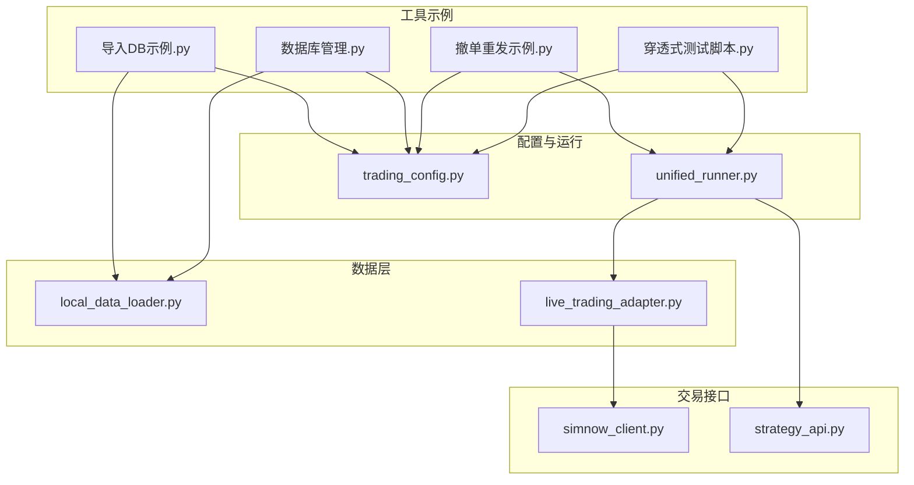
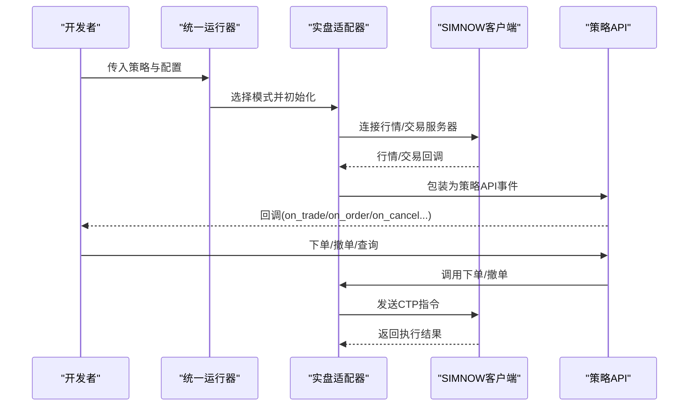
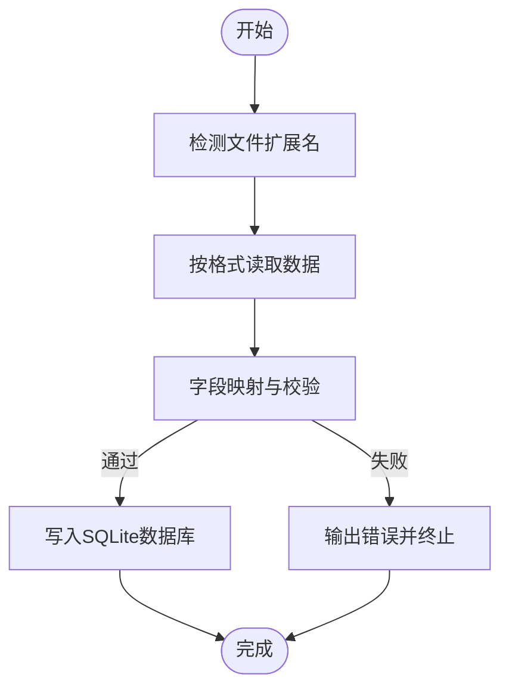
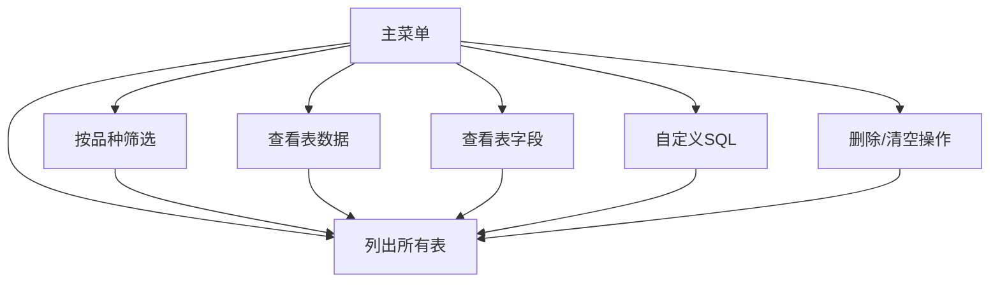
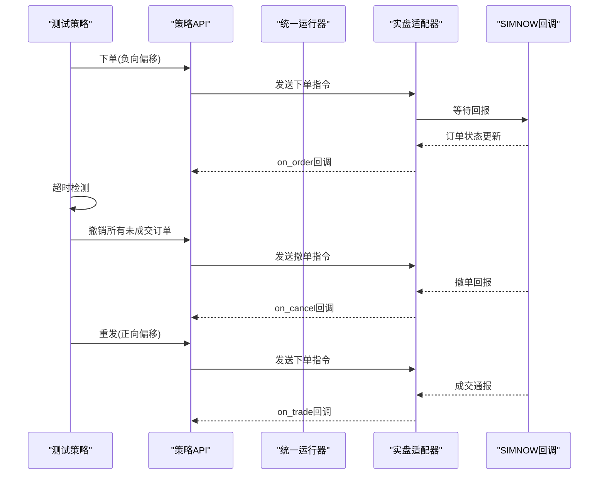
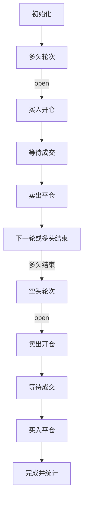
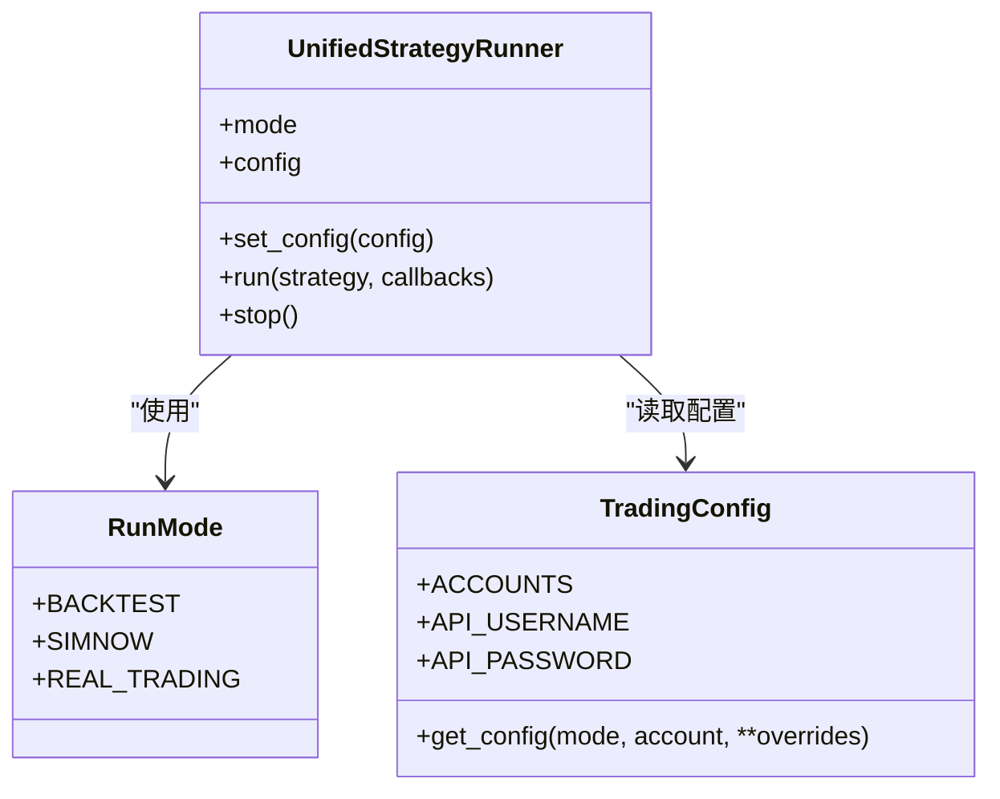
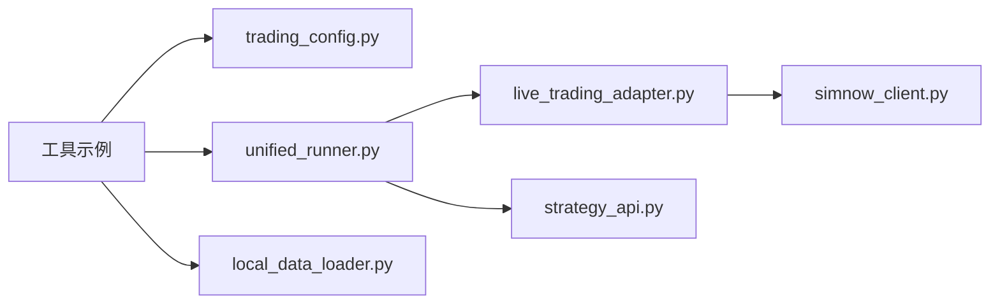

# 开发工具与实用程序

<cite>
**本文引用的文件**
- [README.md](file://README.md)
- [用户手册.md](file://用户手册.md)
- [examples/A_工具_导入数据库DB示例.py](file://examples/A_工具_导入数据库DB示例.py)
- [examples/A_工具_数据库管理_查看与删除.py](file://examples/A_工具_数据库管理_查看与删除.py)
- [examples/A_撤单重发示例.py](file://examples/A_撤单重发示例.py)
- [examples/A_穿透式测试脚本.py](file://examples/A_穿透式测试脚本.py)
- [ssquant/config/trading_config.py](file://ssquant/config/trading_config.py)
- [ssquant/backtest/unified_runner.py](file://ssquant/backtest/unified_runner.py)
- [ssquant/api/strategy_api.py](file://ssquant/api/strategy_api.py)
- [ssquant/data/local_data_loader.py](file://ssquant/data/local_data_loader.py)
- [ssquant/backtest/live_trading_adapter.py](file://ssquant/backtest/live_trading_adapter.py)
- [ssquant/pyctp/simnow_client.py](file://ssquant/pyctp/simnow_client.py)
</cite>

## 目录
1. [简介](#简介)
2. [项目结构](#项目结构)
3. [核心组件](#核心组件)
4. [架构总览](#架构总览)
5. [详细组件分析](#详细组件分析)
6. [依赖关系分析](#依赖关系分析)
7. [性能考量](#性能考量)
8. [故障排查指南](#故障排查指南)
9. [结论](#结论)
10. [附录](#附录)

## 简介
本文件面向SSQuant开发团队与使用者，系统性梳理框架内的“开发工具与实用程序”，包括：
- 数据导入工具：支持多种格式的本地数据导入、字段映射与校验、批量导入与示例生成
- 数据库管理工具：数据库浏览、表信息查询、按品种筛选、自定义SQL执行、删除与清空
- 撤单重发机制：基于TICK流的超时检测、自动撤单与重发、回调联动与日志追踪
- 穿透式测试：覆盖买开/卖平/卖开/买平的监管压力测试脚本
- 最佳实践与常见问题：参数配置、运行模式切换、数据落盘与缓存策略

目标是帮助开发者高效使用这些工具，提升数据准备、调试与验证效率。

## 项目结构
围绕“工具”主题，主要涉及以下模块与示例：
- examples/：工具示例脚本（导入DB、数据库管理、撤单重发、穿透式测试）
- ssquant/config/：账户与运行配置（get_config、ACCOUNTS、API认证）
- ssquant/backtest/：统一运行器与实盘适配器（RunMode、回测/实盘调度）
- ssquant/api/：策略API（数据访问、交易下单、TICK/历史数据）
- ssquant/data/：本地数据加载（CSV/HDF5/7z/SQLite）
- ssquant/backtest/live_trading_adapter.py：实盘行情与订单落盘（CSV/DB）
- ssquant/pyctp/simnow_client.py：SIMNOW行情/交易SPI回调

**图表来源**
- [examples/A_工具_导入数据库DB示例.py](file://examples/A_工具_导入数据库DB示例.py#L1-L776)
- [examples/A_工具_数据库管理_查看与删除.py](file://examples/A_工具_数据库管理_查看与删除.py#L1-L638)
- [examples/A_撤单重发示例.py](file://examples/A_撤单重发示例.py#L1-L429)
- [examples/A_穿透式测试脚本.py](file://examples/A_穿透式测试脚本.py#L1-L202)
- [ssquant/config/trading_config.py](file://ssquant/config/trading_config.py#L1-L187)
- [ssquant/backtest/unified_runner.py](file://ssquant/backtest/unified_runner.py#L1-L379)
- [ssquant/backtest/live_trading_adapter.py](file://ssquant/backtest/live_trading_adapter.py#L1-L2241)
- [ssquant/data/local_data_loader.py](file://ssquant/data/local_data_loader.py#L1-L233)
- [ssquant/api/strategy_api.py](file://ssquant/api/strategy_api.py#L1-L570)
- [ssquant/pyctp/simnow_client.py](file://ssquant/pyctp/simnow_client.py#L1-L815)

**章节来源**
- [README.md](file://README.md#L297-L321)
- [用户手册.md](file://用户手册.md#L70-L85)

## 核心组件
- 数据导入工具：支持CSV/Excel/JSON/Parquet/Feather/Pickle，自动字段映射与校验，统一时间字段处理，批量导入与示例数据生成
- 数据库管理工具：列出表、查看表信息、按品种筛选、自定义SQL、删除/清空表
- 撤单重发机制：超时检测、自动撤单、撤单回调触发重发、日志统计
- 穿透式测试：多轮次买开/卖平/卖开/买平，覆盖监管压力场景
- 配置与运行：统一运行器支持回测/SIMNOW/实盘；账户配置集中管理；本地数据加载支持多格式与SQLite表推导

**章节来源**
- [examples/A_工具_导入数据库DB示例.py](file://examples/A_工具_导入数据库DB示例.py#L1-L776)
- [examples/A_工具_数据库管理_查看与删除.py](file://examples/A_工具_数据库管理_查看与删除.py#L1-L638)
- [examples/A_撤单重发示例.py](file://examples/A_撤单重发示例.py#L1-L429)
- [examples/A_穿透式测试脚本.py](file://examples/A_穿透式测试脚本.py#L1-L202)
- [ssquant/config/trading_config.py](file://ssquant/config/trading_config.py#L1-L187)
- [ssquant/backtest/unified_runner.py](file://ssquant/backtest/unified_runner.py#L1-L379)
- [ssquant/data/local_data_loader.py](file://ssquant/data/local_data_loader.py#L1-L233)

## 架构总览
SSQuant采用“统一运行器 + 多模式适配”的架构：
- 统一运行器根据运行模式（回测/SIMNOW/实盘）调度不同执行器
- SIMNOW/实盘模式通过实盘适配器对接CTP接口，支持CSV/DB落盘
- 策略API提供统一的数据访问与交易接口，屏蔽底层差异
- 工具示例脚本通过配置与运行器直接参与开发流程

**图表来源**
- [ssquant/backtest/unified_runner.py](file://ssquant/backtest/unified_runner.py#L162-L214)
- [ssquant/backtest/live_trading_adapter.py](file://ssquant/backtest/live_trading_adapter.py#L1-L2241)
- [ssquant/pyctp/simnow_client.py](file://ssquant/pyctp/simnow_client.py#L1-L815)
- [ssquant/api/strategy_api.py](file://ssquant/api/strategy_api.py#L1-L570)

## 详细组件分析

### 数据导入工具（导入DB）
- 支持格式：CSV、Excel、JSON、Parquet、Feather、Pickle
- 字段映射与校验：TICK/K线字段映射、必需字段检查、时间字段标准化
- 表命名规范：TICK表名形如{symbol}_tick；K线表名形如{symbol}_{period}_{adjust}
- 批量导入：按文件夹扫描、自动提取symbol、可替换或追加写入
- 示例数据：一键生成多格式示例文件，便于测试

**图表来源**
- [examples/A_工具_导入数据库DB示例.py](file://examples/A_工具_导入数据库DB示例.py#L105-L191)
- [examples/A_工具_导入数据库DB示例.py](file://examples/A_工具_导入数据库DB示例.py#L193-L301)
- [examples/A_工具_导入数据库DB示例.py](file://examples/A_工具_导入数据库DB示例.py#L303-L380)
- [examples/A_工具_导入数据库DB示例.py](file://examples/A_工具_导入数据库DB示例.py#L382-L478)

**章节来源**
- [examples/A_工具_导入数据库DB示例.py](file://examples/A_工具_导入数据库DB示例.py#L1-L776)

### 数据库管理工具（查看与删除）
- 列表与筛选：按类型分类列出表、按品种筛选、显示记录数与时间范围
- 详情查看：首尾若干条数据、字段信息（PRAGMA）
- 自定义SQL：执行任意查询，返回DataFrame
- 删除与清空：删除指定表、清空表数据、按品种批量删除

**图表来源**
- [examples/A_工具_数据库管理_查看与删除.py](file://examples/A_工具_数据库管理_查看与删除.py#L28-L95)
- [examples/A_工具_数据库管理_查看与删除.py](file://examples/A_工具_数据库管理_查看与删除.py#L134-L194)
- [examples/A_工具_数据库管理_查看与删除.py](file://examples/A_工具_数据库管理_查看与删除.py#L236-L301)
- [examples/A_工具_数据库管理_查看与删除.py](file://examples/A_工具_数据库管理_查看与删除.py#L303-L330)
- [examples/A_工具_数据库管理_查看与删除.py](file://examples/A_工具_数据库管理_查看与删除.py#L332-L414)
- [examples/A_工具_数据库管理_查看与删除.py](file://examples/A_工具_数据库管理_查看与删除.py#L416-L473)

**章节来源**
- [examples/A_工具_数据库管理_查看与删除.py](file://examples/A_工具_数据库管理_查看与删除.py#L1-L638)

### 撤单重发机制（超时撤单与自动重发）
- 设计要点：初始订单使用负向偏移（不易成交），超时后自动撤单，撤单回调中以正向偏移重发
- 关键流程：超时检测、撤销未成交订单、撤单回调、重发新单、日志统计
- 回调联动：on_order/on_cancel/on_trade联动，便于观测成交与撤单状态
- 参数配置：可通过配置项设置超时时间、重试次数、重试偏移等

**图表来源**
- [examples/A_撤单重发示例.py](file://examples/A_撤单重发示例.py#L49-L77)
- [examples/A_撤单重发示例.py](file://examples/A_撤单重发示例.py#L95-L198)
- [examples/A_撤单重发示例.py](file://examples/A_撤单重发示例.py#L200-L237)
- [examples/A_撤单重发示例.py](file://examples/A_撤单重发示例.py#L240-L283)
- [ssquant/backtest/unified_runner.py](file://ssquant/backtest/unified_runner.py#L162-L214)
- [ssquant/backtest/live_trading_adapter.py](file://ssquant/backtest/live_trading_adapter.py#L1-L2241)
- [ssquant/pyctp/simnow_client.py](file://ssquant/pyctp/simnow_client.py#L1-L815)

**章节来源**
- [examples/A_撤单重发示例.py](file://examples/A_撤单重发示例.py#L1-L429)
- [ssquant/config/trading_config.py](file://ssquant/config/trading_config.py#L45-L50)
- [ssquant/backtest/unified_runner.py](file://ssquant/backtest/unified_runner.py#L162-L214)

### 穿透式测试（监管压力测试）
- 测试目标：覆盖买开、卖平、卖开、买平四个方向，验证CTP接口稳定性
- 运行模式：SIMNOW/实盘均可，按配置选择
- 执行流程：多轮次依次执行，等待成交回调，统计各方向成交次数
- 参数控制：合约、轮次、间隔、最小变动价位、超价跳数

**图表来源**
- [examples/A_穿透式测试脚本.py](file://examples/A_穿透式测试脚本.py#L66-L123)
- [examples/A_穿透式测试脚本.py](file://examples/A_穿透式测试脚本.py#L125-L184)

**章节来源**
- [examples/A_穿透式测试脚本.py](file://examples/A_穿透式测试脚本.py#L1-L202)

### 配置与运行（统一运行器）
- 运行模式：BACKTEST/SIMNOW/REAL_TRADING
- 配置生成：get_config集中管理账户与参数，支持覆盖
- 回测/实盘适配：根据模式选择不同执行器，统一回调接口

**图表来源**
- [ssquant/backtest/unified_runner.py](file://ssquant/backtest/unified_runner.py#L19-L24)
- [ssquant/backtest/unified_runner.py](file://ssquant/backtest/unified_runner.py#L79-L121)
- [ssquant/config/trading_config.py](file://ssquant/config/trading_config.py#L115-L164)

**章节来源**
- [ssquant/backtest/unified_runner.py](file://ssquant/backtest/unified_runner.py#L1-L379)
- [ssquant/config/trading_config.py](file://ssquant/config/trading_config.py#L1-L187)

### 策略API与数据加载
- 策略API：统一的数据访问与交易接口，支持多数据源、TICK流、参数传递
- 本地数据加载：支持CSV/HDF5/7z/SQLite，自动字段校验与日期筛选

**章节来源**
- [ssquant/api/strategy_api.py](file://ssquant/api/strategy_api.py#L1-L570)
- [ssquant/data/local_data_loader.py](file://ssquant/data/local_data_loader.py#L1-L233)

## 依赖关系分析
- 工具示例依赖配置与运行器：导入DB/数据库管理/穿透式测试均通过get_config与UnifiedStrategyRunner参与
- 实盘适配器依赖SIMNOW客户端：行情/交易回调驱动策略执行与落盘
- 策略API贯穿所有模式：统一数据访问与交易接口，屏蔽回测/实盘差异

**图表来源**
- [examples/A_工具_导入数据库DB示例.py](file://examples/A_工具_导入数据库DB示例.py#L1-L776)
- [examples/A_工具_数据库管理_查看与删除.py](file://examples/A_工具_数据库管理_查看与删除.py#L1-L638)
- [examples/A_穿透式测试脚本.py](file://examples/A_穿透式测试脚本.py#L1-L202)
- [ssquant/config/trading_config.py](file://ssquant/config/trading_config.py#L1-L187)
- [ssquant/backtest/unified_runner.py](file://ssquant/backtest/unified_runner.py#L1-L379)
- [ssquant/backtest/live_trading_adapter.py](file://ssquant/backtest/live_trading_adapter.py#L1-L2241)
- [ssquant/pyctp/simnow_client.py](file://ssquant/pyctp/simnow_client.py#L1-L815)
- [ssquant/api/strategy_api.py](file://ssquant/api/strategy_api.py#L1-L570)
- [ssquant/data/local_data_loader.py](file://ssquant/data/local_data_loader.py#L1-L233)

**章节来源**
- [ssquant/backtest/unified_runner.py](file://ssquant/backtest/unified_runner.py#L1-L379)
- [ssquant/backtest/live_trading_adapter.py](file://ssquant/backtest/live_trading_adapter.py#L1-L2241)
- [ssquant/pyctp/simnow_client.py](file://ssquant/pyctp/simnow_client.py#L1-L815)

## 性能考量
- 数据导入：批量导入时建议先进行字段映射与校验，避免重复转换；Parquet/Feather适合大规模数据
- 数据库管理：自定义SQL尽量带索引字段筛选条件；批量删除/清空前做好备份
- 撤单重发：超时时间与重试偏移应结合合约tick与流动性设置；频繁撤单重发会增加网络与CTP压力
- 实盘落盘：CSV/DB双写采用异步队列，注意磁盘IO与数据库锁竞争；合理设置保存周期与表名后缀

[本节为通用指导，无需特定文件引用]

## 故障排查指南
- 数据导入失败
  - 检查文件格式与扩展名是否受支持
  - 核对必需字段（TICK：LastPrice/BidPrice1/AskPrice1/Volume；K线：open/high/low/close/volume）
  - 确认时间字段可解析（datetime/time/date/timestamp/TradingDay+UpdateTime）
- 数据库管理异常
  - 表不存在或字段缺失：使用“查看表字段”确认结构
  - 删除/清空前确认数据量与影响范围
- 撤单重发未触发
  - 检查超时阈值与offset_ticks设置是否合理
  - 确认enable_tick_callback已启用，且策略中正确调用撤单与重发
- 穿透式测试中断
  - 检查账户权限与服务器状态
  - 确认合约代码与最小变动价位设置正确
- 配置问题
  - get_config缺少必填参数（回测/实盘/SIMNOW分别要求不同）
  - ACCOUNTS中账户名拼写与字段完整性

**章节来源**
- [examples/A_工具_导入数据库DB示例.py](file://examples/A_工具_导入数据库DB示例.py#L236-L244)
- [examples/A_工具_数据库管理_查看与删除.py](file://examples/A_工具_数据库管理_查看与删除.py#L196-L234)
- [examples/A_撤单重发示例.py](file://examples/A_撤单重发示例.py#L200-L237)
- [examples/A_穿透式测试脚本.py](file://examples/A_穿透式测试脚本.py#L125-L184)
- [ssquant/config/trading_config.py](file://ssquant/config/trading_config.py#L115-L164)

## 结论
SSQuant的开发工具与实用程序覆盖了数据准备、数据库维护、交易验证与回归测试的关键环节。通过统一运行器与策略API，开发者可以在回测、SIMNOW与实盘之间无缝切换，配合工具链可显著提升开发效率与质量。建议在日常工作中：
- 使用导入DB工具标准化数据格式与字段
- 用数据库管理工具定期巡检与清理
- 用撤单重发与穿透式测试验证交易稳定性
- 借助配置中心统一管理账户与参数

[本节为总结性内容，无需特定文件引用]

## 附录
- 最佳实践
  - 数据准备：统一字段命名、严格时间字段、批量导入前先校验
  - 配置管理：集中维护ACCOUNTS，按模式覆盖关键参数
  - 调试策略：启用详细日志与回调，分阶段验证（回测→SIMNOW→实盘）
  - 风险控制：合理设置超时与重试，避免过度撤单重发
- 常见问题
  - ModuleNotFoundError: 重新安装或使用源码安装
  - 数据API认证失败：核对用户名/密码与服务器可达性
  - SIMNOW连接失败：更换服务器、检查网络与工作时间

**章节来源**
- [README.md](file://README.md#L90-L120)
- [用户手册.md](file://用户手册.md#L587-L640)