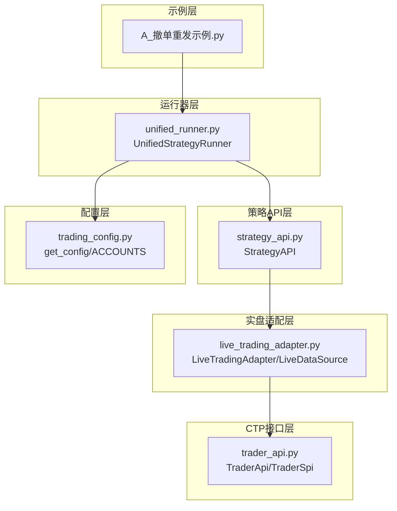
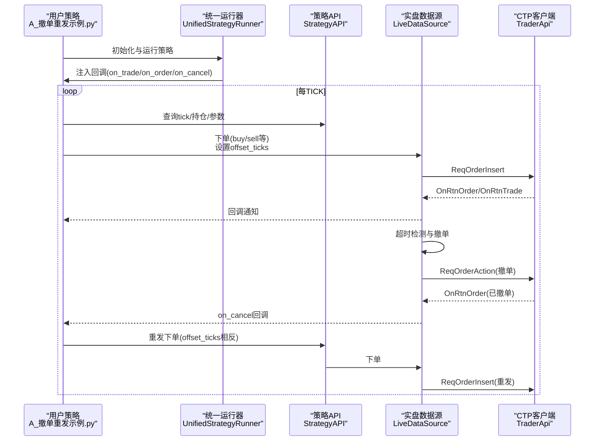
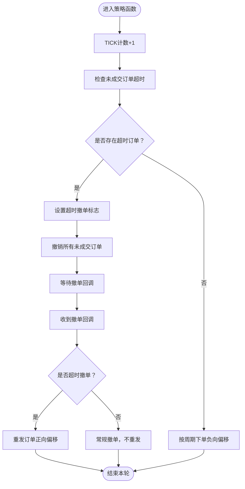
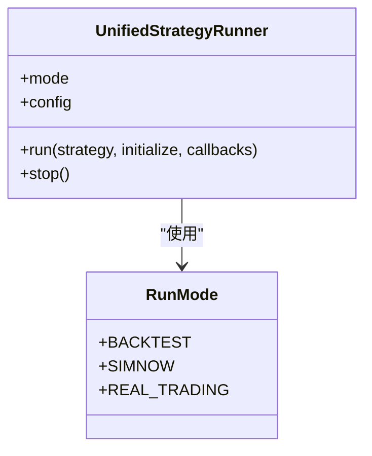
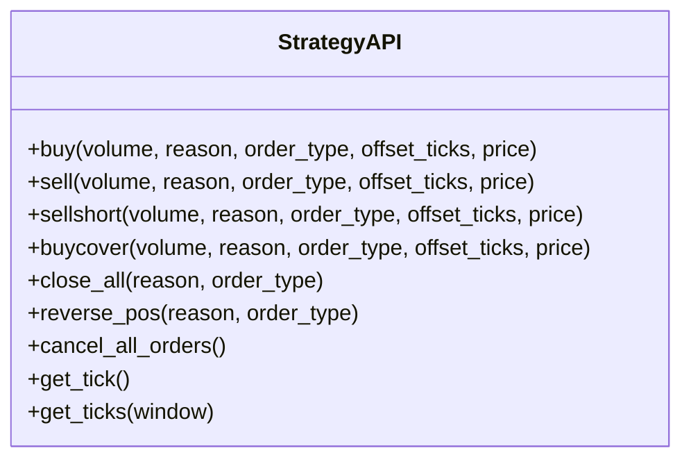
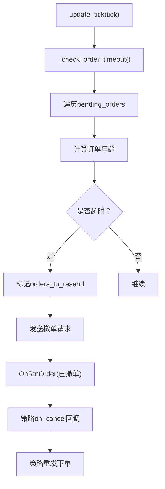
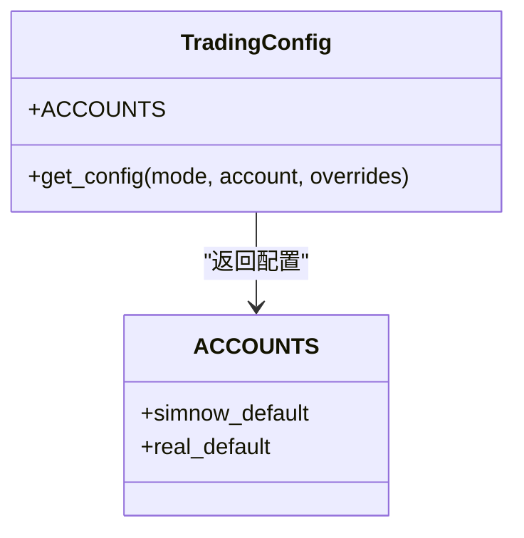
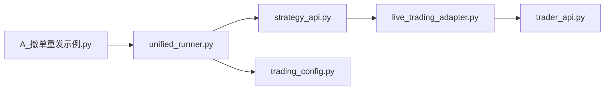

# 撤单重发工具

<cite>
**本文档引用的文件**
- [A_撤单重发示例.py](file://examples/A_撤单重发示例.py)
- [unified_runner.py](file://ssquant/backtest/unified_runner.py)
- [strategy_api.py](file://ssquant/api/strategy_api.py)
- [live_trading_adapter.py](file://ssquant/backtest/live_trading_adapter.py)
- [trading_config.py](file://ssquant/config/trading_config.py)
- [trader_api.py](file://ssquant/pyctp/trader_api.py)
</cite>

## 目录
1. [简介](#简介)
2. [项目结构](#项目结构)
3. [核心组件](#核心组件)
4. [架构概览](#架构概览)
5. [详细组件分析](#详细组件分析)
6. [依赖关系分析](#依赖关系分析)
7. [性能考虑](#性能考虑)
8. [故障排查指南](#故障排查指南)
9. [结论](#结论)
10. [附录](#附录)

## 简介
本工具旨在解决期货交易中“订单长时间未成交”的问题，通过“超时检测-自动撤单-重发补单”的闭环机制，提升订单成交成功率。其核心思想是：以较低的委托价格（负向偏移）降低成交概率，从而触发超时撤单；随后以更高的委托价格（正向偏移）进行重发，确保快速成交。该机制在回测、SIMNOW模拟盘和实盘CTP三种模式下均可运行。

## 项目结构
围绕撤单重发功能的相关文件组织如下：
- 示例脚本：examples/A_撤单重发示例.py，演示完整的超时检测、撤单与重发流程
- 统一运行器：ssquant/backtest/unified_runner.py，支持回测、SIMNOW、实盘三种模式
- 策略API：ssquant/api/strategy_api.py，提供下单、撤单、查询等交易接口
- 实盘适配器：ssquant/backtest/live_trading_adapter.py，封装CTP下单、撤单与订单跟踪
- 交易配置：ssquant/config/trading_config.py，提供账户、参数与智能算法交易配置
- CTP接口：ssquant/pyctp/trader_api.py，封装CTP回调与报单/撤单请求

**图表来源**
- [A_撤单重发示例.py](file://examples/A_撤单重发示例.py#L1-L429)
- [unified_runner.py](file://ssquant/backtest/unified_runner.py#L1-L379)
- [strategy_api.py](file://ssquant/api/strategy_api.py#L1-L570)
- [live_trading_adapter.py](file://ssquant/backtest/live_trading_adapter.py#L1-L1200)
- [trading_config.py](file://ssquant/config/trading_config.py#L1-L187)
- [trader_api.py](file://ssquant/pyctp/trader_api.py#L1-L483)

**章节来源**
- [A_撤单重发示例.py](file://examples/A_撤单重发示例.py#L1-L429)
- [unified_runner.py](file://ssquant/backtest/unified_runner.py#L1-L379)
- [strategy_api.py](file://ssquant/api/strategy_api.py#L1-L570)
- [live_trading_adapter.py](file://ssquant/backtest/live_trading_adapter.py#L1-L1200)
- [trading_config.py](file://ssquant/config/trading_config.py#L1-L187)
- [trader_api.py](file://ssquant/pyctp/trader_api.py#L1-L483)

## 核心组件
- 示例策略与回调
  - 示例脚本提供初始化、TICK回调、报单回调、撤单回调、重发逻辑与超时检测函数，演示完整的撤单重发流程
- 统一运行器
  - 支持回测、SIMNOW、实盘三种模式，负责策略生命周期管理与回调注入
- 策略API
  - 提供下单、撤单、查询等交易接口，并在实盘模式下通过LiveDataSource对接CTP
- 实盘适配器
  - 封装CTP客户端，维护未成交订单跟踪、超时检测、撤单与重发
- 交易配置
  - 提供账户模板、智能算法交易参数（超时时间、重试次数、重试偏移等）

**章节来源**
- [A_撤单重发示例.py](file://examples/A_撤单重发示例.py#L49-L429)
- [unified_runner.py](file://ssquant/backtest/unified_runner.py#L26-L214)
- [strategy_api.py](file://ssquant/api/strategy_api.py#L362-L492)
- [live_trading_adapter.py](file://ssquant/backtest/live_trading_adapter.py#L416-L460)
- [trading_config.py](file://ssquant/config/trading_config.py#L115-L164)

## 架构概览
撤单重发机制在不同运行模式下的交互如下：

**图表来源**
- [A_撤单重发示例.py](file://examples/A_撤单重发示例.py#L240-L429)
- [unified_runner.py](file://ssquant/backtest/unified_runner.py#L162-L214)
- [strategy_api.py](file://ssquant/api/strategy_api.py#L362-L492)
- [live_trading_adapter.py](file://ssquant/backtest/live_trading_adapter.py#L416-L460)
- [trader_api.py](file://ssquant/pyctp/trader_api.py#L335-L395)

## 详细组件分析

### 示例策略与回调
- 初始化与状态管理
  - 初始化函数负责打印测试配置、重置全局状态变量（TICK计数、下单/撤单/重发计数、未成交订单字典、超时撤单标志）
- TICK驱动的下单与超时检测
  - 每隔固定TICK数下单一次，使用负向偏移（降低成交概率）；同时检查未成交订单是否超时
- 报单回调
  - 记录订单状态变化，维护未成交订单跟踪字典
- 撤单回调
  - 识别超时撤单（通过标志位判断），触发重发逻辑；重发时使用正向偏移（提高成交概率）
- 重发策略
  - 重发订单采用与初始订单相反的offset_ticks，确保快速成交；同时记录当前tick价格用于说明

**图表来源**
- [A_撤单重发示例.py](file://examples/A_撤单重发示例.py#L200-L237)
- [A_撤单重发示例.py](file://examples/A_撤单重发示例.py#L137-L198)
- [A_撤单重发示例.py](file://examples/A_撤单重发示例.py#L240-L282)

**章节来源**
- [A_撤单重发示例.py](file://examples/A_撤单重发示例.py#L49-L198)
- [A_撤单重发示例.py](file://examples/A_撤单重发示例.py#L200-L282)

### 统一运行器与回调注入
- 运行模式
  - 支持回测、SIMNOW、实盘三种模式；在实盘模式下注入用户回调（成交、报单、撤单、错误等）
- 配置校验
  - 根据模式校验必填参数，确保账户、服务器、合约等配置完整
- 生命周期管理
  - run方法根据模式选择回测或实盘运行器，完成策略初始化、回调注册与执行

**图表来源**
- [unified_runner.py](file://ssquant/backtest/unified_runner.py#L19-L214)

**章节来源**
- [unified_runner.py](file://ssquant/backtest/unified_runner.py#L26-L214)

### 策略API与下单/撤单接口
- 下单接口
  - buy/sell/sellshort/buycover等方法支持多种订单类型与价格策略；offset_ticks可按单次下单指定，不受全局配置限制
- 撤单接口
  - cancel_all_orders在实盘模式有效，回测模式下无效果；建议撤单后等待短暂时间再重发
- Ticks与历史数据
  - get_tick/get_ticks支持TICK流模式与历史TICK预加载，便于策略观察与调试

**图表来源**
- [strategy_api.py](file://ssquant/api/strategy_api.py#L362-L492)

**章节来源**
- [strategy_api.py](file://ssquant/api/strategy_api.py#L362-L492)

### 实盘适配器与订单跟踪
- 订单超时检测
  - 在update_tick中调用_check_order_timeout，遍历未成交订单，对超时订单标记重发并发送撤单请求
- 未成交订单跟踪
  - LiveDataSource维护pending_orders字典，记录订单插入时间戳与订单数据
- 撤单与重发
  - cancel_all_orders遍历pending_orders，对未成交订单发送撤单请求；重发逻辑在策略回调中实现

**图表来源**
- [live_trading_adapter.py](file://ssquant/backtest/live_trading_adapter.py#L416-L460)
- [live_trading_adapter.py](file://ssquant/backtest/live_trading_adapter.py#L1077-L1112)

**章节来源**
- [live_trading_adapter.py](file://ssquant/backtest/live_trading_adapter.py#L416-L460)
- [live_trading_adapter.py](file://ssquant/backtest/live_trading_adapter.py#L1077-L1112)

### 交易配置与智能算法交易参数
- 账户模板
  - 提供SIMNOW与实盘账户模板，包含服务器、合约、价格跳变、委托偏移等参数
- 智能算法交易
  - 支持订单超时时间、最大重试次数、重试偏移跳数等参数，用于自动撤单与重发
- 配置获取
  - get_config根据运行模式与账户名返回完整配置，支持覆盖参数

**图表来源**
- [trading_config.py](file://ssquant/config/trading_config.py#L115-L164)
- [trading_config.py](file://ssquant/config/trading_config.py#L31-L110)

**章节来源**
- [trading_config.py](file://ssquant/config/trading_config.py#L115-L164)
- [trading_config.py](file://ssquant/config/trading_config.py#L31-L110)

## 依赖关系分析
- 示例策略依赖统一运行器与策略API，通过回调注入实现订单状态与撤单通知
- 策略API在实盘模式下委托LiveDataSource执行下单/撤单，后者通过CTP客户端发起请求
- CTP接口封装报单/撤单请求与回调，驱动实盘适配器的订单状态更新

**图表来源**
- [A_撤单重发示例.py](file://examples/A_撤单重发示例.py#L286-L402)
- [unified_runner.py](file://ssquant/backtest/unified_runner.py#L162-L214)
- [strategy_api.py](file://ssquant/api/strategy_api.py#L362-L492)
- [live_trading_adapter.py](file://ssquant/backtest/live_trading_adapter.py#L1127-L1200)
- [trader_api.py](file://ssquant/pyctp/trader_api.py#L335-L395)
- [trading_config.py](file://ssquant/config/trading_config.py#L115-L164)

**章节来源**
- [A_撤单重发示例.py](file://examples/A_撤单重发示例.py#L286-L402)
- [unified_runner.py](file://ssquant/backtest/unified_runner.py#L162-L214)
- [strategy_api.py](file://ssquant/api/strategy_api.py#L362-L492)
- [live_trading_adapter.py](file://ssquant/backtest/live_trading_adapter.py#L1127-L1200)
- [trader_api.py](file://ssquant/pyctp/trader_api.py#L335-L395)
- [trading_config.py](file://ssquant/config/trading_config.py#L115-L164)

## 性能考虑
- 下单频率限制
  - 策略层与实盘层均内置防重复下单机制，通过冷却时间避免频繁下单
- 撤单与重发间隔
  - 撤单后建议等待短暂时间（如0.3-0.5秒）再重发，以确保订单状态稳定
- 历史数据预加载
  - 实盘/TICK模式下可预加载历史TICK，便于策略观察与调试，但需注意内存占用
- 超时阈值设置
  - 根据市场流动性与合约价格跳变合理设置超时时间，避免过短导致频繁重发或过长影响成交效率

[本节为通用指导，无需特定文件引用]

## 故障排查指南
- 无法撤单
  - 检查是否在实盘模式下调用cancel_all_orders；回测模式下该方法无效果
  - 确认订单系统编号(OrderSysID)与状态符合撤单条件
- 撤单后未触发重发
  - 确认策略on_cancel回调中正确识别超时撤单（通过标志位判断）
  - 检查重发逻辑是否使用了正确的offset_ticks（与初始订单相反）
- CTP连接异常
  - 查看CTP回调日志，确认认证、登录、心跳等流程是否正常
- 频繁重复下单
  - 检查防重复机制是否生效，适当增加冷却时间或减少下单频率
- 性能问题
  - 降低历史TICK预加载数量或缩短滑窗长度，避免内存压力过大

**章节来源**
- [strategy_api.py](file://ssquant/api/strategy_api.py#L477-L492)
- [live_trading_adapter.py](file://ssquant/backtest/live_trading_adapter.py#L1077-L1112)
- [trader_api.py](file://ssquant/pyctp/trader_api.py#L55-L129)

## 结论
撤单重发工具通过“超时检测-自动撤单-重发补单”的闭环机制，在不同运行模式下实现了稳定的订单成交保障。示例脚本清晰展示了从下单到重发的完整流程，配合统一运行器、策略API与实盘适配器，能够满足回测、模拟盘与实盘的多样化需求。通过合理配置超时阈值、重试参数与偏移策略，可在提升成交成功率的同时控制风险与成本。

[本节为总结性内容，无需特定文件引用]

## 附录

### 使用场景与实施步骤
- 异常订单处理
  - 当订单长时间未成交时，系统自动检测并撤销，随后以更高报价重发
- 网络中断恢复
  - 在网络不稳定期间，策略持续跟踪未成交订单；网络恢复后自动完成撤单与重发
- 系统故障应对
  - 通过配置合理的超时阈值与重试次数，降低系统故障对交易的影响

**章节来源**
- [A_撤单重发示例.py](file://examples/A_撤单重发示例.py#L200-L282)
- [trading_config.py](file://ssquant/config/trading_config.py#L46-L49)

### 配置参数与触发条件
- 关键参数
  - 订单超时时间：决定撤单触发时机
  - 重试次数与重试偏移：控制重发频率与报价策略
  - 委托偏移跳数：影响初始订单成交概率与重发报价
- 触发条件
  - 未成交订单超过设定超时阈值
  - 撤单回调中识别为超时撤单
  - 策略重发下单（使用相反偏移）

**章节来源**
- [trading_config.py](file://ssquant/config/trading_config.py#L46-L49)
- [A_撤单重发示例.py](file://examples/A_撤单重发示例.py#L35-L36)
- [A_撤单重发示例.py](file://examples/A_撤单重发示例.py#L164-L190)

### 风险控制与成功率优化
- 风险控制
  - 限制重发次数，避免过度重发造成成本上升
  - 合理设置偏移跳数，防止重发报价过高导致亏损
- 成功率优化
  - 根据市场流动性调整超时阈值
  - 在高波动时段适当提高重发偏移，确保快速成交

**章节来源**
- [trading_config.py](file://ssquant/config/trading_config.py#L46-L49)
- [A_撤单重发示例.py](file://examples/A_撤单重发示例.py#L174-L190)