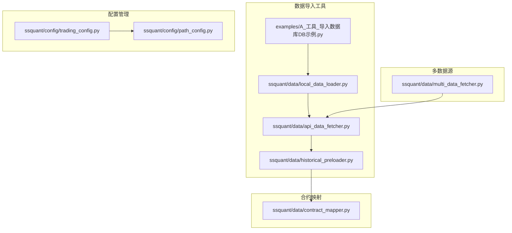
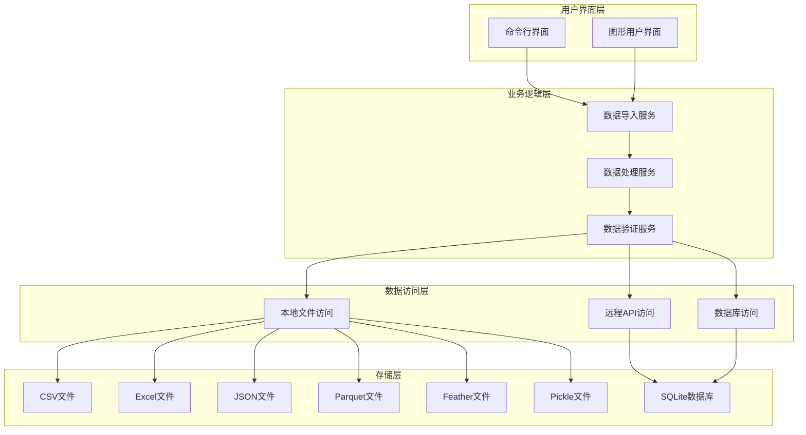
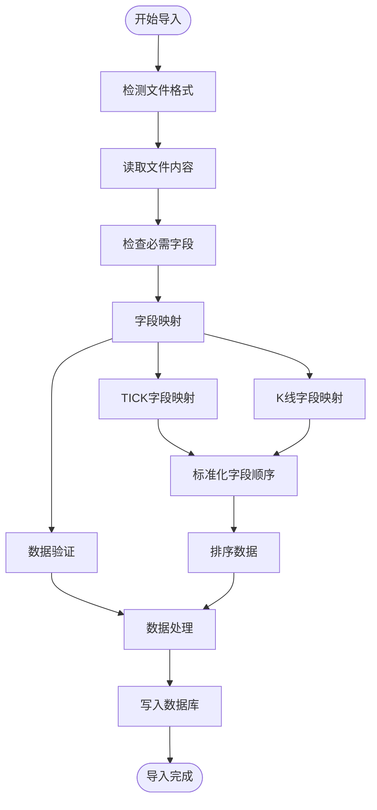
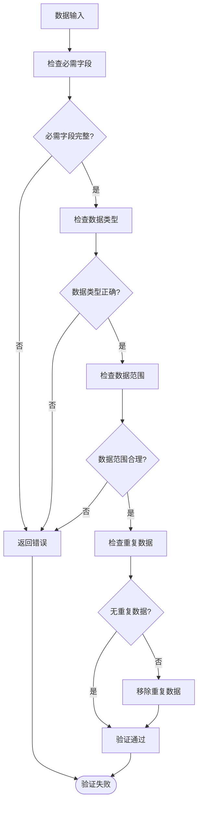
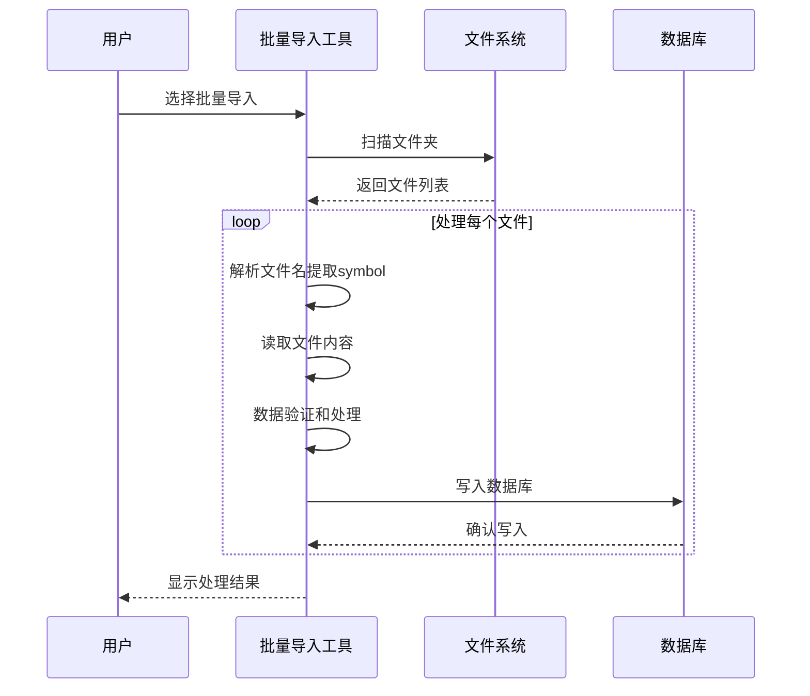
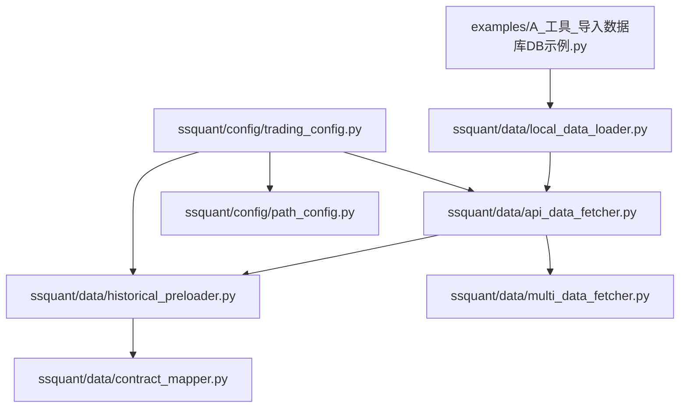

# 数据导入工具

<cite>
**本文档引用的文件**
- [README.md](file://README.md)
- [用户手册.md](file://用户手册.md)
- [A_工具_导入数据库DB示例.py](file://examples/A_工具_导入数据库DB示例.py)
- [local_data_loader.py](file://ssquant/data/local_data_loader.py)
- [api_data_fetcher.py](file://ssquant/data/api_data_fetcher.py)
- [historical_preloader.py](file://ssquant/data/historical_preloader.py)
- [contract_mapper.py](file://ssquant/data/contract_mapper.py)
- [multi_data_fetcher.py](file://ssquant/data/multi_data_fetcher.py)
- [trading_config.py](file://ssquant/config/trading_config.py)
- [path_config.py](file://ssquant/config/path_config.py)
- [requirements.txt](file://requirements.txt)
</cite>

## 目录
1. [简介](#简介)
2. [项目结构](#项目结构)
3. [核心组件](#核心组件)
4. [架构概览](#架构概览)
5. [详细组件分析](#详细组件分析)
6. [依赖关系分析](#依赖关系分析)
7. [性能考虑](#性能考虑)
8. [故障排除指南](#故障排除指南)
9. [结论](#结论)
10. [附录](#附录)

## 简介

SSQuant数据导入工具是一个功能强大的数据处理和导入系统，专为期货量化交易框架设计。该工具支持多种数据格式的导入、处理和存储，包括CSV、Excel、JSON、Parquet、Feather和Pickle格式。

### 主要功能特性

- **多格式支持**：支持CSV、Excel、JSON、Parquet、Feather、Pickle等多种数据格式
- **TICK数据处理**：专门处理CTP原始TICK数据格式
- **K线数据管理**：支持各种K线周期的数据导入和管理
- **数据库集成**：无缝集成SQLite数据库进行数据存储
- **批量处理**：支持批量导入和处理大量数据文件
- **数据验证**：内置数据验证和预处理机制
- **示例数据生成**：自动生成各种格式的示例数据

## 项目结构

SSQuant项目采用模块化的架构设计，数据导入工具分布在多个关键模块中：



**图表来源**
- [A_工具_导入数据库DB示例.py](file://examples/A_工具_导入数据库DB示例.py#L1-L776)
- [local_data_loader.py](file://ssquant/data/local_data_loader.py#L1-L233)
- [api_data_fetcher.py](file://ssquant/data/api_data_fetcher.py#L1-L800)

**章节来源**
- [README.md](file://README.md#L297-L321)
- [用户手册.md](file://用户手册.md#L70-L86)

## 核心组件

### 数据导入示例工具

主要的数据导入工具位于`examples/`目录下的`A_工具_导入数据库DB示例.py`文件中，提供了完整的数据导入解决方案。

### 本地数据加载器

`ssquant/data/local_data_loader.py`提供了灵活的本地数据加载功能，支持多种文件格式和数据源。

### API数据获取器

`ssquant/data/api_data_fetcher.py`实现了从远程API获取期货数据的功能，包括TICK数据和K线数据的处理。

### 历史数据预加载器

`ssquant/data/historical_preloader.py`专门用于实盘和SIMNOW模式的历史数据预加载。

**章节来源**
- [A_工具_导入数据库DB示例.py](file://examples/A_工具_导入数据库DB示例.py#L1-L100)
- [local_data_loader.py](file://ssquant/data/local_data_loader.py#L5-L54)
- [api_data_fetcher.py](file://ssquant/data/api_data_fetcher.py#L171-L264)
- [historical_preloader.py](file://ssquant/data/historical_preloader.py#L11-L50)

## 架构概览

SSQuant数据导入工具采用分层架构设计，确保了良好的可扩展性和维护性：



**图表来源**
- [A_工具_导入数据库DB示例.py](file://examples/A_工具_导入数据库DB示例.py#L80-L95)
- [local_data_loader.py](file://ssquant/data/local_data_loader.py#L55-L143)
- [api_data_fetcher.py](file://ssquant/data/api_data_fetcher.py#L171-L206)

## 详细组件分析

### 数据导入工具核心功能

#### 支持的数据格式

工具支持以下数据格式：

| 格式 | 扩展名 | 描述 | 用途 |
|------|--------|------|------|
| CSV | `.csv` | 逗号分隔值文件 | 最常用的数据交换格式 |
| Excel | `.xlsx`, `.xls` | Microsoft Excel文件 | 图表和报表数据 |
| JSON | `.json` | JavaScript对象表示法 | 网络传输和API数据 |
| Parquet | `.parquet` | 列式存储格式 | 大数据分析和高性能 |
| Feather | `.feather` | 高性能二进制格式 | 快速数据交换 |
| Pickle | `.pkl`, `.pickle` | Python序列化格式 | Python环境数据持久化 |

#### 数据字段映射机制

工具实现了智能的数据字段映射机制，能够处理不同来源数据的字段差异：



**图表来源**
- [A_工具_导入数据库DB示例.py](file://examples/A_工具_导入数据库DB示例.py#L193-L301)
- [A_工具_导入数据库DB示例.py](file://examples/A_工具_导入数据库DB示例.py#L303-L380)

#### TICK数据处理流程

TICK数据处理具有特殊的字段映射和验证规则：

**必需字段**：
- `datetime` - 时间戳
- `LastPrice` - 最新价
- `BidPrice1` - 买一价
- `AskPrice1` - 卖一价
- `Volume` - 累计成交量

**可选字段**：
- `OpenInterest` - 持仓量
- `InstrumentID` - 合约代码
- `TradingDay` - 交易日

#### K线数据处理流程

K线数据处理遵循统一的字段标准：

**必需字段**：
- `datetime` - K线时间戳
- `open` - 开盘价
- `high` - 最高价
- `low` - 最低价
- `close` - 收盘价
- `volume` - 成交量

**可选字段**：
- `amount` - 成交额
- `open_interest` - 持仓量

### 数据库表结构设计

#### TICK数据表结构

TICK数据表采用以下命名规范：
```
{symbol}_tick
```

例如：`rb888_tick`, `au888_tick`, `IF2601_tick`

表结构包含CTP原始字段，确保与实时数据的一致性。

#### K线数据表结构

K线数据表采用以下命名规范：
```
{symbol}_{period}_{adjust}
```

例如：`rb888_1m_hfq` (后复权), `rb888_1h_raw` (不复权), `rb888_D_hfq` (日线后复权)

**周期取值**：1m, 5m, 15m, 30m, 1h, 4h, D, W, M

**复权取值**：hfq (后复权), raw (不复权)

### 数据预处理步骤

#### 字段标准化

工具自动执行以下字段标准化操作：

1. **字段名称统一**：将不同格式的字段名称转换为标准名称
2. **数据类型转换**：确保数值和时间数据的正确类型
3. **缺失值处理**：识别和处理缺失的数据字段
4. **数据范围验证**：验证数据的有效性和合理性

#### 数据验证规则

系统实施严格的数据验证规则：



**图表来源**
- [A_工具_导入数据库DB示例.py](file://examples/A_工具_导入数据库DB示例.py#L236-L245)
- [A_工具_导入数据库DB示例.py](file://examples/A_工具_导入数据库DB示例.py#L334-L343)

### 批量导入功能

#### 批量处理流程

批量导入功能支持从文件夹中自动处理多个数据文件：



**图表来源**
- [A_工具_导入数据库DB示例.py](file://examples/A_工具_导入数据库DB示例.py#L480-L544)

#### 文件命名规范

批量导入要求文件名遵循特定格式：
```
{symbol}_xxx.{extension}
```

例如：`rb888_20251211.csv`, `au888.parquet`

### 示例数据创建功能

工具提供了自动生成示例数据的功能，支持多种格式：

#### 示例TICK数据生成

生成包含以下字段的示例数据：
- `datetime` - 时间戳序列
- `LastPrice` - 最新价格序列
- `BidPrice1` - 买一价序列
- `AskPrice1` - 卖一价序列
- `Volume` - 累计成交量序列
- `OpenInterest` - 持仓量序列

#### 示例K线数据生成

生成包含以下字段的示例数据：
- `datetime` - K线时间戳
- `open` - 开盘价序列
- `high` - 最高价序列
- `low` - 最低价序列
- `close` - 收盘价序列
- `volume` - 成交量序列
- `open_interest` - 持仓量序列

**章节来源**
- [A_工具_导入数据库DB示例.py](file://examples/A_工具_导入数据库DB示例.py#L22-L77)
- [A_工具_导入数据库DB示例.py](file://examples/A_工具_导入数据库DB示例.py#L610-L701)

## 依赖关系分析

### 外部依赖

SSQuant数据导入工具依赖以下外部库：

```mermaid
graph LR
subgraph "核心依赖"
Pandas[Pandas >= 1.3.0]
Numpy[Numpy >= 1.20.0]
Requests[Requests >= 2.25.0]
end
subgraph "可选依赖"
Matplotlib[Matplotlib >= 3.5.0]
Scipy[Scipy >= 1.7.0]
Pillow[Pillow >= 8.0.0]
Akshare[Akshare >= 1.10.0]
PyArrow[PyArrow (用于Parquet/Feather)]
Openpyxl[Openpyxl (用于Excel)]
Xlrd[Xlrd (用于.xls文件)]
Py7zr[Py7zr (用于7z压缩)]
end
subgraph "SSQuant内部模块"
LocalLoader[local_data_loader]
APIDataFetcher[api_data_fetcher]
HistoricalPreloader[historical_preloader]
ContractMapper[contract_mapper]
MultiDataFetcher[multi_data_fetcher]
end
Pandas --> LocalLoader
Pandas --> APIDataFetcher
Pandas --> HistoricalPreloader
Pandas --> MultiDataFetcher
Requests --> APIDataFetcher
LocalLoader --> HistoricalPreloader
APIDataFetcher --> ContractMapper
MultiDataFetcher --> APIDataFetcher
```

**图表来源**
- [requirements.txt](file://requirements.txt#L4-L13)
- [local_data_loader.py](file://ssquant/data/local_data_loader.py#L1-L3)
- [api_data_fetcher.py](file://ssquant/data/api_data_fetcher.py#L1-L8)

### 内部模块依赖



**图表来源**
- [A_工具_导入数据库DB示例.py](file://examples/A_工具_导入数据库DB示例.py#L1-L20)
- [local_data_loader.py](file://ssquant/data/local_data_loader.py#L1-L10)
- [api_data_fetcher.py](file://ssquant/data/api_data_fetcher.py#L1-L10)

**章节来源**
- [requirements.txt](file://requirements.txt#L1-L16)
- [A_工具_导入数据库DB示例.py](file://examples/A_工具_导入数据库DB示例.py#L15-L20)

## 性能考虑

### 数据处理优化

#### 内存管理

- **分块处理**：对于大型文件，采用分块读取和处理策略
- **数据类型优化**：自动选择最适合的数据类型以减少内存占用
- **垃圾回收**：及时释放不再使用的数据对象

#### I/O性能优化

- **批量写入**：使用批量插入操作减少数据库I/O
- **索引优化**：为常用查询字段建立适当的数据库索引
- **缓存机制**：实现数据缓存减少重复读取

### 并发处理

工具支持多文件并发处理：
- **并行导入**：多个文件可以并行导入提高效率
- **异步处理**：远程API调用采用异步方式
- **资源池**：数据库连接和文件句柄使用连接池管理

### 错误处理和恢复

#### 错误分类

- **数据错误**：格式不正确、字段缺失等
- **系统错误**：文件不存在、权限不足等
- **网络错误**：API连接失败、超时等

#### 恢复策略

- **断点续传**：支持部分失败的导入任务恢复
- **数据回滚**：错误发生时自动回滚已提交的数据
- **日志记录**：详细记录所有操作和错误信息

**章节来源**
- [A_工具_导入数据库DB示例.py](file://examples/A_工具_导入数据库DB示例.py#L188-L191)
- [api_data_fetcher.py](file://ssquant/data/api_data_fetcher.py#L686-L800)

## 故障排除指南

### 常见问题及解决方案

#### 文件格式错误

**问题**：不支持的文件格式或格式不正确

**解决方案**：
1. 检查文件扩展名是否在支持列表中
2. 验证文件格式的完整性
3. 确认文件编码格式

#### 数据字段缺失

**问题**：必需字段不存在或名称不匹配

**解决方案**：
1. 使用字段映射功能自动转换字段名称
2. 手动添加缺失的字段
3. 检查数据源的字段定义

#### 数据库连接问题

**问题**：无法连接到SQLite数据库

**解决方案**：
1. 检查数据库文件路径
2. 验证文件权限
3. 确认数据库文件未被其他进程锁定

#### 内存不足

**问题**：处理大型文件时内存不足

**解决方案**：
1. 分块处理大型文件
2. 增加系统内存
3. 优化数据类型

### 调试和诊断

#### 日志记录

工具提供详细的日志记录功能：
- **操作日志**：记录所有数据导入操作
- **错误日志**：记录详细的错误信息和堆栈跟踪
- **性能日志**：记录处理时间和资源使用情况

#### 数据验证

内置的数据验证功能可以帮助识别和修复数据问题：
- **字段验证**：检查必需字段的存在和完整性
- **类型验证**：验证数据类型的正确性
- **范围验证**：检查数值数据的合理性

**章节来源**
- [A_工具_导入数据库DB示例.py](file://examples/A_工具_导入数据库DB示例.py#L135-L191)
- [local_data_loader.py](file://ssquant/data/local_data_loader.py#L148-L164)

## 结论

SSQuant数据导入工具是一个功能完整、设计合理的数据处理系统。它提供了以下主要优势：

### 技术优势

1. **多格式支持**：支持业界标准的数据格式
2. **智能处理**：自动处理字段映射和数据标准化
3. **健壮性**：完善的错误处理和数据验证机制
4. **性能优化**：高效的内存管理和并发处理能力

### 使用价值

1. **易用性**：提供直观的命令行界面和丰富的示例
2. **灵活性**：支持单文件和批量数据处理
3. **可扩展性**：模块化设计便于功能扩展
4. **可靠性**：经过充分测试和验证

### 最佳实践建议

1. **数据准备**：在导入前确保数据格式符合要求
2. **备份策略**：定期备份数据库和重要数据文件
3. **监控机制**：建立数据质量监控和告警机制
4. **文档维护**：保持数据字典和处理流程文档的更新

该工具为期货量化交易提供了坚实的数据基础，能够满足从个人投资者到专业机构的各种需求。

## 附录

### 使用示例

#### 单文件导入示例

```python
# 导入TICK数据
import_tick_data('data/rb2601_tick.csv', 'rb888')

# 导入K线数据
import_kline_data('data/rb2601_1h.parquet', 'rb888', '1h', 'hfq')
```

#### 批量导入示例

```python
# 批量导入TICK数据
batch_import('./tick_data/', 'tick', replace=True)

# 批量导入K线数据
batch_import('./kline_data/', 'kline', '1m', 'hfq', replace=True)
```

#### 示例数据创建

```python
# 创建示例数据
sample_dir = create_sample_data()
print(f"示例数据保存在: {sample_dir}")
```

### 配置选项

#### 数据库配置

```python
DB_PATH = "./data_cache/backtest_data.db"
```

#### 文件格式配置

```python
SUPPORTED_FORMATS = {
    '.csv': 'CSV (逗号分隔)',
    '.xlsx': 'Excel 2007+ (.xlsx)',
    '.xls': 'Excel 97-2003 (.xls)',
    '.json': 'JSON (JavaScript对象表示法)',
    '.parquet': 'Parquet (列式存储)',
    '.feather': 'Feather (高性能二进制)',
    '.pkl': 'Pickle (Python序列化)',
    '.pickle': 'Pickle (Python序列化)',
}
```

### 错误处理机制

#### 异常类型

- `FileNotFoundError`：文件不存在
- `ValueError`：数据格式或值错误
- `ImportError`：依赖库导入失败
- `sqlite3.Error`：数据库操作错误

#### 错误恢复策略

1. **自动重试**：对临时性错误进行自动重试
2. **降级处理**：在功能受限的情况下继续运行
3. **数据回滚**：确保数据一致性
4. **详细日志**：提供完整的错误信息和上下文

**章节来源**
- [A_工具_导入数据库DB示例.py](file://examples/A_工具_导入数据库DB示例.py#L705-L776)
- [trading_config.py](file://ssquant/config/trading_config.py#L10-L26)