# 数据库管理工具

<cite>
**本文档引用的文件**
- [A_工具_数据库管理_查看与删除.py](file://examples/A_工具_数据库管理_查看与删除.py)
- [A_工具_导入数据库DB示例.py](file://examples/A_工具_导入数据库DB示例.py)
- [trading_config.py](file://ssquant/config/trading_config.py)
- [local_data_loader.py](file://ssquant/data/local_data_loader.py)
- [api_data_fetcher.py](file://ssquant/data/api_data_fetcher.py)
- [unified_runner.py](file://ssquant/backtest/unified_runner.py)
- [README.md](file://README.md)
- [用户手册.md](file://用户手册.md)
</cite>

## 目录
1. [简介](#简介)
2. [项目结构](#项目结构)
3. [核心组件](#核心组件)
4. [架构概览](#架构概览)
5. [详细组件分析](#详细组件分析)
6. [依赖关系分析](#依赖关系分析)
7. [性能考虑](#性能考虑)
8. [故障排除指南](#故障排除指南)
9. [结论](#结论)

## 简介

SSQuant数据库管理工具是一个专为期货量化交易框架设计的SQLite数据库管理解决方案。该工具提供了完整的数据库浏览、数据查询、表结构分析和数据清理功能，支持TICK数据和K线数据的统一管理。

### 主要功能特性

- **数据库浏览**: 查看所有表列表，按类型分类显示（TICK数据、K线数据、其他数据）
- **数据查询**: 查看指定表的数据，支持首尾N条记录展示
- **表结构分析**: 查看表的完整字段信息，包括字段类型、约束条件
- **数据清理**: 删除指定表、清空表数据、按品种批量删除
- **自定义查询**: 执行任意SQL查询语句
- **数据导入**: 支持多种格式的数据导入（CSV、Excel、JSON、Parquet等）

## 项目结构

SSQuant项目采用模块化设计，数据库管理工具主要分布在以下目录：

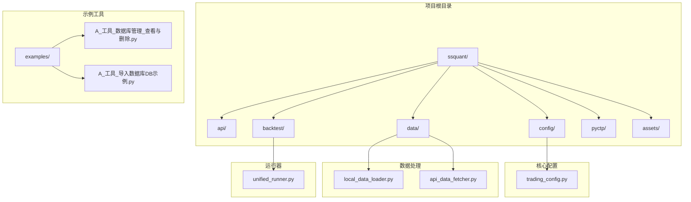

**图表来源**
- [README.md](file://README.md#L297-L320)
- [用户手册.md](file://用户手册.md#L70-L85)

**章节来源**
- [README.md](file://README.md#L297-L320)
- [用户手册.md](file://用户手册.md#L70-L85)

## 核心组件

### 数据库管理工具

数据库管理工具位于`examples/A_工具_数据库管理_查看与删除.py`，提供了完整的数据库管理功能：

- **连接管理**: 自动检测数据库文件存在性，建立SQLite连接
- **表浏览**: 支持按类型分类显示所有表，显示记录数和时间范围
- **数据查询**: 提供多种查询方式，包括表数据查看、字段信息查询
- **数据清理**: 支持单表删除、清空数据、按品种批量删除
- **自定义SQL**: 允许执行任意SQL查询语句

### 数据导入工具

数据导入工具位于`examples/A_工具_导入数据库DB示例.py`，支持多种数据格式的导入：

- **文件格式支持**: CSV、Excel、JSON、Parquet、Feather、Pickle
- **数据类型处理**: TICK数据和K线数据的字段映射和标准化
- **批量导入**: 支持文件夹批量处理
- **示例数据生成**: 自动生成各种格式的示例数据文件

### 配置管理

配置管理位于`ssquant/config/trading_config.py`，定义了数据库连接配置：

- **数据库路径**: `data_cache/backtest_data.db`
- **账户配置**: SIMNOW和实盘账户的数据库保存设置
- **数据保存**: 控制是否保存K线和TICK数据到数据库

**章节来源**
- [A_工具_数据库管理_查看与删除.py](file://examples/A_工具_数据库管理_查看与删除.py#L1-L638)
- [A_工具_导入数据库DB示例.py](file://examples/A_工具_导入数据库DB示例.py#L1-L776)
- [trading_config.py](file://ssquant/config/trading_config.py#L1-L187)

## 架构概览

数据库管理工具采用分层架构设计，各组件职责明确：

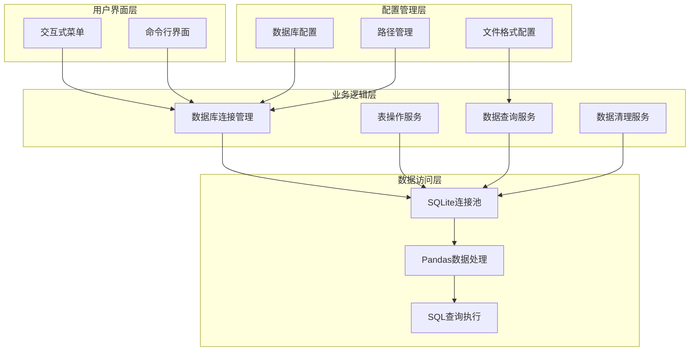

**图表来源**
- [A_工具_数据库管理_查看与删除.py](file://examples/A_工具_数据库管理_查看与删除.py#L20-L25)
- [A_工具_导入数据库DB示例.py](file://examples/A_工具_导入数据库DB示例.py#L94-L95)

### 数据流图

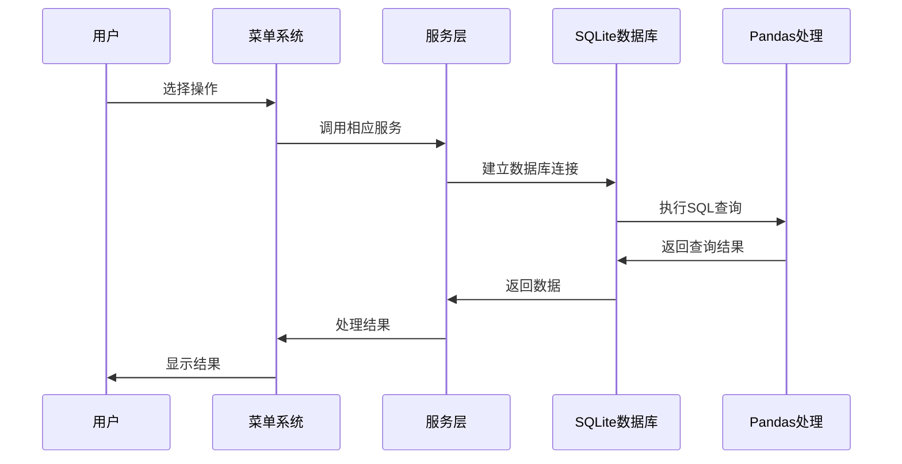

**图表来源**
- [A_工具_数据库管理_查看与删除.py](file://examples/A_工具_数据库管理_查看与删除.py#L134-L193)
- [A_工具_导入数据库DB示例.py](file://examples/A_工具_导入数据库DB示例.py#L546-L586)

## 详细组件分析

### 数据库连接管理

数据库连接管理是整个工具的核心组件，负责数据库的连接、查询和断开：

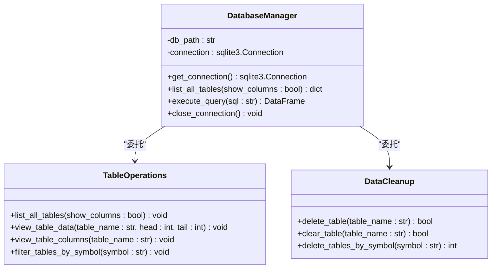

**图表来源**
- [A_工具_数据库管理_查看与删除.py](file://examples/A_工具_数据库管理_查看与删除.py#L20-L95)
- [A_工具_数据库管理_查看与删除.py](file://examples/A_工具_数据库管理_查看与删除.py#L332-L414)

#### 连接建立流程

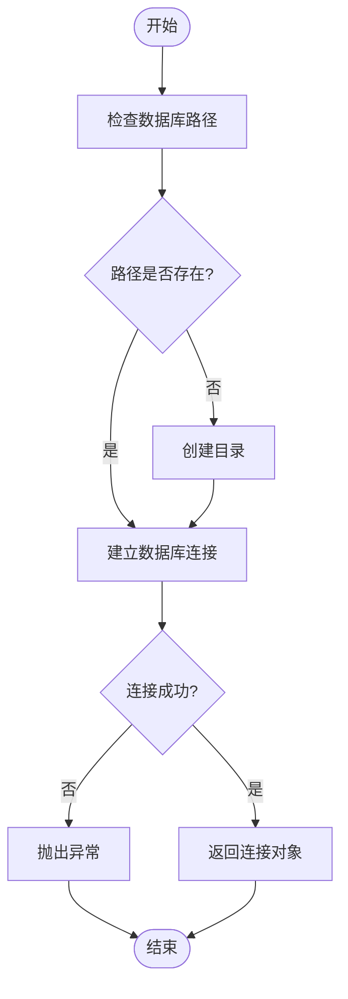

**图表来源**
- [A_工具_数据库管理_查看与删除.py](file://examples/A_工具_数据库管理_查看与删除.py#L20-L25)

**章节来源**
- [A_工具_数据库管理_查看与删除.py](file://examples/A_工具_数据库管理_查看与删除.py#L20-L95)

### 表操作服务

表操作服务提供了完整的表管理功能，包括浏览、查询和分析：

#### 表分类显示

系统自动将表按照数据类型进行分类显示：

- **TICK数据表**: 名称包含`_tick`后缀的表
- **K线数据表**: 包含时间周期标识符的表（如`_1m_`、`_5m_`、`_1h_`等）
- **其他数据表**: 不符合上述模式的表

#### 表信息查询

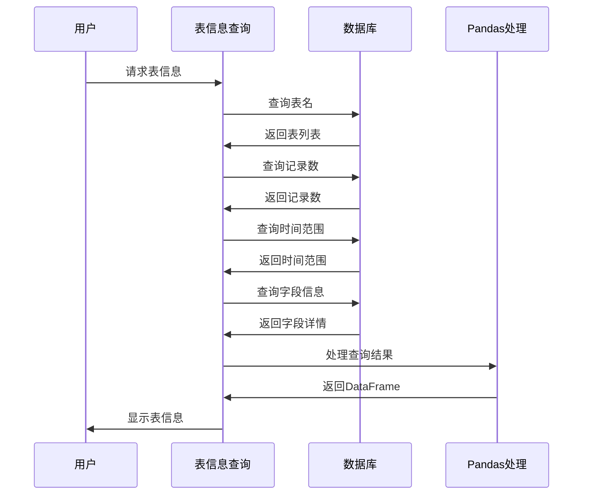

**图表来源**
- [A_工具_数据库管理_查看与删除.py](file://examples/A_工具_数据库管理_查看与删除.py#L97-L132)

**章节来源**
- [A_工具_数据库管理_查看与删除.py](file://examples/A_工具_数据库管理_查看与删除.py#L97-L132)

### 数据查询服务

数据查询服务提供了灵活的数据检索功能：

#### 表数据查看

用户可以选择查看表的前N条和后N条记录：

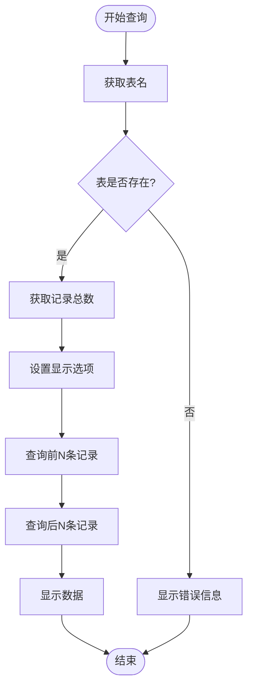

**图表来源**
- [A_工具_数据库管理_查看与删除.py](file://examples/A_工具_数据库管理_查看与删除.py#L134-L193)

#### 字段信息查询

系统提供详细的字段信息，包括字段名、类型、是否可空、默认值等：

**章节来源**
- [A_工具_数据库管理_查看与删除.py](file://examples/A_工具_数据库管理_查看与删除.py#L134-L193)
- [A_工具_数据库管理_查看与删除.py](file://examples/A_工具_数据库管理_查看与删除.py#L196-L233)

### 数据清理服务

数据清理服务提供了安全的数据删除功能：

#### 删除操作流程

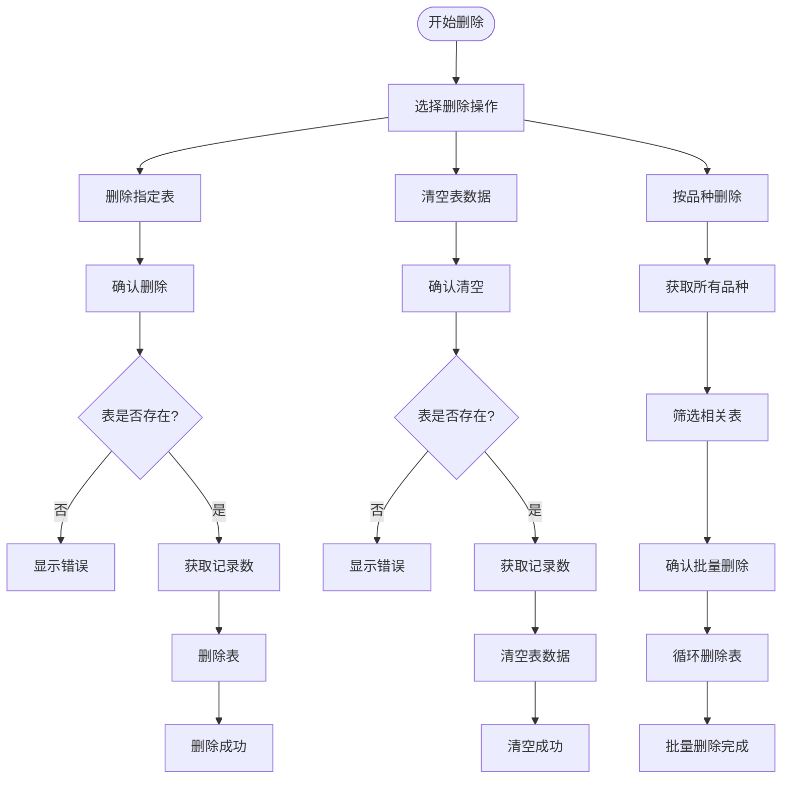

**图表来源**
- [A_工具_数据库管理_查看与删除.py](file://examples/A_工具_数据库管理_查看与删除.py#L332-L472)

**章节来源**
- [A_工具_数据库管理_查看与删除.py](file://examples/A_工具_数据库管理_查看与删除.py#L332-L472)

### 数据导入服务

数据导入服务提供了多种数据格式的支持：

#### 支持的文件格式

| 格式 | 描述 | 扩展名 |
|------|------|--------|
| CSV | 逗号分隔值文件 | `.csv` |
| Excel 2007+ | 现代Excel格式 | `.xlsx` |
| Excel 97-2003 | 传统Excel格式 | `.xls` |
| JSON | JavaScript对象表示法 | `.json` |
| Parquet | 列式存储格式 | `.parquet` |
| Feather | 高性能二进制格式 | `.feather` |
| Pickle | Python序列化格式 | `.pkl`, `.pickle` |

#### 数据处理流程

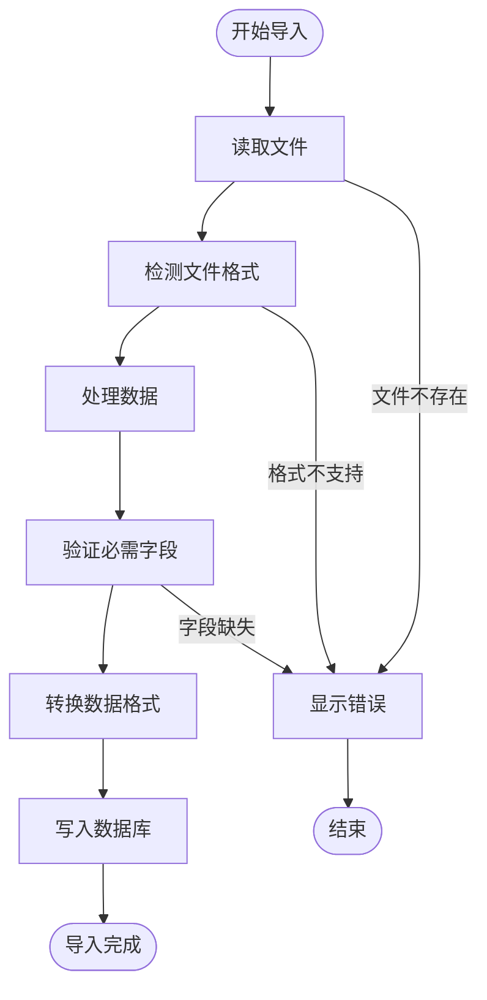

**图表来源**
- [A_工具_导入数据库DB示例.py](file://examples/A_工具_导入数据库DB示例.py#L113-L191)
- [A_工具_导入数据库DB示例.py](file://examples/A_工具_导入数据库DB示例.py#L382-L427)

**章节来源**
- [A_工具_导入数据库DB示例.py](file://examples/A_工具_导入数据库DB示例.py#L80-L91)
- [A_工具_导入数据库DB示例.py](file://examples/A_工具_导入数据库DB示例.py#L113-L191)
- [A_工具_导入数据库DB示例.py](file://examples/A_工具_导入数据库DB示例.py#L382-L427)

## 依赖关系分析

数据库管理工具的依赖关系相对简单，主要依赖于标准库和第三方库：

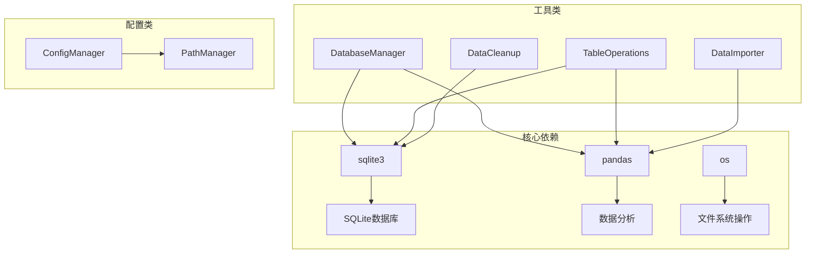

**图表来源**
- [A_工具_数据库管理_查看与删除.py](file://examples/A_工具_数据库管理_查看与删除.py#L12-L14)
- [A_工具_导入数据库DB示例.py](file://examples/A_工具_导入数据库DB示例.py#L15-L19)

### 外部依赖

| 依赖库 | 版本要求 | 用途 |
|--------|----------|------|
| pandas | >= 1.0.0 | 数据处理和分析 |
| sqlite3 | Python标准库 | SQLite数据库操作 |
| openpyxl | >= 2.4.0 | Excel文件读取 |
| pyarrow | >= 0.17.0 | Parquet和Feather格式支持 |
| xlrd | >= 1.0.0 | Excel 97-2003格式支持 |

**章节来源**
- [A_工具_数据库管理_查看与删除.py](file://examples/A_工具_数据库管理_查看与删除.py#L12-L14)
- [A_工具_导入数据库DB示例.py](file://examples/A_工具_导入数据库DB示例.py#L15-L19)

## 性能考虑

### 数据库性能优化

1. **连接池管理**: 使用单一连接避免频繁建立连接的开销
2. **查询优化**: 使用适当的索引和WHERE条件减少查询时间
3. **内存管理**: 及时释放Pandas DataFrame占用的内存
4. **批处理**: 对大量数据操作使用批处理方式

### 内存使用优化

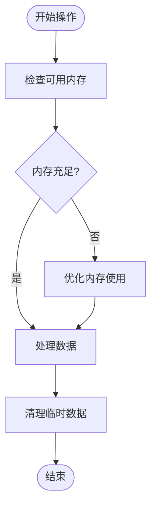

**图表来源**
- [A_工具_数据库管理_查看与删除.py](file://examples/A_工具_数据库管理_查看与删除.py#L166-L169)

### 大数据处理策略

对于大型数据库文件，建议采用以下策略：

1. **分页查询**: 对于大量数据的查询，使用LIMIT和OFFSET分页
2. **增量处理**: 将大数据集分解为更小的批次处理
3. **索引优化**: 为常用查询字段创建适当的索引
4. **缓存策略**: 对频繁访问的数据建立缓存机制

## 故障排除指南

### 常见问题及解决方案

#### 数据库连接问题

| 问题描述 | 可能原因 | 解决方案 |
|----------|----------|----------|
| 数据库文件不存在 | 路径错误或文件被删除 | 检查DB_PATH配置，确认文件存在 |
| 权限不足 | 文件权限设置不当 | 检查文件权限，确保有读写权限 |
| 连接超时 | 数据库锁定或网络问题 | 等待释放锁，检查网络连接 |

#### 查询失败问题

| 问题描述 | 可能原因 | 解决方案 |
|----------|----------|----------|
| SQL语法错误 | 查询语句格式不正确 | 检查SQL语法，参考SQLite文档 |
| 表不存在 | 表名拼写错误 | 使用list_all_tables查看正确表名 |
| 字段不存在 | 字段名错误 | 检查表结构，使用PRAGMA table_info查询 |

#### 数据导入问题

| 问题描述 | 可能原因 | 解决方案 |
|----------|----------|----------|
| 文件格式不支持 | 使用了不支持的扩展名 | 检查SUPPORTED_FORMATS列表 |
| 字段映射失败 | 缺少必需字段 | 检查数据格式，添加必需字段 |
| 内存不足 | 数据量过大 | 分批导入或增加系统内存 |

### 调试技巧

1. **启用详细日志**: 在配置中设置debug模式获取详细信息
2. **逐步验证**: 从简单的查询开始，逐步增加复杂度
3. **数据验证**: 检查数据完整性，确保字段类型正确
4. **性能监控**: 监控内存使用和查询执行时间

**章节来源**
- [A_工具_数据库管理_查看与删除.py](file://examples/A_工具_数据库管理_查看与删除.py#L190-L191)
- [A_工具_导入数据库DB示例.py](file://examples/A_工具_导入数据库DB示例.py#L136-L190)

## 结论

SSQuant数据库管理工具为期货量化交易提供了强大而灵活的数据库管理能力。通过模块化的架构设计和完善的错误处理机制，该工具能够满足从初学者到专业用户的各种需求。

### 主要优势

1. **功能完整**: 提供了数据库管理的所有核心功能
2. **易于使用**: 直观的交互式界面和清晰的错误提示
3. **扩展性强**: 支持多种数据格式和自定义查询
4. **性能优秀**: 优化的查询和数据处理机制
5. **安全可靠**: 完善的错误处理和数据保护机制

### 最佳实践建议

1. **定期备份**: 建立定期备份策略，防止数据丢失
2. **性能监控**: 监控数据库性能，及时发现和解决问题
3. **权限管理**: 合理设置文件权限，确保数据安全
4. **版本控制**: 对重要的数据库结构变更建立版本控制
5. **文档记录**: 记录数据库结构和使用规范

该工具为SSQuant框架提供了坚实的基础设施支持，是进行期货量化交易不可或缺的重要组件。