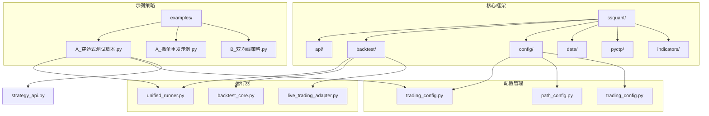
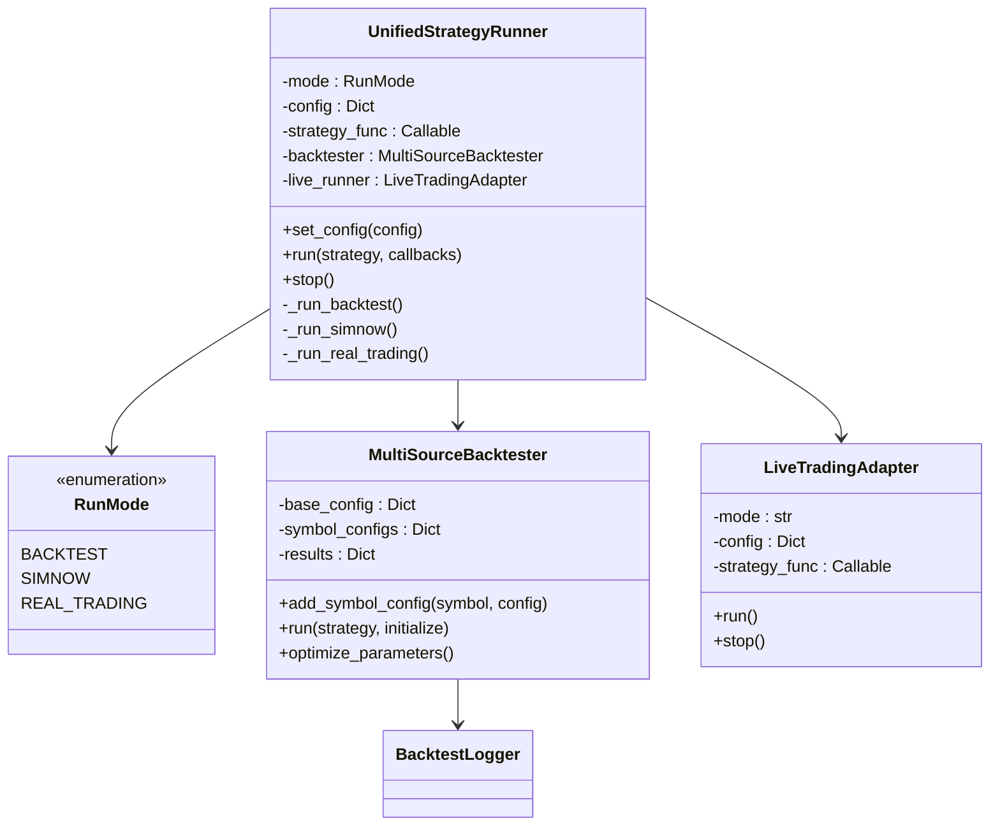
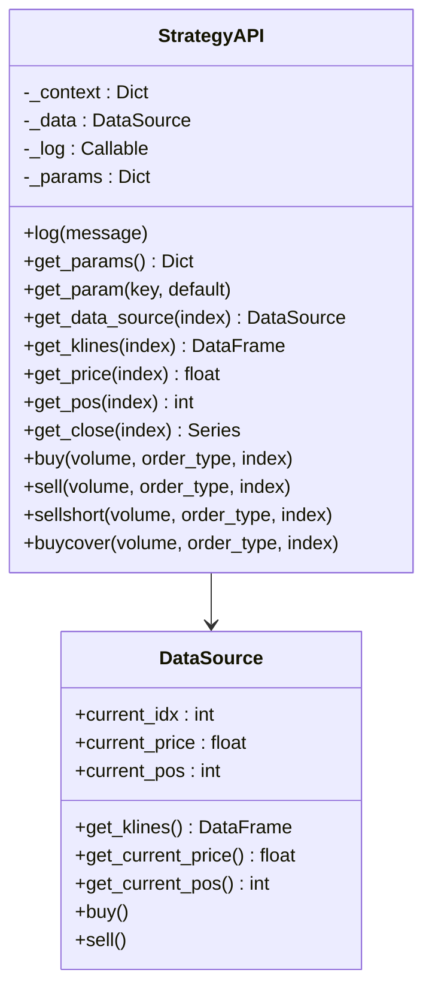
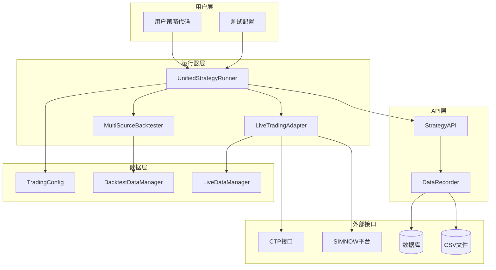
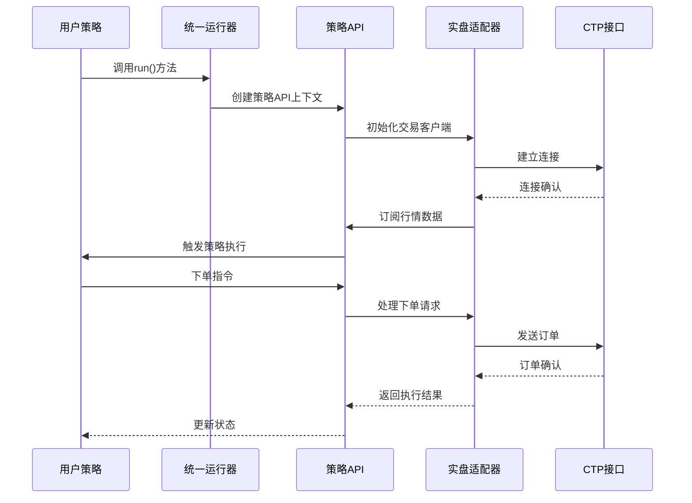
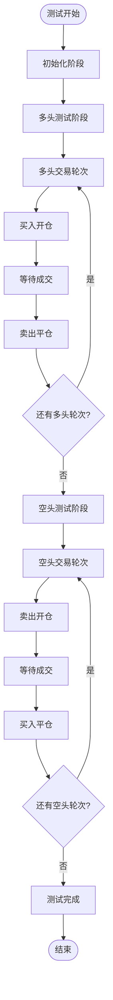
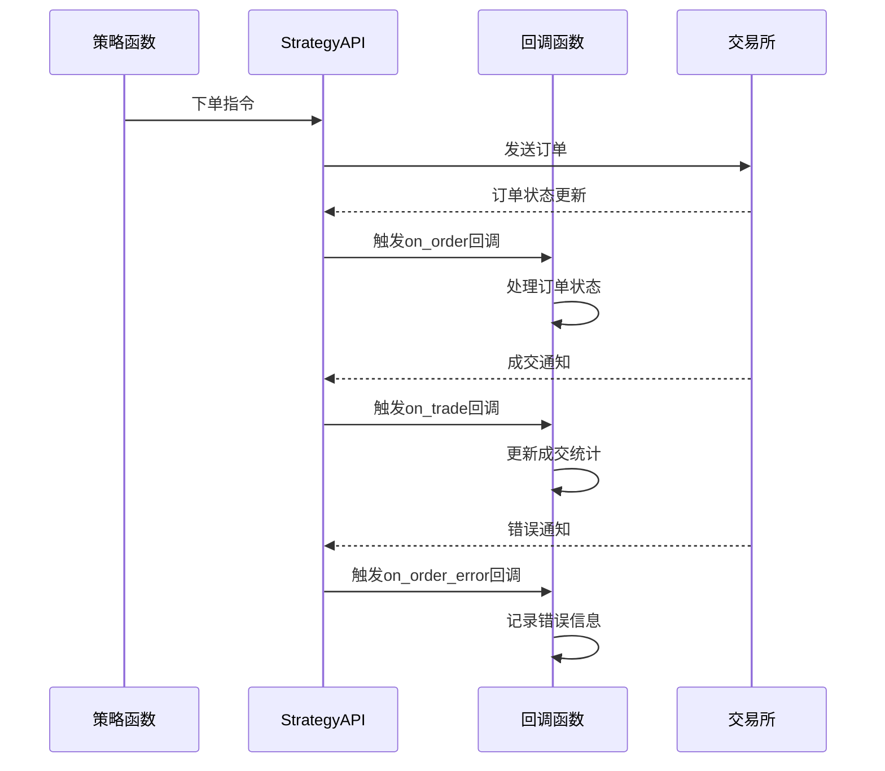
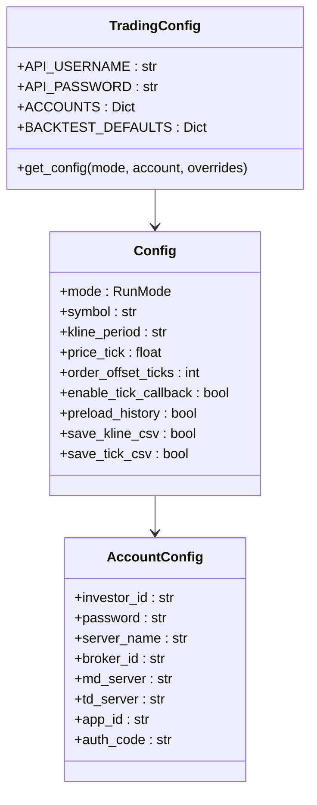
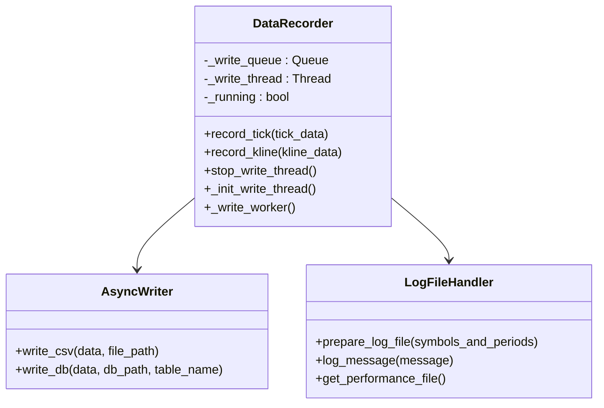
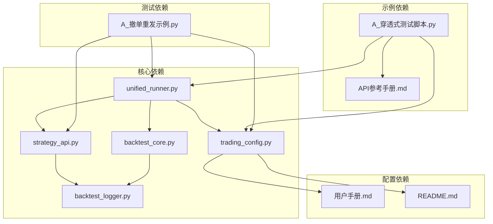

# 穿透式测试工具

<cite>
**本文档引用的文件**
- [A_穿透式测试脚本.py](file://examples/A_穿透式测试脚本.py)
- [README.md](file://README.md)
- [用户手册.md](file://用户手册.md)
- [API参考手册.md](file://API参考手册.md)
- [unified_runner.py](file://ssquant/backtest/unified_runner.py)
- [strategy_api.py](file://ssquant/api/strategy_api.py)
- [trading_config.py](file://ssquant/config/trading_config.py)
- [backtest_core.py](file://ssquant/backtest/backtest_core.py)
- [backtest_logger.py](file://ssquant/backtest/backtest_logger.py)
- [A_撤单重发示例.py](file://examples/A_撤单重发示例.py)
</cite>

## 目录
1. [简介](#简介)
2. [项目结构](#项目结构)
3. [核心组件](#核心组件)
4. [架构概览](#架构概览)
5. [详细组件分析](#详细组件分析)
6. [依赖关系分析](#依赖关系分析)
7. [性能考虑](#性能考虑)
8. [故障排除指南](#故障排除指南)
9. [结论](#结论)
10. [附录](#附录)

## 简介

穿透式测试工具是SSQuant框架中的一个重要功能模块，专门用于验证期货交易系统的完整性和可靠性。该工具通过模拟真实的交易场景，全面检验交易系统的各个层面，包括CTP接口验证、订单执行、风险管理等关键环节。

### 穿透式测试的核心价值

穿透式测试的主要目标是：
- **CTP接口验证**：验证期货公司交易接口的稳定性和准确性
- **交易流程完整性**：检验从下单到成交的完整交易流程
- **系统稳定性评估**：评估系统在高并发和复杂条件下的表现
- **风险控制有效性**：验证风控机制在真实市场环境中的作用

### 测试范围和目标

该工具支持多种测试场景：
- **多头测试**：验证买入开仓、卖出平仓的完整流程
- **空头测试**：验证卖出开仓、买入平仓的完整流程  
- **模拟盘测试**：基于SIMNOW平台的完整测试环境
- **实盘测试**：直接连接CTP接口进行真实测试

## 项目结构

SSQuant框架采用模块化设计，主要包含以下几个核心模块：

**图表来源**
- [unified_runner.py](file://ssquant/backtest/unified_runner.py#L1-L379)
- [strategy_api.py](file://ssquant/api/strategy_api.py#L1-L570)
- [trading_config.py](file://ssquant/config/trading_config.py#L1-L187)

**章节来源**
- [README.md](file://README.md#L297-L321)
- [用户手册.md](file://用户手册.md#L70-L86)

## 核心组件

### 统一策略运行器 (UnifiedStrategyRunner)

统一策略运行器是整个框架的核心组件，支持三种运行模式：

**图表来源**
- [unified_runner.py](file://ssquant/backtest/unified_runner.py#L19-L379)
- [backtest_core.py](file://ssquant/backtest/backtest_core.py#L14-L579)

### 策略API核心类

策略API提供了统一的交易接口，支持多种数据源和交易操作：

**图表来源**
- [strategy_api.py](file://ssquant/api/strategy_api.py#L4-L570)

**章节来源**
- [unified_runner.py](file://ssquant/backtest/unified_runner.py#L26-L379)
- [strategy_api.py](file://ssquant/api/strategy_api.py#L1-L200)

## 架构概览

### 系统架构图

**图表来源**
- [unified_runner.py](file://ssquant/backtest/unified_runner.py#L1-L379)
- [strategy_api.py](file://ssquant/api/strategy_api.py#L1-L570)
- [trading_config.py](file://ssquant/config/trading_config.py#L1-L187)

### 数据流架构

**图表来源**
- [unified_runner.py](file://ssquant/backtest/unified_runner.py#L162-L214)
- [strategy_api.py](file://ssquant/api/strategy_api.py#L362-L400)

## 详细组件分析

### 穿透式测试策略实现

#### 测试策略核心逻辑

穿透式测试策略实现了完整的多头和空头交易循环：

**图表来源**
- [A_穿透式测试脚本.py](file://examples/A_穿透式测试脚本.py#L66-L123)

#### 回调函数处理机制

**图表来源**
- [A_穿透式测试脚本.py](file://examples/A_穿透式测试脚本.py#L31-L57)

**章节来源**
- [A_穿透式测试脚本.py](file://examples/A_穿透式测试脚本.py#L1-L202)

### 配置管理系统

#### 配置参数详解

**图表来源**
- [trading_config.py](file://ssquant/config/trading_config.py#L115-L164)

**章节来源**
- [trading_config.py](file://ssquant/config/trading_config.py#L1-L187)

### 数据记录和监控

#### 数据记录器架构

**图表来源**
- [backtest_core.py](file://ssquant/backtest/backtest_core.py#L1-L579)

**章节来源**
- [backtest_core.py](file://ssquant/backtest/backtest_core.py#L1-L579)

## 依赖关系分析

### 核心依赖关系

**图表来源**
- [unified_runner.py](file://ssquant/backtest/unified_runner.py#L1-L379)
- [strategy_api.py](file://ssquant/api/strategy_api.py#L1-L570)

### 模块耦合度分析

| 模块 | 内聚性 | 耦合度 | 主要职责 |
|------|--------|--------|----------|
| UnifiedStrategyRunner | 高 | 中等 | 统一运行策略，管理运行模式 |
| StrategyAPI | 高 | 低 | 提供统一的交易接口 |
| MultiSourceBacktester | 中等 | 高 | 多数据源回测管理 |
| DataRecorder | 中等 | 低 | 异步数据记录 |
| TradingConfig | 高 | 低 | 配置管理 |

**章节来源**
- [unified_runner.py](file://ssquant/backtest/unified_runner.py#L1-L379)
- [strategy_api.py](file://ssquant/api/strategy_api.py#L1-L570)

## 性能考虑

### 性能优化策略

1. **异步数据处理**
   - 使用队列机制处理数据写入
   - 后台线程异步写入数据库和CSV文件
   - 减少主线程阻塞

2. **内存管理**
   - 及时清理未成交订单状态
   - 优化数据结构减少内存占用
   - 合理设置历史数据预加载数量

3. **网络优化**
   - 连接池管理
   - 心跳检测和自动重连
   - 网络异常处理机制

### 性能监控指标

| 指标类型 | 监控项 | 阈值 | 重要性 |
|----------|--------|------|--------|
| 响应时间 | 订单执行延迟 | < 100ms | 高 |
| 吞吐量 | 每秒订单数 | > 100 | 高 |
| 内存使用 | 进程内存占用 | < 2GB | 中 |
| CPU使用 | CPU占用率 | < 80% | 中 |
| 网络延迟 | 服务器响应时间 | < 50ms | 高 |

## 故障排除指南

### 常见问题及解决方案

#### 连接问题

| 问题描述 | 可能原因 | 解决方案 |
|----------|----------|----------|
| CTP连接失败 | 网络配置错误 | 检查服务器地址和端口 |
| SIMNOW登录失败 | 账号密码错误 | 验证账户信息 |
| 数据获取超时 | 网络不稳定 | 检查网络连接质量 |
| 订单提交失败 | 服务器维护 | 稍后重试或切换服务器 |

#### 交易问题

| 问题描述 | 可能原因 | 解决方案 |
|----------|----------|----------|
| 订单不成交 | 价格设置不当 | 调整offset_ticks参数 |
| 成交延迟 | 市场流动性不足 | 选择流动性更好的合约 |
| 撤单失败 | 系统繁忙 | 稍后重试或降低撤单频率 |
| 持仓不正确 | 计算逻辑错误 | 检查持仓查询API使用 |

#### 配置问题

| 问题描述 | 可能原因 | 解决方案 |
|----------|----------|----------|
| 配置加载失败 | 文件路径错误 | 检查配置文件路径 |
| 参数缺失 | 配置项不完整 | 补充必要的配置参数 |
| 权限不足 | 文件权限问题 | 修改文件权限设置 |
| 编码错误 | 字符编码问题 | 检查文件编码格式 |

**章节来源**
- [用户手册.md](file://用户手册.md#L587-L640)
- [API参考手册.md](file://API参考手册.md#L618-L740)

## 结论

SSQuant穿透式测试工具为期货交易系统提供了全面的测试解决方案。通过统一的API接口和灵活的配置管理，该工具能够有效验证交易系统的各个方面，包括CTP接口、订单执行、风险管理等关键功能。

### 主要优势

1. **统一接口**：一套代码支持回测、模拟和实盘三种模式
2. **完整测试**：覆盖从下单到成交的完整交易流程
3. **灵活配置**：支持多种参数配置和自定义测试场景
4. **实时监控**：提供详细的交易状态监控和日志记录
5. **扩展性强**：模块化设计便于功能扩展和定制

### 改进建议

1. **增强测试覆盖**：增加更多测试场景和边界条件
2. **性能优化**：进一步优化大数据量下的处理性能
3. **可视化改进**：提供更丰富的图表和报表功能
4. **自动化测试**：集成持续集成和自动化测试流程
5. **文档完善**：补充更多使用示例和最佳实践

## 附录

### 测试报告模板

#### 基本信息
- **测试名称**：穿透式测试
- **测试时间**：YYYY-MM-DD HH:mm:ss
- **测试环境**：SIMNOW/实盘
- **测试合约**：合约代码
- **测试周期**：开始日期 - 结束日期

#### 测试结果统计

| 指标类别 | 指标名称 | 测试值 | 标准值 | 结果 |
|----------|----------|--------|--------|------|
| 交易性能 | 订单执行成功率 | XX% | ≥99% | ✓/✗ |
| 交易性能 | 平均成交时间 | Xms | ≤100ms | ✓/✗ |
| 系统稳定性 | 连接稳定性 | XX次 | 0次 | ✓/✗ |
| 风险控制 | 异常处理能力 | 正常/异常 | 正常 | ✓/✗ |

#### 详细分析

**成交统计**
- 多头开仓：XX次，成功XX次，成功率XX%
- 多头平仓：XX次，成功XX次，成功率XX%
- 空头开仓：XX次，成功XX次，成功率XX%
- 空头平仓：XX次，成功XX次，成功率XX%

**错误分析**
- 网络错误：XX次
- 服务器错误：XX次
- 参数错误：XX次
- 其他错误：XX次

#### 改进建议

1. **性能优化**
   - 优化订单提交流程
   - 减少系统响应延迟

2. **稳定性提升**
   - 增加异常处理机制
   - 改善网络连接稳定性

3. **用户体验**
   - 提供更详细的日志信息
   - 增加实时监控功能

#### 测试结论

**总体评价**：优秀/良好/合格/不合格

**建议**：根据测试结果进行相应的系统优化和改进。

---

**章节来源**
- [A_穿透式测试脚本.py](file://examples/A_穿透式测试脚本.py#L116-L122)
- [用户手册.md](file://用户手册.md#L641-L716)