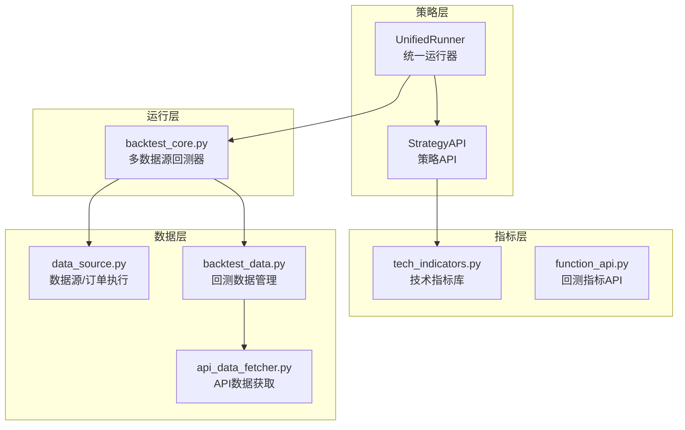
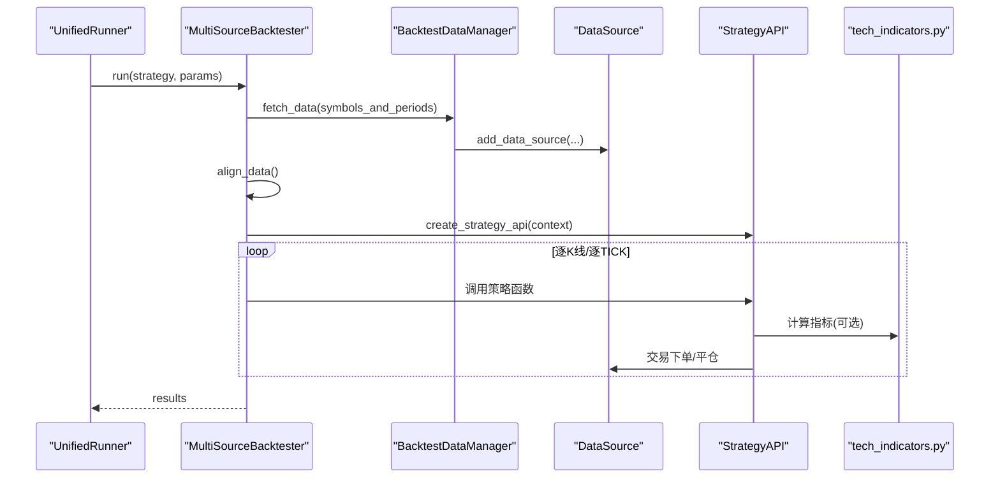
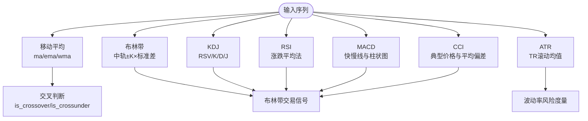
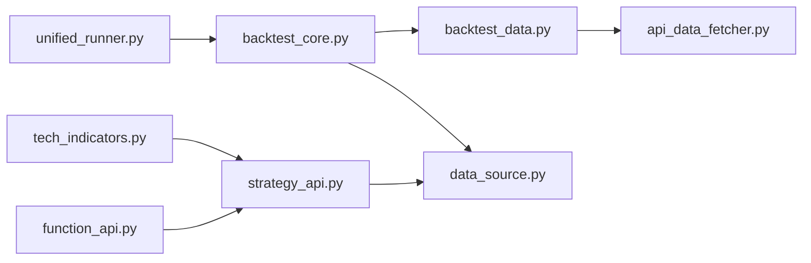

# 技术指标库

<cite>
**本文引用的文件**
- [README.md](file://README.md)
- [ssquant/indicators/tech_indicators.py](file://ssquant/indicators/tech_indicators.py)
- [ssquant/backtest/function_api.py](file://ssquant/backtest/function_api.py)
- [ssquant/api/strategy_api.py](file://ssquant/api/strategy_api.py)
- [ssquant/backtest/backtest_core.py](file://ssquant/backtest/backtest_core.py)
- [ssquant/backtest/backtest_data.py](file://ssquant/backtest/backtest_data.py)
- [ssquant/backtest/unified_runner.py](file://ssquant/backtest/unified_runner.py)
- [ssquant/data/api_data_fetcher.py](file://ssquant/data/api_data_fetcher.py)
- [ssquant/data/data_source.py](file://ssquant/data/data_source.py)
- [examples/B_双均线策略.py](file://examples/B_双均线策略.py)
- [examples/B_海龟交易策略.py](file://examples/B_海龟交易策略.py)
- [examples/B_多品种多周期交易策略.py](file://examples/B_多品种多周期交易策略.py)
- [examples/B_多品种多周期交易策略_参数优化.py](file://examples/B_多品种多周期交易策略_参数优化.py)
</cite>

## 目录
1. [简介](#简介)
2. [项目结构](#项目结构)
3. [核心组件](#核心组件)
4. [架构总览](#架构总览)
5. [详细组件分析](#详细组件分析)
6. [依赖关系分析](#依赖关系分析)
7. [性能考量](#性能考量)
8. [故障排查指南](#故障排查指南)
9. [结论](#结论)
10. [附录](#附录)

## 简介
本文件面向SSQuant技术指标库的使用者与开发者，系统阐述指标计算的数学原理、实现算法与性能优化策略，覆盖内置指标的功能特性、参数设置与使用方法，并提供自定义指标开发指南、扩展接口与最佳实践。文档同时结合回测与实盘运行框架，给出批量计算、缓存策略、参数优化与实战案例（信号生成、风险管理）的完整说明，帮助读者高效构建与验证技术指标体系。

## 项目结构
SSQuant采用模块化分层设计，围绕“策略API + 指标库 + 数据获取 + 回测/实盘运行”四大能力域组织代码。关键模块如下：
- 指标库：提供常用技术指标（移动平均、MACD、RSI、布林带、KDJ、ATR、CCI等）与交叉判断、价格形态识别等辅助函数。
- 策略API：统一的数据访问与交易接口，屏蔽回测/实盘差异。
- 数据层：本地/远端数据获取、缓存与对齐。
- 回测/实盘运行：统一运行器，支持历史回测、SIMNOW模拟与实盘CTP。

图表来源
- [ssquant/indicators/tech_indicators.py](file://ssquant/indicators/tech_indicators.py#L1-L322)
- [ssquant/backtest/function_api.py](file://ssquant/backtest/function_api.py#L1-L198)
- [ssquant/api/strategy_api.py](file://ssquant/api/strategy_api.py#L1-L570)
- [ssquant/backtest/backtest_core.py](file://ssquant/backtest/backtest_core.py#L1-L579)
- [ssquant/backtest/backtest_data.py](file://ssquant/backtest/backtest_data.py#L1-L246)
- [ssquant/data/api_data_fetcher.py](file://ssquant/data/api_data_fetcher.py#L1-L1031)
- [ssquant/data/data_source.py](file://ssquant/data/data_source.py#L1-L922)
- [ssquant/backtest/unified_runner.py](file://ssquant/backtest/unified_runner.py#L1-L379)

章节来源
- [README.md](file://README.md#L297-L321)

## 核心组件
- 技术指标库：提供移动平均、MACD、RSI、布林带、KDJ、ATR、CCI等指标，以及交叉判断与价格形态识别函数。
- 策略API：统一的数据访问与交易接口，支持多数据源、多周期、多订单类型与TICK流。
- 数据获取与缓存：支持本地/远端数据、交易日历、缓存与对齐，提升回测效率。
- 回测/实盘运行：统一运行器，支持参数优化、数据预加载、并行评估与可视化报告。

章节来源
- [ssquant/indicators/tech_indicators.py](file://ssquant/indicators/tech_indicators.py#L1-L322)
- [ssquant/api/strategy_api.py](file://ssquant/api/strategy_api.py#L1-L570)
- [ssquant/backtest/backtest_data.py](file://ssquant/backtest/backtest_data.py#L1-L246)
- [ssquant/backtest/unified_runner.py](file://ssquant/backtest/unified_runner.py#L1-L379)

## 架构总览
SSQuant通过统一运行器在三种模式下无缝运行策略：历史回测、SIMNOW模拟与实盘CTP。策略通过StrategyAPI访问数据与执行交易，指标库既可直接使用内置函数，也可在回测API中使用轻量指标函数。

图表来源
- [ssquant/backtest/unified_runner.py](file://ssquant/backtest/unified_runner.py#L162-L214)
- [ssquant/backtest/backtest_core.py](file://ssquant/backtest/backtest_core.py#L144-L306)
- [ssquant/backtest/backtest_data.py](file://ssquant/backtest/backtest_data.py#L32-L189)
- [ssquant/data/data_source.py](file://ssquant/data/data_source.py#L222-L778)
- [ssquant/api/strategy_api.py](file://ssquant/api/strategy_api.py#L1-L570)
- [ssquant/indicators/tech_indicators.py](file://ssquant/indicators/tech_indicators.py#L1-L322)

## 详细组件分析

### 技术指标库（tech_indicators.py）
- 移动平均：提供简单、指数、加权移动平均，支持滚动窗口与指数平滑。
- 动向类：MACD（快慢线与柱状图）、RSI（相对强弱指数）、ATR（平均真实波幅）。
- 布林带：中轨（MA）、上下轨（中轨±标准差×倍数）。
- 随机指标：KDJ（K/D/J值，含平滑因子与初始值设定）。
- 通道与能量：CCI（顺势指标）、唐奇安通道（由外部函数实现）。
- 交叉与形态：快线上穿/下穿慢线判断、高低点识别（swing high/low）。

图表来源
- [ssquant/indicators/tech_indicators.py](file://ssquant/indicators/tech_indicators.py#L14-L322)

章节来源
- [ssquant/indicators/tech_indicators.py](file://ssquant/indicators/tech_indicators.py#L12-L322)

### 回测指标API（function_api.py）
- 提供回测模式下的指标函数：ma、rsi、macd、boll，便于策略直接调用。
- 提供交易API：开平仓、市价/限价/下一根K线执行等订单类型。
- 与策略API协同：策略可选择使用回测API指标或直接调用指标库。

章节来源
- [ssquant/backtest/function_api.py](file://ssquant/backtest/function_api.py#L1-L198)

### 策略API（strategy_api.py）
- 数据访问：多数据源、多周期的K线与TICK序列获取。
- 交易操作：支持多种订单类型与执行时机（当前K线收盘/下一根K线开盘/市价等）。
- 持仓查询：净持仓、多空分离、今昨仓等。
- 多数据源支持：通过index访问不同数据源，实现多品种多周期策略。

章节来源
- [ssquant/api/strategy_api.py](file://ssquant/api/strategy_api.py#L1-L570)

### 数据获取与缓存（api_data_fetcher.py）
- 交易日历：支持akshare获取与本地缓存，自动更新与回退策略。
- 数据获取：支持本地文件与远端API，自动对齐交易日范围，缓存缺失区间并合并。
- TICK数据：本地SQLite读取，严格日期范围过滤与索引设置。

章节来源
- [ssquant/data/api_data_fetcher.py](file://ssquant/data/api_data_fetcher.py#L1-L1031)

### 回测数据管理（backtest_data.py）
- 多数据源：统一加载、对齐与填充，支持多周期合并。
- 本地/远端数据：优先本地文件，其次API，失败时尝试备选方案。
- 对齐策略：对齐索引与填充方法，保证回测稳定性。

章节来源
- [ssquant/backtest/backtest_data.py](file://ssquant/backtest/backtest_data.py#L1-L246)

### 多数据源回测器（backtest_core.py）
- 多品种多周期：统一配置与运行，支持对齐与填充。
- 结果计算与可视化：性能指标、报告生成与图表输出。
- 参数优化：网格/随机/贝叶斯优化，支持数据复用与并行评估。

章节来源
- [ssquant/backtest/backtest_core.py](file://ssquant/backtest/backtest_core.py#L1-L579)

### 统一运行器（unified_runner.py）
- 三种模式：历史回测、SIMNOW模拟、实盘CTP。
- 配置校验：按模式校验必填参数，支持单/多数据源。
- 回调与事件：实盘模式支持成交/报单/撤单/错误回调。

章节来源
- [ssquant/backtest/unified_runner.py](file://ssquant/backtest/unified_runner.py#L1-L379)

### 数据源与订单执行（data_source.py）
- 订单类型：支持bar_close/next_bar_open/next_bar_close/next_bar_high/next_bar_low/market。
- 待执行队列：延迟到下一K线执行，支持市价单与限价单。
- 交易记录：记录成交动作、价格与原因，便于回测复盘。

章节来源
- [ssquant/data/data_source.py](file://ssquant/data/data_source.py#L1-L922)

## 依赖关系分析
- 指标库与策略API：策略可通过StrategyAPI直接调用指标库函数，也可使用回测API中的轻量指标。
- 回测运行器与数据层：MultiSourceBacktester依赖BacktestDataManager进行数据获取与对齐，BacktestDataManager依赖api_data_fetcher与local_data_loader。
- 数据源与交易：DataSource封装订单执行与持仓更新，统一回测与实盘的交易行为。

图表来源
- [ssquant/indicators/tech_indicators.py](file://ssquant/indicators/tech_indicators.py#L1-L322)
- [ssquant/backtest/function_api.py](file://ssquant/backtest/function_api.py#L1-L198)
- [ssquant/api/strategy_api.py](file://ssquant/api/strategy_api.py#L1-L570)
- [ssquant/backtest/unified_runner.py](file://ssquant/backtest/unified_runner.py#L1-L379)
- [ssquant/backtest/backtest_core.py](file://ssquant/backtest/backtest_core.py#L1-L579)
- [ssquant/backtest/backtest_data.py](file://ssquant/backtest/backtest_data.py#L1-L246)
- [ssquant/data/api_data_fetcher.py](file://ssquant/data/api_data_fetcher.py#L1-L1031)
- [ssquant/data/data_source.py](file://ssquant/data/data_source.py#L1-L922)

## 性能考量
- 指标计算性能
  - 使用pandas rolling与ewm进行向量化计算，避免显式循环。
  - 指数移动平均使用指数平滑，复杂度O(n)。
  - RSI、ATR、CCI等涉及滚动窗口与均值/标准差，注意period与数据长度匹配。
- 缓存策略
  - 数据层对API返回数据进行SQLite缓存，自动检测缺失交易日并增量补全。
  - 回测器支持数据预加载与复用，显著降低参数优化成本。
- 批量计算与并行
  - 参数优化支持并行评估，结合数据复用大幅提升效率。
  - 多数据源对齐时可选择关闭对齐以减少数据丢失风险。
- 订单执行与延迟
  - next_bar_*订单类型通过待执行队列延迟到下一K线执行，避免未来信息泄露。
  - 市价单在TICK数据下使用BidPrice1/AskPrice1，K线数据回测使用收盘价。

章节来源
- [ssquant/backtest/backtest_core.py](file://ssquant/backtest/backtest_core.py#L526-L579)
- [ssquant/backtest/backtest_data.py](file://ssquant/backtest/backtest_data.py#L32-L189)
- [ssquant/data/api_data_fetcher.py](file://ssquant/data/api_data_fetcher.py#L305-L625)
- [ssquant/data/data_source.py](file://ssquant/data/data_source.py#L137-L221)

## 故障排查指南
- 数据获取失败
  - 检查API认证信息与网络连接；确认交易日历与日期范围。
  - 若缓存损坏，清理缓存文件后重试。
- 回测无数据或数据长度不足
  - 确认数据源配置与对齐策略；必要时关闭对齐以避免裁剪。
- 订单执行异常
  - 检查订单类型与价格来源；市价单在TICK数据下需确保BidPrice1/AskPrice1存在。
  - 确认持仓可平量与订单量匹配。
- 参数优化卡顿
  - 启用数据预加载与并行评估；合理设置并行进程数（Windows限制）。

章节来源
- [ssquant/data/api_data_fetcher.py](file://ssquant/data/api_data_fetcher.py#L1-L1031)
- [ssquant/backtest/backtest_data.py](file://ssquant/backtest/backtest_data.py#L1-L246)
- [ssquant/data/data_source.py](file://ssquant/data/data_source.py#L1-L922)
- [examples/B_多品种多周期交易策略_参数优化.py](file://examples/B_多品种多周期交易策略_参数优化.py#L1-L155)

## 结论
SSQuant技术指标库以简洁高效的实现为基础，配合统一的策略API与强大的回测/实盘运行框架，能够支撑从入门到高级的各类技术分析策略。通过内置指标、回测API与自定义扩展，用户可快速构建、验证与优化指标体系，并在多数据源、多周期场景下稳定运行。

## 附录

### 内置指标功能与参数
- 移动平均：ma、ema、wma，周期参数。
- MACD：fast_period、slow_period、signal_period。
- RSI：period。
- 布林带：period、stdev_factor。
- KDJ：n、m1、m2。
- ATR：period。
- CCI：period。
- 交叉判断：is_crossover、is_crossunder，基于索引idx。
- 形态识别：find_swing_high、find_swing_low，窗口window。

章节来源
- [ssquant/indicators/tech_indicators.py](file://ssquant/indicators/tech_indicators.py#L14-L322)

### 使用方法与最佳实践
- 在策略中直接调用指标库函数，或使用回测API中的轻量指标函数。
- 多数据源策略中，使用StrategyAPI的index参数访问不同数据源。
- 使用next_bar_*订单类型避免未来信息泄露；市价单在TICK数据下更贴近真实成交。
- 参数优化前启用数据预加载，结合并行评估提升效率。

章节来源
- [ssquant/api/strategy_api.py](file://ssquant/api/strategy_api.py#L1-L570)
- [ssquant/backtest/function_api.py](file://ssquant/backtest/function_api.py#L1-L198)
- [ssquant/data/data_source.py](file://ssquant/data/data_source.py#L1-L922)

### 实战案例
- 双均线策略：基于ma_cross_strategy，使用回测API与StrategyAPI实现金叉/死叉信号与开平仓。
- 海龟交易策略：基于唐奇安通道突破与ATR波动率调整头寸规模，展示多数据源与参数优化。
- 多品种多周期策略：在同一策略中同时交易多个品种与周期，独立信号与参数化均线周期。

章节来源
- [examples/B_双均线策略.py](file://examples/B_双均线策略.py#L1-L269)
- [examples/B_海龟交易策略.py](file://examples/B_海龟交易策略.py#L1-L423)
- [examples/B_多品种多周期交易策略.py](file://examples/B_多品种多周期交易策略.py#L1-L521)