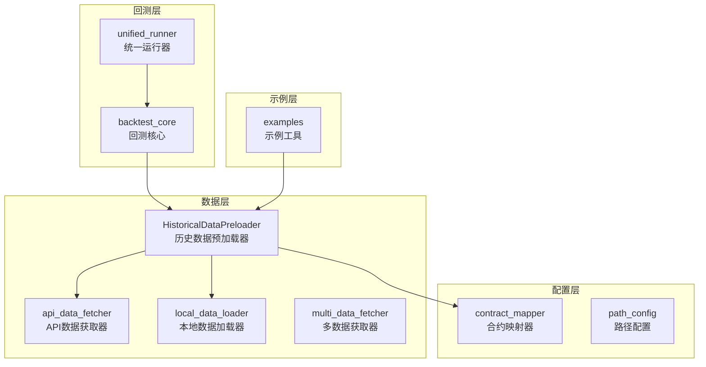
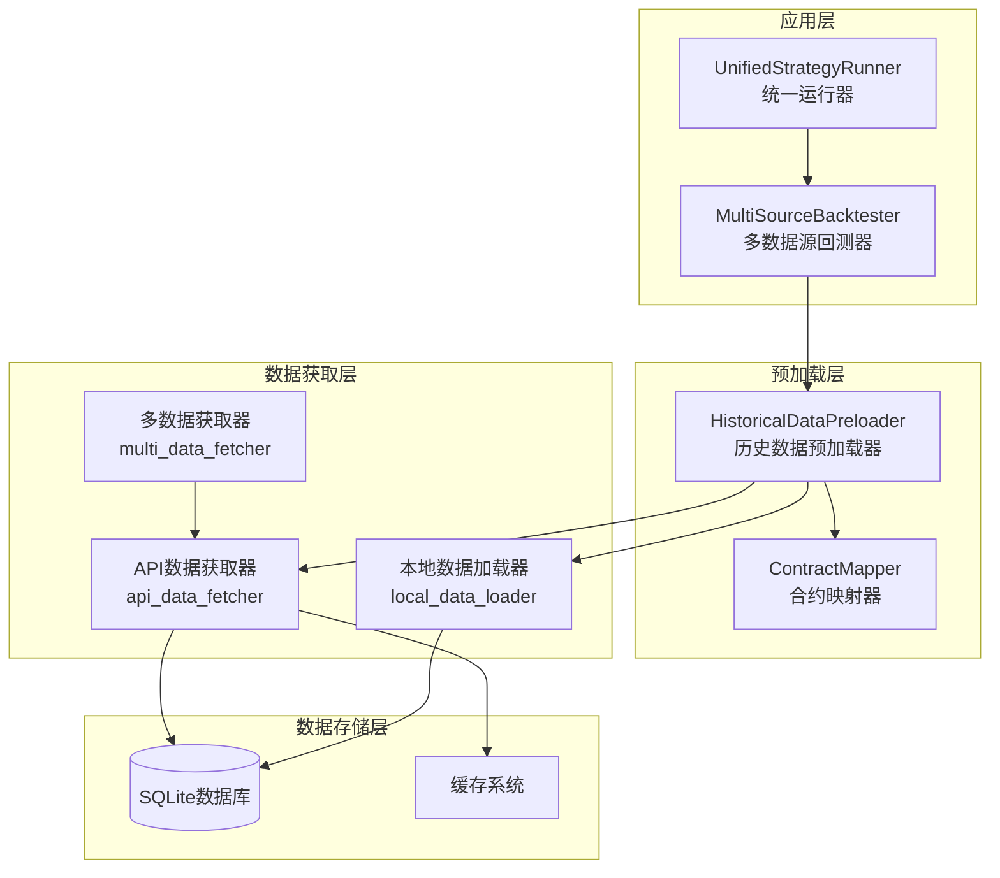
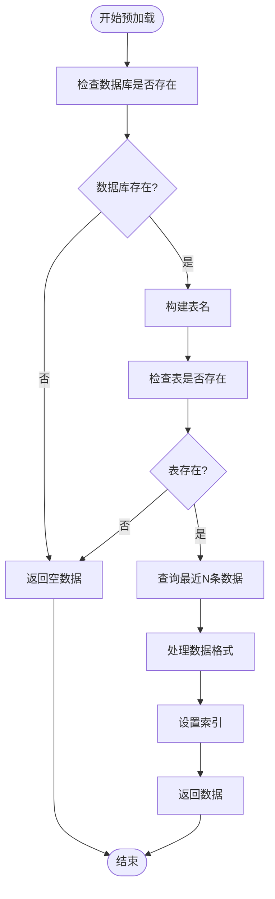
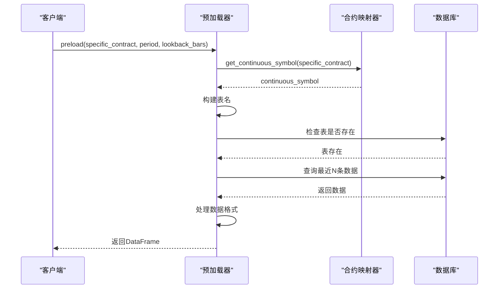
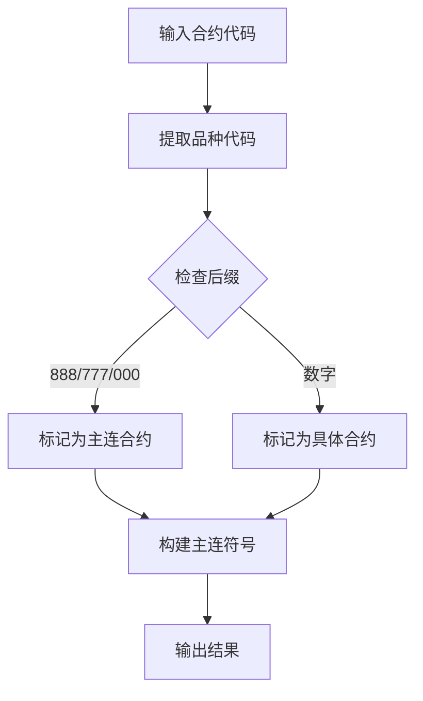
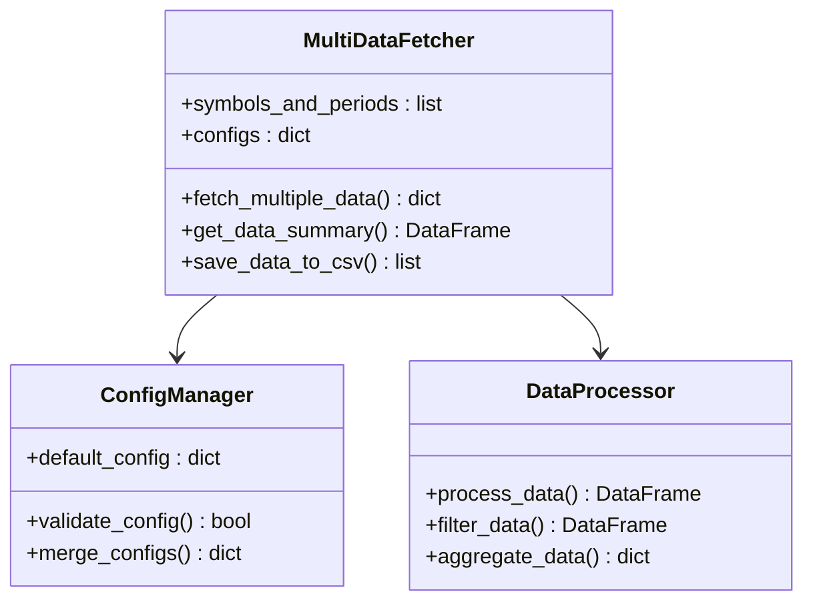
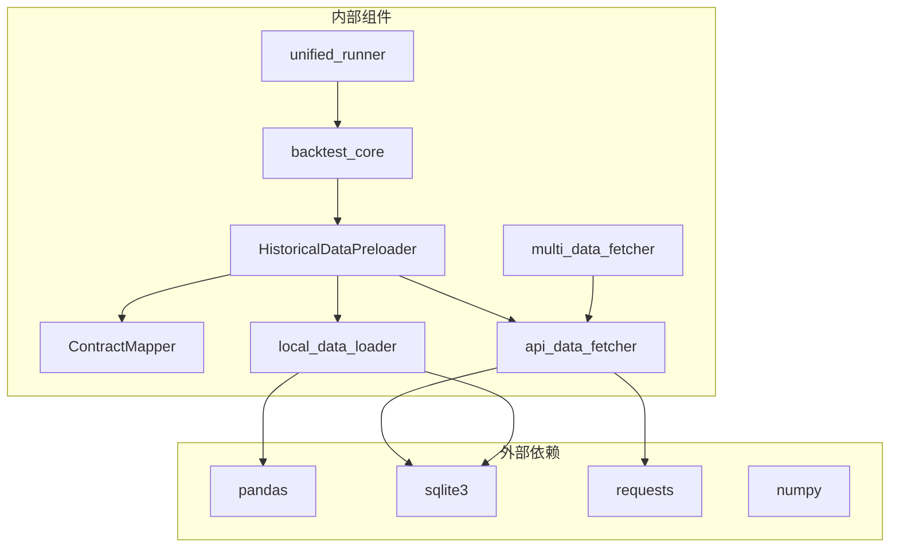
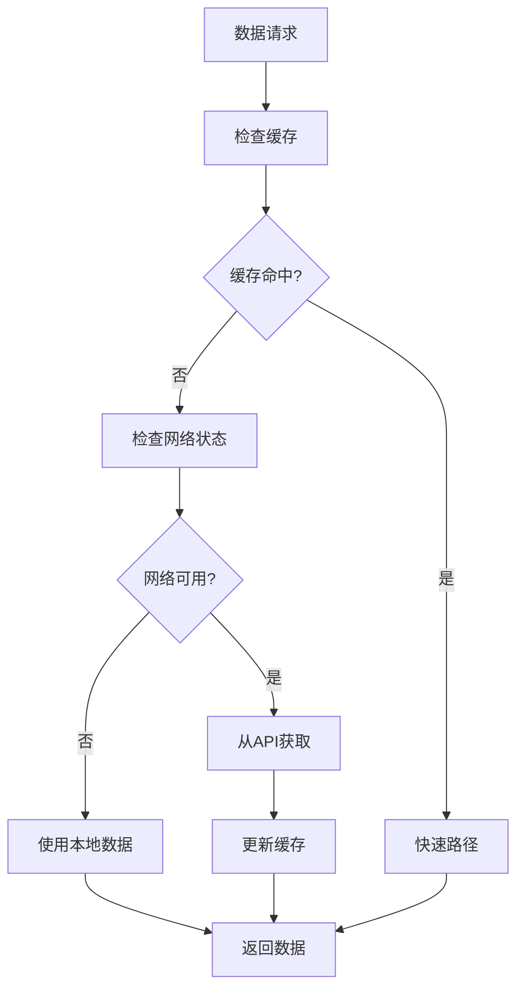

# 历史数据预加载

<cite>
**本文档引用的文件**
- [historical_preloader.py](file://ssquant/data/historical_preloader.py)
- [api_data_fetcher.py](file://ssquant/data/api_data_fetcher.py)
- [local_data_loader.py](file://ssquant/data/local_data_loader.py)
- [multi_data_fetcher.py](file://ssquant/data/multi_data_fetcher.py)
- [contract_mapper.py](file://ssquant/data/contract_mapper.py)
- [backtest_core.py](file://ssquant/backtest/backtest_core.py)
- [unified_runner.py](file://ssquant/backtest/unified_runner.py)
- [A_工具_导入数据库DB示例.py](file://examples/A_工具_导入数据库DB示例.py)
- [path_config.py](file://ssquant/config/path_config.py)
</cite>

## 目录
1. [简介](#简介)
2. [项目结构](#项目结构)
3. [核心组件](#核心组件)
4. [架构概览](#架构概览)
5. [详细组件分析](#详细组件分析)
6. [依赖关系分析](#依赖关系分析)
7. [性能考量](#性能考量)
8. [故障排除指南](#故障排除指南)
9. [结论](#结论)

## 简介

SSQuant历史数据预加载系统是一个专为量化交易框架设计的数据预处理子系统，主要服务于实盘交易和SIMNOW模拟交易模式的启动阶段。该系统通过智能的数据预加载机制，确保交易系统能够快速获取所需的市场数据，从而提升交易执行效率和用户体验。

系统的核心设计理念是"按需加载、智能缓存、无缝集成"，通过多种数据源支持和灵活的配置选项，为用户提供高效、可靠的历史数据预加载服务。

## 项目结构

SSQuant项目采用模块化的组织结构，历史数据预加载系统主要分布在以下目录中：



**图表来源**
- [historical_preloader.py](file://ssquant/data/historical_preloader.py#L1-L339)
- [api_data_fetcher.py](file://ssquant/data/api_data_fetcher.py#L1-L800)
- [backtest_core.py](file://ssquant/backtest/backtest_core.py#L1-L579)

**章节来源**
- [historical_preloader.py](file://ssquant/data/historical_preloader.py#L1-L339)
- [api_data_fetcher.py](file://ssquant/data/api_data_fetcher.py#L1-L800)
- [backtest_core.py](file://ssquant/backtest/backtest_core.py#L1-L579)

## 核心组件

历史数据预加载系统由以下几个核心组件构成：

### 1. 历史数据预加载器 (HistoricalDataPreloader)

这是系统的主要入口点，负责协调各种数据预加载操作。它支持K线数据和TICK数据的预加载，并提供智能的数据库查询和数据验证功能。

### 2. 合约映射器 (ContractMapper)

负责处理主连合约与具体合约之间的映射关系，支持多种合约格式的自动识别和转换。

### 3. API数据获取器 (api_data_fetcher)

提供从外部API获取期货数据的能力，支持缓存机制、重试逻辑和交易日历功能。

### 4. 本地数据加载器 (local_data_loader)

支持多种本地数据格式的加载，包括CSV、HDF5、7Z压缩包和SQLite数据库。

### 5. 多数据获取器 (multi_data_fetcher)

用于批量获取多个品种和周期的数据，支持配置管理和数据汇总功能。

**章节来源**
- [historical_preloader.py](file://ssquant/data/historical_preloader.py#L11-L133)
- [contract_mapper.py](file://ssquant/data/contract_mapper.py#L10-L116)
- [api_data_fetcher.py](file://ssquant/data/api_data_fetcher.py#L171-L626)
- [local_data_loader.py](file://ssquant/data/local_data_loader.py#L5-L174)
- [multi_data_fetcher.py](file://ssquant/data/multi_data_fetcher.py#L4-L76)

## 架构概览

系统采用分层架构设计，各层之间职责明确，耦合度低：



**图表来源**
- [unified_runner.py](file://ssquant/backtest/unified_runner.py#L26-L379)
- [backtest_core.py](file://ssquant/backtest/backtest_core.py#L14-L84)
- [historical_preloader.py](file://ssquant/data/historical_preloader.py#L11-L133)
- [api_data_fetcher.py](file://ssquant/data/api_data_fetcher.py#L171-L626)

## 详细组件分析

### 历史数据预加载器 (HistoricalDataPreloader)

#### 设计原理

预加载器采用"懒加载+智能缓存"的设计理念，通过以下机制实现高效的数据预加载：

1. **智能表名推导**: 自动根据合约代码推导对应的数据库表名
2. **复权类型支持**: 支持不复权和后复权两种数据格式
3. **TICK数据专用**: 为TICK数据提供专门的预加载接口
4. **错误处理**: 完善的异常处理和错误提示机制

#### 核心功能



**图表来源**
- [historical_preloader.py](file://ssquant/data/historical_preloader.py#L23-L133)

#### 预加载策略

系统支持两种主要的预加载策略：

1. **批量预加载策略**: 通过`preload()`方法按K线数量进行预加载
2. **TICK数据预加载策略**: 通过`preload_tick()`方法专门处理TICK数据

#### 执行流程



**图表来源**
- [historical_preloader.py](file://ssquant/data/historical_preloader.py#L23-L125)

**章节来源**
- [historical_preloader.py](file://ssquant/data/historical_preloader.py#L11-L133)

### 合约映射器 (ContractMapper)

#### 设计原理

合约映射器采用规则驱动的设计模式，通过预定义的规则自动识别和转换合约代码格式。

#### 核心算法



**图表来源**
- [contract_mapper.py](file://ssquant/data/contract_mapper.py#L66-L94)

#### 支持的合约格式

系统支持以下合约格式的自动识别和转换：

- **具体合约**: `rb2601`, `au2512`, `IF2503`
- **主连合约**: `rb888`, `au777`, `IF000`
- **大小写兼容**: 自动转换为小写格式

**章节来源**
- [contract_mapper.py](file://ssquant/data/contract_mapper.py#L10-L116)

### API数据获取器 (api_data_fetcher)

#### 设计原理

API数据获取器实现了完整的数据获取生命周期管理，包括缓存管理、重试机制、交易日历等功能。

#### 缓存机制

```mermaid
stateDiagram-v2
[*] --> CheckCache
CheckCache --> CacheExists{"缓存存在?"}
CacheExists --> |否| FetchFromAPI
CacheExists --> |是| CheckCoverage{"缓存覆盖完整?"}
CheckCoverage --> |是| UseCache
CheckCoverage --> |否| MergeData
FetchFromAPI --> SaveToCache
SaveToCache --> UseCache
MergeData --> SaveToCache
UseCache --> [*]
```

**图表来源**
- [api_data_fetcher.py](file://ssquant/data/api_data_fetcher.py#L305-L598)

#### 交易日历功能

系统内置了智能的交易日历功能，支持：

1. **自动更新**: 定期从外部源获取最新的交易日历
2. **缓存机制**: 避免频繁的网络请求
3. **降级策略**: 当外部源不可用时使用内置规则

**章节来源**
- [api_data_fetcher.py](file://ssquant/data/api_data_fetcher.py#L18-L160)

### 本地数据加载器 (local_data_loader)

#### 设计原理

本地数据加载器采用"格式无关"的设计理念，通过统一的接口支持多种数据格式的加载。

#### 支持的数据格式

| 格式 | 扩展名 | 特点 |
|------|--------|------|
| CSV | `.csv` | 最常用，易读易写 |
| Excel | `.xlsx`, `.xls` | 支持复杂格式 |
| JSON | `.json` | 结构化数据，便于传输 |
| HDF5 | `.h5`, `.hdf5` | 高性能列式存储 |
| 7Z压缩包 | `.7z` | 压缩存储，节省空间 |
| SQLite | `.db`, `.sqlite`, `.sqlite3` | 关系型数据库 |

#### 数据验证机制

系统提供多层次的数据验证：

1. **字段完整性检查**: 确保必需字段存在
2. **数据类型验证**: 验证数据格式正确性
3. **时间范围检查**: 确保数据在指定范围内

**章节来源**
- [local_data_loader.py](file://ssquant/data/local_data_loader.py#L5-L174)

### 多数据获取器 (multi_data_fetcher)

#### 设计原理

多数据获取器采用"批量处理+配置管理"的设计模式，支持同时获取多个品种和周期的数据。

#### 配置管理



**图表来源**
- [multi_data_fetcher.py](file://ssquant/data/multi_data_fetcher.py#L4-L76)

**章节来源**
- [multi_data_fetcher.py](file://ssquant/data/multi_data_fetcher.py#L4-L139)

## 依赖关系分析

系统采用松耦合的设计，各组件之间的依赖关系清晰明确：



**图表来源**
- [historical_preloader.py](file://ssquant/data/historical_preloader.py#L6-L8)
- [api_data_fetcher.py](file://ssquant/data/api_data_fetcher.py#L1-L8)
- [local_data_loader.py](file://ssquant/data/local_data_loader.py#L1-L2)

### 关键依赖关系

1. **pandas依赖**: 所有数据处理都基于pandas进行
2. **sqlite3依赖**: 数据持久化和查询的基础
3. **requests依赖**: 外部API数据获取
4. **numpy依赖**: 数值计算和数组操作

**章节来源**
- [historical_preloader.py](file://ssquant/data/historical_preloader.py#L6-L8)
- [api_data_fetcher.py](file://ssquant/data/api_data_fetcher.py#L1-L8)
- [local_data_loader.py](file://ssquant/data/local_data_loader.py#L1-L2)

## 性能考量

### 预加载性能优化

系统在多个层面实现了性能优化：

#### 1. 数据库查询优化

- **索引利用**: 通过datetime索引实现快速查询
- **LIMIT优化**: 使用LIMIT限制返回记录数量
- **排序优化**: 先倒序取N条再正序排列

#### 2. 缓存策略

- **智能缓存**: 检查缓存是否完全覆盖请求范围
- **增量更新**: 只获取缺失的数据部分
- **交易日过滤**: 基于交易日历过滤无效数据

#### 3. 内存管理

- **流式处理**: 避免一次性加载大量数据
- **数据类型优化**: 合理的数据类型选择
- **垃圾回收**: 及时释放不需要的对象

### 并发控制策略

系统采用以下并发控制策略：

1. **单线程模型**: 避免数据库连接竞争
2. **连接池管理**: 合理管理数据库连接
3. **超时控制**: 设置合理的请求超时时间

### 资源调度策略



**图表来源**
- [api_data_fetcher.py](file://ssquant/data/api_data_fetcher.py#L305-L598)

## 故障排除指南

### 常见问题及解决方案

#### 1. 数据库连接问题

**问题症状**: 预加载失败，提示数据库不存在

**解决方案**:
- 检查数据库路径配置
- 确认数据库文件存在
- 验证文件权限设置

#### 2. 表不存在问题

**问题症状**: 提示表不存在，需要检查复权类型

**解决方案**:
- 确认复权类型参数正确
- 检查数据库中是否存在对应表
- 验证合约代码格式

#### 3. 网络连接问题

**问题症状**: API请求超时或失败

**解决方案**:
- 检查网络连接状态
- 验证API认证信息
- 调整超时参数设置

#### 4. 数据格式问题

**问题症状**: 数据加载失败，提示字段缺失

**解决方案**:
- 检查数据文件格式
- 验证必需字段存在
- 确认数据格式符合要求

**章节来源**
- [historical_preloader.py](file://ssquant/data/historical_preloader.py#L67-L132)
- [api_data_fetcher.py](file://ssquant/data/api_data_fetcher.py#L757-L793)

### 错误处理机制

系统实现了完善的错误处理机制：

1. **异常捕获**: 捕获所有可能的异常情况
2. **错误日志**: 详细记录错误信息
3. **降级策略**: 在异常情况下提供备用方案
4. **恢复机制**: 支持自动重试和手动恢复

## 结论

SSQuant历史数据预加载系统通过精心设计的架构和实现，为量化交易提供了高效、可靠的数据预加载服务。系统的主要优势包括：

### 核心优势

1. **多数据源支持**: 支持API、本地文件、数据库等多种数据源
2. **智能缓存机制**: 智能的缓存策略大幅提升数据访问速度
3. **灵活的配置选项**: 支持丰富的配置参数满足不同需求
4. **完善的错误处理**: 完善的错误处理和恢复机制

### 技术特点

1. **模块化设计**: 各组件职责明确，易于维护和扩展
2. **性能优化**: 多层次的性能优化策略
3. **兼容性强**: 支持多种数据格式和合约类型
4. **稳定性高**: 完善的错误处理和异常恢复机制

### 应用价值

该系统为量化交易提供了坚实的数据基础设施，通过高效的预加载机制显著提升了交易系统的响应速度和用户体验。无论是实盘交易、SIMNOW模拟交易还是历史回测，都能获得一致的高质量数据服务。

未来可以在以下方面进一步优化：
- 增加更多的数据格式支持
- 实现更智能的缓存策略
- 提供更丰富的监控和诊断功能
- 增强分布式部署能力