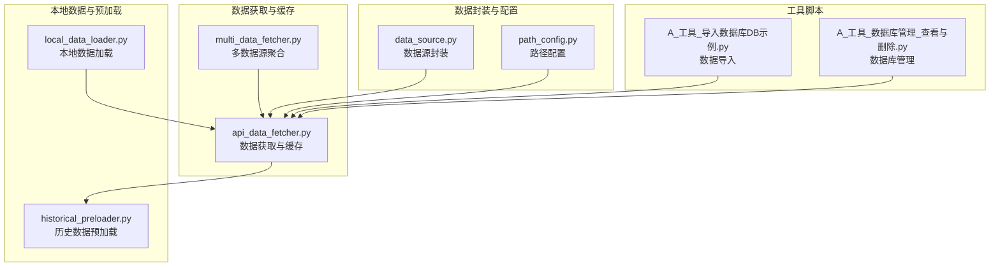
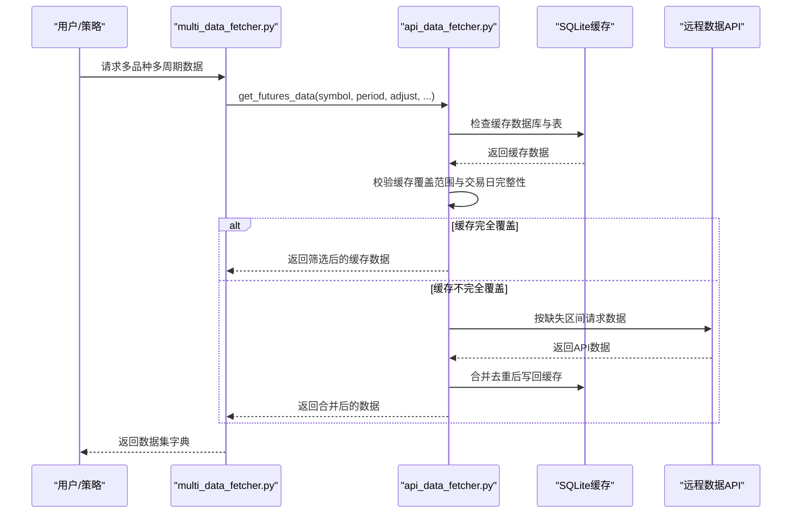
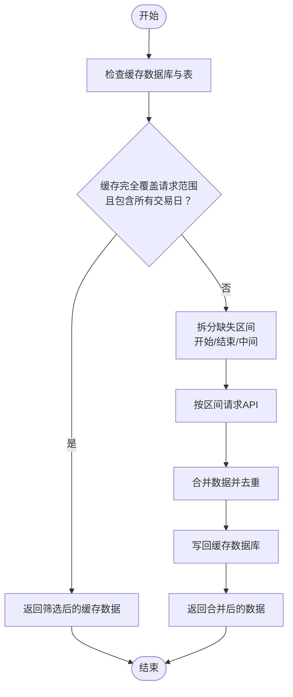
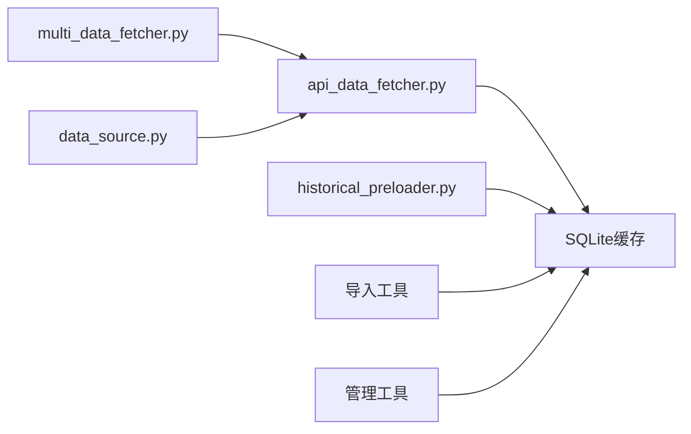

# 数据存储与缓存

<cite>
**本文引用的文件**
- [README.md](file://README.md)
- [ssquant/data/api_data_fetcher.py](file://ssquant/data/api_data_fetcher.py)
- [ssquant/data/local_data_loader.py](file://ssquant/data/local_data_loader.py)
- [ssquant/data/historical_preloader.py](file://ssquant/data/historical_preloader.py)
- [ssquant/data/multi_data_fetcher.py](file://ssquant/data/multi_data_fetcher.py)
- [ssquant/data/data_source.py](file://ssquant/data/data_source.py)
- [ssquant/config/path_config.py](file://ssquant/config/path_config.py)
- [examples/A_工具_导入数据库DB示例.py](file://examples/A_工具_导入数据库DB示例.py)
- [examples/A_工具_数据库管理_查看与删除.py](file://examples/A_工具_数据库管理_查看与删除.py)
</cite>

## 目录
1. [简介](#简介)
2. [项目结构](#项目结构)
3. [核心组件](#核心组件)
4. [架构概览](#架构概览)
5. [详细组件分析](#详细组件分析)
6. [依赖关系分析](#依赖关系分析)
7. [性能考量](#性能考量)
8. [故障排查指南](#故障排查指南)
9. [结论](#结论)
10. [附录](#附录)

## 简介
本文件面向SSQuant数据存储与缓存系统，围绕SQLite数据库的使用方式、表结构设计与数据存储策略展开；详细说明缓存机制的实现原理、缓存文件管理与更新策略；阐述数据去重、索引优化与查询性能提升方法；包含缓存失效机制、数据同步与一致性保证；提供数据备份、恢复与迁移方案；解释缓存配置参数、存储空间管理与性能调优建议。内容基于仓库中实际代码文件进行分析与总结，确保技术细节与实现逻辑准确可追溯。

## 项目结构
SSQuant的数据层主要由以下模块构成：
- 数据获取与缓存：负责从API获取数据、缓存到SQLite、按需合并与去重
- 本地数据加载：支持CSV/HDF5/7z/SQLite等多种格式的本地数据加载
- 历史数据预加载：在实盘/SIMNOW模式启动时按K线数量预加载历史数据
- 多数据源聚合：批量获取多品种多周期数据并汇总
- 数据源封装：为策略引擎提供统一的数据访问与交易接口
- 路径配置：统一管理项目中的路径配置
- 工具脚本：提供数据库导入、查看与删除等实用工具

**图表来源**
- [ssquant/data/api_data_fetcher.py](file://ssquant/data/api_data_fetcher.py#L171-L626)
- [ssquant/data/multi_data_fetcher.py](file://ssquant/data/multi_data_fetcher.py#L1-L139)
- [ssquant/data/local_data_loader.py](file://ssquant/data/local_data_loader.py#L1-L233)
- [ssquant/data/historical_preloader.py](file://ssquant/data/historical_preloader.py#L1-L339)
- [ssquant/data/data_source.py](file://ssquant/data/data_source.py#L1-L922)
- [ssquant/config/path_config.py](file://ssquant/config/path_config.py#L1-L30)
- [examples/A_工具_导入数据库DB示例.py](file://examples/A_工具_导入数据库DB示例.py#L1-L776)
- [examples/A_工具_数据库管理_查看与删除.py](file://examples/A_工具_数据库管理_查看与删除.py#L1-L638)

**章节来源**
- [README.md](file://README.md#L297-L321)

## 核心组件
- 数据获取与缓存（api_data_fetcher.py）
  - 提供从远程API获取期货数据的统一入口，支持K线与TICK数据
  - 实现缓存数据库（SQLite）的读取、合并、去重与更新
  - 基于交易日历进行日期范围修正，确保请求落在交易日
  - 支持按需扩展请求范围以满足API最小数据窗口要求
- 本地数据加载（local_data_loader.py）
  - 支持CSV/HDF5/7z/SQLite等多种格式
  - 对TICK与K线数据进行字段校验与格式统一
  - 提供日期范围筛选与合并逻辑
- 历史数据预加载（historical_preloader.py）
  - 在实盘/SIMNOW模式启动时按K线数量预加载历史数据
  - 支持TICK与K线数据的预加载，自动推导表名
  - 提供可用数据检查与统计信息
- 多数据源聚合（multi_data_fetcher.py）
  - 批量获取多品种多周期数据
  - 统一配置与数据汇总，便于后续分析与导出
- 数据源封装（data_source.py）
  - 为策略引擎提供统一的数据访问接口
  - 支持订单类型、价格获取、待执行订单处理等交易功能
- 路径配置（path_config.py）
  - 统一管理项目路径，避免硬编码
- 工具脚本
  - 数据导入：支持多种格式导入SQLite数据库，统一字段与表名
  - 数据库管理：查看表、字段、执行SQL、删除/清空表等

**章节来源**
- [ssquant/data/api_data_fetcher.py](file://ssquant/data/api_data_fetcher.py#L171-L626)
- [ssquant/data/local_data_loader.py](file://ssquant/data/local_data_loader.py#L1-L233)
- [ssquant/data/historical_preloader.py](file://ssquant/data/historical_preloader.py#L1-L339)
- [ssquant/data/multi_data_fetcher.py](file://ssquant/data/multi_data_fetcher.py#L1-L139)
- [ssquant/data/data_source.py](file://ssquant/data/data_source.py#L1-L922)
- [ssquant/config/path_config.py](file://ssquant/config/path_config.py#L1-L30)
- [examples/A_工具_导入数据库DB示例.py](file://examples/A_工具_导入数据库DB示例.py#L1-L776)
- [examples/A_工具_数据库管理_查看与删除.py](file://examples/A_工具_数据库管理_查看与删除.py#L1-L638)

## 架构概览
SSQuant的数据架构以SQLite为核心存储，结合本地文件与远程API，形成“本地缓存 + 远程补全”的混合数据体系。整体流程如下：

**图表来源**
- [ssquant/data/multi_data_fetcher.py](file://ssquant/data/multi_data_fetcher.py#L4-L76)
- [ssquant/data/api_data_fetcher.py](file://ssquant/data/api_data_fetcher.py#L171-L626)

## 详细组件分析

### 数据获取与缓存（api_data_fetcher.py）
- 缓存策略
  - 缓存数据库路径：data_cache/backtest_data.db
  - 表命名规范：K线表为{symbol}_{period}_{adjust}，TICK表为{symbol}_tick
  - 缓存命中：若缓存数据完全覆盖请求范围且包含所有交易日，则直接返回
  - 缓存缺失：按开始/结束/中间缺失区间分别请求API，合并后去重并写回缓存
- 交易日历
  - 支持akshare获取交易日历，具备缓存与更新控制
  - 若akshare不可用，退化为基本规则（周一至周五）
- API请求与重试
  - 支持超时与重试机制，处理500等服务器错误
  - 对单日请求自动扩展至下一个交易日以满足API最小窗口
- 数据一致性
  - 统一时区转换与datetime格式，避免重复与空值影响
  - 合并后按datetime去重并排序

**图表来源**
- [ssquant/data/api_data_fetcher.py](file://ssquant/data/api_data_fetcher.py#L305-L574)

**章节来源**
- [ssquant/data/api_data_fetcher.py](file://ssquant/data/api_data_fetcher.py#L171-L626)

### 本地数据加载（local_data_loader.py）
- 支持格式：CSV、HDF5、7z、SQLite
- 字段校验：TICK数据要求datetime与价格字段，K线数据要求OHLC字段
- SQLite表推导：支持显式表名或按{symbol}_{period}_{adjust}推导
- 合并与筛选：支持文件列表合并、日期范围筛选、索引设置

**章节来源**
- [ssquant/data/local_data_loader.py](file://ssquant/data/local_data_loader.py#L1-L233)

### 历史数据预加载（historical_preloader.py）
- 预加载策略：按K线数量（lookback_bars）或TICK数量（lookback_count）加载
- 表名推导：TICK表{symbol}_tick；K线表{symbol}_{period}_{adjust}
- 错误处理：表不存在时给出提示与可用表清单
- 数据检查：提供可用数据检查接口，返回表存在性、记录数与日期范围

**章节来源**
- [ssquant/data/historical_preloader.py](file://ssquant/data/historical_preloader.py#L1-L339)

### 多数据源聚合（multi_data_fetcher.py）
- 批量获取：支持多品种多周期配置，统一返回数据集字典
- 配置管理：支持每品种独立配置（日期范围、用户名密码、缓存开关等）
- 摘要与导出：提供数据摘要与CSV导出功能

**章节来源**
- [ssquant/data/multi_data_fetcher.py](file://ssquant/data/multi_data_fetcher.py#L1-L139)

### 数据源封装（data_source.py）
- 数据访问：提供get_close/get_open/get_high/get_low等序列访问
- 交易接口：支持多订单类型（市价/限价/下一K线开盘/收盘/高低）与待执行订单队列
- 持仓管理：支持目标持仓与实际持仓更新，记录交易明细

**章节来源**
- [ssquant/data/data_source.py](file://ssquant/data/data_source.py#L1-L922)

### 路径配置（path_config.py）
- 统一路径：项目根目录、数据缓存目录、回测结果与日志目录
- 避免硬编码：集中管理路径，便于部署与迁移

**章节来源**
- [ssquant/config/path_config.py](file://ssquant/config/path_config.py#L1-L30)

### 工具脚本
- 数据导入（A_工具_导入数据库DB示例.py）
  - 支持CSV/Excel/JSON/Parquet/Feather/Pickle导入
  - 统一字段映射与顺序，自动创建表并写入SQLite
  - 提供批量导入与示例数据生成
- 数据库管理（A_工具_数据库管理_查看与删除.py）
  - 查看表列表、字段信息、执行SQL
  - 删除/清空表，按品种批量删除

**章节来源**
- [examples/A_工具_导入数据库DB示例.py](file://examples/A_工具_导入数据库DB示例.py#L1-L776)
- [examples/A_工具_数据库管理_查看与删除.py](file://examples/A_工具_数据库管理_查看与删除.py#L1-L638)

## 依赖关系分析
- 模块耦合
  - multi_data_fetcher依赖api_data_fetcher进行数据获取
  - api_data_fetcher依赖SQLite进行缓存读写
  - data_source依赖api_data_fetcher提供的数据
  - historical_preloader依赖SQLite进行历史数据读取
- 外部依赖
  - requests：远程API通信
  - pandas：数据处理与SQL读写
  - sqlite3：本地缓存数据库
  - 可选：akshare（交易日历）、py7zr（7z解压）

**图表来源**
- [ssquant/data/multi_data_fetcher.py](file://ssquant/data/multi_data_fetcher.py#L1-L139)
- [ssquant/data/api_data_fetcher.py](file://ssquant/data/api_data_fetcher.py#L1-L1031)
- [ssquant/data/historical_preloader.py](file://ssquant/data/historical_preloader.py#L1-L339)
- [examples/A_工具_导入数据库DB示例.py](file://examples/A_工具_导入数据库DB示例.py#L1-L776)
- [examples/A_工具_数据库管理_查看与删除.py](file://examples/A_工具_数据库管理_查看与删除.py#L1-L638)

**章节来源**
- [ssquant/data/multi_data_fetcher.py](file://ssquant/data/multi_data_fetcher.py#L1-L139)
- [ssquant/data/api_data_fetcher.py](file://ssquant/data/api_data_fetcher.py#L1-L1031)
- [ssquant/data/historical_preloader.py](file://ssquant/data/historical_preloader.py#L1-L339)

## 性能考量
- 缓存命中率
  - 通过交易日历与缓存覆盖判断，尽量减少API请求次数
  - 对缺失区间按连续区间合并请求，降低API调用频次
- 去重与排序
  - 合并后按datetime去重并排序，避免重复与无序数据影响查询性能
- 数据格式选择
  - SQLite适合中小规模数据与快速查询；大规模数据可考虑HDF5/Parquet等列式存储
- 索引优化
  - 建议在datetime列建立索引以加速范围查询（可通过工具脚本执行SQL实现）
- I/O优化
  - 批量写入与合并操作减少磁盘I/O
  - 合理设置缓存目录与权限，避免跨盘符拷贝

[本节为通用性能指导，不直接分析具体文件]

## 故障排查指南
- 缓存数据库不存在或表不存在
  - 检查缓存数据库路径与表名是否符合规范
  - 使用数据库管理工具查看可用表与字段
- 缓存数据为空或无效
  - 检查datetime列是否有效，确认时区转换与去重逻辑
  - 重新从API获取并写回缓存
- API请求失败
  - 检查用户名/密码与网络连接
  - 关注状态码与错误信息，必要时扩大请求范围
- 本地数据加载异常
  - 确认文件格式与字段名称，使用导入工具进行标准化处理
- 预加载失败
  - 检查具体合约与周期对应的表是否存在
  - 确认复权类型与表名后缀一致

**章节来源**
- [ssquant/data/api_data_fetcher.py](file://ssquant/data/api_data_fetcher.py#L203-L264)
- [ssquant/data/historical_preloader.py](file://ssquant/data/historical_preloader.py#L67-L91)
- [examples/A_工具_数据库管理_查看与删除.py](file://examples/A_工具_数据库管理_查看与删除.py#L332-L472)

## 结论
SSQuant通过SQLite本地缓存与远程API补全相结合的方式，实现了高效、可靠的数据获取与存储体系。其核心优势在于：
- 明确的表命名规范与字段校验，确保数据质量
- 基于交易日历的日期范围修正与缓存覆盖判断，提升数据一致性
- 按区间合并缺失数据的策略，兼顾性能与完整性
- 完善的工具链（导入、查看、删除、SQL执行），便于运维与调试

建议在生产环境中：
- 合理规划缓存目录与权限
- 定期清理过期表与冗余数据
- 对关键查询建立索引
- 结合业务场景选择合适的数据格式与存储策略

[本节为总结性内容，不直接分析具体文件]

## 附录

### 缓存配置参数
- 缓存目录：data_cache（可通过配置参数覆盖）
- 缓存数据库：data_cache/backtest_data.db
- 缓存开关：use_cache（默认启用）
- 保存策略：save_data（控制是否写回缓存）
- 更新频率：交易日历缓存的更新周期（天）

**章节来源**
- [ssquant/data/api_data_fetcher.py](file://ssquant/data/api_data_fetcher.py#L171-L183)
- [ssquant/data/multi_data_fetcher.py](file://ssquant/data/multi_data_fetcher.py#L25-L58)
- [ssquant/config/path_config.py](file://ssquant/config/path_config.py#L20-L22)

### 数据备份、恢复与迁移
- 备份
  - 直接复制data_cache/backtest_data.db文件
  - 使用数据库管理工具导出特定表或执行SQL备份
- 恢复
  - 将备份文件放置到原路径，重启应用后自动加载
  - 使用导入工具将外部数据重新写入对应表
- 迁移
  - 在新环境创建data_cache目录
  - 复制数据库文件或使用导入工具批量导入

**章节来源**
- [examples/A_工具_数据库管理_查看与删除.py](file://examples/A_工具_数据库管理_查看与删除.py#L303-L330)
- [examples/A_工具_导入数据库DB示例.py](file://examples/A_工具_导入数据库DB示例.py#L414-L427)

### 表结构设计与字段规范
- TICK表：{symbol}_tick
  - 字段：datetime、LastPrice、BidPrice1、AskPrice1、Volume等（与CTP原始字段保持一致）
- K线表：{symbol}_{period}_{adjust}
  - 字段：datetime、open、high、low、close、volume等（可选amount、open_interest等）
  - period取值：1m、5m、15m、30m、1h、4h、D、W、M
  - adjust取值：hfq（后复权）、raw（不复权）

**章节来源**
- [examples/A_工具_导入数据库DB示例.py](file://examples/A_工具_导入数据库DB示例.py#L22-L77)
- [ssquant/data/historical_preloader.py](file://ssquant/data/historical_preloader.py#L50-L56)