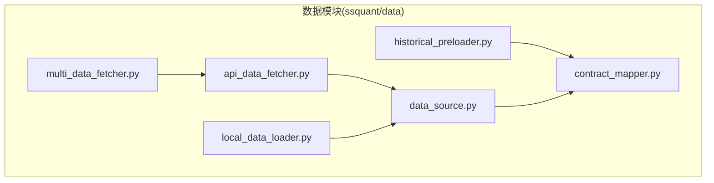
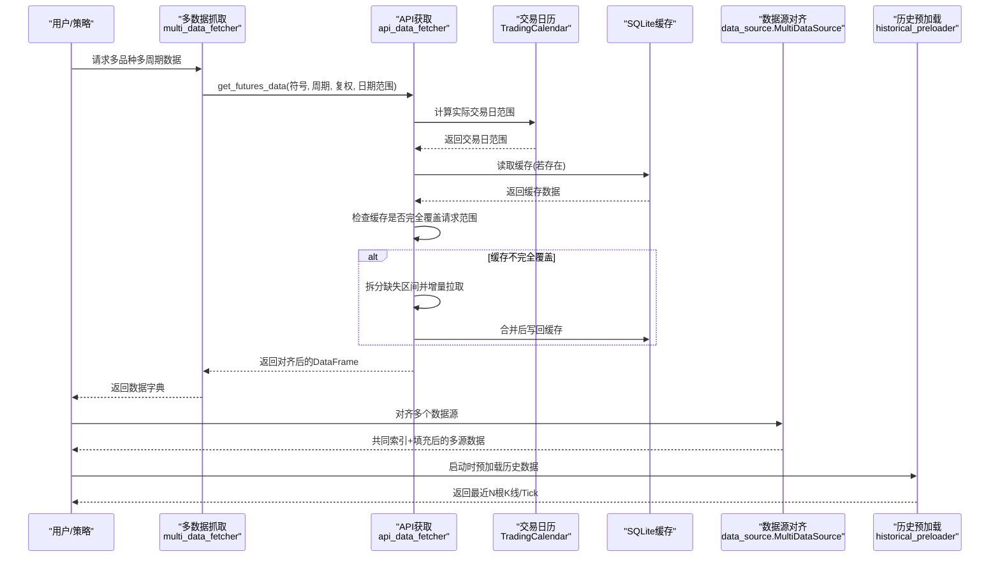
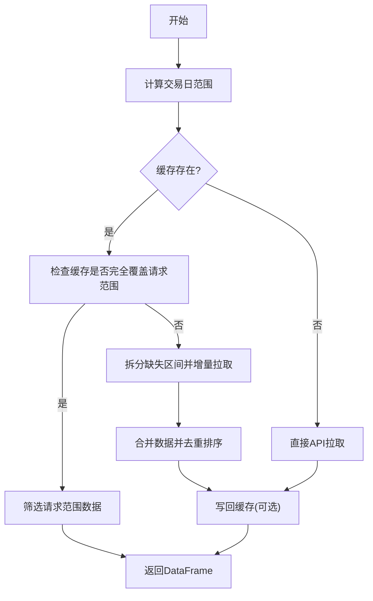
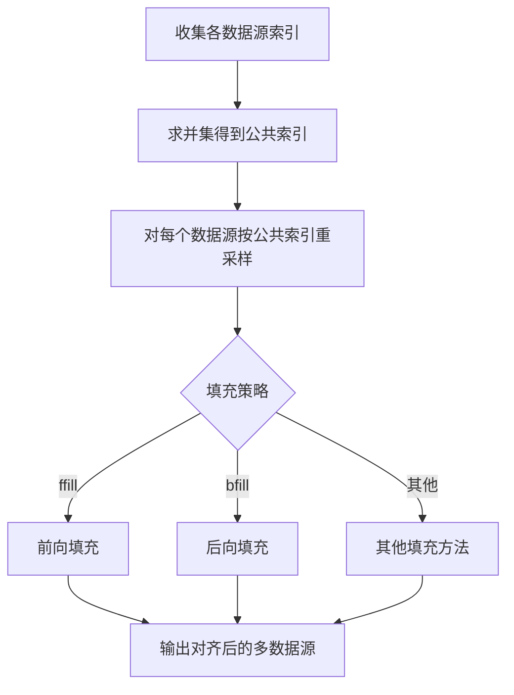
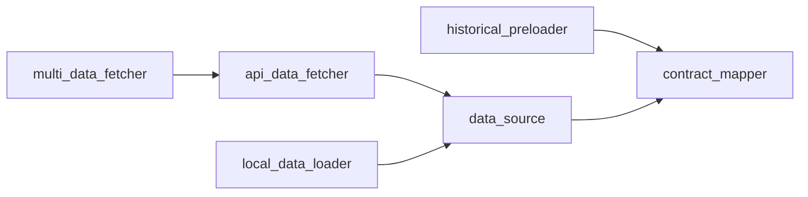

# 数据对齐与处理

<cite>
**本文引用的文件**
- [ssquant/data/__init__.py](file://ssquant/data/__init__.py)
- [ssquant/data/api_data_fetcher.py](file://ssquant/data/api_data_fetcher.py)
- [ssquant/data/multi_data_fetcher.py](file://ssquant/data/multi_data_fetcher.py)
- [ssquant/data/local_data_loader.py](file://ssquant/data/local_data_loader.py)
- [ssquant/data/historical_preloader.py](file://ssquant/data/historical_preloader.py)
- [ssquant/data/data_source.py](file://ssquant/data/data_source.py)
- [ssquant/data/contract_mapper.py](file://ssquant/data/contract_mapper.py)
- [examples/B_多品种多周期交易策略.py](file://examples/B_多品种多周期交易策略.py)
- [examples/B_多品种多周期交易策略_参数优化.py](file://examples/B_多品种多周期交易策略_参数优化.py)
</cite>

## 目录
1. [简介](#简介)
2. [项目结构](#项目结构)
3. [核心组件](#核心组件)
4. [架构总览](#架构总览)
5. [详细组件分析](#详细组件分析)
6. [依赖关系分析](#依赖关系分析)
7. [性能考量](#性能考量)
8. [故障排查指南](#故障排查指南)
9. [结论](#结论)
10. [附录](#附录)

## 简介
本技术文档围绕 SSQuant 的“数据对齐与处理”子系统，系统化阐述多周期数据对齐、时间戳对齐与数据填充策略、缺失数据检测与补全、数据格式标准化与字段映射、类型转换机制、数据质量检查与异常值处理、多品种数据对齐与跨市场整合、时区转换、以及性能优化与内存管理。文档面向策略开发者与数据工程师，既提供高层概览，也给出代码级图示与定位来源，便于快速定位实现细节。

## 项目结构
数据模块位于 ssquant/data 目录，包含以下关键文件：
- api_data_fetcher.py：API 数据获取、缓存、交易日历、时区转换、K线周期与复权处理
- multi_data_fetcher.py：多品种多周期批量数据抓取、汇总与导出
- local_data_loader.py：本地 CSV/HDF5/7z/SQLite 文件加载与字段校验
- historical_preloader.py：历史数据预加载器（实盘/SIMNOW 启动时使用）
- data_source.py：单数据源与多数据源管理，提供对齐与填充能力
- contract_mapper.py：主连合约与具体合约映射

**图示来源**
- [ssquant/data/__init__.py](file://ssquant/data/__init__.py#L44-L84)
- [ssquant/data/api_data_fetcher.py](file://ssquant/data/api_data_fetcher.py#L1-L1031)
- [ssquant/data/multi_data_fetcher.py](file://ssquant/data/multi_data_fetcher.py#L1-L139)
- [ssquant/data/local_data_loader.py](file://ssquant/data/local_data_loader.py#L1-L233)
- [ssquant/data/historical_preloader.py](file://ssquant/data/historical_preloader.py#L1-L339)
- [ssquant/data/data_source.py](file://ssquant/data/data_source.py#L1-L922)
- [ssquant/data/contract_mapper.py](file://ssquant/data/contract_mapper.py#L1-L133)

**章节来源**
- [ssquant/data/__init__.py](file://ssquant/data/__init__.py#L1-L84)

## 核心组件
- API 数据获取与缓存：支持多周期、复权、交易日过滤、时区转换、缓存命中与缺失部分增量拉取
- 多数据源对齐与填充：基于公共索引对齐，支持前向/后向填充
- 本地数据加载与格式标准化：自动字段校验、日期解析、索引规范化
- 历史数据预加载：按 K 线根数或 Tick 数加载，保证实盘/模拟启动性能
- 合约映射：主连与具体合约符号推导，支撑跨市场数据整合

**章节来源**
- [ssquant/data/api_data_fetcher.py](file://ssquant/data/api_data_fetcher.py#L171-L626)
- [ssquant/data/multi_data_fetcher.py](file://ssquant/data/multi_data_fetcher.py#L4-L76)
- [ssquant/data/local_data_loader.py](file://ssquant/data/local_data_loader.py#L5-L174)
- [ssquant/data/historical_preloader.py](file://ssquant/data/historical_preloader.py#L11-L133)
- [ssquant/data/data_source.py](file://ssquant/data/data_source.py#L884-L922)
- [ssquant/data/contract_mapper.py](file://ssquant/data/contract_mapper.py#L66-L94)

## 架构总览
下图展示了从数据抓取、缓存、对齐到策略使用的端到端流程。

**图示来源**
- [ssquant/data/multi_data_fetcher.py](file://ssquant/data/multi_data_fetcher.py#L4-L76)
- [ssquant/data/api_data_fetcher.py](file://ssquant/data/api_data_fetcher.py#L171-L626)
- [ssquant/data/data_source.py](file://ssquant/data/data_source.py#L884-L922)
- [ssquant/data/historical_preloader.py](file://ssquant/data/historical_preloader.py#L23-L133)

## 详细组件分析

### 组件A：API 数据获取与缓存（多周期、复权、交易日过滤、时区转换）
- 功能要点
  - 交易日历：支持缓存与回退规则；提供交易日判断与交易日范围计算
  - K线周期与复权：支持分钟、小时、日、周、月；后复权/不复权
  - 时间戳处理：统一转换为北京时间，分钟/小时周期将时间向前回拨以对齐开盘
  - 缓存策略：SQLite 存储，按符号+周期+复权命名表；支持缓存完全覆盖、缺失部分增量拉取、去重与排序
  - 错误处理：认证失败、服务器内部错误、超时重试、单日请求扩展
- 关键流程
  - 日期范围修正：将请求范围映射到实际交易日
  - 缓存命中：检查时间范围与交易日完整性，决定是否增量拉取
  - 数据合并：去重、排序、索引设置
  - 输出：统一索引（datetime）、无时区

**图示来源**
- [ssquant/data/api_data_fetcher.py](file://ssquant/data/api_data_fetcher.py#L290-L598)

**章节来源**
- [ssquant/data/api_data_fetcher.py](file://ssquant/data/api_data_fetcher.py#L18-L169)
- [ssquant/data/api_data_fetcher.py](file://ssquant/data/api_data_fetcher.py#L171-L626)

### 组件B：多数据抓取与汇总
- 功能要点
  - 批量抓取：支持多符号+多周期+多复权组合
  - 配置管理：每符号可独立配置日期范围、认证、缓存策略
  - 摘要统计：记录各数据集记录数、时间范围、价格统计
  - 导出：批量导出为CSV
- 使用场景
  - 多品种多周期策略回测前的数据准备
  - 参数优化前的预加载与复用

**章节来源**
- [ssquant/data/multi_data_fetcher.py](file://ssquant/data/multi_data_fetcher.py#L4-L139)

### 组件C：本地数据加载与格式标准化
- 功能要点
  - 支持格式：CSV、HDF5、7z、SQLite
  - 字段校验：K线必须字段（datetime/open/high/low/close）；Tick 必须字段（datetime/price/volume 或 BidPrice1/AskPrice1）
  - 日期筛选：按 start_date/end_date 过滤
  - 索引规范：统一转换为 datetime 索引
- 适用场景
  - 本地历史数据导入、跨市场数据整合、离线数据清洗

**章节来源**
- [ssquant/data/local_data_loader.py](file://ssquant/data/local_data_loader.py#L5-L174)
- [ssquant/data/local_data_loader.py](file://ssquant/data/local_data_loader.py#L176-L233)

### 组件D：历史数据预加载（实盘/SIMNOW）
- 功能要点
  - 按 K 线根数或 Tick 数加载最近数据
  - 表名规则：主连符号+周期+复权后缀（TICK 无复权）
  - 可视化检查：可用数据查询、表存在性、数据量与日期范围
- 性能意义
  - 避免启动时重复拉取，提升实盘/模拟启动速度

**章节来源**
- [ssquant/data/historical_preloader.py](file://ssquant/data/historical_preloader.py#L11-L133)
- [ssquant/data/historical_preloader.py](file://ssquant/data/historical_preloader.py#L134-L240)
- [ssquant/data/historical_preloader.py](file://ssquant/data/historical_preloader.py#L242-L309)

### 组件E：数据源对齐与填充（多数据源）
- 功能要点
  - 共同索引：收集所有数据源索引并求并集
  - 重新索引：按公共索引对齐
  - 填充策略：支持前向填充（ffill）、后向填充（bfill）或自定义填充方法
- 适用场景
  - 多周期、多品种策略中消除时间戳不一致导致的信号错配

**图示来源**
- [ssquant/data/data_source.py](file://ssquant/data/data_source.py#L884-L922)

**章节来源**
- [ssquant/data/data_source.py](file://ssquant/data/data_source.py#L884-L922)

### 组件F：合约映射（主连与具体合约）
- 功能要点
  - 提取品种代码（字母部分）
  - 判断是否主连（常用后缀：888/777/000）
  - 推导主连符号：品种代码+888
- 适用场景
  - 跨市场数据整合、主连连续回测、表名推导

**章节来源**
- [ssquant/data/contract_mapper.py](file://ssquant/data/contract_mapper.py#L10-L133)

## 依赖关系分析
- 模块内聚与耦合
  - api_data_fetcher 与 data_source：前者负责数据获取与缓存，后者负责多源对齐与填充
  - multi_data_fetcher 依赖 api_data_fetcher；local_data_loader 与 data_source 解耦，可独立使用
  - historical_preloader 依赖 contract_mapper 进行符号推导
- 外部依赖
  - pandas、sqlite3、requests（API 调用）、akshare（交易日历可选）

**图示来源**
- [ssquant/data/api_data_fetcher.py](file://ssquant/data/api_data_fetcher.py#L1-L1031)
- [ssquant/data/multi_data_fetcher.py](file://ssquant/data/multi_data_fetcher.py#L1-L139)
- [ssquant/data/local_data_loader.py](file://ssquant/data/local_data_loader.py#L1-L233)
- [ssquant/data/data_source.py](file://ssquant/data/data_source.py#L1-L922)
- [ssquant/data/historical_preloader.py](file://ssquant/data/historical_preloader.py#L1-L339)
- [ssquant/data/contract_mapper.py](file://ssquant/data/contract_mapper.py#L1-L133)

**章节来源**
- [ssquant/data/__init__.py](file://ssquant/data/__init__.py#L44-L84)

## 性能考量
- 缓存与增量拉取
  - 通过 SQLite 缓存历史数据，按交易日完整性判断是否需要增量拉取，减少网络请求
- 对齐与填充
  - 对齐前尽量使用较短周期数据，避免过度稀疏导致的内存膨胀
  - 填充策略选择 ffill/bfill 以降低插值复杂度
- 批处理与并行
  - 多数据抓取支持批量配置，配合参数优化时可预加载数据，避免重复 IO
  - Windows 上并行进程数受限，建议控制 n_jobs
- 内存管理
  - 本地数据加载支持列表合并后统一筛选，减少中间对象
  - 历史预加载按根数/条数限制，避免一次性加载过多

**章节来源**
- [ssquant/data/multi_data_fetcher.py](file://ssquant/data/multi_data_fetcher.py#L4-L76)
- [examples/B_多品种多周期交易策略_参数优化.py](file://examples/B_多品种多周期交易策略_参数优化.py#L18-L155)

## 故障排查指南
- 认证与权限
  - API 返回 401/402/405/406：检查用户名/密码、账号状态
- 交易日与日期范围
  - 若请求日期范围内无交易日：确认 start_date/end_date 是否落在交易日历内
- 缓存问题
  - 缓存为空或无效：清理缓存后重试；检查时区一致性与索引有效性
- 数据缺失与对齐
  - 多周期对齐后出现 NaN：检查 fill_method 与数据稀疏程度；必要时调整周期或增加数据源
- 本地数据格式
  - 字段缺失：确保 K 线具备 datetime/open/high/low/close；Tick 具备 datetime/price/volume 或 BidPrice1/AskPrice1

**章节来源**
- [ssquant/data/api_data_fetcher.py](file://ssquant/data/api_data_fetcher.py#L757-L793)
- [ssquant/data/local_data_loader.py](file://ssquant/data/local_data_loader.py#L144-L164)

## 结论
SSQuant 的数据对齐与处理体系以“交易日约束 + 缓存 + 对齐填充 + 格式标准化”为核心，既能满足多周期、多品种策略的高精度对齐需求，又兼顾实盘/模拟启动性能与跨市场数据整合。通过合理的缓存策略、填充方法与批处理设计，系统在准确性与效率之间取得良好平衡。建议在策略开发中结合历史预加载与多数据源对齐，以获得稳定可靠的回测与实盘体验。

## 附录
- 示例策略参考
  - 多品种多周期策略：展示多数据源使用与信号生成
  - 参数优化示例：演示预加载与并行优化流程

**章节来源**
- [examples/B_多品种多周期交易策略.py](file://examples/B_多品种多周期交易策略.py#L1-L200)
- [examples/B_多品种多周期交易策略_参数优化.py](file://examples/B_多品种多周期交易策略_参数优化.py#L1-L155)