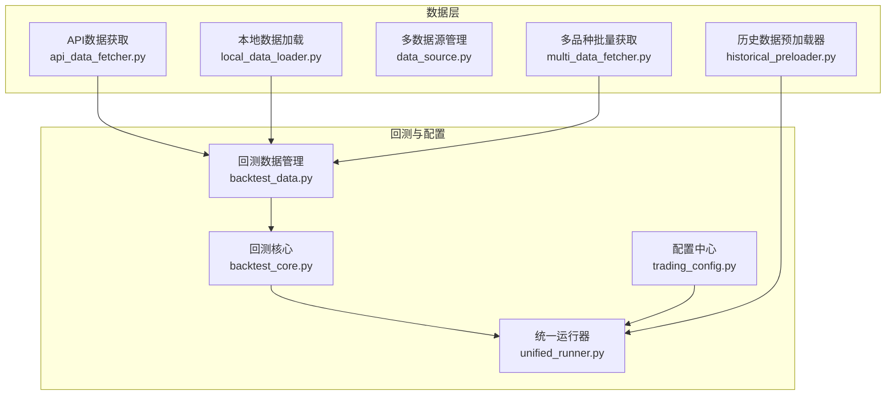
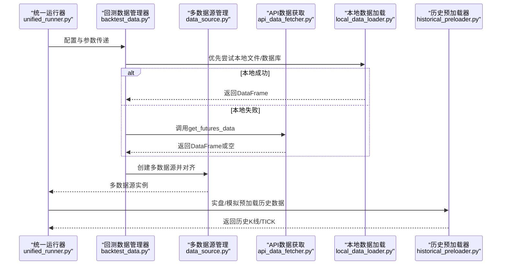
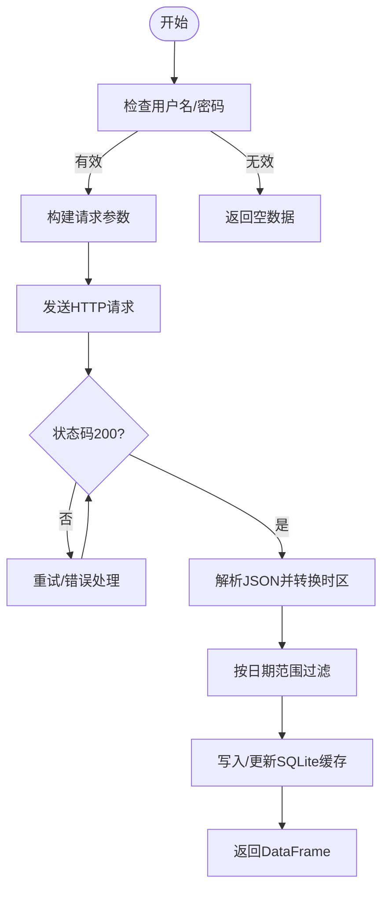
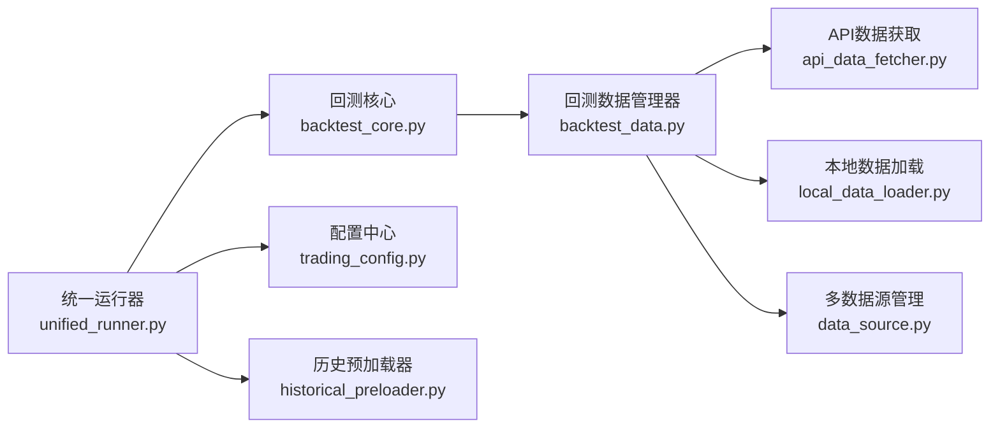

# 数据源类型与配置

<cite>
**本文引用的文件**
- [data_source.py](file://ssquant/data/data_source.py)
- [api_data_fetcher.py](file://ssquant/data/api_data_fetcher.py)
- [local_data_loader.py](file://ssquant/data/local_data_loader.py)
- [multi_data_fetcher.py](file://ssquant/data/multi_data_fetcher.py)
- [backtest_data.py](file://ssquant/backtest/backtest_data.py)
- [backtest_core.py](file://ssquant/backtest/backtest_core.py)
- [historical_preloader.py](file://ssquant/data/historical_preloader.py)
- [trading_config.py](file://ssquant/config/trading_config.py)
- [unified_runner.py](file://ssquant/backtest/unified_runner.py)
- [README.md](file://README.md)
</cite>

## 目录
1. [简介](#简介)
2. [项目结构](#项目结构)
3. [核心组件](#核心组件)
4. [架构总览](#架构总览)
5. [详细组件分析](#详细组件分析)
6. [依赖关系分析](#依赖关系分析)
7. [性能考量](#性能考量)
8. [故障排查指南](#故障排查指南)
9. [结论](#结论)
10. [附录](#附录)

## 简介
本章节面向SSQuant的数据层与配置体系，系统性梳理项目支持的数据源类型（API数据源、本地数据库/文件、TICK数据）、认证与连接管理、多数据源配置策略、优先级与故障转移、扩展接口与自定义开发指南，以及性能优化与监控建议。文档兼顾技术深度与可读性，帮助读者快速掌握数据源的配置与使用。

## 项目结构
围绕数据源与配置的关键模块如下：
- 数据获取与管理
  - API数据获取：[api_data_fetcher.py](file://ssquant/data/api_data_fetcher.py)
  - 本地数据加载：[local_data_loader.py](file://ssquant/data/local_data_loader.py)
  - 多数据源管理：[data_source.py](file://ssquant/data/data_source.py)
  - 多品种批量获取：[multi_data_fetcher.py](file://ssquant/data/multi_data_fetcher.py)
- 回测与配置集成
  - 回测数据管理：[backtest_data.py](file://ssquant/backtest/backtest_data.py)
  - 回测核心：[backtest_core.py](file://ssquant/backtest/backtest_core.py)
  - 统一运行器（模式切换）：[unified_runner.py](file://ssquant/backtest/unified_runner.py)
  - 配置中心：[trading_config.py](file://ssquant/config/trading_config.py)
- 实盘/模拟数据预加载
  - 历史数据预加载器：[historical_preloader.py](file://ssquant/data/historical_preloader.py)

图表来源
- [api_data_fetcher.py](file://ssquant/data/api_data_fetcher.py#L1-L1031)
- [local_data_loader.py](file://ssquant/data/local_data_loader.py#L1-L233)
- [data_source.py](file://ssquant/data/data_source.py#L1-L922)
- [multi_data_fetcher.py](file://ssquant/data/multi_data_fetcher.py#L1-L139)
- [backtest_data.py](file://ssquant/backtest/backtest_data.py#L1-L246)
- [backtest_core.py](file://ssquant/backtest/backtest_core.py#L1-L579)
- [unified_runner.py](file://ssquant/backtest/unified_runner.py#L1-L379)
- [historical_preloader.py](file://ssquant/data/historical_preloader.py#L1-L339)
- [trading_config.py](file://ssquant/config/trading_config.py#L1-L187)

章节来源
- [README.md](file://README.md#L297-L321)

## 核心组件
- 数据源抽象与交易接口
  - 单数据源：[DataSource](file://ssquant/data/data_source.py#L6-L831)
  - 多数据源：[MultiDataSource](file://ssquant/data/data_source.py#L833-L922)
- API数据获取与缓存
  - 期货数据获取：[get_futures_data](file://ssquant/data/api_data_fetcher.py#L171-L626)
  - 交易日历与日期范围：[TradingCalendar](file://ssquant/data/api_data_fetcher.py#L18-L160)
  - API请求与重试：[fetch_data_from_api](file://ssquant/data/api_data_fetcher.py#L627-L800)
- 本地数据加载
  - 本地文件/数据库加载：[load_local_data](file://ssquant/data/local_data_loader.py#L5-L174)
- 多品种批量获取
  - 批量数据抓取：[fetch_multiple_data](file://ssquant/data/multi_data_fetcher.py#L4-L76)
- 回测数据管理
  - 数据获取与备选策略：[BacktestDataManager.fetch_data](file://ssquant/backtest/backtest_data.py#L32-L189)
  - 多数据源对齐与填充：[MultiSourceBacktester](file://ssquant/backtest/backtest_core.py#L14-L200)
- 配置中心
  - API认证与账户配置：[trading_config.py](file://ssquant/config/trading_config.py#L10-L187)
- 实盘/模拟预加载
  - 历史K线/TICK预加载：[HistoricalDataPreloader](file://ssquant/data/historical_preloader.py#L11-L200)

章节来源
- [data_source.py](file://ssquant/data/data_source.py#L6-L922)
- [api_data_fetcher.py](file://ssquant/data/api_data_fetcher.py#L18-L800)
- [local_data_loader.py](file://ssquant/data/local_data_loader.py#L5-L174)
- [multi_data_fetcher.py](file://ssquant/data/multi_data_fetcher.py#L4-L76)
- [backtest_data.py](file://ssquant/backtest/backtest_data.py#L32-L189)
- [backtest_core.py](file://ssquant/backtest/backtest_core.py#L14-L200)
- [trading_config.py](file://ssquant/config/trading_config.py#L10-L187)
- [historical_preloader.py](file://ssquant/data/historical_preloader.py#L11-L200)

## 架构总览
SSQuant的数据层采用“数据源抽象 + 多数据源管理 + 回测/实盘适配”的分层设计。回测阶段通过回测数据管理器统一调度API与本地数据，支持多品种多周期数据对齐；实盘/模拟阶段通过历史预加载器从本地数据库读取K线/TICK数据，保障低延迟与稳定性。

图表来源
- [unified_runner.py](file://ssquant/backtest/unified_runner.py#L1-L379)
- [backtest_data.py](file://ssquant/backtest/backtest_data.py#L32-L189)
- [data_source.py](file://ssquant/data/data_source.py#L833-L922)
- [api_data_fetcher.py](file://ssquant/data/api_data_fetcher.py#L171-L626)
- [local_data_loader.py](file://ssquant/data/local_data_loader.py#L5-L174)
- [historical_preloader.py](file://ssquant/data/historical_preloader.py#L23-L133)

## 详细组件分析

### 数据源类型与配置
- 支持的数据源类型
  - API数据源：通过HTTP接口获取K线/TICK数据，支持复权类型与交易日历校验。
  - 本地数据库/文件：支持CSV、HDF5、7z压缩包、SQLite数据库，自动字段校验与日期筛选。
  - TICK数据：仅支持本地数据库采集，不通过远程API提供。
- 配置要点
  - API认证：用户名/密码在配置中心集中管理，可通过运行器注入。
  - 本地数据：支持单文件与多文件合并加载，SQLite表名推导与显式指定。
  - 复权类型：'0'不复权，'1'后复权；TICK数据无复权概念。

章节来源
- [api_data_fetcher.py](file://ssquant/data/api_data_fetcher.py#L171-L626)
- [local_data_loader.py](file://ssquant/data/local_data_loader.py#L5-L174)
- [trading_config.py](file://ssquant/config/trading_config.py#L10-L187)

### API数据获取与认证
- 认证机制
  - 用户名/密码通过配置中心提供，回测/实盘均需有效凭证。
  - API端点固定，参数包含symbol、start_date、end_date、kline_period、adjust_type等。
- 参数配置
  - 周期支持分钟、小时、日、周、月；TICK数据仅本地数据库。
  - 复权类型与深度统计开关可选。
- 连接管理与重试
  - 超时控制与最大重试次数；对500内部错误与4xx认证错误分别处理。
  - 交易日历自动校验，避免非交易日请求。
- 缓存策略
  - SQLite缓存数据库按表名规则存储，支持完全覆盖与缺失部分增量补取。
  - 时区转换与重复数据去重，确保数据一致性。

图表来源
- [api_data_fetcher.py](file://ssquant/data/api_data_fetcher.py#L627-L800)
- [api_data_fetcher.py](file://ssquant/data/api_data_fetcher.py#L171-L626)

章节来源
- [api_data_fetcher.py](file://ssquant/data/api_data_fetcher.py#L18-L160)
- [api_data_fetcher.py](file://ssquant/data/api_data_fetcher.py#L627-L800)
- [trading_config.py](file://ssquant/config/trading_config.py#L167-L177)

### 本地数据加载与校验
- 支持格式与字段
  - CSV/HDF5/7z：K线必须字段datetime/open/high/low/close；TICK必须字段datetime/price/volume。
  - SQLite：表名推导规则与显式指定，自动查找匹配表。
- 加载流程
  - 单文件：读取后自动校验字段，转换datetime为索引，按日期范围筛选。
  - 多文件：依次加载并合并，最终统一筛选。
- 错误处理
  - 文件不存在、格式不支持、字段缺失、表不存在等均抛出明确错误信息，便于定位。

章节来源
- [local_data_loader.py](file://ssquant/data/local_data_loader.py#L5-L174)

### 多数据源配置策略与对齐
- 多数据源管理
  - 通过MultiDataSource统一管理多个DataSource实例，支持对齐与填充。
- 数据对齐与填充
  - 基于所有数据源索引的并集，重新索引并按策略填充缺失值（前向/后向填充）。
- 回测核心
  - MultiSourceBacktester在回测阶段负责数据获取、创建多数据源、对齐与填充。

章节来源
- [data_source.py](file://ssquant/data/data_source.py#L833-L922)
- [backtest_core.py](file://ssquant/backtest/backtest_core.py#L14-L200)

### 多品种批量获取与摘要
- 批量获取
  - 支持按品种与周期列表批量抓取，自动汇总并保存CSV。
- 摘要统计
  - 输出各数据集的基本统计信息，便于质量检查与对比。

章节来源
- [multi_data_fetcher.py](file://ssquant/data/multi_data_fetcher.py#L4-L76)
- [multi_data_fetcher.py](file://ssquant/data/multi_data_fetcher.py#L78-L139)

### 实盘/模拟数据预加载
- 历史K线预加载
  - 按回看K线数量加载，自动推导主连符号与表名，支持后复权/不复权。
- 历史TICK预加载
  - 专门针对TICK数据，按回看条数加载，表名规则与保存一致。
- 错误提示
  - 数据库不存在、表不存在、无数据等情况均有明确提示与建议。

章节来源
- [historical_preloader.py](file://ssquant/data/historical_preloader.py#L23-L133)
- [historical_preloader.py](file://ssquant/data/historical_preloader.py#L134-L200)

### 配置与运行模式
- 配置中心
  - API认证：统一用户名/密码。
  - 账户配置：SIMNOW与实盘账户参数集合，含服务器、AppID、授权码等。
  - 默认回测参数：初始资金、手续费、保证金率、合约乘数、复权类型、缓存策略等。
- 运行模式
  - 回测：支持单数据源与多数据源配置。
  - SIMNOW/实盘：支持单数据源与多数据源配置，含数据预加载与回调。

章节来源
- [trading_config.py](file://ssquant/config/trading_config.py#L10-L187)
- [unified_runner.py](file://ssquant/backtest/unified_runner.py#L19-L200)

## 依赖关系分析
- 模块耦合
  - 回测数据管理器依赖API与本地加载模块，统一调度数据获取。
  - 多数据源管理器依赖DataSource，提供对齐与填充能力。
  - 统一运行器根据模式选择回测或实盘路径。
- 外部依赖
  - API数据获取依赖HTTP请求与SQLite缓存。
  - 本地数据加载依赖pandas与SQLite/7z/HDF5等库。
- 循环依赖
  - 未发现循环导入；模块职责清晰，接口边界明确。

图表来源
- [unified_runner.py](file://ssquant/backtest/unified_runner.py#L1-L379)
- [backtest_core.py](file://ssquant/backtest/backtest_core.py#L1-L579)
- [backtest_data.py](file://ssquant/backtest/backtest_data.py#L1-L246)
- [api_data_fetcher.py](file://ssquant/data/api_data_fetcher.py#L1-L1031)
- [local_data_loader.py](file://ssquant/data/local_data_loader.py#L1-L233)
- [data_source.py](file://ssquant/data/data_source.py#L1-L922)
- [trading_config.py](file://ssquant/config/trading_config.py#L1-L187)
- [historical_preloader.py](file://ssquant/data/historical_preloader.py#L1-L339)

## 性能考量
- 数据获取
  - 启用缓存与增量补取，减少重复请求；对缺失交易日进行区间合并，降低API调用频次。
  - 交易日历校验避免无效请求，提升成功率。
- 数据存储
  - SQLite缓存按表名规则组织，支持高效查询与去重。
- 数据对齐
  - 对齐策略采用索引并集与填充，避免未来数据泄露；填充方法可选前向/后向填充。
- 实盘/模拟
  - 历史预加载器按K线数量加载，减少实时请求压力；TICK数据预加载确保低延迟。

章节来源
- [api_data_fetcher.py](file://ssquant/data/api_data_fetcher.py#L18-L160)
- [api_data_fetcher.py](file://ssquant/data/api_data_fetcher.py#L305-L574)
- [data_source.py](file://ssquant/data/data_source.py#L884-L922)
- [historical_preloader.py](file://ssquant/data/historical_preloader.py#L23-L133)

## 故障排查指南
- API认证失败
  - 检查用户名/密码是否正确；确认账户状态与权限。
  - 参考：[get_api_auth](file://ssquant/config/trading_config.py#L167-L177)
- 数据为空
  - 确认日期范围是否包含交易日；检查缓存是否覆盖完整范围。
  - 参考：[get_trading_date_range](file://ssquant/data/api_data_fetcher.py#L167-L169)
- 本地文件/数据库错误
  - 文件不存在、格式不支持、字段缺失、表不存在等，按提示修正。
  - 参考：[load_local_data](file://ssquant/data/local_data_loader.py#L5-L174)
- 多数据源对齐异常
  - 检查各数据源索引是否一致；确认填充策略与缺失值处理。
  - 参考：[MultiDataSource.align_data](file://ssquant/data/data_source.py#L884-L922)
- 实盘/模拟预加载失败
  - 数据库不存在或表不存在，按提示检查路径与表名。
  - 参考：[HistoricalDataPreloader.preload](file://ssquant/data/historical_preloader.py#L67-L92)

章节来源
- [trading_config.py](file://ssquant/config/trading_config.py#L167-L177)
- [api_data_fetcher.py](file://ssquant/data/api_data_fetcher.py#L167-L169)
- [local_data_loader.py](file://ssquant/data/local_data_loader.py#L5-L174)
- [data_source.py](file://ssquant/data/data_source.py#L884-L922)
- [historical_preloader.py](file://ssquant/data/historical_preloader.py#L67-L92)

## 结论
SSQuant通过清晰的数据源抽象与多数据源管理，实现了API与本地数据的统一接入；配合回测数据管理器与历史预加载器，满足回测、SIMNOW模拟与实盘交易的多样化需求。配置中心集中管理认证与账户参数，简化部署与运维。建议在生产环境中启用缓存与对齐填充策略，结合日志与监控持续优化数据获取与回测性能。

## 附录
- 配置最佳实践
  - 回测：启用缓存与保存策略，合理设置日期范围与复权类型。
  - 实盘/模拟：使用历史预加载器减少实时请求，确保数据库路径与表名一致。
- 扩展接口与自定义开发
  - 新增数据源：实现类似DataSource的接口，支持数据设置、索引访问与交易接口。
  - 自定义数据源：在回测数据管理器中扩展数据获取分支，优先尝试本地，失败时回退API。
- 监控方法
  - 关注API状态码与重试次数；记录本地加载异常与表名推导结果；对齐前后数据量变化进行对比。