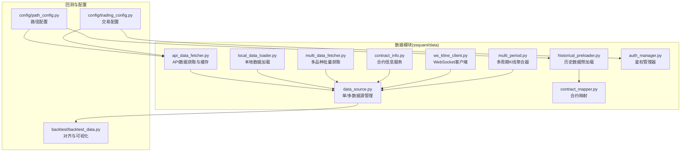
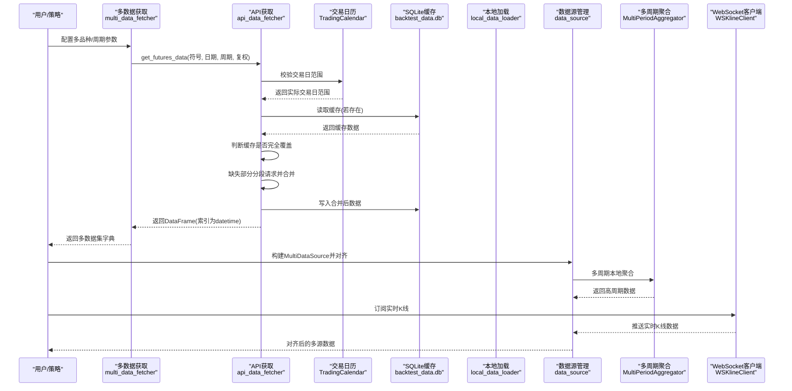
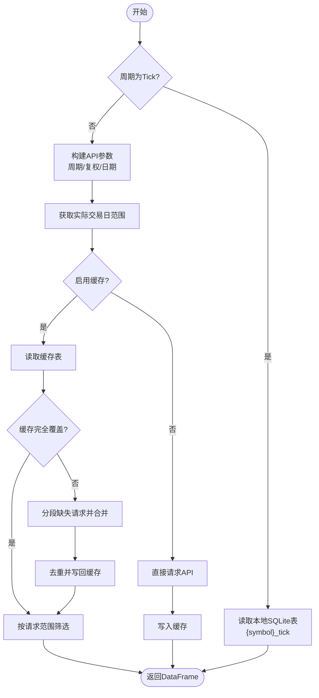
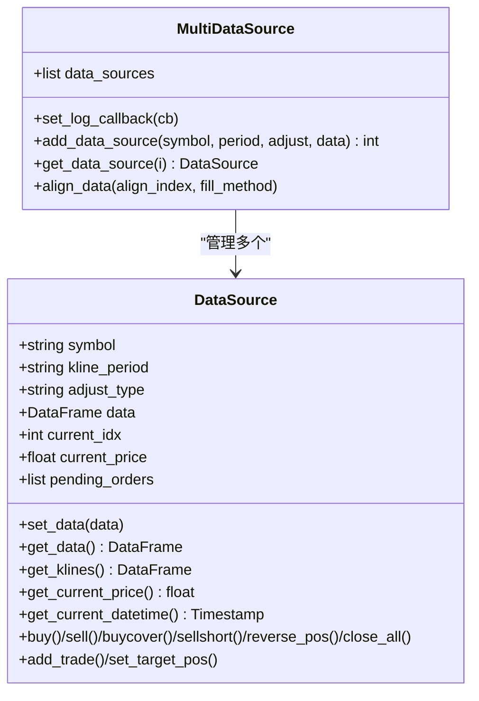
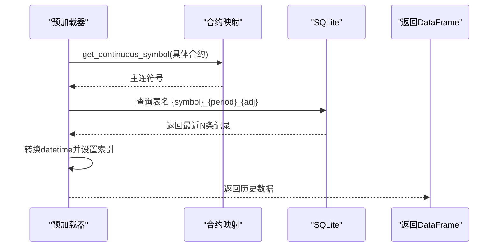
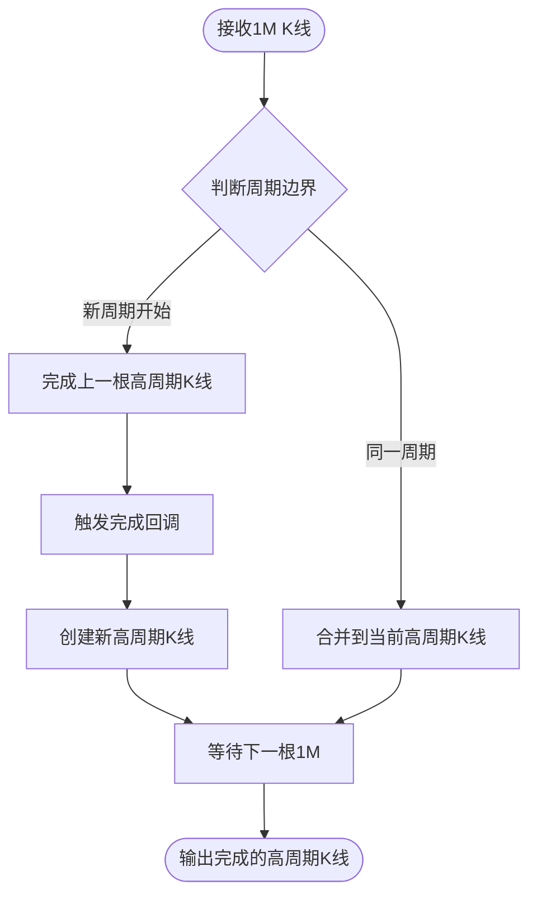
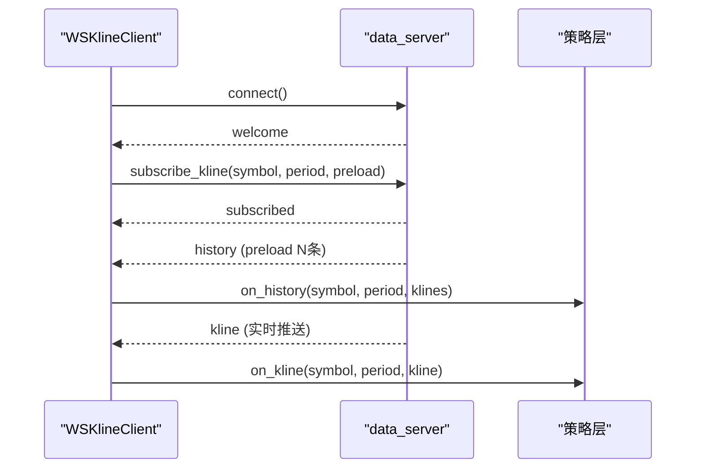
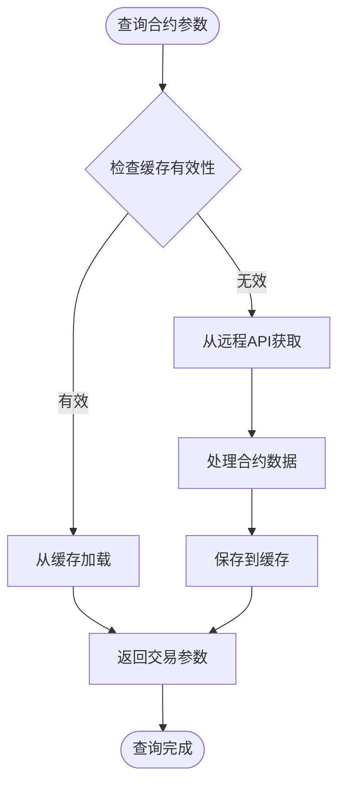
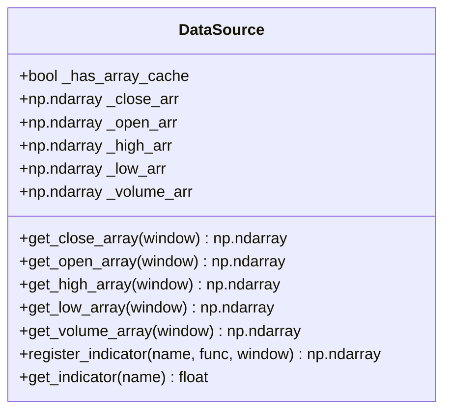
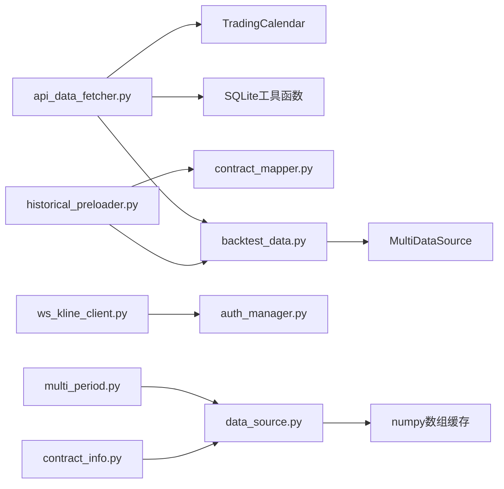

# 数据管理模块

<cite>
**本文档引用的文件**
- [ssquant/data/__init__.py](file://ssquant/data/__init__.py)
- [ssquant/data/api_data_fetcher.py](file://ssquant/data/api_data_fetcher.py)
- [ssquant/data/local_data_loader.py](file://ssquant/data/local_data_loader.py)
- [ssquant/data/multi_data_fetcher.py](file://ssquant/data/multi_data_fetcher.py)
- [ssquant/data/data_source.py](file://ssquant/data/data_source.py)
- [ssquant/data/historical_preloader.py](file://ssquant/data/historical_preloader.py)
- [ssquant/data/contract_mapper.py](file://ssquant/data/contract_mapper.py)
- [ssquant/data/multi_period.py](file://ssquant/data/multi_period.py)
- [ssquant/data/ws_kline_client.py](file://ssquant/data/ws_kline_client.py)
- [ssquant/data/contract_info.py](file://ssquant/data/contract_info.py)
- [ssquant/data/auth_manager.py](file://ssquant/data/auth_manager.py)
- [ssquant/backtest/backtest_data.py](file://ssquant/backtest/backtest_data.py)
- [ssquant/config/path_config.py](file://ssquant/config/path_config.py)
- [ssquant/config/trading_config.py](file://ssquant/config/trading_config.py)
</cite>

## 目录
1. [简介](#简介)
2. [项目结构](#项目结构)
3. [核心组件](#核心组件)
4. [架构总览](#架构总览)
5. [详细组件分析](#详细组件分析)
6. [依赖关系分析](#依赖关系分析)
7. [性能考量](#性能考量)
8. [故障排查指南](#故障排查指南)
9. [结论](#结论)
10. [附录](#附录)

## 简介
本文件为 SSQuant 项目数据管理模块的技术文档，聚焦以下主题：
- 数据源类型与数据获取机制
- 本地数据加载与存储策略
- API 数据获取实现原理
- 多数据源整合与对齐机制
- 时间戳处理与缺失数据补全策略
- 历史数据预加载系统与缓存机制
- **新增功能：多周期支持、WebSocket 客户端、合约信息管理、数组缓存机制**
- 性能优化与数据质量检查
- 异常处理与故障恢复
- 数据源扩展、自定义数据格式支持与数据迁移指南

## 项目结构
数据管理模块位于 ssquant/data 目录，包含以下关键文件：
- api_data_fetcher.py：API 数据获取与缓存
- local_data_loader.py：本地数据加载与格式校验
- multi_data_fetcher.py：多品种批量数据获取
- data_source.py：单/多数据源管理与对齐
- historical_preloader.py：历史数据预加载器
- contract_mapper.py：合约映射（主连与具体合约）
- **multi_period.py：多周期 K 线本地聚合器**
- **ws_kline_client.py：WebSocket K 线客户端**
- **contract_info.py：合约信息服务与参数管理**
- **auth_manager.py：鉴权管理器与 data_server 代理**

**图表来源**
- [ssquant/data/api_data_fetcher.py:1-1031](file://ssquant/data/api_data_fetcher.py#L1-L1031)
- [ssquant/data/local_data_loader.py:1-233](file://ssquant/data/local_data_loader.py#L1-L233)
- [ssquant/data/multi_data_fetcher.py:1-142](file://ssquant/data/multi_data_fetcher.py#L1-L142)
- [ssquant/data/data_source.py:1-1830](file://ssquant/data/data_source.py#L1-L1830)
- [ssquant/data/historical_preloader.py:1-339](file://ssquant/data/historical_preloader.py#L1-L339)
- [ssquant/data/contract_mapper.py:1-133](file://ssquant/data/contract_mapper.py#L1-L133)
- [ssquant/data/multi_period.py:1-355](file://ssquant/data/multi_period.py#L1-L355)
- [ssquant/data/ws_kline_client.py:1-549](file://ssquant/data/ws_kline_client.py#L1-L549)
- [ssquant/data/contract_info.py:1-441](file://ssquant/data/contract_info.py#L1-L441)
- [ssquant/data/auth_manager.py:1-203](file://ssquant/data/auth_manager.py#L1-L203)
- [ssquant/backtest/backtest_data.py:1-300](file://ssquant/backtest/backtest_data.py#L1-L300)
- [ssquant/config/path_config.py:1-30](file://ssquant/config/path_config.py#L1-L30)
- [ssquant/config/trading_config.py:1-120](file://ssquant/config/trading_config.py#L1-L120)

**章节来源**
- [ssquant/data/__init__.py:1-118](file://ssquant/data/__init__.py#L1-L118)

## 核心组件
- API 数据获取与缓存：支持分钟、小时、日、周、月周期，自动复权、时区转换、交易日历、智能缓存与缺失数据补全。
- 本地数据加载：支持 CSV、HDF5、SQLite、7z 压缩包，自动字段校验与日期筛选。
- 多品种批量获取：批量拉取不同品种与周期的数据，汇总统计与导出。
- 数据源管理：单数据源持有数据与交易状态，多数据源对齐与填充。
- 历史数据预加载：按 K 线数量或 Tick 数量预加载，支持主连符号与复权类型。
- 合约映射：从具体合约推导主连符号，支持 rb888、au888 等。
- **多周期支持：本地聚合任意周期（2M、3M、7M、4H 等），服务端只推送 1M，客户端实时派生高周期。**
- **WebSocket 客户端：连接 data_server 实时数据服务器，支持预加载历史数据和断线重连。**
- **合约信息管理：自动获取和缓存合约参数，支持主力合约映射和交易参数查询。**
- **数组缓存机制：ndarray 视图直读，零拷贝访问，性能提升 10-30×，支持指标注册式缓存。**

**章节来源**
- [ssquant/data/__init__.py:7-118](file://ssquant/data/__init__.py#L7-L118)
- [ssquant/data/multi_period.py:1-355](file://ssquant/data/multi_period.py#L1-L355)
- [ssquant/data/ws_kline_client.py:1-549](file://ssquant/data/ws_kline_client.py#L1-L549)
- [ssquant/data/contract_info.py:1-441](file://ssquant/data/contract_info.py#L1-L441)
- [ssquant/data/data_source.py:475-659](file://ssquant/data/data_source.py#L475-L659)

## 架构总览
数据管理模块围绕"数据获取—数据存储—数据对齐—数据消费"闭环构建，核心流程如下：

**图表来源**
- [ssquant/data/multi_data_fetcher.py:4-142](file://ssquant/data/multi_data_fetcher.py#L4-L142)
- [ssquant/data/api_data_fetcher.py:171-626](file://ssquant/data/api_data_fetcher.py#L171-L626)
- [ssquant/data/api_data_fetcher.py:810-908](file://ssquant/data/api_data_fetcher.py#L810-L908)
- [ssquant/data/data_source.py:884-922](file://ssquant/data/data_source.py#L884-L922)
- [ssquant/data/multi_period.py:67-127](file://ssquant/data/multi_period.py#L67-L127)
- [ssquant/data/ws_kline_client.py:175-200](file://ssquant/data/ws_kline_client.py#L175-L200)

## 详细组件分析

### API 数据获取与缓存
- 功能要点
  - 支持周期：分钟(M)、小时(H)、日(D)、周(W)、月(MM)。
  - 复权：后复权(hfq)与不复权(raw)。
  - 交易日历：基于 akshare 或基础规则生成，缓存于 data_cache/trading_calendar_cache.pkl。
  - 缓存：SQLite(backtest_data.db)按表名 {symbol}_{period}_{adjust} 存储。
  - 时间戳：统一转换为北京时间，分钟/小时周期将时间向前回移一个周期。
  - 缺失数据：按交易日切分，分段请求并合并，去重后写回缓存。
  - 重试：HTTP 请求最多重试 3 次，处理 500/401/402/405/406 等状态码。
- 关键流程图

**图表来源**
- [ssquant/data/api_data_fetcher.py:171-626](file://ssquant/data/api_data_fetcher.py#L171-L626)
- [ssquant/data/api_data_fetcher.py:810-908](file://ssquant/data/api_data_fetcher.py#L810-L908)

**章节来源**
- [ssquant/data/api_data_fetcher.py:18-169](file://ssquant/data/api_data_fetcher.py#L18-L169)
- [ssquant/data/api_data_fetcher.py:171-626](file://ssquant/data/api_data_fetcher.py#L171-L626)
- [ssquant/data/api_data_fetcher.py:810-1031](file://ssquant/data/api_data_fetcher.py#L810-L1031)

### 本地数据加载与格式校验
- 支持格式：CSV、HDF5(key 必填)、SQLite(自动推导表名或显式指定)、7z 压缩包内 CSV。
- 字段校验：
  - K线：datetime/open/high/low/close 必备；volume/symbol 推荐。
  - Tick：datetime + LastPrice 或 BidPrice1/AskPrice1 必备。
- 日期筛选：按 start_date/end_date 过滤，打印原始/筛选后统计。
- 合并策略：多文件列表按时间排序合并，再统一筛选。

**章节来源**
- [ssquant/data/local_data_loader.py:5-174](file://ssquant/data/local_data_loader.py#L5-L174)
- [ssquant/data/local_data_loader.py:176-233](file://ssquant/data/local_data_loader.py#L176-L233)

### 多品种批量数据获取
- 输入：symbols_and_periods 列表 + 各品种配置字典。
- 输出：字典，键为 "{symbol}_{kline_period}_{复权描述}"，值为 DataFrame。
- 统计与导出：提供摘要统计与 CSV 导出工具。

**章节来源**
- [ssquant/data/multi_data_fetcher.py:4-76](file://ssquant/data/multi_data_fetcher.py#L4-L76)
- [ssquant/data/multi_data_fetcher.py:78-142](file://ssquant/data/multi_data_fetcher.py#L78-L142)

### 数据源管理与对齐
- DataSource：持有单个数据源的 OHLCV/Tick 数据，维护当前索引、价格、持仓、挂单与交易记录。
- MultiDataSource：管理多个 DataSource，提供对齐与填充。
- 对齐策略：收集各数据源索引并求并集，reindex 后按 ffill/bfill 填充。

**图表来源**
- [ssquant/data/data_source.py:6-922](file://ssquant/data/data_source.py#L6-L922)

**章节来源**
- [ssquant/data/data_source.py:6-922](file://ssquant/data/data_source.py#L6-L922)

### 历史数据预加载系统
- 预加载 K 线：按 K 线数量回看，自动推导主连符号与表名，查询最近 N 条并排序。
- 预加载 Tick：按记录数回看，支持自定义历史符号。
- 可用性检查：检查数据库、表是否存在，统计记录数与日期范围。
- 与合约映射协作：通过 ContractMapper 将具体合约映射为主连符号。

**图表来源**
- [ssquant/data/historical_preloader.py:23-133](file://ssquant/data/historical_preloader.py#L23-L133)
- [ssquant/data/contract_mapper.py:66-94](file://ssquant/data/contract_mapper.py#L66-L94)

**章节来源**
- [ssquant/data/historical_preloader.py:11-339](file://ssquant/data/historical_preloader.py#L11-L339)
- [ssquant/data/contract_mapper.py:10-116](file://ssquant/data/contract_mapper.py#L10-L116)

### 多周期支持与本地聚合
- **新增功能：MultiPeriodAggregator 实现本地 K 线聚合**
- 支持任意周期组合：2M、3M、7M、4H、1D 等
- 聚合规则：
  - OHLCV：open 取首根1M，high=max，low=min，close 取末根1M
  - volume/amount/openint：累加
  - cumulative_openint：取末根1M的值
  - 订单流字段：B/S/多开/空开/... 累加
  - 深度数据：open_bidp/askp 取首根，close_bidp/askp 取末根
- 时间对齐规则：与服务端聚合保持一致，确保回测和实盘一致性
- 批量聚合：支持 DataFrame 级别的历史数据批量聚合

**图表来源**
- [ssquant/data/multi_period.py:67-127](file://ssquant/data/multi_period.py#L67-L127)

**章节来源**
- [ssquant/data/multi_period.py:1-355](file://ssquant/data/multi_period.py#L1-L355)

### WebSocket 客户端与实时数据
- **新增功能：WSKlineClient 实现实时数据推送**
- 连接 data_server WebSocket 服务器，支持多地址轮询
- 订阅任意周期 K 线，支持预加载历史数据
- 自动断线重连，支持鉴权重试
- 线程安全设计，独立后台线程运行
- 回调机制：on_kline、on_history、on_connected 等
- 统计信息：连接状态、接收数据量、重连次数

**图表来源**
- [ssquant/data/ws_kline_client.py:175-200](file://ssquant/data/ws_kline_client.py#L175-L200)
- [ssquant/data/ws_kline_client.py:423-502](file://ssquant/data/ws_kline_client.py#L423-L502)

**章节来源**
- [ssquant/data/ws_kline_client.py:1-549](file://ssquant/data/ws_kline_client.py#L1-L549)

### 合约信息服务与参数管理
- **新增功能：ContractInfoService 提供合约参数查询**
- 自动从远程 API 拉取最新合约信息，本地 JSON 缓存
- 支持主力合约（888）和次主力合约（777）自动映射
- 交易参数：合约乘数、最小变动价位、保证金率、手续费率
- 缓存策略：4小时过期，支持强制刷新
- 多种查询方式：get_trading_params、get_main_contract、list_varieties

**图表来源**
- [ssquant/data/contract_info.py:65-145](file://ssquant/data/contract_info.py#L65-L145)

**章节来源**
- [ssquant/data/contract_info.py:1-441](file://ssquant/data/contract_info.py#L1-L441)

### 数组缓存机制与性能优化
- **新增功能：ndarray 视图直读，零拷贝访问**
- 缓存构建：从 DataFrame 构建 numpy 数组视图，避免 Pandas 索引开销
- 性能提升：回测主路径下比 Pandas 快 10-30×
- 支持字段：open、high、low、close、volume 等 OHLCV 字段
- 指标注册式缓存：IndicatorCache v2，O(1) 查询
- 自动降级：跨周期数据源自动降级到传统路径

**图表来源**
- [ssquant/data/data_source.py:475-659](file://ssquant/data/data_source.py#L475-L659)
- [ssquant/data/data_source.py:1472-1520](file://ssquant/data/data_source.py#L1472-L1520)

**章节来源**
- [ssquant/data/data_source.py:475-659](file://ssquant/data/data_source.py#L475-L659)
- [ssquant/data/data_source.py:1444-1639](file://ssquant/data/data_source.py#L1444-L1639)

### 时间戳处理与缺失数据补全
- 时间戳处理
  - API 返回 UTC 或带时区，统一转换为 Asia/Shanghai，再去除时区。
  - 分钟/小时周期将 datetime 向前回移一个周期，使其表示 K 线开始时刻。
- 缺失数据补全
  - 交易日历驱动的范围校准，避免请求非交易日。
  - 缓存不完全覆盖时，按交易日切分缺失区间，分段请求并合并。
  - 合并后去重并写回缓存，确保一致性。

**章节来源**
- [ssquant/data/api_data_fetcher.py:686-750](file://ssquant/data/api_data_fetcher.py#L686-L750)
- [ssquant/data/api_data_fetcher.py:367-573](file://ssquant/data/api_data_fetcher.py#L367-L573)

### 多数据源整合与对齐机制
- 对齐步骤
  - 收集所有数据源索引，求并集作为公共索引。
  - 对每个数据源 reindex 并按 ffill/bfill 填充。
- 填充策略
  - ffill：向后填充，适合 K 线连续场景。
  - bfill：向前填充，适合末尾缺失。
  - 兼容性：保留 fillna(method=...) 以兼容旧用法。

**章节来源**
- [ssquant/data/data_source.py:884-922](file://ssquant/data/data_source.py#L884-L922)
- [ssquant/backtest/backtest_data.py:220-233](file://ssquant/backtest/backtest_data.py#L220-L233)

## 依赖关系分析
- 外部依赖
  - requests：HTTP 请求 API。
  - pandas/numpy：数据结构与时间序列处理。
  - sqlite3：本地缓存数据库。
  - akshare：交易日历获取（可选）。
  - **websocket-client/websockets：WebSocket 客户端支持。**
- 内部依赖
  - api_data_fetcher 依赖 TradingCalendar 与 SQLite 工具函数。
  - historical_preloader 依赖 contract_mapper。
  - backtest_data.py 依赖 MultiDataSource 进行对齐。
  - **ws_kline_client 依赖 auth_manager 进行鉴权管理。**
  - **data_source 依赖数组缓存机制提供高性能访问。**

**图表来源**
- [ssquant/data/api_data_fetcher.py:1-1031](file://ssquant/data/api_data_fetcher.py#L1-L1031)
- [ssquant/data/historical_preloader.py:1-339](file://ssquant/data/historical_preloader.py#L1-L339)
- [ssquant/data/contract_mapper.py:1-133](file://ssquant/data/contract_mapper.py#L1-L133)
- [ssquant/backtest/backtest_data.py:1-300](file://ssquant/backtest/backtest_data.py#L1-L300)
- [ssquant/data/ws_kline_client.py:1-549](file://ssquant/data/ws_kline_client.py#L1-L549)
- [ssquant/data/auth_manager.py:1-203](file://ssquant/data/auth_manager.py#L1-L203)
- [ssquant/data/data_source.py:475-659](file://ssquant/data/data_source.py#L475-L659)
- [ssquant/data/multi_period.py:1-355](file://ssquant/data/multi_period.py#L1-L355)
- [ssquant/data/contract_info.py:1-441](file://ssquant/data/contract_info.py#L1-L441)

**章节来源**
- [ssquant/data/api_data_fetcher.py:1-17](file://ssquant/data/api_data_fetcher.py#L1-L17)
- [ssquant/data/historical_preloader.py:40-50](file://ssquant/data/historical_preloader.py#L40-L50)
- [ssquant/backtest/backtest_data.py:1-30](file://ssquant/backtest/backtest_data.py#L1-L30)
- [ssquant/data/ws_kline_client.py:32-46](file://ssquant/data/ws_kline_client.py#L32-L46)
- [ssquant/data/auth_manager.py:1-203](file://ssquant/data/auth_manager.py#L1-L203)

## 性能考量
- 缓存策略
  - SQLite 按表名组织，避免重复下载；合并缺失数据后整体写回，减少多次 IO。
  - 交易日历缓存，定期更新，避免频繁网络请求。
  - **合约信息缓存，4小时过期，减少远程 API 调用频率。**
- 数据对齐
  - 并集索引 + 合并填充，避免逐条遍历；ffill/bfill 为 O(n) 级别。
- I/O 优化
  - HDF5 读取需指定 key；7z 解压临时目录，避免磁盘碎片化。
- 时区与时序
  - 统一时区与索引类型，减少转换成本；分钟/小时周期回移避免未来数据泄露。
- **数组缓存优化**
  - ndarray 视图直读，零拷贝访问，性能提升 10-30×。
  - 指标注册式缓存，O(1) 查询，大幅降低计算开销。
  - 跨周期数据源自动降级，确保兼容性和正确性。

## 故障排查指南
- API 认证错误
  - 401/402/405/406：检查用户名/密码与账号状态；确认请求参数。
- 服务器内部错误
  - 500：自动重试 3 次；若仍失败，检查时间范围是否过短（周末/节假日无数据）。
- 缓存读取失败
  - SQLite 报错：捕获异常并回退到直接请求；检查数据库路径与权限。
- 本地数据格式错误
  - 字段缺失：K线缺少 datetime/open/high/low/close；Tick 缺少价格字段。
  - 文件格式不支持：仅支持 CSV/HDF5/SQLite/7z。
- 多数据源对齐异常
  - 空数据源：确保至少两个数据源且索引非空；检查 fill_method 选择。
- **WebSocket 连接问题**
  - 网络连接失败：检查 data_server 地址和防火墙设置。
  - 鉴权失败：确认认证信息正确，检查 on_auth_required 回调。
  - 断线重连：查看重连统计信息，检查网络稳定性。
- **合约信息获取失败**
  - 远程 API 不可用：检查网络连接，等待缓存过期后重试。
  - 缓存损坏：使用 refresh_contracts() 强制刷新。

**章节来源**
- [ssquant/data/api_data_fetcher.py:757-793](file://ssquant/data/api_data_fetcher.py#L757-L793)
- [ssquant/data/api_data_fetcher.py:599-604](file://ssquant/data/api_data_fetcher.py#L599-L604)
- [ssquant/data/local_data_loader.py:144-164](file://ssquant/data/local_data_loader.py#L144-L164)
- [ssquant/data/data_source.py:884-922](file://ssquant/data/data_source.py#L884-L922)
- [ssquant/data/ws_kline_client.py:219-261](file://ssquant/data/ws_kline_client.py#L219-L261)
- [ssquant/data/contract_info.py:133-145](file://ssquant/data/contract_info.py#L133-L145)

## 结论
数据管理模块通过"API 获取 + 本地加载 + 多源对齐 + 预加载"的体系，实现了从数据采集到回测消费的高效闭环。其核心优势在于：
- 智能缓存与缺失补全，显著降低网络与 IO 成本；
- 严格的字段校验与时间戳处理，保障数据质量；
- 多数据源对齐与填充策略，满足多品种多周期回测需求；
- 历史数据预加载与合约映射，提升实盘/仿真启动效率。
- **新增的多周期支持、WebSocket 客户端、合约信息服务和数组缓存机制，进一步提升了系统的实时性、灵活性和性能表现。**

## 附录

### 数据存储与路径配置
- 默认缓存数据库：data_cache/backtest_data.db
- 默认缓存目录：data_cache
- **合约信息缓存：data_cache/contract_info_cache.json**
- 配置入口
  - 路径配置：get_data_cache_dir()
  - 交易配置：db_path 默认 data_cache/backtest_data.db

**章节来源**
- [ssquant/config/path_config.py:19-21](file://ssquant/config/path_config.py#L19-L21)
- [ssquant/config/trading_config.py:66-66](file://ssquant/config/trading_config.py#L66-L66)
- [ssquant/config/trading_config.py:107-107](file://ssquant/config/trading_config.py#L107-L107)
- [ssquant/data/contract_info.py:31-34](file://ssquant/data/contract_info.py#L31-L34)

### 数据源扩展与自定义格式支持
- 扩展步骤
  - 在 local_data_loader 中增加新格式分支，遵循字段校验与日期索引规范。
  - 若涉及 SQLite，支持显式表名或按约定推导（symbol/period/adjust）。
- 自定义数据格式
  - 确保包含 datetime 索引与必要字段；Tick 数据需具备价格字段。
  - 如需导出为 CSV，使用 multi_data_fetcher.save_data_to_csv。
- **多周期扩展**
  - 使用 MultiPeriodAggregator.add_period() 动态添加新周期。
  - 支持任意分钟数、小时数和日周期组合。

**章节来源**
- [ssquant/data/local_data_loader.py:5-142](file://ssquant/data/local_data_loader.py#L5-L142)
- [ssquant/data/multi_data_fetcher.py:113-142](file://ssquant/data/multi_data_fetcher.py#L113-L142)
- [ssquant/data/multi_period.py:59-66](file://ssquant/data/multi_period.py#L59-L66)

### 数据迁移指南
- 从旧表名迁移到新约定
  - 历史预加载器约定：{symbol}_{period}_{adjust}（adjust='hfq'/'raw'）
  - 当前约定：period 大写与小写均可，adjust 仅 raw（历史数据仍兼容 hfq）
- 迁移建议
  - 读取 SQLite 时优先显式指定 db_table，避免歧义。
  - 逐步将历史 hfq 表名迁移为 raw，统一命名规范。
- **合约信息迁移**
  - 新版本使用 JSON 缓存替代旧的 pickle 格式。
  - 合约参数结构保持兼容，新增更多交易参数字段。

**章节来源**
- [ssquant/data/local_data_loader.py:78-96](file://ssquant/data/local_data_loader.py#L78-L96)
- [ssquant/data/historical_preloader.py:50-56](file://ssquant/data/historical_preloader.py#L50-L56)
- [ssquant/data/contract_info.py:31-34](file://ssquant/data/contract_info.py#L31-L34)

### WebSocket 客户端使用指南
- **基本使用**
  - 创建 WSKlineClient 实例，设置回调函数
  - 调用 connect() 建立连接
  - 使用 subscribe_kline() 订阅任意周期数据
- **高级配置**
  - 支持多地址轮询，自动切换备用服务器
  - 预加载历史数据，支持断线重连
  - 统计信息监控，便于调试和性能分析
- **鉴权集成**
  - 通过 auth_manager 进行统一鉴权管理
  - 支持主动重连和被动重鉴权

**章节来源**
- [ssquant/data/ws_kline_client.py:55-64](file://ssquant/data/ws_kline_client.py#L55-L64)
- [ssquant/data/ws_kline_client.py:143-174](file://ssquant/data/ws_kline_client.py#L143-L174)
- [ssquant/data/ws_kline_client.py:175-200](file://ssquant/data/ws_kline_client.py#L175-L200)
- [ssquant/data/auth_manager.py:98-175](file://ssquant/data/auth_manager.py#L98-L175)

### 合约信息服务使用指南
- **参数查询**
  - get_trading_params() 获取完整交易参数
  - get_main_contract() 获取主力合约代码
  - list_varieties() 列出所有品种信息
- **缓存策略**
  - 4小时自动刷新，支持手动强制刷新
  - 过期缓存降级为默认参数，确保系统可用性
- **应用场景**
  - 交易参数配置，手续费和保证金计算
  - 主力合约自动映射，简化策略编写
  - 实时价格查询，支持风控和监控

**章节来源**
- [ssquant/data/contract_info.py:210-275](file://ssquant/data/contract_info.py#L210-L275)
- [ssquant/data/contract_info.py:277-306](file://ssquant/data/contract_info.py#L277-L306)
- [ssquant/data/contract_info.py:308-330](file://ssquant/data/contract_info.py#L308-L330)
- [ssquant/data/contract_info.py:331-344](file://ssquant/data/contract_info.py#L331-L344)

### 数组缓存机制使用指南
- **性能优化**
  - 自动构建 ndarray 缓存，避免 Pandas 索引开销
  - 支持窗口切片，零拷贝访问历史数据
  - 指标注册式缓存，O(1) 查询性能
- **使用场景**
  - 高频策略的实时计算
  - 大量指标的批量计算
  - 实盘交易的快速响应
- **注意事项**
  - 跨周期数据源自动降级
  - 缓存失效时自动重建
  - 支持增量更新和全量重算

**章节来源**
- [ssquant/data/data_source.py:475-557](file://ssquant/data/data_source.py#L475-L557)
- [ssquant/data/data_source.py:1472-1520](file://ssquant/data/data_source.py#L1472-L1520)
- [ssquant/data/data_source.py:1537-1620](file://ssquant/data/data_source.py#L1537-L1620)