# 数据获取机制

<cite>
**本文档引用的文件**
- [api_data_fetcher.py](file://ssquant/data/api_data_fetcher.py)
- [multi_data_fetcher.py](file://ssquant/data/multi_data_fetcher.py)
- [local_data_loader.py](file://ssquant/data/local_data_loader.py)
- [historical_preloader.py](file://ssquant/data/historical_preloader.py)
- [contract_mapper.py](file://ssquant/data/contract_mapper.py)
- [trading_config.py](file://ssquant/config/trading_config.py)
- [path_config.py](file://ssquant/config/path_config.py)
- [A_工具_导入数据库DB示例.py](file://examples/A_工具_导入数据库DB示例.py)
- [B_双均线策略.py](file://examples/B_双均线策略.py)
</cite>

## 目录
1. [简介](#简介)
2. [项目结构](#项目结构)
3. [核心组件](#核心组件)
4. [架构概览](#架构概览)
5. [详细组件分析](#详细组件分析)
6. [依赖关系分析](#依赖关系分析)
7. [性能考量](#性能考量)
8. [故障排除指南](#故障排除指南)
9. [结论](#结论)

## 简介

SSQuant的数据获取机制是一个完整的期货数据获取、缓存和管理框架，支持多种数据源和获取方式。该系统提供了从API获取数据、本地数据库查询、历史数据预加载等功能，能够处理K线数据和TICK数据的获取和管理。

## 项目结构

SSQuant项目采用模块化设计，数据获取相关的文件主要位于`ssquant/data/`目录下：

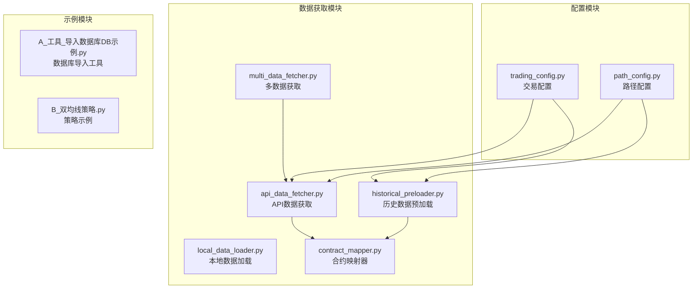

**图表来源**
- [api_data_fetcher.py](file://ssquant/data/api_data_fetcher.py#L1-L1031)
- [multi_data_fetcher.py](file://ssquant/data/multi_data_fetcher.py#L1-L139)
- [local_data_loader.py](file://ssquant/data/local_data_loader.py#L1-L233)
- [historical_preloader.py](file://ssquant/data/historical_preloader.py#L1-L339)
- [contract_mapper.py](file://ssquant/data/contract_mapper.py#L1-L133)

**章节来源**
- [api_data_fetcher.py](file://ssquant/data/api_data_fetcher.py#L1-L1031)
- [multi_data_fetcher.py](file://ssquant/data/multi_data_fetcher.py#L1-L139)
- [local_data_loader.py](file://ssquant/data/local_data_loader.py#L1-L233)
- [historical_preloader.py](file://ssquant/data/historical_preloader.py#L1-L339)
- [contract_mapper.py](file://ssquant/data/contract_mapper.py#L1-L133)

## 核心组件

### 交易日历系统

交易日历系统是数据获取机制的核心基础设施，负责判断交易日和处理日期范围：

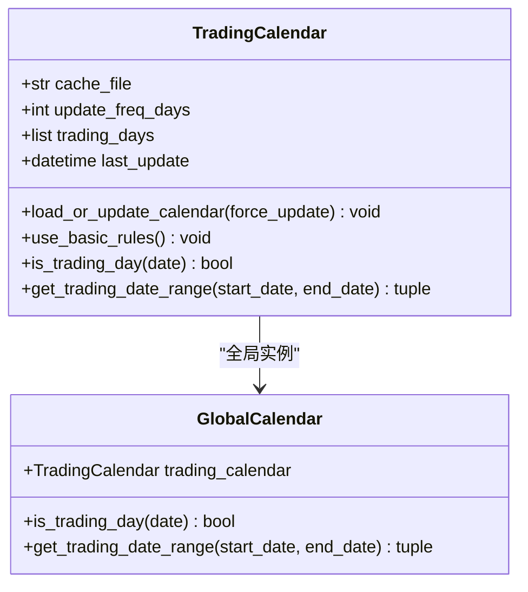

**图表来源**
- [api_data_fetcher.py](file://ssquant/data/api_data_fetcher.py#L18-L169)

### API数据获取器

API数据获取器负责从外部API获取期货数据，支持缓存和重试机制：

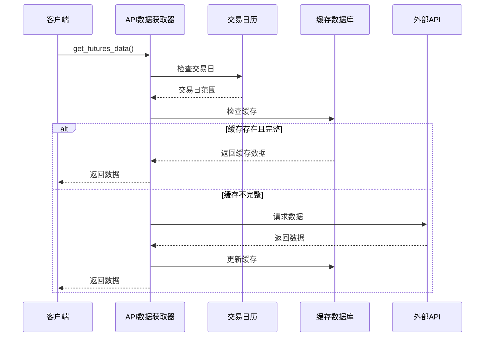

**图表来源**
- [api_data_fetcher.py](file://ssquant/data/api_data_fetcher.py#L171-L625)

### 多数据获取器

多数据获取器支持批量获取多个品种和周期的数据：

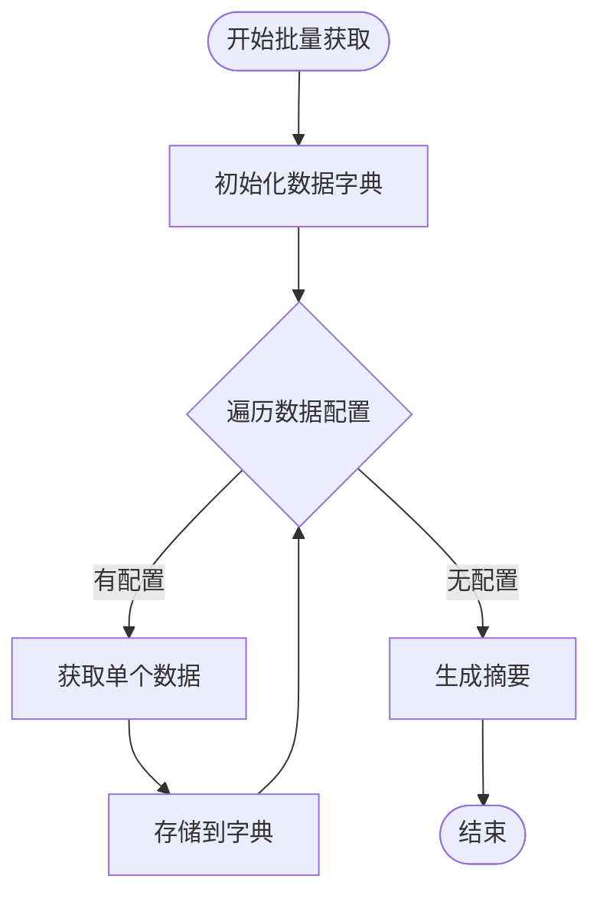

**图表来源**
- [multi_data_fetcher.py](file://ssquant/data/multi_data_fetcher.py#L4-L76)

**章节来源**
- [api_data_fetcher.py](file://ssquant/data/api_data_fetcher.py#L1-L1031)
- [multi_data_fetcher.py](file://ssquant/data/multi_data_fetcher.py#L1-L139)

## 架构概览

SSQuant的数据获取架构采用分层设计，从底层的交易日历和缓存管理到上层的策略接口：

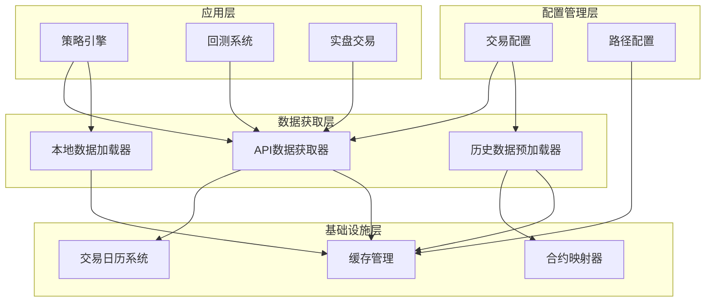

**图表来源**
- [api_data_fetcher.py](file://ssquant/data/api_data_fetcher.py#L1-L1031)
- [local_data_loader.py](file://ssquant/data/local_data_loader.py#L1-L233)
- [historical_preloader.py](file://ssquant/data/historical_preloader.py#L1-L339)
- [trading_config.py](file://ssquant/config/trading_config.py#L1-L187)

## 详细组件分析

### 交易日历系统

交易日历系统实现了灵活的交易日判断机制：

#### 核心功能特性

1. **智能缓存机制**：支持本地缓存交易日历数据，减少网络请求
2. **降级容错**：当外部API不可用时，使用内置规则生成交易日历
3. **动态更新**：定期更新交易日历，确保数据准确性

#### 交易日判断算法

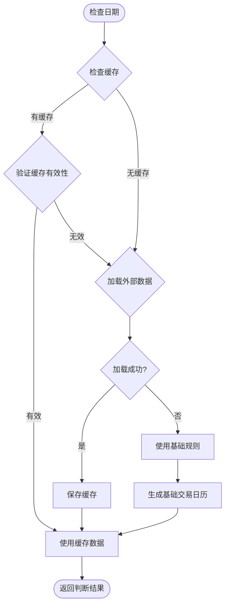

**图表来源**
- [api_data_fetcher.py](file://ssquant/data/api_data_fetcher.py#L33-L100)

#### 日期范围处理

交易日历系统提供了精确的日期范围处理能力：

- **交易日范围计算**：自动过滤非交易日，返回有效的交易日范围
- **边界处理**：智能处理日期边界，确保数据完整性
- **时区处理**：统一处理不同时区的数据

**章节来源**
- [api_data_fetcher.py](file://ssquant/data/api_data_fetcher.py#L18-L169)

### API数据获取机制

API数据获取器实现了完整的数据获取流程，包括缓存管理、重试机制和错误处理。

#### 数据获取流程

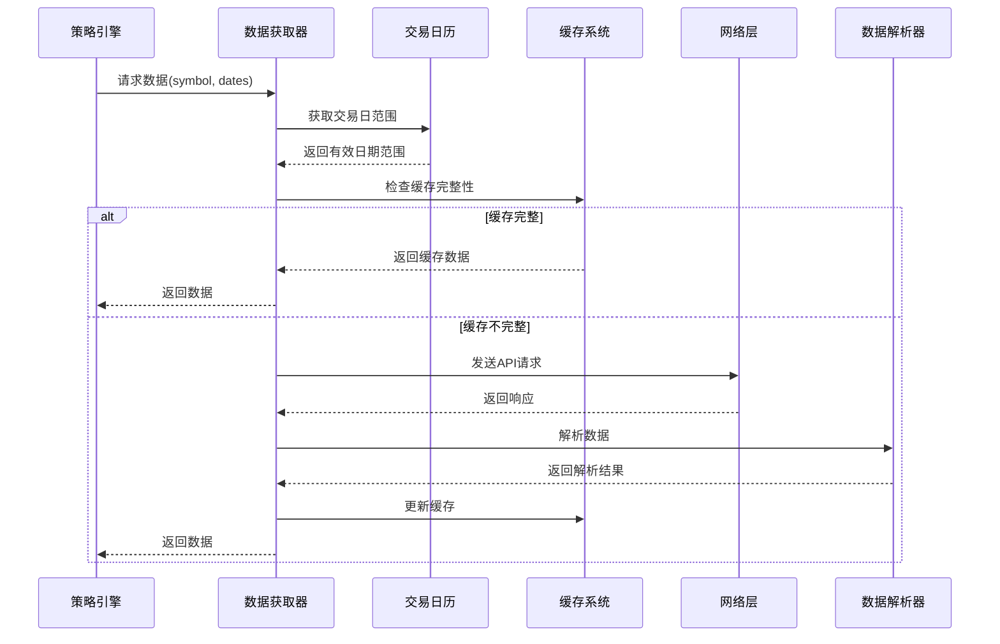

**图表来源**
- [api_data_fetcher.py](file://ssquant/data/api_data_fetcher.py#L171-L625)

#### 缓存管理机制

缓存系统采用了多层次的设计：

1. **数据库缓存**：使用SQLite存储历史数据
2. **内存缓存**：快速访问常用数据
3. **文件缓存**：持久化存储大量历史数据

#### 重试机制设计

系统实现了智能的重试机制：

- **指数退避**：每次重试间隔逐渐增加
- **错误分类**：针对不同错误类型采取不同处理策略
- **最大重试次数**：防止无限重试造成资源浪费

**章节来源**
- [api_data_fetcher.py](file://ssquant/data/api_data_fetcher.py#L627-L808)

### 本地数据加载器

本地数据加载器支持多种数据格式的本地数据加载：

#### 支持的数据格式

| 格式 | 描述 | 特殊说明 |
|------|------|----------|
| CSV | 逗号分隔值 | 最常用格式，易于编辑 |
| Excel | Microsoft Excel | 支持.xlsx和.xls格式 |
| JSON | JavaScript对象表示法 | 支持标准和行式JSON |
| Parquet | 列式存储 | 大数据量高效存储 |
| Feather | 高性能二进制 | 快速读写 |
| Pickle | Python序列化 | 保持Python对象结构 |

#### 数据格式转换

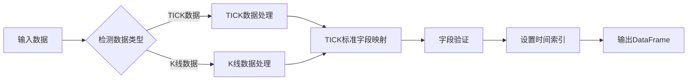

**图表来源**
- [local_data_loader.py](file://ssquant/data/local_data_loader.py#L144-L174)

**章节来源**
- [local_data_loader.py](file://ssquant/data/local_data_loader.py#L1-L233)

### 历史数据预加载器

历史数据预加载器专为实盘和SIMNOW模式设计，提供高效的历史数据访问：

#### 预加载策略

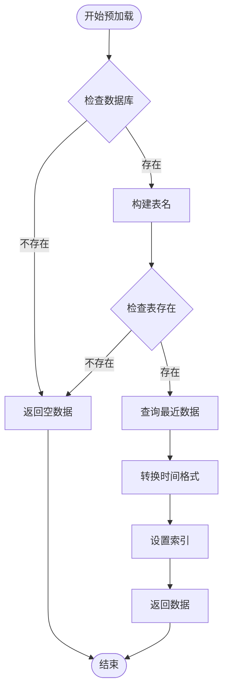

**图表来源**
- [historical_preloader.py](file://ssquant/data/historical_preloader.py#L23-L132)

#### 数据表命名规范

| 数据类型 | 表名格式 | 示例 |
|----------|----------|------|
| TICK数据 | `{symbol}_tick` | `rb888_tick` |
| K线数据(后复权) | `{symbol}_{period}_hfq` | `rb888_1h_hfq` |
| K线数据(不复权) | `{symbol}_{period}_raw` | `rb888_1h_raw` |

**章节来源**
- [historical_preloader.py](file://ssquant/data/historical_preloader.py#L11-L339)

### 合约映射器

合约映射器负责处理主连合约与具体合约之间的映射关系：

#### 合约映射规则

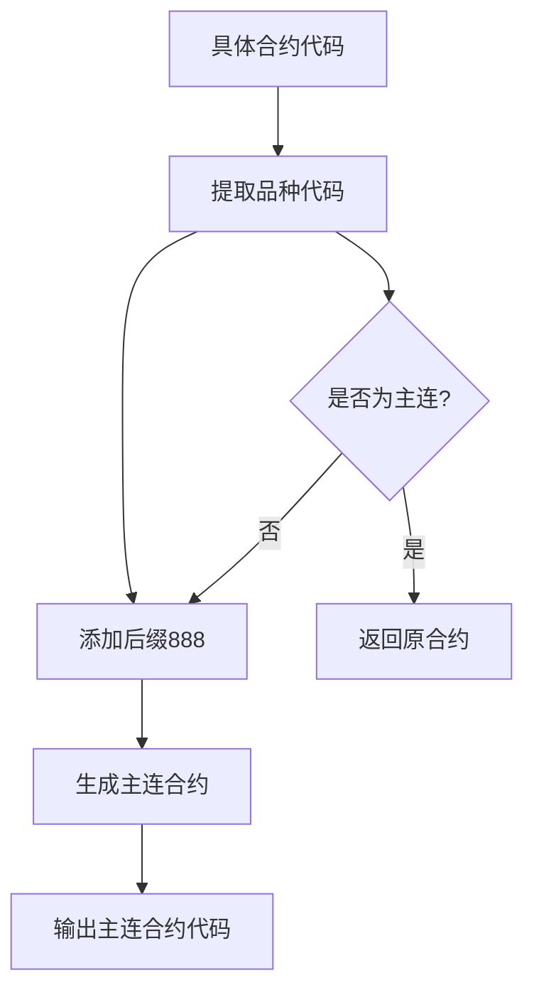

**图表来源**
- [contract_mapper.py](file://ssquant/data/contract_mapper.py#L66-L94)

**章节来源**
- [contract_mapper.py](file://ssquant/data/contract_mapper.py#L1-L133)

## 依赖关系分析

SSQuant的数据获取机制具有清晰的依赖层次结构：

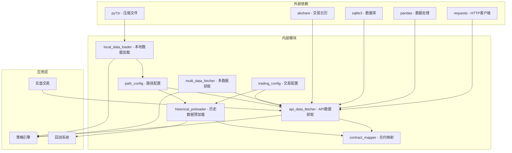

**图表来源**
- [api_data_fetcher.py](file://ssquant/data/api_data_fetcher.py#L1-L10)
- [local_data_loader.py](file://ssquant/data/local_data_loader.py#L1-L4)
- [historical_preloader.py](file://ssquant/data/historical_preloader.py#L6-L8)

### 关键依赖关系

1. **API数据获取依赖**：
   - `requests`：HTTP请求处理
   - `pandas`：数据结构和处理
   - `sqlite3`：本地缓存管理

2. **本地数据加载依赖**：
   - `py7zr`：7z压缩文件解压
   - `pandas`：多格式数据读取

3. **交易日历依赖**：
   - `akshare`：外部交易日历数据
   - `pandas`：数据缓存和处理

**章节来源**
- [api_data_fetcher.py](file://ssquant/data/api_data_fetcher.py#L1-L10)
- [local_data_loader.py](file://ssquant/data/local_data_loader.py#L1-L4)
- [historical_preloader.py](file://ssquant/data/historical_preloader.py#L6-L8)

## 性能考量

### 缓存策略优化

SSQuant采用了多层次的缓存策略来提升性能：

1. **智能缓存判断**：检查缓存的完整性和时效性
2. **增量更新**：只获取缺失的数据部分
3. **内存缓存**：热点数据驻留内存

### 并发控制机制

系统实现了以下并发控制措施：

- **数据库连接池**：复用数据库连接，减少连接开销
- **请求限流**：控制API请求频率，避免被限制
- **异步处理**：支持异步数据获取操作

### 资源管理优化

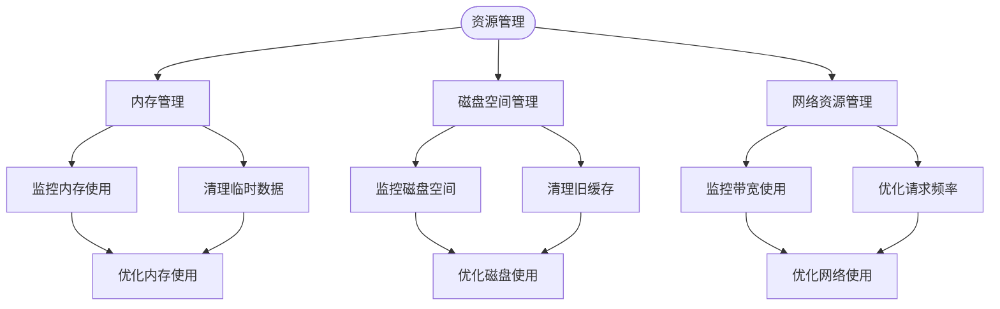

## 故障排除指南

### 常见问题及解决方案

#### 1. API认证失败

**问题症状**：
- 返回401、402、405、406状态码
- 认证错误提示

**解决步骤**：
1. 检查用户名和密码配置
2. 验证账户状态和权限
3. 确认API服务可用性

#### 2. 缓存数据异常

**问题症状**：
- 缓存数据为空或损坏
- 数据库连接错误

**解决步骤**：
1. 清理缓存目录
2. 重新生成缓存数据
3. 检查数据库文件完整性

#### 3. 交易日历错误

**问题症状**：
- 交易日判断异常
- 日期范围计算错误

**解决步骤**：
1. 检查网络连接
2. 验证akshare库安装
3. 手动更新交易日历

#### 4. 数据格式转换错误

**问题症状**：
- 字段缺失或类型错误
- 时间格式不匹配

**解决步骤**：
1. 检查数据文件格式
2. 验证字段映射关系
3. 手动修正数据格式

**章节来源**
- [api_data_fetcher.py](file://ssquant/data/api_data_fetcher.py#L757-L793)
- [local_data_loader.py](file://ssquant/data/local_data_loader.py#L144-L164)

## 结论

SSQuant的数据获取机制是一个设计精良、功能完整的期货数据管理系统。其特点包括：

1. **模块化设计**：清晰的模块划分和职责分离
2. **智能缓存**：多层次的缓存策略提升性能
3. **容错机制**：完善的错误处理和恢复机制
4. **灵活配置**：支持多种数据格式和获取方式
5. **扩展性强**：易于添加新的数据源和处理方式

该系统为量化交易提供了坚实的数据基础设施，支持从简单的回测到复杂的实盘交易场景。通过合理的架构设计和优化策略，能够满足不同规模和复杂度的量化交易需求。