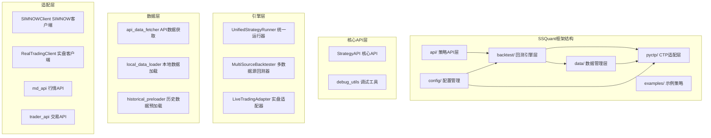
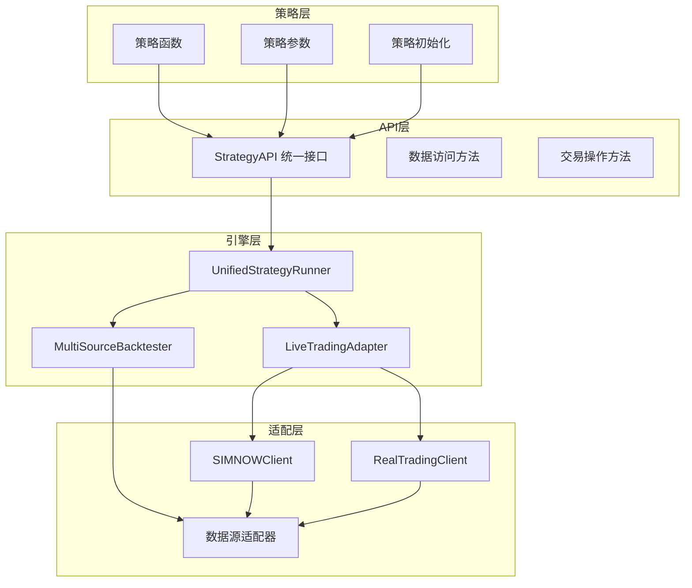
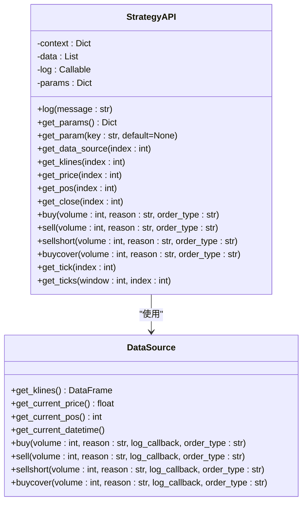
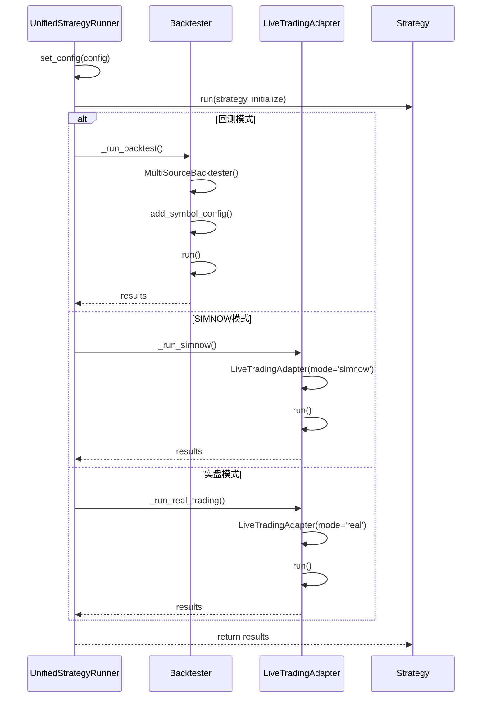
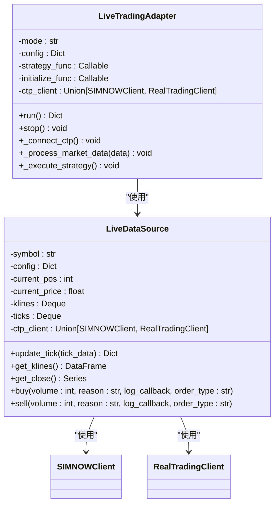
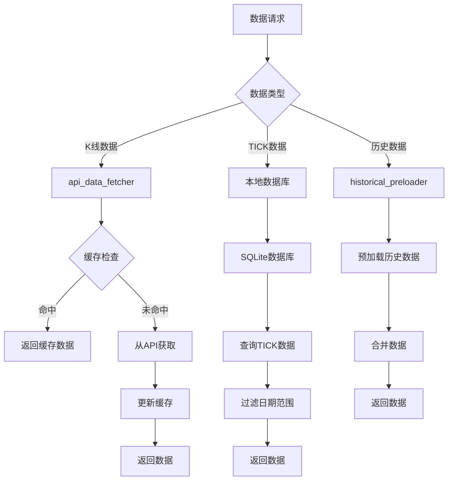
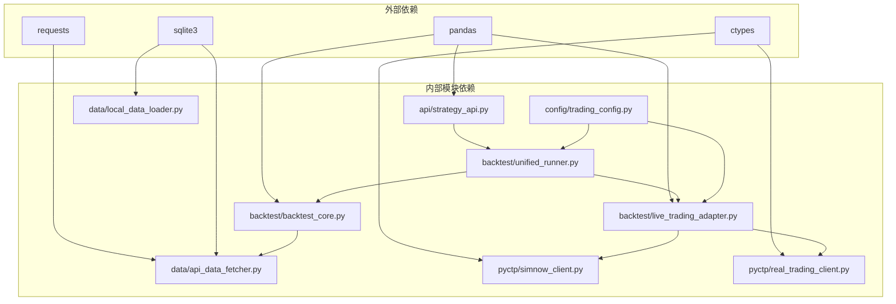

# 整体架构概览

<cite>
**本文档引用的文件**
- [README.md](file://README.md)
- [ssquant/__init__.py](file://ssquant/__init__.py)
- [ssquant/api/strategy_api.py](file://ssquant/api/strategy_api.py)
- [ssquant/backtest/unified_runner.py](file://ssquant/backtest/unified_runner.py)
- [ssquant/backtest/backtest_core.py](file://ssquant/backtest/backtest_core.py)
- [ssquant/backtest/live_trading_adapter.py](file://ssquant/backtest/live_trading_adapter.py)
- [ssquant/data/api_data_fetcher.py](file://ssquant/data/api_data_fetcher.py)
- [ssquant/data/local_data_loader.py](file://ssquant/data/local_data_loader.py)
- [ssquant/pyctp/simnow_client.py](file://ssquant/pyctp/simnow_client.py)
- [ssquant/pyctp/real_trading_client.py](file://ssquant/pyctp/real_trading_client.py)
- [ssquant/config/trading_config.py](file://ssquant/config/trading_config.py)
- [examples/B_双均线策略.py](file://examples/B_双均线策略.py)
</cite>

## 目录
1. [简介](#简介)
2. [项目结构](#项目结构)
3. [核心组件](#核心组件)
4. [架构概览](#架构概览)
5. [详细组件分析](#详细组件分析)
6. [依赖关系分析](#依赖关系分析)
7. [性能考虑](#性能考虑)
8. [故障排除指南](#故障排除指南)
9. [结论](#结论)

## 简介

SSQuant是一个专业的期货量化交易框架，其核心设计理念是"一套代码三处运行"，即同一套策略代码可以在回测、SIMNOW模拟交易和实盘CTP交易三种环境下无缝运行。该框架采用分层架构设计，通过统一的策略API接口实现了策略层、API层、引擎层和适配层的有效分离。

## 项目结构

SSQuant框架采用模块化的目录结构，主要包含以下核心模块：

**图表来源**
- [ssquant/api/strategy_api.py](file://ssquant/api/strategy_api.py#L1-L570)
- [ssquant/backtest/unified_runner.py](file://ssquant/backtest/unified_runner.py#L1-L379)
- [ssquant/data/api_data_fetcher.py](file://ssquant/data/api_data_fetcher.py#L1-L800)

**章节来源**
- [README.md](file://README.md#L297-L321)
- [ssquant/__init__.py](file://ssquant/__init__.py#L1-L18)

## 核心组件

### 策略API层
策略API层是整个框架的核心抽象层，提供统一的策略开发接口。其主要职责包括：
- 数据访问接口：提供统一的数据获取方法
- 交易操作接口：封装各种交易指令
- 多数据源支持：支持单数据源和多数据源模式
- 参数管理：提供策略参数的获取和设置

### 引擎层
引擎层负责具体的执行逻辑，包含三个核心组件：
- UnifiedStrategyRunner：统一策略运行器，支持三种运行模式
- MultiSourceBacktester：多数据源回测器，处理回测逻辑
- LiveTradingAdapter：实盘适配器，处理实盘交易逻辑

### 数据管理层
数据管理层提供灵活的数据获取和处理能力：
- API数据获取：从远程API获取数据
- 本地数据加载：支持多种格式的本地数据文件
- 历史数据预加载：为实盘交易提供历史数据支持

### 适配层
适配层负责与外部系统的对接：
- SIMNOWClient：SIMNOW模拟交易客户端
- RealTradingClient：实盘交易客户端
- CTP API封装：提供统一的CTP接口

**章节来源**
- [ssquant/api/strategy_api.py](file://ssquant/api/strategy_api.py#L1-L570)
- [ssquant/backtest/unified_runner.py](file://ssquant/backtest/unified_runner.py#L1-L379)
- [ssquant/backtest/backtest_core.py](file://ssquant/backtest/backtest_core.py#L1-L200)

## 架构概览

SSQuant框架采用分层架构模式，通过统一的策略API实现了策略层的抽象设计。整体架构遵循"策略层抽象、API层统一、引擎层执行、适配层对接"的设计原则。

**图表来源**
- [ssquant/api/strategy_api.py](file://ssquant/api/strategy_api.py#L1-L570)
- [ssquant/backtest/unified_runner.py](file://ssquant/backtest/unified_runner.py#L1-L379)
- [ssquant/backtest/live_trading_adapter.py](file://ssquant/backtest/live_trading_adapter.py#L1-L800)

### 分层架构设计原则

1. **策略层抽象**：策略函数不依赖具体的执行环境，通过统一API接口进行数据访问和交易操作
2. **API层统一**：提供一致的接口规范，屏蔽底层实现差异
3. **引擎层执行**：根据运行模式选择相应的执行引擎
4. **适配层对接**：负责与外部系统的具体对接

### "一套代码三处运行"实现机制

该机制通过以下方式实现：

1. **统一运行器**：UnifiedStrategyRunner根据运行模式选择不同的执行路径
2. **策略API抽象**：StrategyAPI提供统一的数据访问和交易接口
3. **数据源适配**：不同的运行模式使用不同的数据源实现
4. **交易接口适配**：实盘模式下通过CTP客户端进行交易

**章节来源**
- [README.md](file://README.md#L14-L25)
- [ssquant/backtest/unified_runner.py](file://ssquant/backtest/unified_runner.py#L1-L379)

## 详细组件分析

### 策略API组件分析

StrategyAPI是框架的核心抽象层，提供了统一的策略开发接口。其设计特点包括：

**图表来源**
- [ssquant/api/strategy_api.py](file://ssquant/api/strategy_api.py#L1-L570)

#### API设计特点

1. **数据访问抽象**：通过get_klines、get_price等方法提供统一的数据访问接口
2. **交易操作封装**：buy、sell、sellshort、buycover等方法封装了复杂的交易逻辑
3. **多数据源支持**：通过index参数支持多数据源访问
4. **参数管理**：提供策略参数的获取和设置功能

**章节来源**
- [ssquant/api/strategy_api.py](file://ssquant/api/strategy_api.py#L1-L570)

### 统一运行器组件分析

UnifiedStrategyRunner是框架的核心执行组件，负责根据运行模式选择相应的执行路径：

**图表来源**
- [ssquant/backtest/unified_runner.py](file://ssquant/backtest/unified_runner.py#L1-L379)

#### 运行模式设计

1. **回测模式**：使用MultiSourceBacktester进行历史数据回测
2. **SIMNOW模式**：使用LiveTradingAdapter连接SIMNOW模拟交易
3. **实盘模式**：使用LiveTradingAdapter连接真实CTP交易

**章节来源**
- [ssquant/backtest/unified_runner.py](file://ssquant/backtest/unified_runner.py#L1-L379)

### 实盘适配器组件分析

LiveTradingAdapter负责将CTP实盘交易接口适配为与回测一致的API调用方式：

**图表来源**
- [ssquant/backtest/live_trading_adapter.py](file://ssquant/backtest/live_trading_adapter.py#L1-L800)

#### 实盘适配特点

1. **数据源适配**：将CTP数据适配为回测使用的数据格式
2. **交易接口适配**：将策略API调用转换为CTP交易指令
3. **历史数据预加载**：支持历史K线和TICK数据的预加载
4. **智能算法交易**：支持订单超时检测和自动重试

**章节来源**
- [ssquant/backtest/live_trading_adapter.py](file://ssquant/backtest/live_trading_adapter.py#L1-L800)

### 数据管理层组件分析

数据管理层提供了灵活的数据获取和处理能力：

**图表来源**
- [ssquant/data/api_data_fetcher.py](file://ssquant/data/api_data_fetcher.py#L1-L800)
- [ssquant/data/local_data_loader.py](file://ssquant/data/local_data_loader.py#L1-L233)

#### 数据管理特点

1. **多数据源支持**：支持API数据、本地数据库、历史数据等多种数据源
2. **缓存机制**：实现智能缓存，提高数据访问效率
3. **格式统一**：将不同格式的数据转换为统一的DataFrame格式
4. **日期范围过滤**：支持灵活的日期范围筛选

**章节来源**
- [ssquant/data/api_data_fetcher.py](file://ssquant/data/api_data_fetcher.py#L1-L800)
- [ssquant/data/local_data_loader.py](file://ssquant/data/local_data_loader.py#L1-L233)

## 依赖关系分析

SSQuant框架的依赖关系体现了清晰的分层设计：

**图表来源**
- [ssquant/api/strategy_api.py](file://ssquant/api/strategy_api.py#L1-L570)
- [ssquant/backtest/unified_runner.py](file://ssquant/backtest/unified_runner.py#L1-L379)
- [ssquant/data/api_data_fetcher.py](file://ssquant/data/api_data_fetcher.py#L1-L800)

### 模块耦合度分析

1. **低耦合设计**：各层之间通过清晰的接口进行通信
2. **高内聚特性**：每个模块专注于特定的功能领域
3. **可替换性**：底层实现可以独立替换而不影响上层逻辑

### 循环依赖检查

框架设计避免了循环依赖：
- 策略层不依赖引擎层
- API层不依赖具体实现
- 引擎层通过接口依赖具体实现

**章节来源**
- [ssquant/config/trading_config.py](file://ssquant/config/trading_config.py#L1-L187)

## 性能考虑

### 数据访问性能

1. **缓存机制**：API数据获取器实现了智能缓存，减少重复数据请求
2. **批量数据处理**：支持批量数据加载和处理，提高效率
3. **内存优化**：使用deque等高效数据结构管理历史数据

### 交易执行性能

1. **异步处理**：实盘适配器使用异步队列处理数据写入
2. **防重复机制**：防止短时间内重复下单
3. **智能重试**：实现订单超时检测和自动重试机制

### 系统资源管理

1. **连接池管理**：合理管理CTP连接资源
2. **内存监控**：监控内存使用情况，避免内存泄漏
3. **线程安全**：确保多线程环境下的数据一致性

## 故障排除指南

### 常见问题及解决方案

1. **CTP连接问题**
   - 检查Python版本兼容性
   - 验证CTP客户端配置
   - 确认网络连接稳定性

2. **数据获取失败**
   - 检查API认证信息
   - 验证数据源可用性
   - 检查缓存文件完整性

3. **策略执行异常**
   - 检查策略参数配置
   - 验证数据源有效性
   - 确认交易权限设置

### 调试工具

框架提供了完善的调试工具：
- 详细的日志记录系统
- 数据访问调试工具
- 交易执行监控工具

**章节来源**
- [ssquant/__init__.py](file://ssquant/__init__.py#L1-L18)

## 结论

SSQuant框架通过精心设计的分层架构和统一的策略API接口，成功实现了"一套代码三处运行"的目标。其核心优势包括：

1. **高度模块化**：清晰的分层设计使得各模块职责明确，易于维护和扩展
2. **统一接口设计**：StrategyAPI提供了简洁一致的编程接口
3. **灵活的运行模式**：支持回测、模拟交易和实盘交易三种模式
4. **强大的数据管理**：提供灵活多样的数据获取和处理能力
5. **完善的适配机制**：能够有效适配不同的外部系统

该框架为期货量化交易提供了一个稳定、可靠且易于使用的开发平台，既适合初学者快速上手，也能满足专业用户的复杂需求。