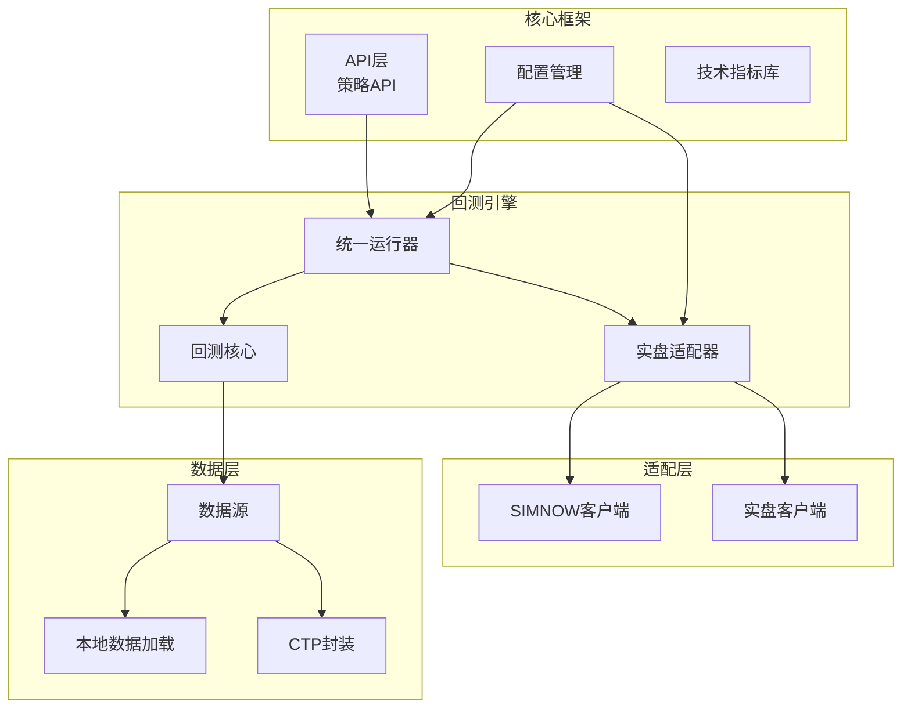
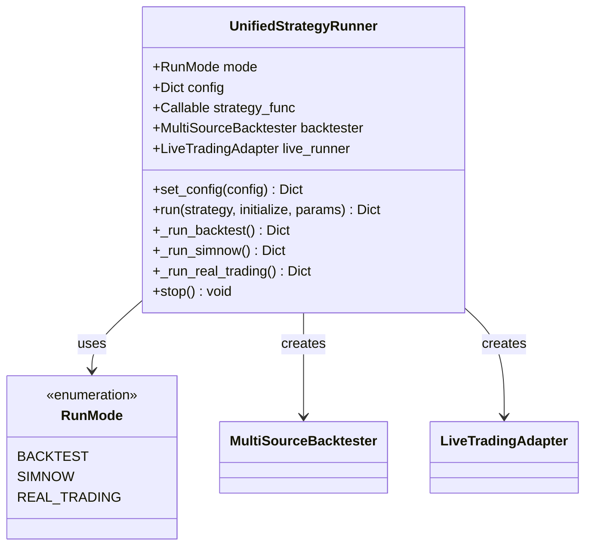
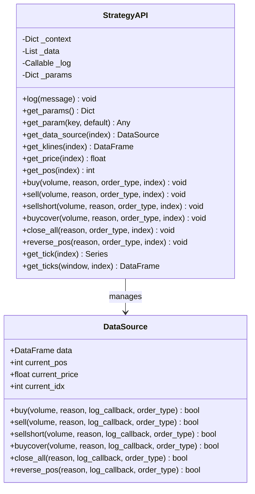
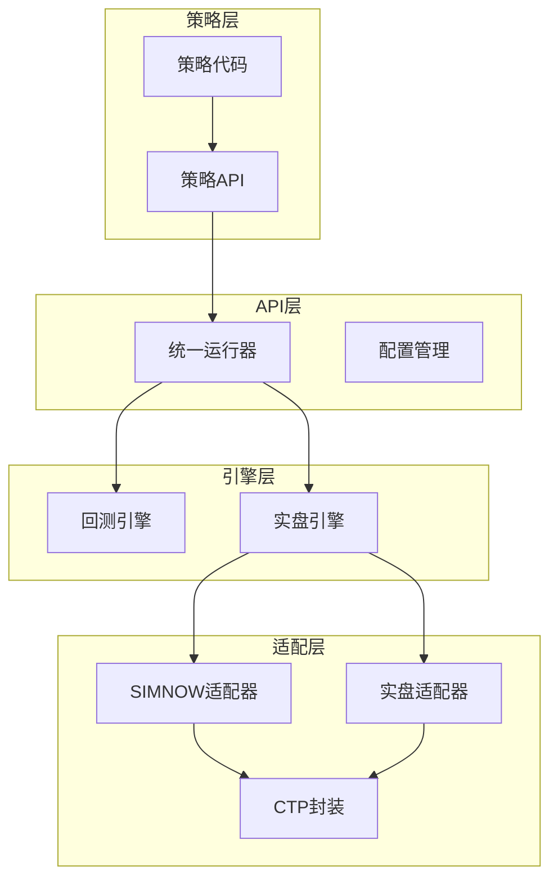
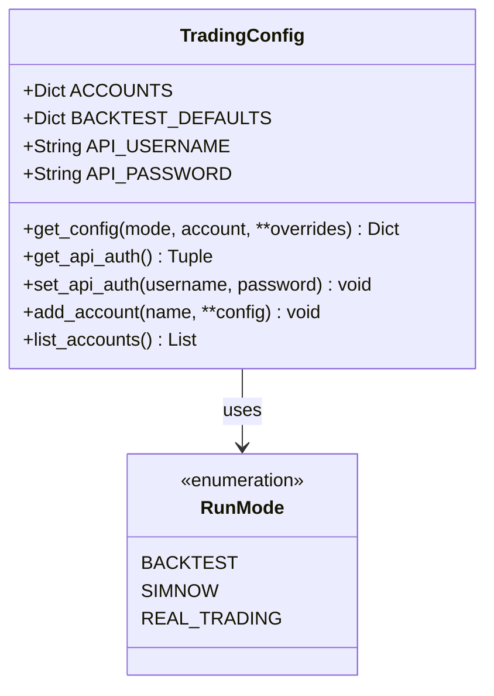
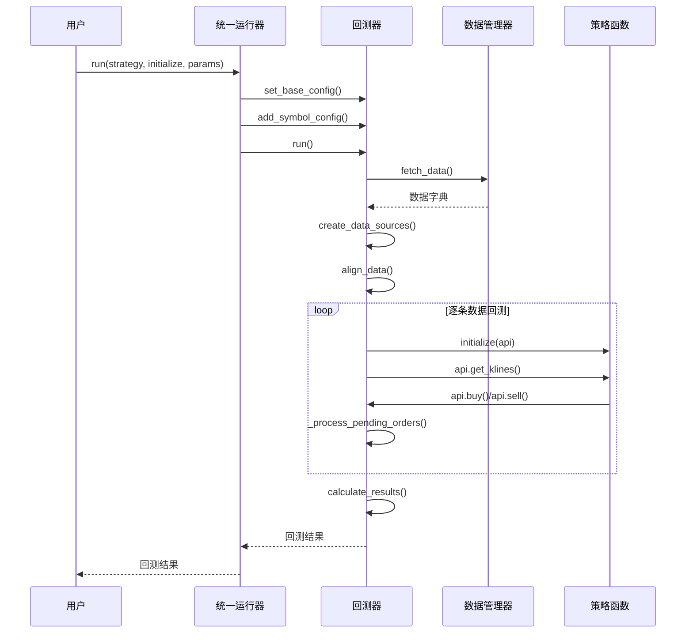
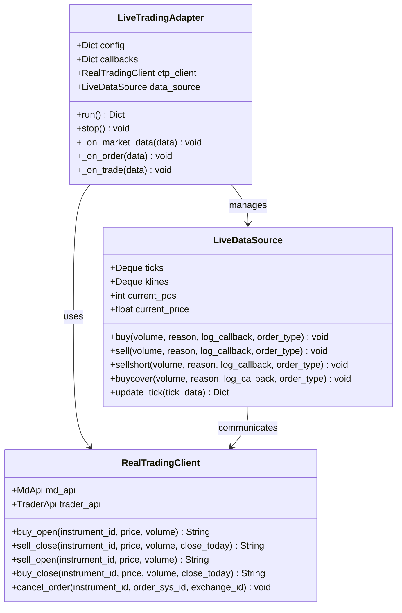
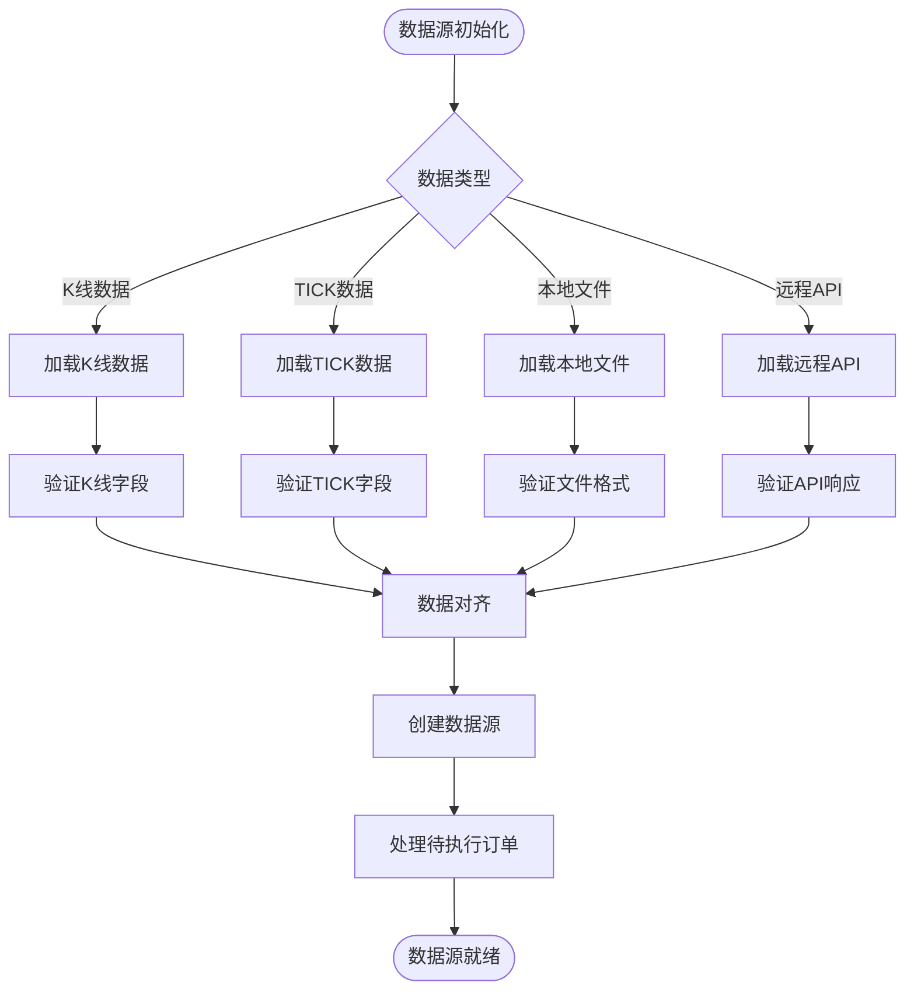
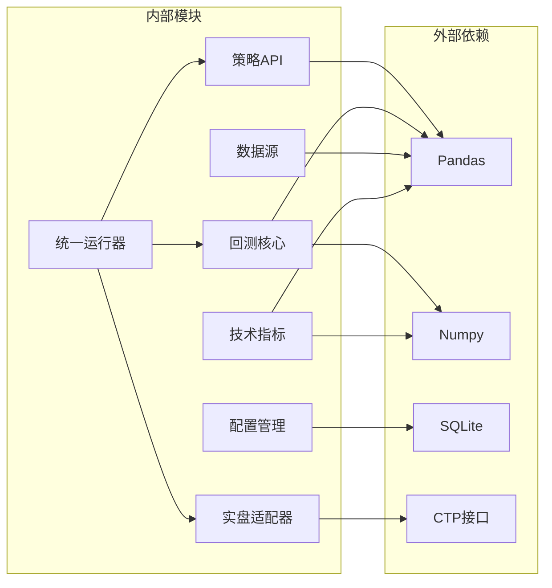
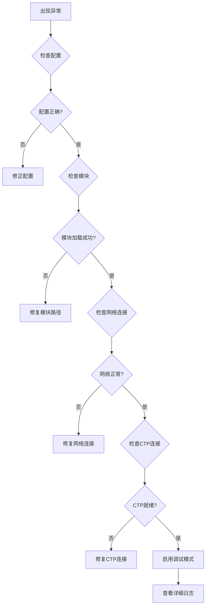

# 核心架构设计

<cite>
**本文档引用的文件**
- [ssquant/__init__.py](file://ssquant/__init__.py)
- [ssquant/api/strategy_api.py](file://ssquant/api/strategy_api.py)
- [ssquant/backtest/unified_runner.py](file://ssquant/backtest/unified_runner.py)
- [ssquant/config/trading_config.py](file://ssquant/config/trading_config.py)
- [ssquant/backtest/backtest_core.py](file://ssquant/backtest/backtest_core.py)
- [ssquant/data/data_source.py](file://ssquant/data/data_source.py)
- [ssquant/backtest/live_trading_adapter.py](file://ssquant/backtest/live_trading_adapter.py)
- [ssquant/pyctp/real_trading_client.py](file://ssquant/pyctp/real_trading_client.py)
- [ssquant/indicators/tech_indicators.py](file://ssquant/indicators/tech_indicators.py)
- [ssquant/data/local_data_loader.py](file://ssquant/data/local_data_loader.py)
- [ssquant/api/debug_utils.py](file://ssquant/api/debug_utils.py)
- [README.md](file://README.md)
</cite>

## 目录
1. [简介](#简介)
2. [项目结构](#项目结构)
3. [核心组件](#核心组件)
4. [架构概览](#架构概览)
5. [详细组件分析](#详细组件分析)
6. [依赖关系分析](#依赖关系分析)
7. [性能考虑](#性能考虑)
8. [故障排除指南](#故障排除指南)
9. [结论](#结论)

## 简介

SSQuant是一个专业的期货量化交易框架，采用"一次编写，三处运行"的设计理念，支持回测、SIMNOW模拟交易和实盘CTP交易三种运行模式。该框架通过统一的策略API接口，实现了策略层、API层、引擎层和适配层的清晰分层架构，为量化交易提供了完整的解决方案。

## 项目结构

SSQuant采用模块化的项目结构，主要包含以下核心模块：

**图表来源**
- [ssquant/__init__.py](file://ssquant/__init__.py#L1-L18)
- [ssquant/api/strategy_api.py](file://ssquant/api/strategy_api.py#L1-L570)
- [ssquant/backtest/unified_runner.py](file://ssquant/backtest/unified_runner.py#L1-L379)

**章节来源**
- [README.md](file://README.md#L297-L321)
- [ssquant/__init__.py](file://ssquant/__init__.py#L1-L18)

## 核心组件

### 统一运行器（UnifiedStrategyRunner）

统一运行器是整个框架的核心协调器，负责管理三种运行模式：

**图表来源**
- [ssquant/backtest/unified_runner.py](file://ssquant/backtest/unified_runner.py#L19-L379)

### 策略API（StrategyAPI）

策略API提供了统一的交易接口，屏蔽了不同运行模式的差异：

**图表来源**
- [ssquant/api/strategy_api.py](file://ssquant/api/strategy_api.py#L4-L570)
- [ssquant/data/data_source.py](file://ssquant/data/data_source.py#L6-L800)

**章节来源**
- [ssquant/api/strategy_api.py](file://ssquant/api/strategy_api.py#L1-L570)
- [ssquant/data/data_source.py](file://ssquant/data/data_source.py#L1-L800)

## 架构概览

SSQuant采用了经典的分层架构设计，实现了策略层、API层、引擎层和适配层的职责分离：

**图表来源**
- [ssquant/backtest/unified_runner.py](file://ssquant/backtest/unified_runner.py#L26-L379)
- [ssquant/config/trading_config.py](file://ssquant/config/trading_config.py#L1-L187)

### 设计模式应用

框架中应用了多种设计模式：

1. **策略模式**：通过统一的策略接口，支持不同的交易策略实现
2. **适配器模式**：将不同数据源和交易接口适配为统一的API
3. **工厂模式**：通过工厂函数创建策略API实例
4. **观察者模式**：实现实时回调机制（on_trade/on_order/on_cancel）
5. **模板方法模式**：统一运行流程，允许子类定制特定步骤

## 详细组件分析

### 配置管理系统

配置管理系统提供了灵活的配置管理机制：

**图表来源**
- [ssquant/config/trading_config.py](file://ssquant/config/trading_config.py#L10-L187)

配置系统支持：
- **账户配置**：SIMNOW模拟账户和实盘账户的统一管理
- **默认参数**：回测的默认配置参数
- **动态配置**：运行时动态生成和覆盖配置
- **API认证**：数据API的用户名和密码管理

**章节来源**
- [ssquant/config/trading_config.py](file://ssquant/config/trading_config.py#L1-L187)

### 回测引擎

回测引擎提供了完整的回测功能：

**图表来源**
- [ssquant/backtest/unified_runner.py](file://ssquant/backtest/unified_runner.py#L206-L314)
- [ssquant/backtest/backtest_core.py](file://ssquant/backtest/backtest_core.py#L144-L306)

**章节来源**
- [ssquant/backtest/backtest_core.py](file://ssquant/backtest/backtest_core.py#L1-L579)

### 实盘适配器

实盘适配器实现了与SIMNOW和实盘CTP的适配：

**图表来源**
- [ssquant/backtest/live_trading_adapter.py](file://ssquant/backtest/live_trading_adapter.py#L1-L800)
- [ssquant/pyctp/real_trading_client.py](file://ssquant/pyctp/real_trading_client.py#L538-L755)

**章节来源**
- [ssquant/backtest/live_trading_adapter.py](file://ssquant/backtest/live_trading_adapter.py#L1-L800)
- [ssquant/pyctp/real_trading_client.py](file://ssquant/pyctp/real_trading_client.py#L1-L755)

### 数据源管理

数据源管理实现了多数据源的统一管理：

**图表来源**
- [ssquant/data/data_source.py](file://ssquant/data/data_source.py#L1-L800)
- [ssquant/data/local_data_loader.py](file://ssquant/data/local_data_loader.py#L1-L233)

**章节来源**
- [ssquant/data/data_source.py](file://ssquant/data/data_source.py#L1-L800)
- [ssquant/data/local_data_loader.py](file://ssquant/data/local_data_loader.py#L1-L233)

## 依赖关系分析

**图表来源**
- [ssquant/indicators/tech_indicators.py](file://ssquant/indicators/tech_indicators.py#L1-L322)
- [ssquant/backtest/backtest_core.py](file://ssquant/backtest/backtest_core.py#L1-L579)

**章节来源**
- [ssquant/indicators/tech_indicators.py](file://ssquant/indicators/tech_indicators.py#L1-L322)
- [ssquant/backtest/backtest_core.py](file://ssquant/backtest/backtest_core.py#L1-L579)

## 性能考虑

### 回测性能优化

1. **数据预加载**：支持预加载历史数据，避免重复IO操作
2. **批量处理**：多数据源并行处理，提高回测效率
3. **内存管理**：使用deque管理TICK数据，控制内存使用
4. **参数优化**：支持网格搜索、随机搜索和贝叶斯优化

### 实盘性能优化

1. **异步写入**：数据记录器使用后台线程异步写入，不阻塞主线程
2. **订单防重复**：实现订单冷却机制，避免频繁下单
3. **智能重试**：支持订单超时自动重发和撤单重发
4. **缓存机制**：持仓信息缓存，减少查询开销

### 扩展性设计

1. **插件化架构**：支持自定义数据源和交易接口
2. **配置驱动**：通过配置文件实现功能开关和参数调整
3. **回调机制**：提供丰富的回调接口，支持事件驱动编程
4. **多模式支持**：统一接口支持回测、模拟和实盘三种模式

## 故障排除指南

### 常见问题诊断

### 调试工具

框架提供了完善的调试工具：

1. **模块检查**：检查关键模块的加载情况
2. **路径检查**：验证Python模块路径配置
3. **函数存在性检查**：验证关键函数的可用性
4. **系统路径检查**：诊断Python环境配置

**章节来源**
- [ssquant/api/debug_utils.py](file://ssquant/api/debug_utils.py#L1-L136)

## 结论

SSQuant框架通过精心设计的分层架构和统一的API接口，成功实现了"一次编写，三处运行"的目标。其核心优势包括：

1. **统一性**：通过策略API屏蔽了不同运行模式的差异
2. **灵活性**：支持回测、模拟和实盘三种运行模式
3. **可扩展性**：模块化设计支持功能扩展和定制
4. **稳定性**：完善的错误处理和调试机制

该框架为量化交易开发者提供了坚实的技术基础，既适合初学者快速上手，也为高级用户提供足够的扩展空间。通过合理运用框架的设计模式和架构原则，开发者可以构建稳定可靠的量化交易系统。