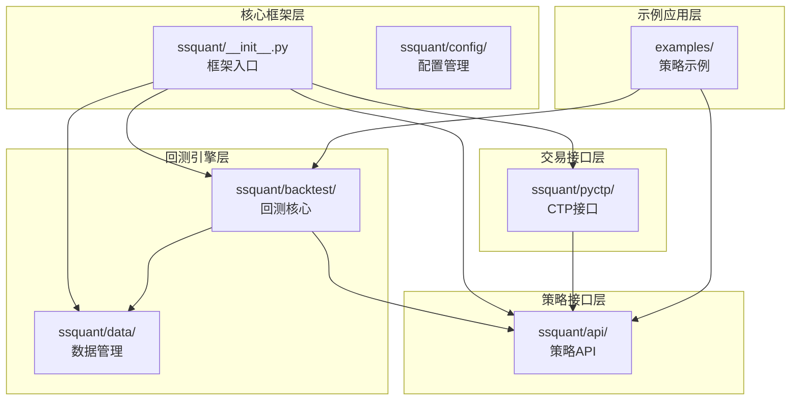
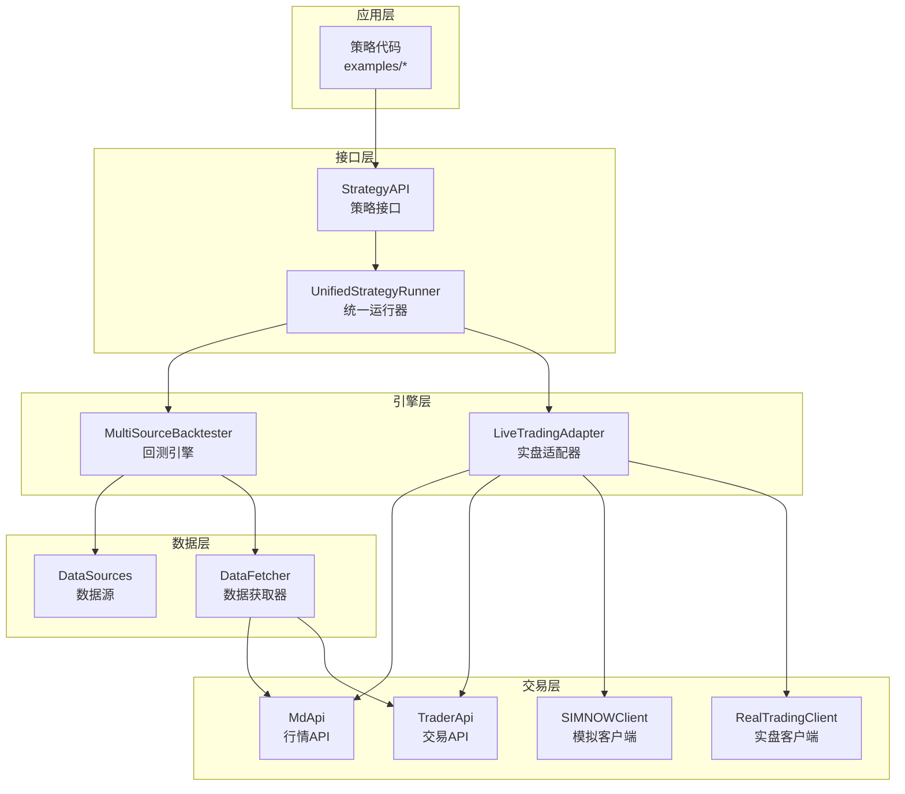
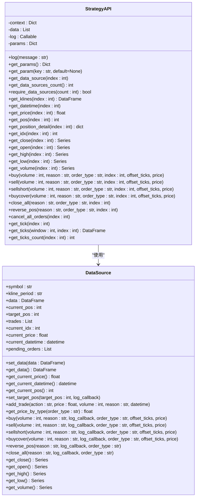
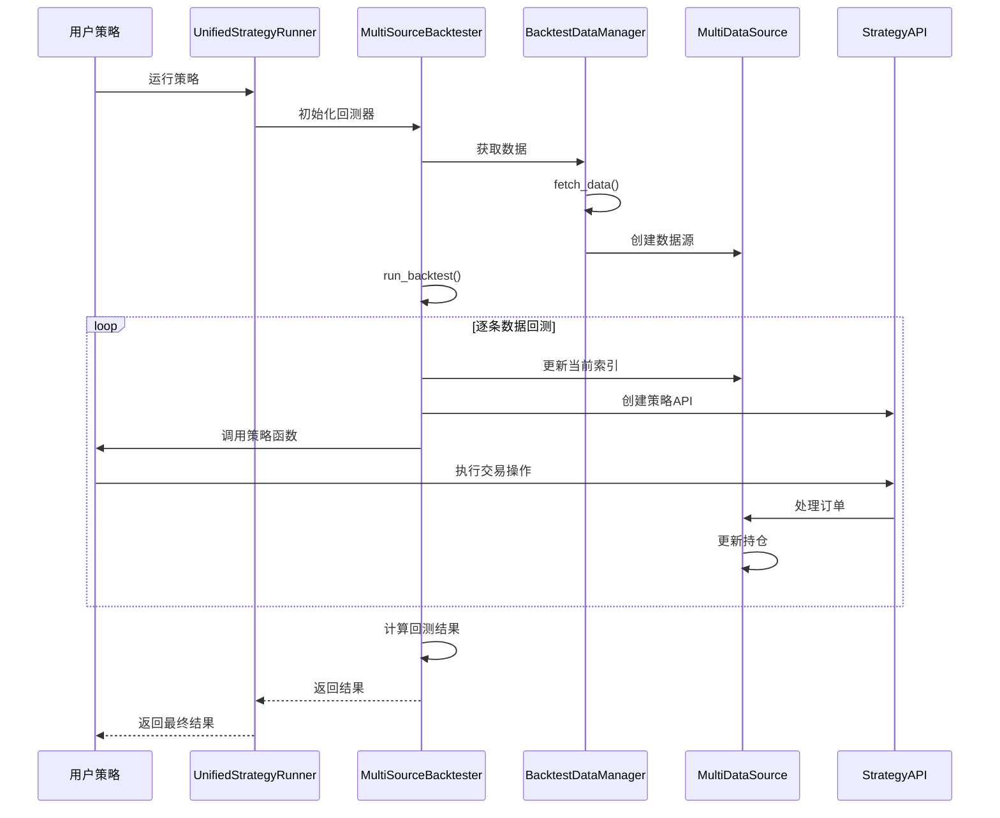
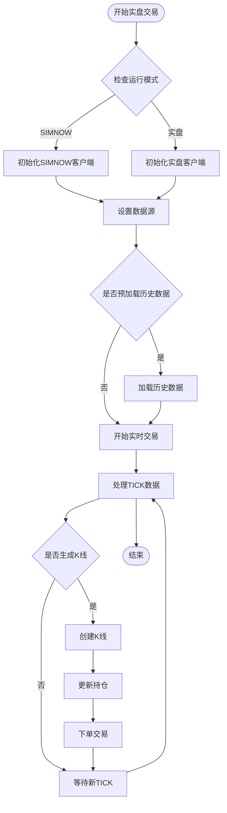
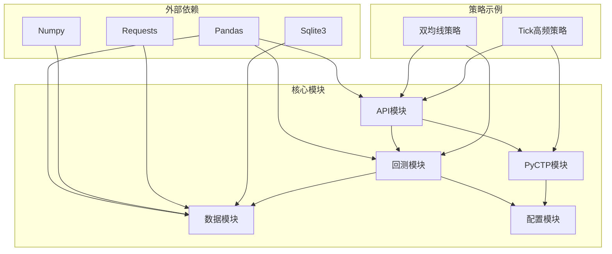

# 模块组织与职责

<cite>
**本文档引用的文件**
- [ssquant/__init__.py](file://ssquant/__init__.py)
- [ssquant/api/__init__.py](file://ssquant/api/__init__.py)
- [ssquant/api/strategy_api.py](file://ssquant/api/strategy_api.py)
- [ssquant/backtest/__init__.py](file://ssquant/backtest/__init__.py)
- [ssquant/backtest/backtest_core.py](file://ssquant/backtest/backtest_core.py)
- [ssquant/backtest/backtest_data.py](file://ssquant/backtest/backtest_data.py)
- [ssquant/backtest/unified_runner.py](file://ssquant/backtest/unified_runner.py)
- [ssquant/backtest/live_trading_adapter.py](file://ssquant/backtest/live_trading_adapter.py)
- [ssquant/data/__init__.py](file://ssquant/data/__init__.py)
- [ssquant/data/api_data_fetcher.py](file://ssquant/data/api_data_fetcher.py)
- [ssquant/data/data_source.py](file://ssquant/data/data_source.py)
- [ssquant/pyctp/__init__.py](file://ssquant/pyctp/__init__.py)
- [ssquant/pyctp/md_api.py](file://ssquant/pyctp/md_api.py)
- [ssquant/config/trading_config.py](file://ssquant/config/trading_config.py)
- [examples/B_双均线策略.py](file://examples/B_双均线策略.py)
- [examples/C_纯Tick高频交易策略.py](file://examples/C_纯Tick高频交易策略.py)
</cite>

## 目录
1. [简介](#简介)
2. [项目结构](#项目结构)
3. [核心模块](#核心模块)
4. [架构概览](#架构概览)
5. [详细组件分析](#详细组件分析)
6. [依赖关系分析](#依赖关系分析)
7. [性能考虑](#性能考虑)
8. [故障排除指南](#故障排除指南)
9. [结论](#结论)
10. [附录](#附录)

## 简介

SSQuant是一个专业的期货量化交易框架，提供了一套完整的从数据获取、策略开发、回测验证到实盘交易的解决方案。该框架采用模块化设计，支持"一次编写，多处运行"的策略开发模式，能够灵活地在历史回测、SIMNOW模拟交易和实盘CTP交易之间切换。

框架的核心特色包括：
- **统一策略接口**：通过StrategyAPI提供简洁一致的策略开发接口
- **多模式运行**：支持回测、模拟交易、实盘交易三种运行模式
- **模块化架构**：清晰的模块边界和职责分工
- **扩展性强**：易于添加新的功能模块和交易接口

## 项目结构

SSQuant框架采用清晰的模块化组织结构，按照功能职责划分为多个核心模块：

**图表来源**
- [ssquant/__init__.py](file://ssquant/__init__.py#L1-L18)
- [ssquant/api/__init__.py](file://ssquant/api/__init__.py#L1-L12)
- [ssquant/backtest/__init__.py](file://ssquant/backtest/__init__.py#L1-L30)
- [ssquant/data/__init__.py](file://ssquant/data/__init__.py#L1-L84)
- [ssquant/pyctp/__init__.py](file://ssquant/pyctp/__init__.py#L1-L26)

**章节来源**
- [ssquant/__init__.py](file://ssquant/__init__.py#L1-L18)
- [ssquant/api/__init__.py](file://ssquant/api/__init__.py#L1-L12)
- [ssquant/backtest/__init__.py](file://ssquant/backtest/__init__.py#L1-L30)
- [ssquant/data/__init__.py](file://ssquant/data/__init__.py#L1-L84)
- [ssquant/pyctp/__init__.py](file://ssquant/pyctp/__init__.py#L1-L26)

## 核心模块

### API模块 - 策略接口设计

API模块是整个框架的策略开发核心，提供了统一的策略接口和工具函数。

**主要职责**：
- 提供策略开发的标准接口
- 管理策略上下文和参数
- 封装数据访问和交易操作
- 支持多数据源访问

**核心组件**：
- `StrategyAPI`：策略API核心类，提供数据访问和交易操作
- `create_strategy_api`：策略API工厂方法

**章节来源**
- [ssquant/api/__init__.py](file://ssquant/api/__init__.py#L1-L12)
- [ssquant/api/strategy_api.py](file://ssquant/api/strategy_api.py#L1-L570)

### 回测模块 - 多数据源回测引擎

回测模块实现了完整的多数据源回测引擎，支持复杂的多品种、多周期策略回测。

**主要职责**：
- 多数据源回测管理
- 数据获取和处理
- 回测结果计算和报告
- 参数优化支持

**核心组件**：
- `MultiSourceBacktester`：多数据源回测器
- `BacktestDataManager`：回测数据管理器
- `UnifiedStrategyRunner`：统一策略运行器

**章节来源**
- [ssquant/backtest/__init__.py](file://ssquant/backtest/__init__.py#L1-L30)
- [ssquant/backtest/backtest_core.py](file://ssquant/backtest/backtest_core.py#L1-L579)
- [ssquant/backtest/backtest_data.py](file://ssquant/backtest/backtest_data.py#L1-L246)
- [ssquant/backtest/unified_runner.py](file://ssquant/backtest/unified_runner.py#L1-L379)

### 数据模块 - 数据管理机制

数据模块提供了完整的期货数据获取、处理和管理功能。

**主要职责**：
- API数据获取和缓存
- 本地数据处理
- 多品种数据管理
- 数据源对齐和同步

**核心组件**：
- `api_data_fetcher`：API数据获取模块
- `local_data_loader`：本地数据处理模块
- `multi_data_fetcher`：多品种数据获取模块
- `data_source`：数据源管理模块

**章节来源**
- [ssquant/data/__init__.py](file://ssquant/data/__init__.py#L1-L84)
- [ssquant/data/api_data_fetcher.py](file://ssquant/data/api_data_fetcher.py#L1-L800)
- [ssquant/data/data_source.py](file://ssquant/data/data_source.py#L1-L800)

### PyCTP模块 - 交易接口封装

PyCTP模块提供了Python CTP API的友好封装，支持CTP行情和交易功能。

**主要职责**：
- CTP行情API封装
- CTP交易API封装
- SIMNOW模拟交易支持
- 实盘CTP交易支持

**核心组件**：
- `MdApi`：CTP行情API
- `TraderApi`：CTP交易API
- `SIMNOWClient`：SIMNOW客户端
- `RealTradingClient`：实盘交易客户端

**章节来源**
- [ssquant/pyctp/__init__.py](file://ssquant/pyctp/__init__.py#L1-L26)
- [ssquant/pyctp/md_api.py](file://ssquant/pyctp/md_api.py#L1-L261)

## 架构概览

SSQuant框架采用了分层架构设计，各层之间职责明确，耦合度低，便于维护和扩展。

**图表来源**
- [ssquant/api/strategy_api.py](file://ssquant/api/strategy_api.py#L1-L570)
- [ssquant/backtest/unified_runner.py](file://ssquant/backtest/unified_runner.py#L1-L379)
- [ssquant/backtest/backtest_core.py](file://ssquant/backtest/backtest_core.py#L1-L579)
- [ssquant/backtest/live_trading_adapter.py](file://ssquant/backtest/live_trading_adapter.py#L1-L800)
- [ssquant/pyctp/md_api.py](file://ssquant/pyctp/md_api.py#L1-L261)

## 详细组件分析

### 策略API组件分析

StrategyAPI是策略开发的核心接口，提供了统一的数据访问和交易操作方法。

**图表来源**
- [ssquant/api/strategy_api.py](file://ssquant/api/strategy_api.py#L1-L570)
- [ssquant/data/data_source.py](file://ssquant/data/data_source.py#L1-L800)

**章节来源**
- [ssquant/api/strategy_api.py](file://ssquant/api/strategy_api.py#L1-L570)
- [ssquant/data/data_source.py](file://ssquant/data/data_source.py#L1-L800)

### 回测引擎组件分析

MultiSourceBacktester是回测系统的核心组件，实现了完整的多数据源回测流程。

**图表来源**
- [ssquant/backtest/unified_runner.py](file://ssquant/backtest/unified_runner.py#L1-L379)
- [ssquant/backtest/backtest_core.py](file://ssquant/backtest/backtest_core.py#L1-L579)
- [ssquant/backtest/backtest_data.py](file://ssquant/backtest/backtest_data.py#L1-L246)

**章节来源**
- [ssquant/backtest/backtest_core.py](file://ssquant/backtest/backtest_core.py#L1-L579)
- [ssquant/backtest/backtest_data.py](file://ssquant/backtest/backtest_data.py#L1-L246)
- [ssquant/backtest/unified_runner.py](file://ssquant/backtest/unified_runner.py#L1-L379)

### 实盘交易适配器组件分析

LiveTradingAdapter实现了实盘交易的适配，支持SIMNOW模拟和真实CTP交易。

**图表来源**
- [ssquant/backtest/live_trading_adapter.py](file://ssquant/backtest/live_trading_adapter.py#L1-L800)

**章节来源**
- [ssquant/backtest/live_trading_adapter.py](file://ssquant/backtest/live_trading_adapter.py#L1-L800)

## 依赖关系分析

SSQuant框架的模块间依赖关系清晰，遵循了依赖倒置原则，降低了模块间的耦合度。

**图表来源**
- [ssquant/api/strategy_api.py](file://ssquant/api/strategy_api.py#L1-L570)
- [ssquant/backtest/backtest_core.py](file://ssquant/backtest/backtest_core.py#L1-L579)
- [ssquant/data/api_data_fetcher.py](file://ssquant/data/api_data_fetcher.py#L1-L800)
- [ssquant/pyctp/md_api.py](file://ssquant/pyctp/md_api.py#L1-L261)

**章节来源**
- [ssquant/api/strategy_api.py](file://ssquant/api/strategy_api.py#L1-L570)
- [ssquant/backtest/backtest_core.py](file://ssquant/backtest/backtest_core.py#L1-L579)
- [ssquant/data/api_data_fetcher.py](file://ssquant/data/api_data_fetcher.py#L1-L800)
- [ssquant/pyctp/md_api.py](file://ssquant/pyctp/md_api.py#L1-L261)

## 性能考虑

SSQuant框架在设计时充分考虑了性能优化，采用了多种策略来提升系统的运行效率：

### 数据缓存策略
- **智能缓存机制**：API数据获取支持本地缓存，避免重复网络请求
- **多级缓存**：支持SQLite数据库缓存和内存缓存
- **缓存失效策略**：基于时间戳和交易日的智能缓存更新

### 并行处理优化
- **异步数据写入**：实盘数据记录使用异步队列，避免阻塞主线程
- **多线程支持**：后台写入线程独立运行，提升数据处理效率
- **并发数据获取**：支持多数据源并行获取和处理

### 内存管理优化
- **数据结构优化**：使用deque等高效数据结构管理历史数据
- **内存池管理**：合理控制内存使用，避免内存泄漏
- **数据压缩**：对历史数据进行压缩存储，节省磁盘空间

## 故障排除指南

### 常见问题及解决方案

**CTP功能不可用**
- **症状**：启动时出现CTP功能不可用警告
- **原因**：Python版本不兼容或CTP库缺失
- **解决**：检查Python版本是否在支持范围内，或降级Python版本

**数据获取失败**
- **症状**：回测或实盘数据获取失败
- **原因**：API认证失败、网络连接问题、数据源不可用
- **解决**：检查trading_config.py中的API认证配置，确认网络连接正常

**订单执行异常**
- **症状**：实盘下单失败或延迟
- **原因**：CTP连接异常、账户权限不足、价格超出限制
- **解决**：检查CTP连接状态，确认账户权限，调整下单价格

**章节来源**
- [ssquant/__init__.py](file://ssquant/__init__.py#L14-L17)
- [ssquant/config/trading_config.py](file://ssquant/config/trading_config.py#L1-L187)

## 结论

SSQuant框架通过模块化的设计理念，成功构建了一个功能完整、扩展性强的期货量化交易系统。各模块职责明确，接口清晰，既保证了系统的稳定性，又为未来的功能扩展奠定了良好的基础。

框架的核心优势包括：
- **统一的策略接口**：简化了策略开发流程
- **灵活的运行模式**：支持多种交易场景
- **完善的回测系统**：提供了可靠的策略验证机制
- **强大的扩展能力**：易于添加新的功能模块

随着量化交易市场的不断发展，SSQuant框架将继续演进，为用户提供更加完善的服务。

## 附录

### 模块设计最佳实践

**模块边界设计**
- 每个模块应该有明确的职责边界
- 模块间通过清晰的接口进行交互
- 避免模块间的循环依赖

**接口设计原则**
- 接口应该简单易用
- 参数和返回值应该有明确的类型约束
- 异常处理应该统一规范

**代码组织规范**
- 采用功能导向的文件组织方式
- 每个文件应该有明确的功能定位
- 代码注释应该清晰完整

### 扩展指导

**添加新模块的步骤**
1. 定义模块的职责和接口
2. 设计模块的配置和初始化流程
3. 实现核心功能并编写单元测试
4. 更新模块的__init__.py文件
5. 在示例中演示新模块的使用

**集成新交易接口**
1. 分析现有交易接口的抽象层次
2. 设计新接口的适配器类
3. 实现数据格式转换和映射
4. 编写兼容性测试用例
5. 更新统一运行器以支持新接口