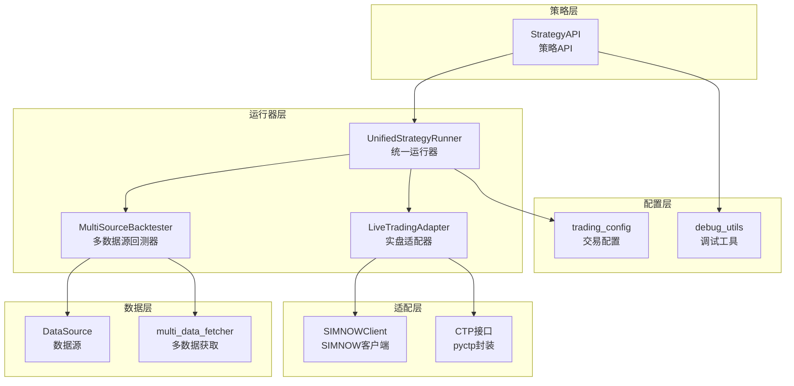
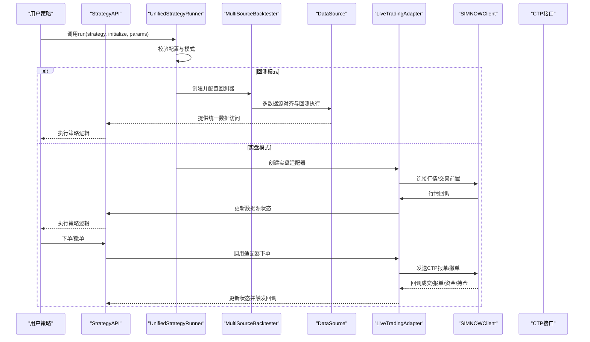
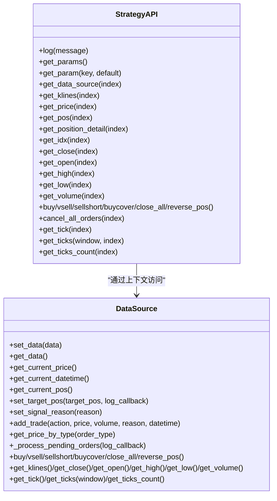
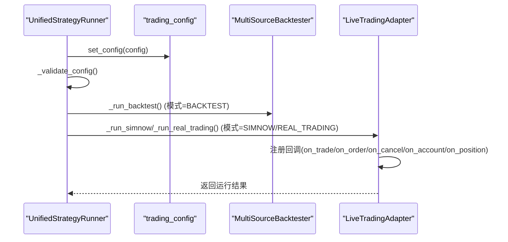
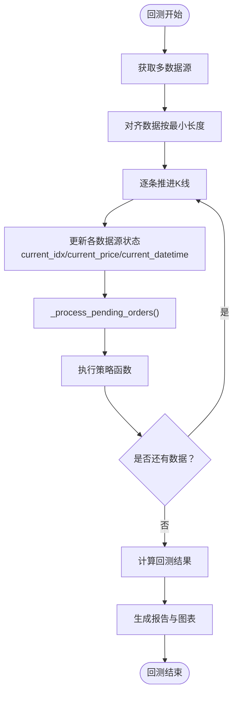
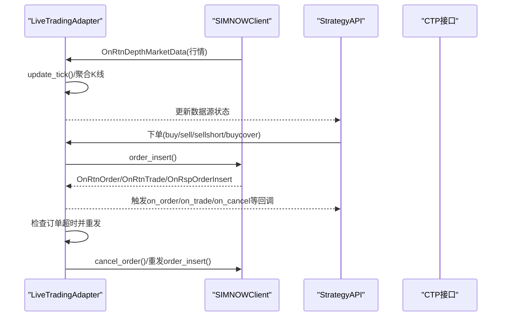
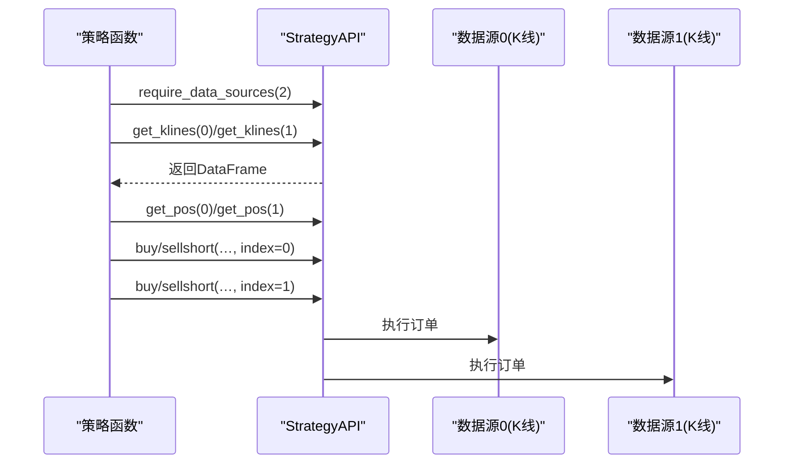
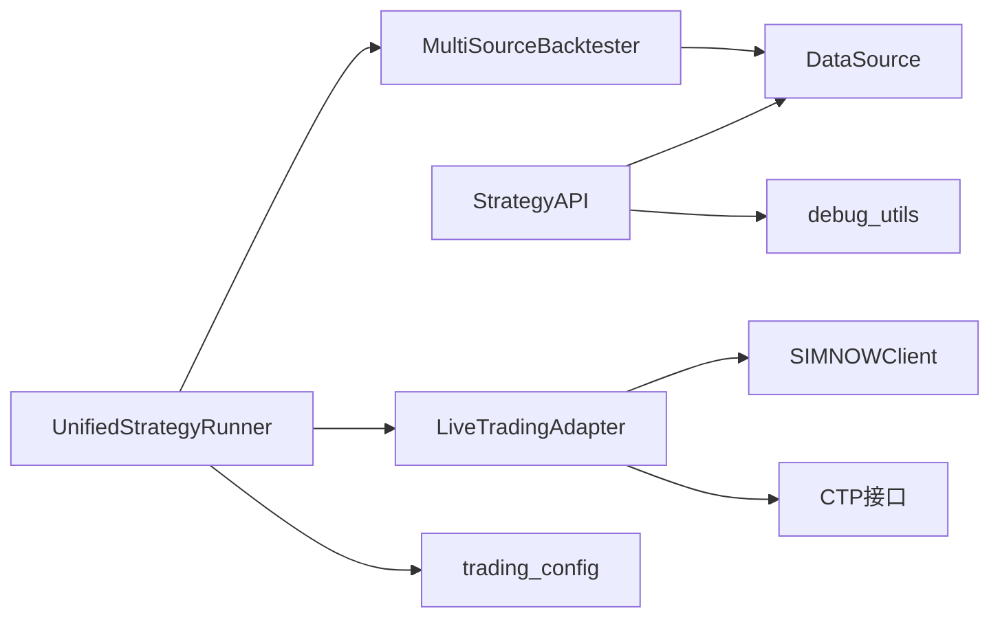

# 组件交互机制

<cite>
**本文档引用的文件**
- [ssquant/__init__.py](file://ssquant/__init__.py)
- [ssquant/api/strategy_api.py](file://ssquant/api/strategy_api.py)
- [ssquant/backtest/unified_runner.py](file://ssquant/backtest/unified_runner.py)
- [ssquant/data/data_source.py](file://ssquant/data/data_source.py)
- [ssquant/backtest/live_trading_adapter.py](file://ssquant/backtest/live_trading_adapter.py)
- [ssquant/backtest/backtest_core.py](file://ssquant/backtest/backtest_core.py)
- [ssquant/data/multi_data_fetcher.py](file://ssquant/data/multi_data_fetcher.py)
- [ssquant/pyctp/simnow_client.py](file://ssquant/pyctp/simnow_client.py)
- [ssquant/config/trading_config.py](file://ssquant/config/trading_config.py)
- [ssquant/api/debug_utils.py](file://ssquant/api/debug_utils.py)
- [examples/B_跨品种套利策略.py](file://examples/B_跨品种套利策略.py)
- [examples/B_海龟交易策略.py](file://examples/B_海龟交易策略.py)
- [README.md](file://README.md)
</cite>

## 目录
1. [简介](#简介)
2. [项目结构](#项目结构)
3. [核心组件](#核心组件)
4. [架构概览](#架构概览)
5. [详细组件分析](#详细组件分析)
6. [依赖分析](#依赖分析)
7. [性能考量](#性能考量)
8. [故障排查指南](#故障排查指南)
9. [结论](#结论)
10. [附录](#附录)

## 简介
本文件系统性梳理SSQuant框架的组件交互机制，重点阐述策略API与数据源的交互、统一运行器与适配器的协调、回测引擎与实时数据的同步方式。文档涵盖组件间的依赖注入、事件传递与状态同步机制，以及异步处理、错误传播与异常恢复的实现策略，并提供交互时序图与数据流图，帮助读者快速理解并高效扩展系统。

## 项目结构
SSQuant采用“策略API + 统一运行器 + 多引擎适配”的分层架构，支持回测、SIMNOW模拟与实盘CTP三种运行模式。核心模块包括：
- 策略API层：提供统一的数据访问与交易接口，屏蔽底层差异
- 统一运行器：根据运行模式调度回测器或实盘适配器
- 回测引擎：多数据源对齐、回测执行、结果计算与可视化
- 实盘适配器：将CTP接口适配为统一API，支持异步行情与交易回调
- 配置管理：集中管理账户、参数与运行模式

**图表来源**
- [ssquant/api/strategy_api.py](file://ssquant/api/strategy_api.py#L1-L570)
- [ssquant/backtest/unified_runner.py](file://ssquant/backtest/unified_runner.py#L1-L379)
- [ssquant/backtest/backtest_core.py](file://ssquant/backtest/backtest_core.py#L1-L579)
- [ssquant/data/data_source.py](file://ssquant/data/data_source.py#L1-L922)
- [ssquant/backtest/live_trading_adapter.py](file://ssquant/backtest/live_trading_adapter.py#L1-L2241)
- [ssquant/pyctp/simnow_client.py](file://ssquant/pyctp/simnow_client.py#L1-L815)
- [ssquant/config/trading_config.py](file://ssquant/config/trading_config.py#L1-L187)
- [ssquant/api/debug_utils.py](file://ssquant/api/debug_utils.py#L1-L136)

**章节来源**
- [README.md](file://README.md#L297-L321)

## 核心组件
- 策略API（StrategyAPI）：封装数据访问与交易操作，提供统一接口，支持多数据源访问与订单类型控制
- 统一运行器（UnifiedStrategyRunner）：根据运行模式（回测/SIMNOW/实盘）调度相应执行器，负责配置校验与回调注册
- 多数据源回测器（MultiSourceBacktester）：多品种多周期数据对齐、回测执行、结果计算与可视化
- 实盘适配器（LiveTradingAdapter）：将CTP接口适配为统一API，支持异步行情、订单超时与重发、数据落盘
- 数据源（DataSource/LiveDataSource）：提供K线/TICK数据访问、订单执行与持仓管理
- 配置管理（trading_config）：账户与参数配置，支持回测默认参数与账户模板
- 调试工具（debug_utils）：模块加载检查与路径诊断

**章节来源**
- [ssquant/api/strategy_api.py](file://ssquant/api/strategy_api.py#L1-L570)
- [ssquant/backtest/unified_runner.py](file://ssquant/backtest/unified_runner.py#L1-L379)
- [ssquant/backtest/backtest_core.py](file://ssquant/backtest/backtest_core.py#L1-L579)
- [ssquant/data/data_source.py](file://ssquant/data/data_source.py#L1-L922)
- [ssquant/backtest/live_trading_adapter.py](file://ssquant/backtest/live_trading_adapter.py#L1-L2241)
- [ssquant/config/trading_config.py](file://ssquant/config/trading_config.py#L1-L187)
- [ssquant/api/debug_utils.py](file://ssquant/api/debug_utils.py#L1-L136)

## 架构概览
SSQuant通过“策略API + 统一运行器 + 多引擎适配”实现“一次编写，三处运行”。运行器根据模式选择回测或实盘路径，回测路径使用多数据源对齐与统一API执行策略；实盘路径通过适配器桥接CTP接口，提供异步回调与数据落盘能力。

**图表来源**
- [ssquant/backtest/unified_runner.py](file://ssquant/backtest/unified_runner.py#L162-L214)
- [ssquant/backtest/backtest_core.py](file://ssquant/backtest/backtest_core.py#L144-L306)
- [ssquant/backtest/live_trading_adapter.py](file://ssquant/backtest/live_trading_adapter.py#L662-L701)
- [ssquant/pyctp/simnow_client.py](file://ssquant/pyctp/simnow_client.py#L662-L701)

## 详细组件分析

### 策略API与数据源交互
- 统一接口：StrategyAPI通过上下文注入数据源集合，提供多数据源访问与订单执行
- 订单执行：数据源内部维护待执行订单队列，按K线推进时批量处理，支持多种订单类型与价格策略
- 持仓管理：数据源维护目标持仓与实际持仓，支持反手、全平与锁仓场景

**图表来源**
- [ssquant/api/strategy_api.py](file://ssquant/api/strategy_api.py#L1-L570)
- [ssquant/data/data_source.py](file://ssquant/data/data_source.py#L1-L922)

**章节来源**
- [ssquant/api/strategy_api.py](file://ssquant/api/strategy_api.py#L91-L558)
- [ssquant/data/data_source.py](file://ssquant/data/data_source.py#L137-L778)

### 统一运行器与适配器协调
- 模式调度：根据运行模式创建回测器或实盘适配器，注入策略函数、初始化函数与回调
- 配置校验：针对不同模式校验必填参数，确保运行安全
- 回调注册：实盘模式下注册成交、报单、撤单、资金与持仓回调，实现事件驱动

**图表来源**
- [ssquant/backtest/unified_runner.py](file://ssquant/backtest/unified_runner.py#L79-L161)
- [ssquant/backtest/unified_runner.py](file://ssquant/backtest/unified_runner.py#L215-L372)
- [ssquant/config/trading_config.py](file://ssquant/config/trading_config.py#L115-L164)

**章节来源**
- [ssquant/backtest/unified_runner.py](file://ssquant/backtest/unified_runner.py#L41-L379)
- [ssquant/config/trading_config.py](file://ssquant/config/trading_config.py#L1-L187)

### 回测引擎与实时数据同步
- 多数据源对齐：回测器按最小数据长度推进，逐条更新各数据源的当前索引、价格与时间
- 订单执行：在每条数据推进时，调用数据源的待执行订单处理逻辑，实现“下一K线”订单的时序执行
- 结果计算：回测结束后计算绩效指标、生成报告与图表

**图表来源**
- [ssquant/backtest/backtest_core.py](file://ssquant/backtest/backtest_core.py#L144-L306)

**章节来源**
- [ssquant/backtest/backtest_core.py](file://ssquant/backtest/backtest_core.py#L14-L579)

### 实盘适配器与CTP交互
- 异步行情：通过SIMNOW/实盘客户端接收CTP行情，聚合为K线并缓存TICK，支持历史数据预加载
- 订单超时与重发：检测未成交订单超时，自动触发撤单并按策略重发
- 数据落盘：异步队列写入CSV/DB，支持K线与TICK双存储
- 回调系统：实时推送成交、报单、资金与持仓变更，便于策略侧状态同步

**图表来源**
- [ssquant/backtest/live_trading_adapter.py](file://ssquant/backtest/live_trading_adapter.py#L461-L701)
- [ssquant/pyctp/simnow_client.py](file://ssquant/pyctp/simnow_client.py#L19-L540)

**章节来源**
- [ssquant/backtest/live_trading_adapter.py](file://ssquant/backtest/live_trading_adapter.py#L26-L233)
- [ssquant/backtest/live_trading_adapter.py](file://ssquant/backtest/live_trading_adapter.py#L235-L708)
- [ssquant/pyctp/simnow_client.py](file://ssquant/pyctp/simnow_client.py#L590-L815)

### 多数据源与多周期策略协作
- 多数据源访问：策略通过index参数访问不同数据源，实现多品种并行交易
- 多周期对齐：回测器对齐不同周期数据，统一推进索引，确保策略在相同时间点执行
- 跨品种套利示例：策略同时访问两个品种的K线，计算价差与Z-score，基于阈值进行开平仓

**图表来源**
- [examples/B_跨品种套利策略.py](file://examples/B_跨品种套利策略.py#L105-L167)

**章节来源**
- [examples/B_跨品种套利策略.py](file://examples/B_跨品种套利策略.py#L1-L200)
- [examples/B_海龟交易策略.py](file://examples/B_海龟交易策略.py#L119-L200)

## 依赖分析
- 组件耦合：策略API与数据源通过上下文弱耦合；运行器与引擎通过接口解耦；适配器与CTP通过SPI回调解耦
- 外部依赖：CTP接口、SIMNOW服务器、SQLite数据库（用于数据落盘）、第三方技术指标库（如statsmodels）
- 依赖链：策略API → 数据源 → 回测引擎或实盘适配器 → CTP/SIMNOW

**图表来源**
- [ssquant/api/strategy_api.py](file://ssquant/api/strategy_api.py#L1-L570)
- [ssquant/backtest/unified_runner.py](file://ssquant/backtest/unified_runner.py#L1-L379)
- [ssquant/backtest/backtest_core.py](file://ssquant/backtest/backtest_core.py#L1-L579)
- [ssquant/backtest/live_trading_adapter.py](file://ssquant/backtest/live_trading_adapter.py#L1-L2241)
- [ssquant/pyctp/simnow_client.py](file://ssquant/pyctp/simnow_client.py#L1-L815)
- [ssquant/config/trading_config.py](file://ssquant/config/trading_config.py#L1-L187)
- [ssquant/api/debug_utils.py](file://ssquant/api/debug_utils.py#L1-L136)

**章节来源**
- [ssquant/__init__.py](file://ssquant/__init__.py#L1-L18)

## 性能考量
- 数据对齐与缓存：回测器按最小数据长度推进，减少无效遍历；数据源使用滑动窗口缓存K线/TICK，降低频繁IO
- 异步落盘：数据记录器使用后台线程与队列异步写入，避免阻塞主线程
- 参数优化：回测器支持预加载数据与参数网格搜索，结合环境变量控制可视化与日志输出，提升优化效率
- 订单超时与重发：通过超时检测与智能重发机制，减少挂单时间，提高执行效率

**章节来源**
- [ssquant/backtest/backtest_core.py](file://ssquant/backtest/backtest_core.py#L456-L579)
- [ssquant/backtest/live_trading_adapter.py](file://ssquant/backtest/live_trading_adapter.py#L26-L113)

## 故障排查指南
- 模块加载检查：使用调试工具检查模块与函数是否存在，定位导入问题
- 配置校验：统一运行器在运行前校验配置，缺失参数会抛出明确错误
- CTP登录与回调：SIMNOW客户端提供详细的错误解码与描述，便于定位登录与报单失败原因
- 数据API认证：回测需配置数据API用户名与密码，未配置会导致数据获取失败

**章节来源**
- [ssquant/api/debug_utils.py](file://ssquant/api/debug_utils.py#L104-L136)
- [ssquant/backtest/unified_runner.py](file://ssquant/backtest/unified_runner.py#L122-L161)
- [ssquant/pyctp/simnow_client.py](file://ssquant/pyctp/simnow_client.py#L517-L583)
- [ssquant/config/trading_config.py](file://ssquant/config/trading_config.py#L167-L177)

## 结论
SSQuant通过统一API与运行器抽象，实现了策略在回测、SIMNOW模拟与实盘CTP之间的无缝切换。组件间通过上下文注入、回调与事件驱动实现松耦合协作，配合异步落盘与订单重发机制，提升了系统的稳定性与可扩展性。建议在实际部署中充分利用配置模板与调试工具，确保运行环境与策略逻辑的一致性。

## 附录
- 典型场景：多数据源多周期策略、跨品种套利、TICK流高频策略
- 扩展建议：新增数据源接口、自定义适配器、插件化技术指标与回测可视化