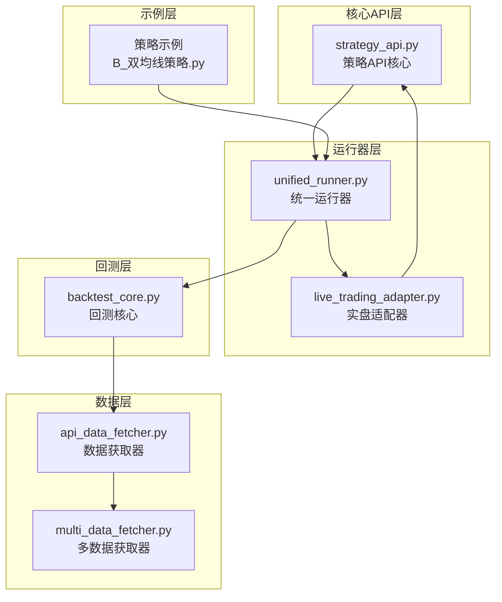
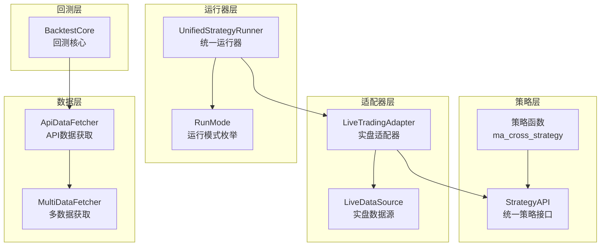
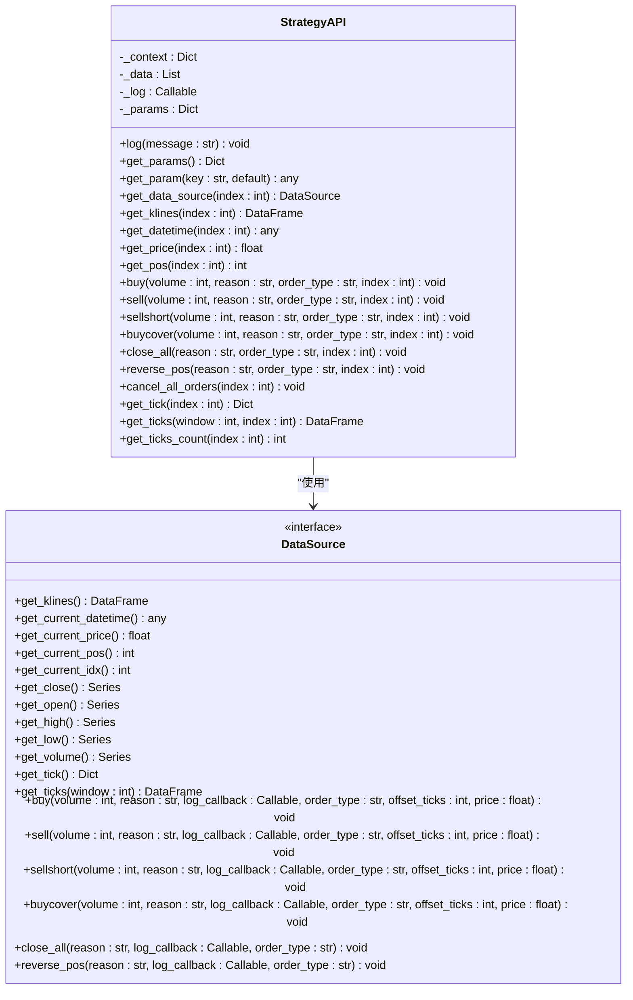
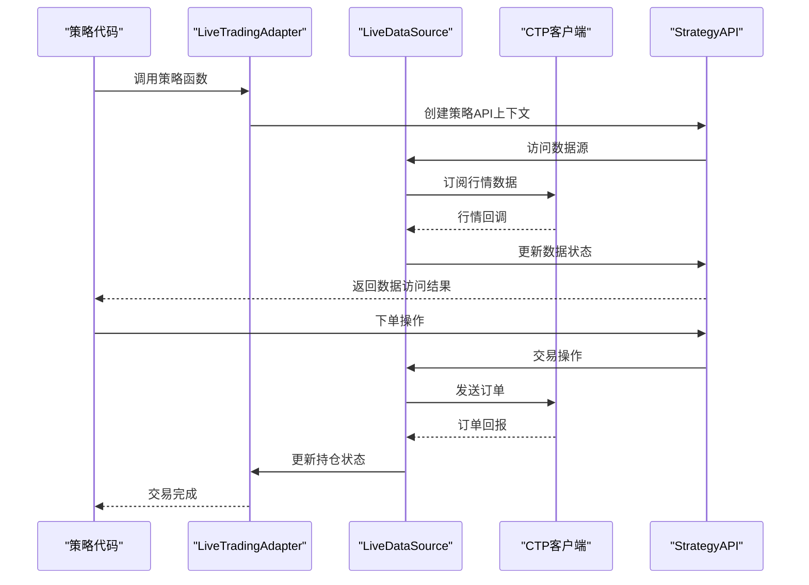
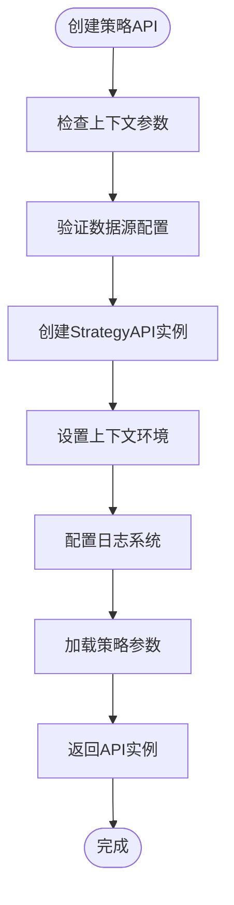
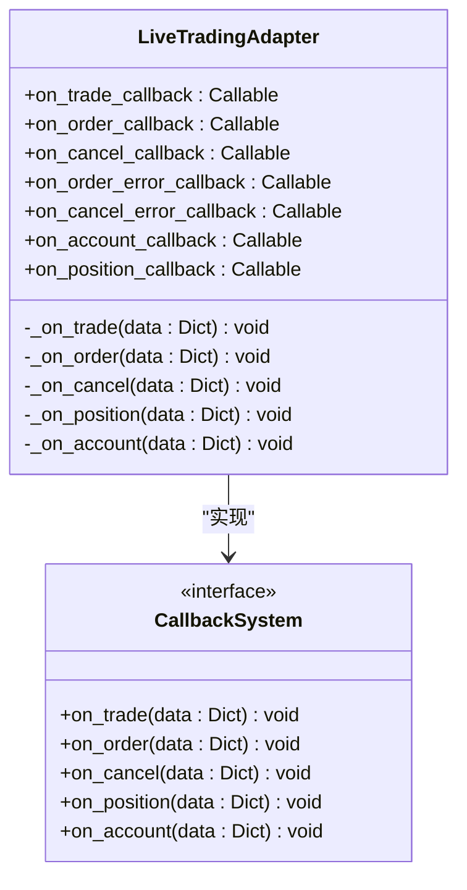
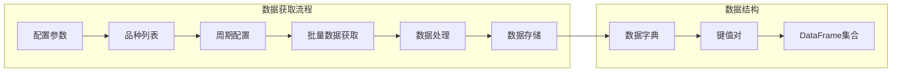
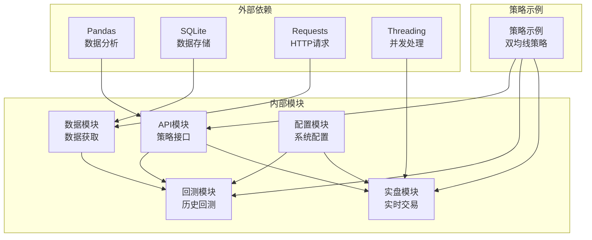

# 设计模式应用

<cite>
**本文档引用的文件**
- [strategy_api.py](file://ssquant/api/strategy_api.py)
- [live_trading_adapter.py](file://ssquant/backtest/live_trading_adapter.py)
- [unified_runner.py](file://ssquant/backtest/unified_runner.py)
- [api_data_fetcher.py](file://ssquant/data/api_data_fetcher.py)
- [multi_data_fetcher.py](file://ssquant/data/multi_data_fetcher.py)
- [backtest_core.py](file://ssquant/backtest/backtest_core.py)
- [B_双均线策略.py](file://examples/B_双均线策略.py)
</cite>

## 目录
1. [简介](#简介)
2. [项目结构](#项目结构)
3. [核心组件](#核心组件)
4. [架构概览](#架构概览)
5. [详细组件分析](#详细组件分析)
6. [依赖关系分析](#依赖关系分析)
7. [性能考量](#性能考量)
8. [故障排除指南](#故障排除指南)
9. [结论](#结论)

## 简介

SSQuant框架是一个专业的量化交易框架，旨在为期货和股票市场提供统一的策略开发和执行环境。该框架通过精心设计的架构，实现了策略代码的可移植性、可扩展性和可维护性。本文档深入分析了框架中应用的各种设计模式，包括策略模式、适配器模式、工厂模式和观察者模式，并详细解释了每种模式的选择原因、实现方式和带来的好处。

## 项目结构

SSQuant框架采用模块化的项目结构，主要分为以下几个核心模块：

**图表来源**
- [strategy_api.py](file://ssquant/api/strategy_api.py#L1-L570)
- [unified_runner.py](file://ssquant/backtest/unified_runner.py#L1-L379)
- [live_trading_adapter.py](file://ssquant/backtest/live_trading_adapter.py#L1-L2241)

**章节来源**
- [strategy_api.py](file://ssquant/api/strategy_api.py#L1-L570)
- [unified_runner.py](file://ssquant/backtest/unified_runner.py#L1-L379)

## 核心组件

### 策略API核心类

StrategyAPI类是整个框架的核心，它提供了统一的策略接口，屏蔽了不同运行模式之间的差异。该类设计精巧，通过封装数据访问和交易操作，为策略开发者提供了简洁易用的编程接口。

### 统一运行器

UnifiedStrategyRunner类实现了运行模式的统一管理，支持历史回测、SIMNOW模拟交易和实盘交易三种模式。通过枚举类型RunMode，该类确保了不同运行模式之间的一致性接口。

### 实盘适配器

LiveTradingAdapter类实现了适配器模式，将CTP实盘交易接口适配为与回测一致的API调用方式。该适配器支持多数据源、多周期的复杂交易场景。

**章节来源**
- [strategy_api.py](file://ssquant/api/strategy_api.py#L4-L570)
- [unified_runner.py](file://ssquant/backtest/unified_runner.py#L19-L379)
- [live_trading_adapter.py](file://ssquant/backtest/live_trading_adapter.py#L1127-L2241)

## 架构概览

SSQuant框架采用了分层架构设计，通过多种设计模式的综合应用，实现了高度的模块化和可扩展性：

**图表来源**
- [unified_runner.py](file://ssquant/backtest/unified_runner.py#L26-L379)
- [live_trading_adapter.py](file://ssquant/backtest/live_trading_adapter.py#L1127-L1246)
- [backtest_core.py](file://ssquant/backtest/backtest_core.py#L14-L200)

## 详细组件分析

### 策略模式的应用

#### 统一策略接口设计

StrategyAPI类完美体现了策略模式的核心思想：定义一个抽象策略接口，允许客户端在运行时选择不同的策略实现。该类通过封装数据访问和交易操作，为策略开发者提供了一个统一的编程接口。

**图表来源**
- [strategy_api.py](file://ssquant/api/strategy_api.py#L4-L570)

#### 策略模式的优势

1. **可替换性**：不同的数据源实现可以在不修改策略代码的情况下替换
2. **可扩展性**：新的数据源类型可以轻松添加到系统中
3. **可测试性**：可以通过模拟数据源轻松测试策略逻辑
4. **统一接口**：为策略开发者提供了一致的编程体验

**章节来源**
- [strategy_api.py](file://ssquant/api/strategy_api.py#L4-L570)

### 适配器模式的应用

#### 实盘适配器设计

LiveTradingAdapter类完美展示了适配器模式的应用，它将CTP实盘交易接口适配为与回测一致的API调用方式。

**图表来源**
- [live_trading_adapter.py](file://ssquant/backtest/live_trading_adapter.py#L1507-L1574)

#### 适配器模式的关键特性

1. **接口转换**：将CTP的复杂接口转换为简单的策略API
2. **多数据源支持**：支持单数据源和多数据源的统一处理
3. **TICK流适配**：实现了TICK流和K线完成两种触发模式
4. **回调适配**：将CTP的回调转换为策略友好的回调接口

**章节来源**
- [live_trading_adapter.py](file://ssquant/backtest/live_trading_adapter.py#L1127-L2241)

### 工厂模式的应用

#### 策略API工厂函数

create_strategy_api函数体现了工厂模式的应用，它负责创建和配置StrategyAPI实例，隐藏了复杂的初始化过程。

**图表来源**
- [strategy_api.py](file://ssquant/api/strategy_api.py#L559-L570)

#### 工厂模式的好处

1. **封装复杂性**：隐藏了StrategyAPI的复杂初始化过程
2. **配置灵活性**：支持动态配置和参数传递
3. **一致性**：确保所有API实例都按照相同的规则创建
4. **可测试性**：可以轻松创建模拟API实例进行测试

**章节来源**
- [strategy_api.py](file://ssquant/api/strategy_api.py#L559-L570)

### 观察者模式的应用

#### 回调系统设计

SSQuant框架广泛使用了观察者模式，通过回调函数实现事件驱动的架构。

**图表来源**
- [live_trading_adapter.py](file://ssquant/backtest/live_trading_adapter.py#L1575-L2210)

#### 观察者模式的实现层次

1. **CTP回调层**：底层CTP接口的原始回调
2. **适配器回调层**：适配器内部的状态更新和处理
3. **用户回调层**：用户自定义的策略回调函数

**章节来源**
- [live_trading_adapter.py](file://ssquant/backtest/live_trading_adapter.py#L1575-L2210)

### 数据获取模式的应用

#### 多数据源获取器

MultiDataFetcher类展示了数据获取模式的应用，它提供了统一的接口来获取多个品种和周期的数据。

**图表来源**
- [multi_data_fetcher.py](file://ssquant/data/multi_data_fetcher.py#L4-L76)

**章节来源**
- [multi_data_fetcher.py](file://ssquant/data/multi_data_fetcher.py#L4-L139)

## 依赖关系分析

SSQuant框架的依赖关系体现了良好的模块化设计：

**图表来源**
- [strategy_api.py](file://ssquant/api/strategy_api.py#L1-L3)
- [api_data_fetcher.py](file://ssquant/data/api_data_fetcher.py#L1-L10)

**章节来源**
- [strategy_api.py](file://ssquant/api/strategy_api.py#L1-L3)
- [api_data_fetcher.py](file://ssquant/data/api_data_fetcher.py#L1-L10)

## 性能考量

SSQuant框架在设计时充分考虑了性能优化：

1. **异步数据处理**：使用线程池和异步队列处理大量数据
2. **内存管理**：通过deque和滑动窗口优化内存使用
3. **缓存机制**：实现多层次的数据缓存系统
4. **批处理优化**：支持批量数据获取和处理
5. **连接池管理**：优化CTP连接的生命周期管理

## 故障排除指南

### 常见设计模式问题

1. **策略模式问题**
   - 确保所有数据源实现都遵循统一接口
   - 检查数据源的初始化参数配置

2. **适配器模式问题**
   - 验证CTP回调函数的正确绑定
   - 检查多数据源的同步机制

3. **工厂模式问题**
   - 确认上下文参数的完整性
   - 验证API实例的配置正确性

4. **观察者模式问题**
   - 检查回调函数的异常处理
   - 验证事件驱动的正确性

**章节来源**
- [live_trading_adapter.py](file://ssquant/backtest/live_trading_adapter.py#L2093-L2210)

## 结论

SSQuant框架通过精心应用多种设计模式，成功实现了量化交易系统的高度模块化和可扩展性。策略模式确保了不同数据源的可替换性，适配器模式实现了运行模式的统一，工厂模式简化了API实例的创建，观察者模式构建了灵活的回调系统。

这些设计模式的综合应用不仅提高了代码的可维护性和可测试性，还为用户提供了统一的编程体验。框架的架构设计充分考虑了期货交易的特殊需求，包括实时数据处理、订单管理和风险管理等方面。

通过本文档的分析，开发者可以更好地理解和应用SSQuant框架的设计理念，在此基础上开发更加健壮和高效的量化交易策略。