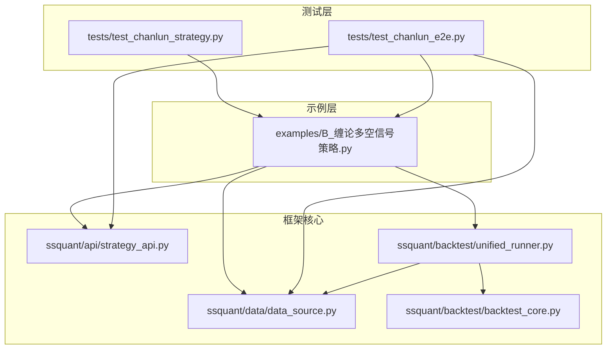
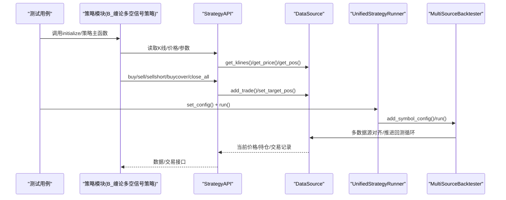
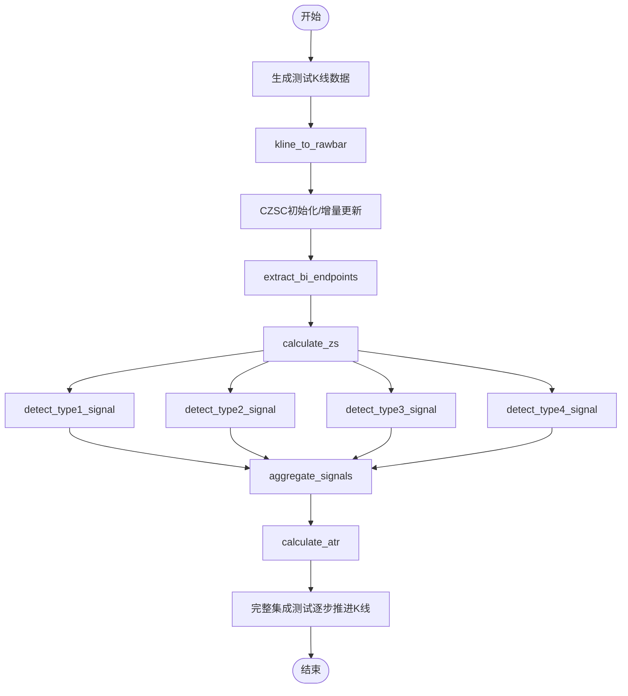
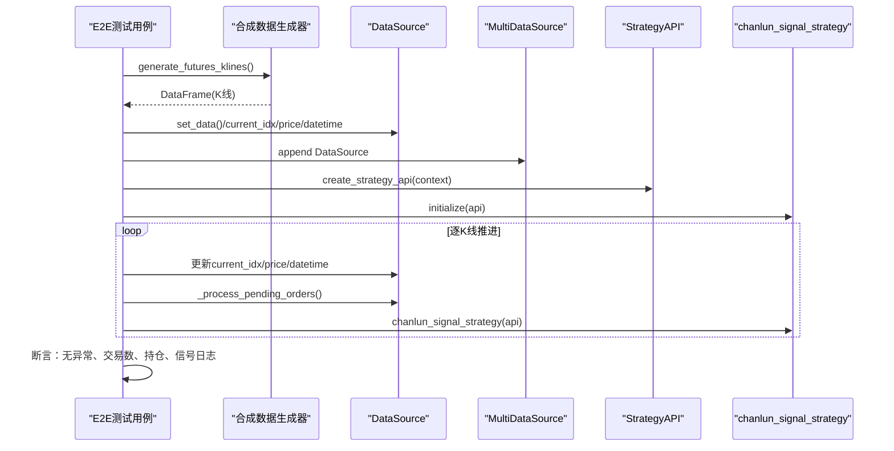
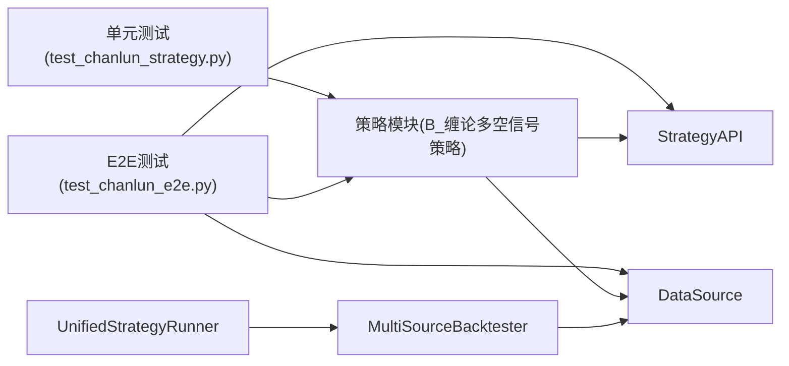

# 测试与质量保证

<cite>
**本文引用的文件**
- [README.md](file://README.md)
- [setup.py](file://setup.py)
- [requirements.txt](file://requirements.txt)
- [tests/test_chanlun_e2e.py](file://tests/test_chanlun_e2e.py)
- [tests/test_chanlun_strategy.py](file://tests/test_chanlun_strategy.py)
- [ssquant/backtest/unified_runner.py](file://ssquant/backtest/unified_runner.py)
- [ssquant/data/data_source.py](file://ssquant/data/data_source.py)
- [ssquant/api/strategy_api.py](file://ssquant/api/strategy_api.py)
- [ssquant/backtest/backtest_core.py](file://ssquant/backtest/backtest_core.py)
- [examples/B_缠论多空信号策略.py](file://examples/B_缠论多空信号策略.py)
</cite>

## 目录
1. [简介](#简介)
2. [项目结构](#项目结构)
3. [核心组件](#核心组件)
4. [架构总览](#架构总览)
5. [详细组件分析](#详细组件分析)
6. [依赖关系分析](#依赖关系分析)
7. [性能考虑](#性能考虑)
8. [故障排查指南](#故障排查指南)
9. [结论](#结论)
10. [附录](#附录)

## 简介
本文件面向SSQuant测试体系，系统化阐述单元测试与端到端（E2E）测试的设计原则、策略与覆盖率要求；详述E2E测试的实现方法、测试场景与验证标准；给出测试策略开发流程、测试用例设计与自动化测试集成建议；提供测试环境搭建、测试数据准备与测试执行指南；包含测试结果分析、缺陷跟踪与质量度量方法；并总结持续集成、回归测试与性能测试的最佳实践，确保项目具备高质量的测试保障。

## 项目结构
SSQuant采用“策略示例 + 框架核心 + 测试”三层组织方式：
- examples：包含19个策略示例，其中缠论多空信号策略作为E2E与单元测试的核心对象。
- ssquant：框架核心模块，涵盖API、回测、数据、指标、CTP封装等。
- tests：包含单元测试与E2E测试，覆盖策略核心逻辑与端到端运行链路。

图表来源
- [examples/B_缠论多空信号策略.py](file://examples/B_缠论多空信号策略.py#L1-L200)
- [tests/test_chanlun_strategy.py](file://tests/test_chanlun_strategy.py#L1-L120)
- [tests/test_chanlun_e2e.py](file://tests/test_chanlun_e2e.py#L1-L120)
- [ssquant/api/strategy_api.py](file://ssquant/api/strategy_api.py#L1-L120)
- [ssquant/data/data_source.py](file://ssquant/data/data_source.py#L1-L120)
- [ssquant/backtest/unified_runner.py](file://ssquant/backtest/unified_runner.py#L1-L120)
- [ssquant/backtest/backtest_core.py](file://ssquant/backtest/backtest_core.py#L1-L120)

章节来源
- [README.md](file://README.md#L297-L321)

## 核心组件
- 策略API（StrategyAPI）：为策略提供数据访问与交易操作的统一接口，屏蔽底层实现细节。
- 数据源（DataSource）：承载单数据源的K线、持仓、交易记录与订单处理逻辑。
- 统一运行器（UnifiedStrategyRunner）：支持回测、SIMNOW模拟与实盘三种模式，负责策略运行编排。
- 回测核心（MultiSourceBacktester）：多数据源回测引擎，负责数据获取、对齐、回测循环与结果计算。
- 策略示例（缠论多空信号策略）：以czsc为核心的技术分析与信号检测实现，是测试重点对象。

章节来源
- [ssquant/api/strategy_api.py](file://ssquant/api/strategy_api.py#L1-L200)
- [ssquant/data/data_source.py](file://ssquant/data/data_source.py#L1-L200)
- [ssquant/backtest/unified_runner.py](file://ssquant/backtest/unified_runner.py#L1-L200)
- [ssquant/backtest/backtest_core.py](file://ssquant/backtest/backtest_core.py#L1-L200)
- [examples/B_缠论多空信号策略.py](file://examples/B_缠论多空信号策略.py#L1-L200)

## 架构总览
SSQuant测试体系围绕“策略API + 数据源 + 统一运行器 + 回测核心”的闭环展开，测试覆盖从策略核心逻辑到端到端运行链路的关键节点。

图表来源
- [tests/test_chanlun_e2e.py](file://tests/test_chanlun_e2e.py#L150-L210)
- [ssquant/backtest/unified_runner.py](file://ssquant/backtest/unified_runner.py#L160-L214)
- [ssquant/backtest/backtest_core.py](file://ssquant/backtest/backtest_core.py#L144-L200)
- [ssquant/data/data_source.py](file://ssquant/data/data_source.py#L137-L200)
- [ssquant/api/strategy_api.py](file://ssquant/api/strategy_api.py#L90-L200)

## 详细组件分析

### 单元测试：缠论核心逻辑
单元测试聚焦策略内部关键模块，包括：
- K线到RawBar转换
- 笔端点提取
- 中枢计算
- 四类信号检测
- 信号聚合与优先级
- ATR计算
- 完整集成（模拟回测数据流）

图表来源
- [tests/test_chanlun_strategy.py](file://tests/test_chanlun_strategy.py#L42-L120)
- [tests/test_chanlun_strategy.py](file://tests/test_chanlun_strategy.py#L136-L186)
- [tests/test_chanlun_strategy.py](file://tests/test_chanlun_strategy.py#L188-L335)
- [tests/test_chanlun_strategy.py](file://tests/test_chanlun_strategy.py#L337-L392)
- [tests/test_chanlun_strategy.py](file://tests/test_chanlun_strategy.py#L394-L416)
- [tests/test_chanlun_strategy.py](file://tests/test_chanlun_strategy.py#L418-L489)

章节来源
- [tests/test_chanlun_strategy.py](file://tests/test_chanlun_strategy.py#L1-L550)

### 端到端测试：合成数据驱动的回测循环
E2E测试通过合成数据直接驱动SSQuant回测框架，验证策略在真实回测环境中的行为，覆盖：
- 完整回测循环（500根K线，realistic模式）
- 强趋势行情（验证趋势信号检测）
- 震荡行情（验证稳定性）
- 策略状态管理（全局状态在回测过程中的正确维护）
- 交易执行验证（StrategyAPI到DataSource的交易落地）
- next_bar_open订单处理（下一根K线开盘价成交）
- 数据窗口一致性（防止未来数据泄露）
- 多次运行隔离性（相同输入产生一致输出）
- 边界条件（极少量数据、恒定价格、极端波动）

图表来源
- [tests/test_chanlun_e2e.py](file://tests/test_chanlun_e2e.py#L39-L152)
- [tests/test_chanlun_e2e.py](file://tests/test_chanlun_e2e.py#L154-L206)
- [tests/test_chanlun_e2e.py](file://tests/test_chanlun_e2e.py#L212-L302)
- [tests/test_chanlun_e2e.py](file://tests/test_chanlun_e2e.py#L405-L467)
- [tests/test_chanlun_e2e.py](file://tests/test_chanlun_e2e.py#L469-L527)
- [tests/test_chanlun_e2e.py](file://tests/test_chanlun_e2e.py#L529-L574)
- [tests/test_chanlun_e2e.py](file://tests/test_chanlun_e2e.py#L576-L610)
- [tests/test_chanlun_e2e.py](file://tests/test_chanlun_e2e.py#L612-L662)
- [tests/test_chanlun_e2e.py](file://tests/test_chanlun_e2e.py#L664-L771)

章节来源
- [tests/test_chanlun_e2e.py](file://tests/test_chanlun_e2e.py#L1-L870)

### 测试策略开发流程
- 设计阶段：明确测试目标（单元/集成/E2E）、选择测试粒度、定义断言标准。
- 编写阶段：遵循“合成数据 + 直接驱动 + 明确断言”的模式，避免外部依赖。
- 执行阶段：在本地与CI中统一执行，确保可重复性。
- 分析阶段：统计失败用例、定位根因、回归验证。
- 持续改进：根据覆盖率与缺陷分布迭代测试用例。

章节来源
- [tests/test_chanlun_strategy.py](file://tests/test_chanlun_strategy.py#L1-L120)
- [tests/test_chanlun_e2e.py](file://tests/test_chanlun_e2e.py#L1-L120)

### 测试用例设计
- 单元测试用例
  - 输入：构造不同模式的K线（正弦、趋势、V型反转、极端波动）
  - 处理：调用kline_to_rawbar、extract_bi_endpoints、calculate_zs、四类信号检测、aggregate_signals、calculate_atr
  - 断言：类型正确、数量符合预期、边界条件不崩溃
- E2E测试用例
  - 输入：合成K线（realistic/strong_trend/oscillation）
  - 处理：setup_backtest_env + 逐K线推进 + 策略主函数
  - 断言：无异常、交易记录数量、最终持仓、信号日志、状态一致性

章节来源
- [tests/test_chanlun_strategy.py](file://tests/test_chanlun_strategy.py#L42-L120)
- [tests/test_chanlun_strategy.py](file://tests/test_chanlun_strategy.py#L188-L335)
- [tests/test_chanlun_strategy.py](file://tests/test_chanlun_strategy.py#L418-L489)
- [tests/test_chanlun_e2e.py](file://tests/test_chanlun_e2e.py#L212-L302)
- [tests/test_chanlun_e2e.py](file://tests/test_chanlun_e2e.py#L304-L403)
- [tests/test_chanlun_e2e.py](file://tests/test_chanlun_e2e.py#L405-L467)
- [tests/test_chanlun_e2e.py](file://tests/test_chanlun_e2e.py#L469-L527)
- [tests/test_chanlun_e2e.py](file://tests/test_chanlun_e2e.py#L529-L610)
- [tests/test_chanlun_e2e.py](file://tests/test_chanlun_e2e.py#L612-L771)

### 自动化测试集成
- 本地执行：pytest或Python直接运行测试文件。
- CI集成：在CI流水线中安装依赖、执行测试并生成报告。
- 覆盖率：建议引入覆盖率工具，结合关键路径断言评估覆盖率。

章节来源
- [setup.py](file://setup.py#L62-L74)
- [requirements.txt](file://requirements.txt#L1-L16)

## 依赖关系分析
- 测试对策略模块的依赖：单元测试直接导入策略函数；E2E测试导入策略模块并驱动其状态与API。
- 测试对框架核心的依赖：E2E测试直接使用DataSource、StrategyAPI；单元测试通过czsc与策略模块交互。
- 运行器与回测核心：E2E测试绕过统一运行器，直接驱动回测循环；单元测试与策略示例共同验证核心逻辑。

图表来源
- [tests/test_chanlun_strategy.py](file://tests/test_chanlun_strategy.py#L27-L40)
- [tests/test_chanlun_e2e.py](file://tests/test_chanlun_e2e.py#L22-L32)
- [ssquant/backtest/unified_runner.py](file://ssquant/backtest/unified_runner.py#L1-L80)
- [ssquant/backtest/backtest_core.py](file://ssquant/backtest/backtest_core.py#L1-L120)
- [ssquant/data/data_source.py](file://ssquant/data/data_source.py#L1-L120)
- [ssquant/api/strategy_api.py](file://ssquant/api/strategy_api.py#L1-L120)

章节来源
- [tests/test_chanlun_strategy.py](file://tests/test_chanlun_strategy.py#L1-L120)
- [tests/test_chanlun_e2e.py](file://tests/test_chanlun_e2e.py#L1-L120)
- [ssquant/backtest/unified_runner.py](file://ssquant/backtest/unified_runner.py#L1-L120)
- [ssquant/backtest/backtest_core.py](file://ssquant/backtest/backtest_core.py#L1-L120)
- [ssquant/data/data_source.py](file://ssquant/data/data_source.py#L1-L120)
- [ssquant/api/strategy_api.py](file://ssquant/api/strategy_api.py#L1-L120)

## 性能考虑
- 合成数据规模：E2E测试使用数百根K线，单元测试使用数十至百根，兼顾性能与覆盖。
- 数据窗口一致性：确保get_klines可见窗口随当前K线索引滚动，避免未来数据泄露。
- 订单延迟执行：next_bar_open订单在下一根K线开盘价执行，验证回测时序正确性。
- 状态管理：策略全局状态在多次运行间正确重置，保证结果可重复。

章节来源
- [tests/test_chanlun_e2e.py](file://tests/test_chanlun_e2e.py#L576-L610)
- [tests/test_chanlun_e2e.py](file://tests/test_chanlun_e2e.py#L529-L574)
- [tests/test_chanlun_e2e.py](file://tests/test_chanlun_e2e.py#L612-L662)

## 故障排查指南
- 策略导入错误：若出现模块导入失败，检查安装与PYTHONPATH，确保ssquant可被导入。
- 数据格式问题：确保K线DataFrame包含open/high/low/close/volume/datetime列，并与DataSource约定一致。
- 订单执行异常：检查订单类型（bar_close/next_bar_open/market）与价格获取逻辑，确认pending_orders处理流程。
- 状态不一致：核对策略全局状态重置逻辑，确保多次运行隔离性。
- 回测断言失败：逐用例缩小范围，关注信号检测、中枢计算、交易执行三个关键环节。

章节来源
- [README.md](file://README.md#L90-L120)
- [tests/test_chanlun_e2e.py](file://tests/test_chanlun_e2e.py#L212-L302)
- [tests/test_chanlun_strategy.py](file://tests/test_chanlun_strategy.py#L188-L335)

## 结论
SSQuant测试体系以单元测试与端到端测试双轨并行：单元测试聚焦策略核心逻辑与关键模块，E2E测试覆盖从数据到交易的完整回测链路。通过合成数据驱动、明确断言与严格的状态管理，测试能够稳定验证策略在不同市场环境下的行为。建议在CI中统一执行测试并引入覆盖率工具，持续完善测试用例，确保高质量交付。

## 附录

### 测试环境搭建
- 安装依赖：使用requirements.txt与setup.py中的依赖声明。
- 运行测试：在项目根目录执行测试脚本或pytest。
- 配置账户：如需实盘/SIMNOW测试，参考README中的配置说明。

章节来源
- [requirements.txt](file://requirements.txt#L1-L16)
- [setup.py](file://setup.py#L16-L74)
- [README.md](file://README.md#L121-L163)

### 测试数据准备
- 合成K线：使用测试脚本中的生成器函数，支持realistic、strong_trend、oscillation等模式。
- 边界数据：极少量数据、恒定价格、极端波动等场景，确保健壮性。

章节来源
- [tests/test_chanlun_e2e.py](file://tests/test_chanlun_e2e.py#L39-L152)
- [tests/test_chanlun_strategy.py](file://tests/test_chanlun_strategy.py#L42-L72)

### 测试执行指南
- 单元测试：直接运行策略单元测试文件，验证核心模块。
- E2E测试：直接运行E2E测试文件，验证完整回测循环与交易执行。
- 回测运行器：如需通过统一运行器执行策略，参考统一运行器与回测核心的接口。

章节来源
- [tests/test_chanlun_strategy.py](file://tests/test_chanlun_strategy.py#L495-L550)
- [tests/test_chanlun_e2e.py](file://tests/test_chanlun_e2e.py#L777-L870)
- [ssquant/backtest/unified_runner.py](file://ssquant/backtest/unified_runner.py#L160-L214)

### 覆盖率与质量度量
- 建议：引入覆盖率工具，结合关键路径断言评估覆盖率，持续提升测试完整性。
- 质量度量：失败用例数、断言命中率、回归用例通过率、边界条件覆盖度。

章节来源
- [tests/test_chanlun_strategy.py](file://tests/test_chanlun_strategy.py#L532-L550)
- [tests/test_chanlun_e2e.py](file://tests/test_chanlun_e2e.py#L785-L870)

### 持续集成与回归测试
- CI流水线：安装依赖、执行测试、生成报告。
- 回归测试：每次提交后自动运行全部测试，确保变更不破坏既有功能。

章节来源
- [setup.py](file://setup.py#L62-L74)
- [README.md](file://README.md#L54-L90)