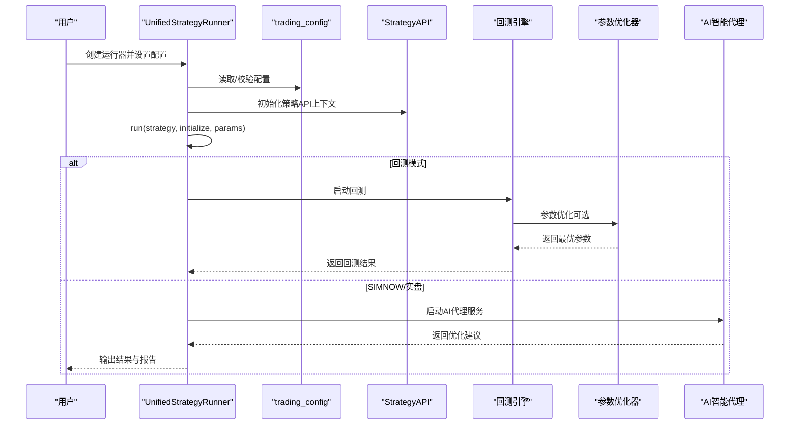
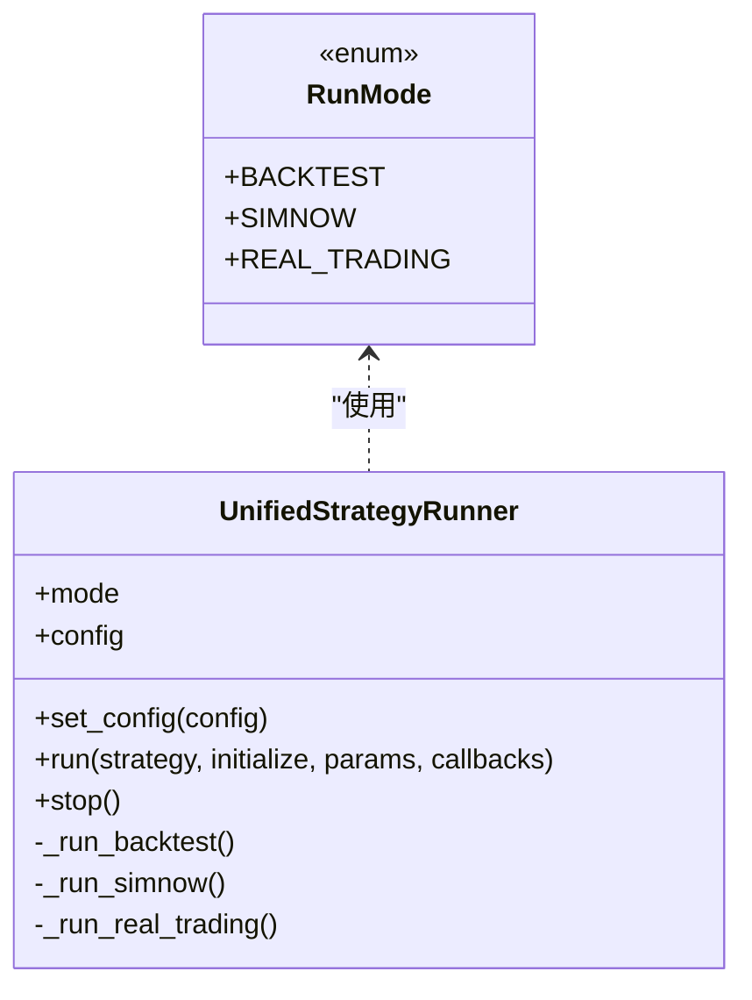
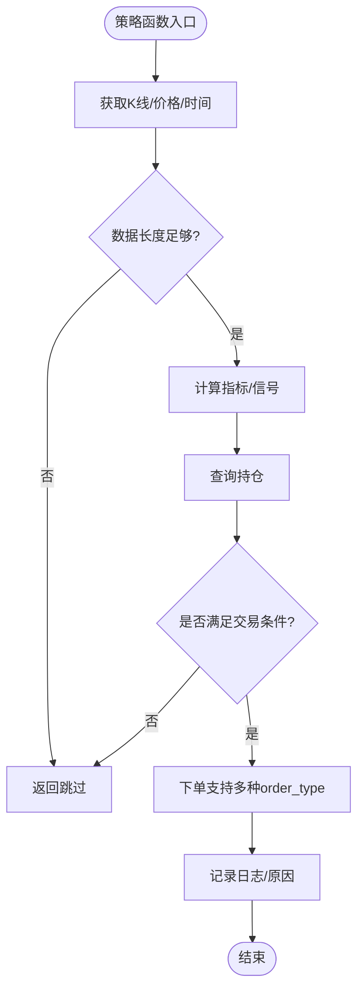
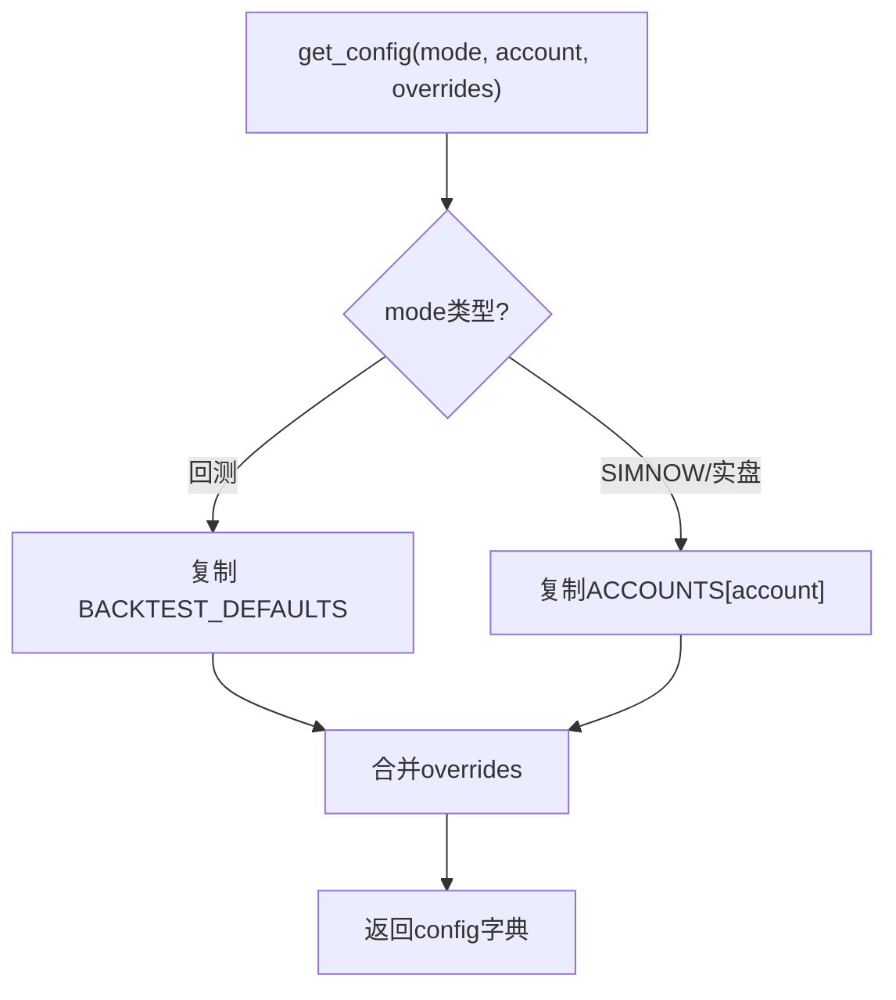
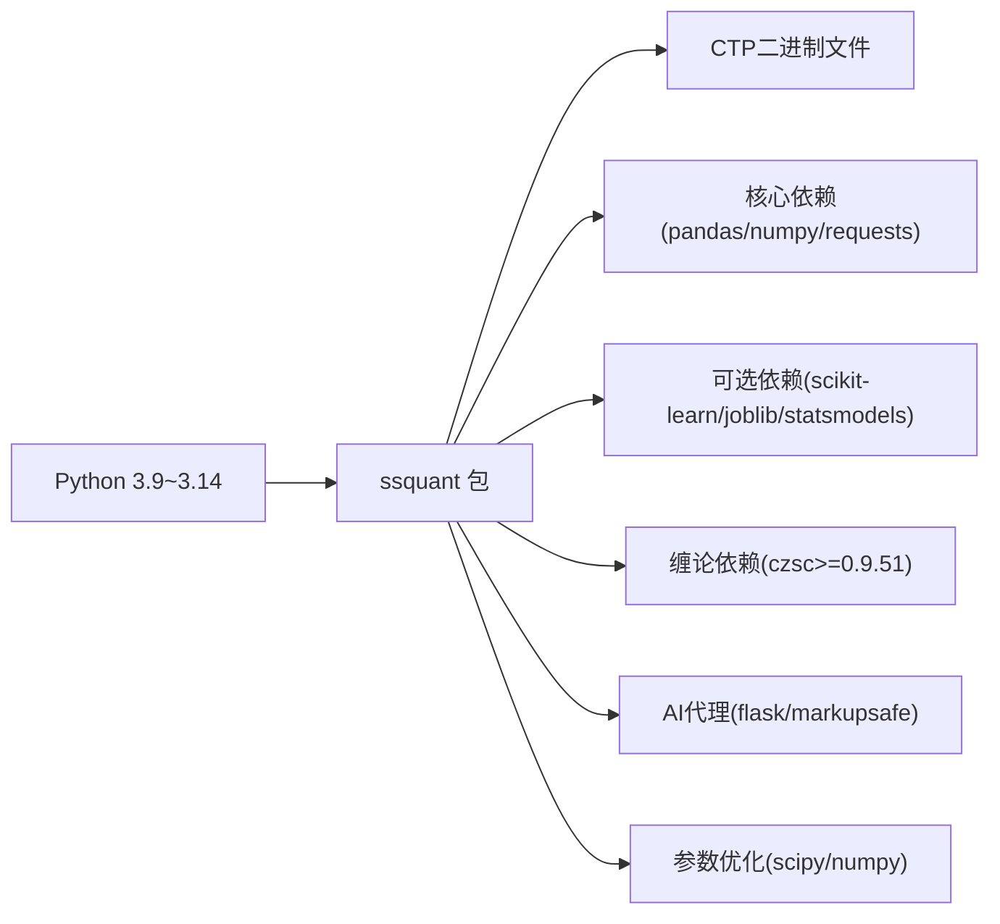

# 用户手册

<cite>
**本文引用的文件**
- [README.md](file://README.md)
- [用户手册.md](file://用户手册.md)
- [API参考手册.md](file://API参考手册.md)
- [AGENTS.md](file://AGENTS.md)
- [CLAUDE.md](file://CLAUDE.md)
- [SKILL.md](file://SKILL.md)
- [046.MD](file://046.MD)
- [ai_agent/README.md](file://ai_agent/README.md)
- [ai_agent/backend.py](file://ai_agent/backend.py)
- [ai_agent/prompt.py](file://ai_agent/prompt.py)
- [ssquant/backtest/parameter_optimizer.py](file://ssquant/backtest/parameter_optimizer.py)
- [ssquant/backtest/backtest_core.py](file://ssquant/backtest/backtest_core.py)
- [ssquant/backtest/README.md](file://ssquant/backtest/README.md)
- [docs/ADR-001-缠论5分钟策略架构评估.md](file://docs/ADR-001-缠论5分钟策略架构评估.md)
- [docs/code-review-缠论多空信号策略.md](file://docs/code-review-缠论多空信号策略.md)
- [docs/实盘验证策略推荐.md](file://docs/实盘验证策略推荐.md)
- [examples/B_缠论5分钟策略.py](file://examples/B_缠论5分钟策略.py)
- [examples/chanlun_5m_strategy.py](file://examples/chanlun_5m_strategy.py)
- [examples/B_十大经典策略之Aberration_高性能.py](file://examples/B_十大经典策略之Aberration_高性能.py)
- [examples/B_多品种多周期交易策略_参数优化.py](file://examples/B_多品种多周期交易策略_参数优化.py)
- [ssquant/__init__.py](file://ssquant/__init__.py)
- [setup.py](file://setup.py)
- [ssquant/config/trading_config.py](file://ssquant/config/trading_config.py)
- [ssquant/backtest/unified_runner.py](file://ssquant/backtest/unified_runner.py)
- [ssquant/api/strategy_api.py](file://ssquant/api/strategy_api.py)
- [examples/B_双均线策略.py](file://examples/B_双均线策略.py)
- [examples/B_海龟交易策略.py](file://examples/B_海龟交易策略.py)
- [examples/B_网格交易策略.py](file://examples/B_网格交易策略.py)
- [examples/B_跨期套利策略.py](file://examples/B_跨期套利策略.py)
</cite>

## 更新摘要
**变更内容**
- 新增价格双重轨道系统说明，详细介绍v0.4.6版本的价格双轨制架构
- 新增AI智能代理使用指南章节，整合ai_agent组件的完整使用说明
- 新增回测性能优化说明，基于参数优化器和高性能策略示例
- 新增新策略示例使用方法，包括Aberration策略和参数优化策略
- 更新项目结构说明，反映新增的AI代理组件和改进的回测框架

## 目录
1. [简介](#简介)
2. [项目结构](#项目结构)
3. [核心组件](#核心组件)
4. [架构总览](#架构总览)
5. [详细组件分析](#详细组件分析)
6. [价格双重轨道系统](#价格双重轨道系统)
7. [AI智能代理使用指南](#ai智能代理使用指南)
8. [回测性能优化指南](#回测性能优化指南)
9. [新策略示例使用方法](#新策略示例使用方法)
10. [依赖关系分析](#依赖关系分析)
11. [性能考虑](#性能考虑)
12. [故障排查指南](#故障排查指南)
13. [结论](#结论)
14. [附录](#附录)

## 简介
SSQuant是一个面向期货市场的量化交易框架，支持"一套代码三处运行"：回测、SIMNOW模拟与实盘CTP交易。它提供统一的策略API、多数据源支持、多周期分析能力，并内置丰富的示例策略，帮助从入门到进阶的用户快速掌握量化交易。

**最新版本v0.4.6核心更新**：
- **价格双重轨道系统**：引入price和raw_price双轨制，分别用于策略计算和回测指标
- **AI智能代理**：集成本地策略开发助手，提供Web界面的AI编程支持
- **回测性能优化**：增强参数优化器，支持网格搜索、随机搜索和贝叶斯优化
- **新策略示例**：新增Aberration经典策略和参数优化策略示例

## 项目结构
- 核心包
  - api：策略API入口，提供数据访问与交易操作
  - backtest：回测引擎与统一运行器，包含参数优化功能
  - config：配置管理（账户、默认参数）
  - data：数据获取与本地加载
  - pyctp/ctp：CTP接口封装与二进制文件
  - indicators：技术指标
- AI智能代理组件
  - ai_agent：Web界面的AI智能代理服务
  - 包含完整的策略生成、调试、回测功能
- 回测优化框架
  - parameter_optimizer：参数优化器，支持多种优化算法
  - backtest_core：核心回测引擎，支持数据复用优化
- 新策略示例
  - B_十大经典策略之Aberration_高性能.py：经典的Aberration策略高性能实现
  - B_多品种多周期交易策略_参数优化.py：参数优化策略示例
  - 新增多个高性能策略示例

```mermaid
graph TB
subgraph "核心包"
API["api/strategy_api.py"]
BT["backtest/backtest_core.py"]
CFG["config/trading_config.py"]
DATA["data/*"]
CTP["pyctp/*"]
IND["indicators/tech_indicators.py"]
PO["backtest/parameter_optimizer.py"]
END
subgraph "AI智能代理组件"
AGENT["ai_agent/*"]
PROMPT["ai_agent/prompt.py"]
BACKEND["ai_agent/backend.py"]
END
subgraph "新策略示例"
ABERRATION["examples/B_十大经典策略之Aberration_高性能.py"]
OPTIMIZE["examples/B_多品种多周期交易策略_参数优化.py"]
END
DOC["README.md / 用户手册.md / API参考手册.md"]
API --> DATA
BT --> CFG
BT --> DATA
BT --> CTP
BT --> PO
API --> IND
AGENT --> BACKEND
BACKEND --> PROMPT
ABERRATION --> API
OPTIMIZE --> PO
DOC --- API
DOC --- BT
DOC --- CFG
```

**图表来源**
- [ssquant/api/strategy_api.py:1-570](file://ssquant/api/strategy_api.py#L1-L570)
- [ssquant/backtest/backtest_core.py:759-786](file://ssquant/backtest/backtest_core.py#L759-L786)
- [ssquant/backtest/parameter_optimizer.py:698-763](file://ssquant/backtest/parameter_optimizer.py#L698-L763)
- [ai_agent/README.md:1-28](file://ai_agent/README.md#L1-L28)
- [ai_agent/prompt.py:12](file://ai_agent/prompt.py#L12)

**章节来源**
- [README.md:297-321](file://README.md#L297-L321)
- [setup.py:28-54](file://setup.py#L28-L54)

## 核心组件
- 统一运行器（UnifiedStrategyRunner）
  - 支持三种运行模式：回测、SIMNOW模拟、实盘CTP
  - 统一配置入口，简化策略迁移
- 策略API（StrategyAPI）
  - 提供数据获取、持仓查询、交易下单、TICK数据、参数与日志等能力
  - 新增price和raw_price双轨制价格接口
- 配置管理（trading_config）
  - 默认回测参数、账户配置、动态获取配置
- AI智能代理集成
  - Web界面的AI助手服务，支持策略生成和调试
  - 基于Claude和OpenAI兼容接口
- 回测性能优化
  - 参数优化器支持网格搜索、随机搜索、贝叶斯优化
  - 数据复用机制大幅提升优化效率
- 新策略示例
  - Aberration经典策略、参数优化策略等高性能示例

**章节来源**
- [ssquant/backtest/unified_runner.py:19-379](file://ssquant/backtest/unified_runner.py#L19-L379)
- [ssquant/api/strategy_api.py:4-570](file://ssquant/api/strategy_api.py#L4-L570)
- [ssquant/config/trading_config.py:10-187](file://ssquant/config/trading_config.py#L10-L187)
- [user_manual.md:642-716](file://user_manual.md#L642-L716)

## 架构总览
SSQuant采用"策略API + 统一运行器 + 配置管理"的分层设计，策略函数通过统一运行器在不同模式下执行，数据与交易通过API抽象，配置贯穿运行全过程。新增的AI智能代理组件提供Web界面的策略开发辅助，参数优化器支持高效的策略参数调优。



**图表来源**
- [ssquant/backtest/unified_runner.py:162-214](file://ssquant/backtest/unified_runner.py#L162-L214)
- [ssquant/backtest/backtest_core.py:759-786](file://ssquant/backtest/backtest_core.py#L759-L786)
- [ssquant/backtest/parameter_optimizer.py:721-763](file://ssquant/backtest/parameter_optimizer.py#L721-L763)

## 详细组件分析

### 统一运行器（UnifiedStrategyRunner）
- 运行模式
  - RunMode.BACKTEST：历史数据回测
  - RunMode.SIMNOW：SIMNOW模拟交易
  - RunMode.REAL_TRADING：实盘CTP交易
- 配置校验
  - 回测：支持单数据源与多数据源；必填参数包括symbol/start_date/end_date/kline_period或data_sources
  - SIMNOW/实盘：支持单数据源与多数据源；必填参数包括账户信息与合约信息
- 多数据源支持
  - 回测：支持同一品种多周期合并
  - 实盘：支持多合约并行
- 回调函数
  - 实盘模式支持on_trade/on_order/on_cancel/on_account/on_position等回调



**图表来源**
- [ssquant/backtest/unified_runner.py:19-61](file://ssquant/backtest/unified_runner.py#L19-L61)
- [ssquant/backtest/unified_runner.py:79-121](file://ssquant/backtest/unified_runner.py#L79-L121)
- [ssquant/backtest/unified_runner.py:206-214](file://ssquant/backtest/unified_runner.py#L206-L214)

**章节来源**
- [ssquant/backtest/unified_runner.py:19-379](file://ssquant/backtest/unified_runner.py#L19-L379)

### 策略API（StrategyAPI）
- 数据访问
  - K线：get_klines/get_close/get_open/get_high/get_low/get_volume
  - 价格与时间：get_price/get_datetime/get_idx
  - **新增**：price和raw_price双轨制价格接口
- 持仓查询
  - 净持仓：get_pos
  - 多空分离：get_long_pos/get_short_pos/get_position_detail
- 交易操作
  - 买入/卖出/开仓/平仓/反手/全平
  - 订单类型：bar_close/next_bar_open/next_bar_close/next_bar_high/next_bar_low/market/limit
  - 支持offset_ticks与price参数
- TICK数据（实盘/SIMNOW）
  - get_tick/get_ticks/get_ticks_count
- 参数与日志
  - get_param/get_params/log
- 多数据源
  - get_data_sources_count/require_data_sources/get_data_source/index参数



**图表来源**
- [ssquant/api/strategy_api.py:287-361](file://ssquant/api/strategy_api.py#L287-L361)
- [ssquant/api/strategy_api.py:362-476](file://ssquant/api/strategy_api.py#L362-L476)
- [ssquant/api/strategy_api.py:493-557](file://ssquant/api/strategy_api.py#L493-L557)

**章节来源**
- [ssquant/api/strategy_api.py:4-570](file://ssquant/api/strategy_api.py#L4-L570)

### 配置管理（trading_config）
- 默认回测参数
  - 初始资金、手续费、保证金率、合约乘数、最小变动价位、滑点、复权类型、缓存与保存等
- 账户配置
  - SIMNOW与实盘账户：投资者ID、密码、服务器、CTP服务器地址、AppID、授权码等
  - 交易参数：K线周期、最小变动价位、委托偏移跳数、智能算法交易参数
  - 数据参数：历史预加载、复权类型、回调开关、数据保存路径
- 动态获取配置
  - get_config(mode, account, overrides)：根据运行模式与账户动态生成配置
  - set_api_auth/get_api_auth：数据API认证
  - add_account/list_accounts：账户管理



**图表来源**
- [ssquant/config/trading_config.py:115-164](file://ssquant/config/trading_config.py#L115-L164)
- [ssquant/config/trading_config.py:151-160](file://ssquant/config/trading_config.py#L151-L160)

**章节来源**
- [ssquant/config/trading_config.py:10-187](file://ssquant/config/trading_config.py#L10-L187)

### 示例策略解析

#### 双均线策略（入门）
- 策略逻辑：短期均线上穿长期均线做多，下穿做空
- 多模式支持：回测、SIMNOW、实盘
- 参数化：快慢均线周期、滑点、手续费、保证金率等

**章节来源**
- [examples/B_双均线策略.py:1-269](file://examples/B_双均线策略.py#L1-L269)

#### 海龟交易策略（趋势跟踪）
- 策略逻辑：基于唐奇安通道突破与ATR波动率调整的系统单位头寸管理
- 多数据源：支持多品种并行
- 参数化：入场/出场周期、ATR周期、风险因子、最大系统单位

**章节来源**
- [examples/B_海龟交易策略.py:1-423](file://examples/B_海龟交易策略.py#L1-L423)

#### 网格交易策略（震荡）
- 策略逻辑：以基准价为中心设定网格，价格下跌一层买入、上涨一层卖出
- 参数化：网格间距、最大持仓

**章节来源**
- [examples/B_网格交易策略.py:1-289](file://examples/B_网格交易策略.py#L1-L289)

#### 跨期套利策略（统计套利）
- 策略逻辑：计算近月与远月合约价差，用Z分数判断开平仓
- 多数据源：近月（主力连续/具体合约）、远月（次主力连续/具体合约）
- 参数化：样本数、阈值、滚动窗口、交易手数

**章节来源**
- [examples/B_跨期套利策略.py:1-376](file://examples/B_跨期套利策略.py#L1-L376)

#### 缠论5分钟策略（专家级）
- 策略逻辑：基于czsc库的缠中说禅理论，识别四种信号形态
- 多周期支持：5分钟、15分钟、30分钟等
- 风控系统：ATR止损、结构止损、中枢止损三重保护
- 参数优化：min_bi_len、signal_cooldown、atr_stop_multiplier等

**章节来源**
- [examples/B_缠论5分钟策略.py:1-1246](file://examples/B_缠论5分钟策略.py#L1-L1246)

#### Aberration经典策略（高性能）
- 策略逻辑：基于布林带的Aberration策略，结合ATR波动率过滤
- 性能优化：使用IndicatorCache v2实现O(1)指标查询
- 参数化：布林带周期、标准差倍数、ATR周期、ATR倍数

**章节来源**
- [examples/B_十大经典策略之Aberration_高性能.py](file://examples/B_十大经典策略之Aberration_高性能.py)

## 价格双重轨道系统

### v0.4.6版本重大更新
SSQuant v0.4.6引入了价格双重轨道系统，彻底改变了价格处理方式，确保策略计算与回测指标的一致性。

#### 双轨制架构设计
| 价格类型 | 用途 | 特点 | 应用场景 |
|---------|------|------|----------|
| `price` / `current_price` | 策略看到的复权价 | 连续平滑，用于指标计算、信号生成、图表显示 | 策略逻辑计算、技术指标分析 |
| `raw_price` / `current_raw_price` | 映射回的真实价格 | 真实价格，用于回测指标、持仓盯市、权益曲线 | 回测指标计算、风险控制 |

#### 核心价值
- **策略计算**：使用连续平滑的复权价格，确保技术指标的平滑性和准确性
- **回测指标**：通过映射后的真实价格计算，保证回测结果的真实性
- **一致性**：解决后复权/前复权回测结果不一致的问题

#### 实际影响
```python
# 旧版本（v0.4.5及之前）
current_price = get_price()  # 复权价或真实价取决于配置

# v0.4.6新版本
price = get_price()           # 策略看到的复权价（连续平滑）
raw_price = get_raw_price()   # 回测指标的真实价格（映射后）
```

#### 性能优化
- 策略计算：使用price接口，享受连续平滑的技术分析效果
- 回测指标：使用raw_price接口，确保指标计算的准确性
- 兼容性：向后兼容，不影响现有策略逻辑

**章节来源**
- [046.MD:132-145](file://046.MD#L132-L145)

## AI智能代理使用指南

### ai_agent组件完整说明
SSQuant AI智能代理是一个本地策略开发助手，提供Web界面的AI编程支持，帮助用户生成策略、调试代码、运行回测和分析报告。

#### 核心能力
- **策略生成**：根据中文需求生成SSQuant策略代码
- **示例优先**：系统提示词要求AI优先参考examples/高性能示例
- **回测执行**：后端保存临时策略文件并用子进程运行回测
- **实时日志**：使用SSE推送回测状态和运行日志
- **报告管理**：自动发现backtest_results/下的HTML报告
- **报告分析**：将回测报告交给AI分析并生成改进建议
- **工作区管理**：按工作区保存聊天、策略、报告关联关系
- **多模型支持**：支持OpenAI兼容接口和Claude原生API
- **思考模式**：支持DeepSeek R1/QwQ文本思考流

#### 安装与启动
```bash
# 进入ai_agent目录
cd ai_agent

# 安装依赖
pip install -r requirements.txt

# 启动服务
python start_server.py
```

#### Web界面功能
- **策略生成器**：输入中文需求，AI自动生成策略代码
- **代码编辑器**：在线编辑和调试策略代码
- **回测面板**：实时查看回测结果和性能指标
- **历史记录**：管理策略开发历史和版本控制
- **报告分析**：AI自动分析回测报告并提供改进建议

#### AI提示词优化
系统提示词要求AI：
- 优先参考examples/高性能示例
- 复用导入语句、函数结构、Runner配置
- 不确定接口时打开示例查看，不要猜测
- 用户需求属于常见类型时，尽量从示例改造

**章节来源**
- [ai_agent/README.md:1-28](file://ai_agent/README.md#L1-L28)
- [ai_agent/prompt.py:12](file://ai_agent/prompt.py#L12)
- [ai_agent/backend.py:1748-1756](file://ai_agent/backend.py#L1748-L1756)

## 回测性能优化指南

### 参数优化器增强功能
SSQuant v0.4.6增强了参数优化器，支持多种优化算法和性能优化机制，大幅提升策略参数调优效率。

#### 支持的优化方法
- **网格搜索（grid）**：穷举搜索最优参数组合
- **随机搜索（random）**：随机采样参数空间
- **贝叶斯优化（bayesian）**：基于高斯过程的概率优化

#### 性能优化机制
- **数据复用**：reuse_data=True时复用预加载数据，大幅提高优化效率
- **静默模式**：优化过程中关闭图表和报告生成，减少I/O开销
- **异常处理**：自动捕获和处理无效参数组合
- **进度监控**：实时显示优化进度和最佳参数

#### 使用示例
```python
from ssquant.backtest.backtest_core import MultiSourceBacktester

# 创建回测器
backtester = MultiSourceBacktester()

# 定义参数网格
param_grid = {
    'fast_period': [5, 10, 15],
    'slow_period': [20, 30, 40],
    'atrr_multiplier': [1.0, 1.5, 2.0]
}

# 运行参数优化
best_params, best_result = backtester.optimize_parameters(
    strategy=my_strategy,
    param_grid=param_grid,
    method='grid',
    optimization_metric='sharpe_ratio',
    reuse_data=True,
    higher_is_better=True
)
```

#### 高性能策略示例
- **B_十大经典策略之Aberration_高性能.py**：使用IndicatorCache v2优化指标计算
- **B_多品种多周期交易策略_参数优化.py**：展示参数优化最佳实践
- **B_多品种多周期交易策略_高性能.py**：多数据源指标缓存优化

**章节来源**
- [ssquant/backtest/backtest_core.py:759-786](file://ssquant/backtest/backtest_core.py#L759-L786)
- [ssquant/backtest/parameter_optimizer.py:698-763](file://ssquant/backtest/parameter_optimizer.py#L698-L763)
- [examples/B_多品种多周期交易策略_参数优化.py](file://examples/B_多品种多周期交易策略_参数优化.py)

## 新策略示例使用方法

### Aberration经典策略
Aberration策略是量化交易中的经典策略，基于布林带和ATR波动率过滤，具有良好的风险收益特征。

#### 策略原理
- **布林带过滤**：使用布林带判断趋势方向
- **ATR波动率**：使用ATR过滤假突破
- **动态止损**：基于ATR设置动态止损位

#### 高性能实现特点
- 使用IndicatorCache v2实现O(1)指标查询
- 增量式数据处理，避免重复计算
- 多数据源支持，可同时处理多个品种

#### 关键参数
- **布林带周期**：通常为20日
- **标准差倍数**：通常为2.0
- **ATR周期**：通常为14日
- **ATR倍数**：通常为1.5-2.5

#### 使用方法
```python
# 直接运行高性能示例
python examples/B_十大经典策略之Aberration_高性能.py

# 或在策略中引用
from examples.B_十大经典策略之Aberration_高性能 import *
```

### 参数优化策略示例
展示了如何使用SSQuant的参数优化功能，通过系统化的方法寻找最优参数组合。

#### 优化流程
1. **定义参数空间**：确定待优化参数的取值范围
2. **选择优化方法**：根据参数数量选择合适的优化算法
3. **设置评估指标**：选择Sharpe比率、总收益率等指标
4. **执行优化**：运行参数优化器寻找最优组合
5. **结果验证**：使用独立时间段验证优化结果

#### 最佳实践
- 优化期间减少日志和报告生成
- 参数网格不要过大，避免计算时间过长
- 回测数据要足够长，确保统计有效性
- 优化结果必须再用独立时间段验证

**章节来源**
- [examples/B_十大经典策略之Aberration_高性能.py](file://examples/B_十大经典策略之Aberration_高性能.py)
- [examples/B_多品种多周期交易策略_参数优化.py](file://examples/B_多品种多周期交易策略_参数优化.py)

## 依赖关系分析
- 版本与平台
  - Python 3.9~3.14，Windows 10+（CTP仅支持Windows）
  - CTP二进制文件随包分发，按Python版本匹配
- 依赖项
  - 核心：pandas、numpy、requests
  - 可选：机器学习策略依赖scikit-learn、joblib、statsmodels
  - 缠论分析：czsc>=0.9.51
  - AI代理：flask、markupsafe等Web框架依赖
  - 参数优化：scipy、numpy优化库
- 包数据
  - 包含ctp二进制文件与资源文件，便于安装即用



**图表来源**
- [setup.py:20-26](file://setup.py#L20-L26)
- [setup.py:43-54](file://setup.py#L43-L54)
- [setup.py:62-74](file://setup.py#L62-L74)

**章节来源**
- [README.md:43-51](file://README.md#L43-L51)
- [ssquant/__init__.py:1-18](file://ssquant/__init__.py#L1-L18)
- [setup.py:59-91](file://setup.py#L59-L91)

## 性能考虑
- 回测性能
  - 使用pandas高效计算指标，建议合理设置滑点与手续费参数
  - 多周期回测时注意数据合并与复权类型一致性
  - 优先使用IndicatorCache v2实现O(1)指标查询
  - **新增**：参数优化时启用数据复用(reuse_data=True)
- 实盘性能
  - 启用智能算法交易（超价委托、超时撤单、重试）提升成交概率
  - TICK流模式下注意回调频率与日志输出，避免阻塞
  - 缠论策略使用增量式数据转换，避免O(N²)性能问题
- 数据加载
  - 预加载历史数据可减少回测时延，但需关注内存占用
  - SQLite数据源支持直接查询，减少中间转换开销
- **新增**：AI代理性能
  - Web界面使用SSE推送实时日志，避免轮询开销
  - 策略代码生成使用示例优先原则，提高生成质量

## 故障排查指南
- ModuleNotFoundError: No module named 'ssquant'
  - 检查是否已安装或重新安装；验证pip list中存在ssquant
- CTP登录报错乱码
  - 框架已优化GBK/GB18030解码；若仍异常，检查Python版本与系统编码
- SIMNOW连接失败
  - 更换服务器（电信1/2、移动、TEST），核对账号密码与网络
- 回测与实盘差异较大
  - 检查复权类型、滑点、最小变动价位、委托偏移等参数
  - **新增**：确认使用正确的价格接口（price vs raw_price）
- 策略不执行
  - 确认数据长度足够、无早期返回、添加日志定位问题
- czsc库缺失
  - 运行`pip install czsc==0.9.51`安装缠论分析库
- AI代理启动失败
  - 检查端口占用和依赖安装，运行`pip install -r ai_agent/requirements.txt`
  - **新增**：确认046.MD版本更新要求
- 参数优化失败
  - **新增**：检查参数网格定义和优化指标设置
  - 确认回测数据足够长，避免过拟合

**章节来源**
- [README.md:90-119](file://README.md#L90-L119)
- [user_manual.md:587-640](file://user_manual.md#L587-L640)

## 结论
SSQuant通过统一运行器与策略API，实现了从回测到实盘的一致化开发体验。v0.4.6版本的重大更新进一步增强了框架的专业性和实用性：

- **价格双重轨道系统**确保了策略计算与回测指标的一致性
- **AI智能代理**提供了强大的本地策略开发辅助
- **回测性能优化**大幅提升了参数调优效率
- **新策略示例**展示了最佳实践和高性能实现

建议遵循"回测验证—SIMNOW测试—小资金实盘—正式运行"的流程，结合AI代理的智能辅助，持续优化参数与风控，快速提升量化交易能力。

## 附录

### 快速开始（步骤概览）
- 安装：pip install ssquant
- 配置：编辑ssquant/config/trading_config.py
- 编写策略：参考examples/B_双均线策略.py
- 运行：选择RunMode.BACKTEST/SIMNOW/REAL_TRADING，统一运行器执行
- **新增**：AI代理：cd ai_agent && python start_server.py启动Web界面
- **新增**：参数优化：使用backtest_core.optimize_parameters进行参数调优

**章节来源**
- [user_manual.md:89-151](file://user_manual.md#L89-L151)
- [examples/B_双均线策略.py:134-269](file://examples/B_双均线策略.py#L134-L269)

### 学习路径与资源
- 初学者（第1周）：阅读用户手册，运行双均线策略，修改参数观察结果
- 进阶（第2-4周）：学习多品种策略、SIMNOW模拟、高级示例（海龟、套利）、参数优化
- 高级（第5周+）：TICK流策略、机器学习策略、缠论策略、实盘小资金测试、正式部署
- **新增**：AI代理（第6周+）：使用Claude Code进行策略开发，Web界面调试
- **新增**：参数优化（第7周+）：系统学习参数优化方法，提升策略稳定性

**章节来源**
- [user_manual.md:642-664](file://user_manual.md#L642-L664)

### API参考要点
- 数据查询：get_close/get_open/get_high/get_low/get_volume/get_klines/get_price/get_datetime/get_idx
- 持仓查询：get_pos/get_long_pos/get_short_pos/get_position_detail
- 交易操作：buy/sell/sellshort/buycover/close_all/reverse_pos
- TICK数据：get_tick/get_ticks/get_ticks_count
- 参数与日志：get_param/get_params/log
- 多数据源：get_data_sources_count/require_data_sources/get_data_source/index参数
- 高性能指标：register_indicator/get_indicator/get_indicator_array
- **新增**：价格双轨制：price/raw_price接口

**章节来源**
- [API参考手册.md:18-740](file://API参考手册.md#L18-L740)

### AI代理使用要点
- Claude Code集成：支持策略代码生成和调试
- Web界面：ai_agent目录提供完整的Web界面服务
- 配置文件：settings.json和requirements.txt管理代理设置
- 历史记录：history.json记录对话历史
- **新增**：示例优先原则：AI写作时优先参考高性能示例

**章节来源**
- [CLAUDE.md:1-118](file://CLAUDE.md#L1-L118)
- [AGENTS.md:1-293](file://AGENTS.md#L1-L293)

### 缠论策略使用要点
- czsc库依赖：pip install czsc==0.9.51
- 参数调优：min_bi_len、signal_cooldown、atr_stop_multiplier等
- 数据源：支持SQLite直接查询，提高性能
- 可视化：完整的K线图、笔、线段、中枢标注

**章节来源**
- [docs/ADR-001-缠论5分钟策略架构评估.md:1-170](file://docs/ADR-001-缠论5分钟策略架构评估.md#L1-L170)
- [examples/B_缠论5分钟策略.py:1-1246](file://examples/B_缠论5分钟策略.py#L1-L1246)

### 参数优化使用要点
- 优化方法：grid/random/bayesian三种算法
- 性能优化：reuse_data=True启用数据复用
- 指标选择：sharpe_ratio/total_return/max_drawdown等
- 结果验证：使用独立时间段验证优化结果
- **新增**：Aberration策略参数优化示例

**章节来源**
- [ssquant/backtest/backtest_core.py:759-786](file://ssquant/backtest/backtest_core.py#L759-L786)
- [examples/B_多品种多周期交易策略_参数优化.py](file://examples/B_多品种多周期交易策略_参数优化.py)