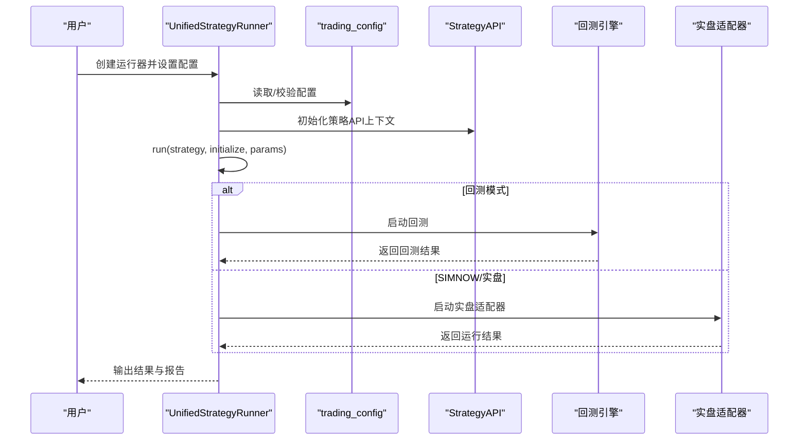
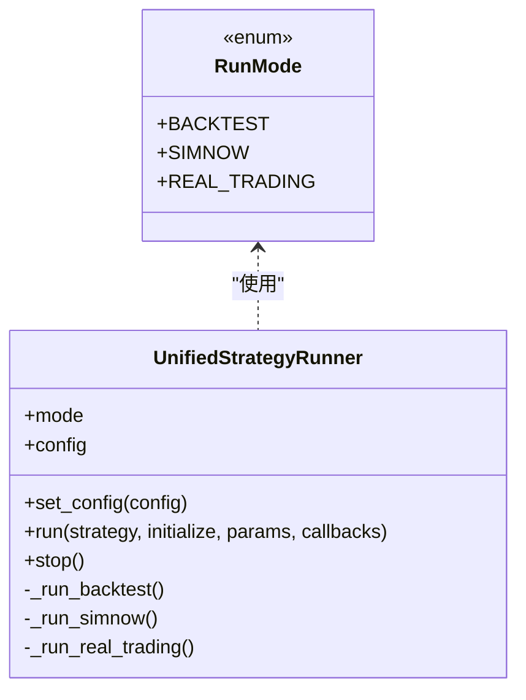
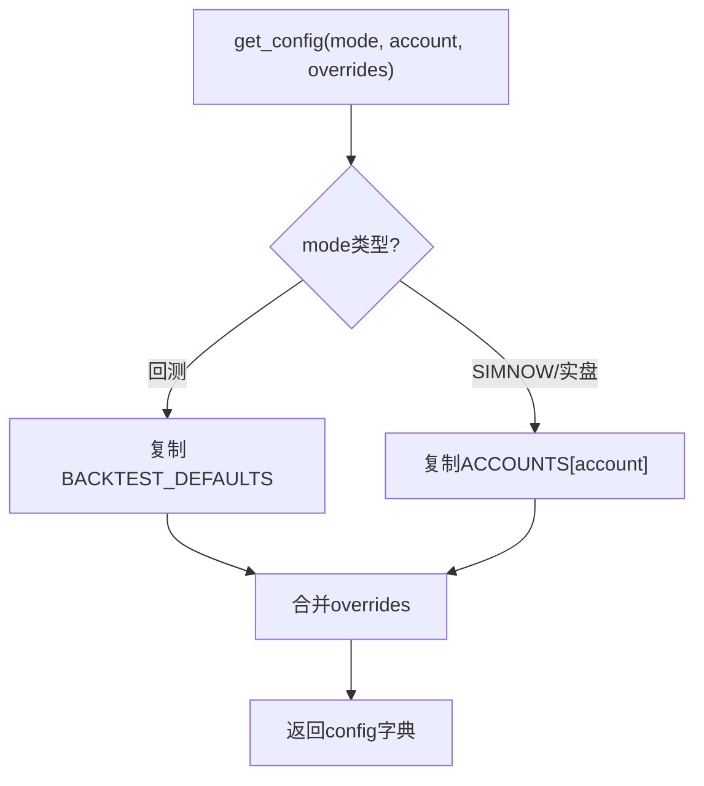
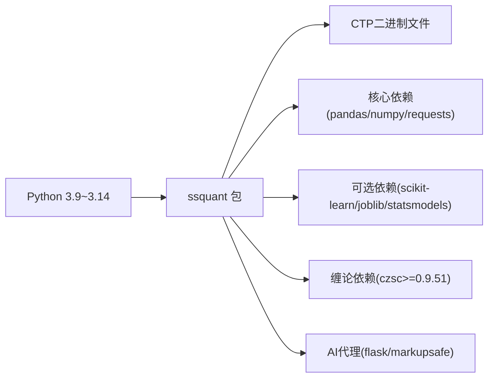

# 用户手册

<cite>
**本文引用的文件**
- [README.md](file://README.md)
- [用户手册.md](file://用户手册.md)
- [API参考手册.md](file://API参考手册.md)
- [AGENTS.md](file://AGENTS.md)
- [CLAUDE.md](file://CLAUDE.md)
- [SKILL.md](file://SKILL.md)
- [docs/ADR-001-缠论5分钟策略架构评估.md](file://docs/ADR-001-缠论5分钟策略架构评估.md)
- [docs/code-review-缠论多空信号策略.md](file://docs/code-review-缠论多空信号策略.md)
- [docs/实盘验证策略推荐.md](file://docs/实盘验证策略推荐.md)
- [examples/B_缠论5分钟策略.py](file://examples/B_缠论5分钟策略.py)
- [examples/chanlun_5m_strategy.py](file://examples/chanlun_5m_strategy.py)
- [ssquant/__init__.py](file://ssquant/__init__.py)
- [setup.py](file://setup.py)
- [ssquant/config/trading_config.py](file://ssquant/config/trading_config.py)
- [ssquant/backtest/unified_runner.py](file://ssquant/backtest/unified_runner.py)
- [ssquant/api/strategy_api.py](file://ssquant/api/strategy_api.py)
- [examples/B_双均线策略.py](file://examples/B_双均线策略.py)
- [examples/B_海龟交易策略.py](file://examples/B_海龟交易策略.py)
- [examples/B_网格交易策略.py](file://examples/B_网格交易策略.py)
- [examples/B_跨期套利策略.py](file://examples/B_跨期套利策略.py)
</cite>

## 更新摘要
**变更内容**
- 新增AI代理使用指南章节，整合AGENTS.md、CLAUDE.md、SKILL.md文档
- 新增缠论策略说明章节，整合docs目录下的缠论相关文档
- 新增性能优化指南章节，基于现有示例策略的高性能实现
- 更新项目结构说明，反映新增的AI代理和缠论策略组件
- 增强示例策略部分，增加缠论5分钟策略和高性能策略示例

## 目录
1. [简介](#简介)
2. [项目结构](#项目结构)
3. [核心组件](#核心组件)
4. [架构总览](#架构总览)
5. [详细组件分析](#详细组件分析)
6. [AI代理使用指南](#ai代理使用指南)
7. [缠论策略说明](#缠论策略说明)
8. [性能优化指南](#性能优化指南)
9. [依赖关系分析](#依赖关系分析)
10. [性能考虑](#性能考虑)
11. [故障排查指南](#故障排查指南)
12. [结论](#结论)
13. [附录](#附录)

## 简介
SSQuant是一个面向期货市场的量化交易框架，支持"一套代码三处运行"：回测、SIMNOW模拟与实盘CTP交易。它提供统一的策略API、多数据源支持、多周期分析能力，并内置丰富的示例策略，帮助从入门到进阶的用户快速掌握量化交易。

**新增特性**：
- AI代理集成：支持Claude Code等AI编程助手的专用指引
- 缠论技术分析：集成czsc库，提供专业的缠中说禅技术分析
- 高性能指标系统：IndicatorCache v2实现O(1)指标查询
- 专家级策略验证：基于实盘验证的策略推荐体系

## 项目结构
- 核心包
  - api：策略API入口，提供数据访问与交易操作
  - backtest：回测引擎与统一运行器
  - config：配置管理（账户、默认参数）
  - data：数据获取与本地加载
  - pyctp/ctp：CTP接口封装与二进制文件
  - indicators：技术指标
- AI代理组件
  - ai_agent：Web界面的AI代理服务
  - docs：AI代理使用指南和策略文档
- 示例策略：examples目录包含19个策略示例，涵盖趋势、套利、轮动、期权、机器学习、缠论等
- 文档：README.md、用户手册.md、API参考手册.md、AI代理指南、缠论策略说明

```mermaid
graph TB
subgraph "核心包"
API["api/strategy_api.py"]
BT["backtest/unified_runner.py"]
CFG["config/trading_config.py"]
DATA["data/*"]
CTP["pyctp/*"]
IND["indicators/tech_indicators.py"]
END
subgraph "AI代理组件"
AGENT["ai_agent/*"]
DOCS["docs/*"]
END
EX["examples/* 策略示例"]
DOC["README.md / 用户手册.md / API参考手册.md"]
EX --> API
EX --> BT
API --> DATA
BT --> CFG
BT --> DATA
BT --> CTP
API --> IND
AGENT --> API
DOCS --> EX
DOC --- API
DOC --- BT
DOC --- CFG
```

**图表来源**
- [ssquant/api/strategy_api.py:1-570](file://ssquant/api/strategy_api.py#L1-L570)
- [ssquant/backtest/unified_runner.py:1-379](file://ssquant/backtest/unified_runner.py#L1-L379)
- [ssquant/config/trading_config.py:1-187](file://ssquant/config/trading_config.py#L1-L187)
- [AGENTS.md:42-100](file://AGENTS.md#L42-L100)

**章节来源**
- [README.md:297-321](file://README.md#L297-L321)
- [setup.py:28-54](file://setup.py#L28-L54)

## 核心组件
- 统一运行器（UnifiedStrategyRunner）
  - 支持三种运行模式：回测、SIMNOW模拟、实盘CTP
  - 统一配置入口，简化策略迁移
- 策略API（StrategyAPI）
  - 提供数据获取、持仓查询、交易下单、TICK数据、参数与日志等能力
- 配置管理（trading_config）
  - 默认回测参数、账户配置、动态获取配置
- AI代理集成
  - Web界面的AI助手服务
  - 支持策略代码生成和调试
- 示例策略
  - 双均线、海龟、网格、跨期套利、缠论等，覆盖入门到高级

**章节来源**
- [ssquant/backtest/unified_runner.py:19-379](file://ssquant/backtest/unified_runner.py#L19-L379)
- [ssquant/api/strategy_api.py:4-570](file://ssquant/api/strategy_api.py#L4-L570)
- [ssquant/config/trading_config.py:10-187](file://ssquant/config/trading_config.py#L10-L187)
- [用户手册.md:642-716](file://用户手册.md#L642-L716)

## 架构总览
SSQuant采用"策略API + 统一运行器 + 配置管理"的分层设计，策略函数通过统一运行器在不同模式下执行，数据与交易通过API抽象，配置贯穿运行全过程。新增的AI代理组件提供Web界面的策略开发辅助。



**图表来源**
- [ssquant/backtest/unified_runner.py:162-214](file://ssquant/backtest/unified_runner.py#L162-L214)
- [ssquant/config/trading_config.py:115-164](file://ssquant/config/trading_config.py#L115-L164)
- [ssquant/api/strategy_api.py:560-570](file://ssquant/api/strategy_api.py#L560-L570)

## 详细组件分析

### 统一运行器（UnifiedStrategyRunner）
- 运行模式
  - RunMode.BACKTEST：历史数据回测
  - RunMode.SIMNOW：SIMNOW模拟交易
  - RunMode.REAL_TRADING：实盘CTP交易
- 配置校验
  - 回测：支持单数据源与多数据源；必填参数包括symbol/start_date/end_date/kline_period或data_sources
  - SIMNOW/实盘：支持单数据源与多数据源；必填参数包括账户信息与合约信息
- 多数据源支持
  - 回测：支持同一品种多周期合并
  - 实盘：支持多合约并行
- 回调函数
  - 实盘模式支持on_trade/on_order/on_cancel/on_account/on_position等回调



**图表来源**
- [ssquant/backtest/unified_runner.py:19-61](file://ssquant/backtest/unified_runner.py#L19-L61)
- [ssquant/backtest/unified_runner.py:79-121](file://ssquant/backtest/unified_runner.py#L79-L121)
- [ssquant/backtest/unified_runner.py:206-214](file://ssquant/backtest/unified_runner.py#L206-L214)

**章节来源**
- [ssquant/backtest/unified_runner.py:19-379](file://ssquant/backtest/unified_runner.py#L19-L379)

### 策略API（StrategyAPI）
- 数据访问
  - K线：get_klines/get_close/get_open/get_high/get_low/get_volume
  - 价格与时间：get_price/get_datetime/get_idx
- 持仓查询
  - 净持仓：get_pos
  - 多空分离：get_long_pos/get_short_pos/get_position_detail
- 交易操作
  - 买入/卖出/开仓/平仓/反手/全平
  - 订单类型：bar_close/next_bar_open/next_bar_close/next_bar_high/next_bar_low/market/limit
  - 支持offset_ticks与price参数
- TICK数据（实盘/SIMNOW）
  - get_tick/get_ticks/get_ticks_count
- 参数与日志
  - get_param/get_params/log
- 多数据源
  - get_data_sources_count/require_data_sources/get_data_source/index参数


**图表来源**
- [ssquant/api/strategy_api.py:287-361](file://ssquant/api/strategy_api.py#L287-L361)
- [ssquant/api/strategy_api.py:362-476](file://ssquant/api/strategy_api.py#L362-L476)
- [ssquant/api/strategy_api.py:493-557](file://ssquant/api/strategy_api.py#L493-L557)

**章节来源**
- [ssquant/api/strategy_api.py:4-570](file://ssquant/api/strategy_api.py#L4-L570)

### 配置管理（trading_config）
- 默认回测参数
  - 初始资金、手续费、保证金率、合约乘数、最小变动价位、滑点、复权类型、缓存与保存等
- 账户配置
  - SIMNOW与实盘账户：投资者ID、密码、服务器、CTP服务器地址、AppID、授权码等
  - 交易参数：K线周期、最小变动价位、委托偏移跳数、智能算法交易参数
  - 数据参数：历史预加载、复权类型、回调开关、数据保存路径
- 动态获取配置
  - get_config(mode, account, overrides)：根据运行模式与账户动态生成配置
  - set_api_auth/get_api_auth：数据API认证
  - add_account/list_accounts：账户管理



**图表来源**
- [ssquant/config/trading_config.py:115-164](file://ssquant/config/trading_config.py#L115-L164)
- [ssquant/config/trading_config.py:151-160](file://ssquant/config/trading_config.py#L151-L160)

**章节来源**
- [ssquant/config/trading_config.py:10-187](file://ssquant/config/trading_config.py#L10-L187)

### 示例策略解析

#### 双均线策略（入门）
- 策略逻辑：短期均线上穿长期均线做多，下穿做空
- 多模式支持：回测、SIMNOW、实盘
- 参数化：快慢均线周期、滑点、手续费、保证金率等

**章节来源**
- [examples/B_双均线策略.py:1-269](file://examples/B_双均线策略.py#L1-L269)

#### 海龟交易策略（趋势跟踪）
- 策略逻辑：基于唐奇安通道突破与ATR波动率调整的系统单位头寸管理
- 多数据源：支持多品种并行
- 参数化：入场/出场周期、ATR周期、风险因子、最大系统单位

**章节来源**
- [examples/B_海龟交易策略.py:1-423](file://examples/B_海龟交易策略.py#L1-L423)

#### 网格交易策略（震荡）
- 策略逻辑：以基准价为中心设定网格，价格下跌一层买入、上涨一层卖出
- 参数化：网格间距、最大持仓

**章节来源**
- [examples/B_网格交易策略.py:1-289](file://examples/B_网格交易策略.py#L1-L289)

#### 跨期套利策略（统计套利）
- 策略逻辑：计算近月与远月合约价差，用Z分数判断开平仓
- 多数据源：近月（主力连续/具体合约）、远月（次主力连续/具体合约）
- 参数化：样本数、阈值、滚动窗口、交易手数

**章节来源**
- [examples/B_跨期套利策略.py:1-376](file://examples/B_跨期套利策略.py#L1-L376)

#### 缠论5分钟策略（专家级）
- 策略逻辑：基于czsc库的缠中说禅理论，识别四种信号形态
- 多周期支持：5分钟、15分钟、30分钟等
- 风控系统：ATR止损、结构止损、中枢止损三重保护
- 参数优化：min_bi_len、signal_cooldown、atr_stop_multiplier等

**章节来源**
- [examples/B_缠论5分钟策略.py:1-1246](file://examples/B_缠论5分钟策略.py#L1-L1246)

## AI代理使用指南

### Claude Code专用指引
SSQuant为Claude Code提供了专门的使用指南，支持AI编程助手的无缝集成。

#### 常用命令
- 安装开发模式：`pip install -e .`
- 安装开发依赖：`pip install -e ".[dev]"`
- 运行所有测试：`pytest`
- 运行单个测试文件：`pytest tests/test_chanlun_strategy.py`
- 禁用可视化运行测试：`NO_VISUALIZATION=true NO_CONSOLE_LOG=true pytest`

#### 高级架构
- 三模式统一策略框架：BACKTEST/SIMNOW/REAL_TRADING
- 核心组件：StrategyAPI、UnifiedStrategyRunner、MultiSourceBacktester、LiveTradingAdapter
- 数据流：回测模式使用api_data_fetcher，实盘模式使用CTP客户端

**章节来源**
- [CLAUDE.md:1-118](file://CLAUDE.md#L1-L118)

### SKILL.md框架使用指南
面向AI代理的完整使用指南，提供策略编写、调试、部署的全流程指导。

#### 核心概念
- RunMode枚举：BACKTEST/SIMNOW/REAL_TRADING三种运行模式
- StrategyAPI：策略与框架交互的唯一接口
- IndicatorCache v2：高性能指标系统，默认O(1)查询

#### 策略编写规范
- 必需函数结构：initialize()和strategy()函数
- 数据访问API：get_close()、get_pos()、get_price()等
- 交易API：buy()、sell()、sellshort()、buycover()等
- 参数系统：get_param()读取参数，支持默认值

#### 高性能指标系统
- IndicatorCache v2原理：在initialize()中注册指标，strategy()中O(1)查询
- 性能对比：默认高性能模式比普通模式快10-30倍
- 多数据源支持：通过index参数为每个数据源独立注册指标

**章节来源**
- [SKILL.md:1-921](file://SKILL.md#L1-L921)

### AGENTS.md项目指南
面向AI编程助手的项目概述和使用指导。

#### 项目概述
- SSQuant（松鼠Quant）：支持"一次编写，三处运行"的期货量化交易框架
- 核心功能：回测、SIMNOW模拟、实盘交易
- 技术栈：Python 3.9-3.14、pandas、numpy、scipy、czsc等

#### 项目结构
- 核心包：ssquant/（pip install后可用）
- 示例策略：examples/（19+个策略示例）
- 测试：tests/（pytest测试）
- 文档：docs/（内部文档）

**章节来源**
- [AGENTS.md:1-293](file://AGENTS.md#L1-L293)

## 缠论策略说明

### ADR-001：缠论5分钟策略架构评估
基于SSQuant框架的缠论策略实现路径评估。

#### 背景
- 用户希望在SSQuant上开发缠论量化策略
- 周期：5分钟K线
- 数据源：SQLite数据库
- 理论参考：waditu/czsc库
- 目标：精准识别缠论买卖点，回测+K线图可视化

#### 决策
复用现有B_缠论多空信号策略.py，仅做四处针对性改动：
1. 将K线周期切到5分钟
2. 把SQLite数据源接入回测路径
3. 调优5分钟周期参数
4. 保留并增强可视化

#### 参数调整（5分钟周期）
```python
strategy_params = {
    'min_bi_len': 5,              # 15m用7，5m缩短到5
    'signal_cooldown': 6,         # 15m用3，5m放大到6（≈30分钟）
    'atr_stop_multiplier': 2.5,   # 15m用2.0，5m放宽到2.5
    'kline_period': '5m',         # 关键改动
}
```

**章节来源**
- [docs/ADR-001-缠论5分钟策略架构评估.md:1-170](file://docs/ADR-001-缠论5分钟策略架构评估.md#L1-L170)

### 代码评审：缠论多空信号策略
对现有缠论策略的代码质量评审和修复建议。

#### 关键问题
- **阻塞性问题**：
  - os模块未导入，导致NameError
  - 主程序块是死代码，无法独立运行
  - detect_type1_signal函数按索引取值，假设端点严格交替

- **性能问题**：
  - 每根K线都把整个DataFrame重新转为RawBar列表
  - entry_price使用当前close而非next_bar_open的开盘价

#### 修复建议
1. 文件顶部新增`import os`
2. 将主程序块下沉到`if __name__ == "__main__":`下
3. detect_type1_signal改为按时间排序后两两配对
4. kline_to_rawbar改为增量式转换
5. entry_price使用下一根K线开盘价

**章节来源**
- [docs/code-review-缠论多空信号策略.md:1-107](file://docs/code-review-缠论多空信号策略.md#L1-L107)

### 实盘验证策略推荐
基于30多次实证迭代的实盘验证方案。

#### 推荐实盘验证方案
- **资产池**：sc888原油（70%）+ au888黄金（30%）
- **策略参数**：已锁定的最优参数组合
- **风控规则**：单笔风险上限、单标的回撤熔断、总账户熔断

#### 三阶段验证
1. **纸盘30天**：验证基础设施可用性
2. **极小本金实盘60天**：验证滑点和成交质量
3. **正式实盘90天**：验证完整策略生命周期

#### 关键风险提示
- 震荡市必然亏损
- 5分钟噪声永远存在
- API中断可能导致仓位失控

**章节来源**
- [docs/实盘验证策略推荐.md:1-273](file://docs/实盘验证策略推荐.md#L1-L273)

## 性能优化指南

### IndicatorCache v2高性能指标系统
SSQuant的高性能指标系统，实现O(1)指标查询。

#### 核心原理
- 在`initialize()`中注册指标函数→框架在数据加载后一次性预计算全部历史
- 在`strategy()`中通过`get_indicator()`/`get_indicator_array()`→O(1)直接取值
- 实盘模式下，每次新K线完成后框架自动触发重计算

#### 性能对比（回测）
| 指标类型 | Pandas（普通） | ndarray（中档） | IndicatorCache v2（高性能） |
|---------|--------------|-----------------|---------------------------|
| 单MA | ~5ms/bar | ~0.5ms/bar | ~0.01ms/bar |
| 5指标+4数据源 | ~80ms/bar | ~8ms/bar | ~0.05ms/bar |

#### 注册指标的标准写法
```python
def initialize(api: StrategyAPI):
    api.register_indicator('ma20',
        lambda c, o, h, l, v: pd.Series(c).rolling(20).mean().to_numpy(),
        window=20)
```

#### 高性能版本vs普通版本的等价性
- 交易逻辑必须完全一致，仅指标获取方式不同
- `get_indicator_array(name, window=2)[-2]`等价于Pandas的`.iloc[-2]`
- 已通过`profiling/audit_examples_equivalence.py`逐笔对账验证

**章节来源**
- [SKILL.md:578-747](file://SKILL.md#L578-L747)

### 缠论策略性能优化
基于czsc库的缠论策略性能优化。

#### 增量式数据转换
```python
def kline_to_rawbar_incremental(klines: pd.DataFrame, symbol: str, freq: str,
                              cached_count: int) -> List[Any]:
    """
    增量式K线转换—只把新增的K线转为RawBar返回。
    cached_count是已经转换并update过的bar数量，本次只返回[cached_count:]的新bar。
    """
    if len(klines) <= cached_count:
        return []
    # 只处理新增的K线
    new_slice = klines.iloc[cached_count:]
    # ...
```

#### 多策略高性能实现
- **B_双均线策略_高性能.py**：使用IndicatorCache v2
- **B_海龟交易策略_高性能.py**：优化ATR计算
- **B_多品种多周期交易策略_高性能.py**：多数据源指标缓存

**章节来源**
- [examples/B_双均线策略_高性能.py](file://examples/B_双均线策略_高性能.py)
- [examples/B_海龟交易策略_高性能.py](file://examples/B_海龟交易策略_高性能.py)
- [examples/B_多品种多周期交易策略_高性能.py](file://examples/B_多品种多周期交易策略_高性能.py)

## 依赖关系分析
- 版本与平台
  - Python 3.9~3.14，Windows 10+（CTP仅支持Windows）
  - CTP二进制文件随包分发，按Python版本匹配
- 依赖项
  - 核心：pandas、numpy、requests
  - 可选：机器学习策略依赖scikit-learn、joblib、statsmodels
  - 缠论分析：czsc>=0.9.51
  - AI代理：flask、markupsafe等Web框架依赖
- 包数据
  - 包含ctp二进制文件与资源文件，便于安装即用



**图表来源**
- [setup.py:20-26](file://setup.py#L20-L26)
- [setup.py:43-54](file://setup.py#L43-L54)
- [setup.py:62-74](file://setup.py#L62-L74)

**章节来源**
- [README.md:43-51](file://README.md#L43-L51)
- [ssquant/__init__.py:1-18](file://ssquant/__init__.py#L1-L18)
- [setup.py:59-91](file://setup.py#L59-L91)

## 性能考虑
- 回测性能
  - 使用pandas高效计算指标，建议合理设置滑点与手续费参数
  - 多周期回测时注意数据合并与复权类型一致性
  - 优先使用IndicatorCache v2实现O(1)指标查询
- 实盘性能
  - 启用智能算法交易（超价委托、超时撤单、重试）提升成交概率
  - TICK流模式下注意回调频率与日志输出，避免阻塞
  - 缠论策略使用增量式数据转换，避免O(N²)性能问题
- 数据加载
  - 预加载历史数据可减少回测时延，但需关注内存占用
  - SQLite数据源支持直接查询，减少中间转换开销

## 故障排查指南
- ModuleNotFoundError: No module named 'ssquant'
  - 检查是否已安装或重新安装；验证pip list中存在ssquant
- CTP登录报错乱码
  - 框架已优化GBK/GB18030解码；若仍异常，检查Python版本与系统编码
- SIMNOW连接失败
  - 更换服务器（电信1/2、移动、TEST），核对账号密码与网络
- 回测与实盘差异较大
  - 检查复权类型、滑点、最小变动价位、委托偏移等参数
- 策略不执行
  - 确认数据长度足够、无早期返回、添加日志定位问题
- czsc库缺失
  - 运行`pip install czsc==0.9.51`安装缠论分析库
- AI代理启动失败
  - 检查端口占用和依赖安装，运行`pip install -r ai_agent/requirements.txt`

**章节来源**
- [README.md:90-119](file://README.md#L90-L119)
- [用户手册.md:587-640](file://用户手册.md#L587-L640)

## 结论
SSQuant通过统一运行器与策略API，实现了从回测到实盘的一致化开发体验。新增的AI代理组件和缠论策略进一步增强了框架的专业性和实用性。结合完善的配置管理、高性能指标系统与丰富示例，用户可快速搭建并验证策略。建议遵循"回测验证—SIMNOW测试—小资金实盘—正式运行"的流程，持续优化参数与风控。

## 附录

### 快速开始（步骤概览）
- 安装：pip install ssquant
- 配置：编辑ssquant/config/trading_config.py
- 编写策略：参考examples/B_双均线策略.py
- 运行：选择RunMode.BACKTEST/SIMNOW/REAL_TRADING，统一运行器执行
- AI代理：cd ai_agent && python app.py启动Web界面

**章节来源**
- [用户手册.md:89-151](file://用户手册.md#L89-L151)
- [examples/B_双均线策略.py:134-269](file://examples/B_双均线策略.py#L134-L269)

### 学习路径与资源
- 初学者（第1周）：阅读用户手册，运行双均线策略，修改参数观察结果
- 进阶（第2-4周）：学习多品种策略、SIMNOW模拟、高级示例（海龟、套利）、参数优化
- 高级（第5周+）：TICK流策略、机器学习策略、缠论策略、实盘小资金测试、正式部署
- AI代理（第6周+）：使用Claude Code进行策略开发，Web界面调试

**章节来源**
- [用户手册.md:642-664](file://用户手册.md#L642-L664)

### API参考要点
- 数据查询：get_close/get_open/get_high/get_low/get_volume/get_klines/get_price/get_datetime/get_idx
- 持仓查询：get_pos/get_long_pos/get_short_pos/get_position_detail
- 交易操作：buy/sell/sellshort/buycover/close_all/reverse_pos
- TICK数据：get_tick/get_ticks/get_ticks_count
- 参数与日志：get_param/get_params/log
- 多数据源：get_data_sources_count/require_data_sources/get_data_source/index参数
- 高性能指标：register_indicator/get_indicator/get_indicator_array

**章节来源**
- [API参考手册.md:18-740](file://API参考手册.md#L18-L740)

### AI代理使用要点
- Claude Code集成：支持策略代码生成和调试
- Web界面：ai_agent目录提供完整的Web界面服务
- 配置文件：settings.json和requirements.txt管理代理设置
- 历史记录：history.json记录对话历史

**章节来源**
- [CLAUDE.md:1-118](file://CLAUDE.md#L1-L118)
- [AGENTS.md:1-293](file://AGENTS.md#L1-L293)

### 缠论策略使用要点
- czsc库依赖：pip install czsc==0.9.51
- 参数调优：min_bi_len、signal_cooldown、atr_stop_multiplier等
- 数据源：支持SQLite直接查询，提高性能
- 可视化：完整的K线图、笔、线段、中枢标注

**章节来源**
- [docs/ADR-001-缠论5分钟策略架构评估.md:1-170](file://docs/ADR-001-缠论5分钟策略架构评估.md#L1-L170)
- [examples/B_缠论5分钟策略.py:1-1246](file://examples/B_缠论5分钟策略.py#L1-L1246)