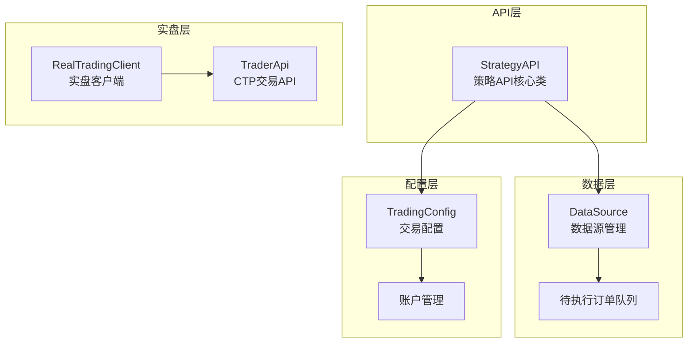
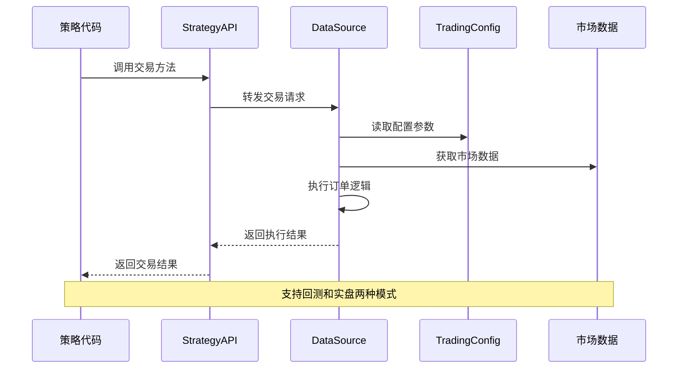
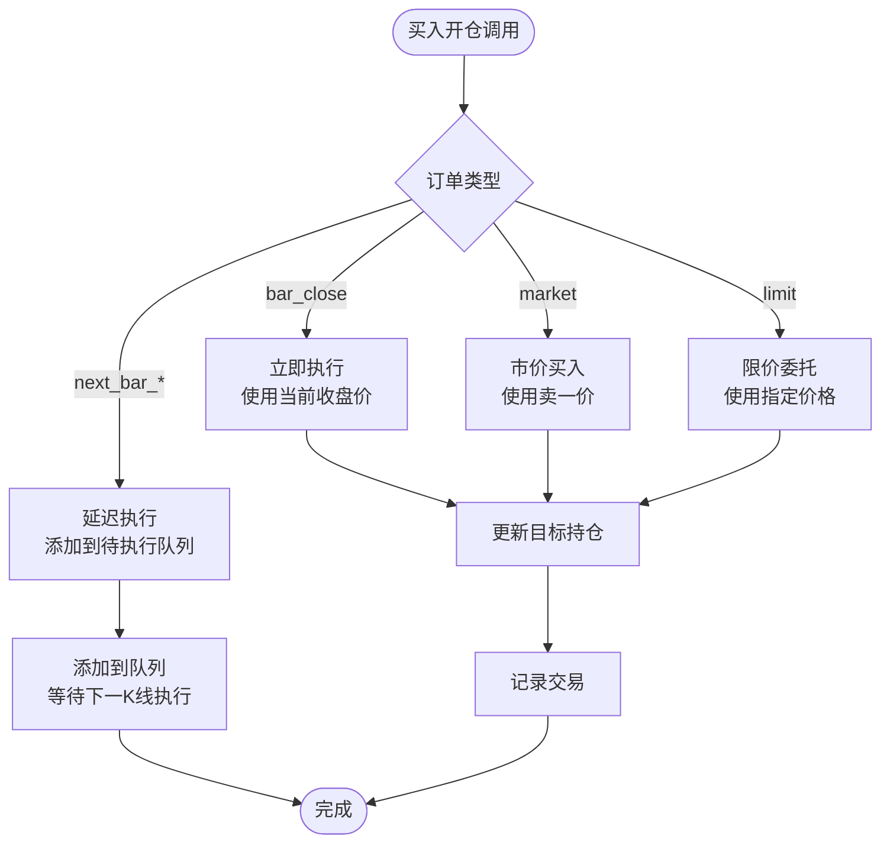
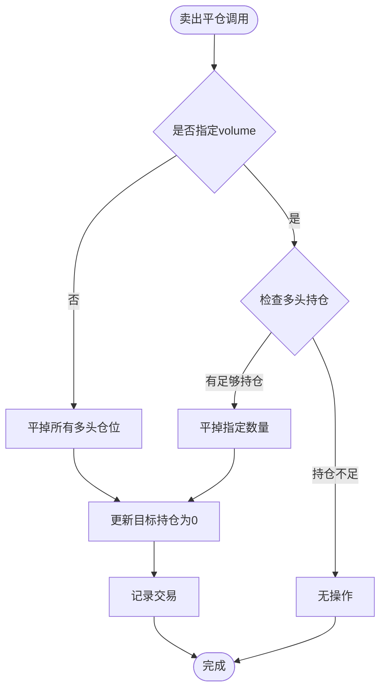
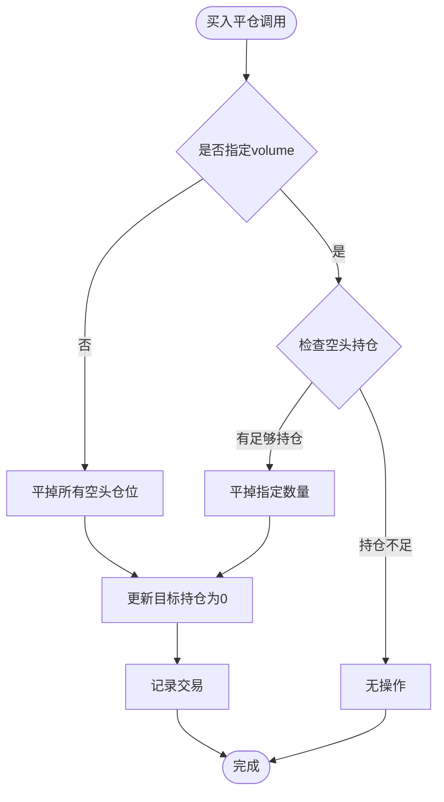
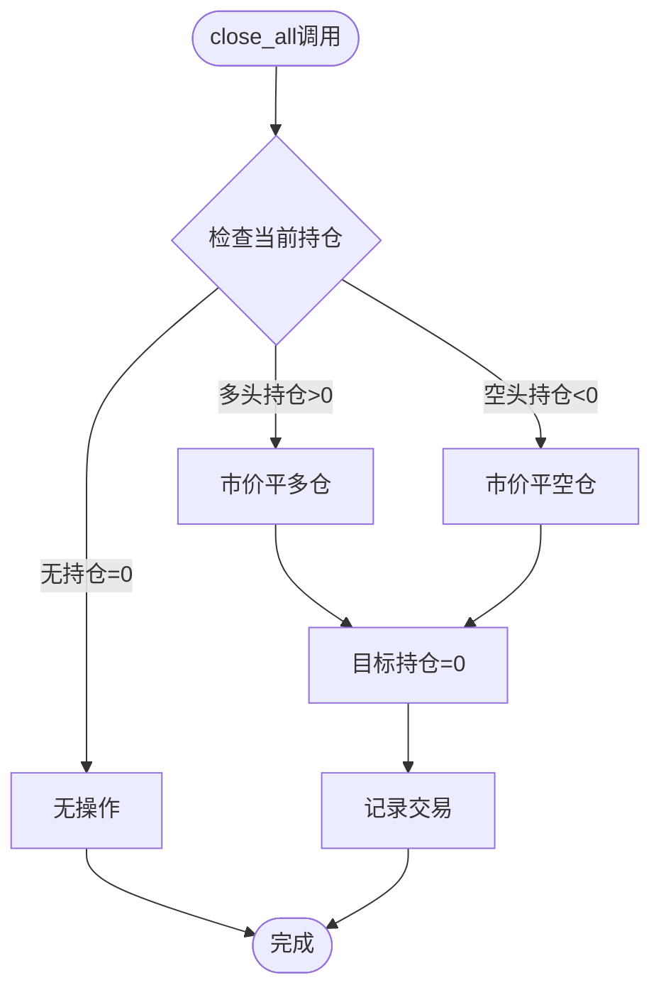
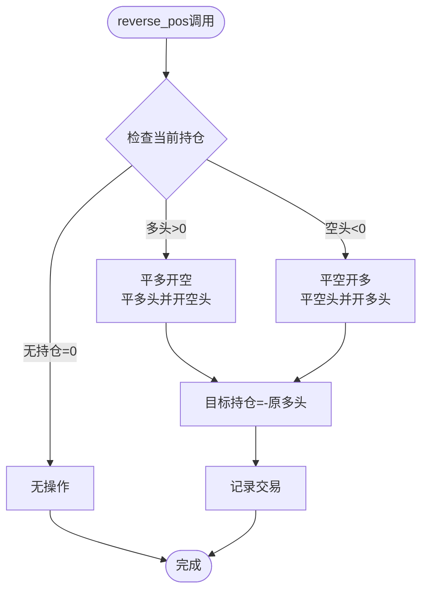
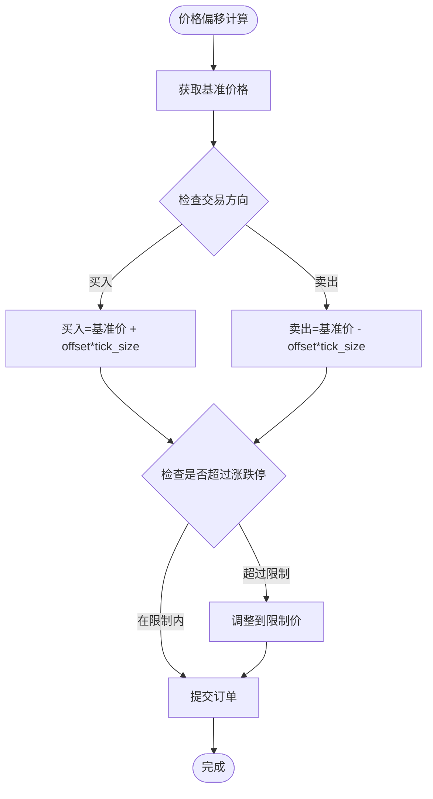
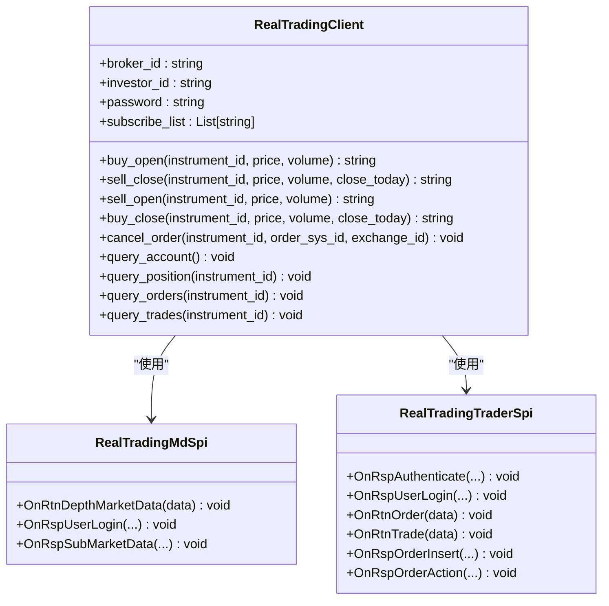
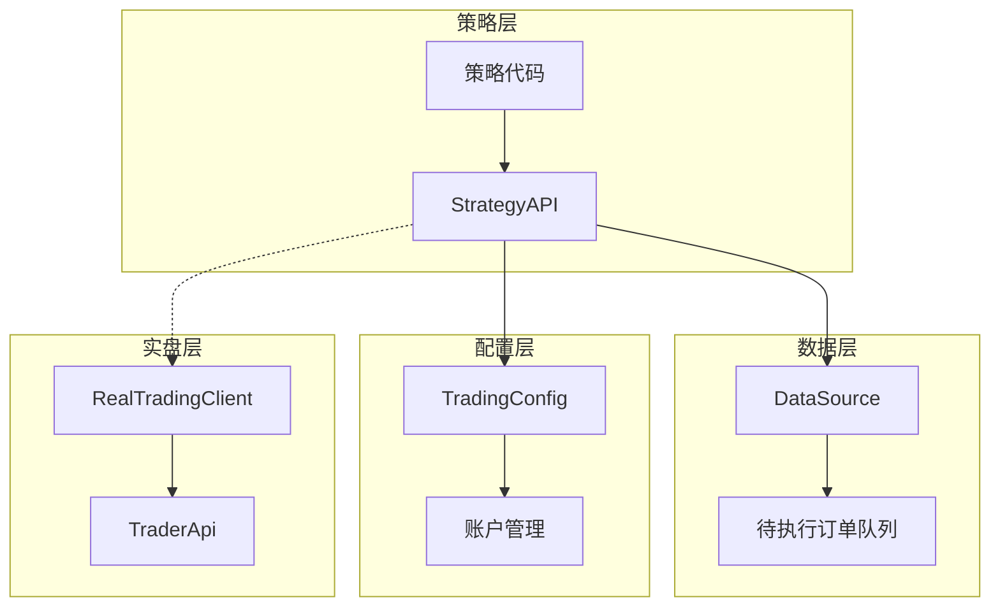

# 交易操作方法

<cite>
**本文档引用的文件**
- [ssquant/api/strategy_api.py](file://ssquant/api/strategy_api.py)
- [ssquant/data/data_source.py](file://ssquant/data/data_source.py)
- [ssquant/config/trading_config.py](file://ssquant/config/trading_config.py)
- [ssquant/pyctp/real_trading_client.py](file://ssquant/pyctp/real_trading_client.py)
- [ssquant/pyctp/trader_api.py](file://ssquant/pyctp/trader_api.py)
- [examples/A_撤单重发示例.py](file://examples/A_撤单重发示例.py)
- [examples/B_缠论5分钟策略.py](file://examples/B_缠论5分钟策略.py)
</cite>

## 目录
1. [简介](#简介)
2. [项目结构](#项目结构)
3. [核心组件](#核心组件)
4. [架构概览](#架构概览)
5. [详细组件分析](#详细组件分析)
6. [依赖关系分析](#依赖关系分析)
7. [性能考虑](#性能考虑)
8. [故障排除指南](#故障排除指南)
9. [结论](#结论)
10. [附录](#附录)

## 简介
本文件为SSQuant策略API的交易操作方法完整文档，涵盖所有下单和撤单接口，包括买入开仓（buy）、卖出平仓（sell）、卖出开仓（sellshort）、买入平仓（buycover、buytocover）以及批量操作（close_all、reverse_pos、cancel_all_orders）。重点解释订单类型参数（limit、bar_close、next_bar_open、next_bar_close、next_bar_high、next_bar_low、market）的含义和使用场景，提供详细的参数说明、价格偏移机制、订单类型选择策略和风险控制建议，并包含完整的交易示例和最佳实践指导。

## 项目结构
SSQuant交易系统采用分层架构设计，主要由以下层次组成：
- API层：提供策略API接口，封装底层交易逻辑
- 数据层：管理数据源和订单执行
- 配置层：管理交易参数和账户配置
- 实盘层：支持CTP实盘交易

**图表来源**
- [ssquant/api/strategy_api.py](file://ssquant/api/strategy_api.py#L4-L570)
- [ssquant/data/data_source.py](file://ssquant/data/data_source.py#L6-L800)
- [ssquant/config/trading_config.py](file://ssquant/config/trading_config.py#L1-L187)

**章节来源**
- [ssquant/api/strategy_api.py](file://ssquant/api/strategy_api.py#L1-L570)
- [ssquant/data/data_source.py](file://ssquant/data/data_source.py#L1-L800)
- [ssquant/config/trading_config.py](file://ssquant/config/trading_config.py#L1-L187)

## 核心组件
SSQuant交易系统的核心组件包括策略API、数据源管理和交易配置三个主要部分。

### 策略API（StrategyAPI）
策略API是交易系统的入口接口，提供统一的交易操作方法。它封装了底层的数据源访问和交易执行逻辑，为策略开发者提供简洁易用的API接口。

### 数据源（DataSource）
数据源负责管理单个数据源的数据和交易操作，包括：
- 持仓管理：当前持仓、目标持仓、交易记录
- 订单执行：支持多种订单类型和价格偏移机制
- 待执行订单队列：管理延迟执行的订单

### 交易配置（TradingConfig）
交易配置管理账户参数、订单超时设置、重试机制等关键交易参数。

**章节来源**
- [ssquant/api/strategy_api.py](file://ssquant/api/strategy_api.py#L4-L570)
- [ssquant/data/data_source.py](file://ssquant/data/data_source.py#L6-L800)
- [ssquant/config/trading_config.py](file://ssquant/config/trading_config.py#L1-L187)

## 架构概览
SSQuant交易系统采用事件驱动的架构模式，支持回测和实盘两种运行模式。

**图表来源**
- [ssquant/api/strategy_api.py](file://ssquant/api/strategy_api.py#L362-L491)
- [ssquant/data/data_source.py](file://ssquant/data/data_source.py#L222-L778)
- [ssquant/config/trading_config.py](file://ssquant/config/trading_config.py#L115-L164)

## 详细组件分析

### 交易接口详解

#### 买入开仓（buy）
买入开仓是最常用的多头建仓操作，支持多种订单类型：

**图表来源**
- [ssquant/data/data_source.py](file://ssquant/data/data_source.py#L222-L306)

**参数说明**：
- `volume`: 交易量，默认为1手
- `reason`: 交易原因，用于日志记录
- `order_type`: 订单类型，默认为'bar_close'
- `offset_ticks`: 价格偏移tick数
- `price`: 限价单价格（仅当order_type='limit'时有效）

#### 卖出平仓（sell）
卖出平仓用于减少或多头头寸，支持全部平仓和部分平仓：

**图表来源**
- [ssquant/data/data_source.py](file://ssquant/data/data_source.py#L308-L416)

**参数说明**：
- `volume`: 交易量，默认为全部多头持仓
- `reason`: 交易原因
- `order_type`: 订单类型，默认为'bar_close'
- `offset_ticks`: 价格偏移tick数
- `price`: 限价单价格（仅当order_type='limit'时有效）

#### 卖出开仓（sellshort）
卖出开仓用于建立空头头寸，支持多种执行方式：

**图表来源**
- [ssquant/data/data_source.py](file://ssquant/data/data_source.py#L418-L493)

**参数说明**：
- `volume`: 交易量，默认为1手
- `reason`: 交易原因
- `order_type`: 订单类型，默认为'bar_close'
- `offset_ticks`: 价格偏移tick数
- `price`: 限价单价格（仅当order_type='limit'时有效）

#### 买入平仓（buycover/buytocover）
买入平仓用于减少或消除空头头寸，buytocver为buycover的别名：

**图表来源**
- [ssquant/data/data_source.py](file://ssquant/data/data_source.py#L495-L603)

**参数说明**：
- `volume`: 交易量，默认为全部空头持仓
- `reason`: 交易原因
- `order_type`: 订单类型，默认为'bar_close'
- `offset_ticks`: 价格偏移tick数
- `price`: 限价单价格（仅当order_type='limit'时有效）

#### 批量操作

##### 平仓所有持仓（close_all）
close_all方法支持平掉所有现有持仓，无论多头还是空头：

**图表来源**
- [ssquant/data/data_source.py](file://ssquant/data/data_source.py#L707-L778)

##### 反转持仓（reverse_pos）
反转持仓用于将现有头寸方向完全改变：

**图表来源**
- [ssquant/data/data_source.py](file://ssquant/data/data_source.py#L605-L705)

##### 撤销所有未成交订单（cancel_all_orders）
仅在实盘模式下有效，用于撤销所有未成交的订单：

**章节来源**
- [ssquant/api/strategy_api.py](file://ssquant/api/strategy_api.py#L362-L491)
- [ssquant/data/data_source.py](file://ssquant/data/data_source.py#L222-L778)

### 订单类型详解

#### 常用订单类型

| 订单类型 | 含义 | 使用场景 | 价格确定 |
|---------|------|----------|----------|
| `bar_close` | 当前K线收盘价 | 立即执行，回测常用 | 使用当前K线收盘价 |
| `market` | 市价单 | 需要快速成交 | 使用对手价（买一/卖一） |
| `next_bar_open` | 下一K线开盘价 | 延迟执行，避免滑点 | 使用下一K线开盘价 |
| `next_bar_close` | 下一K线收盘价 | 延迟执行，精确价格 | 使用下一K线收盘价 |
| `next_bar_high` | 下一K线最高价 | 延迟执行，突破策略 | 使用下一K线最高价 |
| `next_bar_low` | 下一K线最低价 | 延迟执行，支撑策略 | 使用下一K线最低价 |

#### 价格偏移机制
价格偏移机制允许策略通过offset_ticks参数调整委托价格：

**图表来源**
- [examples/A_撤单重发示例.py](file://examples/A_撤单重发示例.py#L24-L26)

**章节来源**
- [ssquant/data/data_source.py](file://ssquant/data/data_source.py#L94-L135)
- [examples/A_撤单重发示例.py](file://examples/A_撤单重发示例.py#L13-L27)

### 实盘交易支持

#### CTP实盘客户端
SSQuant提供完整的CTP实盘交易支持，包括：

**图表来源**
- [ssquant/pyctp/real_trading_client.py](file://ssquant/pyctp/real_trading_client.py#L538-L755)

**章节来源**
- [ssquant/pyctp/real_trading_client.py](file://ssquant/pyctp/real_trading_client.py#L1-L755)
- [ssquant/pyctp/trader_api.py](file://ssquant/pyctp/trader_api.py#L1-L483)

## 依赖关系分析

### 组件耦合关系
SSQuant交易系统采用松耦合设计，各组件间通过清晰的接口进行交互：

**图表来源**
- [ssquant/api/strategy_api.py](file://ssquant/api/strategy_api.py#L4-L570)
- [ssquant/data/data_source.py](file://ssquant/data/data_source.py#L6-L800)
- [ssquant/config/trading_config.py](file://ssquant/config/trading_config.py#L1-L187)

### 外部依赖
系统对外部依赖主要包括：
- **CTP接口**：实盘交易依赖CTP标准接口
- **数据源**：支持多种数据源格式
- **配置管理**：灵活的配置系统支持不同运行模式

**章节来源**
- [ssquant/api/strategy_api.py](file://ssquant/api/strategy_api.py#L1-L570)
- [ssquant/data/data_source.py](file://ssquant/data/data_source.py#L1-L800)
- [ssquant/config/trading_config.py](file://ssquant/config/trading_config.py#L1-L187)

## 性能考虑
SSQuant交易系统在设计时充分考虑了性能优化：

### 订单执行优化
- **延迟执行队列**：支持下一K线价格的延迟订单，避免实时价格计算开销
- **批量处理**：支持多个数据源的批量订单处理
- **内存管理**：优化的数据结构减少内存占用

### 实盘性能
- **异步处理**：实盘交易采用异步回调机制
- **连接池**：CTP连接的高效管理
- **错误恢复**：自动重连和错误恢复机制

## 故障排除指南

### 常见问题及解决方案

#### 订单执行失败
**问题**：订单提交后立即失败
**可能原因**：
- 价格超出涨跌停限制
- 持仓不足导致无法平仓
- 账户资金不足

**解决方法**：
1. 检查订单价格是否在有效范围内
2. 确认账户可用资金充足
3. 验证持仓数量是否足够

#### 订单超时
**问题**：订单长时间未成交
**解决方法**：
1. 调整offset_ticks参数提高成交概率
2. 使用市价单确保快速成交
3. 检查市场流动性情况

#### 实盘连接问题
**问题**：CTP连接不稳定
**解决方法**：
1. 检查网络连接状态
2. 验证账户权限配置
3. 确认服务器地址正确性

**章节来源**
- [ssquant/pyctp/real_trading_client.py](file://ssquant/pyctp/real_trading_client.py#L470-L535)

## 结论
SSQuant交易系统提供了完整、灵活且高性能的交易API接口。通过合理的订单类型选择、价格偏移机制和风险管理策略，策略开发者可以构建稳定可靠的交易系统。系统支持回测和实盘两种模式，满足不同阶段的开发需求。

## 附录

### 交易最佳实践

#### 订单类型选择策略
1. **回测阶段**：使用`bar_close`类型确保公平回测
2. **实盘交易**：根据市场情况选择合适的订单类型
3. **高波动市场**：优先使用市价单确保成交
4. **低波动市场**：可使用限价单控制成本

#### 风险控制建议
1. **止损设置**：为每个订单设置合理的止损点
2. **仓位管理**：避免单一订单占用过多资金
3. **分散投资**：不要将所有资金投入单一品种
4. **监控机制**：建立订单执行状态的实时监控

#### 性能优化技巧
1. **合理使用延迟订单**：利用`next_bar_*`类型减少滑点
2. **批量操作**：使用`close_all`和`reverse_pos`简化操作
3. **配置优化**：根据策略特点调整交易参数
4. **日志管理**：合理使用日志功能避免性能影响

### 示例代码路径
- [撤单重发示例](file://examples/A_撤单重发示例.py#L1-L429)
- [缠论5分钟策略](file://examples/B_缠论5分钟策略.py#L653-L673)

**章节来源**
- [examples/A_撤单重发示例.py](file://examples/A_撤单重发示例.py#L1-L429)
- [examples/B_缠论5分钟策略.py](file://examples/B_缠论5分钟策略.py#L653-L673)