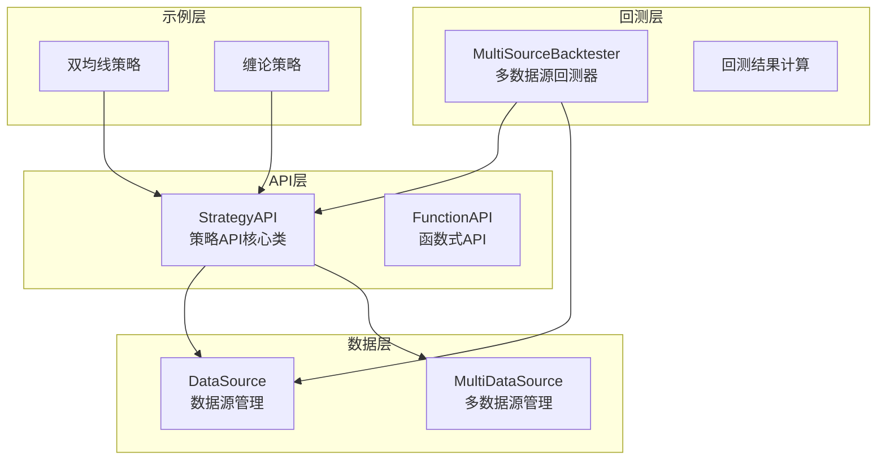
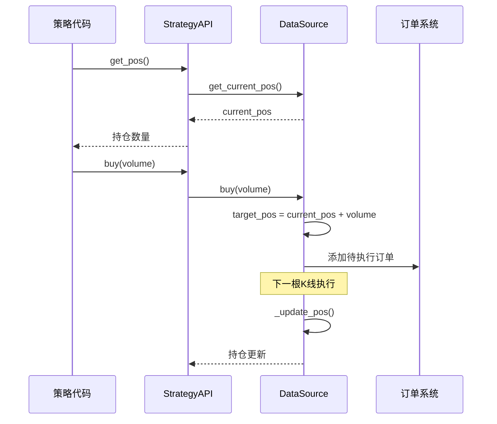
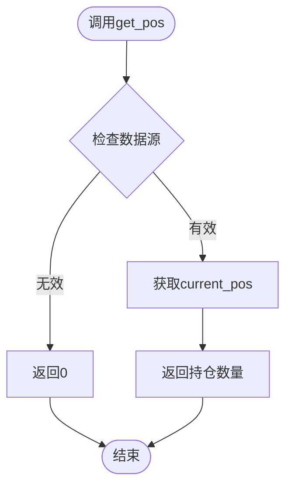
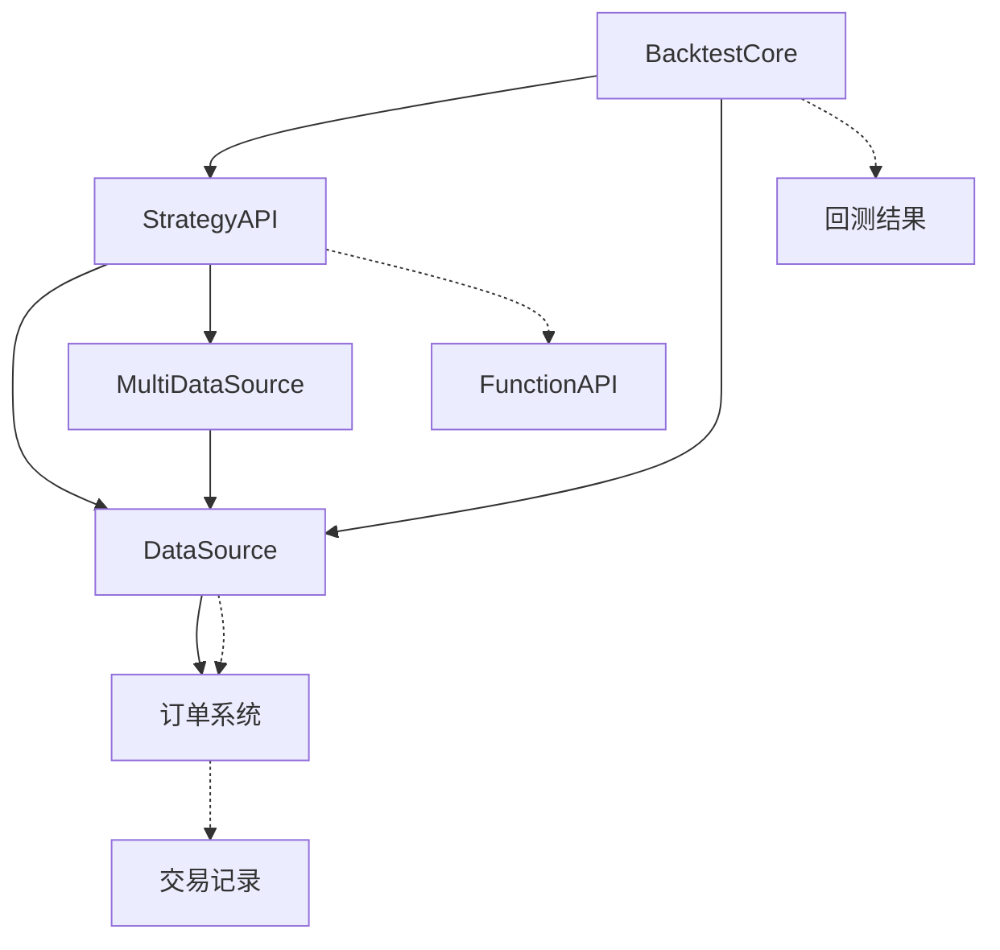

# 持仓管理方法

<cite>
**本文档引用的文件**
- [ssquant/api/strategy_api.py](file://ssquant/api/strategy_api.py)
- [ssquant/data/data_source.py](file://ssquant/data/data_source.py)
- [ssquant/backtest/backtest_core.py](file://ssquant/backtest/backtest_core.py)
- [ssquant/backtest/function_api.py](file://ssquant/backtest/function_api.py)
- [examples/B_双均线策略.py](file://examples/B_双均线策略.py)
- [examples/B_缠论5分钟策略.py](file://examples/B_缠论5分钟策略.py)
</cite>

## 目录
1. [简介](#简介)
2. [项目结构](#项目结构)
3. [核心组件](#核心组件)
4. [架构概览](#架构概览)
5. [详细组件分析](#详细组件分析)
6. [依赖关系分析](#依赖关系分析)
7. [性能考虑](#性能考虑)
8. [故障排除指南](#故障排除指南)
9. [结论](#结论)

## 简介

SSQuant策略API提供了全面的持仓管理功能，支持多种数据源和交易模式。本文档深入分析了持仓查询和管理接口，包括总持仓、多头持仓、空头持仓和详细持仓信息的实现机制。

## 项目结构

SSQuant项目采用模块化设计，主要包含以下核心模块：



**图表来源**
- [ssquant/api/strategy_api.py](file://ssquant/api/strategy_api.py#L4-L570)
- [ssquant/data/data_source.py](file://ssquant/data/data_source.py#L6-L922)
- [ssquant/backtest/backtest_core.py](file://ssquant/backtest/backtest_core.py#L14-L579)

## 核心组件

### StrategyAPI类

StrategyAPI是策略API的核心类，提供了统一的接口来访问数据源和执行交易操作。该类实现了以下关键功能：

- **数据访问接口**：提供获取K线数据、价格、时间戳等方法
- **交易执行接口**：支持买入、卖出、开仓、平仓等交易操作
- **持仓管理接口**：提供多种持仓查询方法
- **多数据源支持**：支持同时管理多个数据源

### DataSource类

DataSource类负责管理单个数据源的数据和交易操作，包含以下核心属性：

- `current_pos`: 当前实际持仓
- `target_pos`: 目标持仓（用于延迟执行）
- `pending_orders`: 待执行订单队列
- `trades`: 交易记录列表

### MultiDataSource类

MultiDataSource类管理多个数据源，提供统一的接口来访问各个数据源。

**章节来源**
- [ssquant/api/strategy_api.py](file://ssquant/api/strategy_api.py#L4-L570)
- [ssquant/data/data_source.py](file://ssquant/data/data_source.py#L6-L922)

## 架构概览

SSQuant的持仓管理架构采用了分层设计，确保了灵活性和可扩展性：



**图表来源**
- [ssquant/api/strategy_api.py](file://ssquant/api/strategy_api.py#L162-L257)
- [ssquant/data/data_source.py](file://ssquant/data/data_source.py#L222-L306)

## 详细组件分析

### 持仓查询接口

#### 总持仓查询 (get_pos)

get_pos方法返回当前的净持仓，计算公式为：多头持仓 - 空头持仓。



**图表来源**
- [ssquant/api/strategy_api.py](file://ssquant/api/strategy_api.py#L162-L175)

#### 多头持仓查询 (get_long_pos)

get_long_pos方法返回当前的多头持仓数量，适用于支持多空分离的数据源。

#### 空头持仓查询 (get_short_pos)

get_short_pos方法返回当前的空头持仓数量，同样适用于支持多空分离的数据源。

#### 详细持仓信息 (get_position_detail)

get_position_detail方法提供最全面的持仓信息，包括：

- `net_pos`: 净持仓（多头-空头）
- `long_pos`: 多头持仓
- `short_pos`: 空头持仓
- `today_pos`: 今日净持仓
- `yd_pos`: 昨日净持仓
- `long_today`: 今日多头持仓
- `short_today`: 今日空头持仓
- `long_yd`: 昨日多头持仓
- `short_yd`: 昨日空头持仓

**章节来源**
- [ssquant/api/strategy_api.py](file://ssquant/api/strategy_api.py#L162-L244)

### 持仓管理最佳实践

#### 持仓限制策略

1. **最大持仓限制**：设置每日最大持仓限额，防止过度集中
2. **多空平衡**：维持多头和空头持仓的合理比例
3. **动态调整**：根据市场波动性调整持仓规模

#### 风险控制措施

1. **止损机制**：设置固定或移动止损点
2. **仓位管理**：采用金字塔加仓或倒金字塔减仓策略
3. **分散投资**：避免单一品种或单一方向的过度暴露

#### 资金管理建议

1. **风险预算**：每次交易的风险不超过总资金的固定比例
2. **收益保护**：在盈利达到一定水平后锁定部分利润
3. **流动性管理**：确保有足够的现金应对突发情况

### 代码示例

#### 基本持仓监控

```python
# 获取当前持仓
current_pos = api.get_pos()

# 检查多头持仓
long_pos = api.get_long_pos()
if long_pos > 0:
    api.log(f"当前持有 {long_pos} 手多头")

# 检查空头持仓  
short_pos = api.get_short_pos()
if short_pos > 0:
    api.log(f"当前持有 {short_pos} 手空头")
```

#### 详细持仓分析

```python
# 获取详细持仓信息
position_detail = api.get_position_detail()
api.log(f"净持仓: {position_detail['net_pos']}")
api.log(f"多头持仓: {position_detail['long_pos']}")
api.log(f"空头持仓: {position_detail['short_pos']}")
api.log(f"今日持仓: {position_detail['today_pos']}")
api.log(f"昨日持仓: {position_detail['yd_pos']}")
```

#### 交易决策逻辑

```python
def position_management_logic(api):
    # 获取当前持仓和价格
    current_pos = api.get_pos()
    current_price = api.get_price()
    
    # 检查是否需要平仓
    if current_pos > 0 and should_exit_position(current_pos, current_price):
        api.sell(volume=current_pos, reason="止盈/止损")
    
    # 检查是否需要加仓
    elif current_pos == 0 and should_enter_position():
        api.buy(volume=calculate_position_size(), reason="趋势确认")
    
    # 检查是否需要反手
    elif current_pos < 0 and should_reverse_position():
        api.buycover(volume=abs(current_pos), reason="趋势反转")
```

**章节来源**
- [examples/B_双均线策略.py](file://examples/B_双均线策略.py#L103-L123)
- [examples/B_缠论5分钟策略.py](file://examples/B_缠论5分钟策略.py#L601-L628)

### 不同数据源下的持仓差异

#### 回测数据源

回测模式下的数据源具有以下特点：
- **历史数据完整性**：包含完整的回测历史数据
- **价格一致性**：使用收盘价进行交易执行
- **延迟执行**：支持下一K线开盘价等延迟订单类型

#### 实盘数据源

实盘模式下的数据源具有以下特点：
- **实时数据流**：支持TICK数据流和K线数据
- **价格实时性**：使用实时买一卖一价格
- **订单执行**：支持市价单和限价单等多种订单类型

#### 多数据源协调

多数据源环境下，系统需要处理：
- **数据对齐**：确保不同周期和品种的数据时间轴对齐
- **持仓同步**：在多个数据源间保持持仓状态的一致性
- **风险控制**：统一的风险管理和资金分配策略

**章节来源**
- [ssquant/data/data_source.py](file://ssquant/data/data_source.py#L833-L922)
- [ssquant/backtest/backtest_core.py](file://ssquant/backtest/backtest_core.py#L14-L81)

## 依赖关系分析

SSQuant的持仓管理模块之间存在清晰的依赖关系：



**图表来源**
- [ssquant/api/strategy_api.py](file://ssquant/api/strategy_api.py#L1-L570)
- [ssquant/data/data_source.py](file://ssquant/data/data_source.py#L1-L922)
- [ssquant/backtest/backtest_core.py](file://ssquant/backtest/backtest_core.py#L1-L579)

**章节来源**
- [ssquant/api/strategy_api.py](file://ssquant/api/strategy_api.py#L1-L570)
- [ssquant/data/data_source.py](file://ssquant/data/data_source.py#L1-L922)

## 性能考虑

### 持仓查询性能

- **缓存机制**：持仓信息通常缓存在内存中，查询速度快
- **批量操作**：支持批量获取多个数据源的持仓信息
- **延迟计算**：目标持仓与实际持仓的更新采用延迟机制

### 内存管理

- **数据源管理**：MultiDataSource类管理多个数据源实例
- **订单队列**：待执行订单存储在队列中，避免内存泄漏
- **交易记录**：交易历史记录定期清理，控制内存使用

### 并发处理

- **线程安全**：持仓更新操作采用原子性保证
- **数据一致性**：多数据源间的持仓状态保持一致
- **异常处理**：完善的异常捕获和恢复机制

## 故障排除指南

### 常见问题及解决方案

#### 持仓查询返回0

**可能原因**：
- 数据源索引超出范围
- 数据源初始化失败
- 回测数据为空

**解决方法**：
```python
# 检查数据源有效性
ds = api.get_data_source(index)
if ds is None:
    api.log(f"数据源 {index} 不存在")
    return

# 检查持仓状态
current_pos = api.get_pos(index)
api.log(f"数据源 {index} 的持仓: {current_pos}")
```

#### 持仓更新不及时

**可能原因**：
- 订单执行延迟
- 数据源更新频率问题
- 回测进度条影响

**解决方法**：
```python
# 确保订单正确执行
api.buy(volume=1, order_type='bar_close')
# 等待下一K线执行
# 或者使用市价单立即执行
api.buy(volume=1, order_type='market')
```

#### 多数据源持仓不一致

**可能原因**：
- 数据源对齐问题
- 订单执行时间差异
- 交易费用计算差异

**解决方法**：
```python
# 检查所有数据源的持仓
for i in range(api.get_data_sources_count()):
    pos = api.get_pos(i)
    api.log(f"数据源 {i} 持仓: {pos}")

# 确保数据源对齐
multi_source = api.get_data_source(0)
if hasattr(multi_source, 'align_data'):
    multi_source.align_data()
```

**章节来源**
- [ssquant/api/strategy_api.py](file://ssquant/api/strategy_api.py#L52-L90)
- [ssquant/backtest/backtest_core.py](file://ssquant/backtest/backtest_core.py#L209-L215)

## 结论

SSQuant的持仓管理方法提供了完整而灵活的解决方案，支持从简单的回测到复杂的实盘交易。通过StrategyAPI类的统一接口，开发者可以轻松实现各种交易策略，同时享受系统提供的风险控制和资金管理功能。

关键优势包括：
- **统一接口**：所有数据源通过相同的API访问
- **灵活扩展**：支持多数据源和多种交易模式
- **性能优化**：高效的内存管理和并发处理
- **完整监控**：提供详细的持仓信息和交易记录

建议开发者在实际应用中结合具体的交易需求，选择合适的持仓管理策略，并建立完善的风险控制机制。