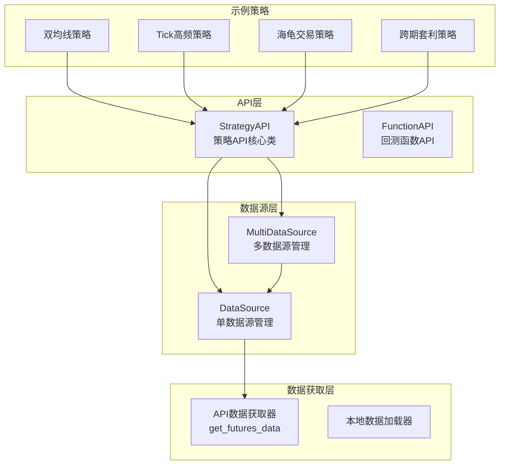
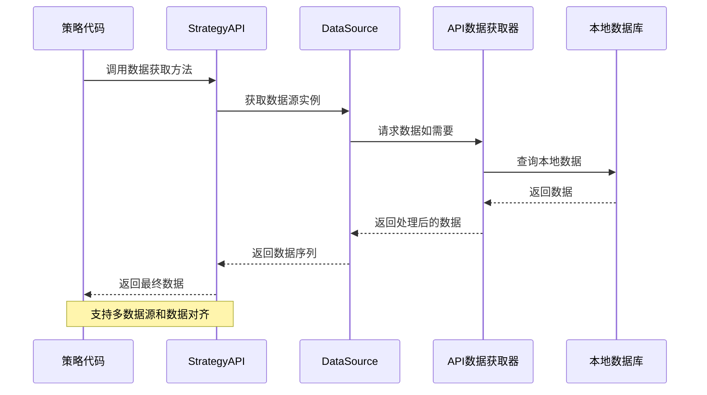
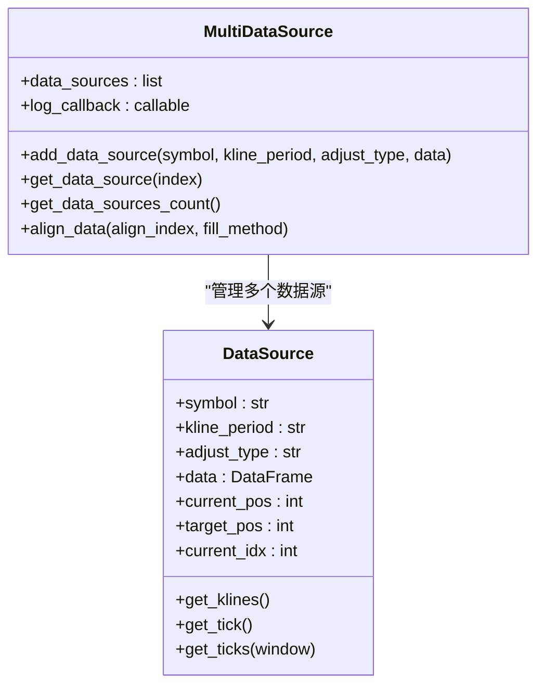
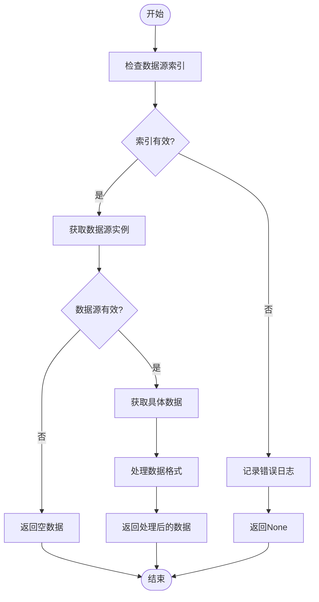
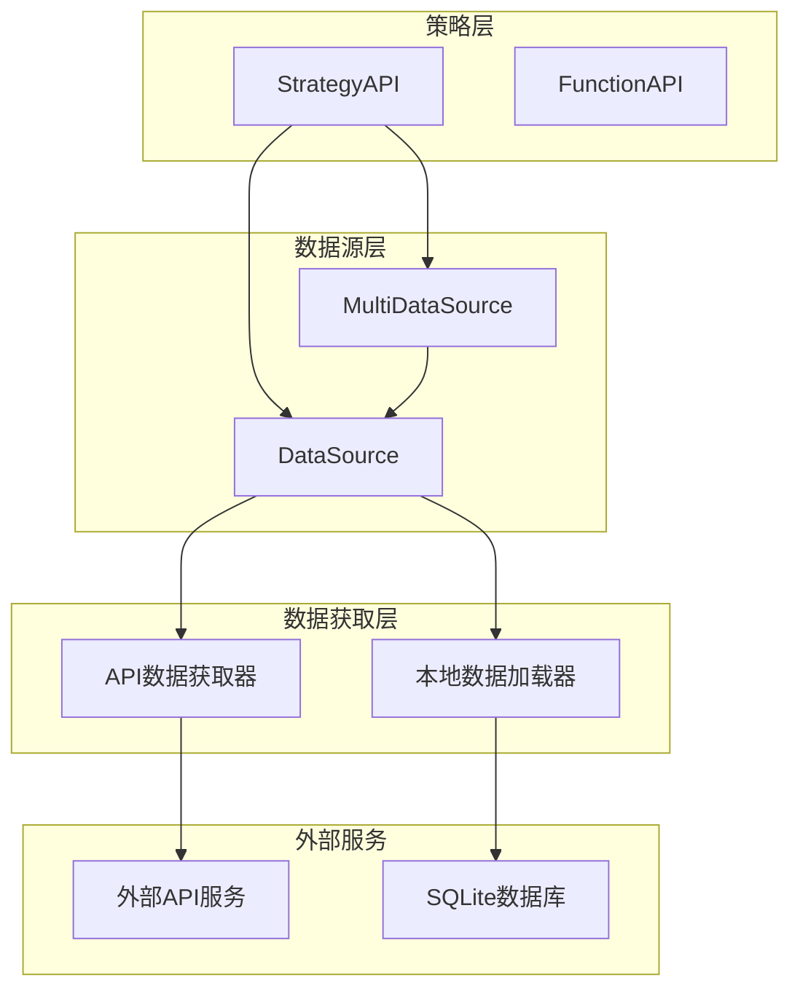

# 数据获取方法

<cite>
**本文档引用的文件**
- [ssquant/api/strategy_api.py](file://ssquant/api/strategy_api.py)
- [ssquant/data/data_source.py](file://ssquant/data/data_source.py)
- [ssquant/data/api_data_fetcher.py](file://ssquant/data/api_data_fetcher.py)
- [ssquant/backtest/function_api.py](file://ssquant/backtest/function_api.py)
- [examples/B_双均线策略.py](file://examples/B_双均线策略.py)
- [examples/C_纯Tick高频交易策略.py](file://examples/C_纯Tick高频交易策略.py)
- [examples/B_海龟交易策略.py](file://examples/B_海龟交易策略.py)
- [examples/B_跨期套利策略.py](file://examples/B_跨期套利策略.py)
</cite>

## 目录
1. [简介](#简介)
2. [项目结构](#项目结构)
3. [核心组件](#核心组件)
4. [架构概览](#架构概览)
5. [详细组件分析](#详细组件分析)
6. [依赖关系分析](#依赖关系分析)
7. [性能考虑](#性能考虑)
8. [故障排除指南](#故障排除指南)
9. [结论](#结论)

## 简介
本文档详细介绍了SSQuant策略API中的数据获取方法，涵盖了所有基础价格数据、时间数据、索引数据、价格数据和Tick数据的访问接口。文档不仅说明了每个方法的参数类型、返回值格式、使用场景和性能考虑，还提供了完整的代码示例展示如何在策略中正确使用这些数据获取方法。同时包含了多数据源支持说明、数据对齐机制和常见错误处理方式。

## 项目结构
SSQuant项目采用模块化设计，数据获取功能主要分布在以下几个核心模块中：

**图表来源**
- [ssquant/api/strategy_api.py](file://ssquant/api/strategy_api.py#L1-L570)
- [ssquant/data/data_source.py](file://ssquant/data/data_source.py#L1-L922)

**章节来源**
- [ssquant/api/strategy_api.py](file://ssquant/api/strategy_api.py#L1-L570)
- [ssquant/data/data_source.py](file://ssquant/data/data_source.py#L1-L922)

## 核心组件
SSQuant的数据获取系统由三个主要层次组成：

### 1. 策略API层
- **StrategyAPI**: 提供统一的策略数据访问接口
- **FunctionAPI**: 专门用于回测环境的函数式API

### 2. 数据源管理层
- **DataSource**: 管理单个数据源的数据和交易操作
- **MultiDataSource**: 管理多个数据源并支持数据对齐

### 3. 数据获取层
- **API数据获取器**: 从外部API获取期货数据
- **本地数据加载器**: 从本地数据库加载历史数据

**章节来源**
- [ssquant/api/strategy_api.py](file://ssquant/api/strategy_api.py#L4-L570)
- [ssquant/data/data_source.py](file://ssquant/data/data_source.py#L6-L922)

## 架构概览
SSQuant采用分层架构设计，确保数据获取的灵活性和可扩展性：

**图表来源**
- [ssquant/api/strategy_api.py](file://ssquant/api/strategy_api.py#L91-L104)
- [ssquant/data/data_source.py](file://ssquant/data/data_source.py#L833-L922)

## 详细组件分析

### 基础价格数据获取方法

#### get_close 方法
**方法签名**: `get_close(index: int = 0) -> pd.Series`

**功能**: 获取指定数据源的收盘价序列

**参数**:
- `index`: 数据源索引，默认为0（第一个数据源）

**返回值**: pandas Series，包含收盘价序列

**使用场景**:
- 技术指标计算（如移动平均线、RSI等）
- 均线交叉策略
- 价格趋势分析

**性能考虑**:
- 返回完整的收盘价序列，适合批量计算
- 时间复杂度：O(n)，其中n为数据点数量

**代码示例路径**:
- [双均线策略中的收盘价使用](file://examples/B_双均线策略.py#L88-L94)

#### get_open 方法
**方法签名**: `get_open(index: int = 0) -> pd.Series`

**功能**: 获取指定数据源的开盘价序列

**参数**:
- `index`: 数据源索引，默认为0

**返回值**: pandas Series，包含开盘价序列

**使用场景**:
- 开盘跳空分析
- 开盘价技术指标计算
- 价格缺口识别

**性能考虑**:
- 与get_close类似，返回完整序列

**代码示例路径**:
- [海龟交易策略中的开盘价使用](file://examples/B_海龟交易策略.py#L161-L163)

#### get_high 方法
**方法签名**: `get_high(index: int = 0) -> pd.Series`

**功能**: 获取指定数据源的最高价序列

**参数**:
- `index`: 数据源索引，默认为0

**返回值**: pandas Series，包含最高价序列

**使用场景**:
- 唐奇安通道计算
- 最高价技术指标
- 价格阻力位分析

**性能考虑**:
- 适用于波动率计算和阻力位识别

**代码示例路径**:
- [海龟交易策略中的最高价使用](file://examples/B_海龟交易策略.py#L161-L162)

#### get_low 方法
**方法签名**: `get_low(index: int = 0) -> pd.Series`

**功能**: 获取指定数据源的最低价序列

**参数**:
- `index`: 数据源索引，默认为0

**返回值**: pandas Series，包含最低价序列

**使用场景**:
- 唐奇安通道计算
- 最低价技术指标
- 价格支撑位分析

**性能考虑**:
- 适用于支撑位识别和底部反转策略

**代码示例路径**:
- [海龟交易策略中的最低价使用](file://examples/B_海龟交易策略.py#L162-L163)

#### get_volume 方法
**方法签名**: `get_volume(index: int = 0) -> pd.Series`

**功能**: 获取指定数据源的成交量序列

**参数**:
- `index`: 数据源索引，默认为0

**返回值**: pandas Series，包含成交量序列

**使用场景**:
- 成交量技术指标（OBV、能量潮等）
- 量价关系分析
- 成交量确认信号

**性能考虑**:
- 重要指标，常用于确认价格走势

**代码示例路径**:
- [双均线策略中的成交量使用](file://examples/B_双均线策略.py#L88-L94)

### 时间数据获取方法

#### get_datetime 方法
**方法签名**: `get_datetime(index: int = 0)`

**功能**: 获取当前日期时间

**参数**:
- `index`: 数据源索引，默认为0

**返回值**: 当前日期时间（支持多种格式）

**使用场景**:
- 交易时间记录
- 数据时间戳管理
- 策略执行时间控制

**性能考虑**:
- 轻量级操作，几乎无性能开销

**代码示例路径**:
- [双均线策略中的时间使用](file://examples/B_双均线策略.py#L126-L128)

#### get_current_datetime 方法
**方法签名**: `get_current_datetime(index: int = 0)`

**功能**: 获取当前日期时间（已废弃，推荐使用get_datetime）

**参数**:
- `index`: 数据源索引，默认为0

**返回值**: 当前日期时间

**使用场景**: 兼容性支持

**性能考虑**: 与get_datetime相同

**代码示例路径**:
- [策略代码中的时间获取](file://examples/B_双均线策略.py#L126-L128)

### 索引数据获取方法

#### get_idx 方法
**方法签名**: `get_idx(index: int = 0) -> int`

**功能**: 获取当前索引

**参数**:
- `index`: 数据源索引，默认为0

**返回值**: 当前索引（整数）

**使用场景**:
- 策略执行进度跟踪
- 数据点位置标识
- 回测进度监控

**性能考虑**:
- O(1)时间复杂度，极轻量级操作

**代码示例路径**:
- [双均线策略中的索引使用](file://examples/B_双均线策略.py#L77-L78)

#### get_current_idx 方法
**方法签名**: `get_current_idx(index: int = 0) -> int`

**功能**: 获取当前索引（已废弃，推荐使用get_idx）

**参数**:
- `index`: 数据源索引，默认为0

**返回值**: 当前索引

**使用场景**: 兼容性支持

**性能考虑**: 与get_idx相同

**代码示例路径**:
- [策略代码中的索引获取](file://examples/B_双均线策略.py#L77-L78)

### 价格数据获取方法

#### get_price 方法
**方法签名**: `get_price(index: int = 0) -> Optional[float]`

**功能**: 获取当前价格

**参数**:
- `index`: 数据源索引，默认为0

**返回值**: 当前价格（浮点数），如果数据源无效则返回None

**使用场景**:
- 实时价格获取
- 交易决策依据
- 价格水平判断

**性能考虑**:
- O(1)时间复杂度
- 支持None返回值处理

**代码示例路径**:
- [双均线策略中的价格使用](file://examples/B_双均线策略.py#L125-L128)

#### get_current_price 方法
**方法签名**: `get_current_price(index: int = 0) -> Optional[float]`

**功能**: 获取当前价格（已废弃，推荐使用get_price）

**参数**:
- `index`: 数据源索引，默认为0

**返回值**: 当前价格

**使用场景**: 兼容性支持

**性能考虑**: 与get_price相同

**代码示例路径**:
- [策略代码中的价格获取](file://examples/B_双均线策略.py#L125-L128)

### Tick数据获取方法

#### get_tick 方法
**方法签名**: `get_tick(index: int = 0)`

**功能**: 获取当前tick的所有字段（Series）

**参数**:
- `index`: 数据源索引，默认为0

**返回值**: 当前tick的所有字段（Series），若无数据则返回None

**使用场景**:
- Tick流策略开发
- 实时价格监控
- 高频交易策略

**性能考虑**:
- 支持多数据源TICK流模式优化
- 优先返回触发当前策略执行的TICK

**代码示例路径**:
- [Tick高频策略中的Tick使用](file://examples/C_纯Tick高频交易策略.py#L264-L272)

#### get_ticks 方法
**方法签名**: `get_ticks(window: int = 100, index: int = 0)`

**功能**: 获取最近window条tick数据（DataFrame）

**参数**:
- `window`: 滑窗长度，默认100
- `index`: 数据源索引，默认为0

**返回值**: 最近window条tick数据（DataFrame），若无数据则返回空DataFrame

**使用场景**:
- Tick数据分析
- 实时指标计算
- 高频策略开发

**性能考虑**:
- 实盘/SIMNOW模式下支持历史TICK预加载
- 可通过get_ticks_count()获取总数

**代码示例路径**:
- [Tick高频策略中的历史Tick使用](file://examples/C_纯Tick高频交易策略.py#L60-L67)

#### get_ticks_count 方法
**方法签名**: `get_ticks_count(index: int = 0) -> int`

**功能**: 获取当前缓存的TICK数据总数

**参数**:
- `index`: 数据源索引，默认为0

**返回值**: 缓存的TICK数据条数

**使用场景**:
- 获取已加载的TICK数量
- 动态调整滑窗大小
- 历史数据完整性检查

**性能考虑**:
- O(1)时间复杂度
- 仅在实盘/SIMNOW模式下有效

**代码示例路径**:
- [Tick高频策略中的Tick计数](file://examples/C_纯Tick高频交易策略.py#L61-L67)

### 多数据源支持和数据对齐

#### 多数据源管理
SSQuant支持同时管理多个数据源，这对于复杂的套利策略和多品种交易至关重要：

**图表来源**
- [ssquant/data/data_source.py](file://ssquant/data/data_source.py#L833-L922)

**使用场景**:
- 跨期套利策略（主力vs次主力）
- 跨品种套利策略
- 多品种组合交易

**数据对齐机制**:
- 支持按索引对齐
- 支持前向填充、后向填充等填充方法
- 自动处理缺失数据

**代码示例路径**:
- [跨期套利策略中的多数据源使用](file://examples/B_跨期套利策略.py#L82-L105)

### 数据获取流程和错误处理

#### 数据获取流程

**图表来源**
- [ssquant/api/strategy_api.py](file://ssquant/api/strategy_api.py#L52-L104)

#### 错误处理机制
- **索引越界**: 自动记录错误并返回None
- **数据源无效**: 返回空DataFrame或None
- **网络异常**: API数据获取器提供重试机制
- **缓存失效**: 自动重新获取数据

**章节来源**
- [ssquant/api/strategy_api.py](file://ssquant/api/strategy_api.py#L52-L104)
- [ssquant/data/data_source.py](file://ssquant/data/data_source.py#L833-L922)

## 依赖关系分析

### 核心依赖关系

**图表来源**
- [ssquant/api/strategy_api.py](file://ssquant/api/strategy_api.py#L1-L570)
- [ssquant/data/data_source.py](file://ssquant/data/data_source.py#L1-L922)
- [ssquant/data/api_data_fetcher.py](file://ssquant/data/api_data_fetcher.py#L1-L1031)

### 数据流向
1. **策略调用** → StrategyAPI
2. **API转发** → DataSource/MultiDataSource
3. **数据获取** → API数据获取器或本地数据库
4. **数据返回** → 策略使用

**章节来源**
- [ssquant/api/strategy_api.py](file://ssquant/api/strategy_api.py#L1-L570)
- [ssquant/data/api_data_fetcher.py](file://ssquant/data/api_data_fetcher.py#L1-L1031)

## 性能考虑

### 数据访问性能
- **序列获取**: get_close/get_open/get_high/get_low/get_volume返回完整序列，适合批量计算
- **单值获取**: get_price/get_datetime/get_idx返回单个值，性能最优
- **Tick数据**: get_tick/get_ticks支持实时数据流，内存使用需谨慎管理

### 缓存机制
- **API缓存**: 自动缓存API获取的数据，减少重复请求
- **历史数据预加载**: 支持Tick数据预加载，提高高频策略性能
- **数据对齐优化**: 多数据源对齐时的内存管理

### 内存管理
- **滚动窗口**: 回测模式下使用deque滚动窗口，限制内存使用
- **数据清理**: 自动清理无效数据和重复数据
- **批量处理**: 支持批量数据处理，提高效率

## 故障排除指南

### 常见问题和解决方案

#### 1. 数据源索引错误
**问题**: `错误：数据源索引 X 超出范围，数据源数量: Y`

**解决方案**:
- 检查数据源数量：`api.get_data_sources_count()`
- 确保索引在有效范围内
- 使用`require_data_sources(count)`验证数据源数量

#### 2. Tick数据为空
**问题**: `get_tick()`返回None或空Series

**解决方案**:
- 检查是否启用了TICK回调模式
- 验证数据源是否为Tick数据
- 使用`get_ticks_count()`检查缓存数据量

#### 3. API数据获取失败
**问题**: 从外部API获取数据失败

**解决方案**:
- 检查网络连接
- 验证用户名和密码
- 查看重试机制是否正常工作
- 检查缓存文件是否损坏

#### 4. 多数据源对齐问题
**问题**: 不同数据源的时间戳不匹配

**解决方案**:
- 使用`align_data()`方法对齐数据
- 检查填充方法设置
- 验证数据源的K线周期一致性

**章节来源**
- [ssquant/api/strategy_api.py](file://ssquant/api/strategy_api.py#L52-L89)
- [ssquant/data/data_source.py](file://ssquant/data/data_source.py#L884-L922)

## 结论

SSQuant策略API提供了全面而灵活的数据获取能力，支持从基础价格数据到高级Tick数据的全方位需求。其分层架构设计确保了系统的可扩展性和高性能，多数据源支持使得复杂的套利策略成为可能。通过合理的错误处理和性能优化，开发者可以构建高效稳定的量化交易策略。

关键优势：
- **统一接口**: 所有数据获取方法都通过StrategyAPI提供一致的接口
- **多数据源支持**: 完善的多数据源管理和对齐机制
- **性能优化**: 智能缓存、滚动窗口和批量处理
- **错误处理**: 完善的错误处理和恢复机制
- **兼容性**: 支持回测、模拟交易和实盘交易

建议的最佳实践：
- 在策略初始化时验证数据源数量
- 合理设置Tick数据的预加载数量
- 使用适当的填充方法处理多数据源对齐
- 实施适当的错误处理和日志记录
- 根据策略需求选择合适的数据获取方法