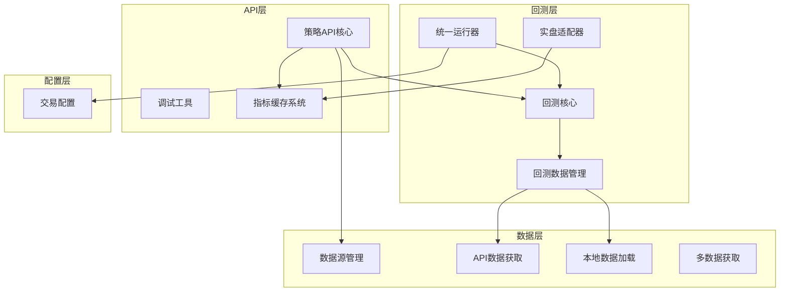
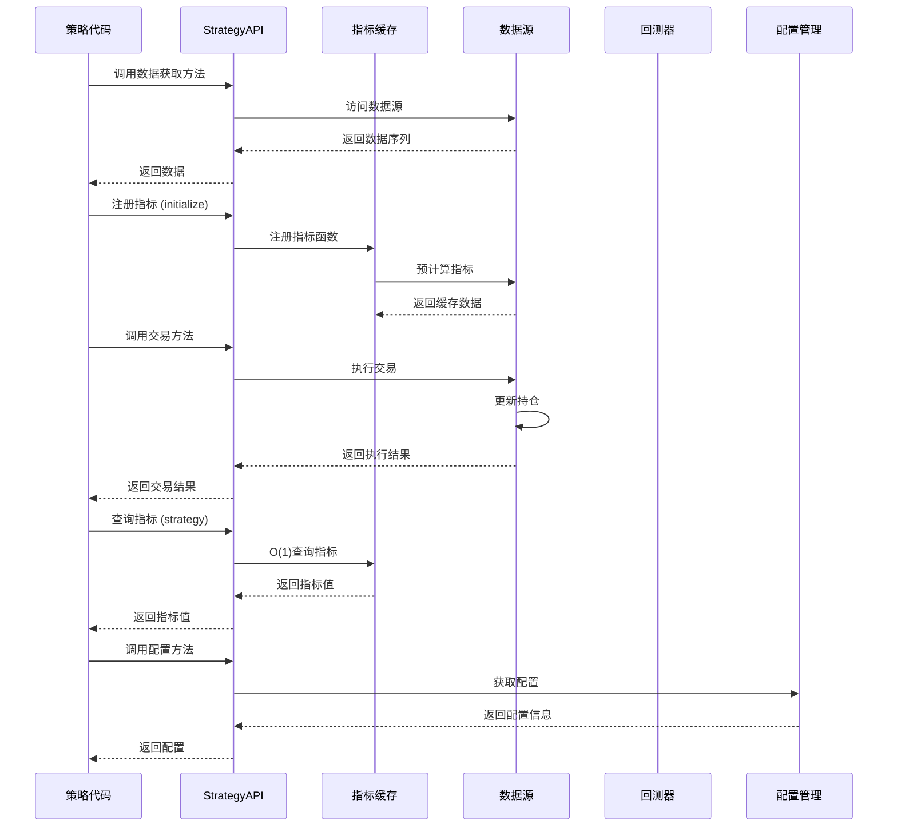
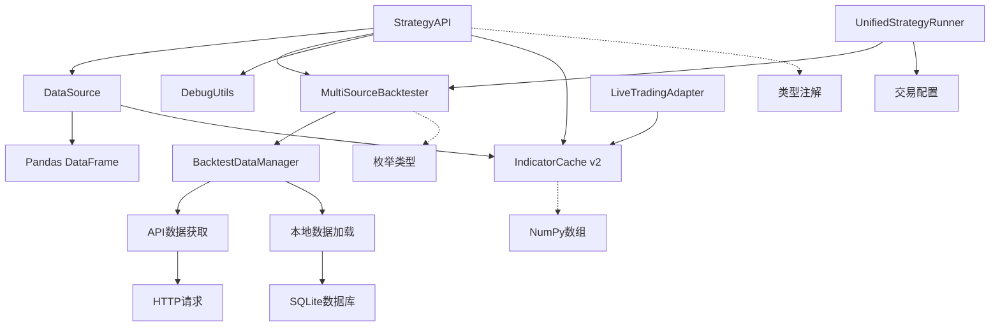

# 策略API参考手册

<cite>
**本文档引用的文件**
- [strategy_api.py](file://ssquant/api/strategy_api.py)
- [__init__.py](file://ssquant/api/__init__.py)
- [data_source.py](file://ssquant/data/data_source.py)
- [backtest_core.py](file://ssquant/backtest/backtest_core.py)
- [backtest_data.py](file://ssquant/backtest/backtest_data.py)
- [unified_runner.py](file://ssquant/backtest/unified_runner.py)
- [trading_config.py](file://ssquant/config/trading_config.py)
- [debug_utils.py](file://ssquant/api/debug_utils.py)
- [tech_indicators.py](file://ssquant/indicators/tech_indicators.py)
- [live_trading_adapter.py](file://ssquant/backtest/live_trading_adapter.py)
- [B_双均线策略.py](file://examples/B_双均线策略.py)
- [B_网格交易策略.py](file://examples/B_网格交易策略.py)
- [B_加仓策略_高性能.py](file://examples/B_加仓策略_高性能.py)
- [B_多品种多周期交易策略_高性能.py](file://examples/B_多品种多周期交易策略_高性能.py)
</cite>

## 目录
1. [简介](#简介)
2. [项目结构](#项目结构)
3. [核心组件](#核心组件)
4. [架构概览](#架构概览)
5. [详细组件分析](#详细组件分析)
6. [高性能指标计算系统](#高性能指标计算系统)
7. [依赖关系分析](#依赖关系分析)
8. [性能考虑](#性能考虑)
9. [故障排除指南](#故障排除指南)
10. [结论](#结论)
11. [附录](#附录)

## 简介

SSQuant策略API是一个专为量化交易设计的综合框架，提供了统一的策略开发接口，支持历史回测、SIMNOW模拟交易和实盘交易三种运行模式。该API的核心目标是简化策略开发流程，提供一致的编程体验，同时支持多数据源、多周期交易和高级订单管理功能。

**最新更新**：新增高性能指标计算系统（IndicatorCache v2），提供O(1)指标查询性能，支持注册式指标缓存和实时重计算。

## 项目结构

SSQuant项目采用模块化设计，主要包含以下核心模块：



**图表来源**
- [strategy_api.py:1-941](file://ssquant/api/strategy_api.py#L1-L941)
- [data_source.py:1-922](file://ssquant/data/data_source.py#L1-L922)
- [backtest_core.py:1-579](file://ssquant/backtest/backtest_core.py#L1-L579)
- [live_trading_adapter.py:933-1041](file://ssquant/backtest/live_trading_adapter.py#L933-L1041)

**章节来源**
- [strategy_api.py:1-50](file://ssquant/api/strategy_api.py#L1-L50)
- [__init__.py:1-12](file://ssquant/api/__init__.py#L1-L12)

## 核心组件

### StrategyAPI类

StrategyAPI是策略开发的核心接口类，提供了统一的策略开发API。它封装了数据访问、交易操作和持仓管理功能，支持多数据源操作。

**主要特性：**
- 多数据源支持：通过索引参数访问不同的数据源
- 统一的交易接口：支持多种订单类型和价格参数
- 持仓管理：提供详细的持仓信息查询
- **高性能指标计算**：支持注册式指标缓存和O(1)查询
- 日志记录：内置日志功能便于调试和监控

**章节来源**
- [strategy_api.py:4-941](file://ssquant/api/strategy_api.py#L4-L941)

### 数据源管理

数据源管理系统负责管理单个或多个数据源，提供数据访问和交易执行功能。

**核心功能：**
- 数据访问：提供OHLCV数据序列访问
- 交易执行：支持多种订单类型和执行方式
- 持仓管理：跟踪和管理交易持仓
- 价格获取：根据订单类型获取相应价格
- **指标缓存**：支持高性能指标计算和缓存

**章节来源**
- [data_source.py:6-922](file://ssquant/data/data_source.py#L6-L922)

## 架构概览

SSQuant采用分层架构设计，确保各层职责清晰，便于维护和扩展。



**图表来源**
- [strategy_api.py:91-941](file://ssquant/api/strategy_api.py#L91-L941)
- [data_source.py:222-705](file://ssquant/data/data_source.py#L222-L705)
- [backtest_core.py:220-306](file://ssquant/backtest/backtest_core.py#L220-L306)
- [live_trading_adapter.py:933-1041](file://ssquant/backtest/live_trading_adapter.py#L933-L1041)

## 详细组件分析

### 数据获取方法

#### 基础数据访问

**get_close()** - 获取收盘价序列
- **参数**: `index: int = 0` - 数据源索引
- **返回值**: `pd.Series` - 收盘价序列
- **用途**: 计算技术指标、分析价格走势

**get_open()** - 获取开盘价序列
- **参数**: `index: int = 0` - 数据源索引  
- **返回值**: `pd.Series` - 开盘价序列
- **用途**: 开盘跳空分析、开盘价策略

**get_high()** - 获取最高价序列
- **参数**: `index: int = 0` - 数据源索引
- **返回值**: `pd.Series` - 最高价序列
- **用途**: 高点分析、阻力位识别

**get_low()** - 获取最低价序列
- **参数**: `index: int = 0` - 数据源索引
- **返回值**: `pd.Series` - 最低价序列
- **用途**: 低点分析、支撑位识别

**get_volume()** - 获取成交量序列
- **参数**: `index: int = 0` - 数据源索引
- **返回值**: `pd.Series` - 成交量序列
- **用途**: 成交量分析、量价关系研究

**章节来源**
- [strategy_api.py:370-444](file://ssquant/api/strategy_api.py#L370-L444)
- [data_source.py:781-800](file://ssquant/data/data_source.py#L781-L800)

#### 高级数据访问

**get_klines()** - 获取K线数据
- **参数**: `index: int = 0` - 数据源索引
- **返回值**: `pd.DataFrame` - K线数据DataFrame
- **用途**: 获取完整的OHLCV数据集

**get_datetime()** - 获取当前日期时间
- **参数**: `index: int = 0` - 数据源索引
- **返回值**: 当前日期时间
- **用途**: 时间序列分析、时间窗口管理

**get_price()** - 获取当前价格
- **参数**: `index: int = 0` - 数据源索引
- **返回值**: `Optional[float]` - 当前价格
- **用途**: 实时价格获取、价格条件判断

**章节来源**
- [strategy_api.py:146-244](file://ssquant/api/strategy_api.py#L146-L244)
- [data_source.py:41-55](file://ssquant/data/data_source.py#L41-L55)

### 交易操作方法

#### 买入开仓 (buy)

**方法签名**: `buy(volume: int = 1, reason: str = "", order_type: str = 'bar_close', index: int = 0, offset_ticks: Optional[int] = None, price: Optional[float] = None)`

**参数说明**:
- `volume`: 交易量，默认为1手
- `reason`: 交易原因，用于日志记录
- `order_type`: 订单类型，支持多种执行方式
- `index`: 数据源索引，默认为0
- `offset_ticks`: 价格偏移跳数
- `price`: 限价单价格（仅当order_type='limit'时有效）

**订单类型支持**:
- `'limit'`: 限价单，需指定price参数
- `'bar_close'`: 当前K线收盘价（默认）
- `'next_bar_open'`: 下一K线开盘价
- `'next_bar_close'`: 下一K线收盘价
- `'next_bar_high'`: 下一K线最高价
- `'next_bar_low'`: 下一K线最低价
- `'market'`: 市价单，按对手价成交

**章节来源**
- [strategy_api.py:572-594](file://ssquant/api/strategy_api.py#L572-L594)
- [data_source.py:222-306](file://ssquant/data/data_source.py#L222-L306)

#### 卖出平仓 (sell)

**方法签名**: `sell(volume: Optional[int] = None, reason: str = "", order_type: str = 'bar_close', index: int = 0, offset_ticks: Optional[int] = None, price: Optional[float] = None)`

**参数说明**:
- `volume`: 交易量，默认为全部多头持仓
- `reason`: 交易原因
- `order_type`: 订单类型（与buy相同）
- `index`: 数据源索引
- `offset_ticks`: 价格偏移跳数
- `price`: 限价单价格

**章节来源**
- [strategy_api.py:595-609](file://ssquant/api/strategy_api.py#L595-L609)
- [data_source.py:308-416](file://ssquant/data/data_source.py#L308-L416)

#### 卖出开仓（做空）(sellshort)

**方法签名**: `sellshort(volume: int = 1, reason: str = "", order_type: str = 'bar_close', index: int = 0, offset_ticks: Optional[int] = None, price: Optional[float] = None)`

**用途**: 建立空头头寸，预期价格下跌

**章节来源**
- [strategy_api.py:611-625](file://ssquant/api/strategy_api.py#L611-L625)
- [data_source.py:418-493](file://ssquant/data/data_source.py#L418-L493)

#### 买入平仓（平空）(buycover)

**方法签名**: `buycover(volume: Optional[int] = None, reason: str = "", order_type: str = 'bar_close', index: int = 0, offset_ticks: Optional[int] = None, price: Optional[float] = None)`

**用途**: 平掉空头头寸，结束做空交易

**章节来源**
- [strategy_api.py:627-641](file://ssquant/api/strategy_api.py#L627-L641)
- [data_source.py:495-603](file://ssquant/data/data_source.py#L495-L603)

### 持仓管理方法

#### 基础持仓查询

**get_pos()** - 获取当前净持仓
- **参数**: `index: int = 0` - 数据源索引
- **返回值**: `int` - 当前净持仓（多头-空头）
- **用途**: 总体仓位管理、风险控制

**get_long_pos()** - 获取多头持仓
- **参数**: `index: int = 0` - 数据源索引
- **返回值**: `int` - 多头持仓数量
- **用途**: 多头仓位监控

**get_short_pos()** - 获取空头持仓
- **参数**: `index: int = 0` - 数据源索引
- **返回值**: `int` - 空头持仓数量
- **用途**: 空头仓位监控

**章节来源**
- [strategy_api.py:245-288](file://ssquant/api/strategy_api.py#L245-L288)
- [data_source.py:57-59](file://ssquant/data/data_source.py#L57-L59)

#### 详细持仓信息

**get_position_detail()** - 获取详细持仓信息
- **参数**: `index: int = 0` - 数据源索引
- **返回值**: `dict` - 包含以下字段的详细信息：
  - `net_pos`: 净持仓（多头-空头）
  - `long_pos`: 多头持仓
  - `short_pos`: 空头持仓
  - `today_pos`: 今仓（净）
  - `yd_pos`: 昨仓（净）
  - `long_today`: 多头今仓
  - `short_today`: 空头今仓
  - `long_yd`: 多头昨仓
  - `short_yd`: 空头昨仓

**章节来源**
- [strategy_api.py:290-327](file://ssquant/api/strategy_api.py#L290-L327)
- [data_source.py:24-31](file://ssquant/data/data_source.py#L24-L31)

### 高级功能

#### 多数据源支持

**get_data_source()** - 获取指定索引的数据源
- **参数**: `index: int = 0` - 数据源索引
- **返回值**: `Optional[DataSource]` - 数据源对象或None
- **用途**: 直接访问底层数据源功能

**get_data_sources_count()** - 获取数据源数量
- **返回值**: `int` - 数据源数量
- **用途**: 动态数据源管理

**require_data_sources()** - 确保数据源数量
- **参数**: `count: int` - 最少需要的数据源数量
- **返回值**: `bool` - 是否满足要求
- **用途**: 策略前置条件检查

**章节来源**
- [strategy_api.py:107-144](file://ssquant/api/strategy_api.py#L107-L144)

#### TICK数据支持

**get_tick()** - 获取当前TICK数据
- **参数**: `index: int = 0` - 数据源索引
- **返回值**: `Optional[pd.Series]` - 当前tick数据
- **用途**: 实时行情监控、TICK级别策略

**get_ticks()** - 获取历史TICK数据
- **参数**: `window: int = 100` - 滑窗长度
- **返回值**: `pd.DataFrame` - 最近window条tick数据
- **用途**: TICK数据分析、高频策略

**get_ticks_count()** - 获取TICK数据总数
- **返回值**: `int` - 缓存的TICK数据条数
- **用途**: 历史数据完整性检查

**章节来源**
- [strategy_api.py:703-778](file://ssquant/api/strategy_api.py#L703-L778)
- [data_source.py:780-800](file://ssquant/data/data_source.py#L780-L800)

#### 批量交易操作

**close_all()** - 平仓所有持仓
- **param** `reason: str = ""` - 交易原因
- **return**: `None`
- **用途**: 策略退出、风险管理

**reverse_pos()** - 反转持仓
- **param** `reason: str = ""` - 交易原因
- **return**: `None`
- **用途**: 方向转换、趋势跟踪

**cancel_all_orders()** - 撤销所有未成交订单
- **param** `index: int = 0` - 数据源索引
- **return**: `None`
- **用途**: 订单管理、风险控制

**章节来源**
- [strategy_api.py:649-701](file://ssquant/api/strategy_api.py#L649-L701)
- [data_source.py:707-778](file://ssquant/data/data_source.py#L707-L778)

## 高性能指标计算系统

### IndicatorCache v2 概述

SSQuant引入了全新的高性能指标计算系统（IndicatorCache v2），将指标计算性能从每根K线O(N)提升到O(1)查询。

**核心优势**：
- **注册式预计算**：在`initialize()`钩子中一次性预计算全部历史指标
- **O(1)查询**：主循环中通过`get_indicator()`直接获取当前值
- **实时重计算**：实盘模式下每根新K线完成后自动重计算
- **三档性能体系**：支持注册式、NumPy数组、Pandas兼容三种性能模式

### 指标注册方法

#### register_indicator()

**方法签名**: `register_indicator(name: str, func: Callable, window: Optional[int] = None, index: int = 0) -> np.ndarray`

**参数说明**:
- `name`: 指标名称，必须唯一
- `func`: 计算函数，接收`(close, open, high, low, volume)`参数
- `window`: 指标所需的历史窗口大小
- `index`: 数据源索引（多数据源时使用）

**计算函数要求**：
- 必须返回与输入等长的`np.ndarray`
- 可包含NaN值（前N根无法计算的位置）
- 必须使用numpy数组进行计算以获得最佳性能

**章节来源**
- [strategy_api.py:521-545](file://ssquant/api/strategy_api.py#L521-L545)
- [live_trading_adapter.py:948-963](file://ssquant/backtest/live_trading_adapter.py#L948-L963)

#### unregister_indicator()

**方法签名**: `unregister_indicator(name: str, index: int = 0) -> bool`

**参数说明**:
- `name`: 要移除的指标名称
- `index`: 数据源索引

**返回值**: 是否成功移除

**章节来源**
- [strategy_api.py:547-553](file://ssquant/api/strategy_api.py#L547-L553)
- [live_trading_adapter.py:965-969](file://ssquant/backtest/live_trading_adapter.py#L965-L969)

### 指标查询方法

#### get_indicator()

**方法签名**: `get_indicator(name: str, index: int = 0) -> float`

**参数说明**:
- `name`: 已注册指标的名称
- `index`: 数据源索引

**返回值**: 当前Bar的指标标量值，如果未找到返回NaN

**性能特点**: O(1)直接查询，无需重新计算

**章节来源**
- [strategy_api.py:555-561](file://ssquant/api/strategy_api.py#L555-L561)
- [live_trading_adapter.py:1021-1029](file://ssquant/backtest/live_trading_adapter.py#L1021-L1029)

#### get_indicator_array()

**方法签名**: `get_indicator_array(name: str, window: int = None, index: int = 0) -> np.ndarray`

**参数说明**:
- `name`: 已注册指标的名称
- `window`: 返回的窗口大小，None表示全部
- `index`: 数据源索引

**返回值**: 指标值的ndarray视图，零拷贝访问

**性能特点**: O(1)查询，支持窗口切片

**章节来源**
- [strategy_api.py:563-570](file://ssquant/api/strategy_api.py#L563-L570)
- [live_trading_adapter.py:1031-1040](file://ssquant/backtest/live_trading_adapter.py#L1031-L1040)

### 使用示例

#### 基础指标注册

```python
def initialize(api: StrategyAPI):
    # 注册简单的移动平均线
    def sma_func(close, open_, high, low, volume):
        return pd.Series(close).rolling(20).mean().to_numpy()
    
    api.register_indicator('sma_20', sma_func, window=20)

def strategy(api: StrategyAPI):
    # O(1)查询当前值
    sma_value = api.get_indicator('sma_20')
    
    # 获取最近2根的值用于交叉判断
    sma_array = api.get_indicator_array('sma_20', window=2)
    if len(sma_array) >= 2:
        prev_sma, curr_sma = sma_array[-2], sma_array[-1]
```

#### 多数据源指标管理

```python
def initialize(api: StrategyAPI):
    ds_count = api.get_data_sources_count()
    for i in range(ds_count):
        # 为每个数据源注册独立的指标缓存
        api.register_indicator('ma_fast', make_sma_func(5), window=5, index=i)
        api.register_indicator('ma_slow', make_sma_func(20), window=20, index=i)

def strategy(api: StrategyAPI):
    # 为每个数据源独立查询指标
    for i in range(api.get_data_sources_count()):
        fast = api.get_indicator('ma_fast', index=i)
        slow = api.get_indicator('ma_slow', index=i)
        # 执行独立的交易逻辑
```

### 性能对比

| 指标类型 | Pandas (普通) | ndarray (中档) | IndicatorCache v2 (高性能) |
|---------|--------------|----------------|---------------------------|
| 单 MA | ~5ms/bar | ~0.5ms/bar | ~0.01ms/bar |
| 5 指标 + 4 数据源 | ~80ms/bar | ~8ms/bar | ~0.05ms/bar |

**章节来源**
- [B_加仓策略_高性能.py:1-150](file://examples/B_加仓策略_高性能.py#L1-L150)
- [B_多品种多周期交易策略_高性能.py:1-334](file://examples/B_多品种多周期交易策略_高性能.py#L1-L334)

## 依赖关系分析

SSQuant策略API的依赖关系体现了清晰的分层架构：



**图表来源**
- [strategy_api.py:1-5](file://ssquant/api/strategy_api.py#L1-L5)
- [backtest_core.py:1-13](file://ssquant/backtest/backtest_core.py#L1-L13)
- [unified_runner.py:1-24](file://ssquant/backtest/unified_runner.py#L1-L24)
- [live_trading_adapter.py:933-952](file://ssquant/backtest/live_trading_adapter.py#L933-L952)

**章节来源**
- [strategy_api.py:1-5](file://ssquant/api/strategy_api.py#L1-L5)
- [backtest_core.py:1-13](file://ssquant/backtest/backtest_core.py#L1-L13)

## 性能考虑

### 数据访问优化

1. **批量数据获取**: 使用`get_klines()`一次性获取完整数据集，避免多次API调用
2. **索引访问**: 通过`get_idx()`获取当前索引，避免重复计算
3. **缓存机制**: 利用内置缓存减少重复数据加载

### 交易执行优化

1. **订单批量化**: 合理使用`order_type`参数，避免频繁的订单修改
2. **价格偏移**: 通过`offset_ticks`参数优化成交概率
3. **批量平仓**: 使用`close_all()`快速清理所有仓位

### 指标计算优化

**高性能指标计算**：
1. **注册式预计算**: 在`initialize()`中注册指标，避免每根K线重复计算
2. **O(1)查询**: 使用`get_indicator()`和`get_indicator_array()`直接获取缓存值
3. **零拷贝访问**: `get_indicator_array()`返回ndarray视图，避免数据复制
4. **实时重计算**: 实盘模式下自动重计算，保持与回测数值一致性

### 内存管理

1. **数据截断**: 对于长周期策略，合理设置历史数据长度
2. **TICK数据**: 谨慎使用TICK数据，避免内存占用过大
3. **对象复用**: 复用策略API对象，避免频繁创建销毁
4. **指标缓存**: 合理管理注册的指标数量，避免内存泄漏

## 故障排除指南

### 常见问题及解决方案

#### 数据获取问题

**问题**: `get_futures_data`返回空数据
- **原因**: API认证失败或网络连接问题
- **解决方案**: 检查`trading_config.py`中的API认证信息

**问题**: 数据源索引超出范围
- **原因**: `get_data_source()`返回None
- **解决方案**: 使用`require_data_sources()`检查数据源数量

#### 指标计算问题

**问题**: `register_indicator`抛出AttributeError
- **原因**: 数据源未实现IndicatorCache接口
- **解决方案**: 确认使用内置DataSource或LiveDataSource，升级到支持IndicatorCache v2的版本

**问题**: `get_indicator`返回NaN
- **原因**: 指标未正确注册或缓存为空
- **解决方案**: 检查`initialize()`中的指标注册逻辑，确认`window`参数设置正确

#### 交易执行问题

**问题**: 订单无法成交
- **原因**: 价格偏移不足或市场流动性不足
- **解决方案**: 调整`offset_ticks`参数或使用市价单

**问题**: 持仓查询结果异常
- **原因**: 数据源未正确初始化
- **解决方案**: 检查数据源配置和初始化过程

#### 调试技巧

**启用调试模式**: 设置`debug=True`获取详细日志信息
**模块检查**: 使用`print_debug_info()`检查模块加载情况
**性能监控**: 监控回测执行时间和内存使用情况
**指标验证**: 使用`get_indicator_array()`检查指标计算结果

**章节来源**
- [debug_utils.py:104-136](file://ssquant/api/debug_utils.py#L104-L136)
- [backtest_core.py:155-204](file://ssquant/backtest/backtest_core.py#L155-L204)
- [strategy_api.py:508-519](file://ssquant/api/strategy_api.py#L508-L519)

## 结论

SSQuant策略API提供了一个功能完整、设计合理的量化交易框架。其核心优势包括：

1. **统一接口**: 一套API支持三种运行模式
2. **多数据源支持**: 灵活的数据源管理和访问
3. **丰富的交易功能**: 支持多种订单类型和执行方式
4. **完善的调试工具**: 提供全面的调试和监控能力
5. **高性能设计**: 优化的数据访问和交易执行机制
6. **指标缓存系统**: 全新的IndicatorCache v2提供O(1)指标查询性能

**最新增强**：高性能指标计算系统（IndicatorCache v2）将指标计算性能从每根K线O(N)提升到O(1)，支持注册式预计算、实时重计算和多数据源隔离缓存。

该API适合从初学者到专业量化分析师的各种用户，能够满足从简单策略到复杂算法交易的各种需求。

## 附录

### 使用示例

#### 基础策略示例

```python
def simple_strategy(api: StrategyAPI):
    # 获取数据
    close = api.get_close()
    current_pos = api.get_pos()
    
    # 简单移动平均交叉策略
    if len(close) >= 20:
        ma_fast = close.rolling(5).mean()
        ma_slow = close.rolling(20).mean()
        
        if ma_fast.iloc[-2] <= ma_slow.iloc[-2] and ma_fast.iloc[-1] > ma_slow.iloc[-1]:
            if current_pos <= 0:
                api.buy(volume=1, order_type='next_bar_open')
        elif ma_fast.iloc[-2] >= ma_slow.iloc[-2] and ma_fast.iloc[-1] < ma_slow.iloc[-1]:
            if current_pos >= 0:
                api.sell(order_type='next_bar_open')
```

#### 高级策略示例

```python
def advanced_strategy(api: StrategyAPI):
    # 多数据源策略
    if api.require_data_sources(2):
        # 获取不同周期的数据
        daily_close = api.get_close(index=0)
        hourly_close = api.get_close(index=1)
        
        # 检查多数据源对齐
        if len(daily_close) > 0 and len(hourly_close) > 0:
            # 执行复杂的多周期过滤
            pass
```

#### 高性能指标策略示例

```python
def initialize(api: StrategyAPI):
    # 注册指标（在initialize中一次性预计算）
    def rsi_func(close, open_, high, low, volume):
        return calculate_rsi(close, 14)
    
    def atr_func(close, open_, high, low, volume):
        return calculate_atr(high, low, close, 14)
    
    api.register_indicator('rsi', rsi_func, window=14)
    api.register_indicator('atr', atr_func, window=14)

def strategy(api: StrategyAPI):
    # O(1)查询指标（主循环中）
    rsi_val = api.get_indicator('rsi')
    atr_val = api.get_indicator('atr')
    
    # 获取最近N根的指标值
    rsi_array = api.get_indicator_array('rsi', window=5)
    
    # 基于指标执行交易逻辑
    if rsi_val < 30 and len(rsi_array) >= 2 and rsi_array[-2] >= 30:
        api.buy(volume=1, order_type='next_bar_open')
    elif rsi_val > 70 and len(rsi_array) >= 2 and rsi_array[-2] <= 70:
        api.sell(order_type='next_bar_open')
```

### 配置最佳实践

1. **数据源配置**: 合理设置数据源数量和类型
2. **参数优化**: 使用参数网格搜索优化策略参数
3. **风险管理**: 设置适当的止损和止盈机制
4. **性能监控**: 定期检查回测性能和资源使用情况
5. **指标管理**: 合理使用IndicatorCache v2，避免过多指标影响性能
6. **内存管理**: 监控指标缓存大小，及时清理不需要的指标

**章节来源**
- [B_加仓策略_高性能.py:30-100](file://examples/B_加仓策略_高性能.py#L30-L100)
- [B_多品种多周期交易策略_高性能.py:28-114](file://examples/B_多品种多周期交易策略_高性能.py#L28-L114)