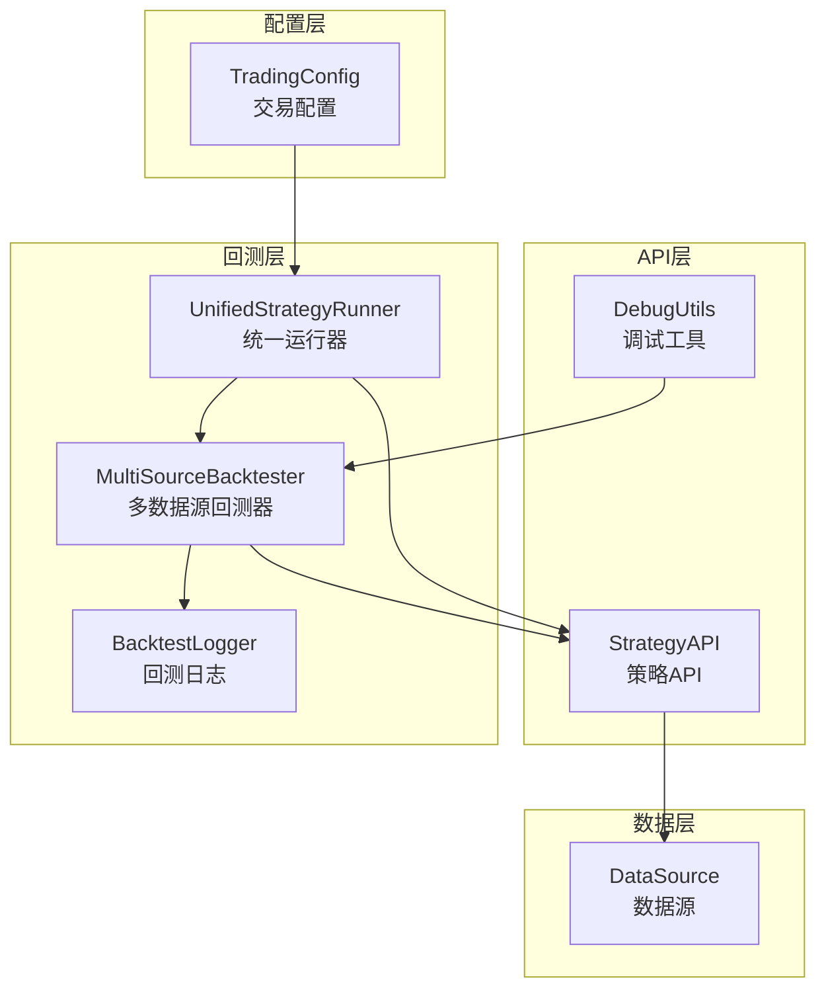
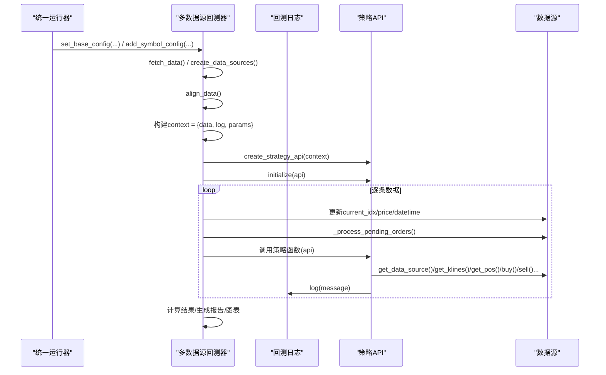
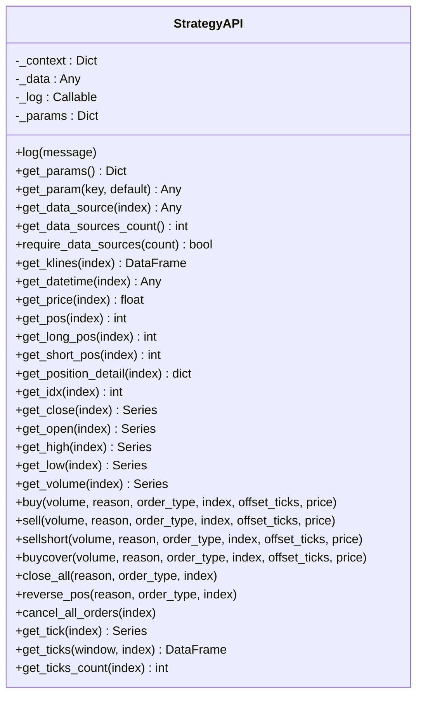
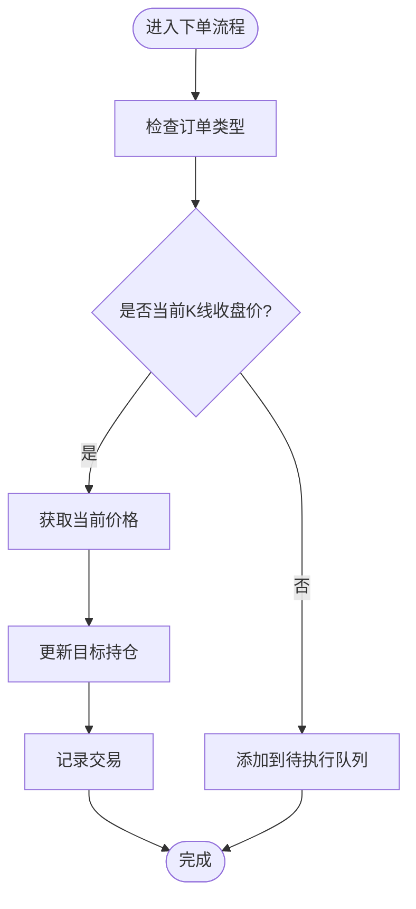
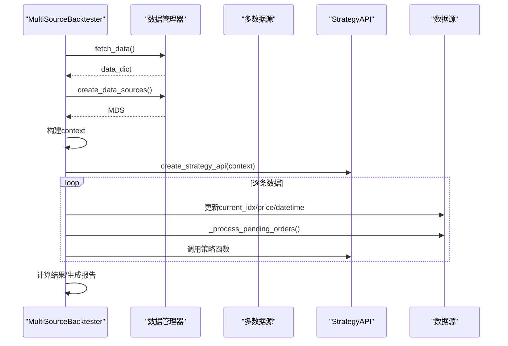
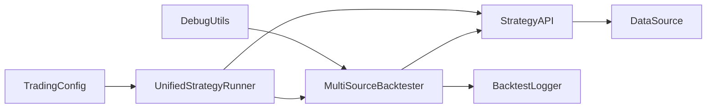

# 配置与工具方法

<cite>
**本文引用的文件**
- [ssquant/api/strategy_api.py](file://ssquant/api/strategy_api.py)
- [ssquant/api/debug_utils.py](file://ssquant/api/debug_utils.py)
- [ssquant/backtest/backtest_core.py](file://ssquant/backtest/backtest_core.py)
- [ssquant/backtest/backtest_logger.py](file://ssquant/backtest/backtest_logger.py)
- [ssquant/backtest/unified_runner.py](file://ssquant/backtest/unified_runner.py)
- [ssquant/data/data_source.py](file://ssquant/data/data_source.py)
- [ssquant/config/trading_config.py](file://ssquant/config/trading_config.py)
- [examples/B_双均线策略.py](file://examples/B_双均线策略.py)
- [examples/B_多品种多周期交易策略.py](file://examples/B_多品种多周期交易策略.py)
- [examples/B_缠论5分钟策略.py](file://examples/B_缠论5分钟策略.py)
</cite>

## 目录
1. [简介](#简介)
2. [项目结构](#项目结构)
3. [核心组件](#核心组件)
4. [架构概览](#架构概览)
5. [详细组件分析](#详细组件分析)
6. [依赖关系分析](#依赖关系分析)
7. [性能考虑](#性能考虑)
8. [故障排查指南](#故障排查指南)
9. [结论](#结论)
10. [附录](#附录)

## 简介
本文件面向SSQuant策略API的配置与工具方法，重点阐述以下能力：
- 策略参数获取：get_params、get_param
- 数据源管理：get_data_source、get_data_sources_count、require_data_sources
- 日志记录：log
- 策略上下文作用与配置方法
- 调试工具使用与最佳实践
- 完整配置示例与工具方法的实际应用案例
- 如何在策略开发中高效利用这些辅助功能提升开发效率

## 项目结构
围绕策略API与回测/实盘运行器，主要涉及以下模块：
- API层：策略API封装与调试工具
- 回测层：多数据源回测器、日志管理、统一运行器
- 数据层：数据源抽象与交易执行
- 配置层：交易配置与运行模式

**图表来源**
- [ssquant/api/strategy_api.py](file://ssquant/api/strategy_api.py#L1-L570)
- [ssquant/api/debug_utils.py](file://ssquant/api/debug_utils.py#L1-L136)
- [ssquant/backtest/backtest_core.py](file://ssquant/backtest/backtest_core.py#L1-L579)
- [ssquant/backtest/backtest_logger.py](file://ssquant/backtest/backtest_logger.py#L1-L90)
- [ssquant/backtest/unified_runner.py](file://ssquant/backtest/unified_runner.py#L1-L379)
- [ssquant/data/data_source.py](file://ssquant/data/data_source.py#L1-L922)
- [ssquant/config/trading_config.py](file://ssquant/config/trading_config.py#L1-L187)

**章节来源**
- [ssquant/api/strategy_api.py](file://ssquant/api/strategy_api.py#L1-L570)
- [ssquant/backtest/backtest_core.py](file://ssquant/backtest/backtest_core.py#L1-L579)
- [ssquant/backtest/unified_runner.py](file://ssquant/backtest/unified_runner.py#L1-L379)
- [ssquant/data/data_source.py](file://ssquant/data/data_source.py#L1-L922)
- [ssquant/config/trading_config.py](file://ssquant/config/trading_config.py#L1-L187)

## 核心组件
- 策略API（StrategyAPI）：提供参数获取、数据源访问、交易下单、日志记录等能力
- 多数据源回测器（MultiSourceBacktester）：构建策略上下文、创建API、驱动回测循环
- 数据源（DataSource）：封装单数据源的数据与交易执行逻辑
- 统一运行器（UnifiedStrategyRunner）：统一封装回测/SIMNOW/实盘三种模式
- 调试工具（DebugUtils）：模块加载检查、路径与函数存在性检查
- 回测日志（BacktestLogger）：日志文件与控制台输出管理

**章节来源**
- [ssquant/api/strategy_api.py](file://ssquant/api/strategy_api.py#L4-L570)
- [ssquant/backtest/backtest_core.py](file://ssquant/backtest/backtest_core.py#L14-L306)
- [ssquant/data/data_source.py](file://ssquant/data/data_source.py#L6-L800)
- [ssquant/backtest/unified_runner.py](file://ssquant/backtest/unified_runner.py#L26-L379)
- [ssquant/api/debug_utils.py](file://ssquant/api/debug_utils.py#L1-L136)
- [ssquant/backtest/backtest_logger.py](file://ssquant/backtest/backtest_logger.py#L4-L90)

## 架构概览
策略API通过回测器注入上下文，策略函数在回测循环中被反复调用，API负责访问数据源、读取参数、执行交易、记录日志。统一运行器负责根据运行模式组装配置并启动相应流程。

**图表来源**
- [ssquant/backtest/unified_runner.py](file://ssquant/backtest/unified_runner.py#L215-L314)
- [ssquant/backtest/backtest_core.py](file://ssquant/backtest/backtest_core.py#L144-L306)
- [ssquant/api/strategy_api.py](file://ssquant/api/strategy_api.py#L560-L570)
- [ssquant/backtest/backtest_logger.py](file://ssquant/backtest/backtest_logger.py#L61-L79)

**章节来源**
- [ssquant/backtest/unified_runner.py](file://ssquant/backtest/unified_runner.py#L215-L314)
- [ssquant/backtest/backtest_core.py](file://ssquant/backtest/backtest_core.py#L144-L306)
- [ssquant/api/strategy_api.py](file://ssquant/api/strategy_api.py#L560-L570)
- [ssquant/backtest/backtest_logger.py](file://ssquant/backtest/backtest_logger.py#L61-L79)

## 详细组件分析

### 策略API（StrategyAPI）
- 参数获取
  - get_params：返回策略参数字典
  - get_param：按键名获取参数，支持默认值
- 数据源管理
  - get_data_source：按索引获取数据源，越界时记录错误日志并返回None
  - get_data_sources_count：返回数据源数量
  - require_data_sources：校验最少数据源数量，不足时记录日志并返回False
- 交易与数据访问
  - get_klines/get_close/get_open/get_high/get_low/get_volume/get_datetime/get_price/get_pos/get_idx等
  - buy/sell/sellshort/buycover/close_all/reverse_pos/cancel_all_orders等交易方法
- 日志记录
  - log：委托上下文中的日志回调函数，统一输出到控制台与日志文件

**图表来源**
- [ssquant/api/strategy_api.py](file://ssquant/api/strategy_api.py#L4-L570)

**章节来源**
- [ssquant/api/strategy_api.py](file://ssquant/api/strategy_api.py#L21-L570)

### 数据源（DataSource）
- 数据与状态
  - set_data/get_data：设置与获取数据
  - current_pos/target_pos/current_idx/current_price/current_datetime：当前状态
  - trades：交易记录
- 价格与订单执行
  - get_current_price/get_current_datetime/get_current_pos
  - get_price_by_type：根据订单类型获取价格
  - _process_pending_orders：处理待执行订单队列
  - buy/sell/sellshort/buycover/close_all/reverse_pos：下单与平仓
- 持仓更新与日志
  - set_target_pos/_update_pos：目标持仓变更与实际持仓同步
  - add_trade：记录交易明细

**图表来源**
- [ssquant/data/data_source.py](file://ssquant/data/data_source.py#L222-L778)

**章节来源**
- [ssquant/data/data_source.py](file://ssquant/data/data_source.py#L6-L800)

### 多数据源回测器（MultiSourceBacktester）
- 上下文构建
  - 构建context：包含data（多数据源）、log（日志回调）、params（策略参数）
  - create_strategy_api(context)：创建策略API实例
- 回测循环
  - 逐条更新各数据源current_idx/price/datetime
  - 处理待执行订单
  - 调用策略函数
- 结果与报告
  - 计算回测结果、生成性能报告与图表

**图表来源**
- [ssquant/backtest/backtest_core.py](file://ssquant/backtest/backtest_core.py#L220-L306)

**章节来源**
- [ssquant/backtest/backtest_core.py](file://ssquant/backtest/backtest_core.py#L14-L306)

### 统一运行器（UnifiedStrategyRunner）
- 运行模式
  - BACKTEST：历史回测
  - SIMNOW：SIMNOW模拟交易
  - REAL_TRADING：实盘CTP交易
- 配置验证与组装
  - set_config：根据模式验证并组装配置
  - run：根据模式分派到不同运行分支
- 回测多数据源
  - 支持data_sources数组，自动聚合同一品种的多周期配置

**章节来源**
- [ssquant/backtest/unified_runner.py](file://ssquant/backtest/unified_runner.py#L19-L379)

### 调试工具（DebugUtils）
- 模块与函数检查
  - check_module_exists/check_function_exists：检查模块与函数存在性
  - get_module_path：获取模块文件路径
- 综合检查
  - check_data_modules：批量检查关键模块与函数
  - print_debug_info：打印调试信息（模块存在性、函数存在性、路径、系统路径）

**章节来源**
- [ssquant/api/debug_utils.py](file://ssquant/api/debug_utils.py#L15-L136)

### 回测日志（BacktestLogger）
- 文件与控制台输出
  - prepare_log_file：准备日志文件与性能报告文件
  - log_message：统一日志输出（控制台+文件）
- 环境变量控制
  - NO_VISUALIZATION/NO_CONSOLE_LOG：控制日志输出与可视化

**章节来源**
- [ssquant/backtest/backtest_logger.py](file://ssquant/backtest/backtest_logger.py#L21-L90)

## 依赖关系分析

**图表来源**
- [ssquant/api/strategy_api.py](file://ssquant/api/strategy_api.py#L1-L570)
- [ssquant/backtest/backtest_core.py](file://ssquant/backtest/backtest_core.py#L1-L579)
- [ssquant/backtest/backtest_logger.py](file://ssquant/backtest/backtest_logger.py#L1-L90)
- [ssquant/backtest/unified_runner.py](file://ssquant/backtest/unified_runner.py#L1-L379)
- [ssquant/data/data_source.py](file://ssquant/data/data_source.py#L1-L922)
- [ssquant/config/trading_config.py](file://ssquant/config/trading_config.py#L1-L187)
- [ssquant/api/debug_utils.py](file://ssquant/api/debug_utils.py#L1-L136)

**章节来源**
- [ssquant/api/strategy_api.py](file://ssquant/api/strategy_api.py#L1-L570)
- [ssquant/backtest/backtest_core.py](file://ssquant/backtest/backtest_core.py#L1-L579)
- [ssquant/backtest/unified_runner.py](file://ssquant/backtest/unified_runner.py#L1-L379)
- [ssquant/data/data_source.py](file://ssquant/data/data_source.py#L1-L922)
- [ssquant/config/trading_config.py](file://ssquant/config/trading_config.py#L1-L187)
- [ssquant/api/debug_utils.py](file://ssquant/api/debug_utils.py#L1-L136)

## 性能考虑
- 数据对齐与填充：多周期对齐与填充策略会影响回测速度与一致性
- 待执行订单处理：在每条数据末尾统一处理，避免重复扫描
- 日志输出：控制台与文件同时输出会增加IO开销，可通过环境变量抑制
- 预加载历史数据：在参数优化阶段复用预加载数据可显著提升效率

[本节为通用指导，无需引用具体文件]

## 故障排查指南
- 模块加载问题
  - 使用调试工具检查模块与函数存在性，定位缺失模块或导入异常
  - 关注print_debug_info输出的模块路径与系统路径
- 数据源越界
  - get_data_source返回None时，检查数据源数量与索引合法性
  - 使用require_data_sources确保最小数据源数量
- 订单执行失败
  - 检查订单类型与价格获取逻辑，确认下一K线价格是否可用
  - 市价单在TICK数据下使用对手价，注意BidPrice1/AskPrice1字段
- 日志输出异常
  - 检查NO_VISUALIZATION/NO_CONSOLE_LOG环境变量
  - 确认prepare_log_file是否成功创建日志文件

**章节来源**
- [ssquant/api/debug_utils.py](file://ssquant/api/debug_utils.py#L104-L136)
- [ssquant/backtest/backtest_core.py](file://ssquant/backtest/backtest_core.py#L201-L215)
- [ssquant/data/data_source.py](file://ssquant/data/data_source.py#L137-L221)
- [ssquant/backtest/backtest_logger.py](file://ssquant/backtest/backtest_logger.py#L31-L79)

## 结论
通过策略API的参数与数据源管理、统一运行器的多模式支持以及调试工具与日志系统的配合，SSQuant为策略开发提供了高效、稳定且可扩展的基础设施。合理使用这些工具能够显著提升策略开发效率与质量。

[本节为总结，无需引用具体文件]

## 附录

### 策略上下文与配置方法
- 上下文构建
  - MultiSourceBacktester在回测开始时构建context：包含data（多数据源）、log（日志回调）、params（策略参数）
  - create_strategy_api(context)创建策略API实例供策略函数使用
- 配置来源
  - trading_config.get_config根据运行模式返回配置字典
  - UnifiedStrategyRunner.set_config验证并组装配置
- 环境变量
  - NO_VISUALIZATION/NO_CONSOLE_LOG控制日志与可视化输出
  - 用于参数优化时自动进入静默模式

**章节来源**
- [ssquant/backtest/backtest_core.py](file://ssquant/backtest/backtest_core.py#L220-L228)
- [ssquant/backtest/unified_runner.py](file://ssquant/backtest/unified_runner.py#L79-L121)
- [ssquant/config/trading_config.py](file://ssquant/config/trading_config.py#L115-L164)
- [ssquant/backtest/backtest_core.py](file://ssquant/backtest/backtest_core.py#L321-L329)

### 调试工具使用指南
- 检查模块加载
  - 调用print_debug_info，查看模块存在性、函数存在性、模块路径与系统路径
- 常见问题定位
  - 模块缺失：根据输出定位缺失模块并安装或修正路径
  - 函数缺失：确认模块中是否存在目标函数
- 最佳实践
  - 在回测开始前调用print_debug_info，确保依赖完整
  - 在CI/CD中加入模块检查步骤，提前发现依赖问题

**章节来源**
- [ssquant/api/debug_utils.py](file://ssquant/api/debug_utils.py#L104-L136)

### 日志记录最佳实践
- 控制台与文件输出
  - 使用log统一输出，避免直接print
  - 通过BacktestLogger控制输出级别与目标
- 环境变量控制
  - NO_CONSOLE_LOG：禁用控制台输出，仅写文件
  - NO_VISUALIZATION：禁用可视化与日志文件，适合参数优化
- 日志内容组织
  - 记录关键事件（初始化、参数、交易、错误）
  - 包含时间戳与上下文信息（品种、周期、索引）

**章节来源**
- [ssquant/backtest/backtest_logger.py](file://ssquant/backtest/backtest_logger.py#L61-L90)
- [ssquant/backtest/backtest_core.py](file://ssquant/backtest/backtest_core.py#L321-L329)

### 配置示例与工具方法应用
- 双均线策略（单数据源）
  - 使用get_param获取快慢均线周期
  - 使用get_klines/get_close获取数据，使用get_pos判断持仓
  - 使用buy/sell等下单方法，使用log记录信号
- 多品种多周期策略（多数据源）
  - 使用require_data_sources确保数据源数量
  - 使用get_data_source按索引访问不同数据源
  - 使用get_klines(index)/get_pos(index)分别获取各数据源数据
- 缠论5分钟策略
  - 使用get_param读取参数，使用get_data_source获取符号与周期
  - 使用get_close/get_high/get_low等序列进行技术分析
  - 使用log记录信号与止损触发

**章节来源**
- [examples/B_双均线策略.py](file://examples/B_双均线策略.py#L26-L130)
- [examples/B_多品种多周期交易策略.py](file://examples/B_多品种多周期交易策略.py#L18-L260)
- [examples/B_缠论5分钟策略.py](file://examples/B_缠论5分钟策略.py#L459-L629)