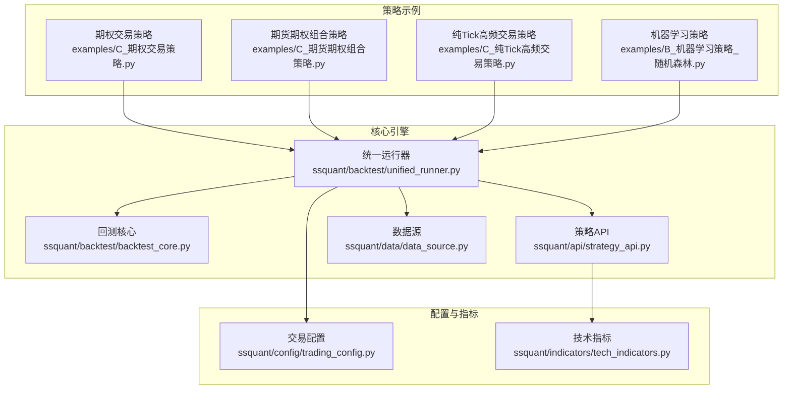
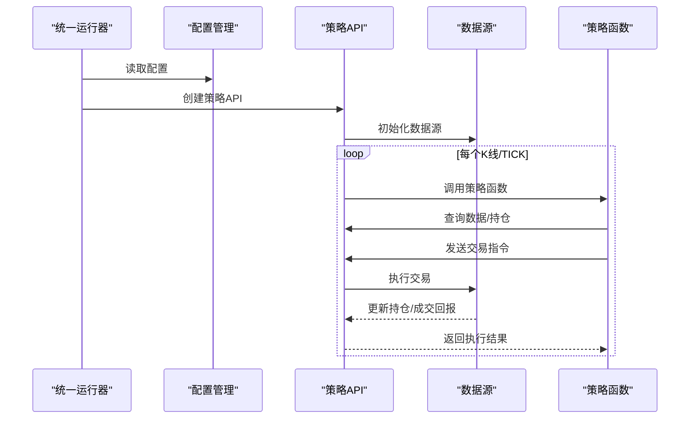
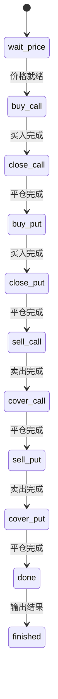
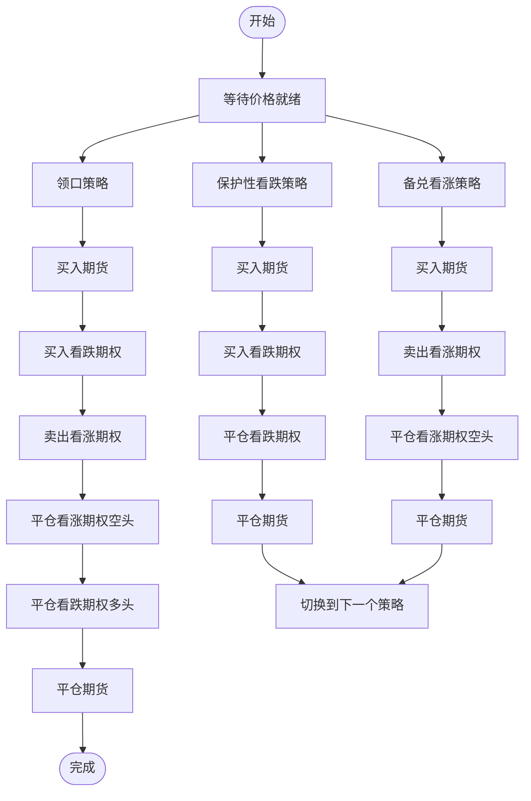
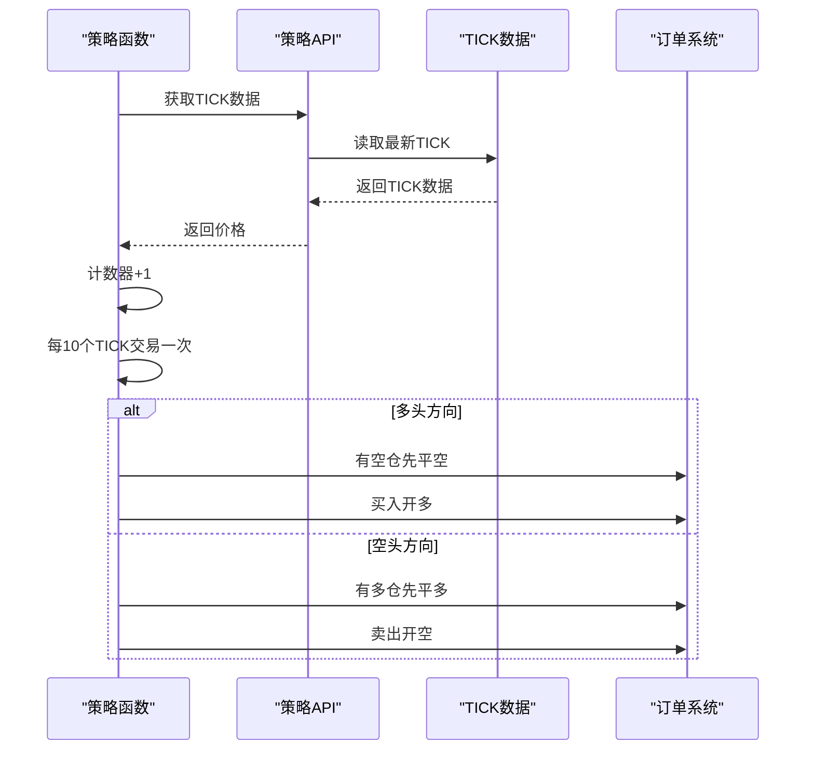
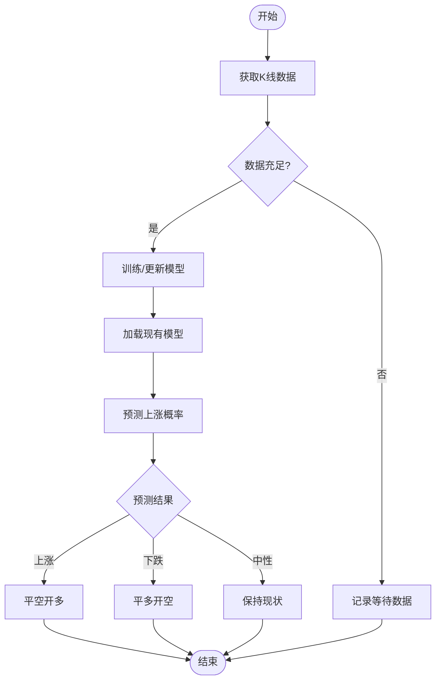
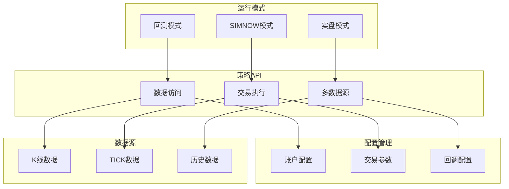

# 专业策略示例

<cite>
**本文引用的文件**
- [examples/C_期权交易策略.py](file://examples/C_期权交易策略.py)
- [examples/C_期货期权组合策略.py](file://examples/C_期货期权组合策略.py)
- [examples/C_纯Tick高频交易策略.py](file://examples/C_纯Tick高频交易策略.py)
- [examples/B_机器学习策略_随机森林.py](file://examples/B_机器学习策略_随机森林.py)
- [ssquant/backtest/backtest_core.py](file://ssquant/backtest/backtest_core.py)
- [ssquant/backtest/unified_runner.py](file://ssquant/backtest/unified_runner.py)
- [ssquant/api/strategy_api.py](file://ssquant/api/strategy_api.py)
- [ssquant/config/trading_config.py](file://ssquant/config/trading_config.py)
- [ssquant/data/data_source.py](file://ssquant/data/data_source.py)
- [ssquant/indicators/tech_indicators.py](file://ssquant/indicators/tech_indicators.py)
- [README.md](file://README.md)
</cite>

## 目录
1. [简介](#简介)
2. [项目结构](#项目结构)
3. [核心组件](#核心组件)
4. [架构概览](#架构概览)
5. [详细组件分析](#详细组件分析)
6. [依赖关系分析](#依赖关系分析)
7. [性能考虑](#性能考虑)
8. [故障排除指南](#故障排除指南)
9. [结论](#结论)
10. [附录](#附录)

## 简介
本文件为SSQuant专业策略示例的深入技术文档，全面解析四种专业策略的设计理念与实现细节：期权交易策略、期货期权组合策略、纯Tick高频交易策略以及机器学习策略。文档涵盖期权定价模型、希腊字母对冲、波动率交易和组合优化技术；高频交易的延迟优化、市场微观结构、流动性管理与风险控制；机器学习策略的特征工程、模型训练、预测验证与实时部署方法；以及专业策略的性能评估、回测验证与实盘监控指南。同时提供监管要求、技术挑战与应用前景分析。

## 项目结构
SSQuant采用分层架构设计，核心模块包括策略API、回测引擎、配置管理、数据源与指标库。专业策略示例位于examples目录，统一运行器位于ssquant/backtest目录，策略API位于ssquant/api目录，配置管理位于ssquant/config目录，数据管理位于ssquant/data目录，技术指标位于ssquant/indicators目录。

**图表来源**
- [examples/C_期权交易策略.py](file://examples/C_期权交易策略.py#L1-L332)
- [examples/C_期货期权组合策略.py](file://examples/C_期货期权组合策略.py#L1-L434)
- [examples/C_纯Tick高频交易策略.py](file://examples/C_纯Tick高频交易策略.py#L1-L463)
- [examples/B_机器学习策略_随机森林.py](file://examples/B_机器学习策略_随机森林.py#L1-L622)
- [ssquant/backtest/unified_runner.py](file://ssquant/backtest/unified_runner.py#L1-L379)
- [ssquant/backtest/backtest_core.py](file://ssquant/backtest/backtest_core.py#L1-L579)
- [ssquant/api/strategy_api.py](file://ssquant/api/strategy_api.py#L1-L570)
- [ssquant/data/data_source.py](file://ssquant/data/data_source.py#L1-L922)
- [ssquant/config/trading_config.py](file://ssquant/config/trading_config.py#L1-L187)
- [ssquant/indicators/tech_indicators.py](file://ssquant/indicators/tech_indicators.py#L1-L322)

**章节来源**
- [README.md](file://README.md#L297-L321)

## 核心组件
本节概述四个专业策略的核心组件及其职责分工。

- 期权交易策略：基于状态机的期权买卖流程，支持看涨/看跌期权的开仓与平仓，包含错误处理与成交回调。
- 期货期权组合策略：实现保护性看跌、备兑看涨与领口策略的自动化执行，支持多数据源与实时行情监控。
- 纯Tick高频交易策略：基于TICK流的多空交替交易，支持回测、SIMNOW模拟与实盘交易，具备完整的CTP回调体系。
- 机器学习策略：使用随机森林模型进行价格走势预测，包含特征工程、模型训练、预测验证与实时部署。

**章节来源**
- [examples/C_期权交易策略.py](file://examples/C_期权交易策略.py#L1-L332)
- [examples/C_期货期权组合策略.py](file://examples/C_期货期权组合策略.py#L1-L434)
- [examples/C_纯Tick高频交易策略.py](file://examples/C_纯Tick高频交易策略.py#L1-L463)
- [examples/B_机器学习策略_随机森林.py](file://examples/B_机器学习策略_随机森林.py#L1-L622)

## 架构概览
SSQuant采用统一运行器模式，支持回测、SIMNOW模拟与实盘交易三种模式。策略通过StrategyAPI访问数据与执行交易，MultiSourceBacktester负责多数据源回测，LiveTradingAdapter负责实盘适配。

**图表来源**
- [ssquant/backtest/unified_runner.py](file://ssquant/backtest/unified_runner.py#L162-L214)
- [ssquant/api/strategy_api.py](file://ssquant/api/strategy_api.py#L91-L104)
- [ssquant/data/data_source.py](file://ssquant/data/data_source.py#L222-L306)

**章节来源**
- [ssquant/backtest/unified_runner.py](file://ssquant/backtest/unified_runner.py#L1-L379)
- [ssquant/backtest/backtest_core.py](file://ssquant/backtest/backtest_core.py#L144-L306)
- [ssquant/api/strategy_api.py](file://ssquant/api/strategy_api.py#L1-L570)

## 详细组件分析

### 期权交易策略分析
该策略通过状态机实现期权交易的完整流程，支持看涨/看跌期权的买入与卖出，并包含错误处理与成交回调。

**图表来源**
- [examples/C_期权交易策略.py](file://examples/C_期权交易策略.py#L30-L46)

策略特点：
- 多数据源配置：支持看涨期权、看跌期权与标的期货的并行监控
- 智能算法交易：支持订单超时、重试与偏移跳数控制
- 实时回调：成交、报单、错误与持仓回调
- 价格缓存：实时缓存各合约的最新价格，避免重复查询

**章节来源**
- [examples/C_期权交易策略.py](file://examples/C_期权交易策略.py#L1-L332)
- [ssquant/config/trading_config.py](file://ssquant/config/trading_config.py#L115-L164)

### 期货期权组合策略分析
该策略实现三种经典期权组合策略：保护性看跌、备兑看涨与领口策略，支持多数据源与实时行情监控。

**图表来源**
- [examples/C_期货期权组合策略.py](file://examples/C_期货期权组合策略.py#L38-L49)

策略特点：
- 多策略组合：支持三种经典期权组合策略的自动化执行
- 实时监控：每10个TICK输出一次行情更新，避免刷屏
- 流动性检测：在关键操作前检查期权价格有效性
- 完整生命周期：从建仓到平仓的完整流程控制

**章节来源**
- [examples/C_期货期权组合策略.py](file://examples/C_期货期权组合策略.py#L1-L434)

### 纯Tick高频交易策略分析
该策略基于TICK流的多空交替交易，支持回测、SIMNOW模拟与实盘交易，具备完整的CTP回调体系。

**图表来源**
- [examples/C_纯Tick高频交易策略.py](file://examples/C_纯Tick高频交易策略.py#L245-L313)

策略特点：
- TICK驱动：每收到一个TICK就触发策略执行
- 多空交替：首次做多，之后多空交替
- 实盘适配：实盘使用市价单，回测使用下一根K线开盘价
- 完整回调：支持成交、报单、撤单、错误与账户资金回调

**章节来源**
- [examples/C_纯Tick高频交易策略.py](file://examples/C_纯Tick高频交易策略.py#L1-L463)

### 机器学习策略分析
该策略使用随机森林模型进行价格走势预测，包含完整的特征工程、模型训练、预测验证与实时部署流程。

**图表来源**
- [examples/B_机器学习策略_随机森林.py](file://examples/B_机器学习策略_随机森林.py#L355-L482)

策略特点：
- 特征工程：包含移动平均线、RSI、MACD、布林带等技术指标
- 模型训练：使用随机森林分类器，支持增量训练与模型保存
- 预测验证：通过阈值控制交易决策，避免过度交易
- 实时部署：支持回测、SIMNOW与实盘三种模式

**章节来源**
- [examples/B_机器学习策略_随机森林.py](file://examples/B_机器学习策略_随机森林.py#L1-L622)

## 依赖关系分析
四个专业策略均依赖统一运行器与策略API，通过配置管理实现不同运行模式的切换。

**图表来源**
- [ssquant/backtest/unified_runner.py](file://ssquant/backtest/unified_runner.py#L79-L161)
- [ssquant/api/strategy_api.py](file://ssquant/api/strategy_api.py#L52-L74)
- [ssquant/config/trading_config.py](file://ssquant/config/trading_config.py#L115-L164)

**章节来源**
- [ssquant/backtest/unified_runner.py](file://ssquant/backtest/unified_runner.py#L1-L379)
- [ssquant/api/strategy_api.py](file://ssquant/api/strategy_api.py#L1-L570)
- [ssquant/config/trading_config.py](file://ssquant/config/trading_config.py#L1-L187)

## 性能考虑
- 回测性能：MultiSourceBacktester支持数据预加载与对齐，减少回测时间；支持参数优化模式，避免重复加载数据。
- 交易性能：StrategyAPI提供批量数据访问与交易执行，减少API调用开销；支持订单超时与重试机制，提高成交成功率。
- 内存管理：数据源采用滑窗机制，避免内存溢出；支持历史数据预加载，提高实时交易响应速度。
- 网络优化：实盘模式下支持断线重连与订单重发，确保交易连续性。

**章节来源**
- [ssquant/backtest/backtest_core.py](file://ssquant/backtest/backtest_core.py#L456-L524)
- [ssquant/api/strategy_api.py](file://ssquant/api/strategy_api.py#L517-L557)
- [ssquant/data/data_source.py](file://ssquant/data/data_source.py#L137-L221)

## 故障排除指南
常见问题与解决方案：

1. **模块导入错误**
   - 现象：`ModuleNotFoundError: No module named 'ssquant'`
   - 解决：重新安装框架或使用源码安装方式

2. **配置参数缺失**
   - 现象：运行时报错缺少必填参数
   - 解决：检查配置文件，确保必填参数完整

3. **数据获取失败**
   - 现象：回测或实盘无法获取数据
   - 解决：检查API认证信息与网络连接

4. **订单执行异常**
   - 现象：订单超时或撤单失败
   - 解决：调整订单超时时间与重试次数，检查价格偏移设置

**章节来源**
- [README.md](file://README.md#L90-L119)
- [ssquant/backtest/unified_runner.py](file://ssquant/backtest/unified_runner.py#L122-L161)

## 结论
SSQuant专业策略示例展现了完整的量化交易框架能力：从期权交易到高频交易，从传统技术分析到机器学习预测，提供了丰富而实用的专业策略模板。通过统一运行器与策略API，用户可以在三种模式间无缝切换，实现从策略开发到实盘部署的完整闭环。建议用户在使用前充分理解各策略的适用场景与风险控制措施，结合自身需求进行定制化开发。

## 附录
- **监管要求**：实盘交易需遵守相关监管规定，建议咨询专业律师或合规部门
- **技术挑战**：高频交易面临延迟优化、市场微观结构理解和流动性管理等挑战
- **应用前景**：随着AI技术发展，机器学习策略在量化交易中的应用前景广阔