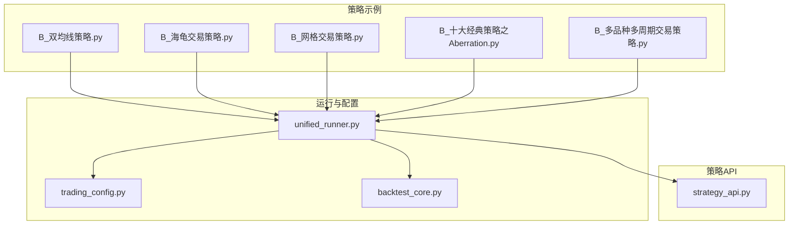
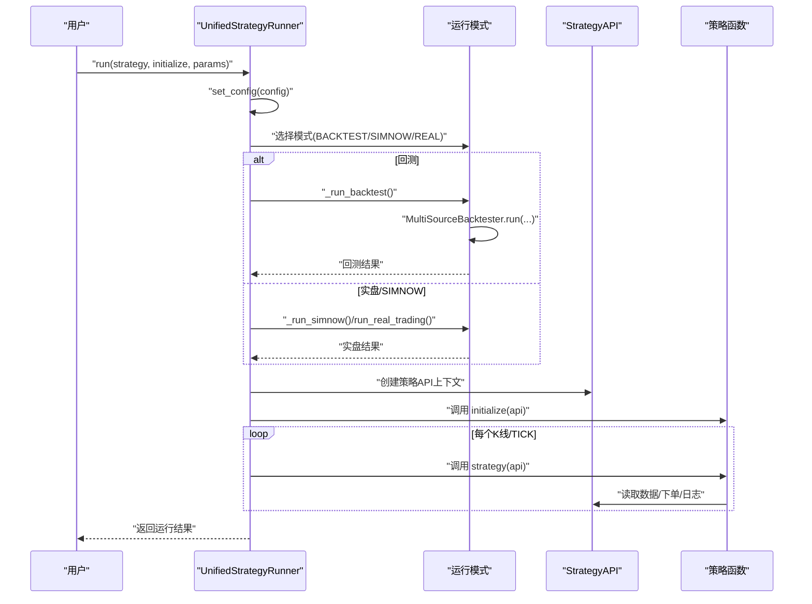
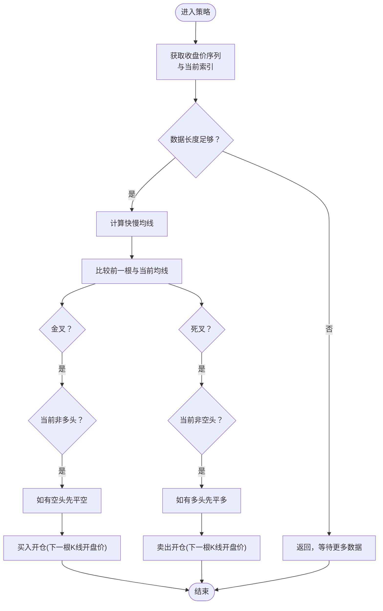
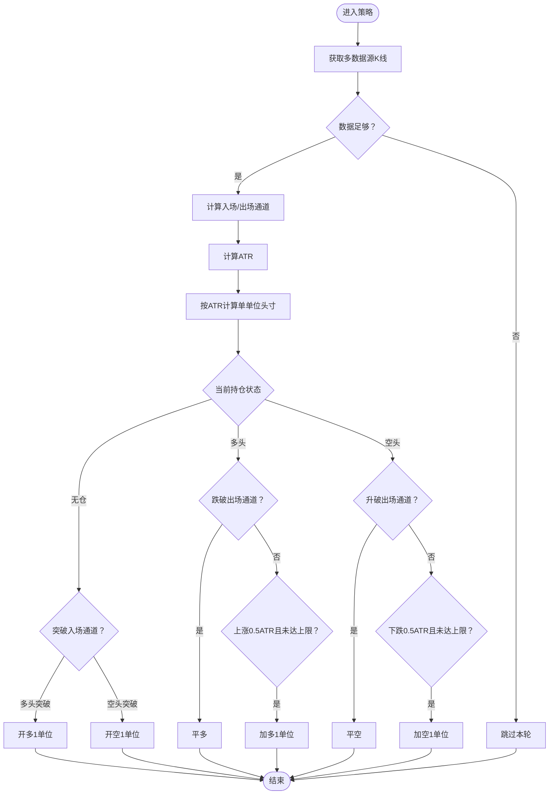
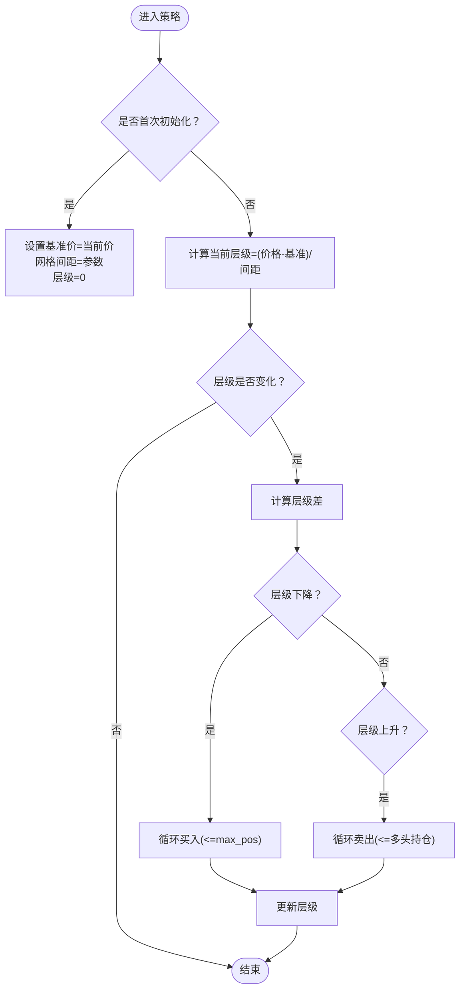
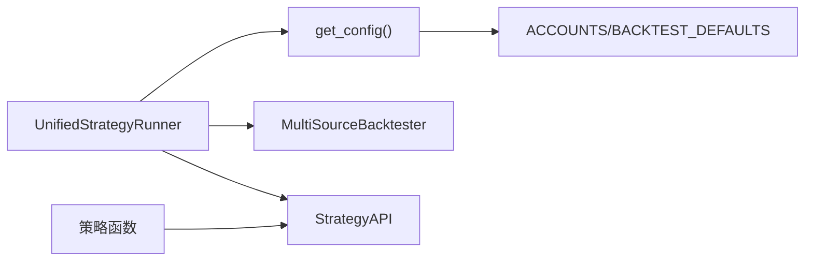

# 基础策略示例

<cite>
**本文引用的文件**
- [B_双均线策略.py](file://examples/B_双均线策略.py)
- [B_海龟交易策略.py](file://examples/B_海龟交易策略.py)
- [B_网格交易策略.py](file://examples/B_网格交易策略.py)
- [B_十大经典策略之Aberration.py](file://examples/B_十大经典策略之Aberration.py)
- [B_多品种多周期交易策略.py](file://examples/B_多品种多周期交易策略.py)
- [strategy_api.py](file://ssquant/api/strategy_api.py)
- [unified_runner.py](file://ssquant/backtest/unified_runner.py)
- [trading_config.py](file://ssquant/config/trading_config.py)
- [backtest_core.py](file://ssquant/backtest/backtest_core.py)
</cite>

## 目录
1. [简介](#简介)
2. [项目结构](#项目结构)
3. [核心组件](#核心组件)
4. [架构总览](#架构总览)
5. [详细组件分析](#详细组件分析)
6. [依赖关系分析](#依赖关系分析)
7. [性能考虑](#性能考虑)
8. [故障排查指南](#故障排查指南)
9. [结论](#结论)
10. [附录](#附录)

## 简介
本文件面向初学者与有经验的开发者，系统性解析 SSQuant 基础策略示例：双均线交叉策略、海龟交易策略与网格交易策略。文档涵盖设计原理、实现细节、信号生成机制、参数配置方法、风险管理措施、代码注释解读、参数调优指南与性能优化建议，并给出适用市场环境、交易品种选择与实盘应用注意事项。所有分析均基于仓库中的实际代码与配置文件，确保可追溯与可落地。

## 项目结构
SSQuant 提供“统一运行器”能力，支持回测、SIMNOW 模拟交易与实盘交易三种模式，策略代码无需改动即可切换运行环境。策略示例位于 examples 目录，核心运行与API位于 ssquant 子包中。

图表来源
- [unified_runner.py](file://ssquant/backtest/unified_runner.py#L1-L379)
- [trading_config.py](file://ssquant/config/trading_config.py#L1-L187)
- [backtest_core.py](file://ssquant/backtest/backtest_core.py#L1-L200)
- [strategy_api.py](file://ssquant/api/strategy_api.py#L1-L570)
- [B_双均线策略.py](file://examples/B_双均线策略.py#L1-L269)
- [B_海龟交易策略.py](file://examples/B_海龟交易策略.py#L1-L423)
- [B_网格交易策略.py](file://examples/B_网格交易策略.py#L1-L289)
- [B_十大经典策略之Aberration.py](file://examples/B_十大经典策略之Aberration.py#L1-L235)
- [B_多品种多周期交易策略.py](file://examples/B_多品种多周期交易策略.py#L1-L521)

章节来源
- [unified_runner.py](file://ssquant/backtest/unified_runner.py#L1-L379)
- [trading_config.py](file://ssquant/config/trading_config.py#L1-L187)
- [backtest_core.py](file://ssquant/backtest/backtest_core.py#L1-L200)
- [strategy_api.py](file://ssquant/api/strategy_api.py#L1-L570)

## 核心组件
- 统一运行器：封装回测、SIMNOW、实盘三种模式，负责策略初始化、参数注入、数据源管理与运行流程控制。
- 策略API：提供数据访问、交易下单、日志记录等能力，屏蔽底层差异，统一策略接口。
- 配置系统：集中管理账户、合约、交易成本、历史数据预加载、回调模式等参数。
- 多数据源回测器：支持多品种、多周期数据对齐与回测执行。

章节来源
- [unified_runner.py](file://ssquant/backtest/unified_runner.py#L19-L24)
- [strategy_api.py](file://ssquant/api/strategy_api.py#L4-L7)
- [trading_config.py](file://ssquant/config/trading_config.py#L115-L164)
- [backtest_core.py](file://ssquant/backtest/backtest_core.py#L14-L84)

## 架构总览
统一运行器根据运行模式选择不同的执行路径：回测模式使用多数据源回测器；SIMNOW/实盘模式使用实盘适配器。策略函数通过 StrategyAPI 获取数据与下单，运行器负责生命周期管理与结果汇总。

图表来源
- [unified_runner.py](file://ssquant/backtest/unified_runner.py#L162-L213)
- [backtest_core.py](file://ssquant/backtest/backtest_core.py#L144-L200)
- [strategy_api.py](file://ssquant/api/strategy_api.py#L9-L20)

## 详细组件分析

### 双均线交叉策略
- 设计原理：基于短期均线上穿/下穿长期均线的金叉/死叉信号进行趋势跟踪，采用“下一根K线开盘价”下单以消除跳空影响。
- 核心逻辑：
  - 计算收盘价滚动均值，比较前一根与当前根均线位置，判定金叉/死叉。
  - 依据当前持仓方向与信号方向决定平仓/反手/开仓。
  - 使用 order_type='next_bar_open' 确保回测/实盘一致性。
- 信号生成机制：通过滚动窗口均值比较，结合索引与数据长度校验，避免早期数据不足导致的误判。
- 参数配置方法：fast_ma、slow_ma 通过 api.get_param 注入；策略参数在主程序中以 strategy_params 传入统一运行器。
- 风险管理措施：仅在有足够历史数据时才生成信号；下单类型固定为“下一根K线开盘价”，降低滑点与跳空风险。
- 适用场景：震荡与趋势初期，适合中短周期K线（如1分钟）。
- 实盘注意：实盘模式下每个TICK会触发策略，但下单仍按K线级别执行；如需TICK级风控，可在策略中读取 tick 数据并设置止损。

图表来源
- [B_双均线策略.py](file://examples/B_双均线策略.py#L39-L123)

章节来源
- [B_双均线策略.py](file://examples/B_双均线策略.py#L26-L123)
- [strategy_api.py](file://ssquant/api/strategy_api.py#L287-L301)
- [strategy_api.py](file://ssquant/api/strategy_api.py#L362-L384)

### 海龟交易策略
- 设计原理：经典趋势跟踪策略，基于唐奇安通道突破入场、ATR波动率管理头寸、移动止损保护利润。
- 核心逻辑：
  - 计算入场通道（N日最高/最低）与出场通道（N/2日最高/最低）。
  - 使用ATR估计波动率，按账户风险比例动态计算系统单位头寸。
  - 多头/空头持仓时，若价格跌破/升破出场通道则平仓；若继续朝有利方向发展且未达最大单位数，按0.5ATR加仓。
- 信号生成机制：当日价格与昨日通道边界比较，形成突破信号；ATR用于头寸与止损设置。
- 参数配置方法：entry_period、exit_period、atr_period、risk_factor、max_units 通过 api.get_param 注入；策略参数在主程序中传入统一运行器。
- 风险管理措施：ATR头寸管理控制单次风险敞口；最大系统单位限制过度加仓；出场通道及时止盈止损。
- 适用场景：趋势明确的市场，适合日线或更高周期；需充足历史数据（如200根以上）。
- 实盘注意：建议开启智能算法交易与订单超时/重试机制，提升成交稳定性。

图表来源
- [B_海龟交易策略.py](file://examples/B_海龟交易策略.py#L119-L280)

章节来源
- [B_海龟交易策略.py](file://examples/B_海龟交易策略.py#L23-L280)
- [B_海龟交易策略.py](file://examples/B_海龟交易策略.py#L43-L83)
- [B_海龟交易策略.py](file://examples/B_海龟交易策略.py#L85-L117)

### 网格交易策略
- 设计原理：在设定价格区间内，价格每下跌一格买入、每上涨一格卖出，实现低买高卖的区间交易。
- 核心逻辑：
  - 首次价格作为基准价，网格间距由参数设定。
  - 当前价格所在层级 = floor((价格 - 基准价)/网格间距)。
  - 层级下降（价格下跌）→ 买入；层级上升（价格上涨）→ 卖出；受最大持仓限制。
- 信号生成机制：层级变化触发交易；支持多数据源时可扩展为多合约网格。
- 参数配置方法：grid_spacing、max_pos 通过 api.get_param 注入；策略参数在主程序中传入统一运行器。
- 风险管理措施：最大持仓限制总敞口；单边行情需配合止损保护（策略中预留空头卖出注释）。
- 适用场景：震荡行情；需合理设置网格间距与初始资金。
- 实盘注意：网格策略对滑点敏感，建议使用较小网格间距与较低手续费；可结合TICK级风控。

图表来源
- [B_网格交易策略.py](file://examples/B_网格交易策略.py#L57-L144)

章节来源
- [B_网格交易策略.py](file://examples/B_网格交易策略.py#L32-L144)

### Aberration 突破策略（补充）
- 设计原理：布林带突破 + ATR移动止损，属于突破追势策略。
- 核心逻辑：价格突破上轨做多、跌破下轨做空；回归中轨平仓；移动止损保护利润。
- 适用场景：震荡区间突破与趋势初期转换阶段。
- 参数配置：bb_period、bb_std、atr_period、atr_multiplier。

章节来源
- [B_十大经典策略之Aberration.py](file://examples/B_十大经典策略之Aberration.py#L30-L94)

### 多数据源多周期策略（补充）
- 设计原理：在同一策略中同时交易多个品种与周期，每个数据源独立计算指标与信号。
- 核心逻辑：自定义均线交叉判断函数，分别对四个数据源（焦炭/焦煤 × 1分钟/5分钟）独立交易。
- 参数配置：fast_ma、slow_ma 通过 api.get_param 注入；多数据源配置在统一运行器中设置。
- 适用场景：跨品种轮动、跨周期过滤与套利策略的组合。

章节来源
- [B_多品种多周期交易策略.py](file://examples/B_多品种多周期交易策略.py#L18-L260)

## 依赖关系分析
- 统一运行器依赖配置系统与回测核心模块，负责模式分发与生命周期管理。
- 策略API提供统一数据访问与下单接口，屏蔽多数据源差异。
- 各策略示例通过统一运行器注册，共享相同的参数注入与运行流程。

图表来源
- [unified_runner.py](file://ssquant/backtest/unified_runner.py#L79-L121)
- [trading_config.py](file://ssquant/config/trading_config.py#L115-L164)
- [strategy_api.py](file://ssquant/api/strategy_api.py#L9-L20)

章节来源
- [unified_runner.py](file://ssquant/backtest/unified_runner.py#L79-L121)
- [trading_config.py](file://ssquant/config/trading_config.py#L115-L164)
- [strategy_api.py](file://ssquant/api/strategy_api.py#L9-L20)

## 性能考虑
- 数据对齐与填充：多周期回测时建议启用对齐与前向填充，减少缺失数据带来的信号漂移。
- 指标计算：滚动窗口计算在长周期数据上可能成为瓶颈，建议：
  - 控制均线周期与数据长度；
  - 使用相对索引（-1/-2）避免重复计算；
  - 对于高频数据，考虑缓存中间结果。
- 订单执行：统一使用“下一根K线开盘价”下单可显著降低滑点与跳空影响，提升回测与实盘一致性。
- 多数据源：在多数据源策略中，尽量减少重复计算，统一在策略层使用自定义指标函数。

## 故障排查指南
- 回测报错“缺少必填参数”：检查回测配置是否包含 symbol/start_date/end_date/kline_period 或 data_sources。
- SIMNOW/实盘报错“账户不存在”：确认 trading_config.py 中 ACCOUNTS 是否包含指定账户名。
- 数据不足导致无信号：检查历史预加载数量与策略所需最小数据长度（如海龟策略建议200根）。
- 订单未成交：检查 order_offset_ticks、algo_trading、order_timeout、retry_limit 等参数。
- 日志定位：使用 StrategyAPI.log 输出关键变量（价格、通道、ATR、层级等）辅助定位问题。

章节来源
- [unified_runner.py](file://ssquant/backtest/unified_runner.py#L122-L161)
- [trading_config.py](file://ssquant/config/trading_config.py#L154-L161)
- [B_海龟交易策略.py](file://examples/B_海龟交易策略.py#L340-L342)

## 结论
SSQuant 的基础策略示例展示了从简单趋势跟踪到复杂波动率管理与网格交易的完整思路。通过统一运行器与策略API，开发者可以在三种模式间无缝切换，快速验证策略思想并进行参数优化。建议在实盘应用前充分进行回测与压力测试，并结合市场环境与品种特性调整参数与风控策略。

## 附录
- 参数调优建议
  - 双均线：从较短周期（如5/10）起步，逐步扩大至10/20或更高；关注最大回撤与胜率平衡。
  - 海龟：入口周期20、出场周期10、ATR周期14、风险因子0.01；最大单位数按账户规模与波动率调整。
  - 网格：间距与合约最小变动价位匹配；初始资金至少为网格跨度×最大持仓×合约乘数×保证金率的数倍。
- 适用市场环境
  - 双均线：震荡与趋势初期；适合中短周期。
  - 海龟：趋势明确市场；适合日线及以上周期。
  - 网格：震荡市场；单边行情需止损保护。
- 实盘应用注意事项
  - 启用智能算法交易与订单超时/重试机制；
  - 合理设置 order_offset_ticks 与滑点；
  - 关注手续费与保证金对收益的影响；
  - 多数据源策略需确保各数据源对齐与同步。