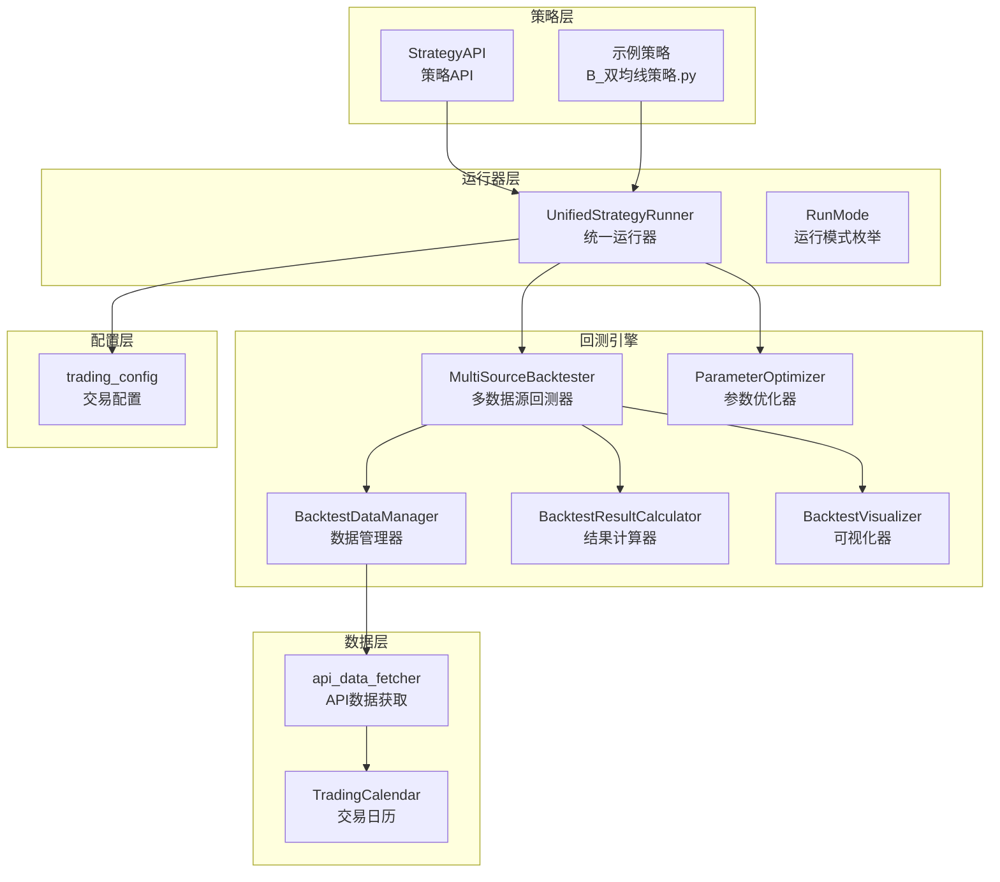
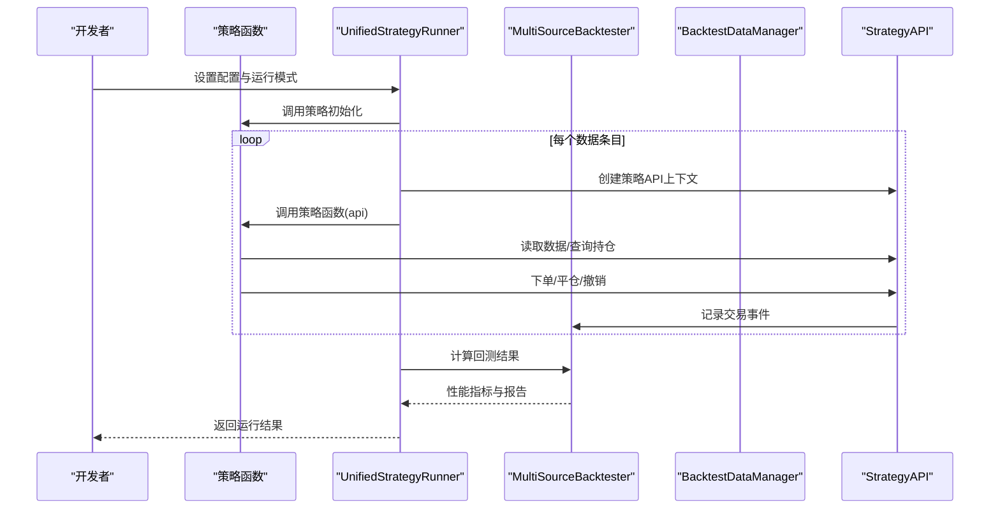
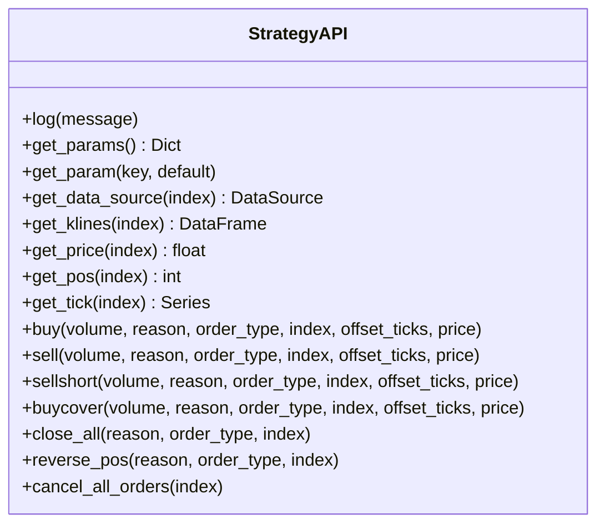
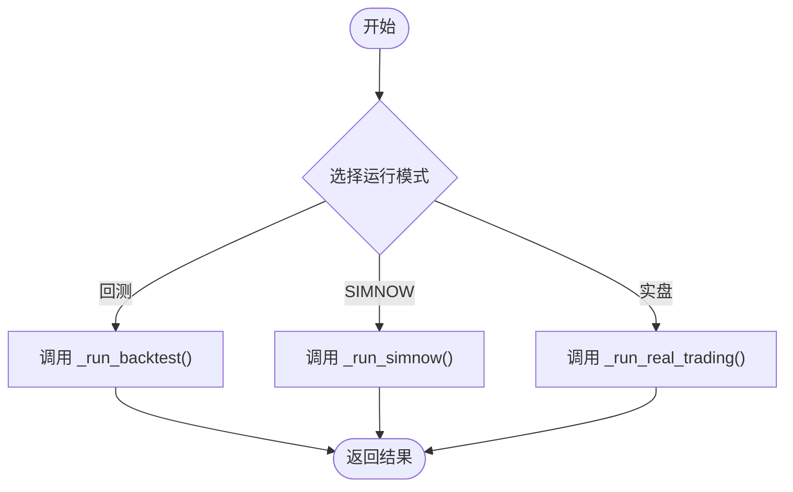
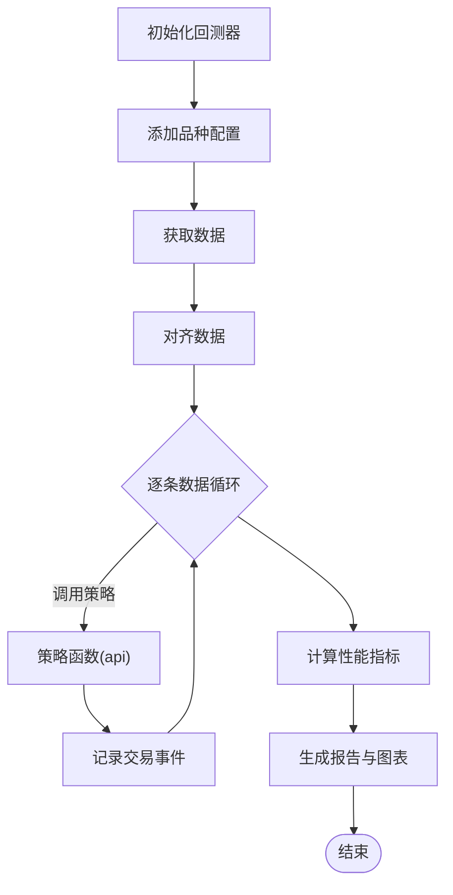
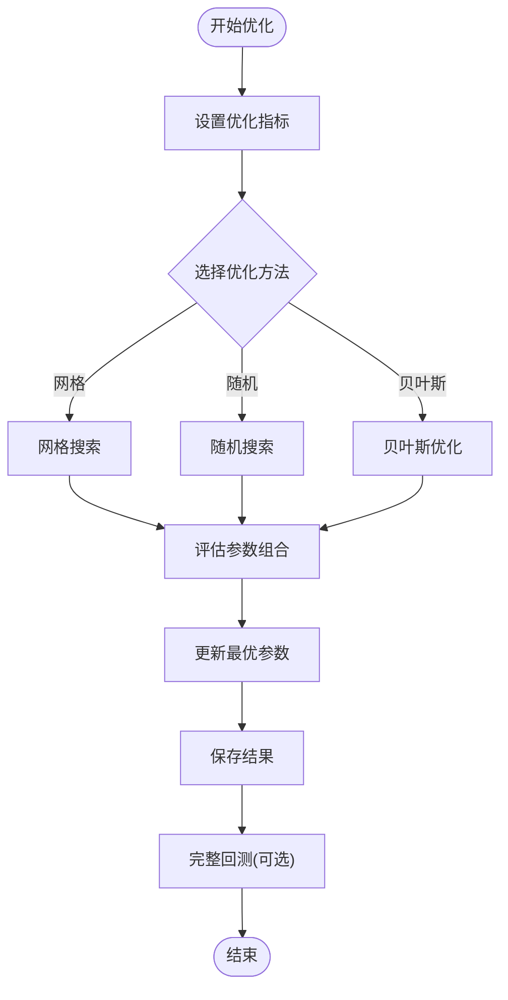
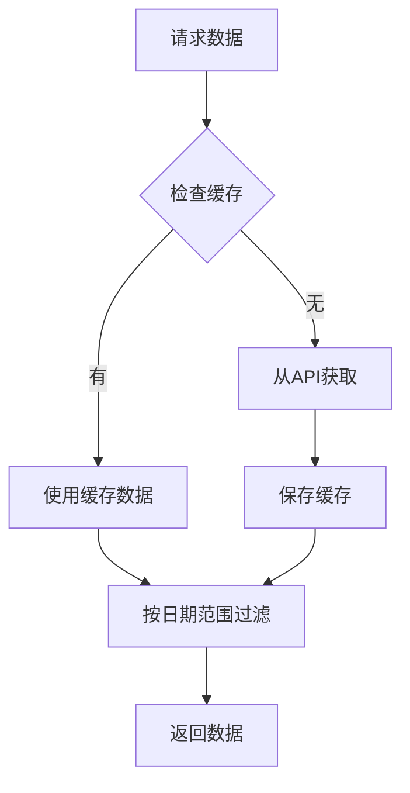
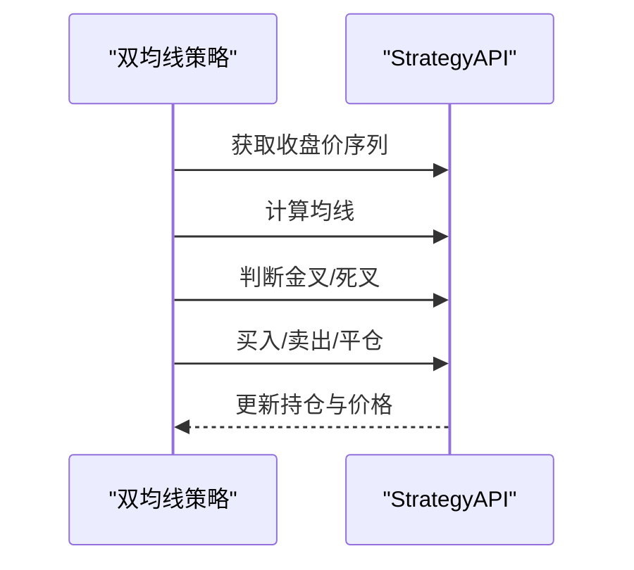
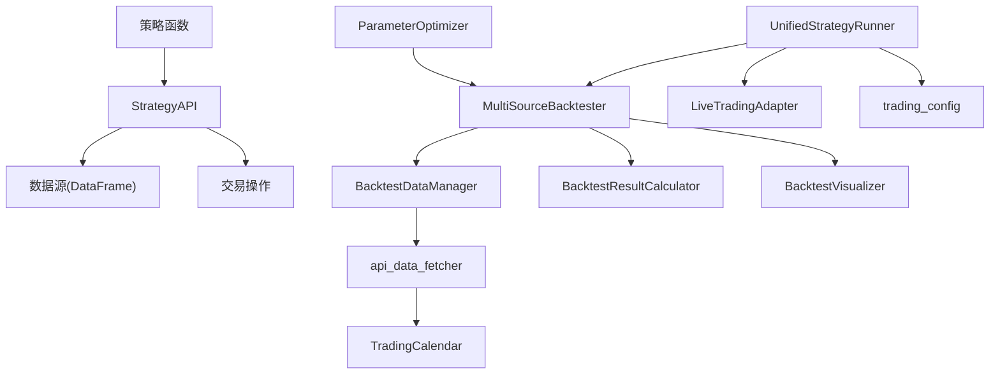

# 策略开发指南

<cite>
**本文档引用的文件**
- [README.md](file://README.md)
- [ssquant/__init__.py](file://ssquant/__init__.py)
- [ssquant/api/strategy_api.py](file://ssquant/api/strategy_api.py)
- [ssquant/backtest/unified_runner.py](file://ssquant/backtest/unified_runner.py)
- [ssquant/backtest/backtest_core.py](file://ssquant/backtest/backtest_core.py)
- [ssquant/backtest/parameter_optimizer.py](file://ssquant/backtest/parameter_optimizer.py)
- [ssquant/config/trading_config.py](file://ssquant/config/trading_config.py)
- [ssquant/data/api_data_fetcher.py](file://ssquant/data/api_data_fetcher.py)
- [ssquant/indicators/tech_indicators.py](file://ssquant/indicators/tech_indicators.py)
- [examples/B_双均线策略.py](file://examples/B_双均线策略.py)
- [examples/B_多品种多周期交易策略.py](file://examples/B_多品种多周期交易策略.py)
- [examples/B_缠论5分钟策略.py](file://examples/B_缠论5分钟策略.py)
- [examples/analyze_signal_quality.py](file://examples/analyze_signal_quality.py)
</cite>

## 目录
1. [简介](#简介)
2. [项目结构](#项目结构)
3. [核心组件](#核心组件)
4. [架构概览](#架构概览)
5. [详细组件分析](#详细组件分析)
6. [依赖关系分析](#依赖关系分析)
7. [性能考量](#性能考量)
8. [故障排除指南](#故障排除指南)
9. [结论](#结论)
10. [附录](#附录)

## 简介
本指南面向希望使用SSQuant框架开发期货量化交易策略的开发者，系统讲解从概念设计到实盘部署的全流程。内容涵盖策略架构、数据与交易API、回测与参数优化、信号质量分析、性能评估与风险控制，以及最佳实践与常见陷阱。

## 项目结构
SSQuant采用模块化设计，核心分为策略API、回测引擎、数据获取、配置管理与示例策略等模块。统一运行器支持回测、SIMNOW模拟与实盘CTP三模式无缝切换。

**图表来源**
- [ssquant/api/strategy_api.py](file://ssquant/api/strategy_api.py#L1-L570)
- [ssquant/backtest/unified_runner.py](file://ssquant/backtest/unified_runner.py#L1-L379)
- [ssquant/backtest/backtest_core.py](file://ssquant/backtest/backtest_core.py#L1-L579)
- [ssquant/backtest/parameter_optimizer.py](file://ssquant/backtest/parameter_optimizer.py#L1-L800)
- [ssquant/data/api_data_fetcher.py](file://ssquant/data/api_data_fetcher.py#L1-L800)
- [ssquant/config/trading_config.py](file://ssquant/config/trading_config.py#L1-L187)

**章节来源**
- [README.md](file://README.md#L297-L321)
- [ssquant/__init__.py](file://ssquant/__init__.py#L1-L18)

## 核心组件
- 策略API（StrategyAPI）：提供数据访问与交易操作的统一接口，屏蔽底层差异，支持多数据源与多周期。
- 统一运行器（UnifiedStrategyRunner）：支持回测、SIMNOW模拟、实盘CTP三种模式，通过配置切换。
- 多数据源回测器（MultiSourceBacktester）：支持多品种、多周期回测，提供对齐、结果计算与可视化。
- 参数优化器（ParameterOptimizer）：网格搜索、随机搜索、贝叶斯优化等方法，支持并行加速。
- 数据获取（api_data_fetcher）：从远程API获取K线/TICK数据，支持缓存与交易日历校验。
- 技术指标库（tech_indicators）：提供常用指标与交叉判断函数，便于策略实现。

**章节来源**
- [ssquant/api/strategy_api.py](file://ssquant/api/strategy_api.py#L1-L570)
- [ssquant/backtest/unified_runner.py](file://ssquant/backtest/unified_runner.py#L1-L379)
- [ssquant/backtest/backtest_core.py](file://ssquant/backtest/backtest_core.py#L1-L579)
- [ssquant/backtest/parameter_optimizer.py](file://ssquant/backtest/parameter_optimizer.py#L1-L800)
- [ssquant/data/api_data_fetcher.py](file://ssquant/data/api_data_fetcher.py#L1-L800)
- [ssquant/indicators/tech_indicators.py](file://ssquant/indicators/tech_indicators.py#L1-L322)

## 架构概览
SSQuant采用“策略API + 统一运行器 + 回测引擎”的分层架构。策略通过API访问数据与执行交易，运行器负责在不同模式下调度回测或实盘流程，回测引擎提供数据对齐、结果计算与可视化。

**图表来源**
- [ssquant/backtest/unified_runner.py](file://ssquant/backtest/unified_runner.py#L162-L214)
- [ssquant/backtest/backtest_core.py](file://ssquant/backtest/backtest_core.py#L144-L306)
- [ssquant/api/strategy_api.py](file://ssquant/api/strategy_api.py#L220-L28)

## 详细组件分析

### 策略API（StrategyAPI）
- 数据访问：get_klines、get_close、get_open、get_high、get_low、get_volume、get_tick、get_ticks等。
- 持仓查询：get_pos、get_long_pos、get_short_pos、get_position_detail。
- 交易操作：buy、sell、sellshort、buycover、close_all、reverse_pos、cancel_all_orders。
- 多数据源：get_data_source(index)、require_data_sources(count)、get_data_sources_count。

**图表来源**
- [ssquant/api/strategy_api.py](file://ssquant/api/strategy_api.py#L1-L570)

**章节来源**
- [ssquant/api/strategy_api.py](file://ssquant/api/strategy_api.py#L91-L558)

### 统一运行器（UnifiedStrategyRunner）
- 运行模式：RunMode.BACKTEST、SIMNOW、REAL_TRADING。
- 配置验证：set_config根据模式校验必填参数。
- 三模式运行：_run_backtest、_run_simnow、_run_real_trading。
- 回调支持：on_trade、on_order、on_cancel、on_account、on_position等。

**图表来源**
- [ssquant/backtest/unified_runner.py](file://ssquant/backtest/unified_runner.py#L19-L214)

**章节来源**
- [ssquant/backtest/unified_runner.py](file://ssquant/backtest/unified_runner.py#L79-L214)

### 多数据源回测器（MultiSourceBacktester）
- 多品种多周期：add_symbol_config支持periods与adjust_type。
- 数据对齐：align_data与fill_method。
- 结果计算：BacktestResultCalculator计算性能指标。
- 可视化：BacktestVisualizer生成图表。
- 参数优化：optimize_parameters支持多种优化方法与并行。

**图表来源**
- [ssquant/backtest/backtest_core.py](file://ssquant/backtest/backtest_core.py#L98-L306)

**章节来源**
- [ssquant/backtest/backtest_core.py](file://ssquant/backtest/backtest_core.py#L14-L143)

### 参数优化器（ParameterOptimizer）
- 方法：grid_search、random_search、bayesian_optimization。
- 并行：使用joblib并行加速。
- 指标：set_optimization_metric支持sharpe_ratio、total_return等。
- 结果：保存最优参数与完整回测报告。

**图表来源**
- [ssquant/backtest/parameter_optimizer.py](file://ssquant/backtest/parameter_optimizer.py#L140-L309)

**章节来源**
- [ssquant/backtest/parameter_optimizer.py](file://ssquant/backtest/parameter_optimizer.py#L74-L139)

### 数据获取与交易日历（api_data_fetcher）
- API数据：get_futures_data支持K线/TICK，自动复权与缓存。
- 交易日历：TradingCalendar基于akshare或基本规则生成交易日范围。
- 错误处理：对500、401等状态码进行友好提示。

**图表来源**
- [ssquant/data/api_data_fetcher.py](file://ssquant/data/api_data_fetcher.py#L171-L626)

**章节来源**
- [ssquant/data/api_data_fetcher.py](file://ssquant/data/api_data_fetcher.py#L18-L169)

### 技术指标库（tech_indicators）
- 常用指标：ma、ema、wma、macd、rsi、bollinger_bands、kdj、atr、cci。
- 交叉判断：is_crossover、is_crossunder。
- 形态识别：find_swing_high、find_swing_low。

**章节来源**
- [ssquant/indicators/tech_indicators.py](file://ssquant/indicators/tech_indicators.py#L1-L322)

### 示例策略分析

#### 双均线策略（B_双均线策略.py）
- 概念：短均线上穿/下穿长均线产生多/空信号。
- 多周期：支持1m/5m/15m/30m/1h/4h/1d。
- 多数据源：演示多品种多周期策略模板。
- 实盘：TICK驱动与K线驱动切换。

**图表来源**
- [examples/B_双均线策略.py](file://examples/B_双均线策略.py#L39-L123)

**章节来源**
- [examples/B_双均线策略.py](file://examples/B_双均线策略.py#L1-L269)

#### 多品种多周期策略（B_多品种多周期交易策略.py）
- 多数据源：j888 5m/15m 与 jm888 5m/15m。
- 独立交易：每个数据源独立计算信号与下单。
- 参数化：fast_ma、slow_ma可配置。

**章节来源**
- [examples/B_多品种多周期交易策略.py](file://examples/B_多品种多周期交易策略.py#L1-L521)

#### 缠论5分钟策略（B_缠论5分钟策略.py）
- 增量分析：czsc RawBar增量更新，避免全量重算。
- 信号聚合：TYPE1/2/3/4多信号优先级聚合。
- 趋势过滤：15m MA方向过滤。
- 止损体系：ATR/结构/中枢三重止损。
- 可视化：生成缠论分析K线图与信号导出。

**章节来源**
- [examples/B_缠论5分钟策略.py](file://examples/B_缠论5分钟策略.py#L1-L1056)

#### 信号质量分析（analyze_signal_quality.py）
- 前瞻收益：按signal_type分组计算N根K线后的收益。
- 统计指标：信号数、胜率、平均收益、波动率。
- 输出：signal_quality_by_type.csv。

**章节来源**
- [examples/analyze_signal_quality.py](file://examples/analyze_signal_quality.py#L1-L133)

## 依赖关系分析

**图表来源**
- [ssquant/backtest/unified_runner.py](file://ssquant/backtest/unified_runner.py#L15-L16)
- [ssquant/backtest/backtest_core.py](file://ssquant/backtest/backtest_core.py#L7-L12)
- [ssquant/data/api_data_fetcher.py](file://ssquant/data/api_data_fetcher.py#L1-L16)

**章节来源**
- [ssquant/backtest/unified_runner.py](file://ssquant/backtest/unified_runner.py#L1-L379)
- [ssquant/backtest/backtest_core.py](file://ssquant/backtest/backtest_core.py#L1-L579)
- [ssquant/data/api_data_fetcher.py](file://ssquant/data/api_data_fetcher.py#L1-L800)

## 性能考量
- 数据对齐与填充：align_data与fill_method影响回测速度与精度。
- 缓存策略：get_futures_data支持缓存与增量更新，减少API调用。
- 并行优化：ParameterOptimizer支持joblib并行，显著提升网格/随机搜索效率。
- 可视化与日志：NO_VISUALIZATION与NO_CONSOLE_LOG环境变量可禁用图表与控制台输出，加速参数优化。
- TICK流：实盘模式下启用TICK回调可实现毫秒级风控，但需注意CPU占用。

[本节为通用指导，无需特定文件引用]

## 故障排除指南
- ModuleNotFoundError: No module named 'ssquant'：检查pip安装状态与PYTHONPATH。
- CTP功能不可用：检查Python版本与CTP二进制文件匹配，框架会打印警告。
- API认证失败：确认trading_config.py中的API_USERNAME/PASSWORD与账户状态。
- 数据为空：检查交易日历、日期范围与缓存完整性。
- 参数优化无结果：确认优化指标名称与higher_is_better设置，检查环境变量NO_VISUALIZATION/NO_CONSOLE_LOG。

**章节来源**
- [README.md](file://README.md#L90-L119)
- [ssquant/__init__.py](file://ssquant/__init__.py#L14-L17)
- [ssquant/config/trading_config.py](file://ssquant/config/trading_config.py#L167-L177)
- [ssquant/data/api_data_fetcher.py](file://ssquant/data/api_data_fetcher.py#L757-L793)

## 结论
SSQuant提供从策略开发到实盘部署的一站式能力。通过统一API与运行器，开发者可专注于策略逻辑；借助多数据源回测与参数优化，可快速迭代与验证策略；配合信号质量分析与可视化，能持续改进策略表现。建议遵循最佳实践，重视风险控制与回测验证，逐步过渡到SIMNOW与实盘。

[本节为总结性内容，无需特定文件引用]

## 附录

### 策略开发最佳实践
- 从简单策略开始：先实现单数据源单周期策略，再扩展到多周期与多品种。
- 参数化：将关键参数通过strategy_params注入，便于参数优化。
- 风险控制：设置止损、止盈、最大回撤与仓位管理。
- 回测验证：使用不同样本外区间验证策略稳定性。
- 信号质量：定期分析信号前瞻收益，剔除无效信号类型。

[本节为通用指导，无需特定文件引用]

### 常见陷阱与解决方案
- 过拟合：仅在训练区间优化，样本外验证；限制参数空间。
- 信号漂移：定期重跑回测，关注市场结构变化。
- 滑点与手续费：在回测中加入滑点与手续费，贴近真实成本。
- 数据质量问题：检查交易日历与复权类型，避免跨市场/跨品种错误对齐。

[本节为通用指导，无需特定文件引用]

### 实盘部署要点
- SIMNOW验证：至少一周高强度测试，验证订单执行与风控。
- 小资金验证：实盘前用小资金验证策略，逐步加仓。
- 算法交易：启用智能算法交易，设置超时与重试机制。
- 数据保存：开启K线/TICK数据保存，便于事后分析。

**章节来源**
- [ssquant/backtest/unified_runner.py](file://ssquant/backtest/unified_runner.py#L316-L372)
- [ssquant/config/trading_config.py](file://ssquant/config/trading_config.py#L31-L110)