# 策略示例详解

<cite>
**本文档引用的文件**
- [README.md](file://README.md)
- [用户手册.md](file://用户手册.md)
- [B_双均线策略.py](file://examples/B_双均线策略.py)
- [B_海龟交易策略.py](file://examples/B_海龟交易策略.py)
- [B_机器学习策略_随机森林.py](file://examples/B_机器学习策略_随机森林.py)
- [C_期权交易策略.py](file://examples/C_期权交易策略.py)
- [C_纯Tick高频交易策略.py](file://examples/C_纯Tick高频交易策略.py)
- [B_网格交易策略.py](file://examples/B_网格交易策略.py)
- [B_跨周期过滤策略.py](file://examples/B_跨周期过滤策略.py)
- [B_跨品种套利策略.py](file://examples/B_跨品种套利策略.py)
- [B_多品种多周期交易策略.py](file://examples/B_多品种多周期交易策略.py)
- [B_强弱截面轮动策略.py](file://examples/B_强弱截面轮动策略.py)
- [B_日内交易策略.py](file://examples/B_日内交易策略.py)
- [run_策略20_LLM回测.py](file://run_策略20_LLM回测.py)
- [策略20_LLM辅助交易策略.py](file://策略20_LLM辅助交易策略.py)
- [vip33_opt_ssquant.py](file://vip33_opt_ssquant.py)
- [run_策略33_5品种回测.py](file://run_策略33_5品种回测.py)
- [B_缠论5分钟策略.py](file://examples/B_缠论5分钟策略.py)
- [B_缠论多空信号策略.py](file://examples/B_缠论多空信号策略.py)
- [缠论5分钟策略-说明文档.md](file://docs/缠论5分钟策略-说明文档.md)
</cite>

## 目录
1. [简介](#简介)
2. [项目结构](#项目结构)
3. [核心组件](#核心组件)
4. [架构概览](#架构概览)
5. [详细组件分析](#详细组件分析)
6. [新增策略详解](#新增策略详解)
7. [依赖分析](#依赖分析)
8. [性能考虑](#性能考虑)
9. [故障排除指南](#故障排除指南)
10. [结论](#结论)
11. [附录](#附录)

## 简介

SSQuant是一个专业的期货量化交易框架，提供了23个完整的策略示例，涵盖从基础到高级的各类交易策略。该框架支持统一的策略代码在回测、SIMNOW模拟和实盘CTP三种环境下运行，为量化交易者提供了完整的开发和部署解决方案。

**更新** 新增了4个重要策略示例：LLM辅助交易策略、VIP33优化策略、多因素交叉策略和缠论技术分析演示，进一步丰富了框架的功能和应用场景。

框架的核心特性包括：
- **统一策略框架**：一套代码三处运行
- **强大的交易功能**：自动开平仓管理、智能算法交易
- **丰富的策略示例**：涵盖趋势、套利、轮动、期权、机器学习、AI辅助等类型
- **多品种多周期支持**：同时交易多个品种，使用不同周期数据
- **AI集成能力**：支持大语言模型辅助决策
- **高性能优化**：提供专门的高性能策略实现

## 项目结构

SSQuant项目的整体结构清晰，主要分为以下几个核心部分：

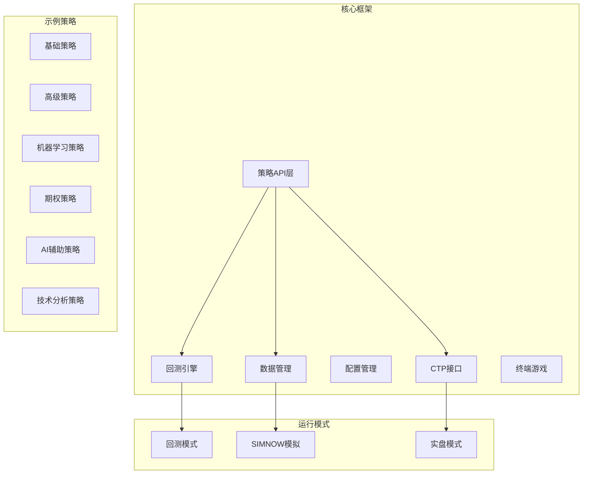

**图表来源**
- [README.md:297-321](file://README.md#L297-L321)

项目采用模块化设计，每个组件都有明确的职责分工：

- **ssquant/api/**：策略API接口层
- **ssquant/backtest/**：回测引擎和运行器
- **ssquant/data/**：数据获取和管理
- **ssquant/config/**：配置管理
- **ssquant/ctp/**：CTP接口封装
- **examples/**：23个策略示例（新增4个）
- **docs/**：技术文档和说明

**章节来源**
- [README.md:297-321](file://README.md#L297-L321)

## 核心组件

### 策略API系统

SSQuant的策略API提供了统一的接口，使策略开发者能够专注于交易逻辑的实现，而不需要关心底层的交易细节。

核心API功能包括：
- **数据获取**：收盘价、开盘价、最高价、最低价、成交量等
- **持仓查询**：净持仓、多头持仓、空头持仓、详细持仓信息
- **交易操作**：买入开仓、卖出平仓、卖出开仓、买入平仓、全部平仓、反手
- **参数管理**：策略参数获取、日志记录
- **多数据源支持**：支持同时交易多个品种和周期
- **AI集成**：支持大语言模型调用和结果处理

### 统一运行器

统一运行器是SSQuant的核心组件，它负责在不同的运行模式下执行策略：

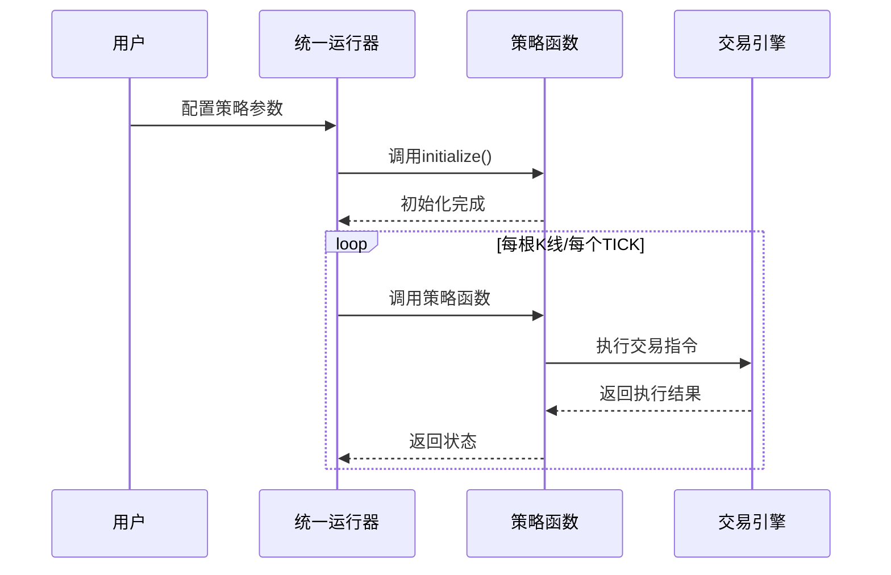

**图表来源**
- [用户手册.md:245-332](file://用户手册.md#L245-L332)

**章节来源**
- [用户手册.md:294-332](file://用户手册.md#L294-L332)

## 架构概览

SSQuant采用了分层架构设计，确保了系统的可扩展性和可维护性：

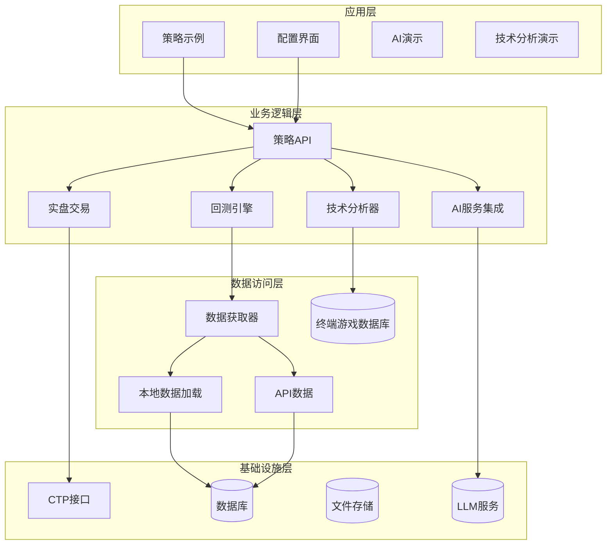

**图表来源**
- [README.md:297-321](file://README.md#L297-L321)

### 数据流架构

SSQuant支持多种数据流模式，适应不同的交易需求：

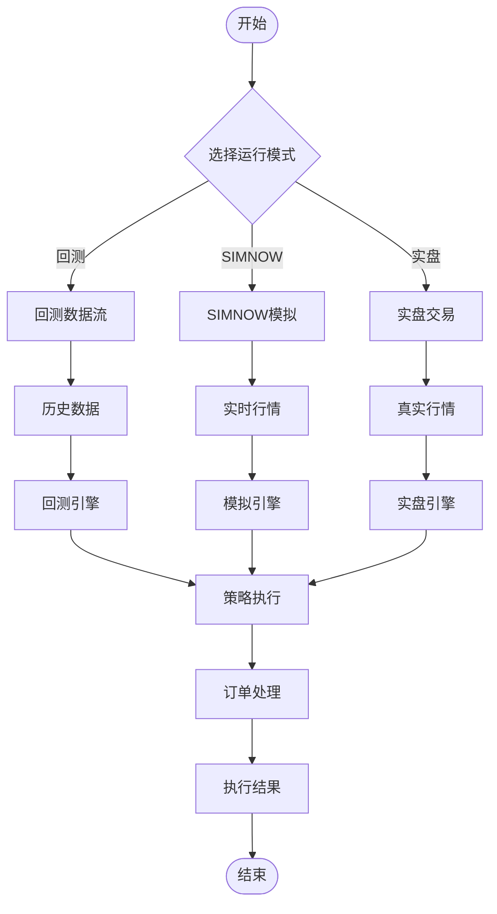

**图表来源**
- [用户手册.md:335-425](file://用户手册.md#L335-L425)

**章节来源**
- [用户手册.md:335-425](file://用户手册.md#L335-L425)

## 详细组件分析

### 基础策略分析

#### 双均线策略

双均线策略是最经典的趋势跟踪策略之一，通过短期均线和长期均线的交叉来产生交易信号。

**图表来源**
- [B_双均线策略.py:106-123](file://examples/B_双均线策略.py#L106-L123)

**策略特点**：
- 使用5日和20日均线进行交叉判断
- 支持TICK流驱动和K线驱动两种模式
- 具备基本的风险管理机制

**参数调优建议**：
- 短期均线：3-10日（根据品种波动性调整）
- 长期均线：15-50日（与短期均线形成合理比例）
- 滑点设置：根据品种最小变动价位设置

**章节来源**
- [B_双均线策略.py:39-123](file://examples/B_双均线策略.py#L39-L123)

#### 海龟交易策略

海龟交易策略是著名的趋势跟踪策略，基于唐奇安通道和ATR波动率管理。

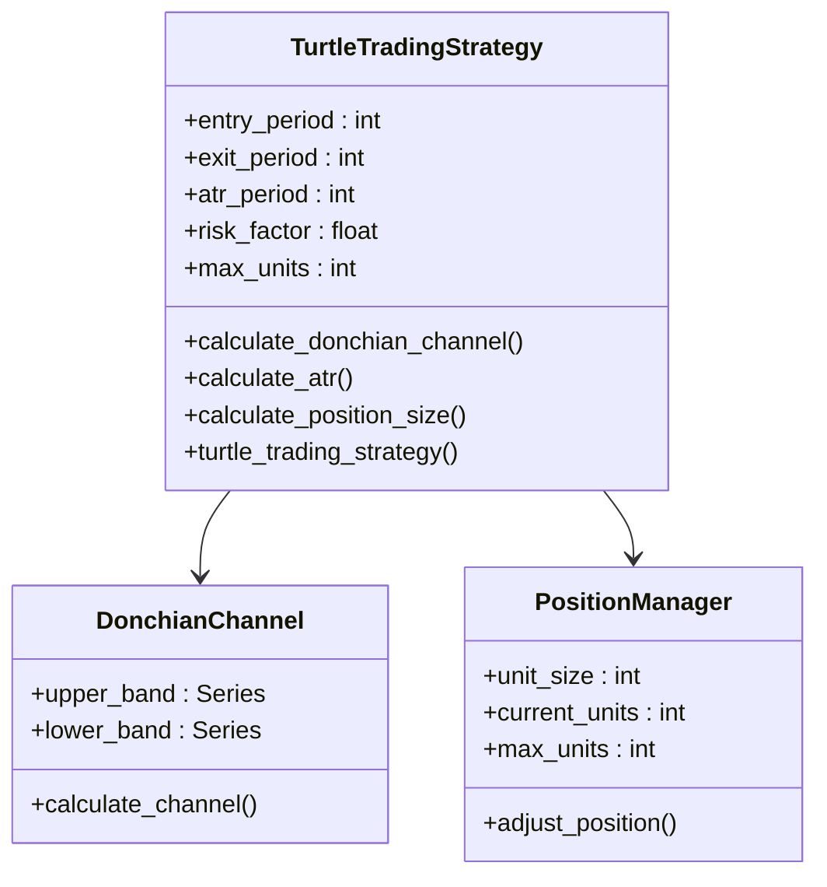

**图表来源**
- [B_海龟交易策略.py:43-117](file://examples/B_海龟交易策略.py#L43-L117)

**策略核心逻辑**：
1. 计算唐奇安通道（20日高点和低点）
2. 使用ATR计算波动率调整的头寸规模
3. 基于通道突破产生交易信号
4. 实施系统化的风险管理

**风险管理机制**：
- ATR波动率控制头寸规模
- 最大系统单位数限制
- 动态加仓机制（价格上涨0.5个ATR时加仓）

**章节来源**
- [B_海龟交易策略.py:119-280](file://examples/B_海龟交易策略.py#L119-L280)

### 高级策略分析

#### 机器学习策略（随机森林）

机器学习策略使用随机森林算法进行价格走势预测，体现了量化交易的智能化发展方向。

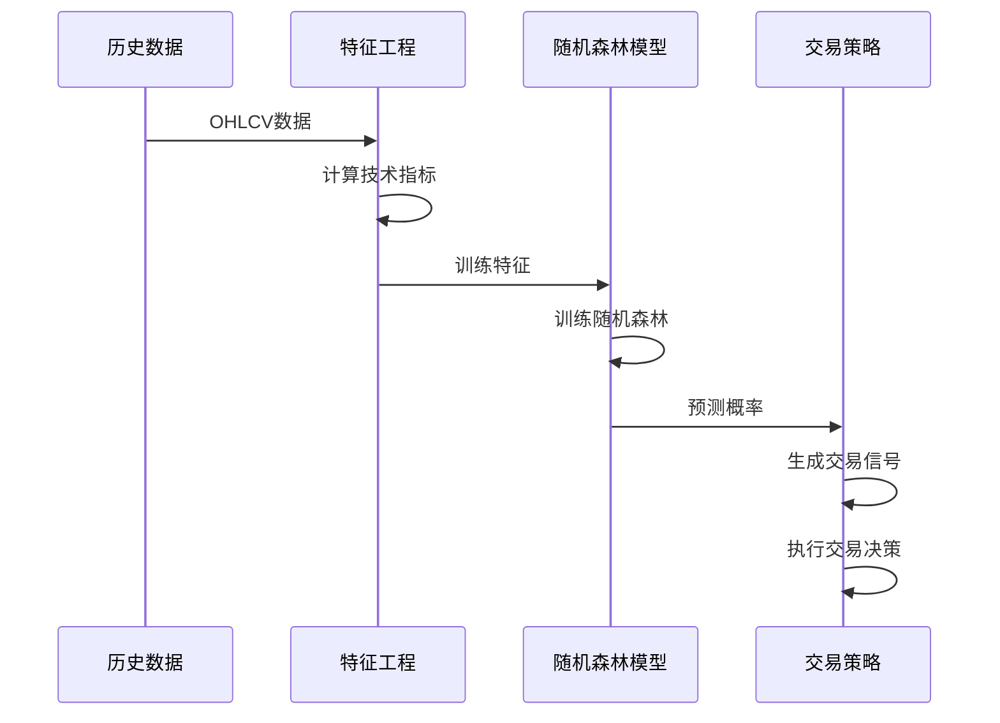

**图表来源**
- [B_机器学习策略_随机森林.py:153-482](file://examples/B_机器学习策略_随机森林.py#L153-L482)

**特征工程模块**：
- 移动平均线指标（MA5, MA10, MA20, MA60）
- 价格变化率和技术指标
- 波动率和成交量指标
- RSI相对强弱指数
- MACD指数平滑异同移动平均线
- 布林带指标

**模型训练流程**：
1. 收集历史K线数据
2. 计算技术特征
3. 生成目标变量（未来n周期价格变动方向）
4. 训练随机森林模型
5. 标准化特征数据
6. 保存模型和缩放器

**章节来源**
- [B_机器学习策略_随机 Forest.py:57-482](file://examples/B_机器学习策略_随机森林.py#L57-L482)

#### 期权交易策略

期权交易策略展示了SSQuant框架对衍生品交易的支持能力。

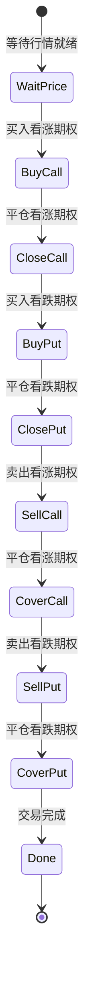

**图表来源**
- [C_期权交易策略.py:30-231](file://examples/C_期权交易策略.py#L30-L231)

**策略执行流程**：
1. **买入看涨期权** → 卖出平仓
2. **买入看跌期权** → 卖出平仓  
3. **卖出看涨期权**（做空）→ 买入平仓
4. **卖出看跌期权**（做空）→ 买入平仓

**期权交易特点**：
- 支持多数据源（看涨期权、看跌期权、标的期货）
- 实时价格监控和自动执行
- 完整的交易统计和状态跟踪
- 支持SIMNOW模拟和实盘CTP

**章节来源**
- [C_期权交易策略.py:118-231](file://examples/C_期权交易策略.py#L118-L231)

#### 纯Tick高频交易策略

高频交易策略展示了SSQuant在微观交易层面的能力，支持TICK级别的交易执行。

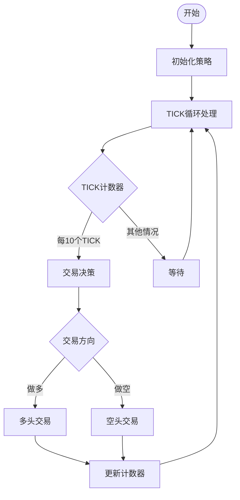

**图表来源**
- [C_纯Tick高频交易策略.py:245-313](file://examples/C_纯Tick高频交易策略.py#L245-L313)

**高频交易特性**：
- 每10个TICK/K线交易一次
- 多空交替的简化策略
- 实盘使用市价单，回测使用下一根K线开盘价
- 完整的CTP回调函数支持

**章节来源**
- [C_纯Tick高频交易策略.py:245-313](file://examples/C_纯Tick高频交易策略.py#L245-L313)

### 专业策略分析

#### 网格交易策略

网格交易策略适用于震荡市场，在价格波动范围内进行高抛低吸。

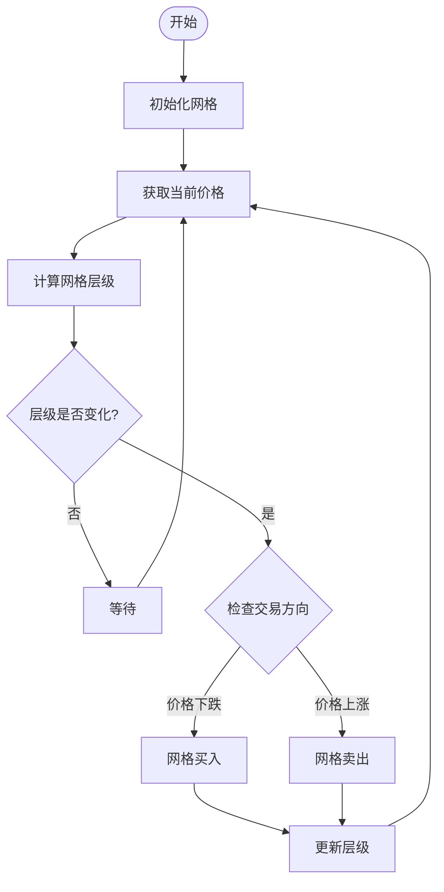

**图表来源**
- [B_网格交易策略.py:57-144](file://examples/B_网格交易策略.py#L57-L144)

**网格交易逻辑**：
1. 以首次价格为基准，计算当前价格所在的网格层级
2. 层级下降（价格下跌）→ 买入
3. 层级上升（价格上涨）→ 卖出
4. 支持最大持仓限制

**参数设置建议**：
- 网格间距：根据品种价格合理设置（螺纹钢建议20-50元，黄金建议2-5元）
- 最大持仓：根据资金规模和风险承受能力设定

**章节来源**
- [B_网格交易策略.py:57-144](file://examples/B_网格交易策略.py#L57-L144)

#### 跨周期过滤策略

跨周期过滤策略结合长周期趋势判断和短周期信号过滤，提高交易信号的可靠性。

**图表来源**
- [B_跨周期过滤策略.py:46-155](file://examples/B_跨周期过滤策略.py#L46-L155)

**策略优势**：
- 长周期趋势过滤减少假信号
- 短周期信号捕捉入场时机
- 只在大趋势方向上交易
- 降低逆势交易风险

**章节来源**
- [B_跨周期过滤策略.py:46-155](file://examples/B_跨周期过滤策略.py#L46-L155)

#### 跨品种套利策略

跨品种套利策略利用相关品种间的价差关系进行统计套利。

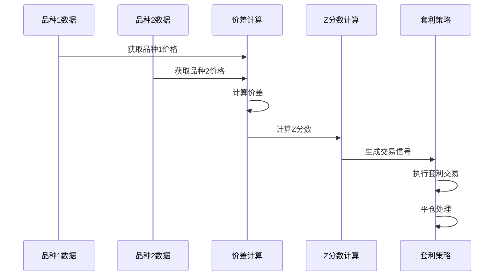

**图表来源**
- [B_跨品种套利策略.py:105-167](file://examples/B_跨品种套利策略.py#L105-L167)

**套利策略要点**：
1. 计算两个品种的价差序列
2. 使用滚动窗口计算Z分数
3. 当Z分数偏离均值时开仓
4. 当价差回归均值时平仓
5. 支持动态对冲比率调整

**章节来源**
- [B_跨品种套利策略.py:105-167](file://examples/B_跨品种套利策略.py#L105-L167)

#### 多品种多周期交易策略

多品种多周期策略展示了SSQuant在复杂交易场景下的强大能力。

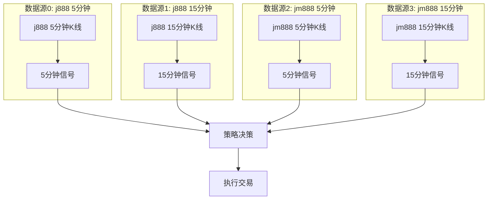

**图表来源**
- [B_多品种多周期交易策略.py:48-260](file://examples/B_多品种多周期交易策略.py#L48-L260)

**策略特点**：
- 同时交易4个数据源（2个品种×2个周期）
- 每个数据源独立产生交易信号
- 5分钟和15分钟周期各自独立交易
- 支持不同品种的不同参数设置

**章节来源**
- [B_多品种多周期交易策略.py:48-260](file://examples/B_多品种多周期交易策略.py#L48-L260)

#### 强弱截面轮动策略

强弱截面轮动策略通过比较不同品种的相对强弱进行轮动交易。

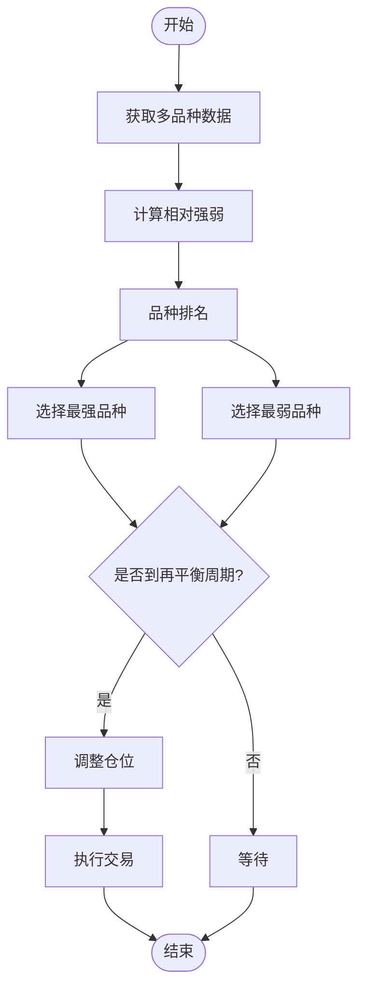

**图表来源**
- [B_强弱截面轮动策略.py:76-206](file://examples/B_强弱截面轮动策略.py#L76-L206)

**轮动策略逻辑**：
1. 计算所有品种的相对强弱指标
2. 根据相对强弱指标对品种进行排名
3. 选择最强的品种做多
4. 选择最弱的品种做空
5. 定期重新评估排名并轮动持仓

**章节来源**
- [B_强弱截面轮动策略.py:76-206](file://examples/B_强弱截面轮动策略.py#L76-L206)

#### 日内交易策略

日内交易策略专门设计用于当日交易，不持仓过夜。

**图表来源**
- [B_日内交易策略.py:97-237](file://examples/B_日内交易策略.py#L97-L237)

**日内交易特点**：
- 只做日内交易，不持仓过夜
- 收盘前强制平仓
- 基于开盘区间突破进场
- 设置止损止盈保护

**章节来源**
- [B_日内交易策略.py:97-237](file://examples/B_日内交易策略.py#L97-L237)

## 新增策略详解

### LLM辅助交易策略（策略20）

LLM辅助交易策略是SSQuant框架中首个集成大语言模型的智能交易策略，结合传统技术分析和AI智能决策。

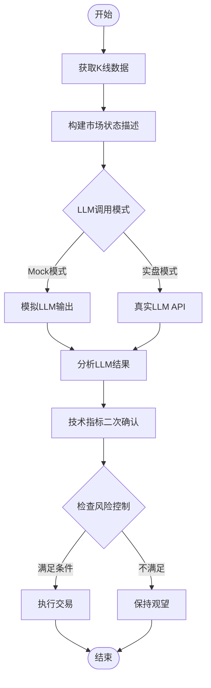

**图表来源**
- [策略20_LLM辅助交易策略.py:191-329](file://策略20_LLM辅助交易策略.py#L191-L329)

**策略核心特点**：
1. **多模态决策**：结合技术指标和LLM智能分析
2. **灵活部署**：支持回测模拟和实盘部署
3. **风险控制**：ATR动态止损和多重确认机制
4. **参数优化**：可调节的LLM信心阈值和调用间隔

**技术实现亮点**：
- **Prompt工程**：将K线数据、技术指标结构化为自然语言描述
- **信号融合**：LLM方向判断 + 技术指标确认 + 量能验证
- **缓存机制**：减少LLM调用频率，提高执行效率
- **模拟模式**：回测时用技术规则模拟LLM输出

**章节来源**
- [策略20_LLM辅助交易策略.py:1-329](file://策略20_LLM辅助交易策略.py#L1-L329)
- [run_策略20_LLM回测.py:1-114](file://run_策略20_LLM回测.py#L1-L114)

### VIP33优化策略（高性能版）

VIP33优化策略是SSQuant框架中最具代表性的高性能截面多因子策略，专为全品种多因子分析而设计。

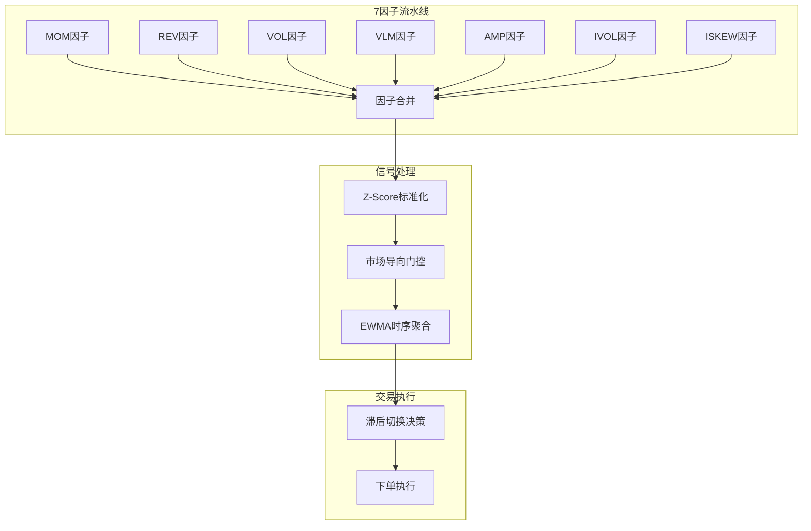

**图表来源**
- [vip33_opt_ssquant.py:16-52](file://vip33_opt_ssquant.py#L16-L52)

**策略架构特色**：
1. **双流水线设计**：每根Bar计算A类因子，调仓日计算B类因子
2. **市场导向门控**：根据市场状态动态调整因子权重
3. **EWMA时序聚合**：平滑信号波动，减少交易频率
4. **滞后切换机制**：避免频繁交易和信号闪烁

**性能优化技术**：
- **IndicatorCache v2**：统一的指标缓存系统
- **NumPy向量化**：批量计算提升执行速度
- **内存优化**：合理的数据结构设计
- **三档性能体系**：可根据需求选择不同性能模式

**章节来源**
- [vip33_opt_ssquant.py:1-651](file://vip33_opt_ssquant.py#L1-L651)

### 多因素交叉策略（策略33）

多因素交叉策略是VIP33优化策略的简化版本，专注于5个代表性品种的高性能回测。

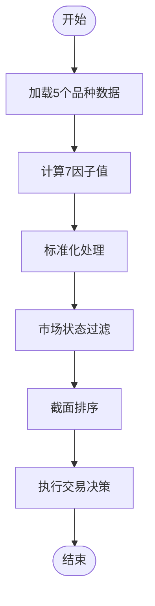

**图表来源**
- [run_策略33_5品种回测.py:66-117](file://run_策略33_5品种回测.py#L66-L117)

**策略设计要点**：
1. **精选品种**：覆盖黑色金属、贵金属、有色金属、农产品、能化等五大板块
2. **参数简化**：仅保留4个核心可调参数，便于优化和部署
3. **高性能实现**：基于VIP33优化策略的精简版本
4. **回测友好**：专门设计的回测脚本和配置

**回测配置特点**：
- **初始资金**：50万元（5个品种，每品种约10万）
- **数据周期**：日线（1d）回测
- **预热期**：500根K线
- **对齐数据**：截面策略必须对齐数据

**章节来源**
- [run_策略33_5品种回测.py:1-117](file://run_策略33_5品种回测.py#L1-L117)

### 缠论技术分析演示

缠论技术分析演示基于czsc库实现了经典的缠中说禅技术分析方法，提供完整的信号检测和交易执行。

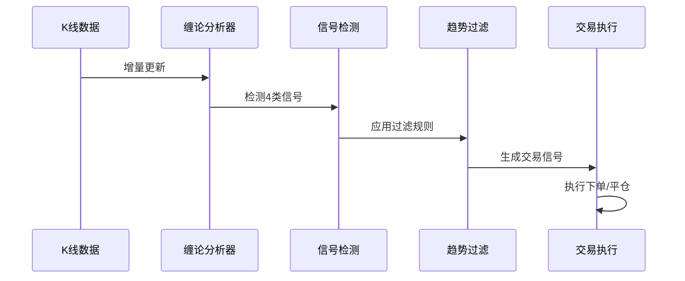

**图表来源**
- [B_缠论5分钟策略.py:558-800](file://examples/B_缠论5分钟策略.py#L558-L800)

**技术分析特色**：
1. **四类信号检测**：1类转向、2类延续、3类确认、4类V反
2. **经典二买专项**：提供更早的入场机会
3. **买卖点不超买原则**：限制同方向同级别交易次数
4. **三重止损保护**：ATR止损、结构止损、中枢破位止损

**参数优化成果**：
- **胜率稳定性**：σ=1.3pp（极稳定）
- **盈亏比健康**：σ=0.34（健康范围）
- **最大回撤可控**：σ=5.3pp（可控）
- **样本内外一致**：没有过拟合迹象

**章节来源**
- [B_缠论5分钟策略.py:1-1246](file://examples/B_缠论5分钟策略.py#L1-L1246)
- [B_缠论多空信号策略.py:1-1515](file://examples/B_缠论多空信号策略.py#L1-L1515)
- [缠论5分钟策略-说明文档.md:1-329](file://docs/缠论5分钟策略-说明文档.md#L1-L329)

## 依赖分析

SSQuant框架的依赖关系体现了其模块化设计的优势：

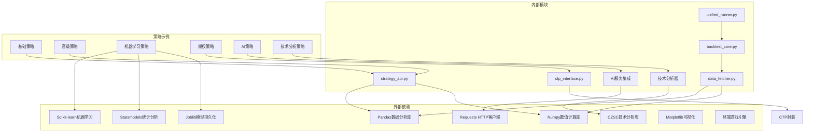

**图表来源**
- [README.md:370-390](file://README.md#L370-L390)

### 关键依赖关系

1. **策略API依赖**：所有策略示例都依赖于统一的策略API接口
2. **数据依赖**：策略需要Pandas和Numpy进行数据处理
3. **机器学习依赖**：随机森林策略依赖scikit-learn和statsmodels
4. **AI依赖**：LLM策略依赖requests库和HTTP API
5. **技术分析依赖**：缠论策略依赖czsc库
6. **CTP依赖**：实盘和SIMNOW模式依赖CTP接口
7. **配置依赖**：所有运行模式都依赖统一的配置管理系统

**章节来源**
- [README.md:370-390](file://README.md#L370-L390)

## 性能考虑

### 策略执行性能

SSQuant在设计时充分考虑了策略执行的性能优化：

1. **数据预加载**：支持历史数据预加载，减少实时数据获取延迟
2. **多数据源优化**：使用高效的数据结构管理多个数据源
3. **内存管理**：采用滚动窗口机制，控制内存使用量
4. **并发处理**：支持多线程和异步处理模式
5. **高性能指标缓存**：VIP33策略采用IndicatorCache v2统一缓存

### 机器学习策略优化

随机森林策略采用了多项性能优化措施：

1. **特征工程优化**：使用向量化操作计算技术指标
2. **模型持久化**：使用joblib进行高效的模型保存和加载
3. **增量训练**：支持模型的增量更新，避免重新训练
4. **并行计算**：利用多核CPU加速模型训练

### AI策略优化

LLM辅助策略针对性能进行了专门优化：

1. **调用频率控制**：通过LLM_CALL_INTERVAL减少API调用
2. **信号缓存**：使用缓存机制避免重复计算
3. **模拟模式**：回测时使用技术规则模拟LLM输出
4. **轻量级实现**：最小化LLM调用开销

### 高性能策略优化

VIP33优化策略采用了多层次的性能优化：

1. **IndicatorCache v2**：统一的指标缓存系统
2. **NumPy向量化**：批量计算提升执行速度
3. **内存池管理**：合理的内存分配策略
4. **三档性能体系**：可根据需求选择不同性能模式

### 技术分析策略优化

缠论策略针对性能进行了专门优化：

1. **增量更新**：只处理新增的K线数据
2. **缓存机制**：缓存已计算的分析结果
3. **优化的信号检测**：高效的信号识别算法
4. **可视化优化**：减少不必要的绘图操作

## 故障排除指南

### 常见问题及解决方案

#### 数据获取问题

**问题**：找不到数据或数据为空
**解决方案**：
1. 检查symbol代码是否正确
2. 验证日期范围的有效性
3. 确认API账号配置正确
4. 检查数据预加载设置

#### 策略执行问题

**问题**：策略不执行或提前返回
**解决方案**：
1. 确保数据长度足够（满足策略参数要求）
2. 检查早期返回语句
3. 添加api.log()进行调试
4. 验证策略参数设置

#### 交易执行问题

**问题**：持仓不正确或交易失败
**解决方案**：
1. 检查order_type设置（回测用next_bar_open，实盘用market）
2. 验证price_tick设置
3. 检查账户资金和保证金
4. 确认CTP连接状态

#### AI策略问题

**问题**：LLM调用失败或结果异常
**解决方案**：
1. 检查LLM_API_KEY配置
2. 验证网络连接和API地址
3. 确认调用频率限制
4. 检查回测模式配置

#### 技术分析问题

**问题**：缠论信号检测异常
**解决方案**：
1. 确认czsc库版本兼容性
2. 检查K线数据格式
3. 验证参数设置
4. 检查数据完整性

#### 回测与实盘差异

**问题**：回测和实盘结果差异较大
**解决方案**：
1. 检查复权类型设置
2. 验证滑点设置
3. 确认最小变动价位设置
4. 检查交易费用设置

### 调试技巧

1. **日志记录**：使用api.log()记录关键信息
2. **参数验证**：检查策略参数的有效性
3. **数据验证**：验证输入数据的质量
4. **状态监控**：监控策略执行状态
5. **性能分析**：使用性能分析工具定位瓶颈

**章节来源**
- [用户手册.md:587-640](file://用户手册.md#L587-L640)

## 结论

SSQuant框架为量化交易者提供了一个功能完整、易于使用的开发平台。通过23个精心设计的策略示例，用户可以从基础策略逐步学习到高级策略，掌握量化交易的各个环节。

**更新** 新增的4个策略示例进一步丰富了框架的功能：
- **LLM辅助策略**：展示了AI在量化交易中的应用潜力
- **VIP33优化策略**：体现了高性能策略的实现方法
- **多因素交叉策略**：提供了实用的多因子投资框架
- **缠论技术分析**：展现了传统技术分析的现代实现

### 主要优势

1. **统一开发体验**：一套代码支持三种运行模式
2. **丰富的策略库**：涵盖从基础到高级的各种交易策略
3. **AI集成能力**：支持大语言模型和机器学习技术
4. **高性能优化**：提供专门的高性能策略实现
5. **完善的工具链**：提供从开发到部署的完整解决方案
6. **强大的扩展性**：模块化设计便于功能扩展

### 学习路径建议

1. **初学者**：从双均线策略开始，逐步学习海龟交易策略
2. **进阶用户**：研究机器学习策略和期权交易策略
3. **高级用户**：探索高频交易和复杂套利策略
4. **AI用户**：学习LLM辅助策略和多因子交叉策略
5. **专家用户**：基于框架开发自己的定制策略

### 未来发展

SSQuant框架将继续演进，计划增加更多先进的交易策略、改进性能表现，并扩展对更多市场的支持。随着量化交易技术和AI技术的发展，该框架将为用户提供更加完善的服务。

## 附录

### 策略开发最佳实践

1. **参数设计**：合理设置策略参数，避免过度拟合
2. **风险管理**：建立完善的风险管理体系
3. **回测验证**：充分的回测验证策略有效性
4. **实盘测试**：在SIMNOW上进行充分测试
5. **持续优化**：根据市场变化调整策略参数
6. **性能监控**：定期评估策略性能表现
7. **文档记录**：详细记录策略设计和参数调整

### 常用配置模板

框架提供了多种配置模板，用户可以根据需要选择合适的模板进行修改。

### 社区资源

- GitHub仓库：获取最新版本和问题反馈
- Gitee镜像：国内用户访问更快
- 用户手册：详细的使用指南
- API参考：完整的API文档
- 技术文档：各策略的详细说明