# 缠论技术分析策略体系

<cite>
**本文档引用的文件**
- [README.md](file://README.md)
- [B_缠论5分钟策略.py](file://examples/B_缠论5分钟策略.py)
- [B_缠论多空信号策略.py](file://examples/B_缠论多空信号策略.py)
- [strategy_api.py](file://ssquant/api/strategy_api.py)
- [unified_runner.py](file://ssquant/backtest/unified_runner.py)
- [local_data_loader.py](file://ssquant/data/local_data_loader.py)
- [data_source.py](file://ssquant/data/data_source.py)
- [backtest_core.py](file://ssquant/backtest/backtest_core.py)
- [test_chanlun_strategy.py](file://tests/test_chanlun_strategy.py)
- [requirements.txt](file://requirements.txt)
- [ADR-001-缠论5分钟策略架构评估.md](file://docs/ADR-001-缠论5分钟策略架构评估.md)
- [A_工具_导入数据库DB示例.py](file://examples/A_工具_导入数据库DB示例.py)
</cite>

## 目录
1. [项目概述](#项目概述)
2. [项目结构](#项目结构)
3. [核心组件](#核心组件)
4. [架构概览](#架构概览)
5. [详细组件分析](#详细组件分析)
6. [依赖关系分析](#依赖关系分析)
7. [性能考虑](#性能考虑)
8. [故障排除指南](#故障排除指南)
9. [结论](#结论)
10. [附录](#附录)

## 项目概述

SSQuant是一个专业的期货量化交易框架，专注于缠论技术分析策略的开发与实施。该框架基于waditu/czsc库构建，提供了完整的缠论分析引擎，包括笔、线段、中枢的识别与分析功能。

### 主要特性

- **缠论分析引擎**：基于czsc库的专业缠论分析能力
- **多周期支持**：支持1分钟到日线级别的多周期分析
- **高性能回测**：提供三档性能优化，速度提升30-100倍
- **多数据源支持**：支持远程数据服务器和本地SQLite数据库
- **可视化报告**：自动生成HTML交互式报告和图表

### 技术架构

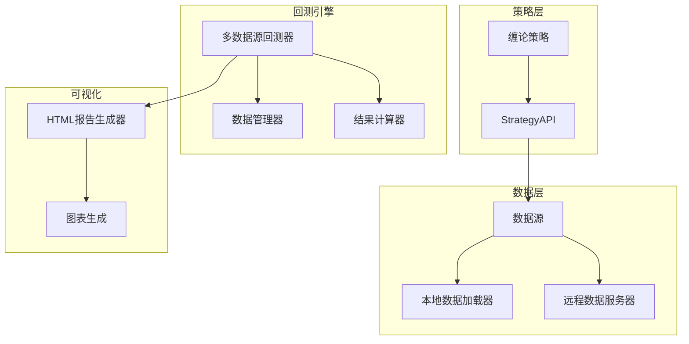

**图表来源**
- [strategy_api.py:1-941](file://ssquant/api/strategy_api.py#L1-L941)
- [backtest_core.py:1-767](file://ssquant/backtest/backtest_core.py#L1-L767)

## 项目结构

项目采用模块化设计，主要分为以下几个核心模块：

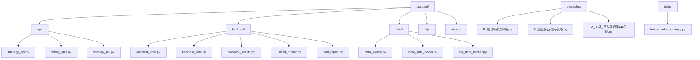

**图表来源**
- [README.md:351-366](file://README.md#L351-L366)

### 核心模块说明

- **api模块**：提供策略API接口，封装数据访问和交易操作
- **backtest模块**：实现多数据源回测引擎，支持参数优化
- **data模块**：处理数据源管理，支持本地和远程数据加载
- **examples模块**：包含完整的策略示例和工具脚本
- **tests模块**：提供单元测试和集成测试

**章节来源**
- [README.md:351-366](file://README.md#L351-L366)

## 核心组件

### StrategyAPI - 策略API接口

StrategyAPI是策略开发的核心接口，提供了统一的数据访问和交易操作方法：

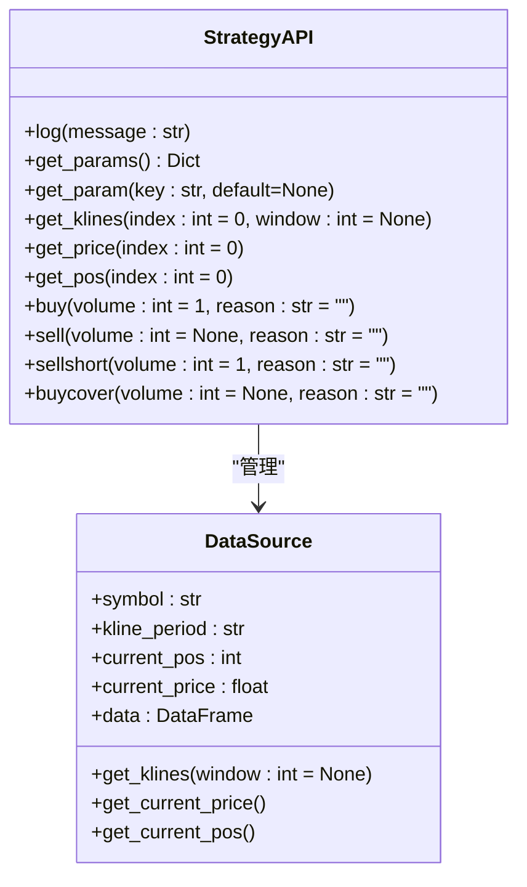

**图表来源**
- [strategy_api.py:5-941](file://ssquant/api/strategy_api.py#L5-L941)
- [data_source.py:34-1830](file://ssquant/data/data_source.py#L34-L1830)

### 多数据源回测器

MultiSourceBacktester支持多品种、多周期的回测，通过统一的接口管理不同的数据源：

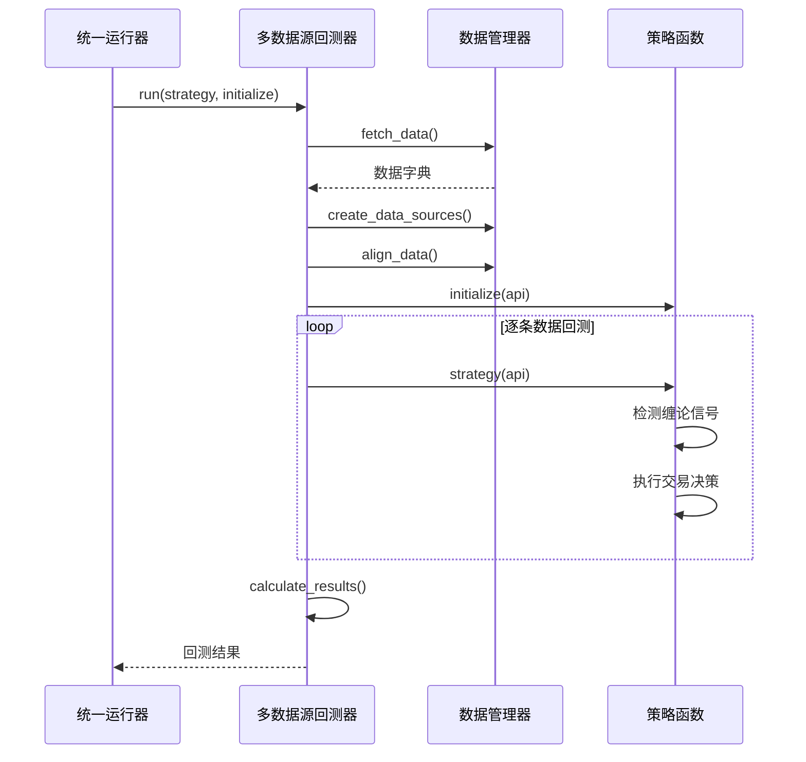

**图表来源**
- [unified_runner.py:26-566](file://ssquant/backtest/unified_runner.py#L26-L566)
- [backtest_core.py:14-767](file://ssquant/backtest/backtest_core.py#L14-L767)

**章节来源**
- [strategy_api.py:1-941](file://ssquant/api/strategy_api.py#L1-L941)
- [backtest_core.py:1-767](file://ssquant/backtest/backtest_core.py#L1-L767)

## 架构概览

### 数据流架构

缠论策略的数据流遵循严格的处理流程：

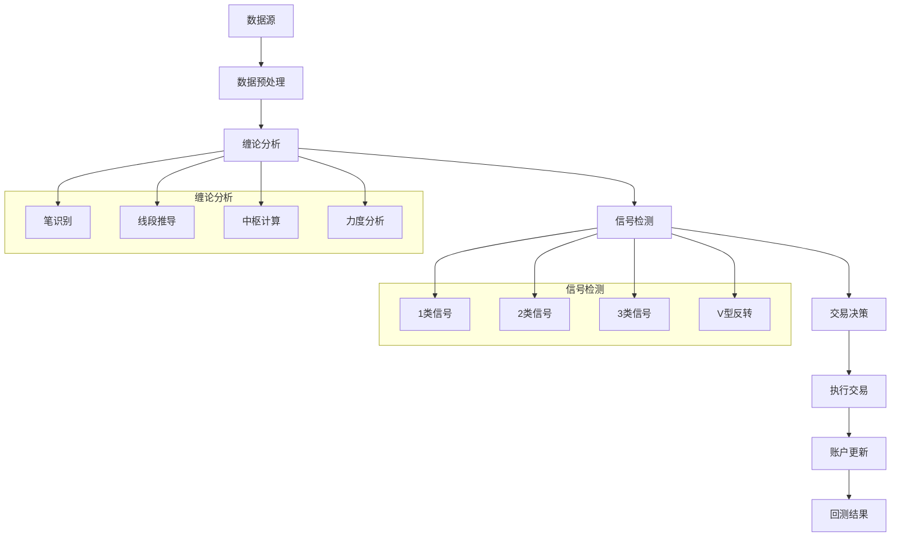

**图表来源**
- [B_缠论5分钟策略.py:558-800](file://examples/B_缠论5分钟策略.py#L558-L800)
- [B_缠论多空信号策略.py:720-800](file://examples/B_缠论多空信号策略.py#L720-L800)

### 策略执行流程

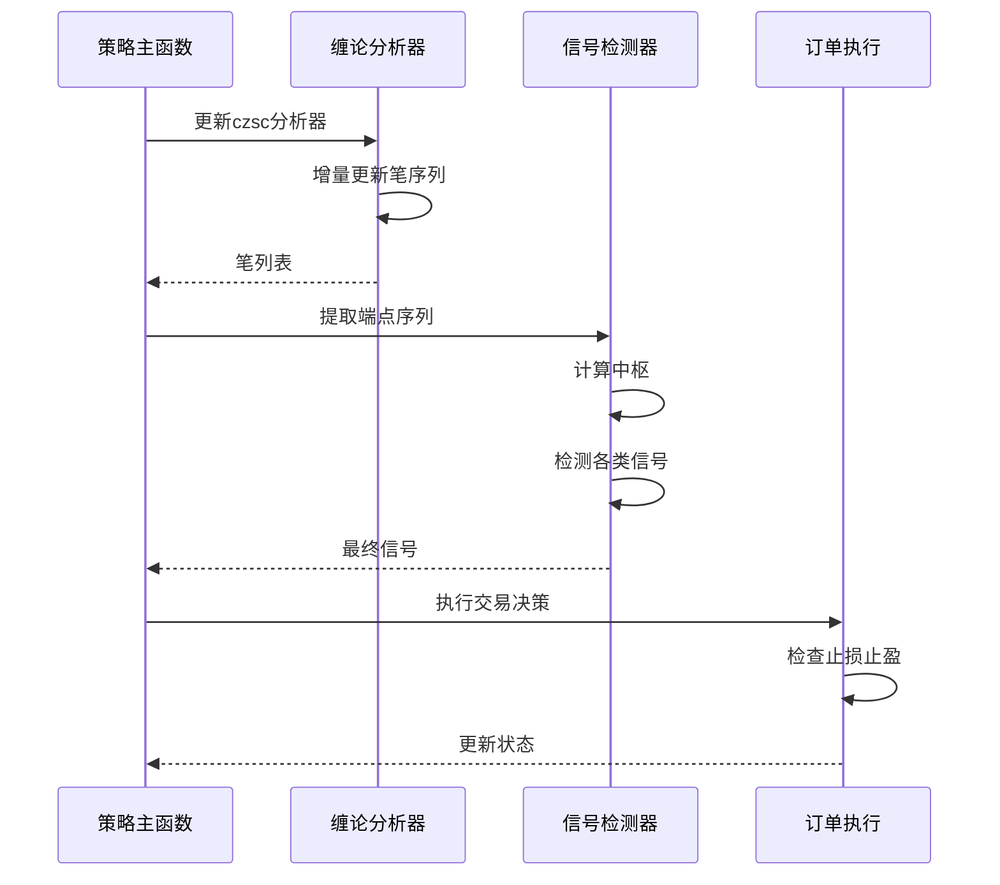

**图表来源**
- [B_缠论5分钟策略.py:591-799](file://examples/B_缠论5分钟策略.py#L591-L799)

## 详细组件分析

### 缠论信号检测系统

缠论策略实现了四种核心信号类型的检测机制：

#### 1类信号（趋势反转）

1类信号是最基础的趋势反转信号，基于笔序列的高低点识别：

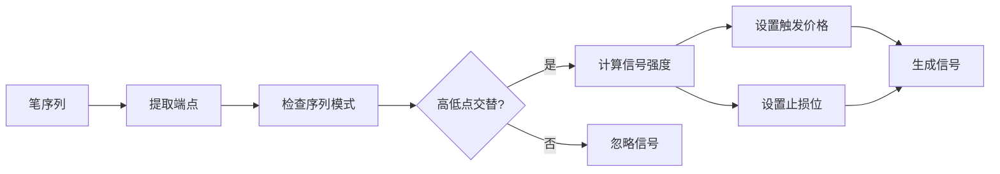

**图表来源**
- [B_缠论多空信号策略.py:322-404](file://examples/B_缠论多空信号策略.py#L322-L404)

#### 2类信号（强势延续）

2类信号检测强势延续的信号，基于相邻笔的力度比较：

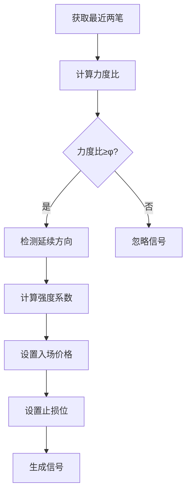

**图表来源**
- [B_缠论多空信号策略.py:407-471](file://examples/B_缠论多空信号策略.py#L407-L471)

#### 3类信号（强势确认）

3类信号检测强势确认信号，基于连续回调的支撑/阻力验证：

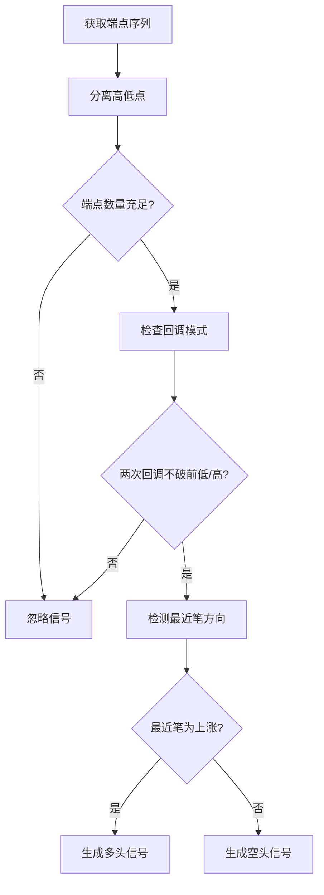

**图表来源**
- [B_缠论多空信号策略.py:474-548](file://examples/B_缠论多空信号策略.py#L474-L548)

#### 4类信号（V型反转）

4类信号检测V型反转信号，基于前一个1类信号的反向突破：

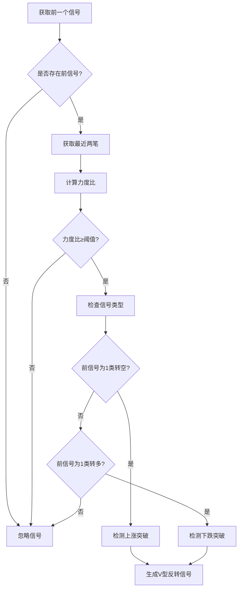

**图表来源**
- [B_缠论多空信号策略.py:551-619](file://examples/B_缠论多空信号策略.py#L551-L619)

### 数据加载与预处理

#### 本地数据加载器

本地数据加载器支持多种数据格式的自动识别和处理：

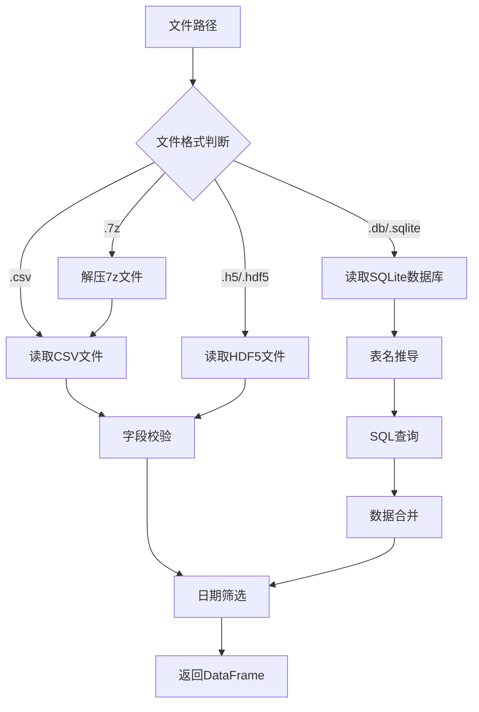

**图表来源**
- [local_data_loader.py:5-233](file://ssquant/data/local_data_loader.py#L5-L233)

#### 数据对齐与缓存

数据对齐机制确保多数据源的时间序列一致性：

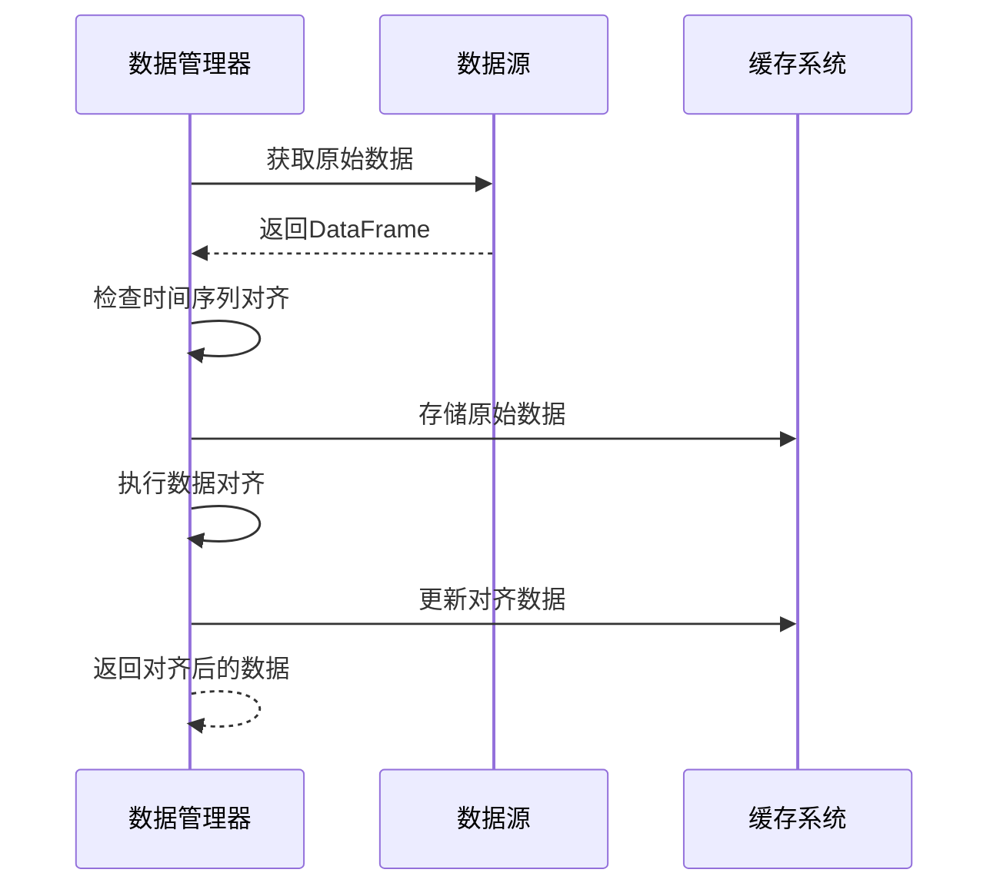

**图表来源**
- [backtest_core.py:199-203](file://ssquant/backtest/backtest_core.py#L199-L203)

**章节来源**
- [B_缠论5分钟策略.py:1-800](file://examples/B_缠论5分钟策略.py#L1-L800)
- [B_缠论多空信号策略.py:1-800](file://examples/B_缠论多空信号策略.py#L1-L800)
- [local_data_loader.py:1-233](file://ssquant/data/local_data_loader.py#L1-L233)

## 依赖关系分析

### 核心依赖关系

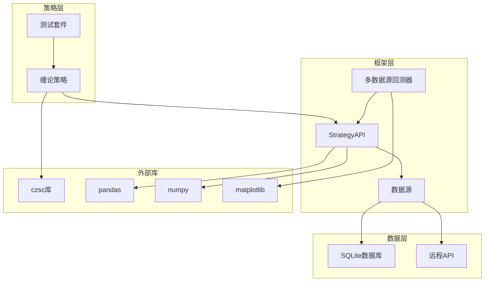

**图表来源**
- [requirements.txt:1-22](file://requirements.txt#L1-L22)
- [strategy_api.py:1-941](file://ssquant/api/strategy_api.py#L1-L941)

### 版本兼容性

| 组件 | 版本要求 | 用途 |
|------|----------|------|
| Python | 3.9 - 3.14 | 主要运行环境 |
| czsc | >=0.9.0 | 缠论分析引擎 |
| pandas | >=1.3.0 | 数据处理 |
| numpy | >=1.20.0 | 数值计算 |
| matplotlib | >=3.5.0 | 可视化 |
| plotly | >=5.18.0 | 交互式图表 |

**章节来源**
- [requirements.txt:1-22](file://requirements.txt#L1-L22)

## 性能考虑

### 回测性能优化

SSQuant框架实现了多层次的性能优化：

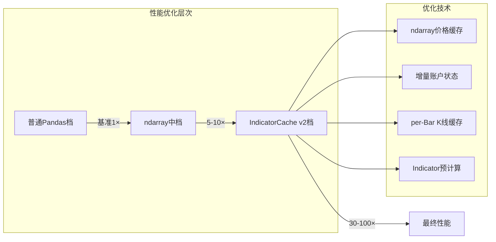

**图表来源**
- [README.md:24-48](file://README.md#L24-L48)

### 缠论分析性能

缠论分析的性能优化主要体现在以下几个方面：

1. **增量更新机制**：只对新增的K线进行分析，避免全量重算
2. **缓存策略**：缓存笔序列、端点、中枢等中间结果
3. **向量化计算**：使用pandas和numpy进行向量化操作
4. **内存管理**：合理控制数据结构大小，避免内存泄漏

**章节来源**
- [README.md:24-48](file://README.md#L24-L48)
- [B_缠论5分钟策略.py:591-621](file://examples/B_缠论5分钟策略.py#L591-L621)

## 故障排除指南

### 常见问题及解决方案

#### 1. czsc库未安装

**问题症状**：策略运行时报错，提示czsc库未安装

**解决方案**：
```bash
pip install czsc==0.9.51
```

#### 2. 数据库连接失败

**问题症状**：无法从SQLite数据库读取数据

**解决方案**：
1. 确认数据库文件路径正确
2. 检查表名格式是否符合约定
3. 验证数据库文件完整性

#### 3. 回测数据为空

**问题症状**：回测结果显示无数据

**解决方案**：
1. 检查数据源配置
2. 验证时间范围设置
3. 确认数据文件格式正确

#### 4. 策略参数调优

**问题症状**：策略在5分钟周期表现不佳

**解决方案**：
根据5分钟周期的特点调整参数：
- `min_bi_len`: 从7调整为5
- `signal_cooldown`: 从3调整为6
- `atr_stop_multiplier`: 从2.0调整为2.5

**章节来源**
- [ADR-001-缠论5分钟策略架构评估.md:123-136](file://docs/ADR-001-缠论5分钟策略架构评估.md#L123-L136)

### 调试技巧

1. **启用调试模式**：设置`debug=True`获取详细日志
2. **逐步验证**：分别测试数据加载、分析器、信号检测各环节
3. **参数敏感性分析**：单独调整关键参数观察效果变化
4. **可视化验证**：利用HTML报告检查分析结果的合理性

## 结论

SSQuant框架为缠论技术分析提供了完整的解决方案，具有以下优势：

### 技术优势

1. **专业性**：基于权威的czsc库，确保缠论分析的准确性
2. **高性能**：多档性能优化，支持大规模回测
3. **易用性**：统一的API接口，简化策略开发流程
4. **可视化**：自动生成HTML交互式报告，便于结果分析

### 应用价值

1. **策略开发**：提供完整的缠论策略开发环境
2. **回测验证**：支持多周期、多品种的回测验证
3. **参数优化**：内置参数优化功能，提高策略质量
4. **部署便利**：一套代码支持回测、仿真、实盘三模式

### 发展前景

随着量化交易市场的不断发展，缠论技术分析策略将在以下方面得到进一步发展：

1. **算法优化**：持续改进缠论分析算法的准确性和效率
2. **多因子融合**：与其他技术指标和基本面分析相结合
3. **机器学习**：引入机器学习方法提升信号预测能力
4. **实时应用**：优化实时交易环境下的性能表现

## 附录

### 策略参数配置

| 参数名称 | 默认值 | 说明 |
|----------|--------|------|
| min_bi_len | 5 | 笔的最小长度（5分钟周期） |
| golden_ratio | 1.618 | 黄金分割比例阈值 |
| atr_period | 14 | ATR计算周期 |
| atr_stop_multiplier | 2.5 | ATR止损倍数（5分钟周期） |
| signal_cooldown | 6 | 信号冷却期（5分钟周期） |
| base_volume | 1 | 基础交易手数 |
| use_structure_stop | True | 是否使用结构止损 |

### 数据格式规范

#### K线数据字段

| 字段名 | 必需 | 说明 |
|--------|------|------|
| datetime | 是 | 时间戳 |
| open | 是 | 开盘价 |
| high | 是 | 最高价 |
| low | 是 | 最低价 |
| close | 是 | 收盘价 |
| volume | 是 | 成交量 |

#### SQLite表命名约定

```
{symbol}_{period}_{adjust}
```

示例：
- `rb888_5m_hfq` - 螺纹钢5分钟周期后复权数据
- `au888_1h_raw` - 白银1小时周期不复权数据

### 参考文档

1. **缠论5分钟策略架构评估**：详细说明5分钟周期策略的实现路径
2. **缠论多空信号策略**：完整的15分钟周期策略实现
3. **测试套件**：提供策略核心逻辑的单元测试
4. **数据导入工具**：支持多种格式的数据导入SQLite数据库