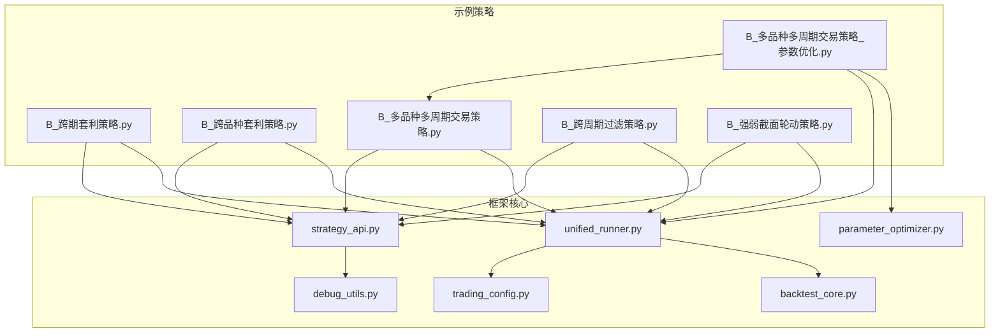
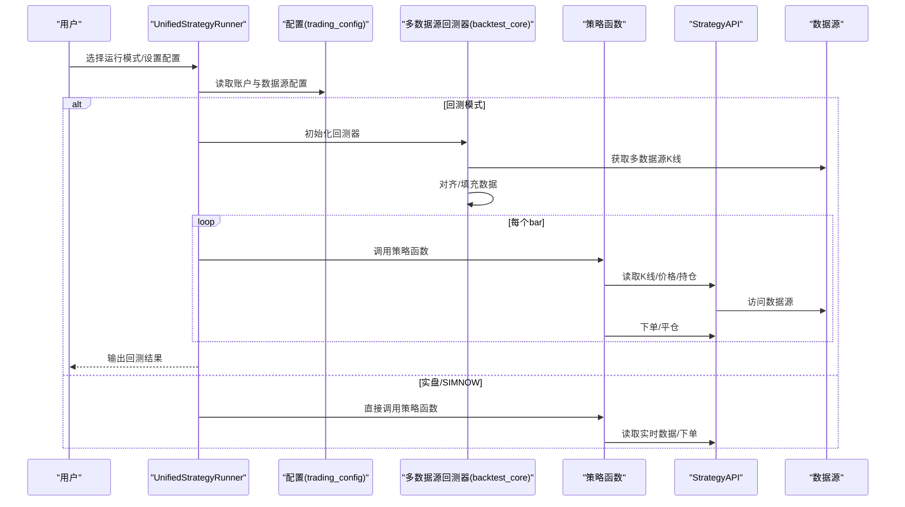
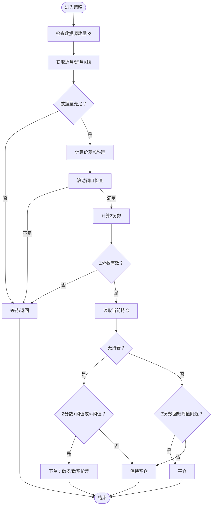
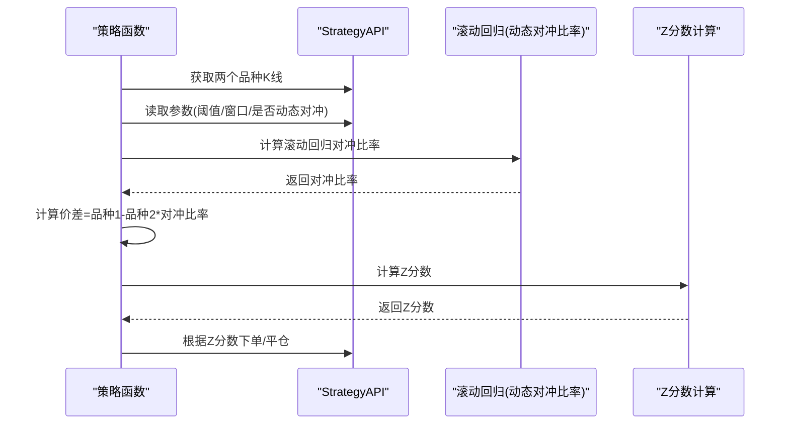
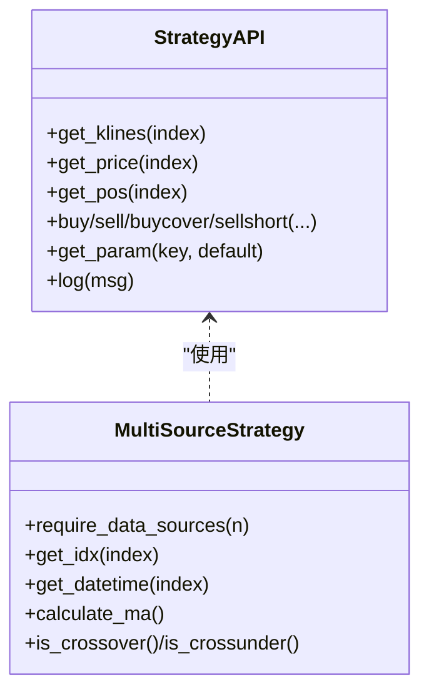
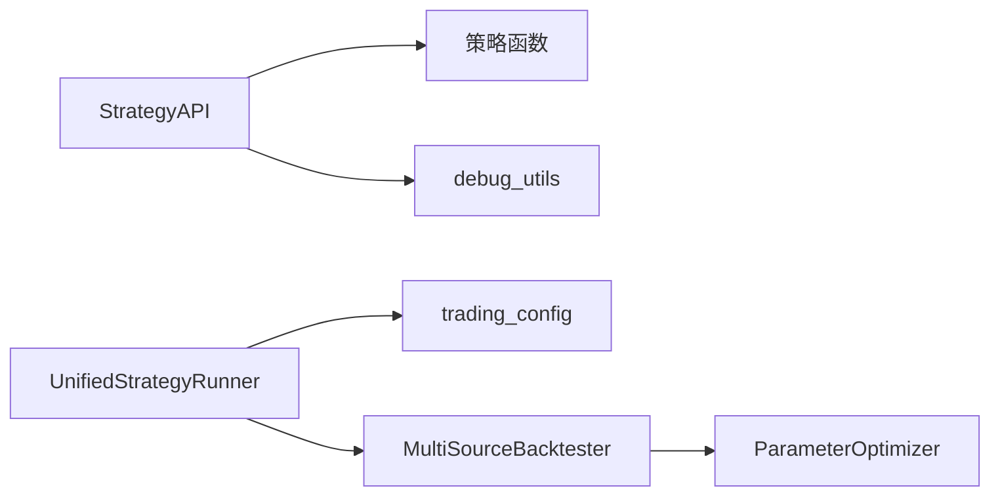

# 高级策略示例

<cite>
**本文引用的文件**
- [B_跨期套利策略.py](file://examples/B_跨期套利策略.py)
- [B_跨品种套利策略.py](file://examples/B_跨品种套利策略.py)
- [B_多品种多周期交易策略.py](file://examples/B_多品种多周期交易策略.py)
- [B_多品种多周期交易策略_参数优化.py](file://examples/B_多品种多周期交易策略_参数优化.py)
- [B_跨周期过滤策略.py](file://examples/B_跨周期过滤策略.py)
- [B_强弱截面轮动策略.py](file://examples/B_强弱截面轮动策略.py)
- [strategy_api.py](file://ssquant/api/strategy_api.py)
- [unified_runner.py](file://ssquant/backtest/unified_runner.py)
- [trading_config.py](file://ssquant/config/trading_config.py)
- [backtest_core.py](file://ssquant/backtest/backtest_core.py)
- [parameter_optimizer.py](file://ssquant/backtest/parameter_optimizer.py)
- [debug_utils.py](file://ssquant/api/debug_utils.py)
</cite>

## 目录
1. [简介](#简介)
2. [项目结构](#项目结构)
3. [核心组件](#核心组件)
4. [架构总览](#架构总览)
5. [详细组件分析](#详细组件分析)
6. [依赖关系分析](#依赖关系分析)
7. [性能考量](#性能考量)
8. [故障排除指南](#故障排除指南)
9. [结论](#结论)
10. [附录](#附录)

## 简介
本文件面向希望掌握复杂量化交易策略开发与应用的读者，围绕 SSQuant 的高级策略示例进行系统化技术文档整理。重点覆盖三类高级策略：
- 跨期套利策略：同品种不同合约月份间的价差均值回归交易
- 跨品种套利策略：不同品种间价差的统计套利，含动态对冲比率
- 多品种多周期交易策略：在同一策略内同时管理多个品种、多个周期的信号与仓位

文档将从系统架构、组件关系、数据流、处理逻辑、集成点、风险控制、收益最大化机制、调试与性能监控、故障排除以及实盘部署要点等方面进行全面阐述，并提供可视化图示帮助理解。

## 项目结构
SSQuant 采用“策略示例 + 框架层”的分层组织方式：
- examples 目录：提供多种策略示例，涵盖跨期/跨品种套利与多数据源多周期策略
- ssquant 目录：框架核心，包含策略API、回测/实盘运行器、配置、数据接口、指标与交易适配等

图表来源
- [B_跨期套利策略.py](file://examples/B_跨期套利策略.py#L1-L376)
- [B_跨品种套利策略.py](file://examples/B_跨品种套利策略.py#L1-L352)
- [B_多品种多周期交易策略.py](file://examples/B_多品种多周期交易策略.py#L1-L521)
- [B_多品种多周期交易策略_参数优化.py](file://examples/B_多品种多周期交易策略_参数优化.py#L1-L155)
- [B_跨周期过滤策略.py](file://examples/B_跨周期过滤策略.py#L1-L200)
- [B_强弱截面轮动策略.py](file://examples/B_强弱截面轮动策略.py#L1-L200)
- [strategy_api.py](file://ssquant/api/strategy_api.py#L1-L570)
- [unified_runner.py](file://ssquant/backtest/unified_runner.py#L1-L379)
- [trading_config.py](file://ssquant/config/trading_config.py#L1-L187)
- [backtest_core.py](file://ssquant/backtest/backtest_core.py#L1-L200)
- [parameter_optimizer.py](file://ssquant/backtest/parameter_optimizer.py#L1-L200)
- [debug_utils.py](file://ssquant/api/debug_utils.py#L1-L136)

章节来源
- [B_跨期套利策略.py](file://examples/B_跨期套利策略.py#L1-L376)
- [B_跨品种套利策略.py](file://examples/B_跨品种套利策略.py#L1-L352)
- [B_多品种多周期交易策略.py](file://examples/B_多品种多周期交易策略.py#L1-L521)
- [B_多品种多周期交易策略_参数优化.py](file://examples/B_多品种多周期交易策略_参数优化.py#L1-L155)
- [B_跨周期过滤策略.py](file://examples/B_跨周期过滤策略.py#L1-L200)
- [B_强弱截面轮动策略.py](file://examples/B_强弱截面轮动策略.py#L1-L200)
- [strategy_api.py](file://ssquant/api/strategy_api.py#L1-L570)
- [unified_runner.py](file://ssquant/backtest/unified_runner.py#L1-L379)
- [trading_config.py](file://ssquant/config/trading_config.py#L1-L187)
- [backtest_core.py](file://ssquant/backtest/backtest_core.py#L1-L200)
- [parameter_optimizer.py](file://ssquant/backtest/parameter_optimizer.py#L1-L200)
- [debug_utils.py](file://ssquant/api/debug_utils.py#L1-L136)

## 核心组件
- 策略API（StrategyAPI）：提供统一的数据访问、交易下单、日志与参数读取能力，屏蔽底层数据源差异
- 统一运行器（UnifiedStrategyRunner）：支持回测、SIMNOW模拟与实盘三种模式，统一对接策略与配置
- 配置系统（trading_config）：集中管理账户、数据源、历史数据预加载、复权类型等参数
- 多数据源回测器（MultiSourceBacktester）：支持多品种、多周期数据的获取、对齐与回测
- 参数优化器（ParameterOptimizer）：提供网格搜索、随机搜索、贝叶斯优化等优化方法
- 调试工具（debug_utils）：模块加载检查、路径诊断等辅助工具

章节来源
- [strategy_api.py](file://ssquant/api/strategy_api.py#L1-L570)
- [unified_runner.py](file://ssquant/backtest/unified_runner.py#L1-L379)
- [trading_config.py](file://ssquant/config/trading_config.py#L1-L187)
- [backtest_core.py](file://ssquant/backtest/backtest_core.py#L1-L200)
- [parameter_optimizer.py](file://ssquant/backtest/parameter_optimizer.py#L1-L200)
- [debug_utils.py](file://ssquant/api/debug_utils.py#L1-L136)

## 架构总览
SSQuant 的高级策略示例遵循“策略函数 + API + 运行器 + 配置”的解耦设计。策略函数通过 StrategyAPI 获取多数据源的K线、价格、持仓等信息，结合参数进行交易决策；UnifiedStrategyRunner 根据运行模式选择回测或实盘路径；trading_config 提供账户与数据源配置；MultiSourceBacktester 负责数据获取与对齐；参数优化器支持网格搜索等优化方法。

图表来源
- [unified_runner.py](file://ssquant/backtest/unified_runner.py#L1-L379)
- [trading_config.py](file://ssquant/config/trading_config.py#L1-L187)
- [backtest_core.py](file://ssquant/backtest/backtest_core.py#L1-L200)
- [strategy_api.py](file://ssquant/api/strategy_api.py#L1-L570)

## 详细组件分析

### 跨期套利策略
- 设计思路
  - 同一品种不同合约月份（近月 vs 远月）构建价差序列，利用价差均值回归特性进行交易
  - 通过滚动窗口计算价差均值与标准差，得到Z分数，以此作为开平仓信号
  - 对冲比率为1:1（同品种不同月份），降低跨期价差波动带来的系统性风险
- 实现要点
  - 价差计算：近月收盘价减去远月收盘价
  - Z分数计算：滚动均值与滚动标准差，避免除零
  - 交易逻辑：Z分数超过阈值做空价差（卖近月+买远月），低于负阈值做多价差（买近月+卖远月），回归至阈值附近平仓
  - 参数：最小样本数、开仓阈值、平仓阈值、滚动窗口、交易手数
- 风险控制与收益最大化
  - 严格设定阈值与滚动窗口，避免过拟合
  - 控制交易频率，减少滑点与手续费侵蚀
  - 使用“下一根K线开盘价”委托，降低冲击成本
- 适用场景与实盘部署
  - 适合具备较强流动性与复权一致性的连续合约
  - 实盘部署时注意历史数据源映射（近月用主力连续，远月用次主力连续）

图表来源
- [B_跨期套利策略.py](file://examples/B_跨期套利策略.py#L69-L173)

章节来源
- [B_跨期套利策略.py](file://examples/B_跨期套利策略.py#L1-L376)

### 跨品种套利策略
- 设计思路
  - 两个相关性强的品种（如焦炭与焦煤）构建价差，利用统计学方法（滚动回归）估计动态对冲比率
  - 通过Z分数判断价差偏离程度，进行配对交易
- 实现要点
  - 动态对冲比率：基于滚动窗口的OLS回归，斜率系数作为 hedge_ratio
  - 价差计算：p1 - p2 * hedge_ratio
  - 交易逻辑：Z分数显著偏离时做多/做空价差，回归阈值附近平仓
  - 参数：最小样本数、Z分数阈值、滚动窗口、对冲比率窗口、是否使用动态对冲比率
- 风险控制与收益最大化
  - 动态对冲比率可适应价比变化，提升稳定性
  - 通过滚动窗口与阈值控制交易频率，避免噪音交易
- 适用场景与实盘部署
  - 适用于存在产业链上下游关系的品种
  - 实盘中注意对冲比率的稳定性与更新频率

图表来源
- [B_跨品种套利策略.py](file://examples/B_跨品种套利策略.py#L105-L167)

章节来源
- [B_跨品种套利策略.py](file://examples/B_跨品种套利策略.py#L1-L352)

### 多品种多周期交易策略
- 设计思路
  - 在同一策略中同时管理多个数据源（多个品种、多个周期），每个数据源独立产生信号
  - 使用自定义指标（如移动平均线）而非API内置指标，增强可控性
  - 通过参数化均线周期，针对不同品种与周期设置差异化参数
- 实现要点
  - 自定义指标：移动平均线、金叉/死叉判断
  - 交易逻辑：每个数据源独立交易，5分钟与15分钟周期互不影响
  - 参数：快线周期、慢线周期
- 信号融合与仓位管理
  - 各数据源独立决策，避免相互干扰
  - 通过“下一根K线开盘价”委托，减少滑点与冲击
- 参数优化
  - 使用 MultiSourceBacktester 预加载数据，避免重复IO
  - ParameterOptimizer 提供网格搜索、并行加速与结果导出

图表来源
- [B_多品种多周期交易策略.py](file://examples/B_多品种多周期交易策略.py#L48-L260)
- [strategy_api.py](file://ssquant/api/strategy_api.py#L1-L570)

章节来源
- [B_多品种多周期交易策略.py](file://examples/B_多品种多周期交易策略.py#L1-L521)
- [B_多品种多周期交易策略_参数优化.py](file://examples/B_多品种多周期交易策略_参数优化.py#L1-L155)

### 跨周期过滤策略
- 设计思路
  - 长周期（如日线）判断趋势方向，短周期（如15分钟）寻找入场时机
  - 仅在大趋势方向上交易，过滤噪音信号
- 实现要点
  - 长周期与短周期均线交叉信号分别计算
  - 趋势过滤：长周期快线上穿/下穿慢线决定多/空趋势
  - 信号过滤：短周期金叉/死叉在趋势方向上才入场
- 适用场景
  - 适合震荡市或趋势市的过滤策略，降低逆势交易概率

章节来源
- [B_跨周期过滤策略.py](file://examples/B_跨周期过滤策略.py#L1-L200)

### 强弱截面轮动策略
- 设计思路
  - 计算多个品种的相对强弱指标（如N周期回报率），按强弱排序
  - 选择最强品种做多，最弱品种做空，定期再平衡
- 实现要点
  - 相对强弱指标：N周期回报率
  - 排名与调仓：每N个bar重新评估并调整目标仓位
- 适用场景
  - 多品种截面轮动，适合多资产轮动与风格切换

章节来源
- [B_强弱截面轮动策略.py](file://examples/B_强弱截面轮动策略.py#L1-L200)

## 依赖关系分析
- 策略与API
  - 所有策略示例均依赖 StrategyAPI 进行数据访问与下单
- 运行器与配置
  - UnifiedStrategyRunner 依据运行模式读取 trading_config，构造回测或实盘路径
- 回测与优化
  - MultiSourceBacktester 负责多数据源获取与对齐
  - ParameterOptimizer 提供参数优化方法与并行加速
- 调试与诊断
  - debug_utils 提供模块加载检查与路径诊断

图表来源
- [strategy_api.py](file://ssquant/api/strategy_api.py#L1-L570)
- [unified_runner.py](file://ssquant/backtest/unified_runner.py#L1-L379)
- [trading_config.py](file://ssquant/config/trading_config.py#L1-L187)
- [backtest_core.py](file://ssquant/backtest/backtest_core.py#L1-L200)
- [parameter_optimizer.py](file://ssquant/backtest/parameter_optimizer.py#L1-L200)
- [debug_utils.py](file://ssquant/api/debug_utils.py#L1-L136)

章节来源
- [strategy_api.py](file://ssquant/api/strategy_api.py#L1-L570)
- [unified_runner.py](file://ssquant/backtest/unified_runner.py#L1-L379)
- [trading_config.py](file://ssquant/config/trading_config.py#L1-L187)
- [backtest_core.py](file://ssquant/backtest/backtest_core.py#L1-L200)
- [parameter_optimizer.py](file://ssquant/backtest/parameter_optimizer.py#L1-L200)
- [debug_utils.py](file://ssquant/api/debug_utils.py#L1-L136)

## 性能考量
- 数据预加载与对齐
  - MultiSourceBacktester 支持预加载与对齐，减少重复IO与缺失数据导致的回测偏差
- 并行优化
  - ParameterOptimizer 使用 joblib 并行计算，显著缩短网格搜索耗时
- 滑点与手续费
  - 建议使用“下一根K线开盘价”委托，降低滑点与冲击成本
- 参数敏感性
  - 对滚动窗口、阈值等参数进行稳健性检验，避免过拟合

[本节为通用指导，无需特定文件引用]

## 故障排除指南
- 模块加载问题
  - 使用 debug_utils 的模块检查函数定位缺失模块与路径问题
- 数据源不足
  - 策略函数应使用 require_data_sources 检查数据源数量
- 参数异常
  - 使用 get_param 提供默认值，避免因参数缺失导致异常
- 回测与实盘差异
  - 检查复权类型、滑点、手续费与下单方式的一致性
- Windows并行限制
  - 参数优化时注意 WaitForMultipleObjects 句柄上限，合理设置并行进程数

章节来源
- [debug_utils.py](file://ssquant/api/debug_utils.py#L1-L136)
- [strategy_api.py](file://ssquant/api/strategy_api.py#L1-L570)
- [B_多品种多周期交易策略_参数优化.py](file://examples/B_多品种多周期交易策略_参数优化.py#L1-L155)

## 结论
SSQuant 的高级策略示例展示了如何在统一框架下实现跨期、跨品种与多数据源多周期的复杂交易策略。通过 StrategyAPI 的抽象、UnifiedStrategyRunner 的统一运行模式、MultiSourceBacktester 的数据对齐与 ParameterOptimizer 的参数优化，开发者可以快速搭建、验证并迭代复杂策略。配合严格的风险控制与调试手段，能够在回测与实盘之间建立稳健的桥梁。

[本节为总结，无需特定文件引用]

## 附录
- 适用场景与市场条件
  - 跨期套利：适合流动性良好、复权一致的连续合约
  - 跨品种套利：适合存在产业链关系的强相关品种
  - 多数据源多周期：适合追求多信号融合与差异化参数的策略
- 实盘部署要点
  - 明确历史数据源映射（如近月用主力连续、远月用次主力连续）
  - 配置账户参数（下单偏移、超时、重试等）
  - 使用预加载与对齐，确保数据一致性
  - 严格风控与参数校准，避免过度拟合

[本节为通用指导，无需特定文件引用]