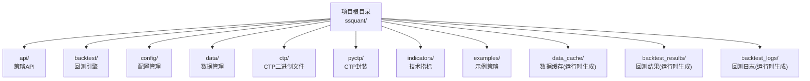
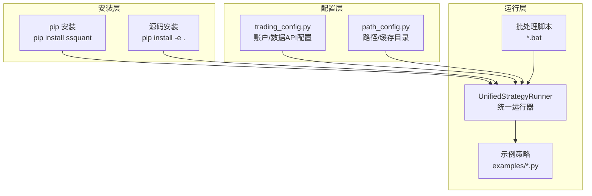
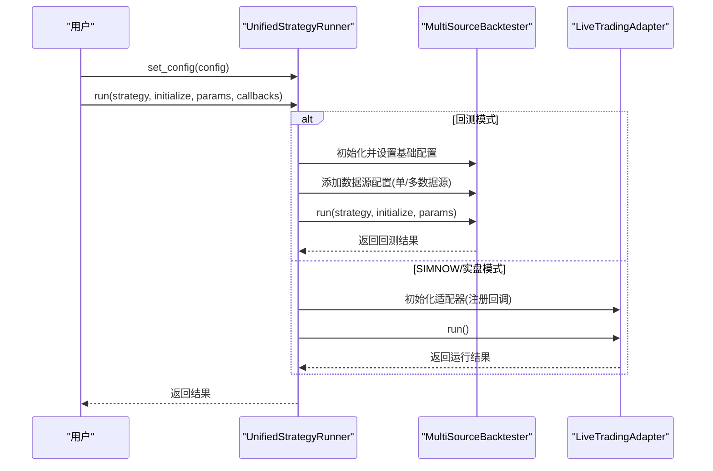
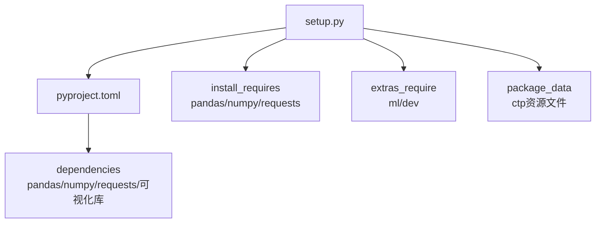

# 安装部署

<cite>
**本文引用的文件**
- [README.md](file://README.md)
- [用户手册.md](file://用户手册.md)
- [setup.py](file://setup.py)
- [pyproject.toml](file://pyproject.toml)
- [requirements.txt](file://requirements.txt)
- [ssquant/__init__.py](file://ssquant/__init__.py)
- [ssquant/config/trading_config.py](file://ssquant/config/trading_config.py)
- [ssquant/config/path_config.py](file://ssquant/config/path_config.py)
- [ssquant/backtest/unified_runner.py](file://ssquant/backtest/unified_runner.py)
- [setup_and_run.bat](file://setup_and_run.bat)
- [运行_缠论5分钟回测.bat](file://运行_缠论5分钟回测.bat)
- [examples/B_双均线策略.py](file://examples/B_双均线策略.py)
- [examples/B_缠论5分钟策略.py](file://examples/B_缠论5分钟策略.py)
</cite>

## 目录
1. [简介](#简介)
2. [项目结构](#项目结构)
3. [核心组件](#核心组件)
4. [架构总览](#架构总览)
5. [详细组件分析](#详细组件分析)
6. [依赖关系分析](#依赖关系分析)
7. [性能考虑](#性能考虑)
8. [故障排查指南](#故障排查指南)
9. [结论](#结论)
10. [附录](#附录)

## 简介
本指南面向首次接触 SSQuant 的用户，提供从源码安装、pip 安装到直接运行的全流程部署说明，涵盖配置选项、路径设置、权限要求、批处理脚本使用、安装验证、功能测试与环境确认，以及部署后的初始化步骤与首次运行验证。目标是帮助你在 Windows 环境下顺利完成 SSQuant 的安装与初始部署。

## 项目结构
SSQuant 采用“包 + 示例 + 配置”的组织方式，核心模块位于 ssquant 包内，示例策略位于 examples 目录，配置集中在 config 子模块，回测与实盘运行通过统一运行器对接。

图表来源
- [用户手册.md](file://用户手册.md#L70-L85)

章节来源
- [用户手册.md](file://用户手册.md#L70-L85)

## 核心组件
- 统一运行器：负责在回测、SIMNOW 模拟与实盘之间切换，屏蔽底层差异，统一策略执行接口。
- 配置管理：集中管理账户、数据 API、路径等配置，并提供 get_config 工厂函数生成运行所需配置。
- 批处理脚本：提供一键运行示例策略的便捷入口，便于快速验证环境与功能。
- 示例策略：包含多种策略模板，便于学习与二次开发。

章节来源
- [ssquant/backtest/unified_runner.py](file://ssquant/backtest/unified_runner.py#L26-L61)
- [ssquant/config/trading_config.py](file://ssquant/config/trading_config.py#L115-L164)
- [ssquant/config/path_config.py](file://ssquant/config/path_config.py#L10-L30)

## 架构总览
SSQuant 的安装与运行涉及三个层面：
- 安装层：pip 安装或源码安装，生成可导入的 ssquant 包。
- 配置层：账户、数据 API、路径等配置，决定运行模式与数据来源。
- 运行层：通过统一运行器在回测、SIMNOW、实盘之间切换，执行策略并输出结果。

图表来源
- [setup.py](file://setup.py#L28-L108)
- [pyproject.toml](file://pyproject.toml#L5-L70)
- [ssquant/config/trading_config.py](file://ssquant/config/trading_config.py#L115-L164)
- [ssquant/config/path_config.py](file://ssquant/config/path_config.py#L10-L30)
- [ssquant/backtest/unified_runner.py](file://ssquant/backtest/unified_runner.py#L26-L61)

## 详细组件分析

### 安装方式与环境准备
- 系统要求
  - 操作系统：Windows 10+（CTP 仅支持 Windows）
  - Python 版本：3.9 ~ 3.14
  - 内存：4GB+
- 安装方式
  - pip 安装（推荐）：pip install ssquant
  - 源码安装：pip install -e .
- 依赖管理
  - requirements.txt 与 setup.py/pyproject.toml 中声明的核心依赖与可选依赖，确保运行回测与可视化功能正常。
- CTP 支持
  - 框架内置 CTP 二进制文件，按 Python 版本分目录存放，安装后会尝试加载对应版本的 CTP 组件。

章节来源
- [README.md](file://README.md#L43-L51)
- [README.md](file://README.md#L56-L88)
- [setup.py](file://setup.py#L16-L26)
- [pyproject.toml](file://pyproject.toml#L32-L40)
- [ssquant/__init__.py](file://ssquant/__init__.py#L9-L17)

### 配置选项与路径设置
- 账户配置
  - 数据 API 认证：API_USERNAME/API_PASSWORD，用于自动获取历史数据。
  - SIMNOW/实盘账户：在 ACCOUNTS 中定义，包括 investor_id/password、服务器地址、AppID/授权码等。
- 运行配置
  - get_config 提供统一工厂，支持回测、SIMNOW、实盘三种模式的参数注入。
  - 支持单数据源与多数据源配置，回测模式支持本地文件/数据库表直连。
- 路径配置
  - data_cache、backtest_results、backtest_logs 等目录由 path_config 统一管理，避免硬编码。

章节来源
- [ssquant/config/trading_config.py](file://ssquant/config/trading_config.py#L10-L186)
- [ssquant/config/trading_config.py](file://ssquant/config/trading_config.py#L115-L164)
- [ssquant/config/path_config.py](file://ssquant/config/path_config.py#L10-L30)

### 批处理脚本使用
- setup_and_run.bat
  - 作用：在 Windows 下以 UTF-8 编码运行示例策略，输出 run.log 并显示日志尾部。
  - 适用：快速验证安装与运行环境。
- 运行_缠论5分钟回测.bat
  - 作用：运行缠论5分钟策略示例，展示回测结果输出位置（backtest_results）。
  - 输出：生成缠论分析图与信号清单/JSON文件。

章节来源
- [setup_and_run.bat](file://setup_and_run.bat#L1-L12)
- [运行_缠论5分钟回测.bat](file://运行_缠论5分钟回测.bat#L1-L17)

### 安装验证与功能测试
- 导入验证
  - 通过 python -c "from ssquant.api.strategy_api import StrategyAPI; print('ssquant 导入成功!')" 验证安装。
- 环境确认
  - 检查 Python 版本是否在 3.9 ~ 3.14 范围内。
  - 确认 CTP 可用性（若 Python 版本不匹配，会提示 CTP 功能受限）。
- 示例运行
  - 运行 examples/B_双均线策略.py 或运行_缠论5分钟回测.bat，观察回测结果与日志输出。

章节来源
- [README.md](file://README.md#L116-L119)
- [ssquant/__init__.py](file://ssquant/__init__.py#L9-L17)
- [examples/B_双均线策略.py](file://examples/B_双均线策略.py#L134-L268)

### 部署后的初始化步骤
- 配置数据 API
  - 在 trading_config.py 中填写 API_USERNAME/API_PASSWORD，以便自动拉取历史数据。
- 配置账户
  - 在 ACCOUNTS 中添加 SIMNOW/实盘账户信息，确保 broker_id、md_server、td_server、app_id、auth_code 等参数齐全。
- 路径与缓存
  - 确认 data_cache、backtest_results、backtest_logs 目录存在或可创建。
- 首次运行验证
  - 使用回测模式运行示例策略，检查回测报告与日志。
  - 若使用 SIMNOW/实盘，先在本地回测验证策略逻辑，再逐步迁移至模拟/实盘。

章节来源
- [ssquant/config/trading_config.py](file://ssquant/config/trading_config.py#L10-L186)
- [ssquant/config/path_config.py](file://ssquant/config/path_config.py#L20-L30)
- [用户手册.md](file://用户手册.md#L153-L242)

### 统一运行器工作流
统一运行器根据运行模式选择不同的执行路径：回测模式使用 MultiSourceBacktester，SIMNOW/实盘模式使用 LiveTradingAdapter。其职责包括配置校验、策略执行、回调注册与结果返回。

图表来源
- [ssquant/backtest/unified_runner.py](file://ssquant/backtest/unified_runner.py#L79-L214)
- [ssquant/backtest/unified_runner.py](file://ssquant/backtest/unified_runner.py#L215-L372)

## 依赖关系分析
- 安装依赖
  - setup.py 与 pyproject.toml 声明了核心依赖（pandas、numpy、requests 等）与可选依赖（matplotlib、scipy、Pillow、akshare 等）。
  - package_data 中包含 CTP 二进制文件与资源文件，确保安装后可直接使用。
- 运行依赖
  - Python 版本限制：>=3.9,<3.15
  - 操作系统：仅 Windows（CTP 限制）

图表来源
- [setup.py](file://setup.py#L16-L54)
- [pyproject.toml](file://pyproject.toml#L32-L52)

章节来源
- [setup.py](file://setup.py#L16-L54)
- [pyproject.toml](file://pyproject.toml#L32-L52)

## 性能考虑
- 回测性能
  - 合理设置回测周期与数据量，避免过长的历史回测导致内存压力。
  - 使用 use_cache/save_data 控制数据缓存与保存，平衡性能与持久化需求。
- 实盘/模拟性能
  - 适当设置 order_offset_ticks 与 retry_limit，平衡成交概率与成本。
  - 在启用 TICK 回调时，注意回调频率对性能的影响。

## 故障排查指南
- ModuleNotFoundError: No module named 'ssquant'
  - 确认已安装或重新安装（pip install ssquant 或 pip install -e .）。
  - 使用 pip list | findstr ssquant 检查是否已安装。
- CTP 功能受限
  - 当 Python 版本不在内置 CTP 支持范围内时，会提示 CTP 功能不可用，回测可用，实盘受限。
- SIMNOW/实盘连接失败
  - 检查服务器名称、账号密码、网络连通性；必要时更换服务器或在工作日测试。
- 回测结果异常
  - 检查 symbol、日期范围、复权类型、滑点设置等参数是否合理。

章节来源
- [README.md](file://README.md#L90-L119)
- [ssquant/__init__.py](file://ssquant/__init__.py#L14-L17)
- [用户手册.md](file://用户手册.md#L587-L624)

## 结论
通过本指南，你可以完成 SSQuant 的安装与部署：选择合适的安装方式、配置账户与数据 API、准备路径与缓存、使用批处理脚本快速验证，并在回测、SIMNOW、实盘之间无缝切换。建议先以回测验证策略逻辑，再逐步过渡到模拟与实盘，确保策略稳健后再正式运行。

## 附录
- 常用命令
  - pip install ssquant
  - pip install -e .
  - python -c "from ssquant.api.strategy_api import StrategyAPI; print('ssquant 导入成功!')"
- 示例策略
  - examples/B_双均线策略.py
  - examples/B_缠论5分钟策略.py
- 批处理脚本
  - setup_and_run.bat
  - 运行_缠论5分钟回测.bat